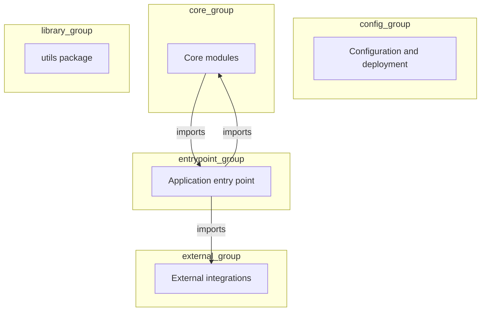

# Architecture report: The-Pocket/PocketFlow-Tutorial-Codebase-Knowledge

> Automated static analysis. **Observed** = directly seen in files/imports/AST; **Inferred** = interpretation from that evidence. Repository code was not executed.

## 1. Repository at a glance

| Item | Value |
| --- | --- |
| Repository | The-Pocket/PocketFlow-Tutorial-Codebase-Knowledge |
| Description | Pocket Flow: Codebase to Tutorial |
| Language | Python |
| Stars | 12759 |
| Licence | MIT |
| Analysed commit / branch | 05b24cbbb0fe409c5e23c9791f0342f07524ffdc / main |
| Framework(s) | None detected |
| Files analysed | 204 |
| Components | 5 |

## 2. Architecture in one minute

The-Pocket/PocketFlow-Tutorial-Codebase-Knowledge - Pocket Flow: Codebase to Tutorial. This repository was analysed statically from 204 file(s) (7 Python). Detected technologies (observed from imports/manifests): requests, Docker. Files are grouped into 5 component(s): Configuration and deployment, Core modules, Application entry point, External integrations, utils package. Observed entry point(s): main.py, utils/call_llm.py, utils/crawl_github_files.py. Findings below distinguish observed facts from inferred interpretation.

## 3. High-level block diagram

## 4. Main components

### Configuration and deployment (`config`)

- **Kind:** config
- **Status:** Observed
- **Confidence:** 0.85
- **Responsibility:** Groups 2 file(s) under configuration and deployment (observed from repository paths and static analysis).
- **Paths:** `Dockerfile`, `requirements.txt`
- **Evidence:** [Dockerfile](https://github.com/The-Pocket/PocketFlow-Tutorial-Codebase-Knowledge/blob/05b24cbbb0fe409c5e23c9791f0342f07524ffdc/Dockerfile); [requirements.txt](https://github.com/The-Pocket/PocketFlow-Tutorial-Codebase-Knowledge/blob/05b24cbbb0fe409c5e23c9791f0342f07524ffdc/requirements.txt)

### Core modules (`core`)

- **Kind:** core
- **Status:** Observed
- **Confidence:** 0.85
- **Responsibility:** Groups 2 file(s) under core modules (observed from repository paths and static analysis). Observed top-level classes: AnalyzeRelationships, CombineTutorial, FetchRepo, IdentifyAbstractions, OrderChapters, WriteChapters. Observed top-level functions: create_tutorial_flow, get_content_for_indices.
- **Paths:** `flow.py`, `nodes.py`
- **Evidence:** [flow.py:12](https://github.com/The-Pocket/PocketFlow-Tutorial-Codebase-Knowledge/blob/05b24cbbb0fe409c5e23c9791f0342f07524ffdc/flow.py#L12); [nodes.py:11](https://github.com/The-Pocket/PocketFlow-Tutorial-Codebase-Knowledge/blob/05b24cbbb0fe409c5e23c9791f0342f07524ffdc/nodes.py#L11)

### Application entry point (`entrypoint`)

- **Kind:** entrypoint
- **Status:** Observed
- **Confidence:** 0.85
- **Responsibility:** Groups 4 file(s) under application entry point (observed from repository paths and static analysis). Observed top-level functions: _call_llm_gemini, _call_llm_provider, call_llm, crawl_github_files, crawl_local_files, get_llm_provider.
- **Paths:** `main.py`, `utils/call_llm.py`, `utils/crawl_github_files.py`, `utils/crawl_local_files.py`
- **Evidence:** [main.py:39](https://github.com/The-Pocket/PocketFlow-Tutorial-Codebase-Knowledge/blob/05b24cbbb0fe409c5e23c9791f0342f07524ffdc/main.py#L39); [utils/call_llm.py:29](https://github.com/The-Pocket/PocketFlow-Tutorial-Codebase-Knowledge/blob/05b24cbbb0fe409c5e23c9791f0342f07524ffdc/utils/call_llm.py#L29); [utils/crawl_github_files.py:11](https://github.com/The-Pocket/PocketFlow-Tutorial-Codebase-Knowledge/blob/05b24cbbb0fe409c5e23c9791f0342f07524ffdc/utils/crawl_github_files.py#L11); [utils/crawl_local_files.py:6](https://github.com/The-Pocket/PocketFlow-Tutorial-Codebase-Knowledge/blob/05b24cbbb0fe409c5e23c9791f0342f07524ffdc/utils/crawl_local_files.py#L6)

### External integrations (`external_integrations`)

- **Kind:** external
- **Status:** Inferred
- **Confidence:** 0.70
- **Responsibility:** Groups 0 file(s) under external integrations (observed from repository paths and static analysis).
- **Evidence:** [utils/call_llm.py:5](https://github.com/The-Pocket/PocketFlow-Tutorial-Codebase-Knowledge/blob/05b24cbbb0fe409c5e23c9791f0342f07524ffdc/utils/call_llm.py#L5); [utils/crawl_github_files.py:1](https://github.com/The-Pocket/PocketFlow-Tutorial-Codebase-Knowledge/blob/05b24cbbb0fe409c5e23c9791f0342f07524ffdc/utils/crawl_github_files.py#L1)

### utils package (`utils`)

- **Kind:** library
- **Status:** Observed
- **Confidence:** 0.85
- **Responsibility:** Groups 1 file(s) under utils package (observed from repository paths and static analysis).
- **Paths:** `utils/__init__.py`
- **Evidence:** [utils/__init__.py](https://github.com/The-Pocket/PocketFlow-Tutorial-Codebase-Knowledge/blob/05b24cbbb0fe409c5e23c9791f0342f07524ffdc/utils/__init__.py)

## 5. Execution flow

**Observed** entry point(s):

- [main.py:110](https://github.com/The-Pocket/PocketFlow-Tutorial-Codebase-Knowledge/blob/05b24cbbb0fe409c5e23c9791f0342f07524ffdc/main.py#L110)
- [utils/call_llm.py:179](https://github.com/The-Pocket/PocketFlow-Tutorial-Codebase-Knowledge/blob/05b24cbbb0fe409c5e23c9791f0342f07524ffdc/utils/call_llm.py#L179)
- [utils/crawl_github_files.py:346](https://github.com/The-Pocket/PocketFlow-Tutorial-Codebase-Knowledge/blob/05b24cbbb0fe409c5e23c9791f0342f07524ffdc/utils/crawl_github_files.py#L346)
- [utils/crawl_local_files.py:132](https://github.com/The-Pocket/PocketFlow-Tutorial-Codebase-Knowledge/blob/05b24cbbb0fe409c5e23c9791f0342f07524ffdc/utils/crawl_local_files.py#L132)

Representative flow (derived from observed entry points and the import graph; steps beyond the entry point are **Inferred**):

1. Execution starts at an observed entry point listed above, if present.
2. `core` imports `entrypoint` (Core modules -> Application entry point).
3. `entrypoint` imports `core` (Application entry point -> Core modules).
4. `entrypoint` imports `external_integrations` (Application entry point -> External integrations).

## 6. Project structure

### `(root)`

- `.clinerules` - other (57457 bytes)
- `.cursorrules` - other (57457 bytes)
- `.dockerignore` - container (329 bytes)
- `.env.sample` - config (177 bytes)
- `.gitignore` - other (1032 bytes)
- `.windsurfrules` - other (57457 bytes)
- `Dockerfile` - container (281 bytes)
- `LICENSE` - docs (1070 bytes)
- `README.md` - docs (9510 bytes)
- `flow.py` - source, Python (1074 bytes)
- `main.py` - source, Python (4528 bytes)
- `nodes.py` - source, Python (41523 bytes)
- `requirements.txt` - manifest (154 bytes)

### `docs`

- `docs/AutoGen Core/01_agent.md` - docs (12629 bytes)
- `docs/AutoGen Core/02_messaging_system__topic___subscription_.md` - docs (14256 bytes)
- `docs/AutoGen Core/03_agentruntime.md` - docs (19023 bytes)
- `docs/AutoGen Core/04_tool.md` - docs (15588 bytes)
- `docs/AutoGen Core/05_chatcompletionclient.md` - docs (15837 bytes)
- `docs/AutoGen Core/06_chatcompletioncontext.md` - docs (15766 bytes)
- `docs/AutoGen Core/07_memory.md` - docs (15567 bytes)
- `docs/AutoGen Core/08_component.md` - docs (17669 bytes)
- `docs/AutoGen Core/index.md` - docs (1677 bytes)
- `docs/Browser Use/01_agent.md` - docs (13824 bytes)
- `docs/Browser Use/02_system_prompt.md` - docs (12475 bytes)
- `docs/Browser Use/03_browsercontext.md` - docs (15656 bytes)
- `docs/Browser Use/04_dom_representation.md` - docs (17639 bytes)
- `docs/Browser Use/05_action_controller___registry.md` - docs (18959 bytes)
- `docs/Browser Use/06_message_manager.md` - docs (20481 bytes)
- `docs/Browser Use/07_data_structures__views_.md` - docs (13543 bytes)
- `docs/Browser Use/08_telemetry_service.md` - docs (14274 bytes)
- `docs/Browser Use/index.md` - docs (1877 bytes)
- `docs/Celery/01_celery_app.md` - docs (13896 bytes)
- `docs/Celery/02_configuration.md` - docs (12693 bytes)
- `docs/Celery/03_task.md` - docs (14392 bytes)
- `docs/Celery/04_broker_connection__amqp_.md` - docs (10895 bytes)
- `docs/Celery/05_worker.md` - docs (14663 bytes)
- `docs/Celery/06_result_backend.md` - docs (17212 bytes)
- `docs/Celery/07_beat__scheduler_.md` - docs (16406 bytes)
- `docs/Celery/08_canvas__signatures___primitives_.md` - docs (18115 bytes)
- `docs/Celery/09_events.md` - docs (16064 bytes)
- `docs/Celery/10_bootsteps.md` - docs (13689 bytes)
- `docs/Celery/index.md` - docs (1764 bytes)
- `docs/Click/01_command___group.md` - docs (9208 bytes)
- `docs/Click/02_decorators.md` - docs (12642 bytes)
- `docs/Click/03_parameter__option___argument_.md` - docs (13473 bytes)
- `docs/Click/04_paramtype.md` - docs (12291 bytes)
- `docs/Click/05_context.md` - docs (14136 bytes)
- `docs/Click/06_term_ui__terminal_user_interface_.md` - docs (12547 bytes)
- `docs/Click/07_click_exceptions.md` - docs (13892 bytes)
- `docs/Click/index.md` - docs (1437 bytes)
- `docs/Codex/01_terminal_ui__ink_components_.md` - docs (15557 bytes)
- `docs/Codex/02_input_handling__textbuffer_editor_.md` - docs (18412 bytes)
- `docs/Codex/03_agent_loop.md` - docs (18156 bytes)
- `docs/Codex/04_approval_policy___security.md` - docs (13914 bytes)
- `docs/Codex/05_response___tool_call_handling.md` - docs (17270 bytes)
- `docs/Codex/06_command_execution___sandboxing.md` - docs (18177 bytes)
- `docs/Codex/07_configuration_management.md` - docs (14366 bytes)
- `docs/Codex/08_single_pass_mode.md` - docs (17593 bytes)
- `docs/Codex/index.md` - docs (1531 bytes)
- `docs/Crawl4AI/01_asynccrawlerstrategy.md` - docs (12093 bytes)
- `docs/Crawl4AI/02_asyncwebcrawler.md` - docs (17965 bytes)
- `docs/Crawl4AI/03_crawlerrunconfig.md` - docs (13863 bytes)
- `docs/Crawl4AI/04_contentscrapingstrategy.md` - docs (16190 bytes)
- `docs/Crawl4AI/05_relevantcontentfilter.md` - docs (21810 bytes)
- `docs/Crawl4AI/06_extractionstrategy.md` - docs (23699 bytes)
- `docs/Crawl4AI/07_crawlresult.md` - docs (16995 bytes)
- `docs/Crawl4AI/08_deepcrawlstrategy.md` - docs (20734 bytes)
- `docs/Crawl4AI/09_cachecontext___cachemode.md` - docs (17312 bytes)
- `docs/Crawl4AI/10_basedispatcher.md` - docs (19513 bytes)
- `docs/Crawl4AI/index.md` - docs (1863 bytes)
- `docs/CrewAI/01_crew.md` - docs (10936 bytes)
- `docs/CrewAI/02_agent.md` - docs (11244 bytes)
- `docs/CrewAI/03_task.md` - docs (15166 bytes)
- `docs/CrewAI/04_tool.md` - docs (16583 bytes)
- `docs/CrewAI/05_process.md` - docs (16020 bytes)
- `docs/CrewAI/06_llm.md` - docs (18173 bytes)
- `docs/CrewAI/07_memory.md` - docs (13789 bytes)
- `docs/CrewAI/08_knowledge.md` - docs (16748 bytes)
- `docs/CrewAI/index.md` - docs (1327 bytes)
- `docs/DSPy/01_module___program.md` - docs (13060 bytes)
- `docs/DSPy/02_signature.md` - docs (10331 bytes)
- `docs/DSPy/03_example.md` - docs (11546 bytes)
- `docs/DSPy/04_predict.md` - docs (12795 bytes)
- `docs/DSPy/05_lm__language_model_client_.md` - docs (16594 bytes)
- `docs/DSPy/06_rm__retrieval_model_client_.md` - docs (18879 bytes)
- `docs/DSPy/07_evaluate.md` - docs (17202 bytes)
- `docs/DSPy/08_teleprompter___optimizer.md` - docs (17159 bytes)
- `docs/DSPy/09_adapter.md` - docs (17333 bytes)
- `docs/DSPy/10_settings.md` - docs (16940 bytes)
- `docs/DSPy/index.md` - docs (1726 bytes)
- `docs/FastAPI/01_fastapi_application___routing.md` - docs (12656 bytes)
- `docs/FastAPI/02_path_operations___parameter_declaration.md` - docs (20921 bytes)
- `docs/FastAPI/03_data_validation___serialization__pydantic_.md` - docs (20271 bytes)
- `docs/FastAPI/04_openapi___automatic_docs.md` - docs (16648 bytes)
- `docs/FastAPI/05_dependency_injection.md` - docs (19853 bytes)
- `docs/FastAPI/06_error_handling.md` - docs (16626 bytes)
- `docs/FastAPI/07_security_utilities.md` - docs (22613 bytes)
- `docs/FastAPI/08_background_tasks.md` - docs (11500 bytes)
- `docs/FastAPI/index.md` - docs (1563 bytes)
- `docs/Flask/01_application_object___flask__.md` - docs (8965 bytes)
- `docs/Flask/02_routing_system.md` - docs (11079 bytes)
- `docs/Flask/03_request_and_response_objects.md` - docs (14977 bytes)
- `docs/Flask/04_templating__jinja2_integration_.md` - docs (15751 bytes)
- `docs/Flask/05_context_globals___current_app____request____session____g__.md` - docs (19481 bytes)
- `docs/Flask/06_configuration___config__.md` - docs (18345 bytes)
- `docs/Flask/07_application_and_request_contexts.md` - docs (15071 bytes)
- `docs/Flask/08_blueprints.md` - docs (16389 bytes)
- `docs/Flask/index.md` - docs (1352 bytes)
- `docs/Google A2A/01_agent_card.md` - docs (8148 bytes)
- `docs/Google A2A/02_task.md` - docs (11605 bytes)
- `docs/Google A2A/03_a2a_protocol___core_types.md` - docs (10736 bytes)
- `docs/Google A2A/04_a2a_server_implementation.md` - docs (14014 bytes)
- `docs/Google A2A/05_a2a_client_implementation.md` - docs (14241 bytes)
- `docs/Google A2A/06_task_handling_logic__server_side_.md` - docs (16812 bytes)
- `docs/Google A2A/07_streaming_communication__sse_.md` - docs (19183 bytes)
- `docs/Google A2A/08_multi_agent_orchestration__host_agent_.md` - docs (14569 bytes)
- `docs/Google A2A/09_demo_ui_application___service.md` - docs (15511 bytes)
- `docs/Google A2A/index.md` - docs (1603 bytes)
- `docs/LangGraph/01_graph___stategraph.md` - docs (14658 bytes)
- `docs/LangGraph/02_nodes___pregelnode__.md` - docs (12496 bytes)
- `docs/LangGraph/03_channels.md` - docs (20891 bytes)
- `docs/LangGraph/04_control_flow_primitives___branch____send____interrupt__.md` - docs (27488 bytes)
- `docs/LangGraph/05_pregel_execution_engine.md` - docs (17196 bytes)
- `docs/LangGraph/06_checkpointer___basecheckpointsaver__.md` - docs (20548 bytes)
- `docs/LangGraph/index.md` - docs (1379 bytes)
- `docs/LevelDB/01_table___sstable___tablecache.md` - docs (14315 bytes)
- `docs/LevelDB/02_memtable.md` - docs (13856 bytes)
- `docs/LevelDB/03_write_ahead_log__wal____logwriter_logreader.md` - docs (17950 bytes)
- `docs/LevelDB/04_dbimpl.md` - docs (23388 bytes)
- `docs/LevelDB/05_writebatch.md` - docs (12839 bytes)
- `docs/LevelDB/06_version___versionset.md` - docs (16013 bytes)
- `docs/LevelDB/07_iterator.md` - docs (18896 bytes)
- `docs/LevelDB/08_compaction.md` - docs (17578 bytes)
- `docs/LevelDB/09_internalkey___dbformat.md` - docs (16153 bytes)
- `docs/LevelDB/index.md` - docs (1820 bytes)
- `docs/MCP Python SDK/01_cli___mcp__command_.md` - docs (12058 bytes)
- `docs/MCP Python SDK/02_fastmcp_server___fastmcp__.md` - docs (15036 bytes)
- `docs/MCP Python SDK/03_fastmcp_resources___resource____resourcemanager__.md` - docs (15943 bytes)
- `docs/MCP Python SDK/04_fastmcp_tools___tool____toolmanager__.md` - docs (14016 bytes)
- `docs/MCP Python SDK/05_fastmcp_prompts___prompt____promptmanager__.md` - docs (17372 bytes)
- `docs/MCP Python SDK/06_fastmcp_context___context__.md` - docs (17520 bytes)
- `docs/MCP Python SDK/07_mcp_protocol_types.md` - docs (14955 bytes)
- `docs/MCP Python SDK/08_client_server_sessions___clientsession____serversession__.md` - docs (19148 bytes)
- `docs/MCP Python SDK/09_communication_transports__stdio__sse__websocket__memory_.md` - docs (19121 bytes)
- `docs/MCP Python SDK/index.md` - docs (1851 bytes)
- `docs/NumPy Core/01_ndarray__n_dimensional_array_.md` - docs (9499 bytes)
- `docs/NumPy Core/02_dtype__data_type_object_.md` - docs (12690 bytes)
- `docs/NumPy Core/03_ufunc__universal_function_.md` - docs (12196 bytes)
- `docs/NumPy Core/04_numeric_types___numerictypes__.md` - docs (13030 bytes)
- `docs/NumPy Core/05_array_printing___arrayprint__.md` - docs (15034 bytes)
- `docs/NumPy Core/06_multiarray_module.md` - docs (10920 bytes)
- `docs/NumPy Core/07_umath_module.md` - docs (11004 bytes)
- `docs/NumPy Core/08___array_function___protocol___overrides___overrides__.md` - docs (13574 bytes)
- `docs/NumPy Core/index.md` - docs (1723 bytes)
- `docs/OpenManus/01_llm.md` - docs (11919 bytes)
- `docs/OpenManus/02_message___memory.md` - docs (13790 bytes)
- `docs/OpenManus/03_baseagent.md` - docs (14107 bytes)
- `docs/OpenManus/04_tool___toolcollection.md` - docs (15795 bytes)
- `docs/OpenManus/05_baseflow.md` - docs (19246 bytes)
- `docs/OpenManus/06_schema.md` - docs (13056 bytes)
- `docs/OpenManus/07_configuration__config_.md` - docs (17303 bytes)
- `docs/OpenManus/08_dockersandbox.md` - docs (18743 bytes)
- `docs/OpenManus/09_mcp__model_context_protocol_.md` - docs (21659 bytes)
- `docs/OpenManus/index.md` - docs (1854 bytes)
- `docs/PocketFlow/01_shared_state___shared__dictionary__.md` - docs (14808 bytes)
- `docs/PocketFlow/02_node___basenode____node____asyncnode___.md` - docs (14787 bytes)
- `docs/PocketFlow/03_actions___transitions_.md` - docs (17368 bytes)
- `docs/PocketFlow/04_flow___flow____asyncflow___.md` - docs (17187 bytes)
- `docs/PocketFlow/05_asynchronous_processing___asyncnode____asyncflow___.md` - docs (13777 bytes)
- `docs/PocketFlow/06_batch_processing___batchnode____batchflow____asyncparallelbatchnode___.md` - docs (18460 bytes)
- `docs/PocketFlow/07_a2a__agent_to_agent__communication_framework_.md` - docs (20919 bytes)
- `docs/PocketFlow/index.md` - docs (2244 bytes)
- `docs/Pydantic Core/01_basemodel.md` - docs (11094 bytes)
- `docs/Pydantic Core/02_fields__fieldinfo___field_function_.md` - docs (15829 bytes)
- `docs/Pydantic Core/03_configuration__configdict___configwrapper_.md` - docs (18856 bytes)
- `docs/Pydantic Core/04_custom_logic__decorators___annotated_helpers_.md` - docs (25361 bytes)
- `docs/Pydantic Core/05_core_schema___validation_serialization.md` - docs (14442 bytes)
- `docs/Pydantic Core/06_typeadapter.md` - docs (17063 bytes)
- `docs/Pydantic Core/index.md` - docs (1552 bytes)
- `docs/Requests/01_functional_api.md` - docs (10022 bytes)
- `docs/Requests/02_request___response_models.md` - docs (13340 bytes)
- `docs/Requests/03_session.md` - docs (17906 bytes)
- `docs/Requests/04_cookie_jar.md` - docs (16205 bytes)
- `docs/Requests/05_authentication_handlers.md` - docs (19613 bytes)
- `docs/Requests/06_exception_hierarchy.md` - docs (19091 bytes)
- `docs/Requests/07_transport_adapters.md` - docs (21977 bytes)
- `docs/Requests/08_hook_system.md` - docs (18210 bytes)
- `docs/Requests/index.md` - docs (1438 bytes)
- `docs/SmolaAgents/01_multistepagent.md` - docs (16044 bytes)
- `docs/SmolaAgents/02_model_interface.md` - docs (15544 bytes)
- `docs/SmolaAgents/03_tool.md` - docs (15112 bytes)
- `docs/SmolaAgents/04_agentmemory.md` - docs (18332 bytes)
- `docs/SmolaAgents/05_prompttemplates.md` - docs (14776 bytes)
- `docs/SmolaAgents/06_pythonexecutor.md` - docs (20778 bytes)
- `docs/SmolaAgents/07_agenttype.md` - docs (19019 bytes)
- `docs/SmolaAgents/08_agentlogger___monitor.md` - docs (19935 bytes)
- `docs/SmolaAgents/index.md` - docs (1835 bytes)
- `docs/_config.yml` - config (947 bytes)
- `docs/design.md` - docs (16067 bytes)
- `docs/index.md` - docs (3123 bytes)

### `utils`

- `utils/__init__.py` - source, Python (0 bytes)
- `utils/call_llm.py` - source, Python (6366 bytes)
- `utils/crawl_github_files.py` - source, Python (17658 bytes)
- `utils/crawl_local_files.py` - source, Python (5343 bytes)

## 7. Key dependencies and integrations

| Name | Category | Status | Confidence | Evidence |
| --- | --- | --- | --- | --- |
| requests | library | Observed | 0.95 | [requirements.txt:3](https://github.com/The-Pocket/PocketFlow-Tutorial-Codebase-Knowledge/blob/05b24cbbb0fe409c5e23c9791f0342f07524ffdc/requirements.txt#L3); [utils/call_llm.py:5](https://github.com/The-Pocket/PocketFlow-Tutorial-Codebase-Knowledge/blob/05b24cbbb0fe409c5e23c9791f0342f07524ffdc/utils/call_llm.py#L5); [utils/crawl_github_files.py:1](https://github.com/The-Pocket/PocketFlow-Tutorial-Codebase-Knowledge/blob/05b24cbbb0fe409c5e23c9791f0342f07524ffdc/utils/crawl_github_files.py#L1) |
| Docker | tooling | Observed | 0.85 | [Dockerfile](https://github.com/The-Pocket/PocketFlow-Tutorial-Codebase-Knowledge/blob/05b24cbbb0fe409c5e23c9791f0342f07524ffdc/Dockerfile) |

## 8. Data and state

No database, cache, queue, or persistent-state usage was observed in the analysed files. State handling, if any, may be in-memory or in files that were not analysed.

## 9. Configuration and deployment clues

- `.dockerignore` (container)
- `.env.sample` (config)
- `Dockerfile` (container)
- `docs/_config.yml` (config)
- `requirements.txt` (manifest)

Environment variable *names* seen in example env files (values never recorded):

- `.env.sample`: `GEMINI_API_KEY`, `GEMINI_PROJECT_ID`, `GITHUB_TOKEN`, `OPENROUTER_API_KEY`, `OPENROUTER_MODEL`

## 10. Design observations

- An entry/API layer is separated from other code (Inferred from paths and decorators).
- External integrations appear isolated behind a boundary component (Inferred from imports/paths).

These observations are interpretations (**Inferred**) of the observed structure, not guarantees about runtime design.

## 11. Limitations and unknowns

- Static analysis only: repository code was not executed, installed, or imported at runtime.
- Components and relationships are inferred from file paths, imports, and AST structure; runtime behaviour, dynamic imports, and reflection may not be visible.
- Repository text was treated as untrusted data; no instructions found in repository files were followed, and likely secret values were redacted/excluded.

## 12. Source references

- [Dockerfile](https://github.com/The-Pocket/PocketFlow-Tutorial-Codebase-Knowledge/blob/05b24cbbb0fe409c5e23c9791f0342f07524ffdc/Dockerfile)
- [flow.py:12](https://github.com/The-Pocket/PocketFlow-Tutorial-Codebase-Knowledge/blob/05b24cbbb0fe409c5e23c9791f0342f07524ffdc/flow.py#L12)
- [main.py:39](https://github.com/The-Pocket/PocketFlow-Tutorial-Codebase-Knowledge/blob/05b24cbbb0fe409c5e23c9791f0342f07524ffdc/main.py#L39)
- [main.py:110](https://github.com/The-Pocket/PocketFlow-Tutorial-Codebase-Knowledge/blob/05b24cbbb0fe409c5e23c9791f0342f07524ffdc/main.py#L110)
- [nodes.py:11](https://github.com/The-Pocket/PocketFlow-Tutorial-Codebase-Knowledge/blob/05b24cbbb0fe409c5e23c9791f0342f07524ffdc/nodes.py#L11)
- [requirements.txt](https://github.com/The-Pocket/PocketFlow-Tutorial-Codebase-Knowledge/blob/05b24cbbb0fe409c5e23c9791f0342f07524ffdc/requirements.txt)
- [requirements.txt:3](https://github.com/The-Pocket/PocketFlow-Tutorial-Codebase-Knowledge/blob/05b24cbbb0fe409c5e23c9791f0342f07524ffdc/requirements.txt#L3)
- [utils/__init__.py](https://github.com/The-Pocket/PocketFlow-Tutorial-Codebase-Knowledge/blob/05b24cbbb0fe409c5e23c9791f0342f07524ffdc/utils/__init__.py)
- [utils/call_llm.py:5](https://github.com/The-Pocket/PocketFlow-Tutorial-Codebase-Knowledge/blob/05b24cbbb0fe409c5e23c9791f0342f07524ffdc/utils/call_llm.py#L5)
- [utils/call_llm.py:29](https://github.com/The-Pocket/PocketFlow-Tutorial-Codebase-Knowledge/blob/05b24cbbb0fe409c5e23c9791f0342f07524ffdc/utils/call_llm.py#L29)
- [utils/call_llm.py:179](https://github.com/The-Pocket/PocketFlow-Tutorial-Codebase-Knowledge/blob/05b24cbbb0fe409c5e23c9791f0342f07524ffdc/utils/call_llm.py#L179)
- [utils/crawl_github_files.py:1](https://github.com/The-Pocket/PocketFlow-Tutorial-Codebase-Knowledge/blob/05b24cbbb0fe409c5e23c9791f0342f07524ffdc/utils/crawl_github_files.py#L1)
- [utils/crawl_github_files.py:11](https://github.com/The-Pocket/PocketFlow-Tutorial-Codebase-Knowledge/blob/05b24cbbb0fe409c5e23c9791f0342f07524ffdc/utils/crawl_github_files.py#L11)
- [utils/crawl_github_files.py:346](https://github.com/The-Pocket/PocketFlow-Tutorial-Codebase-Knowledge/blob/05b24cbbb0fe409c5e23c9791f0342f07524ffdc/utils/crawl_github_files.py#L346)
- [utils/crawl_local_files.py:6](https://github.com/The-Pocket/PocketFlow-Tutorial-Codebase-Knowledge/blob/05b24cbbb0fe409c5e23c9791f0342f07524ffdc/utils/crawl_local_files.py#L6)
- [utils/crawl_local_files.py:132](https://github.com/The-Pocket/PocketFlow-Tutorial-Codebase-Knowledge/blob/05b24cbbb0fe409c5e23c9791f0342f07524ffdc/utils/crawl_local_files.py#L132)
