# Architecture report: TheAlgorithms/Python

> Automated static analysis. **Observed** = directly seen in files/imports/AST; **Inferred** = interpretation from that evidence. Repository code was not executed.

## 1. Repository at a glance

| Item | Value |
| --- | --- |
| Repository | TheAlgorithms/Python |
| Description | All Algorithms implemented in Python |
| Language | Python |
| Stars | 226113 |
| Licence | MIT |
| Analysed commit / branch | 30507bbe41397065728167fb09aa820f9fce8dc7 / master |
| Framework(s) | None detected |
| Files analysed | 800 |
| Components | 35 |

## 2. Architecture in one minute

TheAlgorithms/Python - All Algorithms implemented in Python. This repository was analysed statically from 800 file(s) (742 Python). Detected technologies (observed from imports/manifests): GitHub Actions, NumPy, pandas, Docker, pytest, unittest. Files are grouped into 35 component(s): audio_filters package, backtracking package, bit_manipulation package, blockchain package, boolean_algebra package, cellular_automata package, ciphers package, computer_vision package. Observed entry point(s): backtracking/all_combinations.py, backtracking/all_subsequences.py, backtracking/combination_sum.py. Findings below distinguish observed facts from inferred interpretation.

## 3. High-level block diagram

```mermaid
flowchart TD
    subgraph config_group
        config["Configuration and deployment"]
    end
    subgraph entrypoint_group
        entrypoint["Application entry point"]
    end
    subgraph library_group
        audio_filters["audio_filters package"]
        backtracking["backtracking package"]
        bit_manipulation["bit_manipulation package"]
        blockchain["blockchain package"]
        boolean_algebra["boolean_algebra package"]
        cellular_automata["cellular_automata package"]
        ciphers["ciphers package"]
        computer_vision["computer_vision package"]
        conversions["conversions package"]
        data_compression["data_compression package"]
        data_structures["data_structures package"]
        digital_image_processing["digital_image_processing package"]
        divide_and_conquer["divide_and_conquer package"]
        dynamic_programming["dynamic_programming package"]
        graphs["graphs package"]
        greedy_methods["greedy_methods package"]
        hashes["hashes package"]
        knapsack["knapsack package"]
        linear_algebra["linear_algebra package"]
        machine_learning["machine_learning package"]
        maths["maths package"]
    end
    subgraph test_group
        tests["Tests"]
    end
    other["Other components (11 merged)"]
    %% Note: 11 smaller component(s) merged into 'other' to keep the diagram readable.
    ciphers -->|imports| maths
    data_structures -->|imports| entrypoint
    entrypoint -->|imports| ciphers
    entrypoint -->|imports| data_structures
    entrypoint -->|imports| other
    entrypoint -->|imports| maths
    tests -->|imports| data_structures
    tests -->|imports| digital_image_processing
    tests -->|imports| entrypoint
    tests -->|imports| graphs
    tests -->|imports| knapsack
    tests -->|imports| linear_algebra
```

## 4. Main components

### audio_filters package (`audio_filters`)

- **Kind:** library
- **Status:** Observed
- **Confidence:** 0.85
- **Responsibility:** Groups 5 file(s) under audio_filters package (observed from repository paths and static analysis). Observed top-level classes: EqualLoudnessFilter, FilterType, IIRFilter. Observed top-level functions: _numerator, _polystab, _validate_frequency, get_bounds, make_allpass, make_bandpass.
- **Paths:** `audio_filters/__init__.py`, `audio_filters/butterworth_filter.py`, `audio_filters/equal_loudness_filter.py`, `audio_filters/iir_filter.py`, `audio_filters/show_response.py`
- **Evidence:** [audio_filters/__init__.py](https://github.com/TheAlgorithms/Python/blob/30507bbe41397065728167fb09aa820f9fce8dc7/audio_filters/__init__.py); [audio_filters/butterworth_filter.py:23](https://github.com/TheAlgorithms/Python/blob/30507bbe41397065728167fb09aa820f9fce8dc7/audio_filters/butterworth_filter.py#L23); [audio_filters/equal_loudness_filter.py:16](https://github.com/TheAlgorithms/Python/blob/30507bbe41397065728167fb09aa820f9fce8dc7/audio_filters/equal_loudness_filter.py#L16); [audio_filters/iir_filter.py:4](https://github.com/TheAlgorithms/Python/blob/30507bbe41397065728167fb09aa820f9fce8dc7/audio_filters/iir_filter.py#L4); [audio_filters/show_response.py:17](https://github.com/TheAlgorithms/Python/blob/30507bbe41397065728167fb09aa820f9fce8dc7/audio_filters/show_response.py#L17)

### backtracking package (`backtracking`)

- **Kind:** library
- **Status:** Observed
- **Confidence:** 0.85
- **Responsibility:** Groups 7 file(s) under backtracking package (observed from repository paths and static analysis). Observed top-level functions: backtrack, color, create_state_space_tree, generate_all_permutations, hamilton_cycle, is_safe.
- **Paths:** `backtracking/__init__.py`, `backtracking/all_permutations.py`, `backtracking/coloring.py`, `backtracking/hamiltonian_cycle.py`, `backtracking/n_queens.py`, `backtracking/word_break.py`, `backtracking/word_ladder.py`
- **Evidence:** [backtracking/__init__.py](https://github.com/TheAlgorithms/Python/blob/30507bbe41397065728167fb09aa820f9fce8dc7/backtracking/__init__.py); [backtracking/all_permutations.py:12](https://github.com/TheAlgorithms/Python/blob/30507bbe41397065728167fb09aa820f9fce8dc7/backtracking/all_permutations.py#L12); [backtracking/coloring.py:10](https://github.com/TheAlgorithms/Python/blob/30507bbe41397065728167fb09aa820f9fce8dc7/backtracking/coloring.py#L10); [backtracking/hamiltonian_cycle.py:11](https://github.com/TheAlgorithms/Python/blob/30507bbe41397065728167fb09aa820f9fce8dc7/backtracking/hamiltonian_cycle.py#L11); [backtracking/n_queens.py:16](https://github.com/TheAlgorithms/Python/blob/30507bbe41397065728167fb09aa820f9fce8dc7/backtracking/n_queens.py#L16); [backtracking/word_break.py:10](https://github.com/TheAlgorithms/Python/blob/30507bbe41397065728167fb09aa820f9fce8dc7/backtracking/word_break.py#L10); [backtracking/word_ladder.py:15](https://github.com/TheAlgorithms/Python/blob/30507bbe41397065728167fb09aa820f9fce8dc7/backtracking/word_ladder.py#L15)

### bit_manipulation package (`bit_manipulation`)

- **Kind:** library
- **Status:** Observed
- **Confidence:** 0.85
- **Responsibility:** Groups 1 file(s) under bit_manipulation package (observed from repository paths and static analysis).
- **Paths:** `bit_manipulation/__init__.py`
- **Evidence:** [bit_manipulation/__init__.py](https://github.com/TheAlgorithms/Python/blob/30507bbe41397065728167fb09aa820f9fce8dc7/bit_manipulation/__init__.py)

### blockchain package (`blockchain`)

- **Kind:** library
- **Status:** Observed
- **Confidence:** 0.85
- **Responsibility:** Groups 3 file(s) under blockchain package (observed from repository paths and static analysis). Observed top-level classes: Block, Blockchain, Validator. Observed top-level functions: choose_validator.
- **Paths:** `blockchain/__init__.py`, `blockchain/proof_of_stake.py`, `blockchain/simple_blockchain.py`
- **Evidence:** [blockchain/__init__.py](https://github.com/TheAlgorithms/Python/blob/30507bbe41397065728167fb09aa820f9fce8dc7/blockchain/__init__.py); [blockchain/proof_of_stake.py:4](https://github.com/TheAlgorithms/Python/blob/30507bbe41397065728167fb09aa820f9fce8dc7/blockchain/proof_of_stake.py#L4); [blockchain/simple_blockchain.py:16](https://github.com/TheAlgorithms/Python/blob/30507bbe41397065728167fb09aa820f9fce8dc7/blockchain/simple_blockchain.py#L16)

### boolean_algebra package (`boolean_algebra`)

- **Kind:** library
- **Status:** Observed
- **Confidence:** 0.85
- **Responsibility:** Groups 1 file(s) under boolean_algebra package (observed from repository paths and static analysis).
- **Paths:** `boolean_algebra/__init__.py`
- **Evidence:** [boolean_algebra/__init__.py](https://github.com/TheAlgorithms/Python/blob/30507bbe41397065728167fb09aa820f9fce8dc7/boolean_algebra/__init__.py)

### cellular_automata package (`cellular_automata`)

- **Kind:** library
- **Status:** Observed
- **Confidence:** 0.85
- **Responsibility:** Groups 1 file(s) under cellular_automata package (observed from repository paths and static analysis).
- **Paths:** `cellular_automata/__init__.py`
- **Evidence:** [cellular_automata/__init__.py](https://github.com/TheAlgorithms/Python/blob/30507bbe41397065728167fb09aa820f9fce8dc7/cellular_automata/__init__.py)

### ciphers package (`ciphers`)

- **Kind:** library
- **Status:** Observed
- **Confidence:** 0.85
- **Responsibility:** Groups 5 file(s) under ciphers package (observed from repository paths and static analysis). Observed top-level classes: BifidCipher, PolybiusCipher. Observed top-level functions: decrypt_caesar_with_chi_squared, find_mod_inverse.
- **Paths:** `ciphers/__init__.py`, `ciphers/bifid.py`, `ciphers/cryptomath_module.py`, `ciphers/decrypt_caesar_with_chi_squared.py`, `ciphers/polybius.py`
- **Evidence:** [ciphers/__init__.py](https://github.com/TheAlgorithms/Python/blob/30507bbe41397065728167fb09aa820f9fce8dc7/ciphers/__init__.py); [ciphers/bifid.py:21](https://github.com/TheAlgorithms/Python/blob/30507bbe41397065728167fb09aa820f9fce8dc7/ciphers/bifid.py#L21); [ciphers/cryptomath_module.py:11](https://github.com/TheAlgorithms/Python/blob/30507bbe41397065728167fb09aa820f9fce8dc7/ciphers/cryptomath_module.py#L11); [ciphers/decrypt_caesar_with_chi_squared.py:5](https://github.com/TheAlgorithms/Python/blob/30507bbe41397065728167fb09aa820f9fce8dc7/ciphers/decrypt_caesar_with_chi_squared.py#L5); [ciphers/polybius.py:20](https://github.com/TheAlgorithms/Python/blob/30507bbe41397065728167fb09aa820f9fce8dc7/ciphers/polybius.py#L20)

### computer_vision package (`computer_vision`)

- **Kind:** library
- **Status:** Observed
- **Confidence:** 0.85
- **Responsibility:** Groups 2 file(s) under computer_vision package (observed from repository paths and static analysis). Observed top-level functions: otsu_threshold.
- **Paths:** `computer_vision/__init__.py`, `computer_vision/otsu_threshold.py`
- **Evidence:** [computer_vision/__init__.py](https://github.com/TheAlgorithms/Python/blob/30507bbe41397065728167fb09aa820f9fce8dc7/computer_vision/__init__.py); [computer_vision/otsu_threshold.py:10](https://github.com/TheAlgorithms/Python/blob/30507bbe41397065728167fb09aa820f9fce8dc7/computer_vision/otsu_threshold.py#L10)

### Configuration and deployment (`config`)

- **Kind:** config
- **Status:** Observed
- **Confidence:** 0.85
- **Responsibility:** Groups 1 file(s) under configuration and deployment (observed from repository paths and static analysis).
- **Paths:** `audio_filters/loudness_curve.json`
- **Evidence:** [audio_filters/loudness_curve.json](https://github.com/TheAlgorithms/Python/blob/30507bbe41397065728167fb09aa820f9fce8dc7/audio_filters/loudness_curve.json)

### conversions package (`conversions`)

- **Kind:** library
- **Status:** Observed
- **Confidence:** 0.85
- **Responsibility:** Groups 2 file(s) under conversions package (observed from repository paths and static analysis). Observed top-level functions: approximately_equal_hsv, hsv_to_rgb, rgb_to_hsv.
- **Paths:** `conversions/__init__.py`, `conversions/rgb_hsv_conversion.py`
- **Evidence:** [conversions/__init__.py](https://github.com/TheAlgorithms/Python/blob/30507bbe41397065728167fb09aa820f9fce8dc7/conversions/__init__.py); [conversions/rgb_hsv_conversion.py:15](https://github.com/TheAlgorithms/Python/blob/30507bbe41397065728167fb09aa820f9fce8dc7/conversions/rgb_hsv_conversion.py#L15)

### data_compression package (`data_compression`)

- **Kind:** library
- **Status:** Observed
- **Confidence:** 0.85
- **Responsibility:** Groups 2 file(s) under data_compression package (observed from repository paths and static analysis).
- **Paths:** `data_compression/__init__.py`, `data_compression/huffman.py`
- **Evidence:** [data_compression/__init__.py](https://github.com/TheAlgorithms/Python/blob/30507bbe41397065728167fb09aa820f9fce8dc7/data_compression/__init__.py); [data_compression/huffman.py](https://github.com/TheAlgorithms/Python/blob/30507bbe41397065728167fb09aa820f9fce8dc7/data_compression/huffman.py)

### data_structures package (`data_structures`)

- **Kind:** library
- **Status:** Observed
- **Confidence:** 0.85
- **Responsibility:** Groups 36 file(s) under data_structures package (observed from repository paths and static analysis). Observed top-level classes: Bloom, CircularQueue, DisjointSet, HashTableWithLinkedList, KDNode, LinkedDeque. Observed top-level functions: build_kdtree, calculate_span, hypercube_points, is_prime, make_linked_list, merge_intervals.
- **Paths:** `data_structures/__init__.py`, `data_structures/arrays/__init__.py`, `data_structures/arrays/merge_intervals.py`, `data_structures/arrays/pairwise_iteration.py`, `data_structures/arrays/set_matrix_zeroes.py`, `data_structures/arrays/sudoku_solver.py`, `data_structures/binary_tree/__init__.py`, `data_structures/disjoint_set/__init__.py`, `data_structures/disjoint_set/alternate_disjoint_set.py`, `data_structures/hashing/__init__.py`, `data_structures/hashing/bloom_filter.py`, `data_structures/hashing/hash_table_with_linked_list.py`, `data_structures/hashing/number_theory/__init__.py`, `data_structures/hashing/number_theory/prime_numbers.py`, `data_structures/heap/__init__.py`, `data_structures/kd_tree/__init__.py`, `data_structures/kd_tree/build_kdtree.py`, `data_structures/kd_tree/example/__init__.py`, `data_structures/kd_tree/example/hypercube_points.py`, `data_structures/kd_tree/kd_node.py`, `data_structures/kd_tree/nearest_neighbour_search.py`, `data_structures/linked_list/__init__.py`, `data_structures/linked_list/deque_doubly.py`, `data_structures/linked_list/from_sequence.py`, `data_structures/linked_list/kth_element_from_end.py`, `data_structures/linked_list/partition_linked_list.py`, `data_structures/queues/__init__.py`, `data_structures/queues/circular_queue.py`, `data_structures/queues/queue_on_pseudo_stack.py`, `data_structures/stacks/__init__.py`, `data_structures/stacks/stock_span_problem.py`, `data_structures/suffix_tree/__init__.py`, `data_structures/suffix_tree/example/__init__.py`, `data_structures/suffix_tree/suffix_tree.py`, `data_structures/suffix_tree/suffix_tree_node.py`, `data_structures/trie/__init__.py`
- **Evidence:** [data_structures/__init__.py](https://github.com/TheAlgorithms/Python/blob/30507bbe41397065728167fb09aa820f9fce8dc7/data_structures/__init__.py); [data_structures/arrays/__init__.py](https://github.com/TheAlgorithms/Python/blob/30507bbe41397065728167fb09aa820f9fce8dc7/data_structures/arrays/__init__.py); [data_structures/arrays/merge_intervals.py:1](https://github.com/TheAlgorithms/Python/blob/30507bbe41397065728167fb09aa820f9fce8dc7/data_structures/arrays/merge_intervals.py#L1); [data_structures/arrays/pairwise_iteration.py:14](https://github.com/TheAlgorithms/Python/blob/30507bbe41397065728167fb09aa820f9fce8dc7/data_structures/arrays/pairwise_iteration.py#L14); [data_structures/arrays/set_matrix_zeroes.py:29](https://github.com/TheAlgorithms/Python/blob/30507bbe41397065728167fb09aa820f9fce8dc7/data_structures/arrays/set_matrix_zeroes.py#L29); [data_structures/arrays/sudoku_solver.py](https://github.com/TheAlgorithms/Python/blob/30507bbe41397065728167fb09aa820f9fce8dc7/data_structures/arrays/sudoku_solver.py); [data_structures/binary_tree/__init__.py](https://github.com/TheAlgorithms/Python/blob/30507bbe41397065728167fb09aa820f9fce8dc7/data_structures/binary_tree/__init__.py); [data_structures/disjoint_set/__init__.py](https://github.com/TheAlgorithms/Python/blob/30507bbe41397065728167fb09aa820f9fce8dc7/data_structures/disjoint_set/__init__.py)

### digital_image_processing package (`digital_image_processing`)

- **Kind:** library
- **Status:** Observed
- **Confidence:** 0.85
- **Responsibility:** Groups 12 file(s) under digital_image_processing package (observed from repository paths and static analysis). Observed top-level classes: IndexCalculation.
- **Paths:** `digital_image_processing/__init__.py`, `digital_image_processing/dithering/__init__.py`, `digital_image_processing/edge_detection/__init__.py`, `digital_image_processing/filters/__init__.py`, `digital_image_processing/histogram_equalization/__init__.py`, `digital_image_processing/histogram_equalization/image_data/__init__.py`, `digital_image_processing/histogram_equalization/output_data/__init__.py`, `digital_image_processing/image_data/__init__.py`, `digital_image_processing/index_calculation.py`, `digital_image_processing/morphological_operations/__init__.py`, `digital_image_processing/resize/__init__.py`, `digital_image_processing/rotation/__init__.py`
- **Evidence:** [digital_image_processing/__init__.py](https://github.com/TheAlgorithms/Python/blob/30507bbe41397065728167fb09aa820f9fce8dc7/digital_image_processing/__init__.py); [digital_image_processing/dithering/__init__.py](https://github.com/TheAlgorithms/Python/blob/30507bbe41397065728167fb09aa820f9fce8dc7/digital_image_processing/dithering/__init__.py); [digital_image_processing/edge_detection/__init__.py](https://github.com/TheAlgorithms/Python/blob/30507bbe41397065728167fb09aa820f9fce8dc7/digital_image_processing/edge_detection/__init__.py); [digital_image_processing/filters/__init__.py](https://github.com/TheAlgorithms/Python/blob/30507bbe41397065728167fb09aa820f9fce8dc7/digital_image_processing/filters/__init__.py); [digital_image_processing/histogram_equalization/__init__.py](https://github.com/TheAlgorithms/Python/blob/30507bbe41397065728167fb09aa820f9fce8dc7/digital_image_processing/histogram_equalization/__init__.py); [digital_image_processing/histogram_equalization/image_data/__init__.py](https://github.com/TheAlgorithms/Python/blob/30507bbe41397065728167fb09aa820f9fce8dc7/digital_image_processing/histogram_equalization/image_data/__init__.py); [digital_image_processing/histogram_equalization/output_data/__init__.py](https://github.com/TheAlgorithms/Python/blob/30507bbe41397065728167fb09aa820f9fce8dc7/digital_image_processing/histogram_equalization/output_data/__init__.py); [digital_image_processing/image_data/__init__.py](https://github.com/TheAlgorithms/Python/blob/30507bbe41397065728167fb09aa820f9fce8dc7/digital_image_processing/image_data/__init__.py)

### divide_and_conquer package (`divide_and_conquer`)

- **Kind:** library
- **Status:** Observed
- **Confidence:** 0.85
- **Responsibility:** Groups 1 file(s) under divide_and_conquer package (observed from repository paths and static analysis).
- **Paths:** `divide_and_conquer/__init__.py`
- **Evidence:** [divide_and_conquer/__init__.py](https://github.com/TheAlgorithms/Python/blob/30507bbe41397065728167fb09aa820f9fce8dc7/divide_and_conquer/__init__.py)

### dynamic_programming package (`dynamic_programming`)

- **Kind:** library
- **Status:** Observed
- **Confidence:** 0.85
- **Responsibility:** Groups 3 file(s) under dynamic_programming package (observed from repository paths and static analysis). Observed top-level functions: max_product_subarray, minimum_subarray_sum.
- **Paths:** `dynamic_programming/__init__.py`, `dynamic_programming/max_product_subarray.py`, `dynamic_programming/minimum_size_subarray_sum.py`
- **Evidence:** [dynamic_programming/__init__.py](https://github.com/TheAlgorithms/Python/blob/30507bbe41397065728167fb09aa820f9fce8dc7/dynamic_programming/__init__.py); [dynamic_programming/max_product_subarray.py:1](https://github.com/TheAlgorithms/Python/blob/30507bbe41397065728167fb09aa820f9fce8dc7/dynamic_programming/max_product_subarray.py#L1); [dynamic_programming/minimum_size_subarray_sum.py:4](https://github.com/TheAlgorithms/Python/blob/30507bbe41397065728167fb09aa820f9fce8dc7/dynamic_programming/minimum_size_subarray_sum.py#L4)

### electronics package (`electronics`)

- **Kind:** library
- **Status:** Observed
- **Confidence:** 0.85
- **Responsibility:** Groups 1 file(s) under electronics package (observed from repository paths and static analysis).
- **Paths:** `electronics/__init__.py`
- **Evidence:** [electronics/__init__.py](https://github.com/TheAlgorithms/Python/blob/30507bbe41397065728167fb09aa820f9fce8dc7/electronics/__init__.py)

### Application entry point (`entrypoint`)

- **Kind:** entrypoint
- **Status:** Observed
- **Confidence:** 0.85
- **Responsibility:** Groups 591 file(s) under application entry point (observed from repository paths and static analysis). Observed top-level classes: AStar, AVLtree, AdjacencyList, Angle, AssignmentUsingBitmask, BWTTransformDict. Observed top-level functions: __decrypt_part, __encrypt_part, __get_demo_graph, __judge_point, __prepare, _add_point_to_hull.
- **Paths:** `backtracking/all_combinations.py`, `backtracking/all_subsequences.py`, `backtracking/combination_sum.py`, `backtracking/crossword_puzzle_solver.py`, `backtracking/generate_parentheses.py`, `backtracking/generate_parentheses_iterative.py`, `backtracking/knight_tour.py`, `backtracking/m_coloring_problem.py`, `backtracking/match_word_pattern.py`, `backtracking/minimax.py`, `backtracking/n_queens_math.py`, `backtracking/power_sum.py`, `backtracking/rat_in_maze.py`, `backtracking/sudoku.py`, `backtracking/sum_of_subsets.py`, `backtracking/word_search.py`, `bit_manipulation/binary_and_operator.py`, `bit_manipulation/binary_coded_decimal.py`, `bit_manipulation/binary_count_setbits.py`, `bit_manipulation/binary_count_trailing_zeros.py`, `bit_manipulation/binary_or_operator.py`, `bit_manipulation/binary_shifts.py`, `bit_manipulation/binary_twos_complement.py`, `bit_manipulation/binary_xor_operator.py`, `bit_manipulation/bitwise_addition_recursive.py`, `bit_manipulation/count_1s_brian_kernighan_method.py`, `bit_manipulation/count_number_of_one_bits.py`, `bit_manipulation/excess_3_code.py`, `bit_manipulation/fast_walsh_hadamard_transform.py`, `bit_manipulation/find_previous_power_of_two.py`, `bit_manipulation/find_unique_number.py`, `bit_manipulation/gray_code_sequence.py`, `bit_manipulation/highest_set_bit.py`, `bit_manipulation/index_of_rightmost_set_bit.py`, `bit_manipulation/is_even.py`, `bit_manipulation/is_power_of_two.py`, `bit_manipulation/largest_pow_of_two_le_num.py`, `bit_manipulation/missing_number.py`, `bit_manipulation/next_power_of_two.py`, `bit_manipulation/numbers_different_signs.py`, `bit_manipulation/parity.py`, `bit_manipulation/power_of_4.py`, `bit_manipulation/reverse_bits.py`, `bit_manipulation/rotate_bits.py`, `bit_manipulation/single_bit_manipulation_operations.py`, `bit_manipulation/swap_all_odd_and_even_bits.py`, `bit_manipulation/xor_swap_two_integers.py`, `blockchain/diophantine_equation.py`, `blockchain/merkle_tree.py`, `blockchain/proof_of_work.py`, `blockchain/simple_proof_of_work.py`, `boolean_algebra/and_gate.py`, `boolean_algebra/imply_gate.py`, `boolean_algebra/karnaugh_map_simplification.py`, `boolean_algebra/multiplexer.py`, `boolean_algebra/nand_gate.py`, `boolean_algebra/nimply_gate.py`, `boolean_algebra/nor_gate.py`, `boolean_algebra/not_gate.py`, `boolean_algebra/or_gate.py`, `boolean_algebra/quine_mc_cluskey.py`, `boolean_algebra/xnor_gate.py`, `boolean_algebra/xor_gate.py`, `cellular_automata/conways_game_of_life.py`, `cellular_automata/elementary_cellular_automaton.py`, `cellular_automata/game_of_life.py`, `cellular_automata/langtons_ant.py`, `cellular_automata/nagel_schrekenberg.py`, `cellular_automata/one_dimensional.py`, `cellular_automata/wa_tor.py`, `ciphers/a1z26.py`, `ciphers/affine_cipher.py`, `ciphers/atbash.py`, `ciphers/autokey.py`, `ciphers/baconian_cipher.py`, `ciphers/base16.py`, `ciphers/base32.py`, `ciphers/base58.py`, `ciphers/base64_cipher.py`, `ciphers/base85.py`, `ciphers/beaufort_cipher.py`, `ciphers/brute_force_caesar_cipher.py`, `ciphers/caesar_cipher.py`, `ciphers/columnar_transposition.py`, `ciphers/des_ecb.py`, `ciphers/deterministic_miller_rabin.py`, `ciphers/diffie.py`, `ciphers/diffie_hellman.py`, `ciphers/elgamal_key_generator.py`, `ciphers/enigma_machine2.py`, `ciphers/fractionated_morse_cipher.py`, `ciphers/gronsfeld_cipher.py`, `ciphers/hill_cipher.py`, `ciphers/mixed_keyword_cypher.py`, `ciphers/mono_alphabetic_ciphers.py`, `ciphers/morse_code.py`, `ciphers/onepad_cipher.py`, `ciphers/permutation_cipher.py`, `ciphers/playfair_cipher.py`, `ciphers/porta_cipher.py`, `ciphers/rabin_miller.py`, `ciphers/rail_fence_cipher.py`, `ciphers/rc4.py`, `ciphers/rot13.py`, `ciphers/rsa_cipher.py`, `ciphers/rsa_factorization.py`, `ciphers/rsa_key_generator.py`, `ciphers/running_key_cipher.py`, `ciphers/shuffled_shift_cipher.py`, `ciphers/simple_keyword_cypher.py`, `ciphers/simple_substitution_cipher.py`, `ciphers/skytale_cipher.py`, `ciphers/transposition_cipher.py`, `ciphers/transposition_cipher_encrypt_decrypt_file.py`, `ciphers/trifid_cipher.py`, `ciphers/vernam_cipher.py`, `ciphers/vigenere_cipher.py`, `ciphers/xor_cipher.py`, `ciphers/xtea.py`, `computer_vision/flip_augmentation.py`, `computer_vision/gramian.py`, `computer_vision/haralick_descriptors.py`, `computer_vision/harris_corner.py`, `computer_vision/horn_schunck.py`, `computer_vision/intensity_based_segmentation.py`, `computer_vision/mean_threshold.py`, `computer_vision/mosaic_augmentation.py`, `computer_vision/pooling_functions.py`, `computer_vision/vision_transformer.py`, `conversions/astronomical_length_scale_conversion.py`, `conversions/base64_to_binary.py`, `conversions/binary_to_base64.py`, `conversions/binary_to_decimal.py`, `conversions/binary_to_excess3.py`, `conversions/binary_to_gray.py`, `conversions/binary_to_gray_code.py`, `conversions/binary_to_hexadecimal.py`, `conversions/binary_to_octal.py`, `conversions/convert_number_to_words.py`, `conversions/decimal_to_any.py`, `conversions/decimal_to_binary.py`, `conversions/decimal_to_hexadecimal.py`, `conversions/decimal_to_octal.py`, `conversions/endianness.py`, `conversions/energy_conversions.py`, `conversions/excel_title_to_column.py`, `conversions/hex_to_bin.py`, `conversions/hex_to_rgb.py`, `conversions/hexadecimal_to_decimal.py`, `conversions/int_to_negative_binary_base.py`, `conversions/ipv4_conversion.py`, `conversions/length_conversion.py`, `conversions/molecular_chemistry.py`, `conversions/negative_binary_base_to_int.py`, `conversions/octal_to_binary.py`, `conversions/octal_to_decimal.py`, `conversions/octal_to_hexadecimal.py`, `conversions/prefix_conversions.py`, `conversions/prefix_conversions_string.py`, `conversions/pressure_conversions.py`, `conversions/rectangular_to_polar.py`, `conversions/rgb_cmyk_conversion.py`, `conversions/roman_numerals.py`, `conversions/speed_conversions.py`, `conversions/temperature_conversions.py`, `conversions/time_conversions.py`, `conversions/volume_conversions.py`, `conversions/weight_conversion.py`, `data_compression/burrows_wheeler.py`, `data_compression/coordinate_compression.py`, `data_compression/lempel_ziv.py`, `data_compression/lempel_ziv_decompress.py`, `data_compression/lz77.py`, `data_compression/move_to_front.py`, `data_compression/peak_signal_to_noise_ratio.py`, `data_compression/run_length_encoding.py`, `data_structures/arrays/dynamic_array.py`, `data_structures/arrays/equilibrium_index_in_array.py`, `data_structures/arrays/find_triplets_with_0_sum.py`, `data_structures/arrays/gas_station.py`, `data_structures/arrays/index_2d_array_in_1d.py`, `data_structures/arrays/kth_largest_element.py`, `data_structures/arrays/median_two_array.py`, `data_structures/arrays/merge_sorted.py`, `data_structures/arrays/monotonic_array.py`, `data_structures/arrays/pairs_with_given_sum.py`, `data_structures/arrays/permutations.py`, `data_structures/arrays/prefix_sum.py`, `data_structures/arrays/product_sum.py`, `data_structures/arrays/reverse_array.py`, `data_structures/arrays/rotate_array.py`, `data_structures/arrays/sparse_table.py`, `data_structures/binary_tree/avl_tree.py`, `data_structures/binary_tree/basic_binary_tree.py`, `data_structures/binary_tree/binary_search_tree.py`, `data_structures/binary_tree/binary_search_tree_recursive.py`, `data_structures/binary_tree/binary_tree_maximum_path_sum.py`, `data_structures/binary_tree/binary_tree_mirror.py`, `data_structures/binary_tree/binary_tree_node_sum.py`, `data_structures/binary_tree/binary_tree_path_sum.py`, `data_structures/binary_tree/binary_tree_traversals.py`, `data_structures/binary_tree/diameter_of_binary_tree.py`, `data_structures/binary_tree/diff_views_of_binary_tree.py`, `data_structures/binary_tree/distribute_coins.py`, `data_structures/binary_tree/fenwick_tree.py`, `data_structures/binary_tree/flatten_binarytree_to_linkedlist.py`, `data_structures/binary_tree/floor_and_ceiling.py`, `data_structures/binary_tree/inorder_tree_traversal_2022.py`, `data_structures/binary_tree/is_sorted.py`, `data_structures/binary_tree/is_sum_tree.py`, `data_structures/binary_tree/lazy_segment_tree.py`, `data_structures/binary_tree/lowest_common_ancestor.py`, `data_structures/binary_tree/maximum_fenwick_tree.py`, `data_structures/binary_tree/maximum_sum_bst.py`, `data_structures/binary_tree/merge_two_binary_trees.py`, `data_structures/binary_tree/mirror_binary_tree.py`, `data_structures/binary_tree/non_recursive_segment_tree.py`, `data_structures/binary_tree/number_of_possible_binary_trees.py`, `data_structures/binary_tree/persistent_segment_tree.py`, `data_structures/binary_tree/red_black_tree.py`, `data_structures/binary_tree/segment_tree.py`, `data_structures/binary_tree/segment_tree_other.py`, `data_structures/binary_tree/serialize_deserialize_binary_tree.py`, `data_structures/binary_tree/splay_tree.py`, `data_structures/binary_tree/symmetric_tree.py`, `data_structures/binary_tree/treap.py`, `data_structures/binary_tree/wavelet_tree.py`, `data_structures/disjoint_set/disjoint_set.py`, `data_structures/hashing/double_hash.py`, `data_structures/hashing/hash_map.py`, `data_structures/hashing/hash_table.py`, `data_structures/hashing/quadratic_probing.py`, `data_structures/heap/binomial_heap.py`, `data_structures/heap/heap.py`, `data_structures/heap/heap_generic.py`, `data_structures/heap/max_heap.py`, `data_structures/heap/min_heap.py`, `data_structures/heap/randomized_heap.py`, `data_structures/heap/skew_heap.py`, `data_structures/kd_tree/example/example_usage.py`, `data_structures/linked_list/circular_linked_list.py`, `data_structures/linked_list/doubly_linked_list.py`, `data_structures/linked_list/doubly_linked_list_two.py`, `data_structures/linked_list/floyds_cycle_detection.py`, `data_structures/linked_list/has_loop.py`, `data_structures/linked_list/is_palindrome.py`, `data_structures/linked_list/merge_sort_linked_list.py`, `data_structures/linked_list/merge_two_lists.py`, `data_structures/linked_list/middle_element_of_linked_list.py`, `data_structures/linked_list/print_reverse.py`, `data_structures/linked_list/remove_nth_node_from_end_of_list.py`, `data_structures/linked_list/reverse_k_group.py`, `data_structures/linked_list/rotate_to_the_right.py`, `data_structures/linked_list/singly_linked_list.py`, `data_structures/linked_list/skip_list.py`, `data_structures/linked_list/sorted_linked_list.py`, `data_structures/linked_list/swap_nodes.py`, `data_structures/linked_list/xor_linked_list.py`, `data_structures/queues/circular_queue_linked_list.py`, `data_structures/queues/double_ended_queue.py`, `data_structures/queues/linked_queue.py`, `data_structures/queues/monotonic_queue.py`, `data_structures/queues/priority_queue_using_list.py`, `data_structures/queues/queue_by_list.py`, `data_structures/queues/queue_by_two_stacks.py`, `data_structures/stacks/balanced_parentheses.py`, `data_structures/stacks/dijkstras_two_stack_algorithm.py`, `data_structures/stacks/infix_to_postfix_conversion.py`, `data_structures/stacks/infix_to_prefix_conversion.py`, `data_structures/stacks/kth_next_greater_element.py`, `data_structures/stacks/largest_rectangle_histogram.py`, `data_structures/stacks/lexicographical_numbers.py`, `data_structures/stacks/next_greater_element.py`, `data_structures/stacks/postfix_evaluation.py`, `data_structures/stacks/postfix_to_infix_conversion.py`, `data_structures/stacks/prefix_evaluation.py`, `data_structures/stacks/stack.py`, `data_structures/stacks/stack_tracking_min_max.py`, `data_structures/stacks/stack_using_two_queues.py`, `data_structures/stacks/stack_with_doubly_linked_list.py`, `data_structures/stacks/stack_with_singly_linked_list.py`, `data_structures/suffix_tree/example/example_usage.py`, `data_structures/trie/radix_tree.py`, `data_structures/trie/trie.py`, `digital_image_processing/change_brightness.py`, `digital_image_processing/change_contrast.py`, `digital_image_processing/convert_to_negative.py`, `digital_image_processing/dithering/burkes.py`, `digital_image_processing/edge_detection/canny.py`, `digital_image_processing/filters/bilateral_filter.py`, `digital_image_processing/filters/convolve.py`, `digital_image_processing/filters/gabor_filter.py`, `digital_image_processing/filters/gaussian_filter.py`, `digital_image_processing/filters/laplacian_filter.py`, `digital_image_processing/filters/local_binary_pattern.py`, `digital_image_processing/filters/median_filter.py`, `digital_image_processing/filters/sobel_filter.py`, `digital_image_processing/histogram_equalization/histogram_stretch.py`, `digital_image_processing/morphological_operations/dilation_operation.py`, `digital_image_processing/morphological_operations/erosion_operation.py`, `digital_image_processing/resize/resize.py`, `digital_image_processing/rotation/rotation.py`, `digital_image_processing/sepia.py`, `divide_and_conquer/closest_pair_of_points.py`, `divide_and_conquer/convex_hull.py`, `divide_and_conquer/heaps_algorithm.py`, `divide_and_conquer/heaps_algorithm_iterative.py`, `divide_and_conquer/inversions.py`, `divide_and_conquer/kth_order_statistic.py`, `divide_and_conquer/max_difference_pair.py`, `divide_and_conquer/max_subarray.py`, `divide_and_conquer/mergesort.py`, `divide_and_conquer/minimum_element_of_array.py`, `divide_and_conquer/peak.py`, `divide_and_conquer/power.py`, `divide_and_conquer/strassen_matrix_multiplication.py`, `dynamic_programming/abbreviation.py`, `dynamic_programming/all_construct.py`, `dynamic_programming/bitmask.py`, `dynamic_programming/catalan_numbers.py`, `dynamic_programming/climbing_stairs.py`, `dynamic_programming/combination_sum_iv.py`, `dynamic_programming/edit_distance.py`, `dynamic_programming/egg_dropping.py`, `dynamic_programming/factorial.py`, `dynamic_programming/fast_fibonacci.py`, `dynamic_programming/fibonacci.py`, `dynamic_programming/fizz_buzz.py`, `dynamic_programming/floyd_warshall.py`, `dynamic_programming/integer_partition.py`, `dynamic_programming/iterating_through_submasks.py`, `dynamic_programming/knapsack.py`, `dynamic_programming/largest_divisible_subset.py`, `dynamic_programming/longest_common_subsequence.py`, `dynamic_programming/longest_common_substring.py`, `dynamic_programming/longest_increasing_subsequence.py`, `dynamic_programming/longest_increasing_subsequence_iterative.py`, `dynamic_programming/longest_increasing_subsequence_o_nlogn.py`, `dynamic_programming/longest_palindromic_subsequence.py`, `dynamic_programming/longest_repeating_subsequence.py`, `dynamic_programming/matrix_chain_multiplication.py`, `dynamic_programming/matrix_chain_order.py`, `dynamic_programming/max_non_adjacent_sum.py`, `dynamic_programming/max_subarray_sum.py`, `dynamic_programming/min_distance_up_bottom.py`, `dynamic_programming/minimum_coin_change.py`, `dynamic_programming/minimum_cost_path.py`, `dynamic_programming/minimum_partition.py`, `dynamic_programming/minimum_squares_to_represent_a_number.py`, `dynamic_programming/minimum_steps_to_one.py`, `dynamic_programming/minimum_tickets_cost.py`, `dynamic_programming/narcissistic_number.py`, `dynamic_programming/needleman_wunsch.py`, `dynamic_programming/optimal_binary_search_tree.py`, `dynamic_programming/palindrome_partitioning.py`, `dynamic_programming/range_sum_query.py`, `dynamic_programming/regex_match.py`, `dynamic_programming/rod_cutting.py`, `dynamic_programming/smith_waterman.py`, `dynamic_programming/subset_generation.py`, `dynamic_programming/sum_of_subset.py`, `dynamic_programming/trapped_water.py`, `dynamic_programming/tribonacci.py`, `dynamic_programming/viterbi.py`, `dynamic_programming/wildcard_matching.py`, `dynamic_programming/word_break.py`, `electronics/apparent_power.py`, `electronics/builtin_voltage.py`, `electronics/capacitor_equivalence.py`, `electronics/carrier_concentration.py`, `electronics/charging_capacitor.py`, `electronics/charging_inductor.py`, `electronics/circular_convolution.py`, `electronics/coulombs_law.py`, `electronics/electric_conductivity.py`, `electronics/electric_power.py`, `electronics/electrical_impedance.py`, `electronics/full_wave_rectifier.py`, `electronics/half_wave_rectifier.py`, `electronics/ic_555_timer.py`, `electronics/ind_reactance.py`, `electronics/ohms_law.py`, `electronics/power_factor_correction.py`, `electronics/real_and_reactive_power.py`, `electronics/resistor_color_code.py`, `electronics/resistor_equivalence.py`, `electronics/resonant_frequency.py`, `electronics/star_delta_conversions.py`, `electronics/wheatstone_bridge.py`, `file_transfer/receive_file.py`, `file_transfer/send_file.py`, `financial/annuity_due_future_value.py`, `financial/equated_monthly_installments.py`, `financial/expected_shortfall.py`, `financial/exponential_moving_average.py`, `financial/fractional_differentiation.py`, `financial/interest.py`, `financial/kelly_criterion.py`, `financial/macaulay_duration.py`, `financial/ordinary_annuity_future_value.py`, `financial/present_value.py`, `financial/price_plus_tax.py`, `financial/sharpe_ratio.py`, `financial/simple_moving_average.py`, `financial/straight_line_depreciation.py`, `financial/streaming_moving_average.py`, `financial/time_and_half_pay.py`, `financial/value_at_risk.py`, `fractals/barnsley_fern.py`, `fractals/hilbert_curve.py`, `fractals/julia_sets.py`, `fractals/koch_snowflake.py`, `fractals/mandelbrot.py`, `fractals/sierpinski_carpet.py`, `fractals/sierpinski_triangle.py`, `fractals/vicsek.py`, `fuzzy_logic/fuzzy_operations.py`, `fuzzy_logic/fuzzy_set_operations.py`, `genetic_algorithm/basic_string.py`, `genetic_algorithm/travelling_salesman_problem.py`, `geodesy/haversine_distance.py`, `geodesy/lamberts_ellipsoidal_distance.py`, `geodesy/radar_target_calculation.py`, `geometry/braik_mac_construction.py`, `geometry/geometry.py`, `geometry/graham_scan.py`, `geometry/jarvis_march.py`, `geometry/monotone_chain.py`, `geometry/ramer_douglas_peucker.py`, `geometry/rotating_calipers.py`, `geometry/segment_intersection.py`, `geometry/shoelace.py`, `geometry/triangle.py`, `graphics/bezier_curve.py`, `graphics/bresenham_line_basic.py`, `graphics/bresenham_line_generalized.py`, `graphics/butterfly_pattern.py`, `graphics/digital_differential_analyzer_line.py`, `graphics/vector3_for_2d_rendering.py`, `graphs/a_star.py`, `graphs/ant_colony_optimization_algorithms.py`, `graphs/basic_graphs.py`, `graphs/bellman_ford.py`, `graphs/bi_directional_dijkstra.py`, `graphs/bidirectional_a_star.py`, `graphs/bidirectional_breadth_first_search.py`, `graphs/bidirectional_search.py`, `graphs/boruvka.py`, `graphs/breadth_first_search.py`, `graphs/breadth_first_search_2.py`, `graphs/breadth_first_search_shortest_path.py`, `graphs/breadth_first_search_shortest_path_2.py`, `graphs/breadth_first_search_zero_one_shortest_path.py`, `graphs/check_bipatrite.py`, `graphs/check_cycle.py`, `graphs/connected_components.py`, `graphs/deep_clone_graph.py`, `graphs/depth_first_search.py`, `graphs/depth_first_search_2.py`, `graphs/dijkstra.py`, `graphs/dijkstra_2.py`, `graphs/dijkstra_algorithm.py`, `graphs/dijkstra_alternate.py`, `graphs/dijkstra_binary_grid.py`, `graphs/edmonds_karp_multiple_source_and_sink.py`, `graphs/eulerian_path_and_circuit_for_undirected_graph.py`, `graphs/even_tree.py`, `graphs/finding_bridges.py`, `graphs/frequent_pattern_graph_miner.py`, `graphs/g_topological_sort.py`, `graphs/graph_adjacency_list.py`, `graphs/graph_adjacency_matrix.py`, `graphs/graph_centrality.py`, `graphs/graph_peripherality.py`, `graphs/graphs_floyd_warshall.py`, `graphs/greedy_best_first.py`, `graphs/greedy_min_vertex_cover.py`, `graphs/kahns_algorithm_topo.py`, `graphs/karger.py`, `graphs/lanczos_eigenvectors.py`, `graphs/markov_chain.py`, `graphs/matching_min_vertex_cover.py`, `graphs/minimum_path_sum.py`, `graphs/minimum_spanning_tree_kruskal.py`, `graphs/minimum_spanning_tree_prims.py`, `graphs/multi_heuristic_astar.py`, `graphs/page_rank.py`, `graphs/prim.py`, `graphs/random_graph_generator.py`, `graphs/scc_kosaraju.py`, `graphs/tarjans_scc.py`, `graphs/travelling_salesman_problem.py`, `greedy_methods/best_time_to_buy_and_sell_stock.py`, `greedy_methods/fractional_cover_problem.py`, `greedy_methods/fractional_knapsack.py`, `greedy_methods/fractional_knapsack_2.py`, `greedy_methods/gas_station.py`, `greedy_methods/minimize_deviation_in_array.py`, `greedy_methods/minimum_coin_change.py`, `greedy_methods/minimum_waiting_time.py`, `greedy_methods/optimal_merge_pattern.py`, `greedy_methods/sliding_window.py`, `greedy_methods/smallest_range.py`, `hashes/chaos_machine.py`, `hashes/crc32.py`, `hashes/elf.py`, `hashes/enigma_machine.py`, `hashes/fletcher16.py`, `hashes/jenkins_one_at_a_time.py`, `hashes/luhn.py`, `hashes/md5.py`, `hashes/sha1.py`, `hashes/sha256.py`, `knapsack/greedy_knapsack.py`, `knapsack/knapsack.py`, `knapsack/recursive_approach_knapsack.py`, `linear_algebra/gauss_jordan.py`, `linear_algebra/gaussian_elimination.py`, `linear_algebra/jacobi_iteration_method.py`, `linear_algebra/lu_decomposition.py`, `linear_algebra/matrix_inversion.py`, `linear_algebra/src/conjugate_gradient.py`, `linear_algebra/src/gaussian_elimination_pivoting.py`, `linear_algebra/src/polynom_for_points.py`, `linear_algebra/src/power_iteration.py`, `linear_algebra/src/rank_of_matrix.py`, `linear_algebra/src/rayleigh_quotient.py`, `linear_algebra/src/schur_complement.py`, `linear_programming/simplex.py`, `machine_learning/apriori_algorithm.py`, `machine_learning/astar.py`, `machine_learning/automatic_differentiation.py`, `machine_learning/dbscan.py`, `machine_learning/decision_tree.py`, `machine_learning/dimensionality_reduction.py`, `machine_learning/federated_averaging.py`, `machine_learning/forecasting/run.py`, `machine_learning/frequent_pattern_growth.py`, `machine_learning/gaussian_mixture_model.py`, `machine_learning/gaussian_naive_bayes.py`, `machine_learning/gradient_boosting_classifier.py`, `machine_learning/gradient_boosting_regressor.py`, `machine_learning/gradient_descent.py`, `machine_learning/k_means_clust.py`, `machine_learning/k_medoids.py`, `machine_learning/k_nearest_neighbors.py`, `machine_learning/linear_discriminant_analysis.py`, `machine_learning/linear_regression.py`, `machine_learning/linear_regression_vectorized.py`, `machine_learning/local_weighted_learning/local_weighted_learning.py`, `machine_learning/logistic_regression.py`, `machine_learning/loss_functions.py`, `machine_learning/mab.py`, `machine_learning/mean_shift.py`, `machine_learning/mfcc.py`, `machine_learning/mini_batch_gradient_descent.py`, `machine_learning/multilayer_perceptron_classifier.py`, `machine_learning/naive_bayes_text_classification.py`, `machine_learning/ordinary_least_squares_regression.py`, `machine_learning/polynomial_regression.py`, `machine_learning/principle_component_analysis.py`, `machine_learning/q_learning.py`, `machine_learning/random_forest_classifier.py`, `machine_learning/random_forest_regressor.py`, `machine_learning/ridge_regression.py`, `machine_learning/rmsprop.py`, `machine_learning/self_organizing_map.py`, `machine_learning/sequential_minimum_optimization.py`, `machine_learning/similarity_search.py`, `machine_learning/support_vector_machines.py`, `machine_learning/t_stochastic_neighbour_embedding.py`, `maths/abs.py`, `maths/addition_without_arithmetic.py`, `maths/aliquot_sum.py`, `maths/allocation_number.py`, `maths/arc_length.py`, `maths/area.py`, `maths/area_under_curve.py`, `maths/autocorrelation.py`, `maths/average_absolute_deviation.py`, `maths/average_mean.py`, `maths/average_median.py`, `maths/average_mode.py`, `maths/bailey_borwein_plouffe.py`, `maths/base_neg2_conversion.py`, `maths/basic_maths.py`, `maths/bearing.py`, `maths/binary_exponentiation.py`, `maths/binary_multiplication.py`, `maths/binomial_coefficient.py`, `maths/binomial_distribution.py`
- **Evidence:** [backtracking/all_combinations.py:13](https://github.com/TheAlgorithms/Python/blob/30507bbe41397065728167fb09aa820f9fce8dc7/backtracking/all_combinations.py#L13); [backtracking/all_subsequences.py:14](https://github.com/TheAlgorithms/Python/blob/30507bbe41397065728167fb09aa820f9fce8dc7/backtracking/all_subsequences.py#L14); [backtracking/combination_sum.py:16](https://github.com/TheAlgorithms/Python/blob/30507bbe41397065728167fb09aa820f9fce8dc7/backtracking/combination_sum.py#L16); [backtracking/crossword_puzzle_solver.py:4](https://github.com/TheAlgorithms/Python/blob/30507bbe41397065728167fb09aa820f9fce8dc7/backtracking/crossword_puzzle_solver.py#L4); [backtracking/generate_parentheses.py:11](https://github.com/TheAlgorithms/Python/blob/30507bbe41397065728167fb09aa820f9fce8dc7/backtracking/generate_parentheses.py#L11); [backtracking/generate_parentheses_iterative.py:1](https://github.com/TheAlgorithms/Python/blob/30507bbe41397065728167fb09aa820f9fce8dc7/backtracking/generate_parentheses_iterative.py#L1); [backtracking/knight_tour.py:6](https://github.com/TheAlgorithms/Python/blob/30507bbe41397065728167fb09aa820f9fce8dc7/backtracking/knight_tour.py#L6); [backtracking/m_coloring_problem.py:1](https://github.com/TheAlgorithms/Python/blob/30507bbe41397065728167fb09aa820f9fce8dc7/backtracking/m_coloring_problem.py#L1)

### External integrations (`external_integrations`)

- **Kind:** external
- **Status:** Inferred
- **Confidence:** 0.70
- **Responsibility:** Groups 0 file(s) under external integrations (observed from repository paths and static analysis).
- **Evidence:** [file_transfer/receive_file.py:1](https://github.com/TheAlgorithms/Python/blob/30507bbe41397065728167fb09aa820f9fce8dc7/file_transfer/receive_file.py#L1); [file_transfer/send_file.py:2](https://github.com/TheAlgorithms/Python/blob/30507bbe41397065728167fb09aa820f9fce8dc7/file_transfer/send_file.py#L2)

### file_transfer package (`file_transfer`)

- **Kind:** library
- **Status:** Observed
- **Confidence:** 0.85
- **Responsibility:** Groups 1 file(s) under file_transfer package (observed from repository paths and static analysis).
- **Paths:** `file_transfer/__init__.py`
- **Evidence:** [file_transfer/__init__.py](https://github.com/TheAlgorithms/Python/blob/30507bbe41397065728167fb09aa820f9fce8dc7/file_transfer/__init__.py)

### financial package (`financial`)

- **Kind:** library
- **Status:** Observed
- **Confidence:** 0.85
- **Responsibility:** Groups 1 file(s) under financial package (observed from repository paths and static analysis).
- **Paths:** `financial/__init__.py`
- **Evidence:** [financial/__init__.py](https://github.com/TheAlgorithms/Python/blob/30507bbe41397065728167fb09aa820f9fce8dc7/financial/__init__.py)

### fractals package (`fractals`)

- **Kind:** library
- **Status:** Observed
- **Confidence:** 0.85
- **Responsibility:** Groups 1 file(s) under fractals package (observed from repository paths and static analysis).
- **Paths:** `fractals/__init__.py`
- **Evidence:** [fractals/__init__.py](https://github.com/TheAlgorithms/Python/blob/30507bbe41397065728167fb09aa820f9fce8dc7/fractals/__init__.py)

### fuzzy_logic package (`fuzzy_logic`)

- **Kind:** library
- **Status:** Observed
- **Confidence:** 0.85
- **Responsibility:** Groups 1 file(s) under fuzzy_logic package (observed from repository paths and static analysis).
- **Paths:** `fuzzy_logic/__init__.py`
- **Evidence:** [fuzzy_logic/__init__.py](https://github.com/TheAlgorithms/Python/blob/30507bbe41397065728167fb09aa820f9fce8dc7/fuzzy_logic/__init__.py)

### genetic_algorithm package (`genetic_algorithm`)

- **Kind:** library
- **Status:** Observed
- **Confidence:** 0.85
- **Responsibility:** Groups 1 file(s) under genetic_algorithm package (observed from repository paths and static analysis).
- **Paths:** `genetic_algorithm/__init__.py`
- **Evidence:** [genetic_algorithm/__init__.py](https://github.com/TheAlgorithms/Python/blob/30507bbe41397065728167fb09aa820f9fce8dc7/genetic_algorithm/__init__.py)

### geodesy package (`geodesy`)

- **Kind:** library
- **Status:** Observed
- **Confidence:** 0.85
- **Responsibility:** Groups 1 file(s) under geodesy package (observed from repository paths and static analysis).
- **Paths:** `geodesy/__init__.py`
- **Evidence:** [geodesy/__init__.py](https://github.com/TheAlgorithms/Python/blob/30507bbe41397065728167fb09aa820f9fce8dc7/geodesy/__init__.py)

### geometry package (`geometry`)

- **Kind:** library
- **Status:** Observed
- **Confidence:** 0.85
- **Responsibility:** Groups 1 file(s) under geometry package (observed from repository paths and static analysis).
- **Paths:** `geometry/__init__.py`
- **Evidence:** [geometry/__init__.py](https://github.com/TheAlgorithms/Python/blob/30507bbe41397065728167fb09aa820f9fce8dc7/geometry/__init__.py)

### graphics package (`graphics`)

- **Kind:** library
- **Status:** Observed
- **Confidence:** 0.85
- **Responsibility:** Groups 1 file(s) under graphics package (observed from repository paths and static analysis).
- **Paths:** `graphics/__init__.py`
- **Evidence:** [graphics/__init__.py](https://github.com/TheAlgorithms/Python/blob/30507bbe41397065728167fb09aa820f9fce8dc7/graphics/__init__.py)

### graphs package (`graphs`)

- **Kind:** library
- **Status:** Observed
- **Confidence:** 0.85
- **Responsibility:** Groups 14 file(s) under graphs package (observed from repository paths and static analysis). Observed top-level classes: BlossomAuxData, BlossomData, Dinic, DirectedGraph, DisjointSetTree, DisjointSetTreeNode. Observed top-level functions: _bellman_ford, _collect_nodes_and_edges, _dijkstra, compute_ap, find_components, get_child_left_position.
- **Paths:** `graphs/__init__.py`, `graphs/articulation_points.py`, `graphs/dinic.py`, `graphs/directed_and_undirected_weighted_graph.py`, `graphs/edmonds_blossom_algorithm.py`, `graphs/gale_shapley_bigraph.py`, `graphs/graph_list.py`, `graphs/hopcroft_karp.py`, `graphs/johnson.py`, `graphs/kahns_algorithm_long.py`, `graphs/minimum_spanning_tree_boruvka.py`, `graphs/minimum_spanning_tree_kruskal2.py`, `graphs/minimum_spanning_tree_prims2.py`, `graphs/strongly_connected_components.py`
- **Evidence:** [graphs/__init__.py](https://github.com/TheAlgorithms/Python/blob/30507bbe41397065728167fb09aa820f9fce8dc7/graphs/__init__.py); [graphs/articulation_points.py:2](https://github.com/TheAlgorithms/Python/blob/30507bbe41397065728167fb09aa820f9fce8dc7/graphs/articulation_points.py#L2); [graphs/dinic.py:4](https://github.com/TheAlgorithms/Python/blob/30507bbe41397065728167fb09aa820f9fce8dc7/graphs/dinic.py#L4); [graphs/directed_and_undirected_weighted_graph.py:9](https://github.com/TheAlgorithms/Python/blob/30507bbe41397065728167fb09aa820f9fce8dc7/graphs/directed_and_undirected_weighted_graph.py#L9); [graphs/edmonds_blossom_algorithm.py:4](https://github.com/TheAlgorithms/Python/blob/30507bbe41397065728167fb09aa820f9fce8dc7/graphs/edmonds_blossom_algorithm.py#L4); [graphs/gale_shapley_bigraph.py:4](https://github.com/TheAlgorithms/Python/blob/30507bbe41397065728167fb09aa820f9fce8dc7/graphs/gale_shapley_bigraph.py#L4); [graphs/graph_list.py:14](https://github.com/TheAlgorithms/Python/blob/30507bbe41397065728167fb09aa820f9fce8dc7/graphs/graph_list.py#L14); [graphs/hopcroft_karp.py](https://github.com/TheAlgorithms/Python/blob/30507bbe41397065728167fb09aa820f9fce8dc7/graphs/hopcroft_karp.py)

### greedy_methods package (`greedy_methods`)

- **Kind:** library
- **Status:** Observed
- **Confidence:** 0.85
- **Responsibility:** Groups 2 file(s) under greedy_methods package (observed from repository paths and static analysis). Observed top-level functions: activity_selection.
- **Paths:** `greedy_methods/__init__.py`, `greedy_methods/activity_selection.py`
- **Evidence:** [greedy_methods/__init__.py](https://github.com/TheAlgorithms/Python/blob/30507bbe41397065728167fb09aa820f9fce8dc7/greedy_methods/__init__.py); [greedy_methods/activity_selection.py:13](https://github.com/TheAlgorithms/Python/blob/30507bbe41397065728167fb09aa820f9fce8dc7/greedy_methods/activity_selection.py#L13)

### hashes package (`hashes`)

- **Kind:** library
- **Status:** Observed
- **Confidence:** 0.85
- **Responsibility:** Groups 5 file(s) under hashes package (observed from repository paths and static analysis). Observed top-level functions: adler32, djb2, emitter_converter, receptor_converter, sdbm, text_from_bits.
- **Paths:** `hashes/__init__.py`, `hashes/adler32.py`, `hashes/djb2.py`, `hashes/hamming_code.py`, `hashes/sdbm.py`
- **Evidence:** [hashes/__init__.py](https://github.com/TheAlgorithms/Python/blob/30507bbe41397065728167fb09aa820f9fce8dc7/hashes/__init__.py); [hashes/adler32.py:14](https://github.com/TheAlgorithms/Python/blob/30507bbe41397065728167fb09aa820f9fce8dc7/hashes/adler32.py#L14); [hashes/djb2.py:21](https://github.com/TheAlgorithms/Python/blob/30507bbe41397065728167fb09aa820f9fce8dc7/hashes/djb2.py#L21); [hashes/hamming_code.py:52](https://github.com/TheAlgorithms/Python/blob/30507bbe41397065728167fb09aa820f9fce8dc7/hashes/hamming_code.py#L52); [hashes/sdbm.py:22](https://github.com/TheAlgorithms/Python/blob/30507bbe41397065728167fb09aa820f9fce8dc7/hashes/sdbm.py#L22)

### knapsack package (`knapsack`)

- **Kind:** library
- **Status:** Observed
- **Confidence:** 0.85
- **Responsibility:** Groups 1 file(s) under knapsack package (observed from repository paths and static analysis).
- **Paths:** `knapsack/__init__.py`
- **Evidence:** [knapsack/__init__.py](https://github.com/TheAlgorithms/Python/blob/30507bbe41397065728167fb09aa820f9fce8dc7/knapsack/__init__.py)

### linear_algebra package (`linear_algebra`)

- **Kind:** library
- **Status:** Observed
- **Confidence:** 0.85
- **Responsibility:** Groups 4 file(s) under linear_algebra package (observed from repository paths and static analysis). Observed top-level classes: Matrix, Vector. Observed top-level functions: axpy, projection, random_matrix, random_vector, reflection, rotation.
- **Paths:** `linear_algebra/__init__.py`, `linear_algebra/src/__init__.py`, `linear_algebra/src/lib.py`, `linear_algebra/src/transformations_2d.py`
- **Evidence:** [linear_algebra/__init__.py](https://github.com/TheAlgorithms/Python/blob/30507bbe41397065728167fb09aa820f9fce8dc7/linear_algebra/__init__.py); [linear_algebra/src/__init__.py](https://github.com/TheAlgorithms/Python/blob/30507bbe41397065728167fb09aa820f9fce8dc7/linear_algebra/src/__init__.py); [linear_algebra/src/lib.py:30](https://github.com/TheAlgorithms/Python/blob/30507bbe41397065728167fb09aa820f9fce8dc7/linear_algebra/src/lib.py#L30); [linear_algebra/src/transformations_2d.py:20](https://github.com/TheAlgorithms/Python/blob/30507bbe41397065728167fb09aa820f9fce8dc7/linear_algebra/src/transformations_2d.py#L20)

### linear_programming package (`linear_programming`)

- **Kind:** library
- **Status:** Observed
- **Confidence:** 0.85
- **Responsibility:** Groups 1 file(s) under linear_programming package (observed from repository paths and static analysis).
- **Paths:** `linear_programming/__init__.py`
- **Evidence:** [linear_programming/__init__.py](https://github.com/TheAlgorithms/Python/blob/30507bbe41397065728167fb09aa820f9fce8dc7/linear_programming/__init__.py)

### machine_learning package (`machine_learning`)

- **Kind:** library
- **Status:** Observed
- **Confidence:** 0.85
- **Responsibility:** Groups 6 file(s) under machine_learning package (observed from repository paths and static analysis). Observed top-level functions: document_frequency, inverse_document_frequency, mae, manual_accuracy, mbd, mse.
- **Paths:** `machine_learning/__init__.py`, `machine_learning/data_transformations.py`, `machine_learning/forecasting/__init__.py`, `machine_learning/local_weighted_learning/__init__.py`, `machine_learning/scoring_functions.py`, `machine_learning/word_frequency_functions.py`
- **Evidence:** [machine_learning/__init__.py](https://github.com/TheAlgorithms/Python/blob/30507bbe41397065728167fb09aa820f9fce8dc7/machine_learning/__init__.py); [machine_learning/data_transformations.py:32](https://github.com/TheAlgorithms/Python/blob/30507bbe41397065728167fb09aa820f9fce8dc7/machine_learning/data_transformations.py#L32); [machine_learning/forecasting/__init__.py](https://github.com/TheAlgorithms/Python/blob/30507bbe41397065728167fb09aa820f9fce8dc7/machine_learning/forecasting/__init__.py); [machine_learning/local_weighted_learning/__init__.py](https://github.com/TheAlgorithms/Python/blob/30507bbe41397065728167fb09aa820f9fce8dc7/machine_learning/local_weighted_learning/__init__.py); [machine_learning/scoring_functions.py:19](https://github.com/TheAlgorithms/Python/blob/30507bbe41397065728167fb09aa820f9fce8dc7/machine_learning/scoring_functions.py#L19); [machine_learning/word_frequency_functions.py:43](https://github.com/TheAlgorithms/Python/blob/30507bbe41397065728167fb09aa820f9fce8dc7/machine_learning/word_frequency_functions.py#L43)

### maths package (`maths`)

- **Kind:** library
- **Status:** Observed
- **Confidence:** 0.85
- **Responsibility:** Groups 1 file(s) under maths package (observed from repository paths and static analysis).
- **Paths:** `maths/__init__.py`
- **Evidence:** [maths/__init__.py](https://github.com/TheAlgorithms/Python/blob/30507bbe41397065728167fb09aa820f9fce8dc7/maths/__init__.py)

### Tests (`tests`)

- **Kind:** test
- **Status:** Observed
- **Confidence:** 0.85
- **Responsibility:** Groups 24 file(s) under tests (observed from repository paths and static analysis). Observed routes: PATCH socket.socket, PATCH builtins.open. Observed top-level classes: EdmondsBlossomAlgorithmTest, Test, TestClass, TestJarvisMarch, TestPoint, TestSuffixTree. Observed top-level functions: _del, _get, _run_operation, _set, test_4x4_matrix, test_8x8_matrix.
- **Paths:** `data_structures/hashing/tests/__init__.py`, `data_structures/hashing/tests/test_hash_map.py`, `data_structures/kd_tree/tests/__init__.py`, `data_structures/kd_tree/tests/test_kdtree.py`, `data_structures/suffix_tree/tests/__init__.py`, `data_structures/suffix_tree/tests/test_suffix_tree.py`, `digital_image_processing/test_digital_image_processing.py`, `divide_and_conquer/tests/__init__.py`, `divide_and_conquer/tests/test_strassen_matrix_multiplication.py`, `file_transfer/tests/__init__.py`, `file_transfer/tests/test_send_file.py`, `geometry/tests/__init__.py`, `geometry/tests/test_graham_scan.py`, `geometry/tests/test_jarvis_march.py`, `graphs/tests/__init__.py`, `graphs/tests/test_edmonds_blossom_algorithm.py`, `graphs/tests/test_graphs_floyd_warshall.py`, `graphs/tests/test_johnson.py`, `graphs/tests/test_min_spanning_tree_kruskal.py`, `graphs/tests/test_min_spanning_tree_prim.py`, `knapsack/tests/__init__.py`, `knapsack/tests/test_greedy_knapsack.py`, `knapsack/tests/test_knapsack.py`, `linear_algebra/src/test_linear_algebra.py`
- **Evidence:** [data_structures/hashing/tests/__init__.py](https://github.com/TheAlgorithms/Python/blob/30507bbe41397065728167fb09aa820f9fce8dc7/data_structures/hashing/tests/__init__.py); [data_structures/hashing/tests/test_hash_map.py:8](https://github.com/TheAlgorithms/Python/blob/30507bbe41397065728167fb09aa820f9fce8dc7/data_structures/hashing/tests/test_hash_map.py#L8); [data_structures/kd_tree/tests/__init__.py](https://github.com/TheAlgorithms/Python/blob/30507bbe41397065728167fb09aa820f9fce8dc7/data_structures/kd_tree/tests/__init__.py); [data_structures/kd_tree/tests/test_kdtree.py:26](https://github.com/TheAlgorithms/Python/blob/30507bbe41397065728167fb09aa820f9fce8dc7/data_structures/kd_tree/tests/test_kdtree.py#L26); [data_structures/suffix_tree/tests/__init__.py](https://github.com/TheAlgorithms/Python/blob/30507bbe41397065728167fb09aa820f9fce8dc7/data_structures/suffix_tree/tests/__init__.py); [data_structures/suffix_tree/tests/test_suffix_tree.py:14](https://github.com/TheAlgorithms/Python/blob/30507bbe41397065728167fb09aa820f9fce8dc7/data_structures/suffix_tree/tests/test_suffix_tree.py#L14); [digital_image_processing/test_digital_image_processing.py:27](https://github.com/TheAlgorithms/Python/blob/30507bbe41397065728167fb09aa820f9fce8dc7/digital_image_processing/test_digital_image_processing.py#L27); [divide_and_conquer/tests/__init__.py](https://github.com/TheAlgorithms/Python/blob/30507bbe41397065728167fb09aa820f9fce8dc7/divide_and_conquer/tests/__init__.py)

## 5. Execution flow

**Observed** entry point(s):

- [backtracking/all_combinations.py:103](https://github.com/TheAlgorithms/Python/blob/30507bbe41397065728167fb09aa820f9fce8dc7/backtracking/all_combinations.py#L103)
- [backtracking/all_subsequences.py:102](https://github.com/TheAlgorithms/Python/blob/30507bbe41397065728167fb09aa820f9fce8dc7/backtracking/all_subsequences.py#L102)
- [backtracking/combination_sum.py:72](https://github.com/TheAlgorithms/Python/blob/30507bbe41397065728167fb09aa820f9fce8dc7/backtracking/combination_sum.py#L72)
- [backtracking/crossword_puzzle_solver.py:114](https://github.com/TheAlgorithms/Python/blob/30507bbe41397065728167fb09aa820f9fce8dc7/backtracking/crossword_puzzle_solver.py#L114)
- [backtracking/generate_parentheses.py:78](https://github.com/TheAlgorithms/Python/blob/30507bbe41397065728167fb09aa820f9fce8dc7/backtracking/generate_parentheses.py#L78)
- [linear_algebra/src/conjugate_gradient.py:176](https://github.com/TheAlgorithms/Python/blob/30507bbe41397065728167fb09aa820f9fce8dc7/linear_algebra/src/conjugate_gradient.py#L176)
- [linear_algebra/src/gaussian_elimination_pivoting.py:72](https://github.com/TheAlgorithms/Python/blob/30507bbe41397065728167fb09aa820f9fce8dc7/linear_algebra/src/gaussian_elimination_pivoting.py#L72)
- [linear_algebra/src/polynom_for_points.py:106](https://github.com/TheAlgorithms/Python/blob/30507bbe41397065728167fb09aa820f9fce8dc7/linear_algebra/src/polynom_for_points.py#L106)
- [linear_algebra/src/power_iteration.py:125](https://github.com/TheAlgorithms/Python/blob/30507bbe41397065728167fb09aa820f9fce8dc7/linear_algebra/src/power_iteration.py#L125)
- [linear_algebra/src/rank_of_matrix.py:90](https://github.com/TheAlgorithms/Python/blob/30507bbe41397065728167fb09aa820f9fce8dc7/linear_algebra/src/rank_of_matrix.py#L90)
- [linear_algebra/src/rayleigh_quotient.py:65](https://github.com/TheAlgorithms/Python/blob/30507bbe41397065728167fb09aa820f9fce8dc7/linear_algebra/src/rayleigh_quotient.py#L65)
- [linear_algebra/src/schur_complement.py:94](https://github.com/TheAlgorithms/Python/blob/30507bbe41397065728167fb09aa820f9fce8dc7/linear_algebra/src/schur_complement.py#L94)

**Observed** routes (from decorators):

- `PATCH socket.socket` -> `test_send_file_running_as_expected` in `file_transfer/tests/test_send_file.py:8`
- `PATCH builtins.open` -> `test_send_file_running_as_expected` in `file_transfer/tests/test_send_file.py:8`

Representative flow (derived from observed entry points and the import graph; steps beyond the entry point are **Inferred**):

1. Execution starts at an observed entry point listed above, if present.
2. `ciphers` imports `maths` (ciphers package -> maths package).
3. `data_structures` imports `entrypoint` (data_structures package -> Application entry point).
4. `entrypoint` imports `ciphers` (Application entry point -> ciphers package).
5. `entrypoint` imports `data_structures` (Application entry point -> data_structures package).
6. `entrypoint` imports `external_integrations` (Application entry point -> External integrations).
7. `entrypoint` imports `maths` (Application entry point -> maths package).
8. `tests` imports `data_structures` (Tests -> data_structures package).
9. `tests` imports `digital_image_processing` (Tests -> digital_image_processing package).

## 6. Project structure

### `(root)`

- `.gitattributes` - other (12 bytes)
- `.gitignore` - other (1223 bytes)
- `.gitpod.yml` - config (52 bytes)
- `.pre-commit-config.yaml` - config (1748 bytes)
- `.python-version` - other (6 bytes)
- `AGENTS.md` - docs (2902 bytes)
- `CONTRIBUTING.md` - docs (12771 bytes)
- `DIRECTORY.md` - docs (85361 bytes)
- `LICENSE.md` - docs (1095 bytes)
- `README.md` - docs (2550 bytes)
- `SECURITY.md` - docs (1220 bytes)
- `index.md` - docs (188 bytes)

### `.devcontainer`

- `.devcontainer/Dockerfile` - container (372 bytes)
- `.devcontainer/README.md` - docs (1194 bytes)
- `.devcontainer/devcontainer.json` - config (2358 bytes)
- `.devcontainer/post_install` - other (1010 bytes)

### `.github`

- `.github/CODEOWNERS` - other (956 bytes)
- `.github/ISSUE_TEMPLATE/bug_report.yml` - config (1589 bytes)
- `.github/ISSUE_TEMPLATE/config.yml` - config (188 bytes)
- `.github/ISSUE_TEMPLATE/feature_request.yml` - config (715 bytes)
- `.github/ISSUE_TEMPLATE/other.yml` - config (543 bytes)
- `.github/dependabot.yml` - config (331 bytes)
- `.github/pull_request_template.md` - docs (1470 bytes)
- `.github/skills/code-review/SKILL.md` - docs (4433 bytes)
- `.github/skills/new-pull-request/SKILL.md` - docs (4071 bytes)
- `.github/skills/review-open-issue/SKILL.md` - docs (4947 bytes)
- `.github/stale.yml` - config (2547 bytes)
- `.github/workflows/build.yml` - ci, YAML (2083 bytes)
- `.github/workflows/devcontainer_ci.yml` - ci, YAML (613 bytes)
- `.github/workflows/directory_writer.yml` - ci, YAML (1014 bytes)
- `.github/workflows/hacktoberfest_prep.yml` - ci, YAML (5410 bytes)
- `.github/workflows/project_euler.yml` - ci, YAML (1293 bytes)
- `.github/workflows/ruff.yml` - ci, YAML (346 bytes)
- `.github/workflows/sphinx.yml` - ci, YAML (1470 bytes)
- `.github/workflows/ty.yml` - ci, YAML (2733 bytes)
- `.github/zizmor.yml` - config (116 bytes)

### `audio_filters`

- `audio_filters/README.md` - docs (3433 bytes)
- `audio_filters/__init__.py` - source, Python (0 bytes)
- `audio_filters/butterworth_filter.py` - source, Python (10664 bytes)
- `audio_filters/equal_loudness_filter.py` - source, Python (7731 bytes)
- `audio_filters/iir_filter.py` - source, Python (4598 bytes)
- `audio_filters/loudness_curve.json` - config (812 bytes)
- `audio_filters/show_response.py` - source, Python (2594 bytes)

### `backtracking`

- `backtracking/README.md` - docs (374 bytes)
- `backtracking/__init__.py` - source, Python (0 bytes)
- `backtracking/all_combinations.py` - source, Python (3481 bytes)
- `backtracking/all_permutations.py` - source, Python (2741 bytes)
- `backtracking/all_subsequences.py` - source, Python (2465 bytes)
- `backtracking/coloring.py` - source, Python (6212 bytes)
- `backtracking/combination_sum.py` - source, Python (2270 bytes)
- `backtracking/crossword_puzzle_solver.py` - source, Python (4055 bytes)
- `backtracking/generate_parentheses.py` - source, Python (2438 bytes)
- `backtracking/generate_parentheses_iterative.py` - source, Python (2164 bytes)
- `backtracking/hamiltonian_cycle.py` - source, Python (5835 bytes)
- `backtracking/knight_tour.py` - source, Python (2451 bytes)
- `backtracking/m_coloring_problem.py` - source, Python (2253 bytes)
- `backtracking/match_word_pattern.py` - source, Python (1806 bytes)
- `backtracking/minimax.py` - source, Python (3315 bytes)
- `backtracking/n_queens.py` - source, Python (3293 bytes)
- `backtracking/n_queens_math.py` - source, Python (4937 bytes)
- `backtracking/power_sum.py` - source, Python (2624 bytes)
- `backtracking/rat_in_maze.py` - source, Python (6563 bytes)
- `backtracking/sudoku.py` - source, Python (3958 bytes)
- `backtracking/sum_of_subsets.py` - source, Python (2208 bytes)
- `backtracking/word_break.py` - source, Python (2146 bytes)
- `backtracking/word_ladder.py` - source, Python (3728 bytes)
- `backtracking/word_search.py` - source, Python (7348 bytes)

### `bit_manipulation`

- `bit_manipulation/README.md` - docs (722 bytes)
- `bit_manipulation/__init__.py` - source, Python (0 bytes)
- `bit_manipulation/binary_and_operator.py` - source, Python (2244 bytes)
- `bit_manipulation/binary_coded_decimal.py` - source, Python (705 bytes)
- `bit_manipulation/binary_count_setbits.py` - source, Python (1108 bytes)
- `bit_manipulation/binary_count_trailing_zeros.py` - source, Python (1420 bytes)
- `bit_manipulation/binary_or_operator.py` - source, Python (1260 bytes)
- `bit_manipulation/binary_shifts.py` - source, Python (3403 bytes)
- `bit_manipulation/binary_twos_complement.py` - source, Python (1121 bytes)
- `bit_manipulation/binary_xor_operator.py` - source, Python (1224 bytes)
- `bit_manipulation/bitwise_addition_recursive.py` - source, Python (1594 bytes)
- `bit_manipulation/count_1s_brian_kernighan_method.py` - source, Python (1286 bytes)
- `bit_manipulation/count_number_of_one_bits.py` - source, Python (4548 bytes)
- `bit_manipulation/excess_3_code.py` - source, Python (628 bytes)
- `bit_manipulation/fast_walsh_hadamard_transform.py` - source, Python (6906 bytes)
- `bit_manipulation/find_previous_power_of_two.py` - source, Python (967 bytes)
- `bit_manipulation/find_unique_number.py` - source, Python (998 bytes)
- `bit_manipulation/gray_code_sequence.py` - source, Python (2489 bytes)
- `bit_manipulation/highest_set_bit.py` - source, Python (850 bytes)
- `bit_manipulation/index_of_rightmost_set_bit.py` - source, Python (1483 bytes)
- `bit_manipulation/is_even.py` - source, Python (1820 bytes)
- `bit_manipulation/is_power_of_two.py` - source, Python (1389 bytes)
- `bit_manipulation/largest_pow_of_two_le_num.py` - source, Python (1332 bytes)
- `bit_manipulation/missing_number.py` - source, Python (881 bytes)
- `bit_manipulation/next_power_of_two.py` - source, Python (1193 bytes)
- `bit_manipulation/numbers_different_signs.py` - source, Python (856 bytes)
- `bit_manipulation/parity.py` - source, Python (850 bytes)
- `bit_manipulation/power_of_4.py` - source, Python (1493 bytes)
- `bit_manipulation/reverse_bits.py` - source, Python (2328 bytes)
- `bit_manipulation/rotate_bits.py` - source, Python (1824 bytes)
- `bit_manipulation/single_bit_manipulation_operations.py` - source, Python (3075 bytes)
- `bit_manipulation/swap_all_odd_and_even_bits.py` - source, Python (1893 bytes)
- `bit_manipulation/xor_swap_two_integers.py` - source, Python (1020 bytes)

### `blockchain`

- `blockchain/README.md` - docs (10159 bytes)
- `blockchain/__init__.py` - source, Python (0 bytes)
- `blockchain/diophantine_equation.py` - source, Python (4359 bytes)
- `blockchain/merkle_tree.py` - source, Python (2715 bytes)
- `blockchain/proof_of_stake.py` - source, Python (1228 bytes)
- `blockchain/proof_of_work.py` - source, Python (6269 bytes)
- `blockchain/simple_blockchain.py` - source, Python (4781 bytes)
- `blockchain/simple_proof_of_work.py` - source, Python (1712 bytes)

### `boolean_algebra`

- `boolean_algebra/README.md` - docs (264 bytes)
- `boolean_algebra/__init__.py` - source, Python (0 bytes)
- `boolean_algebra/and_gate.py` - source, Python (2611 bytes)
- `boolean_algebra/imply_gate.py` - source, Python (2462 bytes)
- `boolean_algebra/karnaugh_map_simplification.py` - source, Python (1369 bytes)
- `boolean_algebra/multiplexer.py` - source, Python (1224 bytes)
- `boolean_algebra/nand_gate.py` - source, Python (952 bytes)
- `boolean_algebra/nimply_gate.py` - source, Python (965 bytes)
- `boolean_algebra/nor_gate.py` - source, Python (1724 bytes)
- `boolean_algebra/not_gate.py` - source, Python (706 bytes)
- `boolean_algebra/or_gate.py` - source, Python (887 bytes)
- `boolean_algebra/quine_mc_cluskey.py` - source, Python (4276 bytes)
- `boolean_algebra/xnor_gate.py` - source, Python (966 bytes)
- `boolean_algebra/xor_gate.py` - source, Python (887 bytes)

### `cellular_automata`

- `cellular_automata/README.md` - docs (441 bytes)
- `cellular_automata/__init__.py` - source, Python (0 bytes)
- `cellular_automata/conways_game_of_life.py` - source, Python (3197 bytes)
- `cellular_automata/elementary_cellular_automaton.py` - source, Python (2133 bytes)
- `cellular_automata/game_of_life.py` - source, Python (5493 bytes)
- `cellular_automata/langtons_ant.py` - source, Python (3440 bytes)
- `cellular_automata/nagel_schrekenberg.py` - source, Python (5175 bytes)
- `cellular_automata/one_dimensional.py` - source, Python (2398 bytes)
- `cellular_automata/wa_tor.py` - source, Python (20556 bytes)

### `ciphers`

- `ciphers/README.md` - docs (303 bytes)
- `ciphers/__init__.py` - source, Python (0 bytes)
- `ciphers/a1z26.py` - source, Python (1284 bytes)
- `ciphers/affine_cipher.py` - source, Python (3457 bytes)
- `ciphers/atbash.py` - source, Python (1448 bytes)
- `ciphers/autokey.py` - source, Python (4779 bytes)
- `ciphers/baconian_cipher.py` - source, Python (2136 bytes)
- `ciphers/base16.py` - source, Python (2318 bytes)
- `ciphers/base32.py` - source, Python (1426 bytes)
- `ciphers/base58.py` - source, Python (5036 bytes)
- `ciphers/base64_cipher.py` - source, Python (5036 bytes)
- `ciphers/base85.py` - source, Python (1867 bytes)
- `ciphers/beaufort_cipher.py` - source, Python (1940 bytes)
- `ciphers/bifid.py` - source, Python (3584 bytes)
- `ciphers/brute_force_caesar_cipher.py` - source, Python (1962 bytes)
- `ciphers/caesar_cipher.py` - source, Python (7956 bytes)
- `ciphers/columnar_transposition.py` - source, Python (3390 bytes)
- `ciphers/cryptomath_module.py` - source, Python (2261 bytes)
- `ciphers/decrypt_caesar_with_chi_squared.py` - source, Python (9535 bytes)
- `ciphers/des_ecb.py` - source, Python (20651 bytes)
- `ciphers/deterministic_miller_rabin.py` - source, Python (4182 bytes)
- `ciphers/diffie.py` - source, Python (1584 bytes)
- `ciphers/diffie_hellman.py` - source, Python (12147 bytes)
- `ciphers/elgamal_key_generator.py` - source, Python (2168 bytes)
- `ciphers/enigma_machine2.py` - source, Python (8909 bytes)
- `ciphers/fractionated_morse_cipher.py` - source, Python (4003 bytes)
- `ciphers/gronsfeld_cipher.py` - source, Python (1220 bytes)
- `ciphers/hill_cipher.py` - source, Python (7333 bytes)
- `ciphers/mixed_keyword_cypher.py` - source, Python (2556 bytes)
- `ciphers/mono_alphabetic_ciphers.py` - source, Python (1790 bytes)
- `ciphers/morse_code.py` - source, Python (1713 bytes)
- `ciphers/onepad_cipher.py` - source, Python (1855 bytes)
- `ciphers/permutation_cipher.py` - source, Python (4058 bytes)
- `ciphers/playfair_cipher.py` - source, Python (4506 bytes)
- `ciphers/polybius.py` - source, Python (3084 bytes)
- `ciphers/porta_cipher.py` - source, Python (3152 bytes)
- `ciphers/rabin_miller.py` - source, Python (3291 bytes)
- `ciphers/rail_fence_cipher.py` - source, Python (3162 bytes)
- `ciphers/rc4.py` - source, Python (6659 bytes)
- `ciphers/rot13.py` - source, Python (841 bytes)
- `ciphers/rsa_cipher.py` - source, Python (4977 bytes)
- `ciphers/rsa_factorization.py` - source, Python (1696 bytes)
- `ciphers/rsa_key_generator.py` - source, Python (1919 bytes)
- `ciphers/running_key_cipher.py` - source, Python (2023 bytes)
- `ciphers/shuffled_shift_cipher.py` - source, Python (6738 bytes)
- `ciphers/simple_keyword_cypher.py` - source, Python (2845 bytes)
- `ciphers/simple_substitution_cipher.py` - source, Python (2353 bytes)
- `ciphers/skytale_cipher.py` - source, Python (2957 bytes)
- `ciphers/transposition_cipher.py` - source, Python (1815 bytes)
- `ciphers/transposition_cipher_encrypt_decrypt_file.py` - source, Python (1166 bytes)
- `ciphers/trifid_cipher.py` - source, Python (7022 bytes)
- `ciphers/vernam_cipher.py` - source, Python (1077 bytes)
- `ciphers/vigenere_cipher.py` - source, Python (1807 bytes)
- `ciphers/xor_cipher.py` - source, Python (6936 bytes)
- `ciphers/xtea.py` - source, Python (3411 bytes)

### `computer_vision`

- `computer_vision/README.md` - docs (899 bytes)
- `computer_vision/__init__.py` - source, Python (0 bytes)
- `computer_vision/flip_augmentation.py` - source, Python (4367 bytes)
- `computer_vision/gramian.py` - source, Python (1976 bytes)
- `computer_vision/haralick_descriptors.py` - source, Python (15415 bytes)
- `computer_vision/harris_corner.py` - source, Python (2217 bytes)
- `computer_vision/horn_schunck.py` - source, Python (4293 bytes)
- `computer_vision/intensity_based_segmentation.py` - source, Python (1767 bytes)
- `computer_vision/mean_threshold.py` - source, Python (746 bytes)
- `computer_vision/mosaic_augmentation.py` - source, Python (7257 bytes)
- `computer_vision/otsu_threshold.py` - source, Python (2363 bytes)
- `computer_vision/pooling_functions.py` - source, Python (4348 bytes)
- `computer_vision/vision_transformer.py` - source, Python (13787 bytes)

### `conversions`

- `conversions/README.md` - docs (295 bytes)
- `conversions/__init__.py` - source, Python (0 bytes)
- `conversions/astronomical_length_scale_conversion.py` - source, Python (3045 bytes)
- `conversions/base64_to_binary.py` - source, Python (2540 bytes)
- `conversions/binary_to_base64.py` - source, Python (2673 bytes)
- `conversions/binary_to_decimal.py` - source, Python (1277 bytes)
- `conversions/binary_to_excess3.py` - source, Python (886 bytes)
- `conversions/binary_to_gray.py` - source, Python (1404 bytes)
- `conversions/binary_to_gray_code.py` - source, Python (5664 bytes)
- `conversions/binary_to_hexadecimal.py` - source, Python (1700 bytes)
- `conversions/binary_to_octal.py` - source, Python (1196 bytes)
- `conversions/convert_number_to_words.py` - source, Python (5690 bytes)
- `conversions/decimal_to_any.py` - source, Python (3211 bytes)
- `conversions/decimal_to_binary.py` - source, Python (3328 bytes)
- `conversions/decimal_to_hexadecimal.py` - source, Python (1960 bytes)
- `conversions/decimal_to_octal.py` - source, Python (1211 bytes)
- `conversions/endianness.py` - source, Python (8477 bytes)
- `conversions/energy_conversions.py` - source, Python (4292 bytes)
- `conversions/excel_title_to_column.py` - source, Python (1269 bytes)
- `conversions/hex_to_bin.py` - source, Python (1500 bytes)
- `conversions/hex_to_rgb.py` - source, Python (1951 bytes)
- `conversions/hexadecimal_to_decimal.py` - source, Python (1521 bytes)
- `conversions/int_to_negative_binary_base.py` - source, Python (775 bytes)
- `conversions/ipv4_conversion.py` - source, Python (2241 bytes)
- `conversions/length_conversion.py` - source, Python (4151 bytes)
- `conversions/molecular_chemistry.py` - source, Python (3737 bytes)
- `conversions/negative_binary_base_to_int.py` - source, Python (631 bytes)
- `conversions/octal_to_binary.py` - source, Python (1438 bytes)
- `conversions/octal_to_decimal.py` - source, Python (2408 bytes)
- `conversions/octal_to_hexadecimal.py` - source, Python (1626 bytes)
- `conversions/prefix_conversions.py` - source, Python (2468 bytes)
- `conversions/prefix_conversions_string.py` - source, Python (3181 bytes)
- `conversions/pressure_conversions.py` - source, Python (2980 bytes)
- `conversions/rectangular_to_polar.py` - source, Python (768 bytes)
- `conversions/rgb_cmyk_conversion.py` - source, Python (2073 bytes)
- `conversions/rgb_hsv_conversion.py` - source, Python (5789 bytes)
- `conversions/roman_numerals.py` - source, Python (2718 bytes)
- `conversions/speed_conversions.py` - source, Python (1770 bytes)
- `conversions/temperature_conversions.py` - source, Python (11615 bytes)
- `conversions/time_conversions.py` - source, Python (3127 bytes)
- `conversions/volume_conversions.py` - source, Python (2795 bytes)
- `conversions/weight_conversion.py` - source, Python (10699 bytes)

### `data_compression`

- `data_compression/README.md` - docs (726 bytes)
- `data_compression/__init__.py` - source, Python (0 bytes)
- `data_compression/burrows_wheeler.py` - source, Python (6956 bytes)
- `data_compression/coordinate_compression.py` - source, Python (4325 bytes)
- `data_compression/huffman.py` - source, Python (2720 bytes)
- `data_compression/lempel_ziv.py` - source, Python (3589 bytes)
- `data_compression/lempel_ziv_decompress.py` - source, Python (3115 bytes)
- `data_compression/lz77.py` - source, Python (8049 bytes)
- `data_compression/move_to_front.py` - source, Python (3001 bytes)
- `data_compression/peak_signal_to_noise_ratio.py` - source, Python (1342 bytes)
- `data_compression/run_length_encoding.py` - source, Python (1325 bytes)

### `data_structures`

- `data_structures/__init__.py` - source, Python (0 bytes)
- `data_structures/arrays/__init__.py` - source, Python (0 bytes)
- `data_structures/arrays/dynamic_array.py` - source, Python (3295 bytes)
- `data_structures/arrays/equilibrium_index_in_array.py` - source, Python (1575 bytes)
- `data_structures/arrays/find_triplets_with_0_sum.py` - source, Python (4234 bytes)
- `data_structures/arrays/gas_station.py` - source, Python (1498 bytes)
- `data_structures/arrays/index_2d_array_in_1d.py` - source, Python (3133 bytes)
- `data_structures/arrays/kth_largest_element.py` - source, Python (3673 bytes)
- `data_structures/arrays/median_two_array.py` - source, Python (1553 bytes)
- `data_structures/arrays/merge_intervals.py` - source, Python (1987 bytes)
- `data_structures/arrays/merge_sorted.py` - source, Python (1874 bytes)
- `data_structures/arrays/monotonic_array.py` - source, Python (946 bytes)
- `data_structures/arrays/pairs_with_given_sum.py` - source, Python (702 bytes)
- `data_structures/arrays/pairwise_iteration.py` - source, Python (5087 bytes)
- `data_structures/arrays/permutations.py` - source, Python (1309 bytes)
- `data_structures/arrays/prefix_sum.py` - source, Python (2571 bytes)
- `data_structures/arrays/product_sum.py` - source, Python (6504 bytes)
- `data_structures/arrays/reverse_array.py` - source, Python (2157 bytes)
- `data_structures/arrays/rotate_array.py` - source, Python (1935 bytes)
- `data_structures/arrays/set_matrix_zeroes.py` - source, Python (1754 bytes)
- `data_structures/arrays/sparse_table.py` - source, Python (3318 bytes)
- `data_structures/arrays/sudoku_solver.py` - source, Python (8115 bytes)
- `data_structures/binary_tree/README.md` - docs (5501 bytes)
- `data_structures/binary_tree/__init__.py` - source, Python (0 bytes)
- `data_structures/binary_tree/avl_tree.py` - source, Python (9708 bytes)
- `data_structures/binary_tree/basic_binary_tree.py` - source, Python (2678 bytes)
- `data_structures/binary_tree/binary_search_tree.py` - source, Python (10931 bytes)
- `data_structures/binary_tree/binary_search_tree_recursive.py` - source, Python (16488 bytes)
- `data_structures/binary_tree/binary_tree_maximum_path_sum.py` - source, Python (2700 bytes)
- `data_structures/binary_tree/binary_tree_mirror.py` - source, Python (1793 bytes)
- `data_structures/binary_tree/binary_tree_node_sum.py` - source, Python (1746 bytes)
- `data_structures/binary_tree/binary_tree_path_sum.py` - source, Python (2468 bytes)
- `data_structures/binary_tree/binary_tree_traversals.py` - source, Python (5749 bytes)
- `data_structures/binary_tree/diameter_of_binary_tree.py` - source, Python (1645 bytes)
- `data_structures/binary_tree/diff_views_of_binary_tree.py` - source, Python (4843 bytes)
- `data_structures/binary_tree/distribute_coins.py` - source, Python (3261 bytes)
- `data_structures/binary_tree/fenwick_tree.py` - source, Python (6368 bytes)
- `data_structures/binary_tree/flatten_binarytree_to_linkedlist.py` - source, Python (3408 bytes)
- `data_structures/binary_tree/floor_and_ceiling.py` - source, Python (2110 bytes)
- `data_structures/binary_tree/inorder_tree_traversal_2022.py` - source, Python (2272 bytes)
- `data_structures/binary_tree/is_sorted.py` - source, Python (3044 bytes)
- `data_structures/binary_tree/is_sum_tree.py` - source, Python (4126 bytes)
- `data_structures/binary_tree/lazy_segment_tree.py` - source, Python (4847 bytes)
- `data_structures/binary_tree/lowest_common_ancestor.py` - source, Python (4999 bytes)
- `data_structures/binary_tree/maximum_fenwick_tree.py` - source, Python (5365 bytes)
- `data_structures/binary_tree/maximum_sum_bst.py` - source, Python (2143 bytes)
- `data_structures/binary_tree/merge_two_binary_trees.py` - source, Python (2285 bytes)
- `data_structures/binary_tree/mirror_binary_tree.py` - source, Python (3494 bytes)
- `data_structures/binary_tree/non_recursive_segment_tree.py` - source, Python (4719 bytes)
- `data_structures/binary_tree/number_of_possible_binary_trees.py` - source, Python (2889 bytes)
- `data_structures/binary_tree/persistent_segment_tree.py` - source, Python (5050 bytes)
- `data_structures/binary_tree/red_black_tree.py` - source, Python (25467 bytes)
- `data_structures/binary_tree/segment_tree.py` - source, Python (3348 bytes)
- `data_structures/binary_tree/segment_tree_other.py` - source, Python (7583 bytes)
- `data_structures/binary_tree/serialize_deserialize_binary_tree.py` - source, Python (3569 bytes)
- `data_structures/binary_tree/splay_tree.py` - source, Python (7286 bytes)
- `data_structures/binary_tree/symmetric_tree.py` - source, Python (3636 bytes)
- `data_structures/binary_tree/treap.py` - source, Python (4790 bytes)
- `data_structures/binary_tree/wavelet_tree.py` - source, Python (6065 bytes)
- `data_structures/disjoint_set/__init__.py` - source, Python (0 bytes)
- `data_structures/disjoint_set/alternate_disjoint_set.py` - source, Python (2192 bytes)
- `data_structures/disjoint_set/disjoint_set.py` - source, Python (3360 bytes)
- `data_structures/hashing/__init__.py` - source, Python (0 bytes)
- `data_structures/hashing/bloom_filter.py` - source, Python (2797 bytes)
- `data_structures/hashing/double_hash.py` - source, Python (2722 bytes)
- `data_structures/hashing/hash_map.py` - source, Python (8730 bytes)
- `data_structures/hashing/hash_table.py` - source, Python (8101 bytes)
- `data_structures/hashing/hash_table_with_linked_list.py` - source, Python (869 bytes)
- `data_structures/hashing/number_theory/__init__.py` - source, Python (0 bytes)
- `data_structures/hashing/number_theory/prime_numbers.py` - source, Python (1285 bytes)
- `data_structures/hashing/quadratic_probing.py` - source, Python (2373 bytes)
- `data_structures/hashing/tests/__init__.py` - test, Python (0 bytes)
- `data_structures/hashing/tests/test_hash_map.py` - test, Python (2303 bytes)
- `data_structures/heap/__init__.py` - source, Python (0 bytes)
- `data_structures/heap/binomial_heap.py` - source, Python (12793 bytes)
- `data_structures/heap/heap.py` - source, Python (7180 bytes)
- `data_structures/heap/heap_generic.py` - source, Python (5826 bytes)
- `data_structures/heap/max_heap.py` - source, Python (2436 bytes)
- `data_structures/heap/min_heap.py` - source, Python (4607 bytes)
- `data_structures/heap/randomized_heap.py` - source, Python (5297 bytes)
- `data_structures/heap/skew_heap.py` - source, Python (5632 bytes)
- `data_structures/kd_tree/__init__.py` - source, Python (0 bytes)
- `data_structures/kd_tree/build_kdtree.py` - source, Python (1303 bytes)
- `data_structures/kd_tree/example/__init__.py` - source, Python (0 bytes)
- `data_structures/kd_tree/example/example_usage.py` - source, Python (1575 bytes)
- `data_structures/kd_tree/example/hypercube_points.py` - source, Python (909 bytes)
- `data_structures/kd_tree/kd_node.py` - source, Python (1034 bytes)
- `data_structures/kd_tree/nearest_neighbour_search.py` - source, Python (2757 bytes)
- `data_structures/kd_tree/tests/__init__.py` - test, Python (0 bytes)
- `data_structures/kd_tree/tests/test_kdtree.py` - test, Python (3254 bytes)
- `data_structures/linked_list/__init__.py` - source, Python (3760 bytes)
- `data_structures/linked_list/circular_linked_list.py` - source, Python (6857 bytes)
- `data_structures/linked_list/deque_doubly.py` - source, Python (4103 bytes)
- `data_structures/linked_list/doubly_linked_list.py` - source, Python (7561 bytes)
- `data_structures/linked_list/doubly_linked_list_two.py` - source, Python (6919 bytes)
- `data_structures/linked_list/floyds_cycle_detection.py` - source, Python (4220 bytes)
- `data_structures/linked_list/from_sequence.py` - source, Python (1696 bytes)
- `data_structures/linked_list/has_loop.py` - source, Python (1756 bytes)
- `data_structures/linked_list/is_palindrome.py` - source, Python (4633 bytes)
- `data_structures/linked_list/kth_element_from_end.py` - source, Python (4040 bytes)
- `data_structures/linked_list/merge_sort_linked_list.py` - source, Python (3816 bytes)
- `data_structures/linked_list/merge_two_lists.py` - source, Python (2210 bytes)
- `data_structures/linked_list/middle_element_of_linked_list.py` - source, Python (1551 bytes)
- `data_structures/linked_list/partition_linked_list.py` - source, Python (5233 bytes)
- `data_structures/linked_list/print_reverse.py` - source, Python (3847 bytes)
- `data_structures/linked_list/remove_nth_node_from_end_of_list.py` - source, Python (3750 bytes)
- `data_structures/linked_list/reverse_k_group.py` - source, Python (3076 bytes)
- `data_structures/linked_list/rotate_to_the_right.py` - source, Python (4104 bytes)
- `data_structures/linked_list/singly_linked_list.py` - source, Python (16330 bytes)
- `data_structures/linked_list/skip_list.py` - source, Python (12721 bytes)
- `data_structures/linked_list/sorted_linked_list.py` - source, Python (9247 bytes)
- `data_structures/linked_list/swap_nodes.py` - source, Python (4305 bytes)
- `data_structures/linked_list/xor_linked_list.py` - source, Python (2768 bytes)
- `data_structures/queues/__init__.py` - source, Python (0 bytes)
- `data_structures/queues/circular_queue.py` - source, Python (3138 bytes)
- `data_structures/queues/circular_queue_linked_list.py` - source, Python (4233 bytes)
- `data_structures/queues/double_ended_queue.py` - source, Python (13878 bytes)
- `data_structures/queues/linked_queue.py` - source, Python (3708 bytes)
- `data_structures/queues/monotonic_queue.py` - source, Python (1258 bytes)
- `data_structures/queues/priority_queue_using_list.py` - source, Python (5723 bytes)
- `data_structures/queues/queue_by_list.py` - source, Python (3037 bytes)
- `data_structures/queues/queue_by_two_stacks.py` - source, Python (2614 bytes)
- `data_structures/queues/queue_on_pseudo_stack.py` - source, Python (1562 bytes)
- `data_structures/stacks/__init__.py` - source, Python (0 bytes)
- `data_structures/stacks/balanced_parentheses.py` - source, Python (1215 bytes)
- `data_structures/stacks/dijkstras_two_stack_algorithm.py` - source, Python (2643 bytes)
- `data_structures/stacks/infix_to_postfix_conversion.py` - source, Python (3073 bytes)
- `data_structures/stacks/infix_to_prefix_conversion.py` - source, Python (5827 bytes)
- `data_structures/stacks/kth_next_greater_element.py` - source, Python (3993 bytes)
- `data_structures/stacks/largest_rectangle_histogram.py` - source, Python (1074 bytes)
- `data_structures/stacks/lexicographical_numbers.py` - source, Python (966 bytes)
- `data_structures/stacks/next_greater_element.py` - source, Python (3962 bytes)
- `data_structures/stacks/postfix_evaluation.py` - source, Python (6004 bytes)
- `data_structures/stacks/postfix_to_infix_conversion.py` - source, Python (1972 bytes)
- `data_structures/stacks/prefix_evaluation.py` - source, Python (2012 bytes)
- `data_structures/stacks/stack.py` - source, Python (4733 bytes)
- `data_structures/stacks/stack_tracking_min_max.py` - source, Python (4208 bytes)
- `data_structures/stacks/stack_using_two_queues.py` - source, Python (2321 bytes)
- `data_structures/stacks/stack_with_doubly_linked_list.py` - source, Python (3309 bytes)
- `data_structures/stacks/stack_with_singly_linked_list.py` - source, Python (3870 bytes)
- `data_structures/stacks/stock_span_problem.py` - source, Python (2177 bytes)
- `data_structures/suffix_tree/__init__.py` - source, Python (0 bytes)
- `data_structures/suffix_tree/example/__init__.py` - source, Python (0 bytes)
- `data_structures/suffix_tree/example/example_usage.py` - source, Python (1081 bytes)
- `data_structures/suffix_tree/suffix_tree.py` - source, Python (2005 bytes)
- `data_structures/suffix_tree/suffix_tree_node.py` - source, Python (1306 bytes)
- `data_structures/suffix_tree/tests/__init__.py` - test, Python (0 bytes)
- `data_structures/suffix_tree/tests/test_suffix_tree.py` - test, Python (2200 bytes)
- `data_structures/trie/__init__.py` - source, Python (0 bytes)
- `data_structures/trie/radix_tree.py` - source, Python (8545 bytes)
- `data_structures/trie/trie.py` - source, Python (3614 bytes)

### `digital_image_processing`

- `digital_image_processing/__init__.py` - source, Python (0 bytes)
- `digital_image_processing/change_brightness.py` - source, Python (1565 bytes)
- `digital_image_processing/change_contrast.py` - source, Python (846 bytes)
- `digital_image_processing/convert_to_negative.py` - source, Python (734 bytes)
- `digital_image_processing/dithering/__init__.py` - source, Python (0 bytes)
- `digital_image_processing/dithering/burkes.py` - source, Python (3645 bytes)
- `digital_image_processing/edge_detection/__init__.py` - source, Python (0 bytes)
- `digital_image_processing/edge_detection/canny.py` - source, Python (5422 bytes)
- `digital_image_processing/filters/__init__.py` - source, Python (0 bytes)
- `digital_image_processing/filters/bilateral_filter.py` - source, Python (2883 bytes)
- `digital_image_processing/filters/convolve.py` - source, Python (1629 bytes)
- `digital_image_processing/filters/gabor_filter.py` - source, Python (2620 bytes)
- `digital_image_processing/filters/gaussian_filter.py` - source, Python (1748 bytes)
- `digital_image_processing/filters/laplacian_filter.py` - source, Python (2238 bytes)
- `digital_image_processing/filters/local_binary_pattern.py` - source, Python (2946 bytes)
- `digital_image_processing/filters/median_filter.py` - source, Python (1287 bytes)
- `digital_image_processing/filters/sobel_filter.py` - source, Python (1157 bytes)
- `digital_image_processing/histogram_equalization/__init__.py` - source, Python (0 bytes)
- `digital_image_processing/histogram_equalization/histogram_stretch.py` - source, Python (1931 bytes)
- `digital_image_processing/histogram_equalization/image_data/__init__.py` - source, Python (0 bytes)
- `digital_image_processing/histogram_equalization/output_data/__init__.py` - source, Python (0 bytes)
- `digital_image_processing/image_data/__init__.py` - source, Python (0 bytes)
- `digital_image_processing/index_calculation.py` - source, Python (19733 bytes)
- `digital_image_processing/morphological_operations/__init__.py` - source, Python (0 bytes)
- `digital_image_processing/morphological_operations/dilation_operation.py` - source, Python (2625 bytes)
- `digital_image_processing/morphological_operations/erosion_operation.py` - source, Python (2681 bytes)
- `digital_image_processing/resize/__init__.py` - source, Python (0 bytes)
- `digital_image_processing/resize/resize.py` - source, Python (2236 bytes)
- `digital_image_processing/rotation/__init__.py` - source, Python (0 bytes)
- `digital_image_processing/rotation/rotation.py` - source, Python (1787 bytes)
- `digital_image_processing/sepia.py` - source, Python (1424 bytes)
- `digital_image_processing/test_digital_image_processing.py` - test, Python (4270 bytes)

### `divide_and_conquer`

- `divide_and_conquer/__init__.py` - source, Python (0 bytes)
- `divide_and_conquer/closest_pair_of_points.py` - source, Python (4256 bytes)
- `divide_and_conquer/convex_hull.py` - source, Python (16289 bytes)
- `divide_and_conquer/heaps_algorithm.py` - source, Python (1543 bytes)
- `divide_and_conquer/heaps_algorithm_iterative.py` - source, Python (1620 bytes)
- `divide_and_conquer/inversions.py` - source, Python (4699 bytes)
- `divide_and_conquer/kth_order_statistic.py` - source, Python (1756 bytes)
- `divide_and_conquer/max_difference_pair.py` - source, Python (1288 bytes)
- `divide_and_conquer/max_subarray.py` - source, Python (3488 bytes)
- `divide_and_conquer/mergesort.py` - source, Python (3012 bytes)
- `divide_and_conquer/minimum_element_of_array.py` - source, Python (3739 bytes)
- `divide_and_conquer/peak.py` - source, Python (1252 bytes)
- `divide_and_conquer/power.py` - source, Python (1112 bytes)
- `divide_and_conquer/strassen_matrix_multiplication.py` - source, Python (8304 bytes)
- `divide_and_conquer/tests/__init__.py` - test, Python (0 bytes)
- `divide_and_conquer/tests/test_strassen_matrix_multiplication.py` - test, Python (1438 bytes)

### `docs`

- `docs/__init__.py` - docs (0 bytes)
- `docs/conf.py` - docs (2149 bytes)
- `docs/hacktober_2026_prep.md` - docs (56463 bytes)
- `docs/source/__init__.py` - docs (0 bytes)

### `dynamic_programming`

- `dynamic_programming/__init__.py` - source, Python (0 bytes)
- `dynamic_programming/abbreviation.py` - source, Python (935 bytes)
- `dynamic_programming/all_construct.py` - source, Python (1982 bytes)
- `dynamic_programming/bitmask.py` - source, Python (3133 bytes)
- `dynamic_programming/catalan_numbers.py` - source, Python (2695 bytes)
- `dynamic_programming/climbing_stairs.py` - source, Python (1114 bytes)
- `dynamic_programming/combination_sum_iv.py` - source, Python (2824 bytes)
- `dynamic_programming/edit_distance.py` - source, Python (3443 bytes)
- `dynamic_programming/egg_dropping.py` - source, Python (2601 bytes)
- `dynamic_programming/factorial.py` - source, Python (585 bytes)
- `dynamic_programming/fast_fibonacci.py` - source, Python (863 bytes)
- `dynamic_programming/fibonacci.py` - source, Python (1366 bytes)
- `dynamic_programming/fizz_buzz.py` - source, Python (1979 bytes)
- `dynamic_programming/floyd_warshall.py` - source, Python (2286 bytes)
- `dynamic_programming/integer_partition.py` - source, Python (1761 bytes)
- `dynamic_programming/iterating_through_submasks.py` - source, Python (1747 bytes)
- `dynamic_programming/knapsack.py` - source, Python (5180 bytes)
- `dynamic_programming/largest_divisible_subset.py` - source, Python (2151 bytes)
- `dynamic_programming/longest_common_subsequence.py` - source, Python (2715 bytes)
- `dynamic_programming/longest_common_substring.py` - source, Python (2052 bytes)
- `dynamic_programming/longest_increasing_subsequence.py` - source, Python (1876 bytes)
- `dynamic_programming/longest_increasing_subsequence_iterative.py` - source, Python (2183 bytes)
- `dynamic_programming/longest_increasing_subsequence_o_nlogn.py` - source, Python (1390 bytes)
- `dynamic_programming/longest_palindromic_subsequence.py` - source, Python (1256 bytes)
- `dynamic_programming/longest_repeating_subsequence.py` - source, Python (2611 bytes)
- `dynamic_programming/matrix_chain_multiplication.py` - source, Python (4868 bytes)
- `dynamic_programming/matrix_chain_order.py` - source, Python (1874 bytes)
- `dynamic_programming/max_non_adjacent_sum.py` - source, Python (879 bytes)
- `dynamic_programming/max_product_subarray.py` - source, Python (1604 bytes)
- `dynamic_programming/max_subarray_sum.py` - source, Python (1776 bytes)
- `dynamic_programming/min_distance_up_bottom.py` - source, Python (1406 bytes)
- `dynamic_programming/minimum_coin_change.py` - source, Python (1092 bytes)
- `dynamic_programming/minimum_cost_path.py` - source, Python (936 bytes)
- `dynamic_programming/minimum_partition.py` - source, Python (1662 bytes)
- `dynamic_programming/minimum_size_subarray_sum.py` - source, Python (1795 bytes)
- `dynamic_programming/minimum_squares_to_represent_a_number.py` - source, Python (1426 bytes)
- `dynamic_programming/minimum_steps_to_one.py` - source, Python (1350 bytes)
- `dynamic_programming/minimum_tickets_cost.py` - source, Python (3707 bytes)
- `dynamic_programming/narcissistic_number.py` - source, Python (3559 bytes)
- `dynamic_programming/needleman_wunsch.py` - source, Python (7007 bytes)
- `dynamic_programming/optimal_binary_search_tree.py` - source, Python (5635 bytes)
- `dynamic_programming/palindrome_partitioning.py` - source, Python (1221 bytes)
- `dynamic_programming/range_sum_query.py` - source, Python (2662 bytes)
- `dynamic_programming/regex_match.py` - source, Python (2547 bytes)
- `dynamic_programming/rod_cutting.py` - source, Python (6068 bytes)
- `dynamic_programming/smith_waterman.py` - source, Python (6406 bytes)
- `dynamic_programming/subset_generation.py` - source, Python (2143 bytes)
- `dynamic_programming/sum_of_subset.py` - source, Python (1066 bytes)
- `dynamic_programming/trapped_water.py` - source, Python (2086 bytes)
- `dynamic_programming/tribonacci.py` - source, Python (452 bytes)
- `dynamic_programming/viterbi.py` - source, Python (13447 bytes)
- `dynamic_programming/wildcard_matching.py` - source, Python (1760 bytes)
- `dynamic_programming/word_break.py` - source, Python (2885 bytes)

### `electronics`

- `electronics/__init__.py` - source, Python (0 bytes)
- `electronics/apparent_power.py` - source, Python (1046 bytes)
- `electronics/builtin_voltage.py` - source, Python (2386 bytes)
- `electronics/capacitor_equivalence.py` - source, Python (1593 bytes)
- `electronics/carrier_concentration.py` - source, Python (2747 bytes)
- `electronics/charging_capacitor.py` - source, Python (2591 bytes)
- `electronics/charging_inductor.py` - source, Python (3517 bytes)
- `electronics/circular_convolution.py` - source, Python (3456 bytes)
- `electronics/coulombs_law.py` - source, Python (2706 bytes)
- `electronics/electric_conductivity.py` - source, Python (2565 bytes)
- `electronics/electric_power.py` - source, Python (1947 bytes)
- `electronics/electrical_impedance.py` - source, Python (1548 bytes)
- `electronics/full_wave_rectifier.py` - source, Python (4011 bytes)
- `electronics/half_wave_rectifier.py` - source, Python (3963 bytes)
- `electronics/ic_555_timer.py` - source, Python (2633 bytes)
- `electronics/ind_reactance.py` - source, Python (1991 bytes)
- `electronics/ohms_law.py` - source, Python (1459 bytes)
- `electronics/power_factor_correction.py` - source, Python (4382 bytes)
- `electronics/real_and_reactive_power.py` - source, Python (1206 bytes)
- `electronics/resistor_color_code.py` - source, Python (12632 bytes)
- `electronics/resistor_equivalence.py` - source, Python (1563 bytes)
- `electronics/resonant_frequency.py` - source, Python (1569 bytes)
- `electronics/star_delta_conversions.py` - source, Python (3388 bytes)
- `electronics/wheatstone_bridge.py` - source, Python (2255 bytes)

### `file_transfer`

- `file_transfer/__init__.py` - source, Python (0 bytes)
- `file_transfer/mytext.txt` - docs (67 bytes)
- `file_transfer/receive_file.py` - source, Python (593 bytes)
- `file_transfer/send_file.py` - source, Python (1033 bytes)
- `file_transfer/tests/__init__.py` - test, Python (0 bytes)
- `file_transfer/tests/test_send_file.py` - test, Python (1021 bytes)

### `financial`

- `financial/README.md` - docs (450 bytes)
- `financial/__init__.py` - source, Python (0 bytes)
- `financial/annuity_due_future_value.py` - source, Python (2212 bytes)
- `financial/equated_monthly_installments.py` - source, Python (1926 bytes)
- `financial/expected_shortfall.py` - source, Python (3063 bytes)
- `financial/exponential_moving_average.py` - source, Python (2780 bytes)
- `financial/fractional_differentiation.py` - source, Python (3473 bytes)
- `financial/interest.py` - source, Python (3669 bytes)
- `financial/kelly_criterion.py` - source, Python (6742 bytes)
- `financial/macaulay_duration.py` - source, Python (2407 bytes)
- `financial/ordinary_annuity_future_value.py` - source, Python (2235 bytes)
- `financial/present_value.py` - source, Python (1416 bytes)
- `financial/price_plus_tax.py` - source, Python (413 bytes)
- `financial/sharpe_ratio.py` - source, Python (5012 bytes)
- `financial/simple_moving_average.py` - source, Python (2294 bytes)
- `financial/straight_line_depreciation.py` - source, Python (3919 bytes)
- `financial/streaming_moving_average.py` - source, Python (2605 bytes)
- `financial/time_and_half_pay.py` - source, Python (1054 bytes)
- `financial/value_at_risk.py` - source, Python (3017 bytes)

### `fractals`

- `fractals/README.md` - docs (1896 bytes)
- `fractals/__init__.py` - source, Python (0 bytes)
- `fractals/barnsley_fern.py` - source, Python (5017 bytes)
- `fractals/hilbert_curve.py` - source, Python (4080 bytes)
- `fractals/julia_sets.py` - source, Python (6559 bytes)
- `fractals/koch_snowflake.py` - source, Python (4366 bytes)
- `fractals/mandelbrot.py` - source, Python (5307 bytes)
- `fractals/sierpinski_carpet.py` - source, Python (3955 bytes)
- `fractals/sierpinski_triangle.py` - source, Python (2747 bytes)
- `fractals/vicsek.py` - source, Python (2276 bytes)

### `fuzzy_logic`

- `fuzzy_logic/README.md` - docs (2295 bytes)
- `fuzzy_logic/__init__.py` - source, Python (0 bytes)
- `fuzzy_logic/fuzzy_operations.py` - source, Python (6022 bytes)
- `fuzzy_logic/fuzzy_set_operations.py` - source, Python (6055 bytes)

### `genetic_algorithm`

- `genetic_algorithm/__init__.py` - source, Python (0 bytes)
- `genetic_algorithm/basic_string.py` - source, Python (8063 bytes)
- `genetic_algorithm/travelling_salesman_problem.py` - source, Python (13006 bytes)

### `geodesy`

- `geodesy/__init__.py` - source, Python (0 bytes)
- `geodesy/haversine_distance.py` - source, Python (3025 bytes)
- `geodesy/lamberts_ellipsoidal_distance.py` - source, Python (4435 bytes)
- `geodesy/radar_target_calculation.py` - source, Python (6064 bytes)

### `geometry`

- `geometry/__init__.py` - source, Python (0 bytes)
- `geometry/braik_mac_construction.py` - source, Python (4394 bytes)
- `geometry/geometry.py` - source, Python (13819 bytes)
- `geometry/graham_scan.py` - source, Python (7645 bytes)
- `geometry/jarvis_march.py` - source, Python (5866 bytes)
- `geometry/monotone_chain.py` - source, Python (4231 bytes)
- `geometry/ramer_douglas_peucker.py` - source, Python (6432 bytes)
- `geometry/rotating_calipers.py` - source, Python (6722 bytes)
- `geometry/segment_intersection.py` - source, Python (3407 bytes)
- `geometry/shoelace.py` - source, Python (883 bytes)
- `geometry/tests/__init__.py` - test, Python (0 bytes)
- `geometry/tests/test_graham_scan.py` - test, Python (6872 bytes)
- `geometry/tests/test_jarvis_march.py` - test, Python (3647 bytes)
- `geometry/triangle.py` - source, Python (4403 bytes)

### `graphics`

- `graphics/__init__.py` - source, Python (0 bytes)
- `graphics/bezier_curve.py` - source, Python (5337 bytes)
- `graphics/bresenham_line_basic.py` - source, Python (1270 bytes)
- `graphics/bresenham_line_generalized.py` - source, Python (1459 bytes)
- `graphics/butterfly_pattern.py` - source, Python (1010 bytes)
- `graphics/digital_differential_analyzer_line.py` - source, Python (2798 bytes)
- `graphics/vector3_for_2d_rendering.py` - source, Python (3314 bytes)

### `graphs`

- `graphs/__init__.py` - source, Python (0 bytes)
- `graphs/a_star.py` - source, Python (4442 bytes)
- `graphs/ant_colony_optimization_algorithms.py` - source, Python (8147 bytes)
- `graphs/articulation_points.py` - source, Python (1354 bytes)
- `graphs/basic_graphs.py` - source, Python (11492 bytes)
- `graphs/bellman_ford.py` - source, Python (2320 bytes)
- `graphs/bi_directional_dijkstra.py` - source, Python (3361 bytes)
- `graphs/bidirectional_a_star.py` - source, Python (10110 bytes)
- `graphs/bidirectional_breadth_first_search.py` - source, Python (6069 bytes)
- `graphs/bidirectional_search.py` - source, Python (5656 bytes)
- `graphs/boruvka.py` - source, Python (6411 bytes)
- `graphs/breadth_first_search.py` - source, Python (2390 bytes)
- `graphs/breadth_first_search_2.py` - source, Python (2320 bytes)
- `graphs/breadth_first_search_shortest_path.py` - source, Python (3020 bytes)
- `graphs/breadth_first_search_shortest_path_2.py` - source, Python (3599 bytes)
- `graphs/breadth_first_search_zero_one_shortest_path.py` - source, Python (4676 bytes)
- `graphs/check_bipatrite.py` - source, Python (5108 bytes)
- `graphs/check_cycle.py` - source, Python (1538 bytes)
- `graphs/connected_components.py` - source, Python (1430 bytes)
- `graphs/deep_clone_graph.py` - source, Python (1741 bytes)
- `graphs/depth_first_search.py` - source, Python (1392 bytes)
- `graphs/depth_first_search_2.py` - source, Python (3327 bytes)
- `graphs/dijkstra.py` - source, Python (3765 bytes)
- `graphs/dijkstra_2.py` - source, Python (3259 bytes)
- `graphs/dijkstra_algorithm.py` - source, Python (14735 bytes)
- `graphs/dijkstra_alternate.py` - source, Python (3198 bytes)
- `graphs/dijkstra_binary_grid.py` - source, Python (2875 bytes)
- `graphs/dinic.py` - source, Python (3073 bytes)
- `graphs/directed_and_undirected_weighted_graph.py` - source, Python (18658 bytes)
- `graphs/edmonds_blossom_algorithm.py` - source, Python (10664 bytes)
- `graphs/edmonds_karp_multiple_source_and_sink.py` - source, Python (6688 bytes)
- `graphs/eulerian_path_and_circuit_for_undirected_graph.py` - source, Python (4115 bytes)
- `graphs/even_tree.py` - source, Python (1343 bytes)
- `graphs/finding_bridges.py` - source, Python (2775 bytes)
- `graphs/frequent_pattern_graph_miner.py` - source, Python (7407 bytes)
- `graphs/g_topological_sort.py` - source, Python (970 bytes)
- `graphs/gale_shapley_bigraph.py` - source, Python (1991 bytes)
- `graphs/graph_adjacency_list.py` - source, Python (21680 bytes)
- `graphs/graph_adjacency_matrix.py` - source, Python (22110 bytes)
- `graphs/graph_centrality.py` - source, Python (12294 bytes)
- `graphs/graph_list.py` - source, Python (6550 bytes)
- `graphs/graph_peripherality.py` - source, Python (12239 bytes)
- `graphs/graphs_floyd_warshall.py` - source, Python (3738 bytes)
- `graphs/greedy_best_first.py` - source, Python (5405 bytes)
- `graphs/greedy_min_vertex_cover.py` - source, Python (2332 bytes)
- `graphs/hopcroft_karp.py` - source, Python (12140 bytes)
- `graphs/johnson.py` - source, Python (3386 bytes)
- `graphs/kahns_algorithm_long.py` - source, Python (780 bytes)
- `graphs/kahns_algorithm_topo.py` - source, Python (2080 bytes)
- `graphs/karger.py` - source, Python (2574 bytes)
- `graphs/lanczos_eigenvectors.py` - source, Python (7844 bytes)
- `graphs/markov_chain.py` - source, Python (2093 bytes)
- `graphs/matching_min_vertex_cover.py` - source, Python (2181 bytes)
- `graphs/minimum_path_sum.py` - source, Python (1580 bytes)
- `graphs/minimum_spanning_tree_boruvka.py` - source, Python (6007 bytes)
- `graphs/minimum_spanning_tree_kruskal.py` - source, Python (1353 bytes)
- `graphs/minimum_spanning_tree_kruskal2.py` - source, Python (4059 bytes)
- `graphs/minimum_spanning_tree_prims.py` - source, Python (4924 bytes)
- `graphs/minimum_spanning_tree_prims2.py` - source, Python (8951 bytes)
- `graphs/multi_heuristic_astar.py` - source, Python (8620 bytes)
- `graphs/page_rank.py` - source, Python (1835 bytes)
- `graphs/prim.py` - source, Python (3553 bytes)
- `graphs/random_graph_generator.py` - source, Python (2164 bytes)
- `graphs/scc_kosaraju.py` - source, Python (1306 bytes)
- `graphs/strongly_connected_components.py` - source, Python (2499 bytes)
- `graphs/tarjans_scc.py` - source, Python (3578 bytes)
- `graphs/tests/__init__.py` - test, Python (0 bytes)
- `graphs/tests/test_edmonds_blossom_algorithm.py` - test, Python (2708 bytes)
- `graphs/tests/test_graphs_floyd_warshall.py` - test, Python (1044 bytes)
- `graphs/tests/test_johnson.py` - test, Python (525 bytes)
- `graphs/tests/test_min_spanning_tree_kruskal.py` - test, Python (675 bytes)
- `graphs/tests/test_min_spanning_tree_prim.py` - test, Python (1009 bytes)
- `graphs/travelling_salesman_problem.py` - source, Python (7894 bytes)

### `greedy_methods`

- `greedy_methods/__init__.py` - source, Python (0 bytes)
- `greedy_methods/activity_selection.py` - source, Python (2073 bytes)
- `greedy_methods/best_time_to_buy_and_sell_stock.py` - source, Python (1252 bytes)
- `greedy_methods/fractional_cover_problem.py` - source, Python (2538 bytes)
- `greedy_methods/fractional_knapsack.py` - source, Python (1431 bytes)
- `greedy_methods/fractional_knapsack_2.py` - source, Python (1655 bytes)
- `greedy_methods/gas_station.py` - source, Python (2960 bytes)
- `greedy_methods/minimize_deviation_in_array.py` - source, Python (1892 bytes)
- `greedy_methods/minimum_coin_change.py` - source, Python (3060 bytes)
- `greedy_methods/minimum_waiting_time.py` - source, Python (1399 bytes)
- `greedy_methods/optimal_merge_pattern.py` - source, Python (1637 bytes)
- `greedy_methods/sliding_window.py` - source, Python (1855 bytes)
- `greedy_methods/smallest_range.py` - source, Python (2153 bytes)

### `hashes`

- `hashes/README.md` - docs (2714 bytes)
- `hashes/__init__.py` - source, Python (0 bytes)
- `hashes/adler32.py` - source, Python (759 bytes)
- `hashes/chaos_machine.py` - source, Python (3369 bytes)
- `hashes/crc32.py` - source, Python (2751 bytes)
- `hashes/djb2.py` - source, Python (901 bytes)
- `hashes/elf.py` - source, Python (440 bytes)
- `hashes/enigma_machine.py` - source, Python (2118 bytes)
- `hashes/fletcher16.py` - source, Python (1046 bytes)
- `hashes/hamming_code.py` - source, Python (9250 bytes)
- `hashes/jenkins_one_at_a_time.py` - source, Python (993 bytes)
- `hashes/luhn.py` - source, Python (1232 bytes)
- `hashes/md5.py` - source, Python (11401 bytes)
- `hashes/sdbm.py` - source, Python (1342 bytes)
- `hashes/sha1.py` - source, Python (6352 bytes)
- `hashes/sha256.py` - source, Python (7171 bytes)

### `knapsack`

- `knapsack/README.md` - docs (1503 bytes)
- `knapsack/__init__.py` - source, Python (0 bytes)
- `knapsack/greedy_knapsack.py` - source, Python (3711 bytes)
- `knapsack/knapsack.py` - source, Python (2149 bytes)
- `knapsack/recursive_approach_knapsack.py` - source, Python (1423 bytes)
- `knapsack/tests/__init__.py` - test, Python (0 bytes)
- `knapsack/tests/test_greedy_knapsack.py` - test, Python (2391 bytes)
- `knapsack/tests/test_knapsack.py` - test, Python (1327 bytes)

### `linear_algebra`

- `linear_algebra/README.md` - docs (2592 bytes)
- `linear_algebra/__init__.py` - source, Python (0 bytes)
- `linear_algebra/gauss_jordan.py` - source, Python (2478 bytes)
- `linear_algebra/gaussian_elimination.py` - source, Python (2643 bytes)
- `linear_algebra/jacobi_iteration_method.py` - source, Python (6453 bytes)
- `linear_algebra/lu_decomposition.py` - source, Python (3944 bytes)
- `linear_algebra/matrix_inversion.py` - source, Python (1341 bytes)
- `linear_algebra/src/__init__.py` - source, Python (0 bytes)
- `linear_algebra/src/conjugate_gradient.py` - source, Python (5150 bytes)
- `linear_algebra/src/gaussian_elimination_pivoting.py` - source, Python (2690 bytes)
- `linear_algebra/src/lib.py` - source, Python (14473 bytes)
- `linear_algebra/src/polynom_for_points.py` - source, Python (4647 bytes)
- `linear_algebra/src/power_iteration.py` - source, Python (4541 bytes)
- `linear_algebra/src/rank_of_matrix.py` - source, Python (2384 bytes)
- `linear_algebra/src/rayleigh_quotient.py` - source, Python (1554 bytes)
- `linear_algebra/src/schur_complement.py` - source, Python (2831 bytes)
- `linear_algebra/src/test_linear_algebra.py` - test, Python (6019 bytes)
- `linear_algebra/src/transformations_2d.py` - source, Python (1900 bytes)

### `linear_programming`

- `linear_programming/__init__.py` - source, Python (0 bytes)
- `linear_programming/simplex.py` - source, Python (12365 bytes)

### `machine_learning`

- `machine_learning/__init__.py` - source, Python (0 bytes)
- `machine_learning/apriori_algorithm.py` - source, Python (4114 bytes)
- `machine_learning/astar.py` - source, Python (4221 bytes)
- `machine_learning/automatic_differentiation.py` - source, Python (10352 bytes)
- `machine_learning/data_transformations.py` - source, Python (2854 bytes)
- `machine_learning/dbscan.py` - source, Python (6558 bytes)
- `machine_learning/decision_tree.py` - source, Python (7147 bytes)
- `machine_learning/dimensionality_reduction.py` - source, Python (15204 bytes)
- `machine_learning/federated_averaging.py` - source, Python (5205 bytes)
- `machine_learning/forecasting/__init__.py` - source, Python (0 bytes)
- `machine_learning/forecasting/ex_data.csv` - data (1486 bytes)
- `machine_learning/forecasting/run.py` - source, Python (6917 bytes)
- `machine_learning/frequent_pattern_growth.py` - source, Python (10854 bytes)
- `machine_learning/gaussian_mixture_model.py` - source, Python (9941 bytes)
- `machine_learning/gaussian_naive_bayes.py` - source, Python (1330 bytes)
- `machine_learning/gradient_boosting_classifier.py` - source, Python (4275 bytes)
- `machine_learning/gradient_boosting_regressor.py` - source, Python (2588 bytes)
- `machine_learning/gradient_descent.py` - source, Python (5127 bytes)
- `machine_learning/k_means_clust.py` - source, Python (14708 bytes)
- `machine_learning/k_medoids.py` - source, Python (5278 bytes)
- `machine_learning/k_nearest_neighbors.py` - source, Python (3009 bytes)
- `machine_learning/linear_discriminant_analysis.py` - source, Python (16788 bytes)
- `machine_learning/linear_regression.py` - source, Python (5533 bytes)
- `machine_learning/linear_regression_vectorized.py` - source, Python (2817 bytes)
- `machine_learning/local_weighted_learning/README.md` - docs (2911 bytes)
- `machine_learning/local_weighted_learning/__init__.py` - source, Python (0 bytes)
- `machine_learning/local_weighted_learning/local_weighted_learning.py` - source, Python (6053 bytes)
- `machine_learning/logistic_regression.py` - source, Python (5082 bytes)
- `machine_learning/loss_functions.py` - source, Python (34936 bytes)
- `machine_learning/mab.py` - source, Python (13295 bytes)
- `machine_learning/mean_shift.py` - source, Python (8461 bytes)
- `machine_learning/mfcc.py` - source, Python (14805 bytes)
- `machine_learning/mini_batch_gradient_descent.py` - source, Python (2180 bytes)
- `machine_learning/multilayer_perceptron_classifier.py` - source, Python (17775 bytes)
- `machine_learning/naive_bayes_text_classification.py` - source, Python (6896 bytes)
- `machine_learning/ordinary_least_squares_regression.py` - source, Python (2100 bytes)
- `machine_learning/polynomial_regression.py` - source, Python (7822 bytes)
- `machine_learning/principle_component_analysis.py` - source, Python (2368 bytes)
- `machine_learning/q_learning.py` - source, Python (5801 bytes)
- `machine_learning/random_forest_classifier.py` - source, Python (1172 bytes)
- `machine_learning/random_forest_regressor.py` - source, Python (1474 bytes)
- `machine_learning/ridge_regression.py` - source, Python (6204 bytes)
- `machine_learning/rmsprop.py` - source, Python (4120 bytes)
- `machine_learning/scoring_functions.py` - source, Python (3423 bytes)
- `machine_learning/self_organizing_map.py` - source, Python (2077 bytes)
- `machine_learning/sequential_minimum_optimization.py` - source, Python (20236 bytes)
- `machine_learning/similarity_search.py` - source, Python (5455 bytes)
- `machine_learning/support_vector_machines.py` - source, Python (6144 bytes)
- `machine_learning/t_stochastic_neighbour_embedding.py` - source, Python (5198 bytes)
- `machine_learning/word_frequency_functions.py` - source, Python (5098 bytes)

### `maths`

- `maths/__init__.py` - source, Python (0 bytes)
- `maths/abs.py` - source, Python (1897 bytes)
- `maths/addition_without_arithmetic.py` - source, Python (1000 bytes)
- `maths/aliquot_sum.py` - source, Python (1406 bytes)
- `maths/allocation_number.py` - source, Python (1711 bytes)
- `maths/arc_length.py` - source, Python (340 bytes)
- `maths/area.py` - source, Python (23345 bytes)
- `maths/area_under_curve.py` - source, Python (1663 bytes)
- `maths/autocorrelation.py` - source, Python (1488 bytes)
- `maths/average_absolute_deviation.py` - source, Python (859 bytes)
- `maths/average_mean.py` - source, Python (574 bytes)
- `maths/average_median.py` - source, Python (812 bytes)
- `maths/average_mode.py` - source, Python (935 bytes)
- `maths/bailey_borwein_plouffe.py` - source, Python (3600 bytes)
- `maths/base_neg2_conversion.py` - source, Python (797 bytes)
- `maths/basic_maths.py` - source, Python (3110 bytes)
- `maths/bearing.py` - source, Python (2230 bytes)
- `maths/binary_exponentiation.py` - source, Python (5175 bytes)
- `maths/binary_multiplication.py` - source, Python (2246 bytes)
- `maths/binomial_coefficient.py` - source, Python (1685 bytes)
- `maths/binomial_distribution.py` - source, Python (1547 bytes)

## 7. Key dependencies and integrations

| Name | Category | Status | Confidence | Evidence |
| --- | --- | --- | --- | --- |
| GitHub Actions | ci | Observed | 0.90 | [.github/workflows/build.yml](https://github.com/TheAlgorithms/Python/blob/30507bbe41397065728167fb09aa820f9fce8dc7/.github/workflows/build.yml); [.github/workflows/devcontainer_ci.yml](https://github.com/TheAlgorithms/Python/blob/30507bbe41397065728167fb09aa820f9fce8dc7/.github/workflows/devcontainer_ci.yml); [.github/workflows/directory_writer.yml](https://github.com/TheAlgorithms/Python/blob/30507bbe41397065728167fb09aa820f9fce8dc7/.github/workflows/directory_writer.yml); [.github/workflows/hacktoberfest_prep.yml](https://github.com/TheAlgorithms/Python/blob/30507bbe41397065728167fb09aa820f9fce8dc7/.github/workflows/hacktoberfest_prep.yml) |
| NumPy | library | Observed | 0.95 | [audio_filters/equal_loudness_filter.py:6](https://github.com/TheAlgorithms/Python/blob/30507bbe41397065728167fb09aa820f9fce8dc7/audio_filters/equal_loudness_filter.py#L6); [audio_filters/show_response.py:14](https://github.com/TheAlgorithms/Python/blob/30507bbe41397065728167fb09aa820f9fce8dc7/audio_filters/show_response.py#L14); [cellular_automata/game_of_life.py:34](https://github.com/TheAlgorithms/Python/blob/30507bbe41397065728167fb09aa820f9fce8dc7/cellular_automata/game_of_life.py#L34); [ciphers/bifid.py:10](https://github.com/TheAlgorithms/Python/blob/30507bbe41397065728167fb09aa820f9fce8dc7/ciphers/bifid.py#L10) |
| pandas | library | Observed | 0.95 | [machine_learning/forecasting/run.py:17](https://github.com/TheAlgorithms/Python/blob/30507bbe41397065728167fb09aa820f9fce8dc7/machine_learning/forecasting/run.py#L17); [machine_learning/gradient_boosting_regressor.py:12](https://github.com/TheAlgorithms/Python/blob/30507bbe41397065728167fb09aa820f9fce8dc7/machine_learning/gradient_boosting_regressor.py#L12); [machine_learning/k_means_clust.py:53](https://github.com/TheAlgorithms/Python/blob/30507bbe41397065728167fb09aa820f9fce8dc7/machine_learning/k_means_clust.py#L53); [machine_learning/ridge_regression.py:2](https://github.com/TheAlgorithms/Python/blob/30507bbe41397065728167fb09aa820f9fce8dc7/machine_learning/ridge_regression.py#L2) |
| Docker | tooling | Observed | 0.85 | [.devcontainer/Dockerfile](https://github.com/TheAlgorithms/Python/blob/30507bbe41397065728167fb09aa820f9fce8dc7/.devcontainer/Dockerfile) |
| pytest | tooling | Observed | 0.95 | [.github/workflows/build.yml:32](https://github.com/TheAlgorithms/Python/blob/30507bbe41397065728167fb09aa820f9fce8dc7/.github/workflows/build.yml#L32); [.github/workflows/project_euler.yml:26](https://github.com/TheAlgorithms/Python/blob/30507bbe41397065728167fb09aa820f9fce8dc7/.github/workflows/project_euler.yml#L26); [data_structures/binary_tree/binary_search_tree_recursive.py:16](https://github.com/TheAlgorithms/Python/blob/30507bbe41397065728167fb09aa820f9fce8dc7/data_structures/binary_tree/binary_search_tree_recursive.py#L16); [data_structures/hashing/tests/test_hash_map.py:3](https://github.com/TheAlgorithms/Python/blob/30507bbe41397065728167fb09aa820f9fce8dc7/data_structures/hashing/tests/test_hash_map.py#L3) |
| unittest | tooling | Observed | 0.95 | [data_structures/binary_tree/binary_search_tree_recursive.py:13](https://github.com/TheAlgorithms/Python/blob/30507bbe41397065728167fb09aa820f9fce8dc7/data_structures/binary_tree/binary_search_tree_recursive.py#L13); [data_structures/suffix_tree/tests/test_suffix_tree.py:9](https://github.com/TheAlgorithms/Python/blob/30507bbe41397065728167fb09aa820f9fce8dc7/data_structures/suffix_tree/tests/test_suffix_tree.py#L9); [data_structures/trie/radix_tree.py:7](https://github.com/TheAlgorithms/Python/blob/30507bbe41397065728167fb09aa820f9fce8dc7/data_structures/trie/radix_tree.py#L7); [file_transfer/tests/test_send_file.py:1](https://github.com/TheAlgorithms/Python/blob/30507bbe41397065728167fb09aa820f9fce8dc7/file_transfer/tests/test_send_file.py#L1) |

## 8. Data and state

No database, cache, queue, or persistent-state usage was observed in the analysed files. State handling, if any, may be in-memory or in files that were not analysed.

## 9. Configuration and deployment clues

- `.devcontainer/Dockerfile` (container)
- `.devcontainer/devcontainer.json` (config)
- `.github/ISSUE_TEMPLATE/bug_report.yml` (config)
- `.github/ISSUE_TEMPLATE/config.yml` (config)
- `.github/ISSUE_TEMPLATE/feature_request.yml` (config)
- `.github/ISSUE_TEMPLATE/other.yml` (config)
- `.github/dependabot.yml` (config)
- `.github/stale.yml` (config)
- `.github/workflows/build.yml` (ci)
- `.github/workflows/devcontainer_ci.yml` (ci)
- `.github/workflows/directory_writer.yml` (ci)
- `.github/workflows/hacktoberfest_prep.yml` (ci)
- `.github/workflows/project_euler.yml` (ci)
- `.github/workflows/ruff.yml` (ci)
- `.github/workflows/sphinx.yml` (ci)
- `.github/workflows/ty.yml` (ci)
- `.github/zizmor.yml` (config)
- `.gitpod.yml` (config)
- `.pre-commit-config.yaml` (config)
- `audio_filters/loudness_curve.json` (config)

## 10. Design observations

- An entry/API layer is separated from other code (Inferred from paths and decorators).
- Tests are present alongside source code (Observed from test file paths).
- External integrations appear isolated behind a boundary component (Inferred from imports/paths).

These observations are interpretations (**Inferred**) of the observed structure, not guarantees about runtime design.

## 11. Limitations and unknowns

- Static analysis only: repository code was not executed, installed, or imported at runtime.
- Components and relationships are inferred from file paths, imports, and AST structure; runtime behaviour, dynamic imports, and reflection may not be visible.
- File data_compression/huffman.py could not be parsed as Python (possible SyntaxError) and was skipped for AST analysis.
- File data_structures/arrays/sudoku_solver.py could not be parsed as Python (possible SyntaxError) and was skipped for AST analysis.
- File graphs/hopcroft_karp.py could not be parsed as Python (possible SyntaxError) and was skipped for AST analysis.
- Repository text was treated as untrusted data; no instructions found in repository files were followed, and likely secret values were redacted/excluded.

## 12. Source references

- [.devcontainer/Dockerfile](https://github.com/TheAlgorithms/Python/blob/30507bbe41397065728167fb09aa820f9fce8dc7/.devcontainer/Dockerfile)
- [.github/workflows/build.yml](https://github.com/TheAlgorithms/Python/blob/30507bbe41397065728167fb09aa820f9fce8dc7/.github/workflows/build.yml)
- [.github/workflows/build.yml:32](https://github.com/TheAlgorithms/Python/blob/30507bbe41397065728167fb09aa820f9fce8dc7/.github/workflows/build.yml#L32)
- [.github/workflows/devcontainer_ci.yml](https://github.com/TheAlgorithms/Python/blob/30507bbe41397065728167fb09aa820f9fce8dc7/.github/workflows/devcontainer_ci.yml)
- [.github/workflows/directory_writer.yml](https://github.com/TheAlgorithms/Python/blob/30507bbe41397065728167fb09aa820f9fce8dc7/.github/workflows/directory_writer.yml)
- [.github/workflows/hacktoberfest_prep.yml](https://github.com/TheAlgorithms/Python/blob/30507bbe41397065728167fb09aa820f9fce8dc7/.github/workflows/hacktoberfest_prep.yml)
- [.github/workflows/project_euler.yml](https://github.com/TheAlgorithms/Python/blob/30507bbe41397065728167fb09aa820f9fce8dc7/.github/workflows/project_euler.yml)
- [.github/workflows/project_euler.yml:26](https://github.com/TheAlgorithms/Python/blob/30507bbe41397065728167fb09aa820f9fce8dc7/.github/workflows/project_euler.yml#L26)
- [.github/workflows/ruff.yml](https://github.com/TheAlgorithms/Python/blob/30507bbe41397065728167fb09aa820f9fce8dc7/.github/workflows/ruff.yml)
- [.github/workflows/sphinx.yml](https://github.com/TheAlgorithms/Python/blob/30507bbe41397065728167fb09aa820f9fce8dc7/.github/workflows/sphinx.yml)
- [.github/workflows/ty.yml](https://github.com/TheAlgorithms/Python/blob/30507bbe41397065728167fb09aa820f9fce8dc7/.github/workflows/ty.yml)
- [audio_filters/__init__.py](https://github.com/TheAlgorithms/Python/blob/30507bbe41397065728167fb09aa820f9fce8dc7/audio_filters/__init__.py)
- [audio_filters/butterworth_filter.py:23](https://github.com/TheAlgorithms/Python/blob/30507bbe41397065728167fb09aa820f9fce8dc7/audio_filters/butterworth_filter.py#L23)
- [audio_filters/equal_loudness_filter.py:6](https://github.com/TheAlgorithms/Python/blob/30507bbe41397065728167fb09aa820f9fce8dc7/audio_filters/equal_loudness_filter.py#L6)
- [audio_filters/equal_loudness_filter.py:16](https://github.com/TheAlgorithms/Python/blob/30507bbe41397065728167fb09aa820f9fce8dc7/audio_filters/equal_loudness_filter.py#L16)
- [audio_filters/iir_filter.py:4](https://github.com/TheAlgorithms/Python/blob/30507bbe41397065728167fb09aa820f9fce8dc7/audio_filters/iir_filter.py#L4)
- [audio_filters/loudness_curve.json](https://github.com/TheAlgorithms/Python/blob/30507bbe41397065728167fb09aa820f9fce8dc7/audio_filters/loudness_curve.json)
- [audio_filters/show_response.py:14](https://github.com/TheAlgorithms/Python/blob/30507bbe41397065728167fb09aa820f9fce8dc7/audio_filters/show_response.py#L14)
- [audio_filters/show_response.py:17](https://github.com/TheAlgorithms/Python/blob/30507bbe41397065728167fb09aa820f9fce8dc7/audio_filters/show_response.py#L17)
- [backtracking/__init__.py](https://github.com/TheAlgorithms/Python/blob/30507bbe41397065728167fb09aa820f9fce8dc7/backtracking/__init__.py)
- [backtracking/all_combinations.py:13](https://github.com/TheAlgorithms/Python/blob/30507bbe41397065728167fb09aa820f9fce8dc7/backtracking/all_combinations.py#L13)
- [backtracking/all_combinations.py:103](https://github.com/TheAlgorithms/Python/blob/30507bbe41397065728167fb09aa820f9fce8dc7/backtracking/all_combinations.py#L103)
- [backtracking/all_permutations.py:12](https://github.com/TheAlgorithms/Python/blob/30507bbe41397065728167fb09aa820f9fce8dc7/backtracking/all_permutations.py#L12)
- [backtracking/all_subsequences.py:14](https://github.com/TheAlgorithms/Python/blob/30507bbe41397065728167fb09aa820f9fce8dc7/backtracking/all_subsequences.py#L14)
- [backtracking/all_subsequences.py:102](https://github.com/TheAlgorithms/Python/blob/30507bbe41397065728167fb09aa820f9fce8dc7/backtracking/all_subsequences.py#L102)
- [backtracking/coloring.py:10](https://github.com/TheAlgorithms/Python/blob/30507bbe41397065728167fb09aa820f9fce8dc7/backtracking/coloring.py#L10)
- [backtracking/combination_sum.py:16](https://github.com/TheAlgorithms/Python/blob/30507bbe41397065728167fb09aa820f9fce8dc7/backtracking/combination_sum.py#L16)
- [backtracking/combination_sum.py:72](https://github.com/TheAlgorithms/Python/blob/30507bbe41397065728167fb09aa820f9fce8dc7/backtracking/combination_sum.py#L72)
- [backtracking/crossword_puzzle_solver.py:4](https://github.com/TheAlgorithms/Python/blob/30507bbe41397065728167fb09aa820f9fce8dc7/backtracking/crossword_puzzle_solver.py#L4)
- [backtracking/crossword_puzzle_solver.py:114](https://github.com/TheAlgorithms/Python/blob/30507bbe41397065728167fb09aa820f9fce8dc7/backtracking/crossword_puzzle_solver.py#L114)
- [backtracking/generate_parentheses.py:11](https://github.com/TheAlgorithms/Python/blob/30507bbe41397065728167fb09aa820f9fce8dc7/backtracking/generate_parentheses.py#L11)
- [backtracking/generate_parentheses.py:78](https://github.com/TheAlgorithms/Python/blob/30507bbe41397065728167fb09aa820f9fce8dc7/backtracking/generate_parentheses.py#L78)
- [backtracking/generate_parentheses_iterative.py:1](https://github.com/TheAlgorithms/Python/blob/30507bbe41397065728167fb09aa820f9fce8dc7/backtracking/generate_parentheses_iterative.py#L1)
- [backtracking/hamiltonian_cycle.py:11](https://github.com/TheAlgorithms/Python/blob/30507bbe41397065728167fb09aa820f9fce8dc7/backtracking/hamiltonian_cycle.py#L11)
- [backtracking/knight_tour.py:6](https://github.com/TheAlgorithms/Python/blob/30507bbe41397065728167fb09aa820f9fce8dc7/backtracking/knight_tour.py#L6)
- [backtracking/m_coloring_problem.py:1](https://github.com/TheAlgorithms/Python/blob/30507bbe41397065728167fb09aa820f9fce8dc7/backtracking/m_coloring_problem.py#L1)
- [backtracking/n_queens.py:16](https://github.com/TheAlgorithms/Python/blob/30507bbe41397065728167fb09aa820f9fce8dc7/backtracking/n_queens.py#L16)
- [backtracking/word_break.py:10](https://github.com/TheAlgorithms/Python/blob/30507bbe41397065728167fb09aa820f9fce8dc7/backtracking/word_break.py#L10)
- [backtracking/word_ladder.py:15](https://github.com/TheAlgorithms/Python/blob/30507bbe41397065728167fb09aa820f9fce8dc7/backtracking/word_ladder.py#L15)
- [bit_manipulation/__init__.py](https://github.com/TheAlgorithms/Python/blob/30507bbe41397065728167fb09aa820f9fce8dc7/bit_manipulation/__init__.py)
- [blockchain/__init__.py](https://github.com/TheAlgorithms/Python/blob/30507bbe41397065728167fb09aa820f9fce8dc7/blockchain/__init__.py)
- [blockchain/proof_of_stake.py:4](https://github.com/TheAlgorithms/Python/blob/30507bbe41397065728167fb09aa820f9fce8dc7/blockchain/proof_of_stake.py#L4)
- [blockchain/simple_blockchain.py:16](https://github.com/TheAlgorithms/Python/blob/30507bbe41397065728167fb09aa820f9fce8dc7/blockchain/simple_blockchain.py#L16)
- [boolean_algebra/__init__.py](https://github.com/TheAlgorithms/Python/blob/30507bbe41397065728167fb09aa820f9fce8dc7/boolean_algebra/__init__.py)
- [cellular_automata/__init__.py](https://github.com/TheAlgorithms/Python/blob/30507bbe41397065728167fb09aa820f9fce8dc7/cellular_automata/__init__.py)
- [cellular_automata/game_of_life.py:34](https://github.com/TheAlgorithms/Python/blob/30507bbe41397065728167fb09aa820f9fce8dc7/cellular_automata/game_of_life.py#L34)
- [ciphers/__init__.py](https://github.com/TheAlgorithms/Python/blob/30507bbe41397065728167fb09aa820f9fce8dc7/ciphers/__init__.py)
- [ciphers/bifid.py:10](https://github.com/TheAlgorithms/Python/blob/30507bbe41397065728167fb09aa820f9fce8dc7/ciphers/bifid.py#L10)
- [ciphers/bifid.py:21](https://github.com/TheAlgorithms/Python/blob/30507bbe41397065728167fb09aa820f9fce8dc7/ciphers/bifid.py#L21)
- [ciphers/cryptomath_module.py:11](https://github.com/TheAlgorithms/Python/blob/30507bbe41397065728167fb09aa820f9fce8dc7/ciphers/cryptomath_module.py#L11)
- [ciphers/decrypt_caesar_with_chi_squared.py:5](https://github.com/TheAlgorithms/Python/blob/30507bbe41397065728167fb09aa820f9fce8dc7/ciphers/decrypt_caesar_with_chi_squared.py#L5)
- [ciphers/hill_cipher.py:41](https://github.com/TheAlgorithms/Python/blob/30507bbe41397065728167fb09aa820f9fce8dc7/ciphers/hill_cipher.py#L41)
- [ciphers/polybius.py:9](https://github.com/TheAlgorithms/Python/blob/30507bbe41397065728167fb09aa820f9fce8dc7/ciphers/polybius.py#L9)
- [ciphers/polybius.py:20](https://github.com/TheAlgorithms/Python/blob/30507bbe41397065728167fb09aa820f9fce8dc7/ciphers/polybius.py#L20)
- [computer_vision/__init__.py](https://github.com/TheAlgorithms/Python/blob/30507bbe41397065728167fb09aa820f9fce8dc7/computer_vision/__init__.py)
- [computer_vision/gramian.py:9](https://github.com/TheAlgorithms/Python/blob/30507bbe41397065728167fb09aa820f9fce8dc7/computer_vision/gramian.py#L9)
- [computer_vision/haralick_descriptors.py:7](https://github.com/TheAlgorithms/Python/blob/30507bbe41397065728167fb09aa820f9fce8dc7/computer_vision/haralick_descriptors.py#L7)
- [computer_vision/otsu_threshold.py:10](https://github.com/TheAlgorithms/Python/blob/30507bbe41397065728167fb09aa820f9fce8dc7/computer_vision/otsu_threshold.py#L10)
- [conversions/__init__.py](https://github.com/TheAlgorithms/Python/blob/30507bbe41397065728167fb09aa820f9fce8dc7/conversions/__init__.py)
- [conversions/rgb_hsv_conversion.py:15](https://github.com/TheAlgorithms/Python/blob/30507bbe41397065728167fb09aa820f9fce8dc7/conversions/rgb_hsv_conversion.py#L15)
- [data_compression/__init__.py](https://github.com/TheAlgorithms/Python/blob/30507bbe41397065728167fb09aa820f9fce8dc7/data_compression/__init__.py)
- [data_compression/huffman.py](https://github.com/TheAlgorithms/Python/blob/30507bbe41397065728167fb09aa820f9fce8dc7/data_compression/huffman.py)
- [data_structures/__init__.py](https://github.com/TheAlgorithms/Python/blob/30507bbe41397065728167fb09aa820f9fce8dc7/data_structures/__init__.py)
- [data_structures/arrays/__init__.py](https://github.com/TheAlgorithms/Python/blob/30507bbe41397065728167fb09aa820f9fce8dc7/data_structures/arrays/__init__.py)
- [data_structures/arrays/merge_intervals.py:1](https://github.com/TheAlgorithms/Python/blob/30507bbe41397065728167fb09aa820f9fce8dc7/data_structures/arrays/merge_intervals.py#L1)
- [data_structures/arrays/pairwise_iteration.py:14](https://github.com/TheAlgorithms/Python/blob/30507bbe41397065728167fb09aa820f9fce8dc7/data_structures/arrays/pairwise_iteration.py#L14)
- [data_structures/arrays/set_matrix_zeroes.py:29](https://github.com/TheAlgorithms/Python/blob/30507bbe41397065728167fb09aa820f9fce8dc7/data_structures/arrays/set_matrix_zeroes.py#L29)
- [data_structures/arrays/sudoku_solver.py](https://github.com/TheAlgorithms/Python/blob/30507bbe41397065728167fb09aa820f9fce8dc7/data_structures/arrays/sudoku_solver.py)
- [data_structures/binary_tree/__init__.py](https://github.com/TheAlgorithms/Python/blob/30507bbe41397065728167fb09aa820f9fce8dc7/data_structures/binary_tree/__init__.py)
- [data_structures/binary_tree/binary_search_tree_recursive.py:13](https://github.com/TheAlgorithms/Python/blob/30507bbe41397065728167fb09aa820f9fce8dc7/data_structures/binary_tree/binary_search_tree_recursive.py#L13)
- [data_structures/binary_tree/binary_search_tree_recursive.py:16](https://github.com/TheAlgorithms/Python/blob/30507bbe41397065728167fb09aa820f9fce8dc7/data_structures/binary_tree/binary_search_tree_recursive.py#L16)
- [data_structures/disjoint_set/__init__.py](https://github.com/TheAlgorithms/Python/blob/30507bbe41397065728167fb09aa820f9fce8dc7/data_structures/disjoint_set/__init__.py)
- [data_structures/hashing/tests/__init__.py](https://github.com/TheAlgorithms/Python/blob/30507bbe41397065728167fb09aa820f9fce8dc7/data_structures/hashing/tests/__init__.py)
- [data_structures/hashing/tests/test_hash_map.py:3](https://github.com/TheAlgorithms/Python/blob/30507bbe41397065728167fb09aa820f9fce8dc7/data_structures/hashing/tests/test_hash_map.py#L3)
- [data_structures/hashing/tests/test_hash_map.py:8](https://github.com/TheAlgorithms/Python/blob/30507bbe41397065728167fb09aa820f9fce8dc7/data_structures/hashing/tests/test_hash_map.py#L8)
- [data_structures/kd_tree/tests/__init__.py](https://github.com/TheAlgorithms/Python/blob/30507bbe41397065728167fb09aa820f9fce8dc7/data_structures/kd_tree/tests/__init__.py)
- [data_structures/kd_tree/tests/test_kdtree.py:10](https://github.com/TheAlgorithms/Python/blob/30507bbe41397065728167fb09aa820f9fce8dc7/data_structures/kd_tree/tests/test_kdtree.py#L10)
- [data_structures/kd_tree/tests/test_kdtree.py:26](https://github.com/TheAlgorithms/Python/blob/30507bbe41397065728167fb09aa820f9fce8dc7/data_structures/kd_tree/tests/test_kdtree.py#L26)
- [data_structures/kd_tree/tests/test_kdtree.py:108](https://github.com/TheAlgorithms/Python/blob/30507bbe41397065728167fb09aa820f9fce8dc7/data_structures/kd_tree/tests/test_kdtree.py#L108)
- [data_structures/suffix_tree/tests/__init__.py](https://github.com/TheAlgorithms/Python/blob/30507bbe41397065728167fb09aa820f9fce8dc7/data_structures/suffix_tree/tests/__init__.py)
- [data_structures/suffix_tree/tests/test_suffix_tree.py:9](https://github.com/TheAlgorithms/Python/blob/30507bbe41397065728167fb09aa820f9fce8dc7/data_structures/suffix_tree/tests/test_suffix_tree.py#L9)
- [data_structures/suffix_tree/tests/test_suffix_tree.py:14](https://github.com/TheAlgorithms/Python/blob/30507bbe41397065728167fb09aa820f9fce8dc7/data_structures/suffix_tree/tests/test_suffix_tree.py#L14)
- [data_structures/trie/radix_tree.py:7](https://github.com/TheAlgorithms/Python/blob/30507bbe41397065728167fb09aa820f9fce8dc7/data_structures/trie/radix_tree.py#L7)
- [digital_image_processing/__init__.py](https://github.com/TheAlgorithms/Python/blob/30507bbe41397065728167fb09aa820f9fce8dc7/digital_image_processing/__init__.py)
- [digital_image_processing/dithering/__init__.py](https://github.com/TheAlgorithms/Python/blob/30507bbe41397065728167fb09aa820f9fce8dc7/digital_image_processing/dithering/__init__.py)
- [digital_image_processing/edge_detection/__init__.py](https://github.com/TheAlgorithms/Python/blob/30507bbe41397065728167fb09aa820f9fce8dc7/digital_image_processing/edge_detection/__init__.py)
- [digital_image_processing/filters/__init__.py](https://github.com/TheAlgorithms/Python/blob/30507bbe41397065728167fb09aa820f9fce8dc7/digital_image_processing/filters/__init__.py)
- [digital_image_processing/histogram_equalization/__init__.py](https://github.com/TheAlgorithms/Python/blob/30507bbe41397065728167fb09aa820f9fce8dc7/digital_image_processing/histogram_equalization/__init__.py)
- [digital_image_processing/histogram_equalization/image_data/__init__.py](https://github.com/TheAlgorithms/Python/blob/30507bbe41397065728167fb09aa820f9fce8dc7/digital_image_processing/histogram_equalization/image_data/__init__.py)
- [digital_image_processing/histogram_equalization/output_data/__init__.py](https://github.com/TheAlgorithms/Python/blob/30507bbe41397065728167fb09aa820f9fce8dc7/digital_image_processing/histogram_equalization/output_data/__init__.py)
- [digital_image_processing/image_data/__init__.py](https://github.com/TheAlgorithms/Python/blob/30507bbe41397065728167fb09aa820f9fce8dc7/digital_image_processing/image_data/__init__.py)
- [digital_image_processing/test_digital_image_processing.py:27](https://github.com/TheAlgorithms/Python/blob/30507bbe41397065728167fb09aa820f9fce8dc7/digital_image_processing/test_digital_image_processing.py#L27)
- [divide_and_conquer/__init__.py](https://github.com/TheAlgorithms/Python/blob/30507bbe41397065728167fb09aa820f9fce8dc7/divide_and_conquer/__init__.py)
- [divide_and_conquer/tests/__init__.py](https://github.com/TheAlgorithms/Python/blob/30507bbe41397065728167fb09aa820f9fce8dc7/divide_and_conquer/tests/__init__.py)
- [divide_and_conquer/tests/test_strassen_matrix_multiplication.py:1](https://github.com/TheAlgorithms/Python/blob/30507bbe41397065728167fb09aa820f9fce8dc7/divide_and_conquer/tests/test_strassen_matrix_multiplication.py#L1)
- [dynamic_programming/__init__.py](https://github.com/TheAlgorithms/Python/blob/30507bbe41397065728167fb09aa820f9fce8dc7/dynamic_programming/__init__.py)
- [dynamic_programming/max_product_subarray.py:1](https://github.com/TheAlgorithms/Python/blob/30507bbe41397065728167fb09aa820f9fce8dc7/dynamic_programming/max_product_subarray.py#L1)
- [dynamic_programming/minimum_size_subarray_sum.py:4](https://github.com/TheAlgorithms/Python/blob/30507bbe41397065728167fb09aa820f9fce8dc7/dynamic_programming/minimum_size_subarray_sum.py#L4)
- [electronics/__init__.py](https://github.com/TheAlgorithms/Python/blob/30507bbe41397065728167fb09aa820f9fce8dc7/electronics/__init__.py)
- [file_transfer/__init__.py](https://github.com/TheAlgorithms/Python/blob/30507bbe41397065728167fb09aa820f9fce8dc7/file_transfer/__init__.py)
- [file_transfer/receive_file.py:1](https://github.com/TheAlgorithms/Python/blob/30507bbe41397065728167fb09aa820f9fce8dc7/file_transfer/receive_file.py#L1)
- [file_transfer/send_file.py:2](https://github.com/TheAlgorithms/Python/blob/30507bbe41397065728167fb09aa820f9fce8dc7/file_transfer/send_file.py#L2)
- [file_transfer/tests/test_send_file.py:1](https://github.com/TheAlgorithms/Python/blob/30507bbe41397065728167fb09aa820f9fce8dc7/file_transfer/tests/test_send_file.py#L1)
- [financial/__init__.py](https://github.com/TheAlgorithms/Python/blob/30507bbe41397065728167fb09aa820f9fce8dc7/financial/__init__.py)
- [fractals/__init__.py](https://github.com/TheAlgorithms/Python/blob/30507bbe41397065728167fb09aa820f9fce8dc7/fractals/__init__.py)
- [fuzzy_logic/__init__.py](https://github.com/TheAlgorithms/Python/blob/30507bbe41397065728167fb09aa820f9fce8dc7/fuzzy_logic/__init__.py)
- [genetic_algorithm/__init__.py](https://github.com/TheAlgorithms/Python/blob/30507bbe41397065728167fb09aa820f9fce8dc7/genetic_algorithm/__init__.py)
- [geodesy/__init__.py](https://github.com/TheAlgorithms/Python/blob/30507bbe41397065728167fb09aa820f9fce8dc7/geodesy/__init__.py)
- [geometry/__init__.py](https://github.com/TheAlgorithms/Python/blob/30507bbe41397065728167fb09aa820f9fce8dc7/geometry/__init__.py)
- [graphics/__init__.py](https://github.com/TheAlgorithms/Python/blob/30507bbe41397065728167fb09aa820f9fce8dc7/graphics/__init__.py)
- [graphs/__init__.py](https://github.com/TheAlgorithms/Python/blob/30507bbe41397065728167fb09aa820f9fce8dc7/graphs/__init__.py)
- [graphs/articulation_points.py:2](https://github.com/TheAlgorithms/Python/blob/30507bbe41397065728167fb09aa820f9fce8dc7/graphs/articulation_points.py#L2)
- [graphs/dinic.py:4](https://github.com/TheAlgorithms/Python/blob/30507bbe41397065728167fb09aa820f9fce8dc7/graphs/dinic.py#L4)
- [graphs/directed_and_undirected_weighted_graph.py:9](https://github.com/TheAlgorithms/Python/blob/30507bbe41397065728167fb09aa820f9fce8dc7/graphs/directed_and_undirected_weighted_graph.py#L9)
- [graphs/edmonds_blossom_algorithm.py:4](https://github.com/TheAlgorithms/Python/blob/30507bbe41397065728167fb09aa820f9fce8dc7/graphs/edmonds_blossom_algorithm.py#L4)
- [graphs/gale_shapley_bigraph.py:4](https://github.com/TheAlgorithms/Python/blob/30507bbe41397065728167fb09aa820f9fce8dc7/graphs/gale_shapley_bigraph.py#L4)
- [graphs/graph_adjacency_list.py:22](https://github.com/TheAlgorithms/Python/blob/30507bbe41397065728167fb09aa820f9fce8dc7/graphs/graph_adjacency_list.py#L22)
- [graphs/graph_adjacency_list.py:26](https://github.com/TheAlgorithms/Python/blob/30507bbe41397065728167fb09aa820f9fce8dc7/graphs/graph_adjacency_list.py#L26)
- [graphs/graph_adjacency_matrix.py:22](https://github.com/TheAlgorithms/Python/blob/30507bbe41397065728167fb09aa820f9fce8dc7/graphs/graph_adjacency_matrix.py#L22)
- [graphs/graph_list.py:14](https://github.com/TheAlgorithms/Python/blob/30507bbe41397065728167fb09aa820f9fce8dc7/graphs/graph_list.py#L14)
- [graphs/hopcroft_karp.py](https://github.com/TheAlgorithms/Python/blob/30507bbe41397065728167fb09aa820f9fce8dc7/graphs/hopcroft_karp.py)
- [graphs/tests/test_edmonds_blossom_algorithm.py:1](https://github.com/TheAlgorithms/Python/blob/30507bbe41397065728167fb09aa820f9fce8dc7/graphs/tests/test_edmonds_blossom_algorithm.py#L1)
- [greedy_methods/__init__.py](https://github.com/TheAlgorithms/Python/blob/30507bbe41397065728167fb09aa820f9fce8dc7/greedy_methods/__init__.py)
- [greedy_methods/activity_selection.py:13](https://github.com/TheAlgorithms/Python/blob/30507bbe41397065728167fb09aa820f9fce8dc7/greedy_methods/activity_selection.py#L13)
- [hashes/__init__.py](https://github.com/TheAlgorithms/Python/blob/30507bbe41397065728167fb09aa820f9fce8dc7/hashes/__init__.py)
- [hashes/adler32.py:14](https://github.com/TheAlgorithms/Python/blob/30507bbe41397065728167fb09aa820f9fce8dc7/hashes/adler32.py#L14)
- [hashes/djb2.py:21](https://github.com/TheAlgorithms/Python/blob/30507bbe41397065728167fb09aa820f9fce8dc7/hashes/djb2.py#L21)
- [hashes/hamming_code.py:52](https://github.com/TheAlgorithms/Python/blob/30507bbe41397065728167fb09aa820f9fce8dc7/hashes/hamming_code.py#L52)
- [hashes/sdbm.py:22](https://github.com/TheAlgorithms/Python/blob/30507bbe41397065728167fb09aa820f9fce8dc7/hashes/sdbm.py#L22)
- [hashes/sha256.py:20](https://github.com/TheAlgorithms/Python/blob/30507bbe41397065728167fb09aa820f9fce8dc7/hashes/sha256.py#L20)
- [knapsack/__init__.py](https://github.com/TheAlgorithms/Python/blob/30507bbe41397065728167fb09aa820f9fce8dc7/knapsack/__init__.py)
- [linear_algebra/__init__.py](https://github.com/TheAlgorithms/Python/blob/30507bbe41397065728167fb09aa820f9fce8dc7/linear_algebra/__init__.py)
- [linear_algebra/src/__init__.py](https://github.com/TheAlgorithms/Python/blob/30507bbe41397065728167fb09aa820f9fce8dc7/linear_algebra/src/__init__.py)
- [linear_algebra/src/conjugate_gradient.py:176](https://github.com/TheAlgorithms/Python/blob/30507bbe41397065728167fb09aa820f9fce8dc7/linear_algebra/src/conjugate_gradient.py#L176)
- [linear_algebra/src/gaussian_elimination_pivoting.py:72](https://github.com/TheAlgorithms/Python/blob/30507bbe41397065728167fb09aa820f9fce8dc7/linear_algebra/src/gaussian_elimination_pivoting.py#L72)
- [linear_algebra/src/lib.py:30](https://github.com/TheAlgorithms/Python/blob/30507bbe41397065728167fb09aa820f9fce8dc7/linear_algebra/src/lib.py#L30)
- [linear_algebra/src/polynom_for_points.py:106](https://github.com/TheAlgorithms/Python/blob/30507bbe41397065728167fb09aa820f9fce8dc7/linear_algebra/src/polynom_for_points.py#L106)
- [linear_algebra/src/power_iteration.py:125](https://github.com/TheAlgorithms/Python/blob/30507bbe41397065728167fb09aa820f9fce8dc7/linear_algebra/src/power_iteration.py#L125)
- [linear_algebra/src/rank_of_matrix.py:90](https://github.com/TheAlgorithms/Python/blob/30507bbe41397065728167fb09aa820f9fce8dc7/linear_algebra/src/rank_of_matrix.py#L90)
- [linear_algebra/src/rayleigh_quotient.py:65](https://github.com/TheAlgorithms/Python/blob/30507bbe41397065728167fb09aa820f9fce8dc7/linear_algebra/src/rayleigh_quotient.py#L65)
- [linear_algebra/src/schur_complement.py:94](https://github.com/TheAlgorithms/Python/blob/30507bbe41397065728167fb09aa820f9fce8dc7/linear_algebra/src/schur_complement.py#L94)
- [linear_algebra/src/transformations_2d.py:20](https://github.com/TheAlgorithms/Python/blob/30507bbe41397065728167fb09aa820f9fce8dc7/linear_algebra/src/transformations_2d.py#L20)
- [linear_programming/__init__.py](https://github.com/TheAlgorithms/Python/blob/30507bbe41397065728167fb09aa820f9fce8dc7/linear_programming/__init__.py)
- [machine_learning/__init__.py](https://github.com/TheAlgorithms/Python/blob/30507bbe41397065728167fb09aa820f9fce8dc7/machine_learning/__init__.py)
- [machine_learning/data_transformations.py:32](https://github.com/TheAlgorithms/Python/blob/30507bbe41397065728167fb09aa820f9fce8dc7/machine_learning/data_transformations.py#L32)
- [machine_learning/forecasting/__init__.py](https://github.com/TheAlgorithms/Python/blob/30507bbe41397065728167fb09aa820f9fce8dc7/machine_learning/forecasting/__init__.py)
- [machine_learning/forecasting/run.py:17](https://github.com/TheAlgorithms/Python/blob/30507bbe41397065728167fb09aa820f9fce8dc7/machine_learning/forecasting/run.py#L17)
- [machine_learning/gradient_boosting_regressor.py:12](https://github.com/TheAlgorithms/Python/blob/30507bbe41397065728167fb09aa820f9fce8dc7/machine_learning/gradient_boosting_regressor.py#L12)
- [machine_learning/k_means_clust.py:53](https://github.com/TheAlgorithms/Python/blob/30507bbe41397065728167fb09aa820f9fce8dc7/machine_learning/k_means_clust.py#L53)
- [machine_learning/local_weighted_learning/__init__.py](https://github.com/TheAlgorithms/Python/blob/30507bbe41397065728167fb09aa820f9fce8dc7/machine_learning/local_weighted_learning/__init__.py)
- [machine_learning/ridge_regression.py:2](https://github.com/TheAlgorithms/Python/blob/30507bbe41397065728167fb09aa820f9fce8dc7/machine_learning/ridge_regression.py#L2)
- [machine_learning/scoring_functions.py:19](https://github.com/TheAlgorithms/Python/blob/30507bbe41397065728167fb09aa820f9fce8dc7/machine_learning/scoring_functions.py#L19)
- [machine_learning/sequential_minimum_optimization.py:36](https://github.com/TheAlgorithms/Python/blob/30507bbe41397065728167fb09aa820f9fce8dc7/machine_learning/sequential_minimum_optimization.py#L36)
- [machine_learning/word_frequency_functions.py:43](https://github.com/TheAlgorithms/Python/blob/30507bbe41397065728167fb09aa820f9fce8dc7/machine_learning/word_frequency_functions.py#L43)
- [maths/__init__.py](https://github.com/TheAlgorithms/Python/blob/30507bbe41397065728167fb09aa820f9fce8dc7/maths/__init__.py)
