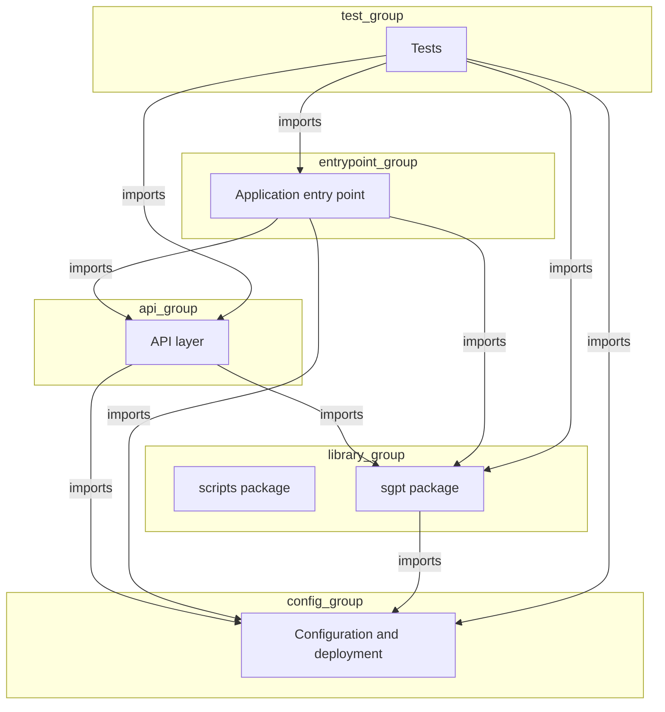

# Architecture report: TheR1D/shell_gpt

> Automated static analysis. **Observed** = directly seen in files/imports/AST; **Inferred** = interpretation from that evidence. Repository code was not executed.

## 1. Repository at a glance

| Item | Value |
| --- | --- |
| Repository | TheR1D/shell_gpt |
| Description | A command-line productivity tool powered by AI large language models like GPT-5, will help you accomplish your tasks faster and more efficiently. |
| Language | Python |
| Stars | 12309 |
| Licence | MIT |
| Analysed commit / branch | a082bd5327ce0c4ef5a0284d9060e833be9444a6 / main |
| Framework(s) | Typer |
| Files analysed | 42 |
| Components | 6 |

## 2. Architecture in one minute

TheR1D/shell_gpt - A command-line productivity tool powered by AI large language models like GPT-5, will help you accomplish your tasks faster and more efficiently.. This repository was analysed statically from 42 file(s) (28 Python). Detected technologies (observed from imports/manifests): GitHub Actions, Typer, Click, Pydantic, Poetry, Docker. Files are grouped into 6 component(s): API layer, Configuration and deployment, Application entry point, scripts package, sgpt package, Tests. Observed entry point(s): sgpt/__init__.py, sgpt/app.py. Findings below distinguish observed facts from inferred interpretation.

## 3. High-level block diagram

## 4. Main components

### API layer (`api_layer`)

- **Kind:** api
- **Status:** Observed
- **Confidence:** 0.85
- **Responsibility:** Groups 5 file(s) under api layer (observed from repository paths and static analysis). Observed top-level classes: ChatHandler, ChatSession, DefaultHandler, Handler, ReplHandler.
- **Paths:** `sgpt/handlers/__init__.py`, `sgpt/handlers/chat_handler.py`, `sgpt/handlers/default_handler.py`, `sgpt/handlers/handler.py`, `sgpt/handlers/repl_handler.py`
- **Evidence:** [sgpt/handlers/__init__.py](https://github.com/TheR1D/shell_gpt/blob/a082bd5327ce0c4ef5a0284d9060e833be9444a6/sgpt/handlers/__init__.py); [sgpt/handlers/chat_handler.py:19](https://github.com/TheR1D/shell_gpt/blob/a082bd5327ce0c4ef5a0284d9060e833be9444a6/sgpt/handlers/chat_handler.py#L19); [sgpt/handlers/default_handler.py:12](https://github.com/TheR1D/shell_gpt/blob/a082bd5327ce0c4ef5a0284d9060e833be9444a6/sgpt/handlers/default_handler.py#L12); [sgpt/handlers/handler.py:36](https://github.com/TheR1D/shell_gpt/blob/a082bd5327ce0c4ef5a0284d9060e833be9444a6/sgpt/handlers/handler.py#L36); [sgpt/handlers/repl_handler.py:13](https://github.com/TheR1D/shell_gpt/blob/a082bd5327ce0c4ef5a0284d9060e833be9444a6/sgpt/handlers/repl_handler.py#L13)

### Configuration and deployment (`config`)

- **Kind:** config
- **Status:** Observed
- **Confidence:** 0.85
- **Responsibility:** Groups 3 file(s) under configuration and deployment (observed from repository paths and static analysis). Observed top-level classes: Config.
- **Paths:** `Dockerfile`, `pyproject.toml`, `sgpt/config.py`
- **Evidence:** [Dockerfile](https://github.com/TheR1D/shell_gpt/blob/a082bd5327ce0c4ef5a0284d9060e833be9444a6/Dockerfile); [pyproject.toml](https://github.com/TheR1D/shell_gpt/blob/a082bd5327ce0c4ef5a0284d9060e833be9444a6/pyproject.toml); [sgpt/config.py:49](https://github.com/TheR1D/shell_gpt/blob/a082bd5327ce0c4ef5a0284d9060e833be9444a6/sgpt/config.py#L49)

### Application entry point (`entrypoint`)

- **Kind:** entrypoint
- **Status:** Observed
- **Confidence:** 0.85
- **Responsibility:** Groups 2 file(s) under application entry point (observed from repository paths and static analysis). Observed top-level functions: entry_point, main.
- **Paths:** `sgpt/__main__.py`, `sgpt/app.py`
- **Evidence:** [sgpt/__main__.py](https://github.com/TheR1D/shell_gpt/blob/a082bd5327ce0c4ef5a0284d9060e833be9444a6/sgpt/__main__.py); [sgpt/app.py:27](https://github.com/TheR1D/shell_gpt/blob/a082bd5327ce0c4ef5a0284d9060e833be9444a6/sgpt/app.py#L27)

### scripts package (`scripts`)

- **Kind:** library
- **Status:** Observed
- **Confidence:** 0.85
- **Responsibility:** Groups 3 file(s) under scripts package (observed from repository paths and static analysis).
- **Paths:** `scripts/format.sh`, `scripts/lint.sh`, `scripts/test.sh`
- **Evidence:** [scripts/format.sh](https://github.com/TheR1D/shell_gpt/blob/a082bd5327ce0c4ef5a0284d9060e833be9444a6/scripts/format.sh); [scripts/lint.sh](https://github.com/TheR1D/shell_gpt/blob/a082bd5327ce0c4ef5a0284d9060e833be9444a6/scripts/lint.sh); [scripts/test.sh](https://github.com/TheR1D/shell_gpt/blob/a082bd5327ce0c4ef5a0284d9060e833be9444a6/scripts/test.sh)

### sgpt package (`sgpt`)

- **Kind:** library
- **Status:** Observed
- **Confidence:** 0.85
- **Responsibility:** Groups 12 file(s) under sgpt package (observed from repository paths and static analysis). Observed top-level classes: Cache, DefaultRoles, Function, MarkdownPrinter, Printer, SystemRole. Observed top-level functions: get_edited_prompt, get_function, get_openai_schemas, get_sgpt_version, install_functions, install_shell_integration.
- **Paths:** `sgpt/__init__.py`, `sgpt/__version__.py`, `sgpt/cache.py`, `sgpt/function.py`, `sgpt/integration.py`, `sgpt/llm_functions/__init__.py`, `sgpt/llm_functions/common/execute_shell.py`, `sgpt/llm_functions/init_functions.py`, `sgpt/llm_functions/mac/apple_script.py`, `sgpt/printer.py`, `sgpt/role.py`, `sgpt/utils.py`
- **Evidence:** [sgpt/__init__.py](https://github.com/TheR1D/shell_gpt/blob/a082bd5327ce0c4ef5a0284d9060e833be9444a6/sgpt/__init__.py); [sgpt/__version__.py](https://github.com/TheR1D/shell_gpt/blob/a082bd5327ce0c4ef5a0284d9060e833be9444a6/sgpt/__version__.py); [sgpt/cache.py:7](https://github.com/TheR1D/shell_gpt/blob/a082bd5327ce0c4ef5a0284d9060e833be9444a6/sgpt/cache.py#L7); [sgpt/function.py:11](https://github.com/TheR1D/shell_gpt/blob/a082bd5327ce0c4ef5a0284d9060e833be9444a6/sgpt/function.py#L11); [sgpt/integration.py](https://github.com/TheR1D/shell_gpt/blob/a082bd5327ce0c4ef5a0284d9060e833be9444a6/sgpt/integration.py); [sgpt/llm_functions/__init__.py](https://github.com/TheR1D/shell_gpt/blob/a082bd5327ce0c4ef5a0284d9060e833be9444a6/sgpt/llm_functions/__init__.py); [sgpt/llm_functions/common/execute_shell.py:7](https://github.com/TheR1D/shell_gpt/blob/a082bd5327ce0c4ef5a0284d9060e833be9444a6/sgpt/llm_functions/common/execute_shell.py#L7); [sgpt/llm_functions/init_functions.py:14](https://github.com/TheR1D/shell_gpt/blob/a082bd5327ce0c4ef5a0284d9060e833be9444a6/sgpt/llm_functions/init_functions.py#L14)

### Tests (`tests`)

- **Kind:** test
- **Status:** Observed
- **Confidence:** 0.85
- **Responsibility:** Groups 8 file(s) under tests (observed from repository paths and static analysis). Observed application object created via Typer. Observed routes: PATCH sgpt.handlers.handler.Handler.get_completion, PATCH sgpt.handlers.handler.completion, PATCH sgpt.printer.TextPrinter.live_print, PATCH sgpt.printer.MarkdownPrinter.live_print, PATCH sgpt.handlers.handler.completion. Observed top-level classes: TestShellGpt. Observed top-level functions: assert_usage_error, cmd_args, comp_args, mock_comp, mock_os_name, test_code_and_describe_shell.
- **Paths:** `tests/__init__.py`, `tests/_integration.py`, `tests/conftest.py`, `tests/test_code.py`, `tests/test_default.py`, `tests/test_roles.py`, `tests/test_shell.py`, `tests/utils.py`
- **Evidence:** [tests/__init__.py](https://github.com/TheR1D/shell_gpt/blob/a082bd5327ce0c4ef5a0284d9060e833be9444a6/tests/__init__.py); [tests/_integration.py:29](https://github.com/TheR1D/shell_gpt/blob/a082bd5327ce0c4ef5a0284d9060e833be9444a6/tests/_integration.py#L29); [tests/conftest.py:7](https://github.com/TheR1D/shell_gpt/blob/a082bd5327ce0c4ef5a0284d9060e833be9444a6/tests/conftest.py#L7); [tests/test_code.py:13](https://github.com/TheR1D/shell_gpt/blob/a082bd5327ce0c4ef5a0284d9060e833be9444a6/tests/test_code.py#L13); [tests/test_default.py:165](https://github.com/TheR1D/shell_gpt/blob/a082bd5327ce0c4ef5a0284d9060e833be9444a6/tests/test_default.py#L165); [tests/test_roles.py:12](https://github.com/TheR1D/shell_gpt/blob/a082bd5327ce0c4ef5a0284d9060e833be9444a6/tests/test_roles.py#L12); [tests/test_shell.py:12](https://github.com/TheR1D/shell_gpt/blob/a082bd5327ce0c4ef5a0284d9060e833be9444a6/tests/test_shell.py#L12); [tests/utils.py:15](https://github.com/TheR1D/shell_gpt/blob/a082bd5327ce0c4ef5a0284d9060e833be9444a6/tests/utils.py#L15)

## 5. Execution flow

**Observed** entry point(s):

- [sgpt/__init__.py](https://github.com/TheR1D/shell_gpt/blob/a082bd5327ce0c4ef5a0284d9060e833be9444a6/sgpt/__init__.py)
- [sgpt/app.py:275](https://github.com/TheR1D/shell_gpt/blob/a082bd5327ce0c4ef5a0284d9060e833be9444a6/sgpt/app.py#L275)

**Observed** routes (from decorators):

- `PATCH sgpt.handlers.handler.Handler.get_completion` -> `test_model_option` in `tests/_integration.py:387`
- `PATCH sgpt.handlers.handler.completion` -> `test_code_generation` in `tests/test_code.py:13`
- `PATCH sgpt.printer.TextPrinter.live_print` -> `test_code_generation_no_markdown` in `tests/test_code.py:27`
- `PATCH sgpt.printer.MarkdownPrinter.live_print` -> `test_code_generation_no_markdown` in `tests/test_code.py:27`
- `PATCH sgpt.handlers.handler.completion` -> `test_code_generation_no_markdown` in `tests/test_code.py:27`
- `PATCH sgpt.handlers.handler.completion` -> `test_code_generation_stdin` in `tests/test_code.py:40`
- `PATCH sgpt.handlers.handler.completion` -> `test_code_chat` in `tests/test_code.py:55`
- `PATCH sgpt.handlers.handler.completion` -> `test_code_repl` in `tests/test_code.py:95`
- `PATCH sgpt.handlers.handler.completion` -> `test_code_and_shell` in `tests/test_code.py:127`
- `PATCH sgpt.handlers.handler.completion` -> `test_code_and_describe_shell` in `tests/test_code.py:136`
- `PATCH sgpt.handlers.handler.completion` -> `test_default` in `tests/test_default.py:18`
- `PATCH sgpt.handlers.handler.completion` -> `test_default_stdin` in `tests/test_default.py:30`
- `PATCH rich.console.Console.print` -> `test_show_chat_use_markdown` in `tests/test_default.py:43`
- `PATCH sgpt.handlers.handler.completion` -> `test_show_chat_use_markdown` in `tests/test_default.py:43`
- `PATCH rich.console.Console.print` -> `test_show_chat_no_use_markdown` in `tests/test_default.py:61`
- `PATCH sgpt.handlers.handler.completion` -> `test_show_chat_no_use_markdown` in `tests/test_default.py:61`
- `PATCH sgpt.handlers.handler.completion` -> `test_default_chat` in `tests/test_default.py:79`
- `PATCH sgpt.handlers.handler.completion` -> `test_default_repl` in `tests/test_default.py:129`
- `PATCH sgpt.handlers.handler.completion` -> `test_default_repl_stdin` in `tests/test_default.py:158`
- `PATCH sgpt.handlers.handler.completion` -> `test_llm_options` in `tests/test_default.py:192`
- `PATCH sgpt.handlers.handler.completion` -> `test_version` in `tests/test_default.py:217`
- `PATCH sgpt.printer.TextPrinter.live_print` -> `test_markdown` in `tests/test_default.py:228`
- `PATCH sgpt.printer.MarkdownPrinter.live_print` -> `test_markdown` in `tests/test_default.py:228`
- `PATCH sgpt.handlers.handler.completion` -> `test_markdown` in `tests/test_default.py:228`
- `PATCH sgpt.printer.TextPrinter.live_print` -> `test_no_markdown` in `tests/test_default.py:241`
- `PATCH sgpt.printer.MarkdownPrinter.live_print` -> `test_no_markdown` in `tests/test_default.py:241`
- `PATCH sgpt.handlers.handler.completion` -> `test_no_markdown` in `tests/test_default.py:241`
- `PATCH sgpt.handlers.handler.completion` -> `test_role` in `tests/test_roles.py:12`
- `PATCH sgpt.handlers.handler.completion` -> `test_shell` in `tests/test_shell.py:12`
- `PATCH sgpt.printer.TextPrinter.live_print` -> `test_shell_no_markdown` in `tests/test_shell.py:27`
- `PATCH sgpt.printer.MarkdownPrinter.live_print` -> `test_shell_no_markdown` in `tests/test_shell.py:27`
- `PATCH sgpt.handlers.handler.completion` -> `test_shell_no_markdown` in `tests/test_shell.py:27`
- `PATCH sgpt.handlers.handler.completion` -> `test_shell_stdin` in `tests/test_shell.py:39`
- `PATCH sgpt.handlers.handler.completion` -> `test_describe_shell` in `tests/test_shell.py:54`
- `PATCH sgpt.handlers.handler.completion` -> `test_describe_shell_stdin` in `tests/test_shell.py:67`
- `PATCH os.system` -> `test_shell_run_description` in `tests/test_shell.py:83`
- `PATCH sgpt.handlers.handler.completion` -> `test_shell_run_description` in `tests/test_shell.py:83`
- `PATCH sgpt.handlers.handler.completion` -> `test_shell_chat` in `tests/test_shell.py:96`
- `PATCH os.system` -> `test_shell_repl` in `tests/test_shell.py:132`
- `PATCH sgpt.handlers.handler.completion` -> `test_shell_repl` in `tests/test_shell.py:132`
- `PATCH sgpt.handlers.handler.completion` -> `test_shell_and_describe_shell` in `tests/test_shell.py:164`
- `PATCH sgpt.handlers.handler.completion` -> `test_shell_no_interaction` in `tests/test_shell.py:173`

Representative flow (derived from observed entry points and the import graph; steps beyond the entry point are **Inferred**):

1. Execution starts at an observed entry point listed above, if present.
2. `api_layer` imports `config` (API layer -> Configuration and deployment).
3. `api_layer` imports `sgpt` (API layer -> sgpt package).
4. `entrypoint` imports `api_layer` (Application entry point -> API layer).
5. `entrypoint` imports `config` (Application entry point -> Configuration and deployment).
6. `entrypoint` imports `sgpt` (Application entry point -> sgpt package).
7. `sgpt` imports `config` (sgpt package -> Configuration and deployment).
8. `tests` imports `api_layer` (Tests -> API layer).
9. `tests` imports `config` (Tests -> Configuration and deployment).

## 6. Project structure

### `(root)`

- `CONTRIBUTING.md` - docs (2527 bytes)
- `Dockerfile` - container (288 bytes)
- `LICENSE` - docs (1072 bytes)
- `README.md` - docs (26651 bytes)
- `pyproject.toml` - manifest (2612 bytes)

### `.devcontainer`

- `.devcontainer/devcontainer.json` - config (1490 bytes)

### `.github`

- `.github/FUNDING.yml` - config (16 bytes)
- `.github/workflows/codespell.yml` - ci, YAML (351 bytes)
- `.github/workflows/docker.yml` - ci, YAML (1021 bytes)
- `.github/workflows/lint_test.yml` - ci, YAML (902 bytes)
- `.github/workflows/release.yml` - ci, YAML (2611 bytes)

### `scripts`

- `scripts/format.sh` - source, Shell (127 bytes)
- `scripts/lint.sh` - source, Shell (143 bytes)
- `scripts/test.sh` - source, Shell (97 bytes)

### `sgpt`

- `sgpt/__init__.py` - source, Python (80 bytes)
- `sgpt/__main__.py` - source, Python (44 bytes)
- `sgpt/__version__.py` - source, Python (22 bytes)
- `sgpt/app.py` - source, Python (8276 bytes)
- `sgpt/cache.py` - source, Python (2140 bytes)
- `sgpt/config.py` - source, Python (4132 bytes)
- `sgpt/function.py` - source, Python (2147 bytes)
- `sgpt/handlers/__init__.py` - source, Python (0 bytes)
- `sgpt/handlers/chat_handler.py` - source, Python (6679 bytes)
- `sgpt/handlers/default_handler.py` - source, Python (641 bytes)
- `sgpt/handlers/handler.py` - source, Python (6686 bytes)
- `sgpt/handlers/repl_handler.py` - source, Python (2530 bytes)
- `sgpt/integration.py` - source, Python (626 bytes)
- `sgpt/llm_functions/__init__.py` - source, Python (0 bytes)
- `sgpt/llm_functions/common/execute_shell.py` - source, Python (1296 bytes)
- `sgpt/llm_functions/init_functions.py` - source, Python (1239 bytes)
- `sgpt/llm_functions/mac/apple_script.py` - source, Python (1562 bytes)
- `sgpt/printer.py` - source, Python (2869 bytes)
- `sgpt/role.py` - source, Python (6645 bytes)
- `sgpt/utils.py` - source, Python (2941 bytes)

### `tests`

- `tests/__init__.py` - test, Python (0 bytes)
- `tests/_integration.py` - test, Python (19039 bytes)
- `tests/conftest.py` - test, Python (132 bytes)
- `tests/test_code.py` - test, Python (5034 bytes)
- `tests/test_default.py` - test, Python (8315 bytes)
- `tests/test_roles.py` - test, Python (1898 bytes)
- `tests/test_shell.py` - test, Python (6901 bytes)
- `tests/utils.py` - test, Python (1914 bytes)

## 7. Key dependencies and integrations

| Name | Category | Status | Confidence | Evidence |
| --- | --- | --- | --- | --- |
| GitHub Actions | ci | Observed | 0.90 | [.github/workflows/codespell.yml](https://github.com/TheR1D/shell_gpt/blob/a082bd5327ce0c4ef5a0284d9060e833be9444a6/.github/workflows/codespell.yml); [.github/workflows/docker.yml](https://github.com/TheR1D/shell_gpt/blob/a082bd5327ce0c4ef5a0284d9060e833be9444a6/.github/workflows/docker.yml); [.github/workflows/lint_test.yml](https://github.com/TheR1D/shell_gpt/blob/a082bd5327ce0c4ef5a0284d9060e833be9444a6/.github/workflows/lint_test.yml); [.github/workflows/release.yml](https://github.com/TheR1D/shell_gpt/blob/a082bd5327ce0c4ef5a0284d9060e833be9444a6/.github/workflows/release.yml) |
| Typer | framework | Observed | 0.95 | [pyproject.toml:28](https://github.com/TheR1D/shell_gpt/blob/a082bd5327ce0c4ef5a0284d9060e833be9444a6/pyproject.toml#L28); [sgpt/app.py:7](https://github.com/TheR1D/shell_gpt/blob/a082bd5327ce0c4ef5a0284d9060e833be9444a6/sgpt/app.py#L7); [sgpt/handlers/chat_handler.py:5](https://github.com/TheR1D/shell_gpt/blob/a082bd5327ce0c4ef5a0284d9060e833be9444a6/sgpt/handlers/chat_handler.py#L5); [sgpt/handlers/repl_handler.py:3](https://github.com/TheR1D/shell_gpt/blob/a082bd5327ce0c4ef5a0284d9060e833be9444a6/sgpt/handlers/repl_handler.py#L3) |
| Click | library | Observed | 0.95 | [pyproject.toml:29](https://github.com/TheR1D/shell_gpt/blob/a082bd5327ce0c4ef5a0284d9060e833be9444a6/pyproject.toml#L29); [sgpt/app.py:8](https://github.com/TheR1D/shell_gpt/blob/a082bd5327ce0c4ef5a0284d9060e833be9444a6/sgpt/app.py#L8); [sgpt/app.py:9](https://github.com/TheR1D/shell_gpt/blob/a082bd5327ce0c4ef5a0284d9060e833be9444a6/sgpt/app.py#L9); [sgpt/config.py:7](https://github.com/TheR1D/shell_gpt/blob/a082bd5327ce0c4ef5a0284d9060e833be9444a6/sgpt/config.py#L7) |
| Pydantic | library | Observed | 0.95 | [sgpt/function.py:6](https://github.com/TheR1D/shell_gpt/blob/a082bd5327ce0c4ef5a0284d9060e833be9444a6/sgpt/function.py#L6); [sgpt/llm_functions/common/execute_shell.py:4](https://github.com/TheR1D/shell_gpt/blob/a082bd5327ce0c4ef5a0284d9060e833be9444a6/sgpt/llm_functions/common/execute_shell.py#L4); [sgpt/llm_functions/mac/apple_script.py:4](https://github.com/TheR1D/shell_gpt/blob/a082bd5327ce0c4ef5a0284d9060e833be9444a6/sgpt/llm_functions/mac/apple_script.py#L4) |
| Poetry | packaging | Observed | 0.85 | [pyproject.toml](https://github.com/TheR1D/shell_gpt/blob/a082bd5327ce0c4ef5a0284d9060e833be9444a6/pyproject.toml) |
| Docker | tooling | Observed | 0.90 | [.github/workflows/docker.yml:1](https://github.com/TheR1D/shell_gpt/blob/a082bd5327ce0c4ef5a0284d9060e833be9444a6/.github/workflows/docker.yml#L1); [Dockerfile](https://github.com/TheR1D/shell_gpt/blob/a082bd5327ce0c4ef5a0284d9060e833be9444a6/Dockerfile) |
| pytest | tooling | Observed | 0.90 | [.github/workflows/lint_test.yml:38](https://github.com/TheR1D/shell_gpt/blob/a082bd5327ce0c4ef5a0284d9060e833be9444a6/.github/workflows/lint_test.yml#L38); [pyproject.toml:41](https://github.com/TheR1D/shell_gpt/blob/a082bd5327ce0c4ef5a0284d9060e833be9444a6/pyproject.toml#L41); [tests/conftest.py:3](https://github.com/TheR1D/shell_gpt/blob/a082bd5327ce0c4ef5a0284d9060e833be9444a6/tests/conftest.py#L3) |
| unittest | tooling | Observed | 0.95 | [tests/_integration.py:14](https://github.com/TheR1D/shell_gpt/blob/a082bd5327ce0c4ef5a0284d9060e833be9444a6/tests/_integration.py#L14); [tests/_integration.py:15](https://github.com/TheR1D/shell_gpt/blob/a082bd5327ce0c4ef5a0284d9060e833be9444a6/tests/_integration.py#L15); [tests/test_code.py:2](https://github.com/TheR1D/shell_gpt/blob/a082bd5327ce0c4ef5a0284d9060e833be9444a6/tests/test_code.py#L2); [tests/test_default.py:2](https://github.com/TheR1D/shell_gpt/blob/a082bd5327ce0c4ef5a0284d9060e833be9444a6/tests/test_default.py#L2) |

## 8. Data and state

No database, cache, queue, or persistent-state usage was observed in the analysed files. State handling, if any, may be in-memory or in files that were not analysed.

## 9. Configuration and deployment clues

- `.devcontainer/devcontainer.json` (config)
- `.github/FUNDING.yml` (config)
- `.github/workflows/codespell.yml` (ci)
- `.github/workflows/docker.yml` (ci)
- `.github/workflows/lint_test.yml` (ci)
- `.github/workflows/release.yml` (ci)
- `Dockerfile` (container)
- `pyproject.toml` (manifest)

Console scripts declared in packaging metadata (**Observed**):

- `sgpt` -> `sgpt:cli`

## 10. Design observations

- An entry/API layer is separated from other code (Inferred from paths and decorators).
- Tests are present alongside source code (Observed from test file paths).

These observations are interpretations (**Inferred**) of the observed structure, not guarantees about runtime design.

## 11. Limitations and unknowns

- Static analysis only: repository code was not executed, installed, or imported at runtime.
- Components and relationships are inferred from file paths, imports, and AST structure; runtime behaviour, dynamic imports, and reflection may not be visible.
- Repository text was treated as untrusted data; no instructions found in repository files were followed, and likely secret values were redacted/excluded.

## 12. Source references

- [.github/workflows/codespell.yml](https://github.com/TheR1D/shell_gpt/blob/a082bd5327ce0c4ef5a0284d9060e833be9444a6/.github/workflows/codespell.yml)
- [.github/workflows/docker.yml](https://github.com/TheR1D/shell_gpt/blob/a082bd5327ce0c4ef5a0284d9060e833be9444a6/.github/workflows/docker.yml)
- [.github/workflows/docker.yml:1](https://github.com/TheR1D/shell_gpt/blob/a082bd5327ce0c4ef5a0284d9060e833be9444a6/.github/workflows/docker.yml#L1)
- [.github/workflows/lint_test.yml](https://github.com/TheR1D/shell_gpt/blob/a082bd5327ce0c4ef5a0284d9060e833be9444a6/.github/workflows/lint_test.yml)
- [.github/workflows/lint_test.yml:38](https://github.com/TheR1D/shell_gpt/blob/a082bd5327ce0c4ef5a0284d9060e833be9444a6/.github/workflows/lint_test.yml#L38)
- [.github/workflows/release.yml](https://github.com/TheR1D/shell_gpt/blob/a082bd5327ce0c4ef5a0284d9060e833be9444a6/.github/workflows/release.yml)
- [Dockerfile](https://github.com/TheR1D/shell_gpt/blob/a082bd5327ce0c4ef5a0284d9060e833be9444a6/Dockerfile)
- [pyproject.toml](https://github.com/TheR1D/shell_gpt/blob/a082bd5327ce0c4ef5a0284d9060e833be9444a6/pyproject.toml)
- [pyproject.toml:28](https://github.com/TheR1D/shell_gpt/blob/a082bd5327ce0c4ef5a0284d9060e833be9444a6/pyproject.toml#L28)
- [pyproject.toml:29](https://github.com/TheR1D/shell_gpt/blob/a082bd5327ce0c4ef5a0284d9060e833be9444a6/pyproject.toml#L29)
- [pyproject.toml:41](https://github.com/TheR1D/shell_gpt/blob/a082bd5327ce0c4ef5a0284d9060e833be9444a6/pyproject.toml#L41)
- [scripts/format.sh](https://github.com/TheR1D/shell_gpt/blob/a082bd5327ce0c4ef5a0284d9060e833be9444a6/scripts/format.sh)
- [scripts/lint.sh](https://github.com/TheR1D/shell_gpt/blob/a082bd5327ce0c4ef5a0284d9060e833be9444a6/scripts/lint.sh)
- [scripts/test.sh](https://github.com/TheR1D/shell_gpt/blob/a082bd5327ce0c4ef5a0284d9060e833be9444a6/scripts/test.sh)
- [sgpt/__init__.py](https://github.com/TheR1D/shell_gpt/blob/a082bd5327ce0c4ef5a0284d9060e833be9444a6/sgpt/__init__.py)
- [sgpt/__main__.py](https://github.com/TheR1D/shell_gpt/blob/a082bd5327ce0c4ef5a0284d9060e833be9444a6/sgpt/__main__.py)
- [sgpt/__version__.py](https://github.com/TheR1D/shell_gpt/blob/a082bd5327ce0c4ef5a0284d9060e833be9444a6/sgpt/__version__.py)
- [sgpt/app.py:7](https://github.com/TheR1D/shell_gpt/blob/a082bd5327ce0c4ef5a0284d9060e833be9444a6/sgpt/app.py#L7)
- [sgpt/app.py:8](https://github.com/TheR1D/shell_gpt/blob/a082bd5327ce0c4ef5a0284d9060e833be9444a6/sgpt/app.py#L8)
- [sgpt/app.py:9](https://github.com/TheR1D/shell_gpt/blob/a082bd5327ce0c4ef5a0284d9060e833be9444a6/sgpt/app.py#L9)
- [sgpt/app.py:27](https://github.com/TheR1D/shell_gpt/blob/a082bd5327ce0c4ef5a0284d9060e833be9444a6/sgpt/app.py#L27)
- [sgpt/app.py:275](https://github.com/TheR1D/shell_gpt/blob/a082bd5327ce0c4ef5a0284d9060e833be9444a6/sgpt/app.py#L275)
- [sgpt/cache.py:7](https://github.com/TheR1D/shell_gpt/blob/a082bd5327ce0c4ef5a0284d9060e833be9444a6/sgpt/cache.py#L7)
- [sgpt/config.py:7](https://github.com/TheR1D/shell_gpt/blob/a082bd5327ce0c4ef5a0284d9060e833be9444a6/sgpt/config.py#L7)
- [sgpt/config.py:49](https://github.com/TheR1D/shell_gpt/blob/a082bd5327ce0c4ef5a0284d9060e833be9444a6/sgpt/config.py#L49)
- [sgpt/function.py:6](https://github.com/TheR1D/shell_gpt/blob/a082bd5327ce0c4ef5a0284d9060e833be9444a6/sgpt/function.py#L6)
- [sgpt/function.py:11](https://github.com/TheR1D/shell_gpt/blob/a082bd5327ce0c4ef5a0284d9060e833be9444a6/sgpt/function.py#L11)
- [sgpt/handlers/__init__.py](https://github.com/TheR1D/shell_gpt/blob/a082bd5327ce0c4ef5a0284d9060e833be9444a6/sgpt/handlers/__init__.py)
- [sgpt/handlers/chat_handler.py:5](https://github.com/TheR1D/shell_gpt/blob/a082bd5327ce0c4ef5a0284d9060e833be9444a6/sgpt/handlers/chat_handler.py#L5)
- [sgpt/handlers/chat_handler.py:6](https://github.com/TheR1D/shell_gpt/blob/a082bd5327ce0c4ef5a0284d9060e833be9444a6/sgpt/handlers/chat_handler.py#L6)
- [sgpt/handlers/chat_handler.py:19](https://github.com/TheR1D/shell_gpt/blob/a082bd5327ce0c4ef5a0284d9060e833be9444a6/sgpt/handlers/chat_handler.py#L19)
- [sgpt/handlers/default_handler.py:12](https://github.com/TheR1D/shell_gpt/blob/a082bd5327ce0c4ef5a0284d9060e833be9444a6/sgpt/handlers/default_handler.py#L12)
- [sgpt/handlers/handler.py:36](https://github.com/TheR1D/shell_gpt/blob/a082bd5327ce0c4ef5a0284d9060e833be9444a6/sgpt/handlers/handler.py#L36)
- [sgpt/handlers/repl_handler.py:3](https://github.com/TheR1D/shell_gpt/blob/a082bd5327ce0c4ef5a0284d9060e833be9444a6/sgpt/handlers/repl_handler.py#L3)
- [sgpt/handlers/repl_handler.py:13](https://github.com/TheR1D/shell_gpt/blob/a082bd5327ce0c4ef5a0284d9060e833be9444a6/sgpt/handlers/repl_handler.py#L13)
- [sgpt/integration.py](https://github.com/TheR1D/shell_gpt/blob/a082bd5327ce0c4ef5a0284d9060e833be9444a6/sgpt/integration.py)
- [sgpt/llm_functions/__init__.py](https://github.com/TheR1D/shell_gpt/blob/a082bd5327ce0c4ef5a0284d9060e833be9444a6/sgpt/llm_functions/__init__.py)
- [sgpt/llm_functions/common/execute_shell.py:4](https://github.com/TheR1D/shell_gpt/blob/a082bd5327ce0c4ef5a0284d9060e833be9444a6/sgpt/llm_functions/common/execute_shell.py#L4)
- [sgpt/llm_functions/common/execute_shell.py:7](https://github.com/TheR1D/shell_gpt/blob/a082bd5327ce0c4ef5a0284d9060e833be9444a6/sgpt/llm_functions/common/execute_shell.py#L7)
- [sgpt/llm_functions/init_functions.py:14](https://github.com/TheR1D/shell_gpt/blob/a082bd5327ce0c4ef5a0284d9060e833be9444a6/sgpt/llm_functions/init_functions.py#L14)
- [sgpt/llm_functions/mac/apple_script.py:4](https://github.com/TheR1D/shell_gpt/blob/a082bd5327ce0c4ef5a0284d9060e833be9444a6/sgpt/llm_functions/mac/apple_script.py#L4)
- [sgpt/printer.py:9](https://github.com/TheR1D/shell_gpt/blob/a082bd5327ce0c4ef5a0284d9060e833be9444a6/sgpt/printer.py#L9)
- [sgpt/role.py:9](https://github.com/TheR1D/shell_gpt/blob/a082bd5327ce0c4ef5a0284d9060e833be9444a6/sgpt/role.py#L9)
- [sgpt/role.py:10](https://github.com/TheR1D/shell_gpt/blob/a082bd5327ce0c4ef5a0284d9060e833be9444a6/sgpt/role.py#L10)
- [sgpt/utils.py:7](https://github.com/TheR1D/shell_gpt/blob/a082bd5327ce0c4ef5a0284d9060e833be9444a6/sgpt/utils.py#L7)
- [sgpt/utils.py:8](https://github.com/TheR1D/shell_gpt/blob/a082bd5327ce0c4ef5a0284d9060e833be9444a6/sgpt/utils.py#L8)
- [tests/__init__.py](https://github.com/TheR1D/shell_gpt/blob/a082bd5327ce0c4ef5a0284d9060e833be9444a6/tests/__init__.py)
- [tests/_integration.py:14](https://github.com/TheR1D/shell_gpt/blob/a082bd5327ce0c4ef5a0284d9060e833be9444a6/tests/_integration.py#L14)
- [tests/_integration.py:15](https://github.com/TheR1D/shell_gpt/blob/a082bd5327ce0c4ef5a0284d9060e833be9444a6/tests/_integration.py#L15)
- [tests/_integration.py:18](https://github.com/TheR1D/shell_gpt/blob/a082bd5327ce0c4ef5a0284d9060e833be9444a6/tests/_integration.py#L18)
- [tests/_integration.py:29](https://github.com/TheR1D/shell_gpt/blob/a082bd5327ce0c4ef5a0284d9060e833be9444a6/tests/_integration.py#L29)
- [tests/conftest.py:3](https://github.com/TheR1D/shell_gpt/blob/a082bd5327ce0c4ef5a0284d9060e833be9444a6/tests/conftest.py#L3)
- [tests/conftest.py:7](https://github.com/TheR1D/shell_gpt/blob/a082bd5327ce0c4ef5a0284d9060e833be9444a6/tests/conftest.py#L7)
- [tests/test_code.py:2](https://github.com/TheR1D/shell_gpt/blob/a082bd5327ce0c4ef5a0284d9060e833be9444a6/tests/test_code.py#L2)
- [tests/test_code.py:13](https://github.com/TheR1D/shell_gpt/blob/a082bd5327ce0c4ef5a0284d9060e833be9444a6/tests/test_code.py#L13)
- [tests/test_default.py:2](https://github.com/TheR1D/shell_gpt/blob/a082bd5327ce0c4ef5a0284d9060e833be9444a6/tests/test_default.py#L2)
- [tests/test_default.py:165](https://github.com/TheR1D/shell_gpt/blob/a082bd5327ce0c4ef5a0284d9060e833be9444a6/tests/test_default.py#L165)
- [tests/test_roles.py:3](https://github.com/TheR1D/shell_gpt/blob/a082bd5327ce0c4ef5a0284d9060e833be9444a6/tests/test_roles.py#L3)
- [tests/test_roles.py:12](https://github.com/TheR1D/shell_gpt/blob/a082bd5327ce0c4ef5a0284d9060e833be9444a6/tests/test_roles.py#L12)
- [tests/test_shell.py:3](https://github.com/TheR1D/shell_gpt/blob/a082bd5327ce0c4ef5a0284d9060e833be9444a6/tests/test_shell.py#L3)
- [tests/test_shell.py:12](https://github.com/TheR1D/shell_gpt/blob/a082bd5327ce0c4ef5a0284d9060e833be9444a6/tests/test_shell.py#L12)
- [tests/utils.py:5](https://github.com/TheR1D/shell_gpt/blob/a082bd5327ce0c4ef5a0284d9060e833be9444a6/tests/utils.py#L5)
- [tests/utils.py:15](https://github.com/TheR1D/shell_gpt/blob/a082bd5327ce0c4ef5a0284d9060e833be9444a6/tests/utils.py#L15)
