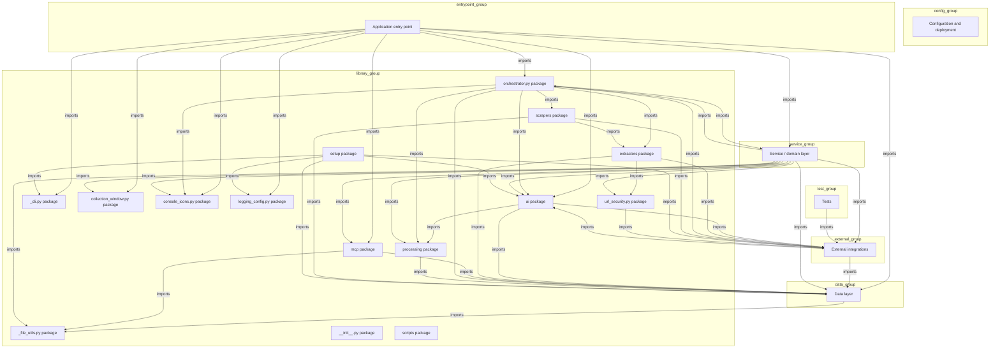

# Architecture report: Thysrael/Horizon

> Automated static analysis. **Observed** = directly seen in files/imports/AST; **Inferred** = interpretation from that evidence. Repository code was not executed.

## 1. Repository at a glance

| Item | Value |
| --- | --- |
| Repository | Thysrael/Horizon |
| Description | 📡 Your own AI-powered news radar. Generates daily briefings in English & Chinese. | 用 AI 构建你专属的新闻雷达 |
| Language | Python |
| Stars | 14256 |
| Licence | MIT |
| Analysed commit / branch | ae30765a45ea97f082f6913181289ddd49566eeb / main |
| Framework(s) | None detected |
| Files analysed | 205 |
| Components | 21 |

## 2. Architecture in one minute

Thysrael/Horizon - 📡 Your own AI-powered news radar. Generates daily briefings in English & Chinese. | 用 AI 构建你专属的新闻雷达. This repository was analysed statically from 205 file(s) (143 Python). Detected technologies (observed from imports/manifests): GitHub Actions, httpx, Pydantic, Poetry, Docker, Docker Compose. Files are grouped into 21 component(s): ai package, _cli.py package, collection_window.py package, Configuration and deployment, console_icons.py package, Data layer, Application entry point, External integrations. Observed entry point(s): scripts/check_mcp.py, skills/horizon/scripts/horizon_ops.py, src/main.py. Findings below distinguish observed facts from inferred interpretation.

## 3. High-level block diagram

## 4. Main components

### ai package (`ai`)

- **Kind:** library
- **Status:** Observed
- **Confidence:** 0.85
- **Responsibility:** Groups 18 file(s) under ai package (observed from repository paths and static analysis). Observed top-level classes: AIProviderUnavailableError, ChatGPTAuth, ChatGPTClient, ClassificationResponse, ContentAnalyzer, ContentClassifier. Observed top-level functions: _atomic_json, _convert_details_to_markdown, _escape_markdown, _escape_markdown_text, _is_safe_markdown_link_url, _json_object.
- **Paths:** `src/ai/__init__.py`, `src/ai/analyzer.py`, `src/ai/chatgpt.py`, `src/ai/chatgpt_auth.py`, `src/ai/classifier.py`, `src/ai/enricher.py`, `src/ai/errors.py`, `src/ai/localization.py`, `src/ai/markdown_utils.py`, `src/ai/prompting/__init__.py`, `src/ai/prompting/analysis.py`, `src/ai/prompting/classification.py`, `src/ai/prompting/common.py`, `src/ai/prompting/deduplication.py`, `src/ai/prompting/enrichment.py`, `src/ai/summarizer.py`, `src/ai/tokens.py`, `src/ai/utils.py`
- **Evidence:** [src/ai/__init__.py](https://github.com/Thysrael/Horizon/blob/ae30765a45ea97f082f6913181289ddd49566eeb/src/ai/__init__.py); [src/ai/analyzer.py:23](https://github.com/Thysrael/Horizon/blob/ae30765a45ea97f082f6913181289ddd49566eeb/src/ai/analyzer.py#L23); [src/ai/chatgpt.py:17](https://github.com/Thysrael/Horizon/blob/ae30765a45ea97f082f6913181289ddd49566eeb/src/ai/chatgpt.py#L17); [src/ai/chatgpt_auth.py:44](https://github.com/Thysrael/Horizon/blob/ae30765a45ea97f082f6913181289ddd49566eeb/src/ai/chatgpt_auth.py#L44); [src/ai/classifier.py:20](https://github.com/Thysrael/Horizon/blob/ae30765a45ea97f082f6913181289ddd49566eeb/src/ai/classifier.py#L20); [src/ai/enricher.py:41](https://github.com/Thysrael/Horizon/blob/ae30765a45ea97f082f6913181289ddd49566eeb/src/ai/enricher.py#L41); [src/ai/errors.py:4](https://github.com/Thysrael/Horizon/blob/ae30765a45ea97f082f6913181289ddd49566eeb/src/ai/errors.py#L4); [src/ai/localization.py:9](https://github.com/Thysrael/Horizon/blob/ae30765a45ea97f082f6913181289ddd49566eeb/src/ai/localization.py#L9)

### _cli.py package (`cli_py`)

- **Kind:** library
- **Status:** Observed
- **Confidence:** 0.85
- **Responsibility:** Groups 1 file(s) under _cli.py package (observed from repository paths and static analysis). Observed top-level functions: add_data_dir_arguments, add_log_level_argument.
- **Paths:** `src/_cli.py`
- **Evidence:** [src/_cli.py:6](https://github.com/Thysrael/Horizon/blob/ae30765a45ea97f082f6913181289ddd49566eeb/src/_cli.py#L6)

### collection_window.py package (`collection_window_py`)

- **Kind:** library
- **Status:** Observed
- **Confidence:** 0.85
- **Responsibility:** Groups 1 file(s) under collection_window.py package (observed from repository paths and static analysis). Observed top-level functions: collection_hours.
- **Paths:** `src/collection_window.py`
- **Evidence:** [src/collection_window.py:4](https://github.com/Thysrael/Horizon/blob/ae30765a45ea97f082f6913181289ddd49566eeb/src/collection_window.py#L4)

### Configuration and deployment (`config`)

- **Kind:** config
- **Status:** Observed
- **Confidence:** 0.85
- **Responsibility:** Groups 11 file(s) under configuration and deployment (observed from repository paths and static analysis).
- **Paths:** `Dockerfile`, `data/config.example.json`, `data/config.github.json`, `data/presets.json`, `docker-compose.yml`, `profiles/ai-creator/profile.json`, `profiles/finance-news/profile.json`, `profiles/tech-blog/profile.json`, `profiles/tech-news/profile.json`, `pyproject.toml`, `skills/horizon/evals/scenarios.json`
- **Evidence:** [Dockerfile](https://github.com/Thysrael/Horizon/blob/ae30765a45ea97f082f6913181289ddd49566eeb/Dockerfile); [data/config.example.json](https://github.com/Thysrael/Horizon/blob/ae30765a45ea97f082f6913181289ddd49566eeb/data/config.example.json); [data/config.github.json](https://github.com/Thysrael/Horizon/blob/ae30765a45ea97f082f6913181289ddd49566eeb/data/config.github.json); [data/presets.json](https://github.com/Thysrael/Horizon/blob/ae30765a45ea97f082f6913181289ddd49566eeb/data/presets.json); [docker-compose.yml](https://github.com/Thysrael/Horizon/blob/ae30765a45ea97f082f6913181289ddd49566eeb/docker-compose.yml); [profiles/ai-creator/profile.json](https://github.com/Thysrael/Horizon/blob/ae30765a45ea97f082f6913181289ddd49566eeb/profiles/ai-creator/profile.json); [profiles/finance-news/profile.json](https://github.com/Thysrael/Horizon/blob/ae30765a45ea97f082f6913181289ddd49566eeb/profiles/finance-news/profile.json); [profiles/tech-blog/profile.json](https://github.com/Thysrael/Horizon/blob/ae30765a45ea97f082f6913181289ddd49566eeb/profiles/tech-blog/profile.json)

### console_icons.py package (`console_icons_py`)

- **Kind:** library
- **Status:** Observed
- **Confidence:** 0.85
- **Responsibility:** Groups 1 file(s) under console_icons.py package (observed from repository paths and static analysis). Observed top-level functions: get_icons.
- **Paths:** `src/console_icons.py`
- **Evidence:** [src/console_icons.py:88](https://github.com/Thysrael/Horizon/blob/ae30765a45ea97f082f6913181289ddd49566eeb/src/console_icons.py#L88)

### Data layer (`data_layer`)

- **Kind:** data
- **Status:** Observed
- **Confidence:** 0.85
- **Responsibility:** Groups 3 file(s) under data layer (observed from repository paths and static analysis). Observed top-level classes: AIConfig, AIProvider, ArtifactSource, CategoryGroupConfig, ClassificationResult, CollectionConfig. Observed top-level functions: _expand_env_vars, safe_output_path.
- **Paths:** `src/models.py`, `src/storage/__init__.py`, `src/storage/manager.py`
- **Evidence:** [src/models.py:10](https://github.com/Thysrael/Horizon/blob/ae30765a45ea97f082f6913181289ddd49566eeb/src/models.py#L10); [src/storage/__init__.py](https://github.com/Thysrael/Horizon/blob/ae30765a45ea97f082f6913181289ddd49566eeb/src/storage/__init__.py); [src/storage/manager.py:21](https://github.com/Thysrael/Horizon/blob/ae30765a45ea97f082f6913181289ddd49566eeb/src/storage/manager.py#L21)

### Application entry point (`entrypoint`)

- **Kind:** entrypoint
- **Status:** Observed
- **Confidence:** 0.85
- **Responsibility:** Groups 7 file(s) under application entry point (observed from repository paths and static analysis). Observed top-level functions: _err, _hours_argument, _main, _make_test_items, _metrics_snapshot, _ok.
- **Paths:** `scripts/check_mcp.py`, `skills/horizon/scripts/horizon_ops.py`, `src/main.py`, `src/mcp/server.py`, `src/services/webhook_cli.py`, `src/services/wechat_cli.py`, `src/setup/chatgpt.py`
- **Evidence:** [scripts/check_mcp.py:14](https://github.com/Thysrael/Horizon/blob/ae30765a45ea97f082f6913181289ddd49566eeb/scripts/check_mcp.py#L14); [skills/horizon/scripts/horizon_ops.py:25](https://github.com/Thysrael/Horizon/blob/ae30765a45ea97f082f6913181289ddd49566eeb/skills/horizon/scripts/horizon_ops.py#L25); [src/main.py:24](https://github.com/Thysrael/Horizon/blob/ae30765a45ea97f082f6913181289ddd49566eeb/src/main.py#L24); [src/mcp/server.py:36](https://github.com/Thysrael/Horizon/blob/ae30765a45ea97f082f6913181289ddd49566eeb/src/mcp/server.py#L36); [src/services/webhook_cli.py:33](https://github.com/Thysrael/Horizon/blob/ae30765a45ea97f082f6913181289ddd49566eeb/src/services/webhook_cli.py#L33); [src/services/wechat_cli.py:37](https://github.com/Thysrael/Horizon/blob/ae30765a45ea97f082f6913181289ddd49566eeb/src/services/wechat_cli.py#L37); [src/setup/chatgpt.py:14](https://github.com/Thysrael/Horizon/blob/ae30765a45ea97f082f6913181289ddd49566eeb/src/setup/chatgpt.py#L14)

### External integrations (`external_integrations`)

- **Kind:** external
- **Status:** Observed
- **Confidence:** 0.85
- **Responsibility:** Groups 1 file(s) under external integrations (observed from repository paths and static analysis). Observed top-level classes: AIClient, AnthropicClient, AzureOpenAIClient, ChainedAIClient, GeminiClient, OpenAIClient. Observed top-level functions: _chat_extra_body, _create_chained_client, _create_single_client, _is_temperature_unsupported, _is_token_limit_unsupported, _looks_like_api_key_value.
- **Paths:** `src/ai/client.py`
- **Evidence:** [src/ai/client.py:53](https://github.com/Thysrael/Horizon/blob/ae30765a45ea97f082f6913181289ddd49566eeb/src/ai/client.py#L53)

### extractors package (`extractors`)

- **Kind:** library
- **Status:** Observed
- **Confidence:** 0.85
- **Responsibility:** Groups 7 file(s) under extractors package (observed from repository paths and static analysis). Observed top-level classes: BaseExtractor, ExtractorRegistry, FirecrawlExtractor, OutcrawlExtractor, SpecStreamExtractor, TrafilaturaExtractor. Observed top-level functions: _build.
- **Paths:** `src/extractors/__init__.py`, `src/extractors/base.py`, `src/extractors/firecrawl.py`, `src/extractors/outcrawl.py`, `src/extractors/registry.py`, `src/extractors/specstream.py`, `src/extractors/trafilatura.py`
- **Evidence:** [src/extractors/__init__.py](https://github.com/Thysrael/Horizon/blob/ae30765a45ea97f082f6913181289ddd49566eeb/src/extractors/__init__.py); [src/extractors/base.py:9](https://github.com/Thysrael/Horizon/blob/ae30765a45ea97f082f6913181289ddd49566eeb/src/extractors/base.py#L9); [src/extractors/firecrawl.py:18](https://github.com/Thysrael/Horizon/blob/ae30765a45ea97f082f6913181289ddd49566eeb/src/extractors/firecrawl.py#L18); [src/extractors/outcrawl.py:19](https://github.com/Thysrael/Horizon/blob/ae30765a45ea97f082f6913181289ddd49566eeb/src/extractors/outcrawl.py#L19); [src/extractors/registry.py:27](https://github.com/Thysrael/Horizon/blob/ae30765a45ea97f082f6913181289ddd49566eeb/src/extractors/registry.py#L27); [src/extractors/specstream.py:19](https://github.com/Thysrael/Horizon/blob/ae30765a45ea97f082f6913181289ddd49566eeb/src/extractors/specstream.py#L19); [src/extractors/trafilatura.py:26](https://github.com/Thysrael/Horizon/blob/ae30765a45ea97f082f6913181289ddd49566eeb/src/extractors/trafilatura.py#L26)

### _file_utils.py package (`file_utils_py`)

- **Kind:** library
- **Status:** Observed
- **Confidence:** 0.85
- **Responsibility:** Groups 1 file(s) under _file_utils.py package (observed from repository paths and static analysis). Observed top-level functions: _atomic_write_text.
- **Paths:** `src/_file_utils.py`
- **Evidence:** [src/_file_utils.py:8](https://github.com/Thysrael/Horizon/blob/ae30765a45ea97f082f6913181289ddd49566eeb/src/_file_utils.py#L8)

### __init__.py package (`init_py`)

- **Kind:** library
- **Status:** Observed
- **Confidence:** 0.85
- **Responsibility:** Groups 1 file(s) under __init__.py package (observed from repository paths and static analysis).
- **Paths:** `src/__init__.py`
- **Evidence:** [src/__init__.py](https://github.com/Thysrael/Horizon/blob/ae30765a45ea97f082f6913181289ddd49566eeb/src/__init__.py)

### logging_config.py package (`logging_config_py`)

- **Kind:** library
- **Status:** Observed
- **Confidence:** 0.85
- **Responsibility:** Groups 1 file(s) under logging_config.py package (observed from repository paths and static analysis). Observed top-level functions: configure_logging.
- **Paths:** `src/logging_config.py`
- **Evidence:** [src/logging_config.py:9](https://github.com/Thysrael/Horizon/blob/ae30765a45ea97f082f6913181289ddd49566eeb/src/logging_config.py#L9)

### mcp package (`mcp`)

- **Kind:** library
- **Status:** Observed
- **Confidence:** 0.85
- **Responsibility:** Groups 4 file(s) under mcp package (observed from repository paths and static analysis). Observed top-level classes: HorizonMcpError, RunStore. Observed top-level functions: _is_horizon_repo, _load_mcp_secrets, _resolve_secrets_path, apply_source_filter, dicts_to_items, get_enabled_sources.
- **Paths:** `src/mcp/__init__.py`, `src/mcp/errors.py`, `src/mcp/horizon_adapter.py`, `src/mcp/run_store.py`
- **Evidence:** [src/mcp/__init__.py](https://github.com/Thysrael/Horizon/blob/ae30765a45ea97f082f6913181289ddd49566eeb/src/mcp/__init__.py); [src/mcp/errors.py:10](https://github.com/Thysrael/Horizon/blob/ae30765a45ea97f082f6913181289ddd49566eeb/src/mcp/errors.py#L10); [src/mcp/horizon_adapter.py:22](https://github.com/Thysrael/Horizon/blob/ae30765a45ea97f082f6913181289ddd49566eeb/src/mcp/horizon_adapter.py#L22); [src/mcp/run_store.py:38](https://github.com/Thysrael/Horizon/blob/ae30765a45ea97f082f6913181289ddd49566eeb/src/mcp/run_store.py#L38)

### orchestrator.py package (`orchestrator_py`)

- **Kind:** library
- **Status:** Observed
- **Confidence:** 0.85
- **Responsibility:** Groups 1 file(s) under orchestrator.py package (observed from repository paths and static analysis). Observed top-level classes: BalancedDigestResult, FetchReport, FilteringPipelineResult, HorizonOrchestrator, SourceFetchOutcome. Observed top-level functions: _deduplication_url_key.
- **Paths:** `src/orchestrator.py`
- **Evidence:** [src/orchestrator.py:59](https://github.com/Thysrael/Horizon/blob/ae30765a45ea97f082f6913181289ddd49566eeb/src/orchestrator.py#L59)

### processing package (`processing`)

- **Kind:** library
- **Status:** Observed
- **Confidence:** 0.85
- **Responsibility:** Groups 5 file(s) under processing package (observed from repository paths and static analysis). Observed top-level classes: ContentParts, HistoryEntry, HistorySearchTool, LoadedProfile, ProfileBlock, ProfileContent. Observed top-level functions: _plain_text, _rank, _read_entries, _tokenize, _url_key, select_content.
- **Paths:** `src/processing/__init__.py`, `src/processing/content.py`, `src/processing/history.py`, `src/processing/profiles.py`, `src/processing/tools.py`
- **Evidence:** [src/processing/__init__.py](https://github.com/Thysrael/Horizon/blob/ae30765a45ea97f082f6913181289ddd49566eeb/src/processing/__init__.py); [src/processing/content.py:11](https://github.com/Thysrael/Horizon/blob/ae30765a45ea97f082f6913181289ddd49566eeb/src/processing/content.py#L11); [src/processing/history.py:28](https://github.com/Thysrael/Horizon/blob/ae30765a45ea97f082f6913181289ddd49566eeb/src/processing/history.py#L28); [src/processing/profiles.py:16](https://github.com/Thysrael/Horizon/blob/ae30765a45ea97f082f6913181289ddd49566eeb/src/processing/profiles.py#L16); [src/processing/tools.py:19](https://github.com/Thysrael/Horizon/blob/ae30765a45ea97f082f6913181289ddd49566eeb/src/processing/tools.py#L19)

### scrapers package (`scrapers`)

- **Kind:** library
- **Status:** Observed
- **Confidence:** 0.85
- **Responsibility:** Groups 13 file(s) under scrapers package (observed from repository paths and static analysis). Observed top-level classes: BaseScraper, FetchResult, GDELTScraper, GitHubScraper, GoogleNewsScraper, HackerNewsScraper. Observed top-level functions: _get_proxy, _html_text, _load_browser_cookies, _rate_limit_delay, _retry_after_seconds.
- **Paths:** `src/scrapers/__init__.py`, `src/scrapers/base.py`, `src/scrapers/gdelt.py`, `src/scrapers/github.py`, `src/scrapers/google_news.py`, `src/scrapers/hackernews.py`, `src/scrapers/openbb.py`, `src/scrapers/ossinsight.py`, `src/scrapers/reddit.py`, `src/scrapers/rss.py`, `src/scrapers/telegram.py`, `src/scrapers/twitter.py`, `src/scrapers/twitter_playwright.py`
- **Evidence:** [src/scrapers/__init__.py](https://github.com/Thysrael/Horizon/blob/ae30765a45ea97f082f6913181289ddd49566eeb/src/scrapers/__init__.py); [src/scrapers/base.py:13](https://github.com/Thysrael/Horizon/blob/ae30765a45ea97f082f6913181289ddd49566eeb/src/scrapers/base.py#L13); [src/scrapers/gdelt.py:35](https://github.com/Thysrael/Horizon/blob/ae30765a45ea97f082f6913181289ddd49566eeb/src/scrapers/gdelt.py#L35); [src/scrapers/github.py:11](https://github.com/Thysrael/Horizon/blob/ae30765a45ea97f082f6913181289ddd49566eeb/src/scrapers/github.py#L11); [src/scrapers/google_news.py:46](https://github.com/Thysrael/Horizon/blob/ae30765a45ea97f082f6913181289ddd49566eeb/src/scrapers/google_news.py#L46); [src/scrapers/hackernews.py:17](https://github.com/Thysrael/Horizon/blob/ae30765a45ea97f082f6913181289ddd49566eeb/src/scrapers/hackernews.py#L17); [src/scrapers/openbb.py:41](https://github.com/Thysrael/Horizon/blob/ae30765a45ea97f082f6913181289ddd49566eeb/src/scrapers/openbb.py#L41); [src/scrapers/ossinsight.py:19](https://github.com/Thysrael/Horizon/blob/ae30765a45ea97f082f6913181289ddd49566eeb/src/scrapers/ossinsight.py#L19)

### scripts package (`scripts`)

- **Kind:** library
- **Status:** Observed
- **Confidence:** 0.85
- **Responsibility:** Groups 1 file(s) under scripts package (observed from repository paths and static analysis).
- **Paths:** `scripts/daily-run.sh`
- **Evidence:** [scripts/daily-run.sh](https://github.com/Thysrael/Horizon/blob/ae30765a45ea97f082f6913181289ddd49566eeb/scripts/daily-run.sh)

### Service / domain layer (`service_layer`)

- **Kind:** service
- **Status:** Observed
- **Confidence:** 0.85
- **Responsibility:** Groups 4 file(s) under service / domain layer (observed from repository paths and static analysis). Observed top-level classes: EmailManager, HorizonPipelineService, ILinkClient, ILinkError, PipelineContext, WeChatDeliveryResult. Observed top-level functions: _client_version_number, _collapsible_panel, _default_runs_root, _escape_email_text, _extract_headers, _format_markdown_for_webhook.
- **Paths:** `src/mcp/service.py`, `src/services/email.py`, `src/services/webhook.py`, `src/services/wechat.py`
- **Evidence:** [src/mcp/service.py:45](https://github.com/Thysrael/Horizon/blob/ae30765a45ea97f082f6913181289ddd49566eeb/src/mcp/service.py#L45); [src/services/email.py:37](https://github.com/Thysrael/Horizon/blob/ae30765a45ea97f082f6913181289ddd49566eeb/src/services/email.py#L37); [src/services/webhook.py:24](https://github.com/Thysrael/Horizon/blob/ae30765a45ea97f082f6913181289ddd49566eeb/src/services/webhook.py#L24); [src/services/wechat.py:42](https://github.com/Thysrael/Horizon/blob/ae30765a45ea97f082f6913181289ddd49566eeb/src/services/wechat.py#L42)

### setup package (`setup`)

- **Kind:** library
- **Status:** Observed
- **Confidence:** 0.85
- **Responsibility:** Groups 6 file(s) under setup package (observed from repository paths and static analysis). Observed top-level functions: _ai_recommendations_available, _count_sources, _gh_key, _matches_input_term, _merge_source_list, _source_unique_key.
- **Paths:** `src/setup/__init__.py`, `src/setup/ai_recommend.py`, `src/setup/presets.py`, `src/setup/prompts.py`, `src/setup/tag_aliases.py`, `src/setup/wizard.py`
- **Evidence:** [src/setup/__init__.py](https://github.com/Thysrael/Horizon/blob/ae30765a45ea97f082f6913181289ddd49566eeb/src/setup/__init__.py); [src/setup/ai_recommend.py:21](https://github.com/Thysrael/Horizon/blob/ae30765a45ea97f082f6913181289ddd49566eeb/src/setup/ai_recommend.py#L21); [src/setup/presets.py:26](https://github.com/Thysrael/Horizon/blob/ae30765a45ea97f082f6913181289ddd49566eeb/src/setup/presets.py#L26); [src/setup/prompts.py](https://github.com/Thysrael/Horizon/blob/ae30765a45ea97f082f6913181289ddd49566eeb/src/setup/prompts.py); [src/setup/tag_aliases.py:111](https://github.com/Thysrael/Horizon/blob/ae30765a45ea97f082f6913181289ddd49566eeb/src/setup/tag_aliases.py#L111); [src/setup/wizard.py:45](https://github.com/Thysrael/Horizon/blob/ae30765a45ea97f082f6913181289ddd49566eeb/src/setup/wizard.py#L45)

### Tests (`tests`)

- **Kind:** test
- **Status:** Observed
- **Confidence:** 0.85
- **Responsibility:** Groups 67 file(s) under tests (observed from repository paths and static analysis). Observed top-level classes: FakeClient, FakeIMAP, FakeSMTP, FakeTools, LoginClient, OAuthServer. Observed top-level functions: _api_key, _articles_payload, _bad_request, _cfg, _client, _complete_openai.
- **Paths:** `tests/conftest.py`, `tests/test_ai_parameter_compatibility.py`, `tests/test_ai_recommend.py`, `tests/test_analyzer.py`, `tests/test_azure_client.py`, `tests/test_balanced_digest.py`, `tests/test_category_wiring.py`, `tests/test_chained_client.py`, `tests/test_chatgpt_auth.py`, `tests/test_chatgpt_client.py`, `tests/test_classifier.py`, `tests/test_cli.py`, `tests/test_collection_windows.py`, `tests/test_console_icons.py`, `tests/test_content_selection.py`, `tests/test_cross_source_duplicates.py`, `tests/test_email.py`, `tests/test_enricher.py`, `tests/test_enrichment_publication.py`, `tests/test_extra_body.py`, `tests/test_extractors_firecrawl.py`, `tests/test_extractors_outcrawl.py`, `tests/test_extractors_registry.py`, `tests/test_extractors_specstream.py`, `tests/test_extractors_trafilatura.py`, `tests/test_fetch_reporting.py`, `tests/test_gdelt.py`, `tests/test_github_unpublished.py`, `tests/test_google_news.py`, `tests/test_hackernews_text.py`, `tests/test_hackernews_visibility.py`, `tests/test_history.py`, `tests/test_horizon_skill.py`, `tests/test_logging_config.py`, `tests/test_main.py`, `tests/test_mcp_adapter.py`, `tests/test_mcp_errors.py`, `tests/test_mcp_run_store.py`, `tests/test_mcp_server.py`, `tests/test_mcp_service_smoke.py`, `tests/test_minimax_client.py`, `tests/test_minimax_flash.py`, `tests/test_openbb_scraper.py`, `tests/test_output_language_config.py`, `tests/test_parse_json_response.py`, `tests/test_presets.py`, `tests/test_profiles.py`, `tests/test_prompting.py`, `tests/test_reddit.py`, `tests/test_rss.py`, `tests/test_rss_concurrency.py`, `tests/test_rss_rate_limit.py`, `tests/test_rss_request_headers.py`, `tests/test_run_listing_recovery.py`, `tests/test_setup_wizard.py`, `tests/test_storage.py`, `tests/test_subscriber_corruption.py`, `tests/test_summarizer.py`, `tests/test_telegram.py`, `tests/test_token_snapshots.py`, `tests/test_topic_dedup.py`, `tests/test_twitter.py`, `tests/test_url_security.py`, `tests/test_webhook.py`, `tests/test_webhook_cli.py`, `tests/test_wechat.py`, `tests/test_wechat_cli.py`
- **Evidence:** [tests/conftest.py](https://github.com/Thysrael/Horizon/blob/ae30765a45ea97f082f6913181289ddd49566eeb/tests/conftest.py); [tests/test_ai_parameter_compatibility.py:25](https://github.com/Thysrael/Horizon/blob/ae30765a45ea97f082f6913181289ddd49566eeb/tests/test_ai_parameter_compatibility.py#L25); [tests/test_ai_recommend.py:10](https://github.com/Thysrael/Horizon/blob/ae30765a45ea97f082f6913181289ddd49566eeb/tests/test_ai_recommend.py#L10); [tests/test_analyzer.py:20](https://github.com/Thysrael/Horizon/blob/ae30765a45ea97f082f6913181289ddd49566eeb/tests/test_analyzer.py#L20); [tests/test_azure_client.py:17](https://github.com/Thysrael/Horizon/blob/ae30765a45ea97f082f6913181289ddd49566eeb/tests/test_azure_client.py#L17); [tests/test_balanced_digest.py:29](https://github.com/Thysrael/Horizon/blob/ae30765a45ea97f082f6913181289ddd49566eeb/tests/test_balanced_digest.py#L29); [tests/test_category_wiring.py:36](https://github.com/Thysrael/Horizon/blob/ae30765a45ea97f082f6913181289ddd49566eeb/tests/test_category_wiring.py#L36); [tests/test_chained_client.py:15](https://github.com/Thysrael/Horizon/blob/ae30765a45ea97f082f6913181289ddd49566eeb/tests/test_chained_client.py#L15)

### url_security.py package (`url_security_py`)

- **Kind:** library
- **Status:** Observed
- **Confidence:** 0.85
- **Responsibility:** Groups 1 file(s) under url_security.py package (observed from repository paths and static analysis). Observed top-level classes: UnsafeURLError. Observed top-level functions: _resolve_hostname, safe_request, validate_http_url, validate_public_http_url.
- **Paths:** `src/url_security.py`
- **Evidence:** [src/url_security.py:13](https://github.com/Thysrael/Horizon/blob/ae30765a45ea97f082f6913181289ddd49566eeb/src/url_security.py#L13)

## 5. Execution flow

**Observed** entry point(s):

- [scripts/check_mcp.py:35](https://github.com/Thysrael/Horizon/blob/ae30765a45ea97f082f6913181289ddd49566eeb/scripts/check_mcp.py#L35)
- [skills/horizon/scripts/horizon_ops.py:118](https://github.com/Thysrael/Horizon/blob/ae30765a45ea97f082f6913181289ddd49566eeb/skills/horizon/scripts/horizon_ops.py#L118)
- [src/main.py:135](https://github.com/Thysrael/Horizon/blob/ae30765a45ea97f082f6913181289ddd49566eeb/src/main.py#L135)
- [src/mcp/server.py:456](https://github.com/Thysrael/Horizon/blob/ae30765a45ea97f082f6913181289ddd49566eeb/src/mcp/server.py#L456)
- [src/services/webhook_cli.py:279](https://github.com/Thysrael/Horizon/blob/ae30765a45ea97f082f6913181289ddd49566eeb/src/services/webhook_cli.py#L279)
- [src/services/wechat_cli.py:217](https://github.com/Thysrael/Horizon/blob/ae30765a45ea97f082f6913181289ddd49566eeb/src/services/wechat_cli.py#L217)
- [src/setup/chatgpt.py:83](https://github.com/Thysrael/Horizon/blob/ae30765a45ea97f082f6913181289ddd49566eeb/src/setup/chatgpt.py#L83)

Representative flow (derived from observed entry points and the import graph; steps beyond the entry point are **Inferred**):

1. Execution starts at an observed entry point listed above, if present.
2. `ai` imports `data_layer` (ai package -> Data layer).
3. `ai` imports `external_integrations` (ai package -> External integrations).
4. `ai` imports `processing` (ai package -> processing package).
5. `data_layer` imports `file_utils_py` (Data layer -> _file_utils.py package).
6. `entrypoint` imports `ai` (Application entry point -> ai package).
7. `entrypoint` imports `cli_py` (Application entry point -> _cli.py package).
8. `entrypoint` imports `collection_window_py` (Application entry point -> collection_window.py package).
9. `entrypoint` imports `console_icons_py` (Application entry point -> console_icons.py package).

## 6. Project structure

### `(root)`

- `.dockerignore` - container (403 bytes)
- `.env.example` - config (1114 bytes)
- `.gitignore` - other (636 bytes)
- `CODE_OF_CONDUCT.md` - docs (5220 bytes)
- `CONTRIBUTING.md` - docs (2357 bytes)
- `Dockerfile` - container (1254 bytes)
- `LICENSE` - docs (1065 bytes)
- `README.md` - docs (25870 bytes)
- `README_ja.md` - docs (30208 bytes)
- `README_zh.md` - docs (25098 bytes)
- `SECURITY.md` - docs (817 bytes)
- `docker-compose.yml` - container (441 bytes)
- `pyproject.toml` - manifest (1488 bytes)

### `.github`

- `.github/ISSUE_TEMPLATE/feature_request.md` - docs (458 bytes)
- `.github/pull_request_template.md` - docs (443 bytes)
- `.github/workflows/daily-summary.yml.disabled` - ci, YAML (1911 bytes)
- `.github/workflows/deploy-docs.yml` - ci, YAML (882 bytes)

### `data`

- `data/config.example.json` - config (6500 bytes)
- `data/config.github.json` - config (5049 bytes)
- `data/presets.json` - config (12658 bytes)

### `docs`

- `docs/_config.yml` - config (544 bytes)
- `docs/_includes/head-custom.html` - docs (1384 bytes)
- `docs/agent-skill.md` - docs (6833 bytes)
- `docs/assets/architecture.svg` - docs (76479 bytes)
- `docs/assets/css/horizon.css` - docs (4658 bytes)
- `docs/assets/horizon-header.svg` - docs (2915 bytes)
- `docs/assets/js/horizon.js` - docs (4220 bytes)
- `docs/assets/ofoxai-logo.svg` - docs (5035 bytes)
- `docs/chatgpt.md` - docs (6927 bytes)
- `docs/configuration.md` - docs (39120 bytes)
- `docs/extractors.md` - docs (7555 bytes)
- `docs/feed-en.xml` - docs (781 bytes)
- `docs/feed-zh.xml` - docs (779 bytes)
- `docs/horizon-hub-design.md` - docs (8780 bytes)
- `docs/index.md` - docs (3271 bytes)
- `docs/profiles.md` - docs (15446 bytes)
- `docs/scoring.md` - docs (4792 bytes)
- `docs/scrapers.md` - docs (10939 bytes)
- `docs/twitter-cookies.md` - docs (3277 bytes)

### `profiles`

- `profiles/ai-creator/analysis.md` - docs (1194 bytes)
- `profiles/ai-creator/enrichment.md` - docs (1226 bytes)
- `profiles/ai-creator/match.md` - docs (643 bytes)
- `profiles/ai-creator/profile.json` - config (548 bytes)
- `profiles/finance-news/analysis.md` - docs (1456 bytes)
- `profiles/finance-news/enrichment.md` - docs (2340 bytes)
- `profiles/finance-news/match.md` - docs (842 bytes)
- `profiles/finance-news/profile.json` - config (688 bytes)
- `profiles/tech-blog/analysis.md` - docs (1622 bytes)
- `profiles/tech-blog/enrichment.md` - docs (2451 bytes)
- `profiles/tech-blog/match.md` - docs (801 bytes)
- `profiles/tech-blog/profile.json` - config (626 bytes)
- `profiles/tech-news/analysis.md` - docs (1320 bytes)
- `profiles/tech-news/enrichment.md` - docs (3161 bytes)
- `profiles/tech-news/match.md` - docs (660 bytes)
- `profiles/tech-news/profile.json` - config (721 bytes)

### `scripts`

- `scripts/check_mcp.py` - source, Python (990 bytes)
- `scripts/daily-run.sh` - source, Shell (1661 bytes)

### `skills`

- `skills/horizon/SKILL.md` - docs (14713 bytes)
- `skills/horizon/evals/scenarios.json` - config (3718 bytes)
- `skills/horizon/references/automation.md` - docs (6178 bytes)
- `skills/horizon/references/pipeline.md` - docs (5840 bytes)
- `skills/horizon/scripts/horizon_ops.py` - source, Python (5190 bytes)

### `src`

- `src/__init__.py` - source, Python (0 bytes)
- `src/_cli.py` - source, Python (844 bytes)
- `src/_file_utils.py` - source, Python (722 bytes)
- `src/ai/__init__.py` - source, Python (0 bytes)
- `src/ai/analyzer.py` - source, Python (7889 bytes)
- `src/ai/chatgpt.py` - source, Python (4754 bytes)
- `src/ai/chatgpt_auth.py` - source, Python (22665 bytes)
- `src/ai/classifier.py` - source, Python (5400 bytes)
- `src/ai/client.py` - source, Python (26998 bytes)
- `src/ai/enricher.py` - source, Python (19172 bytes)
- `src/ai/errors.py` - source, Python (207 bytes)
- `src/ai/localization.py` - source, Python (373 bytes)
- `src/ai/markdown_utils.py` - source, Python (3556 bytes)
- `src/ai/prompting/__init__.py` - source, Python (52 bytes)
- `src/ai/prompting/analysis.py` - source, Python (1111 bytes)
- `src/ai/prompting/classification.py` - source, Python (1392 bytes)
- `src/ai/prompting/common.py` - source, Python (408 bytes)
- `src/ai/prompting/deduplication.py` - source, Python (1011 bytes)
- `src/ai/prompting/enrichment.py` - source, Python (6861 bytes)
- `src/ai/summarizer.py` - source, Python (17319 bytes)
- `src/ai/tokens.py` - source, Python (1967 bytes)
- `src/ai/utils.py` - source, Python (2230 bytes)
- `src/collection_window.py` - source, Python (660 bytes)
- `src/console_icons.py` - source, Python (2197 bytes)
- `src/extractors/__init__.py` - source, Python (411 bytes)
- `src/extractors/base.py` - source, Python (322 bytes)
- `src/extractors/firecrawl.py` - source, Python (2149 bytes)
- `src/extractors/outcrawl.py` - source, Python (1960 bytes)
- `src/extractors/registry.py` - source, Python (1671 bytes)
- `src/extractors/specstream.py` - source, Python (1907 bytes)
- `src/extractors/trafilatura.py` - source, Python (1697 bytes)
- `src/logging_config.py` - source, Python (479 bytes)
- `src/main.py` - source, Python (4721 bytes)
- `src/mcp/README.md` - docs (3294 bytes)
- `src/mcp/__init__.py` - source, Python (77 bytes)
- `src/mcp/errors.py` - source, Python (408 bytes)
- `src/mcp/horizon_adapter.py` - source, Python (8439 bytes)
- `src/mcp/integration.md` - docs (2299 bytes)
- `src/mcp/run_store.py` - source, Python (7850 bytes)
- `src/mcp/server.py` - source, Python (12863 bytes)
- `src/mcp/service.py` - source, Python (30855 bytes)
- `src/models.py` - source, Python (21838 bytes)
- `src/orchestrator.py` - source, Python (46133 bytes)
- `src/processing/__init__.py` - source, Python (143 bytes)
- `src/processing/content.py` - source, Python (1726 bytes)
- `src/processing/history.py` - source, Python (6240 bytes)
- `src/processing/profiles.py` - source, Python (7326 bytes)
- `src/processing/tools.py` - source, Python (2570 bytes)
- `src/scrapers/__init__.py` - source, Python (0 bytes)
- `src/scrapers/base.py` - source, Python (2441 bytes)
- `src/scrapers/gdelt.py` - source, Python (6503 bytes)
- `src/scrapers/github.py` - source, Python (7309 bytes)
- `src/scrapers/google_news.py` - source, Python (8357 bytes)
- `src/scrapers/hackernews.py` - source, Python (5039 bytes)
- `src/scrapers/openbb.py` - source, Python (8423 bytes)
- `src/scrapers/ossinsight.py` - source, Python (6013 bytes)
- `src/scrapers/reddit.py` - source, Python (21394 bytes)
- `src/scrapers/rss.py` - source, Python (9721 bytes)
- `src/scrapers/telegram.py` - source, Python (6705 bytes)
- `src/scrapers/twitter.py` - source, Python (13061 bytes)
- `src/scrapers/twitter_playwright.py` - source, Python (17246 bytes)
- `src/services/email.py` - source, Python (13125 bytes)
- `src/services/webhook.py` - source, Python (31329 bytes)
- `src/services/webhook_cli.py` - source, Python (9800 bytes)
- `src/services/wechat.py` - source, Python (16824 bytes)
- `src/services/wechat_cli.py` - source, Python (9487 bytes)
- `src/setup/__init__.py` - source, Python (46 bytes)
- `src/setup/ai_recommend.py` - source, Python (2623 bytes)
- `src/setup/chatgpt.py` - source, Python (4111 bytes)
- `src/setup/presets.py` - source, Python (10218 bytes)
- `src/setup/prompts.py` - source, Python (1457 bytes)
- `src/setup/tag_aliases.py` - source, Python (5110 bytes)
- `src/setup/wizard.py` - source, Python (18322 bytes)
- `src/storage/__init__.py` - source, Python (0 bytes)
- `src/storage/manager.py` - source, Python (6234 bytes)
- `src/url_security.py` - source, Python (4168 bytes)

### `tests`

- `tests/conftest.py` - test, Python (182 bytes)
- `tests/test_ai_parameter_compatibility.py` - test, Python (12815 bytes)
- `tests/test_ai_recommend.py` - test, Python (1582 bytes)
- `tests/test_analyzer.py` - test, Python (9351 bytes)
- `tests/test_azure_client.py` - test, Python (4421 bytes)
- `tests/test_balanced_digest.py` - test, Python (15706 bytes)
- `tests/test_category_wiring.py` - test, Python (12176 bytes)
- `tests/test_chained_client.py` - test, Python (13009 bytes)
- `tests/test_chatgpt_auth.py` - test, Python (19231 bytes)
- `tests/test_chatgpt_client.py` - test, Python (16020 bytes)
- `tests/test_classifier.py` - test, Python (5230 bytes)
- `tests/test_cli.py` - test, Python (2075 bytes)
- `tests/test_collection_windows.py` - test, Python (4154 bytes)
- `tests/test_console_icons.py` - test, Python (1138 bytes)
- `tests/test_content_selection.py` - test, Python (845 bytes)
- `tests/test_cross_source_duplicates.py` - test, Python (5246 bytes)
- `tests/test_email.py` - test, Python (14396 bytes)
- `tests/test_enricher.py` - test, Python (21147 bytes)
- `tests/test_enrichment_publication.py` - test, Python (5208 bytes)
- `tests/test_extra_body.py` - test, Python (4470 bytes)
- `tests/test_extractors_firecrawl.py` - test, Python (5852 bytes)
- `tests/test_extractors_outcrawl.py` - test, Python (6237 bytes)
- `tests/test_extractors_registry.py` - test, Python (3370 bytes)
- `tests/test_extractors_specstream.py` - test, Python (6441 bytes)
- `tests/test_extractors_trafilatura.py` - test, Python (3509 bytes)
- `tests/test_fetch_reporting.py` - test, Python (10403 bytes)
- `tests/test_gdelt.py` - test, Python (6344 bytes)
- `tests/test_github_unpublished.py` - test, Python (1189 bytes)
- `tests/test_google_news.py` - test, Python (6554 bytes)
- `tests/test_hackernews_text.py` - test, Python (1347 bytes)
- `tests/test_hackernews_visibility.py` - test, Python (860 bytes)
- `tests/test_history.py` - test, Python (8207 bytes)
- `tests/test_horizon_skill.py` - test, Python (7057 bytes)
- `tests/test_logging_config.py` - test, Python (500 bytes)
- `tests/test_main.py` - test, Python (3708 bytes)
- `tests/test_mcp_adapter.py` - test, Python (7006 bytes)
- `tests/test_mcp_errors.py` - test, Python (258 bytes)
- `tests/test_mcp_run_store.py` - test, Python (5779 bytes)
- `tests/test_mcp_server.py` - test, Python (1180 bytes)
- `tests/test_mcp_service_smoke.py` - test, Python (26271 bytes)
- `tests/test_minimax_client.py` - test, Python (15737 bytes)
- `tests/test_minimax_flash.py` - test, Python (7780 bytes)
- `tests/test_openbb_scraper.py` - test, Python (11466 bytes)
- `tests/test_output_language_config.py` - test, Python (803 bytes)
- `tests/test_parse_json_response.py` - test, Python (699 bytes)
- `tests/test_presets.py` - test, Python (1117 bytes)
- `tests/test_profiles.py` - test, Python (4553 bytes)
- `tests/test_prompting.py` - test, Python (2258 bytes)
- `tests/test_reddit.py` - test, Python (17696 bytes)
- `tests/test_rss.py` - test, Python (17475 bytes)
- `tests/test_rss_concurrency.py` - test, Python (4762 bytes)
- `tests/test_rss_rate_limit.py` - test, Python (3619 bytes)
- `tests/test_rss_request_headers.py` - test, Python (3305 bytes)
- `tests/test_run_listing_recovery.py` - test, Python (1035 bytes)
- `tests/test_setup_wizard.py` - test, Python (10434 bytes)
- `tests/test_storage.py` - test, Python (8585 bytes)
- `tests/test_subscriber_corruption.py` - test, Python (1166 bytes)
- `tests/test_summarizer.py` - test, Python (14850 bytes)
- `tests/test_telegram.py` - test, Python (6738 bytes)
- `tests/test_token_snapshots.py` - test, Python (799 bytes)
- `tests/test_topic_dedup.py` - test, Python (5013 bytes)
- `tests/test_twitter.py` - test, Python (28636 bytes)
- `tests/test_url_security.py` - test, Python (3050 bytes)
- `tests/test_webhook.py` - test, Python (70019 bytes)
- `tests/test_webhook_cli.py` - test, Python (5381 bytes)
- `tests/test_wechat.py` - test, Python (12381 bytes)
- `tests/test_wechat_cli.py` - test, Python (6321 bytes)

## 7. Key dependencies and integrations

| Name | Category | Status | Confidence | Evidence |
| --- | --- | --- | --- | --- |
| GitHub Actions | ci | Observed | 0.90 | [.github/workflows/daily-summary.yml.disabled](https://github.com/Thysrael/Horizon/blob/ae30765a45ea97f082f6913181289ddd49566eeb/.github/workflows/daily-summary.yml.disabled); [.github/workflows/deploy-docs.yml](https://github.com/Thysrael/Horizon/blob/ae30765a45ea97f082f6913181289ddd49566eeb/.github/workflows/deploy-docs.yml) |
| httpx | library | Observed | 0.95 | [pyproject.toml:9](https://github.com/Thysrael/Horizon/blob/ae30765a45ea97f082f6913181289ddd49566eeb/pyproject.toml#L9); [src/ai/chatgpt.py:7](https://github.com/Thysrael/Horizon/blob/ae30765a45ea97f082f6913181289ddd49566eeb/src/ai/chatgpt.py#L7); [src/ai/chatgpt_auth.py:23](https://github.com/Thysrael/Horizon/blob/ae30765a45ea97f082f6913181289ddd49566eeb/src/ai/chatgpt_auth.py#L23); [src/ai/client.py:7](https://github.com/Thysrael/Horizon/blob/ae30765a45ea97f082f6913181289ddd49566eeb/src/ai/client.py#L7) |
| Pydantic | library | Observed | 0.95 | [pyproject.toml:16](https://github.com/Thysrael/Horizon/blob/ae30765a45ea97f082f6913181289ddd49566eeb/pyproject.toml#L16); [src/ai/analyzer.py:6](https://github.com/Thysrael/Horizon/blob/ae30765a45ea97f082f6913181289ddd49566eeb/src/ai/analyzer.py#L6); [src/ai/classifier.py:5](https://github.com/Thysrael/Horizon/blob/ae30765a45ea97f082f6913181289ddd49566eeb/src/ai/classifier.py#L5); [src/ai/enricher.py:9](https://github.com/Thysrael/Horizon/blob/ae30765a45ea97f082f6913181289ddd49566eeb/src/ai/enricher.py#L9) |
| Poetry | packaging | Observed | 0.85 | [pyproject.toml](https://github.com/Thysrael/Horizon/blob/ae30765a45ea97f082f6913181289ddd49566eeb/pyproject.toml) |
| Docker | tooling | Observed | 0.85 | [Dockerfile](https://github.com/Thysrael/Horizon/blob/ae30765a45ea97f082f6913181289ddd49566eeb/Dockerfile) |
| Docker Compose | tooling | Observed | 0.85 | [docker-compose.yml](https://github.com/Thysrael/Horizon/blob/ae30765a45ea97f082f6913181289ddd49566eeb/docker-compose.yml) |
| pytest | tooling | Observed | 0.95 | [pyproject.toml:32](https://github.com/Thysrael/Horizon/blob/ae30765a45ea97f082f6913181289ddd49566eeb/pyproject.toml#L32); [tests/test_ai_parameter_compatibility.py:12](https://github.com/Thysrael/Horizon/blob/ae30765a45ea97f082f6913181289ddd49566eeb/tests/test_ai_parameter_compatibility.py#L12); [tests/test_ai_recommend.py:4](https://github.com/Thysrael/Horizon/blob/ae30765a45ea97f082f6913181289ddd49566eeb/tests/test_ai_recommend.py#L4); [tests/test_analyzer.py:7](https://github.com/Thysrael/Horizon/blob/ae30765a45ea97f082f6913181289ddd49566eeb/tests/test_analyzer.py#L7) |
| unittest | tooling | Observed | 0.95 | [tests/test_ai_parameter_compatibility.py:7](https://github.com/Thysrael/Horizon/blob/ae30765a45ea97f082f6913181289ddd49566eeb/tests/test_ai_parameter_compatibility.py#L7); [tests/test_azure_client.py:7](https://github.com/Thysrael/Horizon/blob/ae30765a45ea97f082f6913181289ddd49566eeb/tests/test_azure_client.py#L7); [tests/test_category_wiring.py:5](https://github.com/Thysrael/Horizon/blob/ae30765a45ea97f082f6913181289ddd49566eeb/tests/test_category_wiring.py#L5); [tests/test_chatgpt_client.py:8](https://github.com/Thysrael/Horizon/blob/ae30765a45ea97f082f6913181289ddd49566eeb/tests/test_chatgpt_client.py#L8) |

## 8. Data and state

- Data component `data_layer` (Observed): Groups 3 file(s) under data layer (observed from repository paths and static analysis). Observed top-level classes: AIConfig, AIProvider, ArtifactSource, CategoryGroupConfig, ClassificationResult, CollectionConfig. Observed top-level functions: _expand_env_vars, safe_output_path.

## 9. Configuration and deployment clues

- `.dockerignore` (container)
- `.env.example` (config)
- `.github/workflows/daily-summary.yml.disabled` (ci)
- `.github/workflows/deploy-docs.yml` (ci)
- `Dockerfile` (container)
- `data/config.example.json` (config)
- `data/config.github.json` (config)
- `data/presets.json` (config)
- `docker-compose.yml` (container)
- `docs/_config.yml` (config)
- `profiles/ai-creator/profile.json` (config)
- `profiles/finance-news/profile.json` (config)
- `profiles/tech-blog/profile.json` (config)
- `profiles/tech-news/profile.json` (config)
- `pyproject.toml` (manifest)
- `skills/horizon/evals/scenarios.json` (config)

Environment variable *names* seen in example env files (values never recorded):

- `.env.example`: `ANTHROPIC_API_KEY`, `APIFY_TOKEN`, `AZURE_OPENAI_API_KEY`, `AZURE_OPENAI_ENDPOINT`, `DASHSCOPE_API_KEY`, `DEEPSEEK_API_KEY`, `DOUBAO_API_KEY`, `FIRECRAWL_API_KEY`, `GITHUB_TOKEN`, `GOOGLE_API_KEY`, `HORIZON_WEBHOOK_URL`, `MINIMAX_API_KEY`, `OPENAI_API_KEY`, `OUTCRAWL_API_KEY`, `SPECSTREAM_API_KEY`

Console scripts declared in packaging metadata (**Observed**):

- `horizon` -> `src.main:main`
- `horizon-chatgpt` -> `src.setup.chatgpt:main`
- `horizon-mcp` -> `src.mcp.server:main`
- `horizon-webhook` -> `src.services.webhook_cli:main`
- `horizon-wechat` -> `src.services.wechat_cli:main`
- `horizon-wizard` -> `src.setup.wizard:main`

## 10. Design observations

- An entry/API layer is separated from other code (Inferred from paths and decorators).
- Data-related code is grouped separately, suggesting a data-layer boundary (Inferred).
- Service/domain code is distinct from entry and data code, suggesting layered separation (Inferred).
- Tests are present alongside source code (Observed from test file paths).
- External integrations appear isolated behind a boundary component (Inferred from imports/paths).

These observations are interpretations (**Inferred**) of the observed structure, not guarantees about runtime design.

## 11. Limitations and unknowns

- Static analysis only: repository code was not executed, installed, or imported at runtime.
- Components and relationships are inferred from file paths, imports, and AST structure; runtime behaviour, dynamic imports, and reflection may not be visible.
- Repository text was treated as untrusted data; no instructions found in repository files were followed, and likely secret values were redacted/excluded.

## 12. Source references

- [.github/workflows/daily-summary.yml.disabled](https://github.com/Thysrael/Horizon/blob/ae30765a45ea97f082f6913181289ddd49566eeb/.github/workflows/daily-summary.yml.disabled)
- [.github/workflows/deploy-docs.yml](https://github.com/Thysrael/Horizon/blob/ae30765a45ea97f082f6913181289ddd49566eeb/.github/workflows/deploy-docs.yml)
- [Dockerfile](https://github.com/Thysrael/Horizon/blob/ae30765a45ea97f082f6913181289ddd49566eeb/Dockerfile)
- [data/config.example.json](https://github.com/Thysrael/Horizon/blob/ae30765a45ea97f082f6913181289ddd49566eeb/data/config.example.json)
- [data/config.github.json](https://github.com/Thysrael/Horizon/blob/ae30765a45ea97f082f6913181289ddd49566eeb/data/config.github.json)
- [data/presets.json](https://github.com/Thysrael/Horizon/blob/ae30765a45ea97f082f6913181289ddd49566eeb/data/presets.json)
- [docker-compose.yml](https://github.com/Thysrael/Horizon/blob/ae30765a45ea97f082f6913181289ddd49566eeb/docker-compose.yml)
- [profiles/ai-creator/profile.json](https://github.com/Thysrael/Horizon/blob/ae30765a45ea97f082f6913181289ddd49566eeb/profiles/ai-creator/profile.json)
- [profiles/finance-news/profile.json](https://github.com/Thysrael/Horizon/blob/ae30765a45ea97f082f6913181289ddd49566eeb/profiles/finance-news/profile.json)
- [profiles/tech-blog/profile.json](https://github.com/Thysrael/Horizon/blob/ae30765a45ea97f082f6913181289ddd49566eeb/profiles/tech-blog/profile.json)
- [pyproject.toml](https://github.com/Thysrael/Horizon/blob/ae30765a45ea97f082f6913181289ddd49566eeb/pyproject.toml)
- [pyproject.toml:9](https://github.com/Thysrael/Horizon/blob/ae30765a45ea97f082f6913181289ddd49566eeb/pyproject.toml#L9)
- [pyproject.toml:16](https://github.com/Thysrael/Horizon/blob/ae30765a45ea97f082f6913181289ddd49566eeb/pyproject.toml#L16)
- [pyproject.toml:32](https://github.com/Thysrael/Horizon/blob/ae30765a45ea97f082f6913181289ddd49566eeb/pyproject.toml#L32)
- [scripts/check_mcp.py:14](https://github.com/Thysrael/Horizon/blob/ae30765a45ea97f082f6913181289ddd49566eeb/scripts/check_mcp.py#L14)
- [scripts/check_mcp.py:35](https://github.com/Thysrael/Horizon/blob/ae30765a45ea97f082f6913181289ddd49566eeb/scripts/check_mcp.py#L35)
- [scripts/daily-run.sh](https://github.com/Thysrael/Horizon/blob/ae30765a45ea97f082f6913181289ddd49566eeb/scripts/daily-run.sh)
- [skills/horizon/scripts/horizon_ops.py:25](https://github.com/Thysrael/Horizon/blob/ae30765a45ea97f082f6913181289ddd49566eeb/skills/horizon/scripts/horizon_ops.py#L25)
- [skills/horizon/scripts/horizon_ops.py:118](https://github.com/Thysrael/Horizon/blob/ae30765a45ea97f082f6913181289ddd49566eeb/skills/horizon/scripts/horizon_ops.py#L118)
- [src/__init__.py](https://github.com/Thysrael/Horizon/blob/ae30765a45ea97f082f6913181289ddd49566eeb/src/__init__.py)
- [src/_cli.py:6](https://github.com/Thysrael/Horizon/blob/ae30765a45ea97f082f6913181289ddd49566eeb/src/_cli.py#L6)
- [src/_file_utils.py:8](https://github.com/Thysrael/Horizon/blob/ae30765a45ea97f082f6913181289ddd49566eeb/src/_file_utils.py#L8)
- [src/ai/__init__.py](https://github.com/Thysrael/Horizon/blob/ae30765a45ea97f082f6913181289ddd49566eeb/src/ai/__init__.py)
- [src/ai/analyzer.py:6](https://github.com/Thysrael/Horizon/blob/ae30765a45ea97f082f6913181289ddd49566eeb/src/ai/analyzer.py#L6)
- [src/ai/analyzer.py:23](https://github.com/Thysrael/Horizon/blob/ae30765a45ea97f082f6913181289ddd49566eeb/src/ai/analyzer.py#L23)
- [src/ai/chatgpt.py:7](https://github.com/Thysrael/Horizon/blob/ae30765a45ea97f082f6913181289ddd49566eeb/src/ai/chatgpt.py#L7)
- [src/ai/chatgpt.py:17](https://github.com/Thysrael/Horizon/blob/ae30765a45ea97f082f6913181289ddd49566eeb/src/ai/chatgpt.py#L17)
- [src/ai/chatgpt_auth.py:23](https://github.com/Thysrael/Horizon/blob/ae30765a45ea97f082f6913181289ddd49566eeb/src/ai/chatgpt_auth.py#L23)
- [src/ai/chatgpt_auth.py:44](https://github.com/Thysrael/Horizon/blob/ae30765a45ea97f082f6913181289ddd49566eeb/src/ai/chatgpt_auth.py#L44)
- [src/ai/classifier.py:5](https://github.com/Thysrael/Horizon/blob/ae30765a45ea97f082f6913181289ddd49566eeb/src/ai/classifier.py#L5)
- [src/ai/classifier.py:20](https://github.com/Thysrael/Horizon/blob/ae30765a45ea97f082f6913181289ddd49566eeb/src/ai/classifier.py#L20)
- [src/ai/client.py:7](https://github.com/Thysrael/Horizon/blob/ae30765a45ea97f082f6913181289ddd49566eeb/src/ai/client.py#L7)
- [src/ai/client.py:53](https://github.com/Thysrael/Horizon/blob/ae30765a45ea97f082f6913181289ddd49566eeb/src/ai/client.py#L53)
- [src/ai/enricher.py:9](https://github.com/Thysrael/Horizon/blob/ae30765a45ea97f082f6913181289ddd49566eeb/src/ai/enricher.py#L9)
- [src/ai/enricher.py:41](https://github.com/Thysrael/Horizon/blob/ae30765a45ea97f082f6913181289ddd49566eeb/src/ai/enricher.py#L41)
- [src/ai/errors.py:4](https://github.com/Thysrael/Horizon/blob/ae30765a45ea97f082f6913181289ddd49566eeb/src/ai/errors.py#L4)
- [src/ai/localization.py:9](https://github.com/Thysrael/Horizon/blob/ae30765a45ea97f082f6913181289ddd49566eeb/src/ai/localization.py#L9)
- [src/collection_window.py:4](https://github.com/Thysrael/Horizon/blob/ae30765a45ea97f082f6913181289ddd49566eeb/src/collection_window.py#L4)
- [src/console_icons.py:88](https://github.com/Thysrael/Horizon/blob/ae30765a45ea97f082f6913181289ddd49566eeb/src/console_icons.py#L88)
- [src/extractors/__init__.py](https://github.com/Thysrael/Horizon/blob/ae30765a45ea97f082f6913181289ddd49566eeb/src/extractors/__init__.py)
- [src/extractors/base.py:6](https://github.com/Thysrael/Horizon/blob/ae30765a45ea97f082f6913181289ddd49566eeb/src/extractors/base.py#L6)
- [src/extractors/base.py:9](https://github.com/Thysrael/Horizon/blob/ae30765a45ea97f082f6913181289ddd49566eeb/src/extractors/base.py#L9)
- [src/extractors/firecrawl.py:7](https://github.com/Thysrael/Horizon/blob/ae30765a45ea97f082f6913181289ddd49566eeb/src/extractors/firecrawl.py#L7)
- [src/extractors/firecrawl.py:18](https://github.com/Thysrael/Horizon/blob/ae30765a45ea97f082f6913181289ddd49566eeb/src/extractors/firecrawl.py#L18)
- [src/extractors/outcrawl.py:7](https://github.com/Thysrael/Horizon/blob/ae30765a45ea97f082f6913181289ddd49566eeb/src/extractors/outcrawl.py#L7)
- [src/extractors/outcrawl.py:19](https://github.com/Thysrael/Horizon/blob/ae30765a45ea97f082f6913181289ddd49566eeb/src/extractors/outcrawl.py#L19)
- [src/extractors/registry.py:27](https://github.com/Thysrael/Horizon/blob/ae30765a45ea97f082f6913181289ddd49566eeb/src/extractors/registry.py#L27)
- [src/extractors/specstream.py:7](https://github.com/Thysrael/Horizon/blob/ae30765a45ea97f082f6913181289ddd49566eeb/src/extractors/specstream.py#L7)
- [src/extractors/specstream.py:19](https://github.com/Thysrael/Horizon/blob/ae30765a45ea97f082f6913181289ddd49566eeb/src/extractors/specstream.py#L19)
- [src/extractors/trafilatura.py:26](https://github.com/Thysrael/Horizon/blob/ae30765a45ea97f082f6913181289ddd49566eeb/src/extractors/trafilatura.py#L26)
- [src/logging_config.py:9](https://github.com/Thysrael/Horizon/blob/ae30765a45ea97f082f6913181289ddd49566eeb/src/logging_config.py#L9)
- [src/main.py:24](https://github.com/Thysrael/Horizon/blob/ae30765a45ea97f082f6913181289ddd49566eeb/src/main.py#L24)
- [src/main.py:135](https://github.com/Thysrael/Horizon/blob/ae30765a45ea97f082f6913181289ddd49566eeb/src/main.py#L135)
- [src/mcp/__init__.py](https://github.com/Thysrael/Horizon/blob/ae30765a45ea97f082f6913181289ddd49566eeb/src/mcp/__init__.py)
- [src/mcp/errors.py:10](https://github.com/Thysrael/Horizon/blob/ae30765a45ea97f082f6913181289ddd49566eeb/src/mcp/errors.py#L10)
- [src/mcp/horizon_adapter.py:22](https://github.com/Thysrael/Horizon/blob/ae30765a45ea97f082f6913181289ddd49566eeb/src/mcp/horizon_adapter.py#L22)
- [src/mcp/run_store.py:38](https://github.com/Thysrael/Horizon/blob/ae30765a45ea97f082f6913181289ddd49566eeb/src/mcp/run_store.py#L38)
- [src/mcp/server.py:36](https://github.com/Thysrael/Horizon/blob/ae30765a45ea97f082f6913181289ddd49566eeb/src/mcp/server.py#L36)
- [src/mcp/server.py:456](https://github.com/Thysrael/Horizon/blob/ae30765a45ea97f082f6913181289ddd49566eeb/src/mcp/server.py#L456)
- [src/mcp/service.py:45](https://github.com/Thysrael/Horizon/blob/ae30765a45ea97f082f6913181289ddd49566eeb/src/mcp/service.py#L45)
- [src/models.py:7](https://github.com/Thysrael/Horizon/blob/ae30765a45ea97f082f6913181289ddd49566eeb/src/models.py#L7)
- [src/models.py:10](https://github.com/Thysrael/Horizon/blob/ae30765a45ea97f082f6913181289ddd49566eeb/src/models.py#L10)
- [src/orchestrator.py:59](https://github.com/Thysrael/Horizon/blob/ae30765a45ea97f082f6913181289ddd49566eeb/src/orchestrator.py#L59)
- [src/processing/__init__.py](https://github.com/Thysrael/Horizon/blob/ae30765a45ea97f082f6913181289ddd49566eeb/src/processing/__init__.py)
- [src/processing/content.py:11](https://github.com/Thysrael/Horizon/blob/ae30765a45ea97f082f6913181289ddd49566eeb/src/processing/content.py#L11)
- [src/processing/history.py:28](https://github.com/Thysrael/Horizon/blob/ae30765a45ea97f082f6913181289ddd49566eeb/src/processing/history.py#L28)
- [src/processing/profiles.py:8](https://github.com/Thysrael/Horizon/blob/ae30765a45ea97f082f6913181289ddd49566eeb/src/processing/profiles.py#L8)
- [src/processing/profiles.py:16](https://github.com/Thysrael/Horizon/blob/ae30765a45ea97f082f6913181289ddd49566eeb/src/processing/profiles.py#L16)
- [src/processing/tools.py:19](https://github.com/Thysrael/Horizon/blob/ae30765a45ea97f082f6913181289ddd49566eeb/src/processing/tools.py#L19)
- [src/scrapers/__init__.py](https://github.com/Thysrael/Horizon/blob/ae30765a45ea97f082f6913181289ddd49566eeb/src/scrapers/__init__.py)
- [src/scrapers/base.py:13](https://github.com/Thysrael/Horizon/blob/ae30765a45ea97f082f6913181289ddd49566eeb/src/scrapers/base.py#L13)
- [src/scrapers/gdelt.py:35](https://github.com/Thysrael/Horizon/blob/ae30765a45ea97f082f6913181289ddd49566eeb/src/scrapers/gdelt.py#L35)
- [src/scrapers/github.py:11](https://github.com/Thysrael/Horizon/blob/ae30765a45ea97f082f6913181289ddd49566eeb/src/scrapers/github.py#L11)
- [src/scrapers/google_news.py:46](https://github.com/Thysrael/Horizon/blob/ae30765a45ea97f082f6913181289ddd49566eeb/src/scrapers/google_news.py#L46)
- [src/scrapers/hackernews.py:17](https://github.com/Thysrael/Horizon/blob/ae30765a45ea97f082f6913181289ddd49566eeb/src/scrapers/hackernews.py#L17)
- [src/scrapers/openbb.py:41](https://github.com/Thysrael/Horizon/blob/ae30765a45ea97f082f6913181289ddd49566eeb/src/scrapers/openbb.py#L41)
- [src/scrapers/ossinsight.py:19](https://github.com/Thysrael/Horizon/blob/ae30765a45ea97f082f6913181289ddd49566eeb/src/scrapers/ossinsight.py#L19)
- [src/services/email.py:37](https://github.com/Thysrael/Horizon/blob/ae30765a45ea97f082f6913181289ddd49566eeb/src/services/email.py#L37)
- [src/services/webhook.py:24](https://github.com/Thysrael/Horizon/blob/ae30765a45ea97f082f6913181289ddd49566eeb/src/services/webhook.py#L24)
- [src/services/webhook_cli.py:33](https://github.com/Thysrael/Horizon/blob/ae30765a45ea97f082f6913181289ddd49566eeb/src/services/webhook_cli.py#L33)
- [src/services/webhook_cli.py:279](https://github.com/Thysrael/Horizon/blob/ae30765a45ea97f082f6913181289ddd49566eeb/src/services/webhook_cli.py#L279)
- [src/services/wechat.py:42](https://github.com/Thysrael/Horizon/blob/ae30765a45ea97f082f6913181289ddd49566eeb/src/services/wechat.py#L42)
- [src/services/wechat_cli.py:37](https://github.com/Thysrael/Horizon/blob/ae30765a45ea97f082f6913181289ddd49566eeb/src/services/wechat_cli.py#L37)
- [src/services/wechat_cli.py:217](https://github.com/Thysrael/Horizon/blob/ae30765a45ea97f082f6913181289ddd49566eeb/src/services/wechat_cli.py#L217)
- [src/setup/__init__.py](https://github.com/Thysrael/Horizon/blob/ae30765a45ea97f082f6913181289ddd49566eeb/src/setup/__init__.py)
- [src/setup/ai_recommend.py:21](https://github.com/Thysrael/Horizon/blob/ae30765a45ea97f082f6913181289ddd49566eeb/src/setup/ai_recommend.py#L21)
- [src/setup/chatgpt.py:14](https://github.com/Thysrael/Horizon/blob/ae30765a45ea97f082f6913181289ddd49566eeb/src/setup/chatgpt.py#L14)
- [src/setup/chatgpt.py:83](https://github.com/Thysrael/Horizon/blob/ae30765a45ea97f082f6913181289ddd49566eeb/src/setup/chatgpt.py#L83)
- [src/setup/presets.py:26](https://github.com/Thysrael/Horizon/blob/ae30765a45ea97f082f6913181289ddd49566eeb/src/setup/presets.py#L26)
- [src/setup/prompts.py](https://github.com/Thysrael/Horizon/blob/ae30765a45ea97f082f6913181289ddd49566eeb/src/setup/prompts.py)
- [src/setup/tag_aliases.py:111](https://github.com/Thysrael/Horizon/blob/ae30765a45ea97f082f6913181289ddd49566eeb/src/setup/tag_aliases.py#L111)
- [src/setup/wizard.py:45](https://github.com/Thysrael/Horizon/blob/ae30765a45ea97f082f6913181289ddd49566eeb/src/setup/wizard.py#L45)
- [src/storage/__init__.py](https://github.com/Thysrael/Horizon/blob/ae30765a45ea97f082f6913181289ddd49566eeb/src/storage/__init__.py)
- [src/storage/manager.py:10](https://github.com/Thysrael/Horizon/blob/ae30765a45ea97f082f6913181289ddd49566eeb/src/storage/manager.py#L10)
- [src/storage/manager.py:21](https://github.com/Thysrael/Horizon/blob/ae30765a45ea97f082f6913181289ddd49566eeb/src/storage/manager.py#L21)
- [src/url_security.py:13](https://github.com/Thysrael/Horizon/blob/ae30765a45ea97f082f6913181289ddd49566eeb/src/url_security.py#L13)
- [tests/conftest.py](https://github.com/Thysrael/Horizon/blob/ae30765a45ea97f082f6913181289ddd49566eeb/tests/conftest.py)
- [tests/test_ai_parameter_compatibility.py:7](https://github.com/Thysrael/Horizon/blob/ae30765a45ea97f082f6913181289ddd49566eeb/tests/test_ai_parameter_compatibility.py#L7)
- [tests/test_ai_parameter_compatibility.py:12](https://github.com/Thysrael/Horizon/blob/ae30765a45ea97f082f6913181289ddd49566eeb/tests/test_ai_parameter_compatibility.py#L12)
- [tests/test_ai_parameter_compatibility.py:25](https://github.com/Thysrael/Horizon/blob/ae30765a45ea97f082f6913181289ddd49566eeb/tests/test_ai_parameter_compatibility.py#L25)
- [tests/test_ai_recommend.py:4](https://github.com/Thysrael/Horizon/blob/ae30765a45ea97f082f6913181289ddd49566eeb/tests/test_ai_recommend.py#L4)
- [tests/test_ai_recommend.py:10](https://github.com/Thysrael/Horizon/blob/ae30765a45ea97f082f6913181289ddd49566eeb/tests/test_ai_recommend.py#L10)
- [tests/test_analyzer.py:7](https://github.com/Thysrael/Horizon/blob/ae30765a45ea97f082f6913181289ddd49566eeb/tests/test_analyzer.py#L7)
- [tests/test_analyzer.py:20](https://github.com/Thysrael/Horizon/blob/ae30765a45ea97f082f6913181289ddd49566eeb/tests/test_analyzer.py#L20)
- [tests/test_azure_client.py:7](https://github.com/Thysrael/Horizon/blob/ae30765a45ea97f082f6913181289ddd49566eeb/tests/test_azure_client.py#L7)
- [tests/test_azure_client.py:9](https://github.com/Thysrael/Horizon/blob/ae30765a45ea97f082f6913181289ddd49566eeb/tests/test_azure_client.py#L9)
- [tests/test_azure_client.py:17](https://github.com/Thysrael/Horizon/blob/ae30765a45ea97f082f6913181289ddd49566eeb/tests/test_azure_client.py#L17)
- [tests/test_balanced_digest.py:6](https://github.com/Thysrael/Horizon/blob/ae30765a45ea97f082f6913181289ddd49566eeb/tests/test_balanced_digest.py#L6)
- [tests/test_balanced_digest.py:7](https://github.com/Thysrael/Horizon/blob/ae30765a45ea97f082f6913181289ddd49566eeb/tests/test_balanced_digest.py#L7)
- [tests/test_balanced_digest.py:29](https://github.com/Thysrael/Horizon/blob/ae30765a45ea97f082f6913181289ddd49566eeb/tests/test_balanced_digest.py#L29)
- [tests/test_category_wiring.py:5](https://github.com/Thysrael/Horizon/blob/ae30765a45ea97f082f6913181289ddd49566eeb/tests/test_category_wiring.py#L5)
- [tests/test_category_wiring.py:7](https://github.com/Thysrael/Horizon/blob/ae30765a45ea97f082f6913181289ddd49566eeb/tests/test_category_wiring.py#L7)
- [tests/test_category_wiring.py:36](https://github.com/Thysrael/Horizon/blob/ae30765a45ea97f082f6913181289ddd49566eeb/tests/test_category_wiring.py#L36)
- [tests/test_chained_client.py:7](https://github.com/Thysrael/Horizon/blob/ae30765a45ea97f082f6913181289ddd49566eeb/tests/test_chained_client.py#L7)
- [tests/test_chained_client.py:15](https://github.com/Thysrael/Horizon/blob/ae30765a45ea97f082f6913181289ddd49566eeb/tests/test_chained_client.py#L15)
- [tests/test_chatgpt_client.py:8](https://github.com/Thysrael/Horizon/blob/ae30765a45ea97f082f6913181289ddd49566eeb/tests/test_chatgpt_client.py#L8)
- [tests/test_email.py:4](https://github.com/Thysrael/Horizon/blob/ae30765a45ea97f082f6913181289ddd49566eeb/tests/test_email.py#L4)
- [tests/test_enricher.py:6](https://github.com/Thysrael/Horizon/blob/ae30765a45ea97f082f6913181289ddd49566eeb/tests/test_enricher.py#L6)
- [tests/test_enrichment_publication.py:5](https://github.com/Thysrael/Horizon/blob/ae30765a45ea97f082f6913181289ddd49566eeb/tests/test_enrichment_publication.py#L5)
- [tests/test_extra_body.py:7](https://github.com/Thysrael/Horizon/blob/ae30765a45ea97f082f6913181289ddd49566eeb/tests/test_extra_body.py#L7)
