# Architecture report: Usagi-org/ai-goofish-monitor

> Automated static analysis. **Observed** = directly seen in files/imports/AST; **Inferred** = interpretation from that evidence. Repository code was not executed.

## 1. Repository at a glance

| Item | Value |
| --- | --- |
| Repository | Usagi-org/ai-goofish-monitor |
| Description | 基于 Playwright 和AI实现的闲鱼多任务实时/定时监控与智能分析系统，配备了功能完善的后台管理UI。帮助用户从闲鱼海量商品中，找到心仪产品。 |
| Language | Python |
| Stars | 19922 |
| Licence | MIT |
| Analysed commit / branch | 77f8d75869acd65f9dba72731b95c7c49ea67bdf / master |
| Framework(s) | FastAPI, Vue |
| Files analysed | 295 |
| Components | 21 |

## 2. Architecture in one minute

Usagi-org/ai-goofish-monitor - 基于 Playwright 和AI实现的闲鱼多任务实时/定时监控与智能分析系统，配备了功能完善的后台管理UI。帮助用户从闲鱼海量商品中，找到心仪产品。. This repository was analysed statically from 295 file(s) (115 Python). Detected technologies (observed from imports/manifests): GitHub Actions, SQLite, FastAPI, Vue, httpx, Pydantic. Files are grouped into 21 component(s): ai_handler.py package, ai_message_builder.py package, API layer, chrome-extension package, Configuration and deployment, Core modules, Data layer, Application entry point. Observed entry point(s): desktop_launcher.py, spider_v2.py, src/app.py. Findings below distinguish observed facts from inferred interpretation.

## 3. High-level block diagram

```mermaid
flowchart TD
    subgraph api_group
        api_layer["API layer"]
    end
    subgraph config_group
        config["Configuration and deployment"]
    end
    subgraph core_group
        core["Core modules"]
    end
    subgraph data_group
        data_layer["Data layer"]
    end
    subgraph entrypoint_group
        entrypoint["Application entry point"]
    end
    subgraph external_group
        external_integrations["External integrations"]
    end
    subgraph library_group
        ai_handler_py["ai_handler.py package"]
        ai_message_builder_py["ai_message_builder.py package"]
        chrome_extension["chrome-extension package"]
        failure_guard_py["failure_guard.py package"]
        infrastructure["infrastructure package"]
        init_py["__init__.py package"]
        keyword_rule_engine_py["keyword_rule_engine.py package"]
        parsers_py["parsers.py package"]
        prompt_utils_py["prompt_utils.py package"]
        rotation_py["rotation.py package"]
        scraper_py["scraper.py package"]
        utils_py["utils.py package"]
        web_ui["web-ui package"]
    end
    subgraph service_group
        service_layer["Service / domain layer"]
    end
    subgraph test_group
        tests["Tests"]
    end
    ai_handler_py -->|imports| external_integrations
    api_layer -->|imports| external_integrations
    config -->|imports| infrastructure
    data_layer -->|imports| service_layer
    tests -->|imports| external_integrations
    utils_py -->|imports| external_integrations
```

## 4. Main components

### ai_handler.py package (`ai_handler_py`)

- **Kind:** library
- **Status:** Observed
- **Confidence:** 0.85
- **Responsibility:** Groups 1 file(s) under ai_handler.py package (observed from repository paths and static analysis). Observed top-level functions: _build_debug_request_summary, _build_image_save_path, _download_single_image, _extract_message_content_types, _positive_int, cleanup_ai_logs.
- **Paths:** `src/ai_handler.py`
- **Evidence:** [src/ai_handler.py:53](https://github.com/Usagi-org/ai-goofish-monitor/blob/77f8d75869acd65f9dba72731b95c7c49ea67bdf/src/ai_handler.py#L53)

### ai_message_builder.py package (`ai_message_builder_py`)

- **Kind:** library
- **Status:** Observed
- **Confidence:** 0.85
- **Responsibility:** Groups 1 file(s) under ai_message_builder.py package (observed from repository paths and static analysis). Observed top-level functions: build_analysis_text_prompt, build_user_message_content.
- **Paths:** `src/ai_message_builder.py`
- **Evidence:** [src/ai_message_builder.py:12](https://github.com/Usagi-org/ai-goofish-monitor/blob/77f8d75869acd65f9dba72731b95c7c49ea67bdf/src/ai_message_builder.py#L12)

### API layer (`api_layer`)

- **Kind:** api
- **Status:** Observed
- **Confidence:** 0.85
- **Responsibility:** Groups 26 file(s) under api layer (observed from repository paths and static analysis). Observed routes: GET (path not a literal), GET /{name}, POST (path not a literal), PUT /{name}, DELETE /{name}. Observed top-level classes: AISettingsModel, AccountCreate, AccountUpdate, BlacklistRulesRequest, ItemStatus, LoginStateUpdate. Observed top-level functions: _account_path, _build_download_headers, _ensure_state_dir, _env_bool, _env_int, _has_keyword_rules.
- **Paths:** `src/api/__init__.py`, `src/api/dependencies.py`, `src/api/routes/__init__.py`, `src/api/routes/accounts.py`, `src/api/routes/dashboard.py`, `src/api/routes/login_state.py`, `src/api/routes/logs.py`, `src/api/routes/prompts.py`, `src/api/routes/results.py`, `src/api/routes/settings.py`, `src/api/routes/tasks.py`, `src/api/routes/websocket.py`, `web-ui/src/api/accounts.ts`, `web-ui/src/api/dashboard.ts`, `web-ui/src/api/logs.ts`, `web-ui/src/api/prompts.ts`, `web-ui/src/api/results.ts`, `web-ui/src/api/settings.ts`, `web-ui/src/api/tasks.ts`, `web-ui/src/views/AccountsView.vue`, `web-ui/src/views/DashboardView.vue`, `web-ui/src/views/LoginView.vue`, `web-ui/src/views/LogsView.vue`, `web-ui/src/views/ResultsView.vue`, `web-ui/src/views/SettingsView.vue`, `web-ui/src/views/TasksView.vue`
- **Evidence:** [src/api/__init__.py](https://github.com/Usagi-org/ai-goofish-monitor/blob/77f8d75869acd65f9dba72731b95c7c49ea67bdf/src/api/__init__.py); [src/api/dependencies.py:22](https://github.com/Usagi-org/ai-goofish-monitor/blob/77f8d75869acd65f9dba72731b95c7c49ea67bdf/src/api/dependencies.py#L22); [src/api/routes/__init__.py](https://github.com/Usagi-org/ai-goofish-monitor/blob/77f8d75869acd65f9dba72731b95c7c49ea67bdf/src/api/routes/__init__.py); [src/api/routes/accounts.py:19](https://github.com/Usagi-org/ai-goofish-monitor/blob/77f8d75869acd65f9dba72731b95c7c49ea67bdf/src/api/routes/accounts.py#L19); [src/api/routes/dashboard.py:15](https://github.com/Usagi-org/ai-goofish-monitor/blob/77f8d75869acd65f9dba72731b95c7c49ea67bdf/src/api/routes/dashboard.py#L15); [src/api/routes/login_state.py:14](https://github.com/Usagi-org/ai-goofish-monitor/blob/77f8d75869acd65f9dba72731b95c7c49ea67bdf/src/api/routes/login_state.py#L14); [src/api/routes/logs.py:17](https://github.com/Usagi-org/ai-goofish-monitor/blob/77f8d75869acd65f9dba72731b95c7c49ea67bdf/src/api/routes/logs.py#L17); [src/api/routes/prompts.py:16](https://github.com/Usagi-org/ai-goofish-monitor/blob/77f8d75869acd65f9dba72731b95c7c49ea67bdf/src/api/routes/prompts.py#L16)

### chrome-extension package (`chrome_extension`)

- **Kind:** library
- **Status:** Observed
- **Confidence:** 0.85
- **Responsibility:** Groups 2 file(s) under chrome-extension package (observed from repository paths and static analysis).
- **Paths:** `chrome-extension/background.js`, `chrome-extension/popup.js`
- **Evidence:** [chrome-extension/background.js](https://github.com/Usagi-org/ai-goofish-monitor/blob/77f8d75869acd65f9dba72731b95c7c49ea67bdf/chrome-extension/background.js); [chrome-extension/popup.js](https://github.com/Usagi-org/ai-goofish-monitor/blob/77f8d75869acd65f9dba72731b95c7c49ea67bdf/chrome-extension/popup.js)

### Configuration and deployment (`config`)

- **Kind:** config
- **Status:** Observed
- **Confidence:** 0.85
- **Responsibility:** Groups 24 file(s) under configuration and deployment (observed from repository paths and static analysis). Observed top-level classes: AISettings, AppSettings, EnvManager, NotificationSettings, ScraperSettings. Observed top-level functions: _env_field, get_ai_request_params, get_settings, reload_settings.
- **Paths:** `Dockerfile`, `Dockerfile.base`, `Dockerfile.release`, `chrome-extension/manifest.json`, `config.json`, `docker-compose.dev.yaml`, `docker-compose.yaml`, `pyproject.toml`, `requirements-runtime.txt`, `requirements.txt`, `src/config.py`, `src/infrastructure/config/__init__.py`, `src/infrastructure/config/env_manager.py`, `src/infrastructure/config/settings.py`, `web-ui/.vscode/extensions.json`, `web-ui/Dockerfile`, `web-ui/components.json`, `web-ui/package.json`, `web-ui/src/components/settings/NotificationSettingsPanel.vue`, `web-ui/src/components/settings/RotationSettingsPanel.vue`, `web-ui/src/data/goofishRegions.json`, `web-ui/tsconfig.app.json`, `web-ui/tsconfig.json`, `web-ui/tsconfig.node.json`
- **Evidence:** [Dockerfile](https://github.com/Usagi-org/ai-goofish-monitor/blob/77f8d75869acd65f9dba72731b95c7c49ea67bdf/Dockerfile); [Dockerfile.base](https://github.com/Usagi-org/ai-goofish-monitor/blob/77f8d75869acd65f9dba72731b95c7c49ea67bdf/Dockerfile.base); [Dockerfile.release](https://github.com/Usagi-org/ai-goofish-monitor/blob/77f8d75869acd65f9dba72731b95c7c49ea67bdf/Dockerfile.release); [chrome-extension/manifest.json](https://github.com/Usagi-org/ai-goofish-monitor/blob/77f8d75869acd65f9dba72731b95c7c49ea67bdf/chrome-extension/manifest.json); [config.json](https://github.com/Usagi-org/ai-goofish-monitor/blob/77f8d75869acd65f9dba72731b95c7c49ea67bdf/config.json); [docker-compose.dev.yaml](https://github.com/Usagi-org/ai-goofish-monitor/blob/77f8d75869acd65f9dba72731b95c7c49ea67bdf/docker-compose.dev.yaml); [docker-compose.yaml](https://github.com/Usagi-org/ai-goofish-monitor/blob/77f8d75869acd65f9dba72731b95c7c49ea67bdf/docker-compose.yaml); [pyproject.toml](https://github.com/Usagi-org/ai-goofish-monitor/blob/77f8d75869acd65f9dba72731b95c7c49ea67bdf/pyproject.toml)

### Core modules (`core`)

- **Kind:** core
- **Status:** Observed
- **Confidence:** 0.85
- **Responsibility:** Groups 2 file(s) under core modules (observed from repository paths and static analysis).
- **Paths:** `run_live_smoke.sh`, `start.sh`
- **Evidence:** [run_live_smoke.sh](https://github.com/Usagi-org/ai-goofish-monitor/blob/77f8d75869acd65f9dba72731b95c7c49ea67bdf/run_live_smoke.sh); [start.sh](https://github.com/Usagi-org/ai-goofish-monitor/blob/77f8d75869acd65f9dba72731b95c7c49ea67bdf/start.sh)

### Data layer (`data_layer`)

- **Kind:** data
- **Status:** Observed
- **Confidence:** 0.85
- **Responsibility:** Groups 11 file(s) under data layer (observed from repository paths and static analysis). Observed top-level classes: JsonTaskRepository, SqliteTaskRepository, Task, TaskCreate, TaskGenerateRequest, TaskGenerationJob. Observed top-level functions: _apply_pragmas, _as_int, _bootstrap_completed, _extract_keywords_from_legacy_groups, _has_keyword_rules, _import_price_snapshots_if_needed.
- **Paths:** `src/domain/models/__init__.py`, `src/domain/models/task.py`, `src/domain/models/task_generation.py`, `src/domain/repositories/__init__.py`, `src/domain/repositories/task_repository.py`, `src/infrastructure/persistence/__init__.py`, `src/infrastructure/persistence/json_task_repository.py`, `src/infrastructure/persistence/sqlite_bootstrap.py`, `src/infrastructure/persistence/sqlite_connection.py`, `src/infrastructure/persistence/sqlite_task_repository.py`, `src/infrastructure/persistence/storage_names.py`
- **Evidence:** [src/domain/models/__init__.py](https://github.com/Usagi-org/ai-goofish-monitor/blob/77f8d75869acd65f9dba72731b95c7c49ea67bdf/src/domain/models/__init__.py); [src/domain/models/task.py:18](https://github.com/Usagi-org/ai-goofish-monitor/blob/77f8d75869acd65f9dba72731b95c7c49ea67bdf/src/domain/models/task.py#L18); [src/domain/models/task_generation.py:15](https://github.com/Usagi-org/ai-goofish-monitor/blob/77f8d75869acd65f9dba72731b95c7c49ea67bdf/src/domain/models/task_generation.py#L15); [src/domain/repositories/__init__.py](https://github.com/Usagi-org/ai-goofish-monitor/blob/77f8d75869acd65f9dba72731b95c7c49ea67bdf/src/domain/repositories/__init__.py); [src/domain/repositories/task_repository.py:12](https://github.com/Usagi-org/ai-goofish-monitor/blob/77f8d75869acd65f9dba72731b95c7c49ea67bdf/src/domain/repositories/task_repository.py#L12); [src/infrastructure/persistence/__init__.py](https://github.com/Usagi-org/ai-goofish-monitor/blob/77f8d75869acd65f9dba72731b95c7c49ea67bdf/src/infrastructure/persistence/__init__.py); [src/infrastructure/persistence/json_task_repository.py:11](https://github.com/Usagi-org/ai-goofish-monitor/blob/77f8d75869acd65f9dba72731b95c7c49ea67bdf/src/infrastructure/persistence/json_task_repository.py#L11); [src/infrastructure/persistence/sqlite_bootstrap.py:28](https://github.com/Usagi-org/ai-goofish-monitor/blob/77f8d75869acd65f9dba72731b95c7c49ea67bdf/src/infrastructure/persistence/sqlite_bootstrap.py#L28)

### Application entry point (`entrypoint`)

- **Kind:** entrypoint
- **Status:** Observed
- **Confidence:** 0.85
- **Responsibility:** Groups 3 file(s) under application entry point (observed from repository paths and static analysis). Observed application object created via FastAPI. Observed routes: GET /health, POST /auth/status, GET /, GET /{full_path:path}. Observed top-level classes: LoginRequest. Observed top-level functions: _prepare_environment, _sync_task_runtime_status, auth_status, health_check, lifespan, main.
- **Paths:** `desktop_launcher.py`, `spider_v2.py`, `src/app.py`
- **Evidence:** [desktop_launcher.py:17](https://github.com/Usagi-org/ai-goofish-monitor/blob/77f8d75869acd65f9dba72731b95c7c49ea67bdf/desktop_launcher.py#L17); [spider_v2.py:15](https://github.com/Usagi-org/ai-goofish-monitor/blob/77f8d75869acd65f9dba72731b95c7c49ea67bdf/spider_v2.py#L15); [src/app.py:98](https://github.com/Usagi-org/ai-goofish-monitor/blob/77f8d75869acd65f9dba72731b95c7c49ea67bdf/src/app.py#L98)

### External integrations (`external_integrations`)

- **Kind:** external
- **Status:** Observed
- **Confidence:** 0.85
- **Responsibility:** Groups 12 file(s) under external integrations (observed from repository paths and static analysis). Observed top-level classes: AIClient, BarkClient, GotifyClient, NotificationClient, NotificationMessage, NtfyClient. Observed top-level functions: _normalize_no_proxy_host, _sanitize_no_proxy_env, build_notification_clients.
- **Paths:** `src/infrastructure/external/__init__.py`, `src/infrastructure/external/ai_client.py`, `src/infrastructure/external/notification_clients/__init__.py`, `src/infrastructure/external/notification_clients/bark_client.py`, `src/infrastructure/external/notification_clients/base.py`, `src/infrastructure/external/notification_clients/factory.py`, `src/infrastructure/external/notification_clients/gotify_client.py`, `src/infrastructure/external/notification_clients/ntfy_client.py`, `src/infrastructure/external/notification_clients/pushplus_client.py`, `src/infrastructure/external/notification_clients/telegram_client.py`, `src/infrastructure/external/notification_clients/webhook_client.py`, `src/infrastructure/external/notification_clients/wecom_bot_client.py`
- **Evidence:** [src/infrastructure/external/__init__.py](https://github.com/Usagi-org/ai-goofish-monitor/blob/77f8d75869acd65f9dba72731b95c7c49ea67bdf/src/infrastructure/external/__init__.py); [src/infrastructure/external/ai_client.py:37](https://github.com/Usagi-org/ai-goofish-monitor/blob/77f8d75869acd65f9dba72731b95c7c49ea67bdf/src/infrastructure/external/ai_client.py#L37); [src/infrastructure/external/notification_clients/__init__.py](https://github.com/Usagi-org/ai-goofish-monitor/blob/77f8d75869acd65f9dba72731b95c7c49ea67bdf/src/infrastructure/external/notification_clients/__init__.py); [src/infrastructure/external/notification_clients/bark_client.py:10](https://github.com/Usagi-org/ai-goofish-monitor/blob/77f8d75869acd65f9dba72731b95c7c49ea67bdf/src/infrastructure/external/notification_clients/bark_client.py#L10); [src/infrastructure/external/notification_clients/base.py:13](https://github.com/Usagi-org/ai-goofish-monitor/blob/77f8d75869acd65f9dba72731b95c7c49ea67bdf/src/infrastructure/external/notification_clients/base.py#L13); [src/infrastructure/external/notification_clients/factory.py:15](https://github.com/Usagi-org/ai-goofish-monitor/blob/77f8d75869acd65f9dba72731b95c7c49ea67bdf/src/infrastructure/external/notification_clients/factory.py#L15); [src/infrastructure/external/notification_clients/gotify_client.py:12](https://github.com/Usagi-org/ai-goofish-monitor/blob/77f8d75869acd65f9dba72731b95c7c49ea67bdf/src/infrastructure/external/notification_clients/gotify_client.py#L12); [src/infrastructure/external/notification_clients/ntfy_client.py:10](https://github.com/Usagi-org/ai-goofish-monitor/blob/77f8d75869acd65f9dba72731b95c7c49ea67bdf/src/infrastructure/external/notification_clients/ntfy_client.py#L10)

### failure_guard.py package (`failure_guard_py`)

- **Kind:** library
- **Status:** Observed
- **Confidence:** 0.85
- **Responsibility:** Groups 1 file(s) under failure_guard.py package (observed from repository paths and static analysis). Observed top-level classes: FailureGuard, SkipDecision, _FileLock. Observed top-level functions: _as_int, _atomic_write_json, _cookie_changed, _dt_to_str, _ensure_parent_dir, _get_mtime.
- **Paths:** `src/failure_guard.py`
- **Evidence:** [src/failure_guard.py:35](https://github.com/Usagi-org/ai-goofish-monitor/blob/77f8d75869acd65f9dba72731b95c7c49ea67bdf/src/failure_guard.py#L35)

### infrastructure package (`infrastructure`)

- **Kind:** library
- **Status:** Observed
- **Confidence:** 0.85
- **Responsibility:** Groups 1 file(s) under infrastructure package (observed from repository paths and static analysis).
- **Paths:** `src/infrastructure/__init__.py`
- **Evidence:** [src/infrastructure/__init__.py](https://github.com/Usagi-org/ai-goofish-monitor/blob/77f8d75869acd65f9dba72731b95c7c49ea67bdf/src/infrastructure/__init__.py)

### __init__.py package (`init_py`)

- **Kind:** library
- **Status:** Observed
- **Confidence:** 0.85
- **Responsibility:** Groups 1 file(s) under __init__.py package (observed from repository paths and static analysis).
- **Paths:** `src/__init__.py`
- **Evidence:** [src/__init__.py](https://github.com/Usagi-org/ai-goofish-monitor/blob/77f8d75869acd65f9dba72731b95c7c49ea67bdf/src/__init__.py)

### keyword_rule_engine.py package (`keyword_rule_engine_py`)

- **Kind:** library
- **Status:** Observed
- **Confidence:** 0.85
- **Responsibility:** Groups 1 file(s) under keyword_rule_engine.py package (observed from repository paths and static analysis). Observed top-level functions: _collect_text_fragments, _keyword_matches, _normalize_keywords, _uses_ascii_token_match, build_search_text, evaluate_keyword_rules.
- **Paths:** `src/keyword_rule_engine.py`
- **Evidence:** [src/keyword_rule_engine.py:13](https://github.com/Usagi-org/ai-goofish-monitor/blob/77f8d75869acd65f9dba72731b95c7c49ea67bdf/src/keyword_rule_engine.py#L13)

### parsers.py package (`parsers_py`)

- **Kind:** library
- **Status:** Observed
- **Confidence:** 0.85
- **Responsibility:** Groups 1 file(s) under parsers.py package (observed from repository paths and static analysis). Observed top-level functions: _parse_search_results_json, _parse_user_items_data, calculate_reputation_from_ratings, parse_ratings_data, parse_user_head_data.
- **Paths:** `src/parsers.py`
- **Evidence:** [src/parsers.py:8](https://github.com/Usagi-org/ai-goofish-monitor/blob/77f8d75869acd65f9dba72731b95c7c49ea67bdf/src/parsers.py#L8)

### prompt_utils.py package (`prompt_utils_py`)

- **Kind:** library
- **Status:** Observed
- **Confidence:** 0.85
- **Responsibility:** Groups 1 file(s) under prompt_utils.py package (observed from repository paths and static analysis). Observed top-level functions: _close_ai_client, _read_reference_text, _report_progress, _request_generated_text, _strip_reasoning_blocks, generate_criteria.
- **Paths:** `src/prompt_utils.py`
- **Evidence:** [src/prompt_utils.py:47](https://github.com/Usagi-org/ai-goofish-monitor/blob/77f8d75869acd65f9dba72731b95c7c49ea67bdf/src/prompt_utils.py#L47)

### rotation.py package (`rotation_py`)

- **Kind:** library
- **Status:** Observed
- **Confidence:** 0.85
- **Responsibility:** Groups 1 file(s) under rotation.py package (observed from repository paths and static analysis). Observed top-level classes: RotationItem, RotationPool. Observed top-level functions: load_state_files, parse_proxy_pool.
- **Paths:** `src/rotation.py`
- **Evidence:** [src/rotation.py:9](https://github.com/Usagi-org/ai-goofish-monitor/blob/77f8d75869acd65f9dba72731b95c7c49ea67bdf/src/rotation.py#L9)

### scraper.py package (`scraper_py`)

- **Kind:** library
- **Status:** Observed
- **Confidence:** 0.85
- **Responsibility:** Groups 1 file(s) under scraper.py package (observed from repository paths and static analysis). Observed top-level classes: LoginRequiredError, RiskControlError. Observed top-level functions: _as_bool, _as_int, _build_context_overrides, _build_extra_headers, _clean_kwargs, _default_context_options.
- **Paths:** `src/scraper.py`
- **Evidence:** [src/scraper.py:68](https://github.com/Usagi-org/ai-goofish-monitor/blob/77f8d75869acd65f9dba72731b95c7c49ea67bdf/src/scraper.py#L68)

### Service / domain layer (`service_layer`)

- **Kind:** service
- **Status:** Observed
- **Confidence:** 0.85
- **Responsibility:** Groups 27 file(s) under service / domain layer (observed from repository paths and static analysis). Observed top-level classes: AIAnalysisService, EmptyAIResponseError, ItemAnalysisDispatcher, ItemAnalysisJob, NotificationService, NotificationSettingsValidationError. Observed top-level functions: _build_channel_test_values, _build_daily_trend, _build_fallback_summary, _build_image_input_item, _build_input_content, _build_notification_settings_model.
- **Paths:** `src/core/cron_utils.py`, `src/domain/__init__.py`, `src/services/__init__.py`, `src/services/account_strategy_service.py`, `src/services/ai_request_compat.py`, `src/services/ai_response_parser.py`, `src/services/ai_service.py`, `src/services/dashboard_payloads.py`, `src/services/dashboard_service.py`, `src/services/item_analysis_dispatcher.py`, `src/services/notification_config_service.py`, `src/services/notification_service.py`, `src/services/price_history_service.py`, `src/services/process_service.py`, `src/services/result_blacklist_service.py`, `src/services/result_export_service.py`, `src/services/result_file_service.py`, `src/services/result_storage_service.py`, `src/services/scheduler_service.py`, `src/services/search_pagination.py`, `src/services/seller_profile_cache.py`, `src/services/task_generation_runner.py`, `src/services/task_generation_service.py`, `src/services/task_log_cleanup_service.py`, `src/services/task_payloads.py`, `src/services/task_service.py`, `web-ui/src/services/websocket.ts`
- **Evidence:** [src/core/cron_utils.py:27](https://github.com/Usagi-org/ai-goofish-monitor/blob/77f8d75869acd65f9dba72731b95c7c49ea67bdf/src/core/cron_utils.py#L27); [src/domain/__init__.py](https://github.com/Usagi-org/ai-goofish-monitor/blob/77f8d75869acd65f9dba72731b95c7c49ea67bdf/src/domain/__init__.py); [src/services/__init__.py](https://github.com/Usagi-org/ai-goofish-monitor/blob/77f8d75869acd65f9dba72731b95c7c49ea67bdf/src/services/__init__.py); [src/services/account_strategy_service.py:10](https://github.com/Usagi-org/ai-goofish-monitor/blob/77f8d75869acd65f9dba72731b95c7c49ea67bdf/src/services/account_strategy_service.py#L10); [src/services/ai_request_compat.py:38](https://github.com/Usagi-org/ai-goofish-monitor/blob/77f8d75869acd65f9dba72731b95c7c49ea67bdf/src/services/ai_request_compat.py#L38); [src/services/ai_response_parser.py:8](https://github.com/Usagi-org/ai-goofish-monitor/blob/77f8d75869acd65f9dba72731b95c7c49ea67bdf/src/services/ai_response_parser.py#L8); [src/services/ai_service.py:9](https://github.com/Usagi-org/ai-goofish-monitor/blob/77f8d75869acd65f9dba72731b95c7c49ea67bdf/src/services/ai_service.py#L9); [src/services/dashboard_payloads.py:17](https://github.com/Usagi-org/ai-goofish-monitor/blob/77f8d75869acd65f9dba72731b95c7c49ea67bdf/src/services/dashboard_payloads.py#L17)

### Tests (`tests`)

- **Kind:** test
- **Status:** Observed
- **Confidence:** 0.85
- **Responsibility:** Groups 43 file(s) under tests (observed from repository paths and static analysis). Observed application object created via FastAPI. Observed top-level classes: FakeLocator, FakePage, FakeProcess, FakeProcessService, FakeRequest, FakeResponse. Observed top-level functions: _build_fake_client, _build_record, _build_settings_client, _clear_settings_env, _load_scraper, _noop_random_sleep.
- **Paths:** `tests/README.md`, `tests/__init__.py`, `tests/conftest.py`, `tests/fixtures/config.sample.json`, `tests/fixtures/ratings.json`, `tests/fixtures/search_results.json`, `tests/fixtures/state.sample.json`, `tests/fixtures/user_head.json`, `tests/fixtures/user_items.json`, `tests/integration/test_api_dashboard.py`, `tests/integration/test_api_results.py`, `tests/integration/test_api_settings.py`, `tests/integration/test_api_tasks.py`, `tests/integration/test_cli_spider.py`, `tests/integration/test_pipeline_parse.py`, `tests/live/_support.py`, `tests/live/conftest.py`, `tests/live/test_live_smoke.py`, `tests/test_failure_guard.py`, `tests/test_frontend_build_paths.py`, `tests/unit/test_ai_client.py`, `tests/unit/test_ai_handler_analysis.py`, `tests/unit/test_ai_handler_downloads.py`, `tests/unit/test_ai_request_compat.py`, `tests/unit/test_ai_response_parser.py`, `tests/unit/test_app_lifespan.py`, `tests/unit/test_cron_utils.py`, `tests/unit/test_domain_task.py`, `tests/unit/test_env_manager.py`, `tests/unit/test_item_analysis_dispatcher.py`, `tests/unit/test_keyword_rule_engine.py`, `tests/unit/test_notification_service.py`, `tests/unit/test_price_history_service.py`, `tests/unit/test_process_service.py`, `tests/unit/test_prompt_utils.py`, `tests/unit/test_result_blacklist_service.py`, `tests/unit/test_scraper_browser_channel.py`, `tests/unit/test_scraper_extra_headers.py`, `tests/unit/test_scraper_region_filter.py`, `tests/unit/test_search_pagination.py`, `tests/unit/test_seller_profile_cache.py`, `tests/unit/test_task_log_cleanup_service.py`, `tests/unit/test_utils.py`
- **Evidence:** [tests/README.md](https://github.com/Usagi-org/ai-goofish-monitor/blob/77f8d75869acd65f9dba72731b95c7c49ea67bdf/tests/README.md); [tests/__init__.py](https://github.com/Usagi-org/ai-goofish-monitor/blob/77f8d75869acd65f9dba72731b95c7c49ea67bdf/tests/__init__.py); [tests/conftest.py:117](https://github.com/Usagi-org/ai-goofish-monitor/blob/77f8d75869acd65f9dba72731b95c7c49ea67bdf/tests/conftest.py#L117); [tests/fixtures/config.sample.json](https://github.com/Usagi-org/ai-goofish-monitor/blob/77f8d75869acd65f9dba72731b95c7c49ea67bdf/tests/fixtures/config.sample.json); [tests/fixtures/ratings.json](https://github.com/Usagi-org/ai-goofish-monitor/blob/77f8d75869acd65f9dba72731b95c7c49ea67bdf/tests/fixtures/ratings.json); [tests/fixtures/search_results.json](https://github.com/Usagi-org/ai-goofish-monitor/blob/77f8d75869acd65f9dba72731b95c7c49ea67bdf/tests/fixtures/search_results.json); [tests/fixtures/state.sample.json](https://github.com/Usagi-org/ai-goofish-monitor/blob/77f8d75869acd65f9dba72731b95c7c49ea67bdf/tests/fixtures/state.sample.json); [tests/fixtures/user_head.json](https://github.com/Usagi-org/ai-goofish-monitor/blob/77f8d75869acd65f9dba72731b95c7c49ea67bdf/tests/fixtures/user_head.json)

### utils.py package (`utils_py`)

- **Kind:** library
- **Status:** Observed
- **Confidence:** 0.85
- **Responsibility:** Groups 1 file(s) under utils.py package (observed from repository paths and static analysis). Observed top-level functions: build_task_log_path, convert_goofish_link, format_registration_days, get_link_unique_key, log_time, random_sleep.
- **Paths:** `src/utils.py`
- **Evidence:** [src/utils.py:18](https://github.com/Usagi-org/ai-goofish-monitor/blob/77f8d75869acd65f9dba72731b95c7c49ea67bdf/src/utils.py#L18)

### web-ui package (`web_ui`)

- **Kind:** library
- **Status:** Observed
- **Confidence:** 0.85
- **Responsibility:** Groups 110 file(s) under web-ui package (observed from repository paths and static analysis).
- **Paths:** `web-ui/postcss.config.cjs`, `web-ui/src/App.vue`, `web-ui/src/components/HelloWorld.vue`, `web-ui/src/components/layout/DashboardTaskSearch.vue`, `web-ui/src/components/layout/LocaleToggle.vue`, `web-ui/src/components/layout/TheHeader.vue`, `web-ui/src/components/layout/TheSidebar.vue`, `web-ui/src/components/results/PriceTrendChart.vue`, `web-ui/src/components/results/ResultCard.vue`, `web-ui/src/components/results/ResultsFilterBar.vue`, `web-ui/src/components/results/ResultsGrid.vue`, `web-ui/src/components/results/ResultsInsightsPanel.vue`, `web-ui/src/components/tasks/TaskCreateDialog.vue`, `web-ui/src/components/tasks/TaskForm.vue`, `web-ui/src/components/tasks/TaskGenerationDialog.vue`, `web-ui/src/components/tasks/TaskGenerationProgress.vue`, `web-ui/src/components/tasks/TaskRegionSelector.vue`, `web-ui/src/components/tasks/TasksTable.vue`, `web-ui/src/components/ui/badge/Badge.vue`, `web-ui/src/components/ui/badge/index.ts`, `web-ui/src/components/ui/button/Button.vue`, `web-ui/src/components/ui/button/index.ts`, `web-ui/src/components/ui/card/Card.vue`, `web-ui/src/components/ui/card/CardContent.vue`, `web-ui/src/components/ui/card/CardDescription.vue`, `web-ui/src/components/ui/card/CardFooter.vue`, `web-ui/src/components/ui/card/CardHeader.vue`, `web-ui/src/components/ui/card/CardTitle.vue`, `web-ui/src/components/ui/card/index.ts`, `web-ui/src/components/ui/checkbox/Checkbox.vue`, `web-ui/src/components/ui/checkbox/index.ts`, `web-ui/src/components/ui/dialog/Dialog.vue`, `web-ui/src/components/ui/dialog/DialogClose.vue`, `web-ui/src/components/ui/dialog/DialogContent.vue`, `web-ui/src/components/ui/dialog/DialogDescription.vue`, `web-ui/src/components/ui/dialog/DialogFooter.vue`, `web-ui/src/components/ui/dialog/DialogHeader.vue`, `web-ui/src/components/ui/dialog/DialogScrollContent.vue`, `web-ui/src/components/ui/dialog/DialogTitle.vue`, `web-ui/src/components/ui/dialog/DialogTrigger.vue`, `web-ui/src/components/ui/dialog/index.ts`, `web-ui/src/components/ui/input/Input.vue`, `web-ui/src/components/ui/input/index.ts`, `web-ui/src/components/ui/label/Label.vue`, `web-ui/src/components/ui/label/index.ts`, `web-ui/src/components/ui/select/Select.vue`, `web-ui/src/components/ui/select/SelectContent.vue`, `web-ui/src/components/ui/select/SelectGroup.vue`, `web-ui/src/components/ui/select/SelectItem.vue`, `web-ui/src/components/ui/select/SelectItemText.vue`, `web-ui/src/components/ui/select/SelectLabel.vue`, `web-ui/src/components/ui/select/SelectScrollDownButton.vue`, `web-ui/src/components/ui/select/SelectScrollUpButton.vue`, `web-ui/src/components/ui/select/SelectSeparator.vue`, `web-ui/src/components/ui/select/SelectTrigger.vue`, `web-ui/src/components/ui/select/SelectValue.vue`, `web-ui/src/components/ui/select/index.ts`, `web-ui/src/components/ui/switch/Switch.vue`, `web-ui/src/components/ui/switch/index.ts`, `web-ui/src/components/ui/table/Table.vue`, `web-ui/src/components/ui/table/TableBody.vue`, `web-ui/src/components/ui/table/TableCaption.vue`, `web-ui/src/components/ui/table/TableCell.vue`, `web-ui/src/components/ui/table/TableHead.vue`, `web-ui/src/components/ui/table/TableHeader.vue`, `web-ui/src/components/ui/table/TableRow.vue`, `web-ui/src/components/ui/table/index.ts`, `web-ui/src/components/ui/tabs/Tabs.vue`, `web-ui/src/components/ui/tabs/TabsContent.vue`, `web-ui/src/components/ui/tabs/TabsList.vue`, `web-ui/src/components/ui/tabs/TabsTrigger.vue`, `web-ui/src/components/ui/tabs/index.ts`, `web-ui/src/components/ui/textarea/Textarea.vue`, `web-ui/src/components/ui/textarea/index.ts`, `web-ui/src/components/ui/toast/Toast.vue`, `web-ui/src/components/ui/toast/ToastAction.vue`, `web-ui/src/components/ui/toast/ToastClose.vue`, `web-ui/src/components/ui/toast/ToastDescription.vue`, `web-ui/src/components/ui/toast/ToastProvider.vue`, `web-ui/src/components/ui/toast/ToastTitle.vue`, `web-ui/src/components/ui/toast/ToastViewport.vue`, `web-ui/src/components/ui/toast/Toaster.vue`, `web-ui/src/components/ui/toast/index.ts`, `web-ui/src/components/ui/toast/use-toast.ts`, `web-ui/src/composables/useAuth.ts`, `web-ui/src/composables/useDashboard.ts`, `web-ui/src/composables/useLogs.ts`, `web-ui/src/composables/useMobileNav.ts`, `web-ui/src/composables/useResults.ts`, `web-ui/src/composables/useSettings.ts`, `web-ui/src/composables/useTaskGenerationJob.ts`, `web-ui/src/composables/useTasks.ts`, `web-ui/src/composables/useWebSocket.ts`, `web-ui/src/i18n/index.ts`, `web-ui/src/i18n/messages/en-US-extra.ts`, `web-ui/src/i18n/messages/en-US.ts`, `web-ui/src/i18n/messages/zh-CN-extra.ts`, `web-ui/src/i18n/messages/zh-CN.ts`, `web-ui/src/layouts/MainLayout.vue`, `web-ui/src/lib/http.ts`, `web-ui/src/lib/taskFormQuery.ts`, `web-ui/src/lib/taskSchedule.ts`, `web-ui/src/lib/utils.ts`, `web-ui/src/main.ts`, `web-ui/src/router/index.ts`, `web-ui/src/types/dashboard.d.ts`, `web-ui/src/types/result.d.ts`, `web-ui/src/types/task.d.ts`, `web-ui/tailwind.config.cjs`, `web-ui/vite.config.ts`
- **Evidence:** [web-ui/postcss.config.cjs](https://github.com/Usagi-org/ai-goofish-monitor/blob/77f8d75869acd65f9dba72731b95c7c49ea67bdf/web-ui/postcss.config.cjs); [web-ui/src/App.vue](https://github.com/Usagi-org/ai-goofish-monitor/blob/77f8d75869acd65f9dba72731b95c7c49ea67bdf/web-ui/src/App.vue); [web-ui/src/components/HelloWorld.vue](https://github.com/Usagi-org/ai-goofish-monitor/blob/77f8d75869acd65f9dba72731b95c7c49ea67bdf/web-ui/src/components/HelloWorld.vue); [web-ui/src/components/layout/DashboardTaskSearch.vue](https://github.com/Usagi-org/ai-goofish-monitor/blob/77f8d75869acd65f9dba72731b95c7c49ea67bdf/web-ui/src/components/layout/DashboardTaskSearch.vue); [web-ui/src/components/layout/LocaleToggle.vue](https://github.com/Usagi-org/ai-goofish-monitor/blob/77f8d75869acd65f9dba72731b95c7c49ea67bdf/web-ui/src/components/layout/LocaleToggle.vue); [web-ui/src/components/layout/TheHeader.vue](https://github.com/Usagi-org/ai-goofish-monitor/blob/77f8d75869acd65f9dba72731b95c7c49ea67bdf/web-ui/src/components/layout/TheHeader.vue); [web-ui/src/components/layout/TheSidebar.vue](https://github.com/Usagi-org/ai-goofish-monitor/blob/77f8d75869acd65f9dba72731b95c7c49ea67bdf/web-ui/src/components/layout/TheSidebar.vue); [web-ui/src/components/results/PriceTrendChart.vue](https://github.com/Usagi-org/ai-goofish-monitor/blob/77f8d75869acd65f9dba72731b95c7c49ea67bdf/web-ui/src/components/results/PriceTrendChart.vue)

## 5. Execution flow

**Observed** entry point(s):

- [desktop_launcher.py:45](https://github.com/Usagi-org/ai-goofish-monitor/blob/77f8d75869acd65f9dba72731b95c7c49ea67bdf/desktop_launcher.py#L45)
- [spider_v2.py:219](https://github.com/Usagi-org/ai-goofish-monitor/blob/77f8d75869acd65f9dba72731b95c7c49ea67bdf/spider_v2.py#L219)
- [src/app.py:98](https://github.com/Usagi-org/ai-goofish-monitor/blob/77f8d75869acd65f9dba72731b95c7c49ea67bdf/src/app.py#L98)
- [web-ui/src/i18n/index.ts](https://github.com/Usagi-org/ai-goofish-monitor/blob/77f8d75869acd65f9dba72731b95c7c49ea67bdf/web-ui/src/i18n/index.ts)
- [web-ui/src/main.ts](https://github.com/Usagi-org/ai-goofish-monitor/blob/77f8d75869acd65f9dba72731b95c7c49ea67bdf/web-ui/src/main.ts)
- [web-ui/src/router/index.ts](https://github.com/Usagi-org/ai-goofish-monitor/blob/77f8d75869acd65f9dba72731b95c7c49ea67bdf/web-ui/src/router/index.ts)

**Observed** routes (from decorators):

- `GET ` -> `list_accounts` in `src/api/routes/accounts.py:65`
- `GET /{name}` -> `get_account` in `src/api/routes/accounts.py:81`
- `POST ` -> `create_account` in `src/api/routes/accounts.py:92`
- `PUT /{name}` -> `update_account` in `src/api/routes/accounts.py:106`
- `DELETE /{name}` -> `delete_account` in `src/api/routes/accounts.py:120`
- `GET /summary` -> `get_dashboard_summary` in `src/api/routes/dashboard.py:15`
- `POST ` -> `update_login_state` in `src/api/routes/login_state.py:20`
- `DELETE ` -> `delete_login_state` in `src/api/routes/login_state.py:41`
- `GET ` -> `get_logs` in `src/api/routes/logs.py:56`
- `GET /tail` -> `get_logs_tail` in `src/api/routes/logs.py:105`
- `DELETE ` -> `clear_logs` in `src/api/routes/logs.py:165`
- `GET ` -> `list_prompts` in `src/api/routes/prompts.py:32`
- `GET /{filename}` -> `get_prompt` in `src/api/routes/prompts.py:40`
- `PUT /{filename}` -> `update_prompt` in `src/api/routes/prompts.py:52`
- `GET /files` -> `get_result_files` in `src/api/routes/results.py:50`
- `GET /files/{filename:path}` -> `download_result_file` in `src/api/routes/results.py:56`
- `DELETE /files/{filename:path}` -> `delete_result_file` in `src/api/routes/results.py:70`
- `GET /{filename}` -> `get_result_file_content` in `src/api/routes/results.py:83`
- `GET /{filename}/insights` -> `get_result_file_insights` in `src/api/routes/results.py:130`
- `GET /{filename}/export` -> `export_result_file_content` in `src/api/routes/results.py:141`
- `PATCH /{filename}/items/{item_id}/status` -> `patch_item_status` in `src/api/routes/results.py:195`
- `GET /{filename}/blacklist-rules` -> `get_result_blacklist_rules` in `src/api/routes/results.py:208`
- `PUT /{filename}/blacklist-rules` -> `put_result_blacklist_rules` in `src/api/routes/results.py:218`
- `GET /notifications` -> `get_notification_settings` in `src/api/routes/settings.py:125`
- `PUT /notifications` -> `update_notification_settings` in `src/api/routes/settings.py:130`
- `POST /notifications/test` -> `test_notification_settings` in `src/api/routes/settings.py:151`
- `GET /rotation` -> `get_rotation_settings` in `src/api/routes/settings.py:186`
- `PUT /rotation` -> `update_rotation_settings` in `src/api/routes/settings.py:202`
- `GET /status` -> `get_system_status` in `src/api/routes/settings.py:218`
- `GET /ai` -> `get_ai_settings` in `src/api/routes/settings.py:258`
- `PUT /ai` -> `update_ai_settings` in `src/api/routes/settings.py:268`
- `POST /ai/test` -> `test_ai_settings` in `src/api/routes/settings.py:289`
- `GET ` -> `get_tasks` in `src/api/routes/tasks.py:59`
- `GET /{task_id}` -> `get_task` in `src/api/routes/tasks.py:67`
- `POST /` -> `create_task` in `src/api/routes/tasks.py:78`
- `POST /generate` -> `generate_task` in `src/api/routes/tasks.py:88`
- `GET /generate-jobs/{job_id}` -> `get_task_generation_job` in `src/api/routes/tasks.py:131`
- `PATCH /{task_id}` -> `update_task` in `src/api/routes/tasks.py:141`
- `DELETE /{task_id}` -> `delete_task` in `src/api/routes/tasks.py:215`
- `POST /start/{task_id}` -> `start_task` in `src/api/routes/tasks.py:253`
- `POST /stop/{task_id}` -> `stop_task` in `src/api/routes/tasks.py:271`
- `GET /health` -> `health_check` in `src/app.py:129`
- `POST /auth/status` -> `auth_status` in `src/app.py:145`
- `GET /` -> `read_root` in `src/app.py:156`
- `GET /{full_path:path}` -> `serve_spa` in `src/app.py:169`

Representative flow (derived from observed entry points and the import graph; steps beyond the entry point are **Inferred**):

1. Execution starts at an observed entry point listed above, if present.
2. `ai_handler_py` imports `external_integrations` (ai_handler.py package -> External integrations).
3. `api_layer` imports `external_integrations` (API layer -> External integrations).
4. `config` imports `infrastructure` (Configuration and deployment -> infrastructure package).
5. `data_layer` imports `service_layer` (Data layer -> Service / domain layer).
6. `tests` imports `external_integrations` (Tests -> External integrations).
7. `utils_py` imports `external_integrations` (utils.py package -> External integrations).

## 6. Project structure

### `(root)`

- `.dockerignore` - container (210 bytes)
- `.env.example` - config (4536 bytes)
- `.gitignore` - other (158 bytes)
- `AGENTS.md` - docs (3085 bytes)
- `CLAUDE.md` - docs (3011 bytes)
- `DISCLAIMER.md` - docs (2701 bytes)
- `Dockerfile` - container (1602 bytes)
- `Dockerfile.base` - container (924 bytes)
- `Dockerfile.release` - container (541 bytes)
- `LICENSE` - docs (1068 bytes)
- `README.md` - docs (11652 bytes)
- `README_EN.md` - docs (12216 bytes)
- `config.json` - config (2 bytes)
- `config.json.example` - other (617 bytes)
- `desktop_launcher.py` - source, Python (1131 bytes)
- `docker-compose.dev.yaml` - config (220 bytes)
- `docker-compose.yaml` - container (594 bytes)
- `pyproject.toml` - manifest (563 bytes)
- `requirements-runtime.txt` - manifest (160 bytes)
- `requirements.txt` - manifest (191 bytes)
- `run_live_smoke.sh` - source, Shell (6771 bytes)
- `spider_v2.py` - source, Python (9406 bytes)
- `start.sh` - source, Shell (9614 bytes)
- `xianyu-login-state-privacy.html` - other (3336 bytes)

### `.github`

- `.github/workflows/claude.yml` - ci, YAML (1825 bytes)
- `.github/workflows/docker-image.yml` - ci, YAML (4138 bytes)

### `chrome-extension`

- `chrome-extension/README.md` - docs (1623 bytes)
- `chrome-extension/background.js` - source, JavaScript (8028 bytes)
- `chrome-extension/manifest.json` - config (519 bytes)
- `chrome-extension/popup.html` - other (1114 bytes)
- `chrome-extension/popup.js` - source, JavaScript (2019 bytes)

### `prompts`

- `prompts/base_prompt.txt` - docs (2978 bytes)
- `prompts/macbook_criteria.txt` - docs (4728 bytes)

### `src`

- `src/__init__.py` - source, Python (39 bytes)
- `src/ai_handler.py` - source, Python (18295 bytes)
- `src/ai_message_builder.py` - source, Python (1401 bytes)
- `src/api/__init__.py` - source, Python (0 bytes)
- `src/api/dependencies.py` - source, Python (2548 bytes)
- `src/api/routes/__init__.py` - source, Python (0 bytes)
- `src/api/routes/accounts.py` - source, Python (3796 bytes)
- `src/api/routes/dashboard.py` - source, Python (676 bytes)
- `src/api/routes/login_state.py` - source, Python (1586 bytes)
- `src/api/routes/logs.py` - source, Python (6215 bytes)
- `src/api/routes/prompts.py` - source, Python (1952 bytes)
- `src/api/routes/results.py` - source, Python (8192 bytes)
- `src/api/routes/settings.py` - source, Python (12319 bytes)
- `src/api/routes/tasks.py` - source, Python (12302 bytes)
- `src/api/routes/websocket.py` - source, Python (1505 bytes)
- `src/app.py` - source, Python (6075 bytes)
- `src/config.py` - source, Python (4544 bytes)
- `src/core/cron_utils.py` - source, Python (1978 bytes)
- `src/domain/__init__.py` - source, Python (0 bytes)
- `src/domain/models/__init__.py` - source, Python (121 bytes)
- `src/domain/models/task.py` - source, Python (11960 bytes)
- `src/domain/models/task_generation.py` - source, Python (858 bytes)
- `src/domain/repositories/__init__.py` - source, Python (0 bytes)
- `src/domain/repositories/task_repository.py` - source, Python (740 bytes)
- `src/failure_guard.py` - source, Python (10788 bytes)
- `src/infrastructure/__init__.py` - source, Python (0 bytes)
- `src/infrastructure/config/__init__.py` - source, Python (155 bytes)
- `src/infrastructure/config/env_manager.py` - source, Python (3392 bytes)
- `src/infrastructure/config/settings.py` - source, Python (5414 bytes)
- `src/infrastructure/external/__init__.py` - source, Python (0 bytes)
- `src/infrastructure/external/ai_client.py` - source, Python (9757 bytes)
- `src/infrastructure/external/notification_clients/__init__.py` - source, Python (556 bytes)
- `src/infrastructure/external/notification_clients/bark_client.py` - source, Python (1423 bytes)
- `src/infrastructure/external/notification_clients/base.py` - source, Python (2634 bytes)
- `src/infrastructure/external/notification_clients/factory.py` - source, Python (1653 bytes)
- `src/infrastructure/external/notification_clients/gotify_client.py` - source, Python (1335 bytes)
- `src/infrastructure/external/notification_clients/ntfy_client.py` - source, Python (1205 bytes)
- `src/infrastructure/external/notification_clients/pushplus_client.py` - source, Python (1974 bytes)
- `src/infrastructure/external/notification_clients/telegram_client.py` - source, Python (2410 bytes)
- `src/infrastructure/external/notification_clients/webhook_client.py` - source, Python (5443 bytes)
- `src/infrastructure/external/notification_clients/wecom_bot_client.py` - source, Python (1801 bytes)
- `src/infrastructure/persistence/__init__.py` - source, Python (0 bytes)
- `src/infrastructure/persistence/json_task_repository.py` - source, Python (2387 bytes)
- `src/infrastructure/persistence/sqlite_bootstrap.py` - source, Python (10545 bytes)
- `src/infrastructure/persistence/sqlite_connection.py` - source, Python (5394 bytes)
- `src/infrastructure/persistence/sqlite_task_repository.py` - source, Python (5283 bytes)
- `src/infrastructure/persistence/storage_names.py` - source, Python (652 bytes)
- `src/keyword_rule_engine.py` - source, Python (3446 bytes)
- `src/parsers.py` - source, Python (7835 bytes)
- `src/prompt_utils.py` - source, Python (7168 bytes)
- `src/rotation.py` - source, Python (1971 bytes)
- `src/scraper.py` - source, Python (59767 bytes)
- `src/services/__init__.py` - source, Python (0 bytes)
- `src/services/account_strategy_service.py` - source, Python (1748 bytes)
- `src/services/ai_request_compat.py` - source, Python (7789 bytes)
- `src/services/ai_response_parser.py` - source, Python (3659 bytes)
- `src/services/ai_service.py` - source, Python (2243 bytes)
- `src/services/dashboard_payloads.py` - source, Python (9840 bytes)
- `src/services/dashboard_service.py` - source, Python (2670 bytes)
- `src/services/item_analysis_dispatcher.py` - source, Python (6430 bytes)
- `src/services/notification_config_service.py` - source, Python (15244 bytes)
- `src/services/notification_service.py` - source, Python (2563 bytes)
- `src/services/price_history_service.py` - source, Python (13873 bytes)
- `src/services/process_service.py` - source, Python (11695 bytes)
- `src/services/result_blacklist_service.py` - source, Python (2520 bytes)
- `src/services/result_export_service.py` - source, Python (2205 bytes)
- `src/services/result_file_service.py` - source, Python (1398 bytes)
- `src/services/result_storage_service.py` - source, Python (15480 bytes)
- `src/services/scheduler_service.py` - source, Python (2809 bytes)
- `src/services/search_pagination.py` - source, Python (3296 bytes)
- `src/services/seller_profile_cache.py` - source, Python (2189 bytes)
- `src/services/task_generation_runner.py` - source, Python (3986 bytes)
- `src/services/task_generation_service.py` - source, Python (4745 bytes)
- `src/services/task_log_cleanup_service.py` - source, Python (1360 bytes)
- `src/services/task_payloads.py` - source, Python (786 bytes)
- `src/services/task_service.py` - source, Python (1590 bytes)
- `src/utils.py` - source, Python (5384 bytes)

### `tests`

- `tests/README.md` - test (2817 bytes)
- `tests/__init__.py` - test, Python (0 bytes)
- `tests/conftest.py` - test, Python (4828 bytes)
- `tests/fixtures/config.sample.json` - test (833 bytes)
- `tests/fixtures/ratings.json` - test (780 bytes)
- `tests/fixtures/search_results.json` - test (1071 bytes)
- `tests/fixtures/state.sample.json` - test (25 bytes)
- `tests/fixtures/user_head.json` - test (477 bytes)
- `tests/fixtures/user_items.json` - test (420 bytes)
- `tests/integration/test_api_dashboard.py` - test, Python (4341 bytes)
- `tests/integration/test_api_results.py` - test, Python (15089 bytes)
- `tests/integration/test_api_settings.py` - test, Python (15030 bytes)
- `tests/integration/test_api_tasks.py` - test, Python (6960 bytes)
- `tests/integration/test_cli_spider.py` - test, Python (3545 bytes)
- `tests/integration/test_pipeline_parse.py` - test, Python (1593 bytes)
- `tests/live/_support.py` - test, Python (6972 bytes)
- `tests/live/conftest.py` - test, Python (2846 bytes)
- `tests/live/test_live_smoke.py` - test, Python (11086 bytes)
- `tests/test_failure_guard.py` - test, Python (2545 bytes)
- `tests/test_frontend_build_paths.py` - test, Python (1227 bytes)
- `tests/unit/test_ai_client.py` - test, Python (11217 bytes)
- `tests/unit/test_ai_handler_analysis.py` - test, Python (8843 bytes)
- `tests/unit/test_ai_handler_downloads.py` - test, Python (1215 bytes)
- `tests/unit/test_ai_request_compat.py` - test, Python (2415 bytes)
- `tests/unit/test_ai_response_parser.py` - test, Python (2070 bytes)
- `tests/unit/test_app_lifespan.py` - test, Python (1965 bytes)
- `tests/unit/test_cron_utils.py` - test, Python (803 bytes)
- `tests/unit/test_domain_task.py` - test, Python (3746 bytes)
- `tests/unit/test_env_manager.py` - test, Python (831 bytes)
- `tests/unit/test_item_analysis_dispatcher.py` - test, Python (4428 bytes)
- `tests/unit/test_keyword_rule_engine.py` - test, Python (2238 bytes)
- `tests/unit/test_notification_service.py` - test, Python (4277 bytes)
- `tests/unit/test_price_history_service.py` - test, Python (3364 bytes)
- `tests/unit/test_process_service.py` - test, Python (3142 bytes)
- `tests/unit/test_prompt_utils.py` - test, Python (3597 bytes)
- `tests/unit/test_result_blacklist_service.py` - test, Python (942 bytes)
- `tests/unit/test_scraper_browser_channel.py` - test, Python (1585 bytes)
- `tests/unit/test_scraper_extra_headers.py` - test, Python (910 bytes)
- `tests/unit/test_scraper_region_filter.py` - test, Python (746 bytes)
- `tests/unit/test_search_pagination.py` - test, Python (6276 bytes)
- `tests/unit/test_seller_profile_cache.py` - test, Python (1348 bytes)
- `tests/unit/test_task_log_cleanup_service.py` - test, Python (1756 bytes)
- `tests/unit/test_utils.py` - test, Python (1604 bytes)

### `web-ui`

- `web-ui/.gitignore` - other (253 bytes)
- `web-ui/.vscode/extensions.json` - config (39 bytes)
- `web-ui/Dockerfile` - container (582 bytes)
- `web-ui/README.md` - docs (442 bytes)
- `web-ui/components.json` - config (299 bytes)
- `web-ui/index.html` - other (291 bytes)
- `web-ui/nginx.conf` - other (1155 bytes)
- `web-ui/package.json` - manifest (806 bytes)
- `web-ui/postcss.config.cjs` - source, JavaScript (82 bytes)
- `web-ui/public/vite.svg` - other (1497 bytes)
- `web-ui/src/App.vue` - source, Vue (186 bytes)
- `web-ui/src/api/accounts.ts` - source, TypeScript (1128 bytes)
- `web-ui/src/api/dashboard.ts` - source, TypeScript (221 bytes)
- `web-ui/src/api/logs.ts` - source, TypeScript (963 bytes)
- `web-ui/src/api/prompts.ts` - source, TypeScript (608 bytes)
- `web-ui/src/api/results.ts` - source, TypeScript (2710 bytes)
- `web-ui/src/api/settings.ts` - source, TypeScript (5083 bytes)
- `web-ui/src/api/tasks.ts` - source, TypeScript (1369 bytes)
- `web-ui/src/assets/main.css` - other (2867 bytes)
- `web-ui/src/assets/vue.svg` - other (496 bytes)
- `web-ui/src/components/HelloWorld.vue` - source, Vue (856 bytes)
- `web-ui/src/components/layout/DashboardTaskSearch.vue` - source, Vue (8864 bytes)
- `web-ui/src/components/layout/LocaleToggle.vue` - source, Vue (1180 bytes)
- `web-ui/src/components/layout/TheHeader.vue` - source, Vue (4844 bytes)
- `web-ui/src/components/layout/TheSidebar.vue` - source, Vue (3119 bytes)
- `web-ui/src/components/results/PriceTrendChart.vue` - source, Vue (4743 bytes)
- `web-ui/src/components/results/ResultCard.vue` - source, Vue (9068 bytes)
- `web-ui/src/components/results/ResultsFilterBar.vue` - source, Vue (7390 bytes)
- `web-ui/src/components/results/ResultsGrid.vue` - source, Vue (1873 bytes)
- `web-ui/src/components/results/ResultsInsightsPanel.vue` - source, Vue (4732 bytes)
- `web-ui/src/components/settings/NotificationSettingsPanel.vue` - source, Vue (23270 bytes)
- `web-ui/src/components/settings/RotationSettingsPanel.vue` - source, Vue (4918 bytes)
- `web-ui/src/components/tasks/TaskCreateDialog.vue` - source, Vue (4202 bytes)
- `web-ui/src/components/tasks/TaskForm.vue` - source, Vue (19082 bytes)
- `web-ui/src/components/tasks/TaskGenerationDialog.vue` - source, Vue (1715 bytes)
- `web-ui/src/components/tasks/TaskGenerationProgress.vue` - source, Vue (2886 bytes)
- `web-ui/src/components/tasks/TaskRegionSelector.vue` - source, Vue (5131 bytes)
- `web-ui/src/components/tasks/TasksTable.vue` - source, Vue (24569 bytes)
- `web-ui/src/components/ui/badge/Badge.vue` - source, Vue (395 bytes)
- `web-ui/src/components/ui/badge/index.ts` - source, TypeScript (921 bytes)
- `web-ui/src/components/ui/button/Button.vue` - source, Vue (656 bytes)
- `web-ui/src/components/ui/button/index.ts` - source, TypeScript (1478 bytes)
- `web-ui/src/components/ui/card/Card.vue` - source, Vue (361 bytes)
- `web-ui/src/components/ui/card/CardContent.vue` - source, Vue (269 bytes)
- `web-ui/src/components/ui/card/CardDescription.vue` - source, Vue (286 bytes)
- `web-ui/src/components/ui/card/CardFooter.vue` - source, Vue (287 bytes)
- `web-ui/src/components/ui/card/CardHeader.vue` - source, Vue (288 bytes)
- `web-ui/src/components/ui/card/CardTitle.vue` - source, Vue (328 bytes)
- `web-ui/src/components/ui/card/index.ts` - source, TypeScript (340 bytes)
- `web-ui/src/components/ui/checkbox/Checkbox.vue` - source, Vue (1210 bytes)
- `web-ui/src/components/ui/checkbox/index.ts` - source, TypeScript (53 bytes)
- `web-ui/src/components/ui/dialog/Dialog.vue` - source, Vue (390 bytes)
- `web-ui/src/components/ui/dialog/DialogClose.vue` - source, Vue (253 bytes)
- `web-ui/src/components/ui/dialog/DialogContent.vue` - source, Vue (1944 bytes)
- `web-ui/src/components/ui/dialog/DialogDescription.vue` - source, Vue (644 bytes)
- `web-ui/src/components/ui/dialog/DialogFooter.vue` - source, Vue (362 bytes)
- `web-ui/src/components/ui/dialog/DialogHeader.vue` - source, Vue (316 bytes)
- `web-ui/src/components/ui/dialog/DialogScrollContent.vue` - source, Vue (1816 bytes)
- `web-ui/src/components/ui/dialog/DialogTitle.vue` - source, Vue (671 bytes)
- `web-ui/src/components/ui/dialog/DialogTrigger.vue` - source, Vue (263 bytes)
- `web-ui/src/components/ui/dialog/index.ts` - source, TypeScript (561 bytes)
- `web-ui/src/components/ui/input/Input.vue` - source, Vue (945 bytes)
- `web-ui/src/components/ui/input/index.ts` - source, TypeScript (47 bytes)
- `web-ui/src/components/ui/label/Label.vue` - source, Vue (609 bytes)
- `web-ui/src/components/ui/label/index.ts` - source, TypeScript (47 bytes)
- `web-ui/src/components/ui/select/Select.vue` - source, Vue (390 bytes)
- `web-ui/src/components/ui/select/SelectContent.vue` - source, Vue (1817 bytes)
- `web-ui/src/components/ui/select/SelectGroup.vue` - source, Vue (511 bytes)
- `web-ui/src/components/ui/select/SelectItem.vue` - source, Vue (1149 bytes)
- `web-ui/src/components/ui/select/SelectItemText.vue` - source, Vue (268 bytes)
- `web-ui/src/components/ui/select/SelectLabel.vue` - source, Vue (418 bytes)
- `web-ui/src/components/ui/select/SelectScrollDownButton.vue` - source, Vue (775 bytes)
- `web-ui/src/components/ui/select/SelectScrollUpButton.vue` - source, Vue (761 bytes)
- `web-ui/src/components/ui/select/SelectSeparator.vue` - source, Vue (513 bytes)
- `web-ui/src/components/ui/select/SelectTrigger.vue` - source, Vue (1091 bytes)
- `web-ui/src/components/ui/select/SelectValue.vue` - source, Vue (253 bytes)
- `web-ui/src/components/ui/select/index.ts` - source, TypeScript (699 bytes)
- `web-ui/src/components/ui/switch/Switch.vue` - source, Vue (1271 bytes)
- `web-ui/src/components/ui/switch/index.ts` - source, TypeScript (49 bytes)
- `web-ui/src/components/ui/table/Table.vue` - source, Vue (296 bytes)
- `web-ui/src/components/ui/table/TableBody.vue` - source, Vue (232 bytes)
- `web-ui/src/components/ui/table/TableCaption.vue` - source, Vue (251 bytes)
- `web-ui/src/components/ui/table/TableCell.vue` - source, Vue (246 bytes)
- `web-ui/src/components/ui/table/TableHead.vue` - source, Vue (340 bytes)
- `web-ui/src/components/ui/table/TableHeader.vue` - source, Vue (221 bytes)
- `web-ui/src/components/ui/table/TableRow.vue` - source, Vue (319 bytes)
- `web-ui/src/components/ui/table/index.ts` - source, TypeScript (385 bytes)
- `web-ui/src/components/ui/tabs/Tabs.vue` - source, Vue (376 bytes)
- `web-ui/src/components/ui/tabs/TabsContent.vue` - source, Vue (639 bytes)
- `web-ui/src/components/ui/tabs/TabsList.vue` - source, Vue (601 bytes)
- `web-ui/src/components/ui/tabs/TabsTrigger.vue` - source, Vue (1033 bytes)
- `web-ui/src/components/ui/tabs/index.ts` - source, TypeScript (216 bytes)
- `web-ui/src/components/ui/textarea/Textarea.vue` - source, Vue (869 bytes)
- `web-ui/src/components/ui/textarea/index.ts` - source, TypeScript (53 bytes)
- `web-ui/src/components/ui/toast/Toast.vue` - source, Vue (669 bytes)
- `web-ui/src/components/ui/toast/ToastAction.vue` - source, Vue (1015 bytes)
- `web-ui/src/components/ui/toast/ToastClose.vue` - source, Vue (888 bytes)
- `web-ui/src/components/ui/toast/ToastDescription.vue` - source, Vue (544 bytes)
- `web-ui/src/components/ui/toast/ToastProvider.vue` - source, Vue (263 bytes)
- `web-ui/src/components/ui/toast/ToastTitle.vue` - source, Vue (517 bytes)
- `web-ui/src/components/ui/toast/ToastViewport.vue` - source, Vue (611 bytes)
- `web-ui/src/components/ui/toast/Toaster.vue` - source, Vue (901 bytes)
- `web-ui/src/components/ui/toast/index.ts` - source, TypeScript (1877 bytes)
- `web-ui/src/components/ui/toast/use-toast.ts` - source, TypeScript (3308 bytes)
- `web-ui/src/composables/useAuth.ts` - source, TypeScript (1627 bytes)
- `web-ui/src/composables/useDashboard.ts` - source, TypeScript (3981 bytes)
- `web-ui/src/composables/useLogs.ts` - source, TypeScript (4190 bytes)
- `web-ui/src/composables/useMobileNav.ts` - source, TypeScript (417 bytes)
- `web-ui/src/composables/useResults.ts` - source, TypeScript (8949 bytes)
- `web-ui/src/composables/useSettings.ts` - source, TypeScript (4243 bytes)
- `web-ui/src/composables/useTaskGenerationJob.ts` - source, TypeScript (1887 bytes)
- `web-ui/src/composables/useTasks.ts` - source, TypeScript (3811 bytes)
- `web-ui/src/composables/useWebSocket.ts` - source, TypeScript (939 bytes)
- `web-ui/src/data/goofishRegions.json` - config (81329 bytes)
- `web-ui/src/i18n/index.ts` - source, TypeScript (2580 bytes)
- `web-ui/src/i18n/messages/en-US-extra.ts` - source, TypeScript (13541 bytes)
- `web-ui/src/i18n/messages/en-US.ts` - source, TypeScript (10704 bytes)
- `web-ui/src/i18n/messages/zh-CN-extra.ts` - source, TypeScript (12925 bytes)
- `web-ui/src/i18n/messages/zh-CN.ts` - source, TypeScript (10749 bytes)
- `web-ui/src/layouts/MainLayout.vue` - source, Vue (3356 bytes)
- `web-ui/src/lib/http.ts` - source, TypeScript (1347 bytes)
- `web-ui/src/lib/taskFormQuery.ts` - source, TypeScript (3375 bytes)
- `web-ui/src/lib/taskSchedule.ts` - source, TypeScript (1474 bytes)
- `web-ui/src/lib/utils.ts` - source, TypeScript (166 bytes)
- `web-ui/src/main.ts` - source, TypeScript (225 bytes)
- `web-ui/src/router/index.ts` - source, TypeScript (2573 bytes)
- `web-ui/src/services/websocket.ts` - source, TypeScript (3048 bytes)
- `web-ui/src/types/dashboard.d.ts` - source, TypeScript (1526 bytes)
- `web-ui/src/types/result.d.ts` - source, TypeScript (3044 bytes)
- `web-ui/src/types/task.d.ts` - source, TypeScript (1965 bytes)
- `web-ui/src/views/AccountsView.vue` - source, Vue (11748 bytes)
- `web-ui/src/views/DashboardView.vue` - source, Vue (11616 bytes)
- `web-ui/src/views/LoginView.vue` - source, Vue (2957 bytes)
- `web-ui/src/views/LogsView.vue` - source, Vue (5924 bytes)
- `web-ui/src/views/ResultsView.vue` - source, Vue (6220 bytes)
- `web-ui/src/views/SettingsView.vue` - source, Vue (14436 bytes)
- `web-ui/src/views/TasksView.vue` - source, Vue (8800 bytes)
- `web-ui/tailwind.config.cjs` - source, JavaScript (2731 bytes)
- `web-ui/tsconfig.app.json` - config (537 bytes)
- `web-ui/tsconfig.json` - config (230 bytes)
- `web-ui/tsconfig.node.json` - config (653 bytes)
- `web-ui/vite.config.ts` - source, TypeScript (656 bytes)

## 7. Key dependencies and integrations

| Name | Category | Status | Confidence | Evidence |
| --- | --- | --- | --- | --- |
| GitHub Actions | ci | Observed | 0.90 | [.github/workflows/claude.yml](https://github.com/Usagi-org/ai-goofish-monitor/blob/77f8d75869acd65f9dba72731b95c7c49ea67bdf/.github/workflows/claude.yml); [.github/workflows/docker-image.yml](https://github.com/Usagi-org/ai-goofish-monitor/blob/77f8d75869acd65f9dba72731b95c7c49ea67bdf/.github/workflows/docker-image.yml) |
| SQLite | database | Observed | 0.90 | [src/infrastructure/persistence/sqlite_connection.py:7](https://github.com/Usagi-org/ai-goofish-monitor/blob/77f8d75869acd65f9dba72731b95c7c49ea67bdf/src/infrastructure/persistence/sqlite_connection.py#L7) |
| FastAPI | framework | Observed | 0.95 | [requirements-runtime.txt:5](https://github.com/Usagi-org/ai-goofish-monitor/blob/77f8d75869acd65f9dba72731b95c7c49ea67bdf/requirements-runtime.txt#L5); [requirements.txt:5](https://github.com/Usagi-org/ai-goofish-monitor/blob/77f8d75869acd65f9dba72731b95c7c49ea67bdf/requirements.txt#L5); [src/api/dependencies.py:5](https://github.com/Usagi-org/ai-goofish-monitor/blob/77f8d75869acd65f9dba72731b95c7c49ea67bdf/src/api/dependencies.py#L5); [src/api/routes/accounts.py:8](https://github.com/Usagi-org/ai-goofish-monitor/blob/77f8d75869acd65f9dba72731b95c7c49ea67bdf/src/api/routes/accounts.py#L8) |
| Vue | framework | Observed | 0.85 | [web-ui/package.json:8](https://github.com/Usagi-org/ai-goofish-monitor/blob/77f8d75869acd65f9dba72731b95c7c49ea67bdf/web-ui/package.json#L8) |
| httpx | library | Observed | 0.90 | [requirements-runtime.txt:12](https://github.com/Usagi-org/ai-goofish-monitor/blob/77f8d75869acd65f9dba72731b95c7c49ea67bdf/requirements-runtime.txt#L12); [requirements.txt:12](https://github.com/Usagi-org/ai-goofish-monitor/blob/77f8d75869acd65f9dba72731b95c7c49ea67bdf/requirements.txt#L12); [src/api/routes/settings.py:293](https://github.com/Usagi-org/ai-goofish-monitor/blob/77f8d75869acd65f9dba72731b95c7c49ea67bdf/src/api/routes/settings.py#L293) |
| Pydantic | library | Observed | 0.95 | [src/api/routes/accounts.py:9](https://github.com/Usagi-org/ai-goofish-monitor/blob/77f8d75869acd65f9dba72731b95c7c49ea67bdf/src/api/routes/accounts.py#L9); [src/api/routes/login_state.py:8](https://github.com/Usagi-org/ai-goofish-monitor/blob/77f8d75869acd65f9dba72731b95c7c49ea67bdf/src/api/routes/login_state.py#L8); [src/api/routes/prompts.py:8](https://github.com/Usagi-org/ai-goofish-monitor/blob/77f8d75869acd65f9dba72731b95c7c49ea67bdf/src/api/routes/prompts.py#L8); [src/api/routes/results.py:8](https://github.com/Usagi-org/ai-goofish-monitor/blob/77f8d75869acd65f9dba72731b95c7c49ea67bdf/src/api/routes/results.py#L8) |
| requests | library | Observed | 0.95 | [requirements-runtime.txt:3](https://github.com/Usagi-org/ai-goofish-monitor/blob/77f8d75869acd65f9dba72731b95c7c49ea67bdf/requirements-runtime.txt#L3); [requirements.txt:3](https://github.com/Usagi-org/ai-goofish-monitor/blob/77f8d75869acd65f9dba72731b95c7c49ea67bdf/requirements.txt#L3); [src/ai_handler.py:12](https://github.com/Usagi-org/ai-goofish-monitor/blob/77f8d75869acd65f9dba72731b95c7c49ea67bdf/src/ai_handler.py#L12); [src/infrastructure/external/notification_clients/bark_client.py:5](https://github.com/Usagi-org/ai-goofish-monitor/blob/77f8d75869acd65f9dba72731b95c7c49ea67bdf/src/infrastructure/external/notification_clients/bark_client.py#L5) |
| Tailwind CSS | library | Observed | 0.85 | [web-ui/package.json:28](https://github.com/Usagi-org/ai-goofish-monitor/blob/77f8d75869acd65f9dba72731b95c7c49ea67bdf/web-ui/package.json#L28) |
| Uvicorn | library | Observed | 0.95 | [desktop_launcher.py:11](https://github.com/Usagi-org/ai-goofish-monitor/blob/77f8d75869acd65f9dba72731b95c7c49ea67bdf/desktop_launcher.py#L11); [requirements-runtime.txt:6](https://github.com/Usagi-org/ai-goofish-monitor/blob/77f8d75869acd65f9dba72731b95c7c49ea67bdf/requirements-runtime.txt#L6); [requirements.txt:6](https://github.com/Usagi-org/ai-goofish-monitor/blob/77f8d75869acd65f9dba72731b95c7c49ea67bdf/requirements.txt#L6); [src/app.py:189](https://github.com/Usagi-org/ai-goofish-monitor/blob/77f8d75869acd65f9dba72731b95c7c49ea67bdf/src/app.py#L189) |
| Poetry | packaging | Observed | 0.85 | [pyproject.toml](https://github.com/Usagi-org/ai-goofish-monitor/blob/77f8d75869acd65f9dba72731b95c7c49ea67bdf/pyproject.toml) |
| Docker | tooling | Observed | 0.90 | [.github/workflows/docker-image.yml:1](https://github.com/Usagi-org/ai-goofish-monitor/blob/77f8d75869acd65f9dba72731b95c7c49ea67bdf/.github/workflows/docker-image.yml#L1); [Dockerfile](https://github.com/Usagi-org/ai-goofish-monitor/blob/77f8d75869acd65f9dba72731b95c7c49ea67bdf/Dockerfile); [Dockerfile.base](https://github.com/Usagi-org/ai-goofish-monitor/blob/77f8d75869acd65f9dba72731b95c7c49ea67bdf/Dockerfile.base); [Dockerfile.release](https://github.com/Usagi-org/ai-goofish-monitor/blob/77f8d75869acd65f9dba72731b95c7c49ea67bdf/Dockerfile.release) |
| Docker Compose | tooling | Observed | 0.85 | [docker-compose.yaml](https://github.com/Usagi-org/ai-goofish-monitor/blob/77f8d75869acd65f9dba72731b95c7c49ea67bdf/docker-compose.yaml) |
| pytest | tooling | Observed | 0.95 | [requirements.txt:16](https://github.com/Usagi-org/ai-goofish-monitor/blob/77f8d75869acd65f9dba72731b95c7c49ea67bdf/requirements.txt#L16); [tests/conftest.py:8](https://github.com/Usagi-org/ai-goofish-monitor/blob/77f8d75869acd65f9dba72731b95c7c49ea67bdf/tests/conftest.py#L8); [tests/live/conftest.py:9](https://github.com/Usagi-org/ai-goofish-monitor/blob/77f8d75869acd65f9dba72731b95c7c49ea67bdf/tests/live/conftest.py#L9); [tests/live/test_live_smoke.py:6](https://github.com/Usagi-org/ai-goofish-monitor/blob/77f8d75869acd65f9dba72731b95c7c49ea67bdf/tests/live/test_live_smoke.py#L6) |
| TypeScript | tooling | Observed | 0.85 | [web-ui/package.json:30](https://github.com/Usagi-org/ai-goofish-monitor/blob/77f8d75869acd65f9dba72731b95c7c49ea67bdf/web-ui/package.json#L30) |
| Vite | tooling | Observed | 0.85 | [web-ui/package.json:7](https://github.com/Usagi-org/ai-goofish-monitor/blob/77f8d75869acd65f9dba72731b95c7c49ea67bdf/web-ui/package.json#L7) |

## 8. Data and state

- **SQLite** (Observed, confidence 0.90) - evidence: [src/infrastructure/persistence/sqlite_connection.py:7](https://github.com/Usagi-org/ai-goofish-monitor/blob/77f8d75869acd65f9dba72731b95c7c49ea67bdf/src/infrastructure/persistence/sqlite_connection.py#L7)
- Data component `data_layer` (Observed): Groups 11 file(s) under data layer (observed from repository paths and static analysis). Observed top-level classes: JsonTaskRepository, SqliteTaskRepository, Task, TaskCreate, TaskGenerateRequest, TaskGenerationJob. Observed top-level functions: _apply_pragmas, _as_int, _bootstrap_completed, _extr…

## 9. Configuration and deployment clues

- `.dockerignore` (container)
- `.env.example` (config)
- `.github/workflows/claude.yml` (ci)
- `.github/workflows/docker-image.yml` (ci)
- `Dockerfile` (container)
- `Dockerfile.base` (container)
- `Dockerfile.release` (container)
- `chrome-extension/manifest.json` (config)
- `config.json` (config)
- `docker-compose.dev.yaml` (config)
- `docker-compose.yaml` (container)
- `pyproject.toml` (manifest)
- `requirements-runtime.txt` (manifest)
- `requirements.txt` (manifest)
- `web-ui/.vscode/extensions.json` (config)
- `web-ui/Dockerfile` (container)
- `web-ui/components.json` (config)
- `web-ui/package.json` (manifest)
- `web-ui/src/data/goofishRegions.json` (config)
- `web-ui/tsconfig.app.json` (config)
- `web-ui/tsconfig.json` (config)
- `web-ui/tsconfig.node.json` (config)

Environment variable *names* seen in example env files (values never recorded):

- `.env.example`: `AI_DEBUG_MODE`, `BARK_URL`, `ENABLE_RESPONSE_FORMAT`, `ENABLE_THINKING`, `GOTIFY_TOKEN`, `GOTIFY_URL`, `LOGIN_IS_EDGE`, `NTFY_TOPIC_URL`, `OPENAI_API_KEY`, `OPENAI_BASE_URL`, `OPENAI_MODEL_NAME`, `PCURL_TO_MOBILE`, `PROXY_BLACKLIST_TTL`, `PROXY_POOL`, `PROXY_ROTATION_ENABLED`, `PROXY_ROTATION_MODE`, `PROXY_ROTATION_RETRY_LIMIT`, `PROXY_URL`, `PUSHPLUS_TOKEN`, `PUSHPLUS_TOPIC`, `RUN_HEADLESS`, `SERVER_PORT`, `TASK_FAILURE_GUARD_PATH`, `TASK_FAILURE_PAUSE_SECONDS`, `TASK_FAILURE_THRESHOLD`, `TASK_LOG_RETENTION_DAYS`, `TELEGRAM_API_BASE_URL`, `TELEGRAM_BOT_TOKEN`, `TELEGRAM_CHAT_ID`, `WEBHOOK_BODY`, `WEBHOOK_CONTENT_TYPE`, `WEBHOOK_HEADERS`, `WEBHOOK_METHOD`, `WEBHOOK_QUERY_PARAMETERS`, `WEBHOOK_URL`, `WEB_PASSWORD`, `WEB_USERNAME`, `WX_BOT_URL`

## 10. Design observations

- An entry/API layer is separated from other code (Inferred from paths and decorators).
- Data-related code is grouped separately, suggesting a data-layer boundary (Inferred).
- Service/domain code is distinct from entry and data code, suggesting layered separation (Inferred).
- Tests are present alongside source code (Observed from test file paths).
- External integrations appear isolated behind a boundary component (Inferred from imports/paths).

These observations are interpretations (**Inferred**) of the observed structure, not guarantees about runtime design.

## 11. Limitations and unknowns

- Static analysis only: repository code was not executed, installed, or imported at runtime.
- Components and relationships are inferred from file paths, imports, and AST structure; runtime behaviour, dynamic imports, and reflection may not be visible.
- 2 file(s) were skipped during inventory (2 x lockfile excluded).
- Repository text was treated as untrusted data; no instructions found in repository files were followed, and likely secret values were redacted/excluded.

## 12. Source references

- [.github/workflows/claude.yml](https://github.com/Usagi-org/ai-goofish-monitor/blob/77f8d75869acd65f9dba72731b95c7c49ea67bdf/.github/workflows/claude.yml)
- [.github/workflows/docker-image.yml](https://github.com/Usagi-org/ai-goofish-monitor/blob/77f8d75869acd65f9dba72731b95c7c49ea67bdf/.github/workflows/docker-image.yml)
- [.github/workflows/docker-image.yml:1](https://github.com/Usagi-org/ai-goofish-monitor/blob/77f8d75869acd65f9dba72731b95c7c49ea67bdf/.github/workflows/docker-image.yml#L1)
- [Dockerfile](https://github.com/Usagi-org/ai-goofish-monitor/blob/77f8d75869acd65f9dba72731b95c7c49ea67bdf/Dockerfile)
- [Dockerfile.base](https://github.com/Usagi-org/ai-goofish-monitor/blob/77f8d75869acd65f9dba72731b95c7c49ea67bdf/Dockerfile.base)
- [Dockerfile.release](https://github.com/Usagi-org/ai-goofish-monitor/blob/77f8d75869acd65f9dba72731b95c7c49ea67bdf/Dockerfile.release)
- [chrome-extension/background.js](https://github.com/Usagi-org/ai-goofish-monitor/blob/77f8d75869acd65f9dba72731b95c7c49ea67bdf/chrome-extension/background.js)
- [chrome-extension/manifest.json](https://github.com/Usagi-org/ai-goofish-monitor/blob/77f8d75869acd65f9dba72731b95c7c49ea67bdf/chrome-extension/manifest.json)
- [chrome-extension/popup.js](https://github.com/Usagi-org/ai-goofish-monitor/blob/77f8d75869acd65f9dba72731b95c7c49ea67bdf/chrome-extension/popup.js)
- [config.json](https://github.com/Usagi-org/ai-goofish-monitor/blob/77f8d75869acd65f9dba72731b95c7c49ea67bdf/config.json)
- [desktop_launcher.py:11](https://github.com/Usagi-org/ai-goofish-monitor/blob/77f8d75869acd65f9dba72731b95c7c49ea67bdf/desktop_launcher.py#L11)
- [desktop_launcher.py:17](https://github.com/Usagi-org/ai-goofish-monitor/blob/77f8d75869acd65f9dba72731b95c7c49ea67bdf/desktop_launcher.py#L17)
- [desktop_launcher.py:45](https://github.com/Usagi-org/ai-goofish-monitor/blob/77f8d75869acd65f9dba72731b95c7c49ea67bdf/desktop_launcher.py#L45)
- [docker-compose.dev.yaml](https://github.com/Usagi-org/ai-goofish-monitor/blob/77f8d75869acd65f9dba72731b95c7c49ea67bdf/docker-compose.dev.yaml)
- [docker-compose.yaml](https://github.com/Usagi-org/ai-goofish-monitor/blob/77f8d75869acd65f9dba72731b95c7c49ea67bdf/docker-compose.yaml)
- [pyproject.toml](https://github.com/Usagi-org/ai-goofish-monitor/blob/77f8d75869acd65f9dba72731b95c7c49ea67bdf/pyproject.toml)
- [requirements-runtime.txt:3](https://github.com/Usagi-org/ai-goofish-monitor/blob/77f8d75869acd65f9dba72731b95c7c49ea67bdf/requirements-runtime.txt#L3)
- [requirements-runtime.txt:5](https://github.com/Usagi-org/ai-goofish-monitor/blob/77f8d75869acd65f9dba72731b95c7c49ea67bdf/requirements-runtime.txt#L5)
- [requirements-runtime.txt:6](https://github.com/Usagi-org/ai-goofish-monitor/blob/77f8d75869acd65f9dba72731b95c7c49ea67bdf/requirements-runtime.txt#L6)
- [requirements-runtime.txt:12](https://github.com/Usagi-org/ai-goofish-monitor/blob/77f8d75869acd65f9dba72731b95c7c49ea67bdf/requirements-runtime.txt#L12)
- [requirements.txt:3](https://github.com/Usagi-org/ai-goofish-monitor/blob/77f8d75869acd65f9dba72731b95c7c49ea67bdf/requirements.txt#L3)
- [requirements.txt:5](https://github.com/Usagi-org/ai-goofish-monitor/blob/77f8d75869acd65f9dba72731b95c7c49ea67bdf/requirements.txt#L5)
- [requirements.txt:6](https://github.com/Usagi-org/ai-goofish-monitor/blob/77f8d75869acd65f9dba72731b95c7c49ea67bdf/requirements.txt#L6)
- [requirements.txt:12](https://github.com/Usagi-org/ai-goofish-monitor/blob/77f8d75869acd65f9dba72731b95c7c49ea67bdf/requirements.txt#L12)
- [requirements.txt:16](https://github.com/Usagi-org/ai-goofish-monitor/blob/77f8d75869acd65f9dba72731b95c7c49ea67bdf/requirements.txt#L16)
- [run_live_smoke.sh](https://github.com/Usagi-org/ai-goofish-monitor/blob/77f8d75869acd65f9dba72731b95c7c49ea67bdf/run_live_smoke.sh)
- [spider_v2.py:15](https://github.com/Usagi-org/ai-goofish-monitor/blob/77f8d75869acd65f9dba72731b95c7c49ea67bdf/spider_v2.py#L15)
- [spider_v2.py:219](https://github.com/Usagi-org/ai-goofish-monitor/blob/77f8d75869acd65f9dba72731b95c7c49ea67bdf/spider_v2.py#L219)
- [src/__init__.py](https://github.com/Usagi-org/ai-goofish-monitor/blob/77f8d75869acd65f9dba72731b95c7c49ea67bdf/src/__init__.py)
- [src/ai_handler.py:12](https://github.com/Usagi-org/ai-goofish-monitor/blob/77f8d75869acd65f9dba72731b95c7c49ea67bdf/src/ai_handler.py#L12)
- [src/ai_handler.py:53](https://github.com/Usagi-org/ai-goofish-monitor/blob/77f8d75869acd65f9dba72731b95c7c49ea67bdf/src/ai_handler.py#L53)
- [src/ai_message_builder.py:12](https://github.com/Usagi-org/ai-goofish-monitor/blob/77f8d75869acd65f9dba72731b95c7c49ea67bdf/src/ai_message_builder.py#L12)
- [src/api/__init__.py](https://github.com/Usagi-org/ai-goofish-monitor/blob/77f8d75869acd65f9dba72731b95c7c49ea67bdf/src/api/__init__.py)
- [src/api/dependencies.py:5](https://github.com/Usagi-org/ai-goofish-monitor/blob/77f8d75869acd65f9dba72731b95c7c49ea67bdf/src/api/dependencies.py#L5)
- [src/api/dependencies.py:22](https://github.com/Usagi-org/ai-goofish-monitor/blob/77f8d75869acd65f9dba72731b95c7c49ea67bdf/src/api/dependencies.py#L22)
- [src/api/routes/__init__.py](https://github.com/Usagi-org/ai-goofish-monitor/blob/77f8d75869acd65f9dba72731b95c7c49ea67bdf/src/api/routes/__init__.py)
- [src/api/routes/accounts.py:8](https://github.com/Usagi-org/ai-goofish-monitor/blob/77f8d75869acd65f9dba72731b95c7c49ea67bdf/src/api/routes/accounts.py#L8)
- [src/api/routes/accounts.py:9](https://github.com/Usagi-org/ai-goofish-monitor/blob/77f8d75869acd65f9dba72731b95c7c49ea67bdf/src/api/routes/accounts.py#L9)
- [src/api/routes/accounts.py:19](https://github.com/Usagi-org/ai-goofish-monitor/blob/77f8d75869acd65f9dba72731b95c7c49ea67bdf/src/api/routes/accounts.py#L19)
- [src/api/routes/dashboard.py:4](https://github.com/Usagi-org/ai-goofish-monitor/blob/77f8d75869acd65f9dba72731b95c7c49ea67bdf/src/api/routes/dashboard.py#L4)
- [src/api/routes/dashboard.py:15](https://github.com/Usagi-org/ai-goofish-monitor/blob/77f8d75869acd65f9dba72731b95c7c49ea67bdf/src/api/routes/dashboard.py#L15)
- [src/api/routes/login_state.py:7](https://github.com/Usagi-org/ai-goofish-monitor/blob/77f8d75869acd65f9dba72731b95c7c49ea67bdf/src/api/routes/login_state.py#L7)
- [src/api/routes/login_state.py:8](https://github.com/Usagi-org/ai-goofish-monitor/blob/77f8d75869acd65f9dba72731b95c7c49ea67bdf/src/api/routes/login_state.py#L8)
- [src/api/routes/login_state.py:14](https://github.com/Usagi-org/ai-goofish-monitor/blob/77f8d75869acd65f9dba72731b95c7c49ea67bdf/src/api/routes/login_state.py#L14)
- [src/api/routes/logs.py:7](https://github.com/Usagi-org/ai-goofish-monitor/blob/77f8d75869acd65f9dba72731b95c7c49ea67bdf/src/api/routes/logs.py#L7)
- [src/api/routes/logs.py:8](https://github.com/Usagi-org/ai-goofish-monitor/blob/77f8d75869acd65f9dba72731b95c7c49ea67bdf/src/api/routes/logs.py#L8)
- [src/api/routes/logs.py:17](https://github.com/Usagi-org/ai-goofish-monitor/blob/77f8d75869acd65f9dba72731b95c7c49ea67bdf/src/api/routes/logs.py#L17)
- [src/api/routes/prompts.py:8](https://github.com/Usagi-org/ai-goofish-monitor/blob/77f8d75869acd65f9dba72731b95c7c49ea67bdf/src/api/routes/prompts.py#L8)
- [src/api/routes/prompts.py:16](https://github.com/Usagi-org/ai-goofish-monitor/blob/77f8d75869acd65f9dba72731b95c7c49ea67bdf/src/api/routes/prompts.py#L16)
- [src/api/routes/results.py:8](https://github.com/Usagi-org/ai-goofish-monitor/blob/77f8d75869acd65f9dba72731b95c7c49ea67bdf/src/api/routes/results.py#L8)
- [src/api/routes/settings.py:9](https://github.com/Usagi-org/ai-goofish-monitor/blob/77f8d75869acd65f9dba72731b95c7c49ea67bdf/src/api/routes/settings.py#L9)
- [src/api/routes/settings.py:293](https://github.com/Usagi-org/ai-goofish-monitor/blob/77f8d75869acd65f9dba72731b95c7c49ea67bdf/src/api/routes/settings.py#L293)
- [src/app.py:98](https://github.com/Usagi-org/ai-goofish-monitor/blob/77f8d75869acd65f9dba72731b95c7c49ea67bdf/src/app.py#L98)
- [src/app.py:137](https://github.com/Usagi-org/ai-goofish-monitor/blob/77f8d75869acd65f9dba72731b95c7c49ea67bdf/src/app.py#L137)
- [src/app.py:189](https://github.com/Usagi-org/ai-goofish-monitor/blob/77f8d75869acd65f9dba72731b95c7c49ea67bdf/src/app.py#L189)
- [src/core/cron_utils.py:27](https://github.com/Usagi-org/ai-goofish-monitor/blob/77f8d75869acd65f9dba72731b95c7c49ea67bdf/src/core/cron_utils.py#L27)
- [src/domain/__init__.py](https://github.com/Usagi-org/ai-goofish-monitor/blob/77f8d75869acd65f9dba72731b95c7c49ea67bdf/src/domain/__init__.py)
- [src/domain/models/__init__.py](https://github.com/Usagi-org/ai-goofish-monitor/blob/77f8d75869acd65f9dba72731b95c7c49ea67bdf/src/domain/models/__init__.py)
- [src/domain/models/task.py:9](https://github.com/Usagi-org/ai-goofish-monitor/blob/77f8d75869acd65f9dba72731b95c7c49ea67bdf/src/domain/models/task.py#L9)
- [src/domain/models/task.py:18](https://github.com/Usagi-org/ai-goofish-monitor/blob/77f8d75869acd65f9dba72731b95c7c49ea67bdf/src/domain/models/task.py#L18)
- [src/domain/models/task_generation.py:6](https://github.com/Usagi-org/ai-goofish-monitor/blob/77f8d75869acd65f9dba72731b95c7c49ea67bdf/src/domain/models/task_generation.py#L6)
- [src/domain/models/task_generation.py:15](https://github.com/Usagi-org/ai-goofish-monitor/blob/77f8d75869acd65f9dba72731b95c7c49ea67bdf/src/domain/models/task_generation.py#L15)
- [src/domain/repositories/__init__.py](https://github.com/Usagi-org/ai-goofish-monitor/blob/77f8d75869acd65f9dba72731b95c7c49ea67bdf/src/domain/repositories/__init__.py)
- [src/domain/repositories/task_repository.py:12](https://github.com/Usagi-org/ai-goofish-monitor/blob/77f8d75869acd65f9dba72731b95c7c49ea67bdf/src/domain/repositories/task_repository.py#L12)
- [src/failure_guard.py:35](https://github.com/Usagi-org/ai-goofish-monitor/blob/77f8d75869acd65f9dba72731b95c7c49ea67bdf/src/failure_guard.py#L35)
- [src/infrastructure/__init__.py](https://github.com/Usagi-org/ai-goofish-monitor/blob/77f8d75869acd65f9dba72731b95c7c49ea67bdf/src/infrastructure/__init__.py)
- [src/infrastructure/external/__init__.py](https://github.com/Usagi-org/ai-goofish-monitor/blob/77f8d75869acd65f9dba72731b95c7c49ea67bdf/src/infrastructure/external/__init__.py)
- [src/infrastructure/external/ai_client.py:37](https://github.com/Usagi-org/ai-goofish-monitor/blob/77f8d75869acd65f9dba72731b95c7c49ea67bdf/src/infrastructure/external/ai_client.py#L37)
- [src/infrastructure/external/notification_clients/__init__.py](https://github.com/Usagi-org/ai-goofish-monitor/blob/77f8d75869acd65f9dba72731b95c7c49ea67bdf/src/infrastructure/external/notification_clients/__init__.py)
- [src/infrastructure/external/notification_clients/bark_client.py:5](https://github.com/Usagi-org/ai-goofish-monitor/blob/77f8d75869acd65f9dba72731b95c7c49ea67bdf/src/infrastructure/external/notification_clients/bark_client.py#L5)
- [src/infrastructure/external/notification_clients/bark_client.py:10](https://github.com/Usagi-org/ai-goofish-monitor/blob/77f8d75869acd65f9dba72731b95c7c49ea67bdf/src/infrastructure/external/notification_clients/bark_client.py#L10)
- [src/infrastructure/external/notification_clients/base.py:13](https://github.com/Usagi-org/ai-goofish-monitor/blob/77f8d75869acd65f9dba72731b95c7c49ea67bdf/src/infrastructure/external/notification_clients/base.py#L13)
- [src/infrastructure/external/notification_clients/factory.py:15](https://github.com/Usagi-org/ai-goofish-monitor/blob/77f8d75869acd65f9dba72731b95c7c49ea67bdf/src/infrastructure/external/notification_clients/factory.py#L15)
- [src/infrastructure/external/notification_clients/gotify_client.py:7](https://github.com/Usagi-org/ai-goofish-monitor/blob/77f8d75869acd65f9dba72731b95c7c49ea67bdf/src/infrastructure/external/notification_clients/gotify_client.py#L7)
- [src/infrastructure/external/notification_clients/gotify_client.py:12](https://github.com/Usagi-org/ai-goofish-monitor/blob/77f8d75869acd65f9dba72731b95c7c49ea67bdf/src/infrastructure/external/notification_clients/gotify_client.py#L12)
- [src/infrastructure/external/notification_clients/ntfy_client.py:5](https://github.com/Usagi-org/ai-goofish-monitor/blob/77f8d75869acd65f9dba72731b95c7c49ea67bdf/src/infrastructure/external/notification_clients/ntfy_client.py#L5)
- [src/infrastructure/external/notification_clients/ntfy_client.py:10](https://github.com/Usagi-org/ai-goofish-monitor/blob/77f8d75869acd65f9dba72731b95c7c49ea67bdf/src/infrastructure/external/notification_clients/ntfy_client.py#L10)
- [src/infrastructure/external/notification_clients/pushplus_client.py:6](https://github.com/Usagi-org/ai-goofish-monitor/blob/77f8d75869acd65f9dba72731b95c7c49ea67bdf/src/infrastructure/external/notification_clients/pushplus_client.py#L6)
- [src/infrastructure/external/notification_clients/telegram_client.py:7](https://github.com/Usagi-org/ai-goofish-monitor/blob/77f8d75869acd65f9dba72731b95c7c49ea67bdf/src/infrastructure/external/notification_clients/telegram_client.py#L7)
- [src/infrastructure/persistence/__init__.py](https://github.com/Usagi-org/ai-goofish-monitor/blob/77f8d75869acd65f9dba72731b95c7c49ea67bdf/src/infrastructure/persistence/__init__.py)
- [src/infrastructure/persistence/json_task_repository.py:11](https://github.com/Usagi-org/ai-goofish-monitor/blob/77f8d75869acd65f9dba72731b95c7c49ea67bdf/src/infrastructure/persistence/json_task_repository.py#L11)
- [src/infrastructure/persistence/sqlite_bootstrap.py:28](https://github.com/Usagi-org/ai-goofish-monitor/blob/77f8d75869acd65f9dba72731b95c7c49ea67bdf/src/infrastructure/persistence/sqlite_bootstrap.py#L28)
- [src/infrastructure/persistence/sqlite_connection.py:7](https://github.com/Usagi-org/ai-goofish-monitor/blob/77f8d75869acd65f9dba72731b95c7c49ea67bdf/src/infrastructure/persistence/sqlite_connection.py#L7)
- [src/keyword_rule_engine.py:13](https://github.com/Usagi-org/ai-goofish-monitor/blob/77f8d75869acd65f9dba72731b95c7c49ea67bdf/src/keyword_rule_engine.py#L13)
- [src/parsers.py:8](https://github.com/Usagi-org/ai-goofish-monitor/blob/77f8d75869acd65f9dba72731b95c7c49ea67bdf/src/parsers.py#L8)
- [src/prompt_utils.py:47](https://github.com/Usagi-org/ai-goofish-monitor/blob/77f8d75869acd65f9dba72731b95c7c49ea67bdf/src/prompt_utils.py#L47)
- [src/rotation.py:9](https://github.com/Usagi-org/ai-goofish-monitor/blob/77f8d75869acd65f9dba72731b95c7c49ea67bdf/src/rotation.py#L9)
- [src/scraper.py:68](https://github.com/Usagi-org/ai-goofish-monitor/blob/77f8d75869acd65f9dba72731b95c7c49ea67bdf/src/scraper.py#L68)
- [src/services/__init__.py](https://github.com/Usagi-org/ai-goofish-monitor/blob/77f8d75869acd65f9dba72731b95c7c49ea67bdf/src/services/__init__.py)
- [src/services/account_strategy_service.py:10](https://github.com/Usagi-org/ai-goofish-monitor/blob/77f8d75869acd65f9dba72731b95c7c49ea67bdf/src/services/account_strategy_service.py#L10)
- [src/services/ai_request_compat.py:38](https://github.com/Usagi-org/ai-goofish-monitor/blob/77f8d75869acd65f9dba72731b95c7c49ea67bdf/src/services/ai_request_compat.py#L38)
- [src/services/ai_response_parser.py:8](https://github.com/Usagi-org/ai-goofish-monitor/blob/77f8d75869acd65f9dba72731b95c7c49ea67bdf/src/services/ai_response_parser.py#L8)
- [src/services/ai_service.py:9](https://github.com/Usagi-org/ai-goofish-monitor/blob/77f8d75869acd65f9dba72731b95c7c49ea67bdf/src/services/ai_service.py#L9)
- [src/services/dashboard_payloads.py:17](https://github.com/Usagi-org/ai-goofish-monitor/blob/77f8d75869acd65f9dba72731b95c7c49ea67bdf/src/services/dashboard_payloads.py#L17)
- [src/utils.py:18](https://github.com/Usagi-org/ai-goofish-monitor/blob/77f8d75869acd65f9dba72731b95c7c49ea67bdf/src/utils.py#L18)
- [start.sh](https://github.com/Usagi-org/ai-goofish-monitor/blob/77f8d75869acd65f9dba72731b95c7c49ea67bdf/start.sh)
- [tests/README.md](https://github.com/Usagi-org/ai-goofish-monitor/blob/77f8d75869acd65f9dba72731b95c7c49ea67bdf/tests/README.md)
- [tests/__init__.py](https://github.com/Usagi-org/ai-goofish-monitor/blob/77f8d75869acd65f9dba72731b95c7c49ea67bdf/tests/__init__.py)
- [tests/conftest.py:8](https://github.com/Usagi-org/ai-goofish-monitor/blob/77f8d75869acd65f9dba72731b95c7c49ea67bdf/tests/conftest.py#L8)
- [tests/conftest.py:117](https://github.com/Usagi-org/ai-goofish-monitor/blob/77f8d75869acd65f9dba72731b95c7c49ea67bdf/tests/conftest.py#L117)
- [tests/fixtures/config.sample.json](https://github.com/Usagi-org/ai-goofish-monitor/blob/77f8d75869acd65f9dba72731b95c7c49ea67bdf/tests/fixtures/config.sample.json)
- [tests/fixtures/ratings.json](https://github.com/Usagi-org/ai-goofish-monitor/blob/77f8d75869acd65f9dba72731b95c7c49ea67bdf/tests/fixtures/ratings.json)
- [tests/fixtures/search_results.json](https://github.com/Usagi-org/ai-goofish-monitor/blob/77f8d75869acd65f9dba72731b95c7c49ea67bdf/tests/fixtures/search_results.json)
- [tests/fixtures/state.sample.json](https://github.com/Usagi-org/ai-goofish-monitor/blob/77f8d75869acd65f9dba72731b95c7c49ea67bdf/tests/fixtures/state.sample.json)
- [tests/fixtures/user_head.json](https://github.com/Usagi-org/ai-goofish-monitor/blob/77f8d75869acd65f9dba72731b95c7c49ea67bdf/tests/fixtures/user_head.json)
- [tests/live/conftest.py:9](https://github.com/Usagi-org/ai-goofish-monitor/blob/77f8d75869acd65f9dba72731b95c7c49ea67bdf/tests/live/conftest.py#L9)
- [tests/live/test_live_smoke.py:6](https://github.com/Usagi-org/ai-goofish-monitor/blob/77f8d75869acd65f9dba72731b95c7c49ea67bdf/tests/live/test_live_smoke.py#L6)
- [tests/unit/test_ai_client.py:8](https://github.com/Usagi-org/ai-goofish-monitor/blob/77f8d75869acd65f9dba72731b95c7c49ea67bdf/tests/unit/test_ai_client.py#L8)
- [tests/unit/test_ai_handler_analysis.py:4](https://github.com/Usagi-org/ai-goofish-monitor/blob/77f8d75869acd65f9dba72731b95c7c49ea67bdf/tests/unit/test_ai_handler_analysis.py#L4)
- [tests/unit/test_ai_response_parser.py:1](https://github.com/Usagi-org/ai-goofish-monitor/blob/77f8d75869acd65f9dba72731b95c7c49ea67bdf/tests/unit/test_ai_response_parser.py#L1)
- [tests/unit/test_notification_service.py:3](https://github.com/Usagi-org/ai-goofish-monitor/blob/77f8d75869acd65f9dba72731b95c7c49ea67bdf/tests/unit/test_notification_service.py#L3)
- [web-ui/Dockerfile](https://github.com/Usagi-org/ai-goofish-monitor/blob/77f8d75869acd65f9dba72731b95c7c49ea67bdf/web-ui/Dockerfile)
- [web-ui/package.json:7](https://github.com/Usagi-org/ai-goofish-monitor/blob/77f8d75869acd65f9dba72731b95c7c49ea67bdf/web-ui/package.json#L7)
- [web-ui/package.json:8](https://github.com/Usagi-org/ai-goofish-monitor/blob/77f8d75869acd65f9dba72731b95c7c49ea67bdf/web-ui/package.json#L8)
- [web-ui/package.json:28](https://github.com/Usagi-org/ai-goofish-monitor/blob/77f8d75869acd65f9dba72731b95c7c49ea67bdf/web-ui/package.json#L28)
- [web-ui/package.json:30](https://github.com/Usagi-org/ai-goofish-monitor/blob/77f8d75869acd65f9dba72731b95c7c49ea67bdf/web-ui/package.json#L30)
- [web-ui/postcss.config.cjs](https://github.com/Usagi-org/ai-goofish-monitor/blob/77f8d75869acd65f9dba72731b95c7c49ea67bdf/web-ui/postcss.config.cjs)
- [web-ui/src/App.vue](https://github.com/Usagi-org/ai-goofish-monitor/blob/77f8d75869acd65f9dba72731b95c7c49ea67bdf/web-ui/src/App.vue)
- [web-ui/src/components/HelloWorld.vue](https://github.com/Usagi-org/ai-goofish-monitor/blob/77f8d75869acd65f9dba72731b95c7c49ea67bdf/web-ui/src/components/HelloWorld.vue)
- [web-ui/src/components/layout/DashboardTaskSearch.vue](https://github.com/Usagi-org/ai-goofish-monitor/blob/77f8d75869acd65f9dba72731b95c7c49ea67bdf/web-ui/src/components/layout/DashboardTaskSearch.vue)
- [web-ui/src/components/layout/LocaleToggle.vue](https://github.com/Usagi-org/ai-goofish-monitor/blob/77f8d75869acd65f9dba72731b95c7c49ea67bdf/web-ui/src/components/layout/LocaleToggle.vue)
- [web-ui/src/components/layout/TheHeader.vue](https://github.com/Usagi-org/ai-goofish-monitor/blob/77f8d75869acd65f9dba72731b95c7c49ea67bdf/web-ui/src/components/layout/TheHeader.vue)
- [web-ui/src/components/layout/TheSidebar.vue](https://github.com/Usagi-org/ai-goofish-monitor/blob/77f8d75869acd65f9dba72731b95c7c49ea67bdf/web-ui/src/components/layout/TheSidebar.vue)
- [web-ui/src/components/results/PriceTrendChart.vue](https://github.com/Usagi-org/ai-goofish-monitor/blob/77f8d75869acd65f9dba72731b95c7c49ea67bdf/web-ui/src/components/results/PriceTrendChart.vue)
- [web-ui/src/i18n/index.ts](https://github.com/Usagi-org/ai-goofish-monitor/blob/77f8d75869acd65f9dba72731b95c7c49ea67bdf/web-ui/src/i18n/index.ts)
- [web-ui/src/main.ts](https://github.com/Usagi-org/ai-goofish-monitor/blob/77f8d75869acd65f9dba72731b95c7c49ea67bdf/web-ui/src/main.ts)
- [web-ui/src/router/index.ts](https://github.com/Usagi-org/ai-goofish-monitor/blob/77f8d75869acd65f9dba72731b95c7c49ea67bdf/web-ui/src/router/index.ts)
