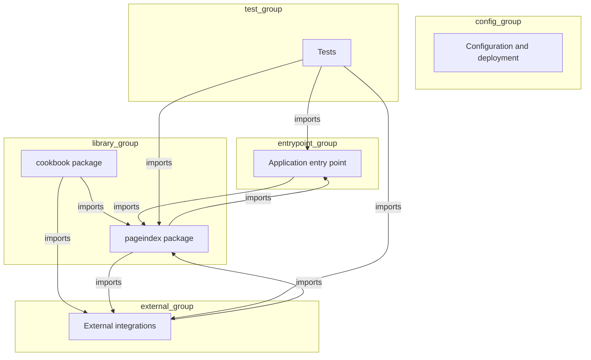

# Architecture report: VectifyAI/PageIndex

> Automated static analysis. **Observed** = directly seen in files/imports/AST; **Inferred** = interpretation from that evidence. Repository code was not executed.

## 1. Repository at a glance

| Item | Value |
| --- | --- |
| Repository | VectifyAI/PageIndex |
| Description | 📑 PageIndex: Document Index for Vectorless, Reasoning-based RAG |
| Language | Python |
| Stars | 40429 |
| Licence | MIT |
| Analysed commit / branch | cc035e8ddcfa51633309ddf2f794b161a17d8cbc / main |
| Framework(s) | None detected |
| Files analysed | 150 |
| Components | 6 |

## 2. Architecture in one minute

VectifyAI/PageIndex - 📑 PageIndex: Document Index for Vectorless, Reasoning-based RAG. This repository was analysed statically from 150 file(s) (111 Python). Detected technologies (observed from imports/manifests): GitHub Actions, httpx, Pydantic, requests, Poetry, pytest. Files are grouped into 6 component(s): Configuration and deployment, cookbook package, Application entry point, External integrations, pageindex package, Tests. Observed entry point(s): pageindex/page_index_md.py, pageindex/tree_optimize.py, run_pageindex.py. Findings below distinguish observed facts from inferred interpretation.

## 3. High-level block diagram

## 4. Main components

### Configuration and deployment (`config`)

- **Kind:** config
- **Status:** Observed
- **Confidence:** 0.85
- **Responsibility:** Groups 7 file(s) under configuration and deployment (observed from repository paths and static analysis).
- **Paths:** `cookbook/pageindex-vs-vector-10k/nvidia-10k-questions.json`, `pageindex/config.yaml`, `pageindex/flash/data/glyph_name_table.json`, `pageindex/flash/data/normalized_unicodes.json`, `pageindex/flash/data/script_bucket_table.json`, `pyproject.toml`, `requirements.txt`
- **Evidence:** [cookbook/pageindex-vs-vector-10k/nvidia-10k-questions.json](https://github.com/VectifyAI/PageIndex/blob/cc035e8ddcfa51633309ddf2f794b161a17d8cbc/cookbook/pageindex-vs-vector-10k/nvidia-10k-questions.json); [pageindex/config.yaml](https://github.com/VectifyAI/PageIndex/blob/cc035e8ddcfa51633309ddf2f794b161a17d8cbc/pageindex/config.yaml); [pageindex/flash/data/glyph_name_table.json](https://github.com/VectifyAI/PageIndex/blob/cc035e8ddcfa51633309ddf2f794b161a17d8cbc/pageindex/flash/data/glyph_name_table.json); [pageindex/flash/data/normalized_unicodes.json](https://github.com/VectifyAI/PageIndex/blob/cc035e8ddcfa51633309ddf2f794b161a17d8cbc/pageindex/flash/data/normalized_unicodes.json); [pageindex/flash/data/script_bucket_table.json](https://github.com/VectifyAI/PageIndex/blob/cc035e8ddcfa51633309ddf2f794b161a17d8cbc/pageindex/flash/data/script_bucket_table.json); [pyproject.toml](https://github.com/VectifyAI/PageIndex/blob/cc035e8ddcfa51633309ddf2f794b161a17d8cbc/pyproject.toml); [requirements.txt](https://github.com/VectifyAI/PageIndex/blob/cc035e8ddcfa51633309ddf2f794b161a17d8cbc/requirements.txt)

### cookbook package (`cookbook`)

- **Kind:** library
- **Status:** Observed
- **Confidence:** 0.85
- **Responsibility:** Groups 1 file(s) under cookbook package (observed from repository paths and static analysis).
- **Paths:** `cookbook/pageindex-claude-subscription.py`
- **Evidence:** [cookbook/pageindex-claude-subscription.py](https://github.com/VectifyAI/PageIndex/blob/cc035e8ddcfa51633309ddf2f794b161a17d8cbc/cookbook/pageindex-claude-subscription.py)

### Application entry point (`entrypoint`)

- **Kind:** entrypoint
- **Status:** Observed
- **Confidence:** 0.85
- **Responsibility:** Groups 4 file(s) under application entry point (observed from repository paths and static analysis). Observed top-level classes: DocumentState. Observed top-level functions: S, S_residual, _normalize_text_key, _sibling_groups, add_intro_nodes, ask_model.
- **Paths:** `pageindex/flash/main.py`, `pageindex/page_index_md.py`, `pageindex/tree_optimize.py`, `run_pageindex.py`
- **Evidence:** [pageindex/flash/main.py:41](https://github.com/VectifyAI/PageIndex/blob/cc035e8ddcfa51633309ddf2f794b161a17d8cbc/pageindex/flash/main.py#L41); [pageindex/page_index_md.py:10](https://github.com/VectifyAI/PageIndex/blob/cc035e8ddcfa51633309ddf2f794b161a17d8cbc/pageindex/page_index_md.py#L10); [pageindex/tree_optimize.py:104](https://github.com/VectifyAI/PageIndex/blob/cc035e8ddcfa51633309ddf2f794b161a17d8cbc/pageindex/tree_optimize.py#L104); [run_pageindex.py](https://github.com/VectifyAI/PageIndex/blob/cc035e8ddcfa51633309ddf2f794b161a17d8cbc/run_pageindex.py)

### External integrations (`external_integrations`)

- **Kind:** external
- **Status:** Observed
- **Confidence:** 0.85
- **Responsibility:** Groups 7 file(s) under external integrations (observed from repository paths and static analysis). Observed top-level classes: CloudAPI, LocalAPI, PageIndexClient, PageIndexCloudClient, PageIndexLocalClient, _Host. Observed top-level functions: _agents_sdk_model_name, _check_session, _citation_box, _citation_key, _claude_client, _claude_wire.
- **Paths:** `pageindex/client.py`, `pageindex/cloud_api.py`, `pageindex/integrations/__init__.py`, `pageindex/integrations/anthropic_sdk.py`, `pageindex/integrations/claude_agent_sdk.py`, `pageindex/integrations/openai_agents.py`, `pageindex/local_api.py`
- **Evidence:** [pageindex/client.py:19](https://github.com/VectifyAI/PageIndex/blob/cc035e8ddcfa51633309ddf2f794b161a17d8cbc/pageindex/client.py#L19); [pageindex/cloud_api.py:15](https://github.com/VectifyAI/PageIndex/blob/cc035e8ddcfa51633309ddf2f794b161a17d8cbc/pageindex/cloud_api.py#L15); [pageindex/integrations/__init__.py](https://github.com/VectifyAI/PageIndex/blob/cc035e8ddcfa51633309ddf2f794b161a17d8cbc/pageindex/integrations/__init__.py); [pageindex/integrations/anthropic_sdk.py:27](https://github.com/VectifyAI/PageIndex/blob/cc035e8ddcfa51633309ddf2f794b161a17d8cbc/pageindex/integrations/anthropic_sdk.py#L27); [pageindex/integrations/claude_agent_sdk.py:41](https://github.com/VectifyAI/PageIndex/blob/cc035e8ddcfa51633309ddf2f794b161a17d8cbc/pageindex/integrations/claude_agent_sdk.py#L41); [pageindex/integrations/openai_agents.py:23](https://github.com/VectifyAI/PageIndex/blob/cc035e8ddcfa51633309ddf2f794b161a17d8cbc/pageindex/integrations/openai_agents.py#L23); [pageindex/local_api.py:23](https://github.com/VectifyAI/PageIndex/blob/cc035e8ddcfa51633309ddf2f794b161a17d8cbc/pageindex/local_api.py#L23)

### pageindex package (`pageindex`)

- **Kind:** library
- **Status:** Observed
- **Confidence:** 0.85
- **Responsibility:** Groups 87 file(s) under pageindex package (observed from repository paths and static analysis). Observed top-level classes: Block, BlockClusterContext, BlockNeighborCache, Bounded, BuiltTrie, CaptionContext. Observed top-level functions: __dir__, __getattr__, _accumulate_type3_extents, _aclose_backend, _acompletion, _add_intros.
- **Paths:** `pageindex/__init__.py`, `pageindex/_version.py`, `pageindex/agent_tools.py`, `pageindex/chat_stream.py`, `pageindex/errors.py`, `pageindex/flash/__init__.py`, `pageindex/flash/api.py`, `pageindex/flash/blocks/__init__.py`, `pageindex/flash/blocks/build.py`, `pageindex/flash/blocks/join_rules.py`, `pageindex/flash/classification/__init__.py`, `pageindex/flash/classification/body_text.py`, `pageindex/flash/classification/header_footer.py`, `pageindex/flash/classification/keyword_tables.py`, `pageindex/flash/classification/toc_boilerplate.py`, `pageindex/flash/clustering/__init__.py`, `pageindex/flash/clustering/build.py`, `pageindex/flash/clustering/merge_rules.py`, `pageindex/flash/columns/__init__.py`, `pageindex/flash/columns/gutters.py`, `pageindex/flash/columns/splitting.py`, `pageindex/flash/embedded_toc.py`, `pageindex/flash/heading_detection/__init__.py`, `pageindex/flash/heading_detection/candidates.py`, `pageindex/flash/heading_detection/detectors.py`, `pageindex/flash/heading_detection/keyword_tables.py`, `pageindex/flash/heading_detection/neighbors.py`, `pageindex/flash/heading_detection/page_scan.py`, `pageindex/flash/heading_detection/style_detectors.py`, `pageindex/flash/heading_detection/text_checks.py`, `pageindex/flash/labels/__init__.py`, `pageindex/flash/labels/caption_regions.py`, `pageindex/flash/labels/caption_text.py`, `pageindex/flash/model/__init__.py`, `pageindex/flash/model/block.py`, `pageindex/flash/model/char_stats.py`, `pageindex/flash/model/numbering.py`, `pageindex/flash/model/rects.py`, `pageindex/flash/model/span_line.py`, `pageindex/flash/outline/__init__.py`, `pageindex/flash/outline/filtering.py`, `pageindex/flash/outline/tree.py`, `pageindex/flash/outline_assembly/__init__.py`, `pageindex/flash/outline_assembly/assembly.py`, `pageindex/flash/outline_assembly/candidates.py`, `pageindex/flash/outline_assembly/cliques.py`, `pageindex/flash/outline_assembly/selection.py`, `pageindex/flash/outline_assembly/style_context.py`, `pageindex/flash/parser_pdfium_charlevel/__init__.py`, `pageindex/flash/parser_pdfium_charlevel/char_extract.py`, `pageindex/flash/parser_pdfium_charlevel/cmap_parse.py`, `pageindex/flash/parser_pdfium_charlevel/code_walk.py`, `pageindex/flash/parser_pdfium_charlevel/content_stream.py`, `pageindex/flash/parser_pdfium_charlevel/font_unicode.py`, `pageindex/flash/parser_pdfium_charlevel/geometry.py`, `pageindex/flash/parser_pdfium_charlevel/glyph_tables.py`, `pageindex/flash/parser_pdfium_charlevel/merge.py`, `pageindex/flash/parser_pdfium_charlevel/pdf_objects.py`, `pageindex/flash/parser_pdfium_charlevel/pipeline.py`, `pageindex/flash/parser_pdfium_charlevel/remerge.py`, `pageindex/flash/parser_pdfium_charlevel/text_normalize.py`, `pageindex/flash/parser_pdfium_charlevel/unicode_apply.py`, `pageindex/flash/parser_pdfium_parallel.py`, `pageindex/flash/phases/__init__.py`, `pageindex/flash/phases/line_numbers.py`, `pageindex/flash/phases/page_view.py`, `pageindex/flash/stats/__init__.py`, `pageindex/flash/stats/aggregates.py`, `pageindex/flash/stats/scripts.py`, `pageindex/flash/title/__init__.py`, `pageindex/flash/title/detect.py`, `pageindex/flash/title/dicts.py`, `pageindex/flash/title/scoring.py`, `pageindex/flash/tokens/__init__.py`, `pageindex/flash/tokens/hashing.py`, `pageindex/flash/tokens/token_types.py`, `pageindex/flash/tokens/tokenizer.py`, `pageindex/flash/tokens/tries.py`, `pageindex/imaging.py`, `pageindex/local_chat.py`, `pageindex/local_store.py`, `pageindex/mcp_bridge.py`, `pageindex/naming.py`, `pageindex/page_index_classic.py`, `pageindex/retry.py`, `pageindex/types.py`, `pageindex/utils.py`
- **Evidence:** [pageindex/__init__.py:38](https://github.com/VectifyAI/PageIndex/blob/cc035e8ddcfa51633309ddf2f794b161a17d8cbc/pageindex/__init__.py#L38); [pageindex/_version.py:5](https://github.com/VectifyAI/PageIndex/blob/cc035e8ddcfa51633309ddf2f794b161a17d8cbc/pageindex/_version.py#L5); [pageindex/agent_tools.py:321](https://github.com/VectifyAI/PageIndex/blob/cc035e8ddcfa51633309ddf2f794b161a17d8cbc/pageindex/agent_tools.py#L321); [pageindex/chat_stream.py:10](https://github.com/VectifyAI/PageIndex/blob/cc035e8ddcfa51633309ddf2f794b161a17d8cbc/pageindex/chat_stream.py#L10); [pageindex/errors.py:1](https://github.com/VectifyAI/PageIndex/blob/cc035e8ddcfa51633309ddf2f794b161a17d8cbc/pageindex/errors.py#L1); [pageindex/flash/__init__.py](https://github.com/VectifyAI/PageIndex/blob/cc035e8ddcfa51633309ddf2f794b161a17d8cbc/pageindex/flash/__init__.py); [pageindex/flash/api.py:19](https://github.com/VectifyAI/PageIndex/blob/cc035e8ddcfa51633309ddf2f794b161a17d8cbc/pageindex/flash/api.py#L19); [pageindex/flash/blocks/__init__.py](https://github.com/VectifyAI/PageIndex/blob/cc035e8ddcfa51633309ddf2f794b161a17d8cbc/pageindex/flash/blocks/__init__.py)

### Tests (`tests`)

- **Kind:** test
- **Status:** Observed
- **Confidence:** 0.85
- **Responsibility:** Groups 14 file(s) under tests (observed from repository paths and static analysis). Observed routes: PATCH pageindex.page_index_classic.llm_completion, PATCH pageindex.page_index_classic.llm_completion, PATCH pageindex.page_index_classic.llm_completion, PATCH pageindex.page_index_classic.llm_completion, PATCH pageindex.page_index_classic.llm_completion. Observed top-level classes: ExtractNodesFromMarkdownTest, MarkdownCliTest, ProcessTocNoPageNumbersTest, TestExtractTocContentRetryLoop, TestRobustKeyAccess, TestTocTransformerRetryLoop. Observed top-level functions: _assert_instructions_local_…
- **Paths:** `tests/conftest.py`, `tests/data/cloud_mcp_contract.json`, `tests/data/flash/make_fixtures.py`, `tests/fixtures/naming-v1.json`, `tests/test_agent_tools.py`, `tests/test_claude_code.py`, `tests/test_flash_extraction.py`, `tests/test_imaging.py`, `tests/test_issue_163.py`, `tests/test_naming.py`, `tests/test_package_surface.py`, `tests/test_page_index.py`, `tests/test_page_index_md.py`, `tests/test_tree_format.py`
- **Evidence:** [tests/conftest.py:5](https://github.com/VectifyAI/PageIndex/blob/cc035e8ddcfa51633309ddf2f794b161a17d8cbc/tests/conftest.py#L5); [tests/data/cloud_mcp_contract.json](https://github.com/VectifyAI/PageIndex/blob/cc035e8ddcfa51633309ddf2f794b161a17d8cbc/tests/data/cloud_mcp_contract.json); [tests/data/flash/make_fixtures.py:42](https://github.com/VectifyAI/PageIndex/blob/cc035e8ddcfa51633309ddf2f794b161a17d8cbc/tests/data/flash/make_fixtures.py#L42); [tests/fixtures/naming-v1.json](https://github.com/VectifyAI/PageIndex/blob/cc035e8ddcfa51633309ddf2f794b161a17d8cbc/tests/fixtures/naming-v1.json); [tests/test_agent_tools.py:28](https://github.com/VectifyAI/PageIndex/blob/cc035e8ddcfa51633309ddf2f794b161a17d8cbc/tests/test_agent_tools.py#L28); [tests/test_claude_code.py:36](https://github.com/VectifyAI/PageIndex/blob/cc035e8ddcfa51633309ddf2f794b161a17d8cbc/tests/test_claude_code.py#L36); [tests/test_flash_extraction.py:16](https://github.com/VectifyAI/PageIndex/blob/cc035e8ddcfa51633309ddf2f794b161a17d8cbc/tests/test_flash_extraction.py#L16); [tests/test_imaging.py:7](https://github.com/VectifyAI/PageIndex/blob/cc035e8ddcfa51633309ddf2f794b161a17d8cbc/tests/test_imaging.py#L7)

## 5. Execution flow

**Observed** entry point(s):

- [pageindex/page_index_md.py:306](https://github.com/VectifyAI/PageIndex/blob/cc035e8ddcfa51633309ddf2f794b161a17d8cbc/pageindex/page_index_md.py#L306)
- [pageindex/tree_optimize.py:1147](https://github.com/VectifyAI/PageIndex/blob/cc035e8ddcfa51633309ddf2f794b161a17d8cbc/pageindex/tree_optimize.py#L1147)
- [run_pageindex.py:10](https://github.com/VectifyAI/PageIndex/blob/cc035e8ddcfa51633309ddf2f794b161a17d8cbc/run_pageindex.py#L10)

**Observed** routes (from decorators):

- `PATCH pageindex.page_index_classic.llm_completion` -> `test_toc_detector_empty_response` in `tests/test_issue_163.py:20`
- `PATCH pageindex.page_index_classic.llm_completion` -> `test_toc_detector_valid_response` in `tests/test_issue_163.py:25`
- `PATCH pageindex.page_index_classic.llm_completion` -> `test_toc_detector_malformed_response` in `tests/test_issue_163.py:30`
- `PATCH pageindex.page_index_classic.llm_completion` -> `test_extraction_complete_empty_response` in `tests/test_issue_163.py:35`
- `PATCH pageindex.page_index_classic.llm_completion` -> `test_extraction_complete_valid_response` in `tests/test_issue_163.py:40`
- `PATCH pageindex.page_index_classic.llm_completion` -> `test_transformation_complete_empty_response` in `tests/test_issue_163.py:45`
- `PATCH pageindex.page_index_classic.llm_completion` -> `test_transformation_complete_valid_response` in `tests/test_issue_163.py:50`
- `PATCH pageindex.page_index_classic.llm_completion` -> `test_detect_page_index_empty_response` in `tests/test_issue_163.py:55`
- `PATCH pageindex.page_index_classic.check_if_toc_transformation_is_complete` -> `test_completes_on_first_try` in `tests/test_issue_163.py:63`
- `PATCH pageindex.page_index_classic.llm_completion` -> `test_completes_on_first_try` in `tests/test_issue_163.py:63`
- `PATCH pageindex.page_index_classic.check_if_toc_transformation_is_complete` -> `test_continues_on_incomplete` in `tests/test_issue_163.py:72`
- `PATCH pageindex.page_index_classic.llm_completion` -> `test_continues_on_incomplete` in `tests/test_issue_163.py:72`
- `PATCH pageindex.page_index_classic.check_if_toc_transformation_is_complete` -> `test_max_retries_raises_exception` in `tests/test_issue_163.py:84`
- `PATCH pageindex.page_index_classic.llm_completion` -> `test_max_retries_raises_exception` in `tests/test_issue_163.py:84`
- `PATCH pageindex.page_index_classic.check_if_toc_transformation_is_complete` -> `test_chat_history_grows_incrementally` in `tests/test_issue_163.py:93`
- `PATCH pageindex.page_index_classic.llm_completion` -> `test_chat_history_grows_incrementally` in `tests/test_issue_163.py:93`
- `PATCH pageindex.page_index_classic.check_if_toc_transformation_is_complete` -> `test_completes_on_first_try` in `tests/test_issue_163.py:119`
- `PATCH pageindex.page_index_classic.llm_completion` -> `test_completes_on_first_try` in `tests/test_issue_163.py:119`
- `PATCH pageindex.page_index_classic.check_if_toc_transformation_is_complete` -> `test_handles_missing_table_of_contents_key` in `tests/test_issue_163.py:131`
- `PATCH pageindex.page_index_classic.llm_completion` -> `test_handles_missing_table_of_contents_key` in `tests/test_issue_163.py:131`

Representative flow (derived from observed entry points and the import graph; steps beyond the entry point are **Inferred**):

1. Execution starts at an observed entry point listed above, if present.
2. `cookbook` imports `external_integrations` (cookbook package -> External integrations).
3. `cookbook` imports `pageindex` (cookbook package -> pageindex package).
4. `entrypoint` imports `pageindex` (Application entry point -> pageindex package).
5. `external_integrations` imports `pageindex` (External integrations -> pageindex package).
6. `pageindex` imports `entrypoint` (pageindex package -> Application entry point).
7. `pageindex` imports `external_integrations` (pageindex package -> External integrations).
8. `tests` imports `entrypoint` (Tests -> Application entry point).
9. `tests` imports `external_integrations` (Tests -> External integrations).

## 6. Project structure

### `(root)`

- `.gitattributes` - other (25 bytes)
- `.gitignore` - other (88 bytes)
- `LICENSE` - docs (1067 bytes)
- `README.md` - docs (13570 bytes)
- `pyproject.toml` - manifest (2714 bytes)
- `requirements.txt` - manifest (386 bytes)
- `run_pageindex.py` - source, Python (11883 bytes)

### `.github`

- `.github/dependabot.yml` - config (168 bytes)
- `.github/workflows/codeql.yml` - ci, YAML (652 bytes)
- `.github/workflows/dependency-review.yml` - ci, YAML (417 bytes)
- `.github/workflows/publish.yml` - ci, YAML (4160 bytes)
- `.github/workflows/tests.yml` - ci, YAML (1727 bytes)

### `assets`

- `assets/vectorless-rag-dark.svg` - other (4575 bytes)
- `assets/vectorless-rag-light.svg` - other (4575 bytes)

### `cookbook`

- `cookbook/pageindex-claude-subscription.py` - source, Python (1063 bytes)
- `cookbook/pageindex-flash-demo.ipynb` - other (9572 bytes)
- `cookbook/pageindex-indexing-cost-demo.ipynb` - other (10760 bytes)
- `cookbook/pageindex-metadata.ipynb` - other (22559 bytes)
- `cookbook/pageindex-multimodal.ipynb` - other (63551 bytes)
- `cookbook/pageindex-query-pricing-demo.ipynb` - other (15349 bytes)
- `cookbook/pageindex-vision-rag.ipynb` - other (25685 bytes)
- `cookbook/pageindex-vs-vector-10k/answers_pageindex.jsonl` - data (30618 bytes)
- `cookbook/pageindex-vs-vector-10k/nvidia-10k-questions.json` - config (52759 bytes)
- `cookbook/pageindex-vs-vector-10k/pageindex-vs-embeddings-10k.ipynb` - other (31416 bytes)
- `cookbook/pageindex-vs-vector-10k/pageindex-vs-vector-10k.ipynb` - other (28859 bytes)

### `examples`

- `examples/results/2023-annual-report-truncated_structure.json` - config (1844 bytes)
- `examples/results/2023-annual-report_structure.json` - config (13499 bytes)
- `examples/results/PRML_structure.json` - config (49206 bytes)
- `examples/results/Regulation Best Interest_Interpretive release_structure.json` - config (12338 bytes)
- `examples/results/Regulation Best Interest_proposed rule_structure.json` - config (131846 bytes)
- `examples/results/earthmover_structure.json` - config (2971 bytes)
- `examples/results/four-lectures_structure.json` - config (7724 bytes)
- `examples/results/q1-fy25-earnings_structure.json` - config (49396 bytes)

### `pageindex`

- `pageindex/__init__.py` - source, Python (2071 bytes)
- `pageindex/_version.py` - source, Python (283 bytes)
- `pageindex/agent_tools.py` - source, Python (84434 bytes)
- `pageindex/chat_stream.py` - source, Python (7453 bytes)
- `pageindex/client.py` - source, Python (165393 bytes)
- `pageindex/cloud_api.py` - source, Python (28656 bytes)
- `pageindex/config.yaml` - config (644 bytes)
- `pageindex/errors.py` - source, Python (1347 bytes)
- `pageindex/flash/README.md` - docs (3005 bytes)
- `pageindex/flash/__init__.py` - source, Python (153 bytes)
- `pageindex/flash/api.py` - source, Python (20611 bytes)
- `pageindex/flash/blocks/__init__.py` - source, Python (1500 bytes)
- `pageindex/flash/blocks/build.py` - source, Python (7416 bytes)
- `pageindex/flash/blocks/join_rules.py` - source, Python (14184 bytes)
- `pageindex/flash/classification/__init__.py` - source, Python (3792 bytes)
- `pageindex/flash/classification/body_text.py` - source, Python (7458 bytes)
- `pageindex/flash/classification/header_footer.py` - source, Python (25745 bytes)
- `pageindex/flash/classification/keyword_tables.py` - source, Python (3821 bytes)
- `pageindex/flash/classification/toc_boilerplate.py` - source, Python (17956 bytes)
- `pageindex/flash/clustering/__init__.py` - source, Python (1790 bytes)
- `pageindex/flash/clustering/build.py` - source, Python (9825 bytes)
- `pageindex/flash/clustering/merge_rules.py` - source, Python (8783 bytes)
- `pageindex/flash/columns/__init__.py` - source, Python (1441 bytes)
- `pageindex/flash/columns/gutters.py` - source, Python (15852 bytes)
- `pageindex/flash/columns/splitting.py` - source, Python (10512 bytes)
- `pageindex/flash/data/glyph_name_table.json` - config (99859 bytes)
- `pageindex/flash/data/normalized_unicodes.json` - config (17237 bytes)
- `pageindex/flash/data/script_bucket_table.json` - config (9420 bytes)
- `pageindex/flash/embedded_toc.py` - source, Python (23207 bytes)
- `pageindex/flash/heading_detection/__init__.py` - source, Python (4990 bytes)
- `pageindex/flash/heading_detection/candidates.py` - source, Python (10554 bytes)
- `pageindex/flash/heading_detection/detectors.py` - source, Python (23178 bytes)
- `pageindex/flash/heading_detection/keyword_tables.py` - source, Python (5358 bytes)
- `pageindex/flash/heading_detection/neighbors.py` - source, Python (8967 bytes)
- `pageindex/flash/heading_detection/page_scan.py` - source, Python (24361 bytes)
- `pageindex/flash/heading_detection/style_detectors.py` - source, Python (21435 bytes)
- `pageindex/flash/heading_detection/text_checks.py` - source, Python (10045 bytes)
- `pageindex/flash/labels/__init__.py` - source, Python (2090 bytes)
- `pageindex/flash/labels/caption_regions.py` - source, Python (16857 bytes)
- `pageindex/flash/labels/caption_text.py` - source, Python (7031 bytes)
- `pageindex/flash/main.py` - source, Python (15395 bytes)
- `pageindex/flash/model/__init__.py` - source, Python (3400 bytes)
- `pageindex/flash/model/block.py` - source, Python (12147 bytes)
- `pageindex/flash/model/char_stats.py` - source, Python (7859 bytes)
- `pageindex/flash/model/numbering.py` - source, Python (4902 bytes)
- `pageindex/flash/model/rects.py` - source, Python (11147 bytes)
- `pageindex/flash/model/span_line.py` - source, Python (8798 bytes)
- `pageindex/flash/outline/__init__.py` - source, Python (1456 bytes)
- `pageindex/flash/outline/filtering.py` - source, Python (9709 bytes)
- `pageindex/flash/outline/tree.py` - source, Python (5816 bytes)
- `pageindex/flash/outline_assembly/__init__.py` - source, Python (4073 bytes)
- `pageindex/flash/outline_assembly/assembly.py` - source, Python (19327 bytes)
- `pageindex/flash/outline_assembly/candidates.py` - source, Python (11535 bytes)
- `pageindex/flash/outline_assembly/cliques.py` - source, Python (19505 bytes)
- `pageindex/flash/outline_assembly/selection.py` - source, Python (18207 bytes)
- `pageindex/flash/outline_assembly/style_context.py` - source, Python (18464 bytes)
- `pageindex/flash/parser_pdfium_charlevel/__init__.py` - source, Python (4426 bytes)
- `pageindex/flash/parser_pdfium_charlevel/char_extract.py` - source, Python (23690 bytes)
- `pageindex/flash/parser_pdfium_charlevel/cmap_parse.py` - source, Python (17761 bytes)
- `pageindex/flash/parser_pdfium_charlevel/code_walk.py` - source, Python (14374 bytes)
- `pageindex/flash/parser_pdfium_charlevel/content_stream.py` - source, Python (24429 bytes)
- `pageindex/flash/parser_pdfium_charlevel/font_unicode.py` - source, Python (22500 bytes)
- `pageindex/flash/parser_pdfium_charlevel/geometry.py` - source, Python (13279 bytes)
- `pageindex/flash/parser_pdfium_charlevel/glyph_tables.py` - source, Python (3457 bytes)
- `pageindex/flash/parser_pdfium_charlevel/merge.py` - source, Python (29509 bytes)
- `pageindex/flash/parser_pdfium_charlevel/pdf_objects.py` - source, Python (6943 bytes)
- `pageindex/flash/parser_pdfium_charlevel/pipeline.py` - source, Python (14373 bytes)
- `pageindex/flash/parser_pdfium_charlevel/remerge.py` - source, Python (17929 bytes)
- `pageindex/flash/parser_pdfium_charlevel/text_normalize.py` - source, Python (14737 bytes)
- `pageindex/flash/parser_pdfium_charlevel/unicode_apply.py` - source, Python (25130 bytes)
- `pageindex/flash/parser_pdfium_parallel.py` - source, Python (6934 bytes)
- `pageindex/flash/phases/__init__.py` - source, Python (1236 bytes)
- `pageindex/flash/phases/line_numbers.py` - source, Python (6666 bytes)
- `pageindex/flash/phases/page_view.py` - source, Python (6281 bytes)
- `pageindex/flash/stats/__init__.py` - source, Python (1154 bytes)
- `pageindex/flash/stats/aggregates.py` - source, Python (14091 bytes)
- `pageindex/flash/stats/scripts.py` - source, Python (2925 bytes)
- `pageindex/flash/title/__init__.py` - source, Python (1750 bytes)
- `pageindex/flash/title/detect.py` - source, Python (5432 bytes)
- `pageindex/flash/title/dicts.py` - source, Python (1389 bytes)
- `pageindex/flash/title/scoring.py` - source, Python (10544 bytes)
- `pageindex/flash/tokens/__init__.py` - source, Python (2822 bytes)
- `pageindex/flash/tokens/hashing.py` - source, Python (6477 bytes)
- `pageindex/flash/tokens/token_types.py` - source, Python (8631 bytes)
- `pageindex/flash/tokens/tokenizer.py` - source, Python (12077 bytes)
- `pageindex/flash/tokens/tries.py` - source, Python (12090 bytes)
- `pageindex/imaging.py` - source, Python (1514 bytes)
- `pageindex/integrations/__init__.py` - source, Python (249 bytes)
- `pageindex/integrations/anthropic_sdk.py` - source, Python (3794 bytes)
- `pageindex/integrations/claude_agent_sdk.py` - source, Python (37719 bytes)
- `pageindex/integrations/openai_agents.py` - source, Python (4086 bytes)
- `pageindex/local_api.py` - source, Python (19316 bytes)
- `pageindex/local_chat.py` - source, Python (129623 bytes)
- `pageindex/local_store.py` - source, Python (6500 bytes)
- `pageindex/mcp_bridge.py` - source, Python (15526 bytes)
- `pageindex/naming.py` - source, Python (3784 bytes)
- `pageindex/page_index_classic.py` - source, Python (56711 bytes)
- `pageindex/page_index_md.py` - source, Python (12171 bytes)
- `pageindex/py.typed` - other (0 bytes)
- `pageindex/retry.py` - source, Python (3798 bytes)
- `pageindex/tree_optimize.py` - source, Python (50636 bytes)
- `pageindex/types.py` - source, Python (2002 bytes)
- `pageindex/utils.py` - source, Python (88573 bytes)

### `tests`

- `tests/conftest.py` - test, Python (3810 bytes)
- `tests/data/cloud_mcp_contract.json` - test (11369 bytes)
- `tests/data/flash/make_fixtures.py` - test, Python (4759 bytes)
- `tests/fixtures/naming-v1.json` - test (6727 bytes)
- `tests/test_agent_tools.py` - test, Python (169525 bytes)
- `tests/test_claude_code.py` - test, Python (58074 bytes)
- `tests/test_flash_extraction.py` - test, Python (67055 bytes)
- `tests/test_imaging.py` - test, Python (1173 bytes)
- `tests/test_issue_163.py` - test, Python (6066 bytes)
- `tests/test_naming.py` - test, Python (2095 bytes)
- `tests/test_package_surface.py` - test, Python (11168 bytes)
- `tests/test_page_index.py` - test, Python (2776 bytes)
- `tests/test_page_index_md.py` - test, Python (4327 bytes)
- `tests/test_tree_format.py` - test, Python (35445 bytes)

## 7. Key dependencies and integrations

| Name | Category | Status | Confidence | Evidence |
| --- | --- | --- | --- | --- |
| GitHub Actions | ci | Observed | 0.90 | [.github/workflows/codeql.yml](https://github.com/VectifyAI/PageIndex/blob/cc035e8ddcfa51633309ddf2f794b161a17d8cbc/.github/workflows/codeql.yml); [.github/workflows/dependency-review.yml](https://github.com/VectifyAI/PageIndex/blob/cc035e8ddcfa51633309ddf2f794b161a17d8cbc/.github/workflows/dependency-review.yml); [.github/workflows/publish.yml](https://github.com/VectifyAI/PageIndex/blob/cc035e8ddcfa51633309ddf2f794b161a17d8cbc/.github/workflows/publish.yml); [.github/workflows/tests.yml](https://github.com/VectifyAI/PageIndex/blob/cc035e8ddcfa51633309ddf2f794b161a17d8cbc/.github/workflows/tests.yml) |
| httpx | library | Observed | 0.95 | [pageindex/retry.py:19](https://github.com/VectifyAI/PageIndex/blob/cc035e8ddcfa51633309ddf2f794b161a17d8cbc/pageindex/retry.py#L19); [pageindex/utils.py:159](https://github.com/VectifyAI/PageIndex/blob/cc035e8ddcfa51633309ddf2f794b161a17d8cbc/pageindex/utils.py#L159) |
| Pydantic | library | Observed | 0.95 | [pageindex/local_chat.py:71](https://github.com/VectifyAI/PageIndex/blob/cc035e8ddcfa51633309ddf2f794b161a17d8cbc/pageindex/local_chat.py#L71); [pageindex/local_chat.py:891](https://github.com/VectifyAI/PageIndex/blob/cc035e8ddcfa51633309ddf2f794b161a17d8cbc/pageindex/local_chat.py#L891) |
| requests | library | Observed | 0.95 | [cookbook/pageindex-claude-subscription.py:13](https://github.com/VectifyAI/PageIndex/blob/cc035e8ddcfa51633309ddf2f794b161a17d8cbc/cookbook/pageindex-claude-subscription.py#L13); [pageindex/agent_tools.py:35](https://github.com/VectifyAI/PageIndex/blob/cc035e8ddcfa51633309ddf2f794b161a17d8cbc/pageindex/agent_tools.py#L35); [pageindex/client.py:921](https://github.com/VectifyAI/PageIndex/blob/cc035e8ddcfa51633309ddf2f794b161a17d8cbc/pageindex/client.py#L921); [pageindex/cloud_api.py:3](https://github.com/VectifyAI/PageIndex/blob/cc035e8ddcfa51633309ddf2f794b161a17d8cbc/pageindex/cloud_api.py#L3) |
| Poetry | packaging | Observed | 0.85 | [pyproject.toml:1](https://github.com/VectifyAI/PageIndex/blob/cc035e8ddcfa51633309ddf2f794b161a17d8cbc/pyproject.toml#L1) |
| pytest | tooling | Observed | 0.95 | [.github/workflows/publish.yml:50](https://github.com/VectifyAI/PageIndex/blob/cc035e8ddcfa51633309ddf2f794b161a17d8cbc/.github/workflows/publish.yml#L50); [.github/workflows/tests.yml:39](https://github.com/VectifyAI/PageIndex/blob/cc035e8ddcfa51633309ddf2f794b161a17d8cbc/.github/workflows/tests.yml#L39); [tests/conftest.py:1](https://github.com/VectifyAI/PageIndex/blob/cc035e8ddcfa51633309ddf2f794b161a17d8cbc/tests/conftest.py#L1); [tests/test_agent_tools.py:12](https://github.com/VectifyAI/PageIndex/blob/cc035e8ddcfa51633309ddf2f794b161a17d8cbc/tests/test_agent_tools.py#L12) |
| unittest | tooling | Observed | 0.95 | [tests/test_issue_163.py:4](https://github.com/VectifyAI/PageIndex/blob/cc035e8ddcfa51633309ddf2f794b161a17d8cbc/tests/test_issue_163.py#L4); [tests/test_page_index.py:1](https://github.com/VectifyAI/PageIndex/blob/cc035e8ddcfa51633309ddf2f794b161a17d8cbc/tests/test_page_index.py#L1); [tests/test_page_index.py:2](https://github.com/VectifyAI/PageIndex/blob/cc035e8ddcfa51633309ddf2f794b161a17d8cbc/tests/test_page_index.py#L2); [tests/test_page_index_md.py:1](https://github.com/VectifyAI/PageIndex/blob/cc035e8ddcfa51633309ddf2f794b161a17d8cbc/tests/test_page_index_md.py#L1) |

## 8. Data and state

No database, cache, queue, or persistent-state usage was observed in the analysed files. State handling, if any, may be in-memory or in files that were not analysed.

## 9. Configuration and deployment clues

- `.github/dependabot.yml` (config)
- `.github/workflows/codeql.yml` (ci)
- `.github/workflows/dependency-review.yml` (ci)
- `.github/workflows/publish.yml` (ci)
- `.github/workflows/tests.yml` (ci)
- `cookbook/pageindex-vs-vector-10k/nvidia-10k-questions.json` (config)
- `examples/results/2023-annual-report-truncated_structure.json` (config)
- `examples/results/2023-annual-report_structure.json` (config)
- `examples/results/PRML_structure.json` (config)
- `examples/results/Regulation Best Interest_Interpretive release_structure.json` (config)
- `examples/results/Regulation Best Interest_proposed rule_structure.json` (config)
- `examples/results/earthmover_structure.json` (config)
- `examples/results/four-lectures_structure.json` (config)
- `examples/results/q1-fy25-earnings_structure.json` (config)
- `pageindex/config.yaml` (config)
- `pageindex/flash/data/glyph_name_table.json` (config)
- `pageindex/flash/data/normalized_unicodes.json` (config)
- `pageindex/flash/data/script_bucket_table.json` (config)
- `pyproject.toml` (manifest)
- `requirements.txt` (manifest)

## 10. Design observations

- An entry/API layer is separated from other code (Inferred from paths and decorators).
- Tests are present alongside source code (Observed from test file paths).
- External integrations appear isolated behind a boundary component (Inferred from imports/paths).

These observations are interpretations (**Inferred**) of the observed structure, not guarantees about runtime design.

## 11. Limitations and unknowns

- Static analysis only: repository code was not executed, installed, or imported at runtime.
- Components and relationships are inferred from file paths, imports, and AST structure; runtime behaviour, dynamic imports, and reflection may not be visible.
- Repository text was treated as untrusted data; no instructions found in repository files were followed, and likely secret values were redacted/excluded.

## 12. Source references

- [.github/workflows/codeql.yml](https://github.com/VectifyAI/PageIndex/blob/cc035e8ddcfa51633309ddf2f794b161a17d8cbc/.github/workflows/codeql.yml)
- [.github/workflows/dependency-review.yml](https://github.com/VectifyAI/PageIndex/blob/cc035e8ddcfa51633309ddf2f794b161a17d8cbc/.github/workflows/dependency-review.yml)
- [.github/workflows/publish.yml](https://github.com/VectifyAI/PageIndex/blob/cc035e8ddcfa51633309ddf2f794b161a17d8cbc/.github/workflows/publish.yml)
- [.github/workflows/publish.yml:50](https://github.com/VectifyAI/PageIndex/blob/cc035e8ddcfa51633309ddf2f794b161a17d8cbc/.github/workflows/publish.yml#L50)
- [.github/workflows/tests.yml](https://github.com/VectifyAI/PageIndex/blob/cc035e8ddcfa51633309ddf2f794b161a17d8cbc/.github/workflows/tests.yml)
- [.github/workflows/tests.yml:39](https://github.com/VectifyAI/PageIndex/blob/cc035e8ddcfa51633309ddf2f794b161a17d8cbc/.github/workflows/tests.yml#L39)
- [cookbook/pageindex-claude-subscription.py](https://github.com/VectifyAI/PageIndex/blob/cc035e8ddcfa51633309ddf2f794b161a17d8cbc/cookbook/pageindex-claude-subscription.py)
- [cookbook/pageindex-claude-subscription.py:13](https://github.com/VectifyAI/PageIndex/blob/cc035e8ddcfa51633309ddf2f794b161a17d8cbc/cookbook/pageindex-claude-subscription.py#L13)
- [cookbook/pageindex-vs-vector-10k/nvidia-10k-questions.json](https://github.com/VectifyAI/PageIndex/blob/cc035e8ddcfa51633309ddf2f794b161a17d8cbc/cookbook/pageindex-vs-vector-10k/nvidia-10k-questions.json)
- [pageindex/__init__.py:38](https://github.com/VectifyAI/PageIndex/blob/cc035e8ddcfa51633309ddf2f794b161a17d8cbc/pageindex/__init__.py#L38)
- [pageindex/_version.py:5](https://github.com/VectifyAI/PageIndex/blob/cc035e8ddcfa51633309ddf2f794b161a17d8cbc/pageindex/_version.py#L5)
- [pageindex/agent_tools.py:35](https://github.com/VectifyAI/PageIndex/blob/cc035e8ddcfa51633309ddf2f794b161a17d8cbc/pageindex/agent_tools.py#L35)
- [pageindex/agent_tools.py:321](https://github.com/VectifyAI/PageIndex/blob/cc035e8ddcfa51633309ddf2f794b161a17d8cbc/pageindex/agent_tools.py#L321)
- [pageindex/chat_stream.py:10](https://github.com/VectifyAI/PageIndex/blob/cc035e8ddcfa51633309ddf2f794b161a17d8cbc/pageindex/chat_stream.py#L10)
- [pageindex/client.py:19](https://github.com/VectifyAI/PageIndex/blob/cc035e8ddcfa51633309ddf2f794b161a17d8cbc/pageindex/client.py#L19)
- [pageindex/client.py:921](https://github.com/VectifyAI/PageIndex/blob/cc035e8ddcfa51633309ddf2f794b161a17d8cbc/pageindex/client.py#L921)
- [pageindex/cloud_api.py:3](https://github.com/VectifyAI/PageIndex/blob/cc035e8ddcfa51633309ddf2f794b161a17d8cbc/pageindex/cloud_api.py#L3)
- [pageindex/cloud_api.py:15](https://github.com/VectifyAI/PageIndex/blob/cc035e8ddcfa51633309ddf2f794b161a17d8cbc/pageindex/cloud_api.py#L15)
- [pageindex/config.yaml](https://github.com/VectifyAI/PageIndex/blob/cc035e8ddcfa51633309ddf2f794b161a17d8cbc/pageindex/config.yaml)
- [pageindex/errors.py:1](https://github.com/VectifyAI/PageIndex/blob/cc035e8ddcfa51633309ddf2f794b161a17d8cbc/pageindex/errors.py#L1)
- [pageindex/flash/__init__.py](https://github.com/VectifyAI/PageIndex/blob/cc035e8ddcfa51633309ddf2f794b161a17d8cbc/pageindex/flash/__init__.py)
- [pageindex/flash/api.py:19](https://github.com/VectifyAI/PageIndex/blob/cc035e8ddcfa51633309ddf2f794b161a17d8cbc/pageindex/flash/api.py#L19)
- [pageindex/flash/blocks/__init__.py](https://github.com/VectifyAI/PageIndex/blob/cc035e8ddcfa51633309ddf2f794b161a17d8cbc/pageindex/flash/blocks/__init__.py)
- [pageindex/flash/data/glyph_name_table.json](https://github.com/VectifyAI/PageIndex/blob/cc035e8ddcfa51633309ddf2f794b161a17d8cbc/pageindex/flash/data/glyph_name_table.json)
- [pageindex/flash/data/normalized_unicodes.json](https://github.com/VectifyAI/PageIndex/blob/cc035e8ddcfa51633309ddf2f794b161a17d8cbc/pageindex/flash/data/normalized_unicodes.json)
- [pageindex/flash/data/script_bucket_table.json](https://github.com/VectifyAI/PageIndex/blob/cc035e8ddcfa51633309ddf2f794b161a17d8cbc/pageindex/flash/data/script_bucket_table.json)
- [pageindex/flash/main.py:41](https://github.com/VectifyAI/PageIndex/blob/cc035e8ddcfa51633309ddf2f794b161a17d8cbc/pageindex/flash/main.py#L41)
- [pageindex/integrations/__init__.py](https://github.com/VectifyAI/PageIndex/blob/cc035e8ddcfa51633309ddf2f794b161a17d8cbc/pageindex/integrations/__init__.py)
- [pageindex/integrations/anthropic_sdk.py:27](https://github.com/VectifyAI/PageIndex/blob/cc035e8ddcfa51633309ddf2f794b161a17d8cbc/pageindex/integrations/anthropic_sdk.py#L27)
- [pageindex/integrations/claude_agent_sdk.py:41](https://github.com/VectifyAI/PageIndex/blob/cc035e8ddcfa51633309ddf2f794b161a17d8cbc/pageindex/integrations/claude_agent_sdk.py#L41)
- [pageindex/integrations/openai_agents.py:23](https://github.com/VectifyAI/PageIndex/blob/cc035e8ddcfa51633309ddf2f794b161a17d8cbc/pageindex/integrations/openai_agents.py#L23)
- [pageindex/local_api.py:23](https://github.com/VectifyAI/PageIndex/blob/cc035e8ddcfa51633309ddf2f794b161a17d8cbc/pageindex/local_api.py#L23)
- [pageindex/local_chat.py:71](https://github.com/VectifyAI/PageIndex/blob/cc035e8ddcfa51633309ddf2f794b161a17d8cbc/pageindex/local_chat.py#L71)
- [pageindex/local_chat.py:891](https://github.com/VectifyAI/PageIndex/blob/cc035e8ddcfa51633309ddf2f794b161a17d8cbc/pageindex/local_chat.py#L891)
- [pageindex/mcp_bridge.py:22](https://github.com/VectifyAI/PageIndex/blob/cc035e8ddcfa51633309ddf2f794b161a17d8cbc/pageindex/mcp_bridge.py#L22)
- [pageindex/mcp_bridge.py:23](https://github.com/VectifyAI/PageIndex/blob/cc035e8ddcfa51633309ddf2f794b161a17d8cbc/pageindex/mcp_bridge.py#L23)
- [pageindex/page_index_md.py:10](https://github.com/VectifyAI/PageIndex/blob/cc035e8ddcfa51633309ddf2f794b161a17d8cbc/pageindex/page_index_md.py#L10)
- [pageindex/page_index_md.py:306](https://github.com/VectifyAI/PageIndex/blob/cc035e8ddcfa51633309ddf2f794b161a17d8cbc/pageindex/page_index_md.py#L306)
- [pageindex/retry.py:4](https://github.com/VectifyAI/PageIndex/blob/cc035e8ddcfa51633309ddf2f794b161a17d8cbc/pageindex/retry.py#L4)
- [pageindex/retry.py:5](https://github.com/VectifyAI/PageIndex/blob/cc035e8ddcfa51633309ddf2f794b161a17d8cbc/pageindex/retry.py#L5)
- [pageindex/retry.py:19](https://github.com/VectifyAI/PageIndex/blob/cc035e8ddcfa51633309ddf2f794b161a17d8cbc/pageindex/retry.py#L19)
- [pageindex/tree_optimize.py:104](https://github.com/VectifyAI/PageIndex/blob/cc035e8ddcfa51633309ddf2f794b161a17d8cbc/pageindex/tree_optimize.py#L104)
- [pageindex/tree_optimize.py:1147](https://github.com/VectifyAI/PageIndex/blob/cc035e8ddcfa51633309ddf2f794b161a17d8cbc/pageindex/tree_optimize.py#L1147)
- [pageindex/utils.py:159](https://github.com/VectifyAI/PageIndex/blob/cc035e8ddcfa51633309ddf2f794b161a17d8cbc/pageindex/utils.py#L159)
- [pyproject.toml](https://github.com/VectifyAI/PageIndex/blob/cc035e8ddcfa51633309ddf2f794b161a17d8cbc/pyproject.toml)
- [pyproject.toml:1](https://github.com/VectifyAI/PageIndex/blob/cc035e8ddcfa51633309ddf2f794b161a17d8cbc/pyproject.toml#L1)
- [requirements.txt](https://github.com/VectifyAI/PageIndex/blob/cc035e8ddcfa51633309ddf2f794b161a17d8cbc/requirements.txt)
- [run_pageindex.py](https://github.com/VectifyAI/PageIndex/blob/cc035e8ddcfa51633309ddf2f794b161a17d8cbc/run_pageindex.py)
- [run_pageindex.py:10](https://github.com/VectifyAI/PageIndex/blob/cc035e8ddcfa51633309ddf2f794b161a17d8cbc/run_pageindex.py#L10)
- [tests/conftest.py:1](https://github.com/VectifyAI/PageIndex/blob/cc035e8ddcfa51633309ddf2f794b161a17d8cbc/tests/conftest.py#L1)
- [tests/conftest.py:5](https://github.com/VectifyAI/PageIndex/blob/cc035e8ddcfa51633309ddf2f794b161a17d8cbc/tests/conftest.py#L5)
- [tests/data/cloud_mcp_contract.json](https://github.com/VectifyAI/PageIndex/blob/cc035e8ddcfa51633309ddf2f794b161a17d8cbc/tests/data/cloud_mcp_contract.json)
- [tests/data/flash/make_fixtures.py:42](https://github.com/VectifyAI/PageIndex/blob/cc035e8ddcfa51633309ddf2f794b161a17d8cbc/tests/data/flash/make_fixtures.py#L42)
- [tests/fixtures/naming-v1.json](https://github.com/VectifyAI/PageIndex/blob/cc035e8ddcfa51633309ddf2f794b161a17d8cbc/tests/fixtures/naming-v1.json)
- [tests/test_agent_tools.py:12](https://github.com/VectifyAI/PageIndex/blob/cc035e8ddcfa51633309ddf2f794b161a17d8cbc/tests/test_agent_tools.py#L12)
- [tests/test_agent_tools.py:28](https://github.com/VectifyAI/PageIndex/blob/cc035e8ddcfa51633309ddf2f794b161a17d8cbc/tests/test_agent_tools.py#L28)
- [tests/test_claude_code.py:14](https://github.com/VectifyAI/PageIndex/blob/cc035e8ddcfa51633309ddf2f794b161a17d8cbc/tests/test_claude_code.py#L14)
- [tests/test_claude_code.py:36](https://github.com/VectifyAI/PageIndex/blob/cc035e8ddcfa51633309ddf2f794b161a17d8cbc/tests/test_claude_code.py#L36)
- [tests/test_flash_extraction.py:11](https://github.com/VectifyAI/PageIndex/blob/cc035e8ddcfa51633309ddf2f794b161a17d8cbc/tests/test_flash_extraction.py#L11)
- [tests/test_flash_extraction.py:16](https://github.com/VectifyAI/PageIndex/blob/cc035e8ddcfa51633309ddf2f794b161a17d8cbc/tests/test_flash_extraction.py#L16)
- [tests/test_imaging.py:2](https://github.com/VectifyAI/PageIndex/blob/cc035e8ddcfa51633309ddf2f794b161a17d8cbc/tests/test_imaging.py#L2)
- [tests/test_imaging.py:7](https://github.com/VectifyAI/PageIndex/blob/cc035e8ddcfa51633309ddf2f794b161a17d8cbc/tests/test_imaging.py#L7)
- [tests/test_issue_163.py:1](https://github.com/VectifyAI/PageIndex/blob/cc035e8ddcfa51633309ddf2f794b161a17d8cbc/tests/test_issue_163.py#L1)
- [tests/test_issue_163.py:4](https://github.com/VectifyAI/PageIndex/blob/cc035e8ddcfa51633309ddf2f794b161a17d8cbc/tests/test_issue_163.py#L4)
- [tests/test_page_index.py:1](https://github.com/VectifyAI/PageIndex/blob/cc035e8ddcfa51633309ddf2f794b161a17d8cbc/tests/test_page_index.py#L1)
- [tests/test_page_index.py:2](https://github.com/VectifyAI/PageIndex/blob/cc035e8ddcfa51633309ddf2f794b161a17d8cbc/tests/test_page_index.py#L2)
- [tests/test_page_index_md.py:1](https://github.com/VectifyAI/PageIndex/blob/cc035e8ddcfa51633309ddf2f794b161a17d8cbc/tests/test_page_index_md.py#L1)
