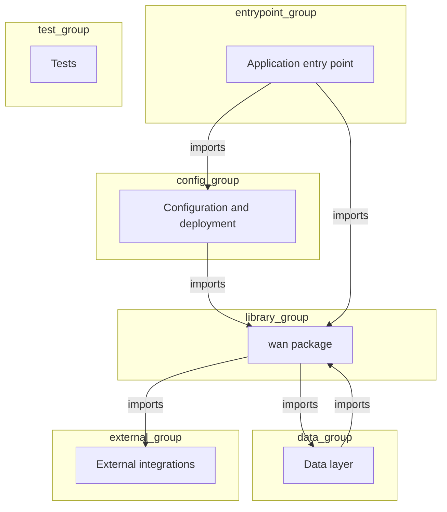

# Architecture report: Wan-Video/Wan2.1

> Automated static analysis. **Observed** = directly seen in files/imports/AST; **Inferred** = interpretation from that evidence. Repository code was not executed.

## 1. Repository at a glance

| Item | Value |
| --- | --- |
| Repository | Wan-Video/Wan2.1 |
| Description | Wan: Open and Advanced Large-Scale Video Generative Models |
| Language | Python |
| Stars | 17435 |
| Licence | Apache-2.0 |
| Analysed commit / branch | 9737cba9c1c3c4d04b33fcad41c111989865d315 / main |
| Framework(s) | None detected |
| Files analysed | 46 |
| Components | 6 |

## 2. Architecture in one minute

Wan-Video/Wan2.1 - Wan: Open and Advanced Large-Scale Video Generative Models. This repository was analysed statically from 46 file(s) (36 Python). Detected technologies (observed from imports/manifests): NumPy, requests, Poetry, setuptools, pytest. Files are grouped into 6 component(s): Configuration and deployment, Data layer, Application entry point, External integrations, Tests, wan package. Observed entry point(s): generate.py, gradio/fl2v_14B_singleGPU.py, gradio/i2v_14B_singleGPU.py. Findings below distinguish observed facts from inferred interpretation.

## 3. High-level block diagram

## 4. Main components

### Configuration and deployment (`config`)

- **Kind:** config
- **Status:** Observed
- **Confidence:** 0.85
- **Responsibility:** Groups 7 file(s) under configuration and deployment (observed from repository paths and static analysis).
- **Paths:** `pyproject.toml`, `requirements.txt`, `wan/configs/__init__.py`, `wan/configs/shared_config.py`, `wan/configs/wan_i2v_14B.py`, `wan/configs/wan_t2v_14B.py`, `wan/configs/wan_t2v_1_3B.py`
- **Evidence:** [pyproject.toml](https://github.com/Wan-Video/Wan2.1/blob/9737cba9c1c3c4d04b33fcad41c111989865d315/pyproject.toml); [requirements.txt](https://github.com/Wan-Video/Wan2.1/blob/9737cba9c1c3c4d04b33fcad41c111989865d315/requirements.txt); [wan/configs/__init__.py](https://github.com/Wan-Video/Wan2.1/blob/9737cba9c1c3c4d04b33fcad41c111989865d315/wan/configs/__init__.py); [wan/configs/shared_config.py](https://github.com/Wan-Video/Wan2.1/blob/9737cba9c1c3c4d04b33fcad41c111989865d315/wan/configs/shared_config.py); [wan/configs/wan_i2v_14B.py](https://github.com/Wan-Video/Wan2.1/blob/9737cba9c1c3c4d04b33fcad41c111989865d315/wan/configs/wan_i2v_14B.py); [wan/configs/wan_t2v_14B.py](https://github.com/Wan-Video/Wan2.1/blob/9737cba9c1c3c4d04b33fcad41c111989865d315/wan/configs/wan_t2v_14B.py); [wan/configs/wan_t2v_1_3B.py](https://github.com/Wan-Video/Wan2.1/blob/9737cba9c1c3c4d04b33fcad41c111989865d315/wan/configs/wan_t2v_1_3B.py)

### Data layer (`data_layer`)

- **Kind:** data
- **Status:** Observed
- **Confidence:** 0.85
- **Responsibility:** Groups 1 file(s) under data layer (observed from repository paths and static analysis). Observed top-level classes: Head, MLPProj, WanAttentionBlock, WanI2VCrossAttention, WanLayerNorm, WanModel. Observed top-level functions: rope_apply, rope_params, sinusoidal_embedding_1d.
- **Paths:** `wan/modules/model.py`
- **Evidence:** [wan/modules/model.py:18](https://github.com/Wan-Video/Wan2.1/blob/9737cba9c1c3c4d04b33fcad41c111989865d315/wan/modules/model.py#L18)

### Application entry point (`entrypoint`)

- **Kind:** entrypoint
- **Status:** Observed
- **Confidence:** 0.85
- **Responsibility:** Groups 8 file(s) under application entry point (observed from repository paths and static analysis). Observed top-level classes: DashScopePromptExpander, FixedSizeQueue, PromptExpander, PromptOutput, QwenPromptExpander, VACEInference. Observed top-level functions: _init_logging, _parse_args, _validate_args, flf2v_generation, generate, gradio_interface.
- **Paths:** `generate.py`, `gradio/fl2v_14B_singleGPU.py`, `gradio/i2v_14B_singleGPU.py`, `gradio/t2i_14B_singleGPU.py`, `gradio/t2v_1.3B_singleGPU.py`, `gradio/t2v_14B_singleGPU.py`, `gradio/vace.py`, `wan/utils/prompt_extend.py`
- **Evidence:** [generate.py:64](https://github.com/Wan-Video/Wan2.1/blob/9737cba9c1c3c4d04b33fcad41c111989865d315/generate.py#L64); [gradio/fl2v_14B_singleGPU.py:27](https://github.com/Wan-Video/Wan2.1/blob/9737cba9c1c3c4d04b33fcad41c111989865d315/gradio/fl2v_14B_singleGPU.py#L27); [gradio/i2v_14B_singleGPU.py:28](https://github.com/Wan-Video/Wan2.1/blob/9737cba9c1c3c4d04b33fcad41c111989865d315/gradio/i2v_14B_singleGPU.py#L28); [gradio/t2i_14B_singleGPU.py:26](https://github.com/Wan-Video/Wan2.1/blob/9737cba9c1c3c4d04b33fcad41c111989865d315/gradio/t2i_14B_singleGPU.py#L26); [gradio/t2v_1.3B_singleGPU.py:26](https://github.com/Wan-Video/Wan2.1/blob/9737cba9c1c3c4d04b33fcad41c111989865d315/gradio/t2v_1.3B_singleGPU.py#L26); [gradio/t2v_14B_singleGPU.py:26](https://github.com/Wan-Video/Wan2.1/blob/9737cba9c1c3c4d04b33fcad41c111989865d315/gradio/t2v_14B_singleGPU.py#L26); [gradio/vace.py:22](https://github.com/Wan-Video/Wan2.1/blob/9737cba9c1c3c4d04b33fcad41c111989865d315/gradio/vace.py#L22); [wan/utils/prompt_extend.py:153](https://github.com/Wan-Video/Wan2.1/blob/9737cba9c1c3c4d04b33fcad41c111989865d315/wan/utils/prompt_extend.py#L153)

### External integrations (`external_integrations`)

- **Kind:** external
- **Status:** Inferred
- **Confidence:** 0.70
- **Responsibility:** Groups 0 file(s) under external integrations (observed from repository paths and static analysis).
- **Evidence:** [wan/utils/qwen_vl_utils.py:15](https://github.com/Wan-Video/Wan2.1/blob/9737cba9c1c3c4d04b33fcad41c111989865d315/wan/utils/qwen_vl_utils.py#L15)

### Tests (`tests`)

- **Kind:** test
- **Status:** Observed
- **Confidence:** 0.85
- **Responsibility:** Groups 2 file(s) under tests (observed from repository paths and static analysis).
- **Paths:** `tests/README.md`, `tests/test.sh`
- **Evidence:** [tests/README.md](https://github.com/Wan-Video/Wan2.1/blob/9737cba9c1c3c4d04b33fcad41c111989865d315/tests/README.md); [tests/test.sh](https://github.com/Wan-Video/Wan2.1/blob/9737cba9c1c3c4d04b33fcad41c111989865d315/tests/test.sh)

### wan package (`wan`)

- **Kind:** library
- **Status:** Observed
- **Confidence:** 0.85
- **Responsibility:** Groups 22 file(s) under wan package (observed from repository paths and static analysis). Observed top-level classes: AttentionBlock, AttentionPool, BaseWanAttentionBlock, CLIPModel, CausalConv3d, Decoder3d. Observed top-level functions: _clip, _read_video_decord, _read_video_torchvision, _t5, _video_vae, attention.
- **Paths:** `wan/__init__.py`, `wan/distributed/__init__.py`, `wan/distributed/fsdp.py`, `wan/distributed/xdit_context_parallel.py`, `wan/first_last_frame2video.py`, `wan/image2video.py`, `wan/modules/__init__.py`, `wan/modules/attention.py`, `wan/modules/clip.py`, `wan/modules/t5.py`, `wan/modules/tokenizers.py`, `wan/modules/vace_model.py`, `wan/modules/vae.py`, `wan/modules/xlm_roberta.py`, `wan/text2video.py`, `wan/utils/__init__.py`, `wan/utils/fm_solvers.py`, `wan/utils/fm_solvers_unipc.py`, `wan/utils/qwen_vl_utils.py`, `wan/utils/utils.py`, `wan/utils/vace_processor.py`, `wan/vace.py`
- **Evidence:** [wan/__init__.py](https://github.com/Wan-Video/Wan2.1/blob/9737cba9c1c3c4d04b33fcad41c111989865d315/wan/__init__.py); [wan/distributed/__init__.py](https://github.com/Wan-Video/Wan2.1/blob/9737cba9c1c3c4d04b33fcad41c111989865d315/wan/distributed/__init__.py); [wan/distributed/fsdp.py:12](https://github.com/Wan-Video/Wan2.1/blob/9737cba9c1c3c4d04b33fcad41c111989865d315/wan/distributed/fsdp.py#L12); [wan/distributed/xdit_context_parallel.py:14](https://github.com/Wan-Video/Wan2.1/blob/9737cba9c1c3c4d04b33fcad41c111989865d315/wan/distributed/xdit_context_parallel.py#L14); [wan/first_last_frame2video.py:32](https://github.com/Wan-Video/Wan2.1/blob/9737cba9c1c3c4d04b33fcad41c111989865d315/wan/first_last_frame2video.py#L32); [wan/image2video.py:32](https://github.com/Wan-Video/Wan2.1/blob/9737cba9c1c3c4d04b33fcad41c111989865d315/wan/image2video.py#L32); [wan/modules/__init__.py](https://github.com/Wan-Video/Wan2.1/blob/9737cba9c1c3c4d04b33fcad41c111989865d315/wan/modules/__init__.py); [wan/modules/attention.py:24](https://github.com/Wan-Video/Wan2.1/blob/9737cba9c1c3c4d04b33fcad41c111989865d315/wan/modules/attention.py#L24)

## 5. Execution flow

**Observed** entry point(s):

- [generate.py:585](https://github.com/Wan-Video/Wan2.1/blob/9737cba9c1c3c4d04b33fcad41c111989865d315/generate.py#L585)
- [gradio/fl2v_14B_singleGPU.py:238](https://github.com/Wan-Video/Wan2.1/blob/9737cba9c1c3c4d04b33fcad41c111989865d315/gradio/fl2v_14B_singleGPU.py#L238)
- [gradio/i2v_14B_singleGPU.py:272](https://github.com/Wan-Video/Wan2.1/blob/9737cba9c1c3c4d04b33fcad41c111989865d315/gradio/i2v_14B_singleGPU.py#L272)
- [gradio/t2i_14B_singleGPU.py:177](https://github.com/Wan-Video/Wan2.1/blob/9737cba9c1c3c4d04b33fcad41c111989865d315/gradio/t2i_14B_singleGPU.py#L177)
- [gradio/t2v_1.3B_singleGPU.py:179](https://github.com/Wan-Video/Wan2.1/blob/9737cba9c1c3c4d04b33fcad41c111989865d315/gradio/t2v_1.3B_singleGPU.py#L179)
- [gradio/t2v_14B_singleGPU.py:177](https://github.com/Wan-Video/Wan2.1/blob/9737cba9c1c3c4d04b33fcad41c111989865d315/gradio/t2v_14B_singleGPU.py#L177)
- [gradio/vace.py:289](https://github.com/Wan-Video/Wan2.1/blob/9737cba9c1c3c4d04b33fcad41c111989865d315/gradio/vace.py#L289)
- [wan/utils/prompt_extend.py:526](https://github.com/Wan-Video/Wan2.1/blob/9737cba9c1c3c4d04b33fcad41c111989865d315/wan/utils/prompt_extend.py#L526)

Representative flow (derived from observed entry points and the import graph; steps beyond the entry point are **Inferred**):

1. Execution starts at an observed entry point listed above, if present.
2. `config` imports `wan` (Configuration and deployment -> wan package).
3. `data_layer` imports `wan` (Data layer -> wan package).
4. `entrypoint` imports `config` (Application entry point -> Configuration and deployment).
5. `entrypoint` imports `wan` (Application entry point -> wan package).
6. `wan` imports `data_layer` (wan package -> Data layer).
7. `wan` imports `external_integrations` (wan package -> External integrations).

## 6. Project structure

### `(root)`

- `.gitignore` - other (340 bytes)
- `.style.yapf` - other (11915 bytes)
- `INSTALL.md` - docs (1150 bytes)
- `LICENSE.txt` - docs (11357 bytes)
- `Makefile` - other (94 bytes)
- `README.md` - docs (43823 bytes)
- `generate.py` - source, Python (22831 bytes)
- `pyproject.toml` - manifest (1339 bytes)
- `requirements.txt` - manifest (227 bytes)

### `gradio`

- `gradio/fl2v_14B_singleGPU.py` - source, Python (8277 bytes)
- `gradio/i2v_14B_singleGPU.py` - source, Python (9282 bytes)
- `gradio/t2i_14B_singleGPU.py` - source, Python (6614 bytes)
- `gradio/t2v_1.3B_singleGPU.py` - source, Python (6598 bytes)
- `gradio/t2v_14B_singleGPU.py` - source, Python (6598 bytes)
- `gradio/vace.py` - source, Python (12928 bytes)

### `tests`

- `tests/README.md` - test (216 bytes)
- `tests/test.sh` - test, Shell (5476 bytes)

### `wan`

- `wan/__init__.py` - source, Python (189 bytes)
- `wan/configs/__init__.py` - source, Python (1468 bytes)
- `wan/configs/shared_config.py` - source, Python (915 bytes)
- `wan/configs/wan_i2v_14B.py` - source, Python (1045 bytes)
- `wan/configs/wan_t2v_14B.py` - source, Python (742 bytes)
- `wan/configs/wan_t2v_1_3B.py` - source, Python (759 bytes)
- `wan/distributed/__init__.py` - source, Python (0 bytes)
- `wan/distributed/fsdp.py` - source, Python (1307 bytes)
- `wan/distributed/xdit_context_parallel.py` - source, Python (6839 bytes)
- `wan/first_last_frame2video.py` - source, Python (14622 bytes)
- `wan/image2video.py` - source, Python (13184 bytes)
- `wan/modules/__init__.py` - source, Python (422 bytes)
- `wan/modules/attention.py` - source, Python (5435 bytes)
- `wan/modules/clip.py` - source, Python (16848 bytes)
- `wan/modules/model.py` - source, Python (21289 bytes)
- `wan/modules/t5.py` - source, Python (16910 bytes)
- `wan/modules/tokenizers.py` - source, Python (2431 bytes)
- `wan/modules/vace_model.py` - source, Python (8281 bytes)
- `wan/modules/vae.py` - source, Python (23163 bytes)
- `wan/modules/xlm_roberta.py` - source, Python (4865 bytes)
- `wan/text2video.py` - source, Python (10235 bytes)
- `wan/utils/__init__.py` - source, Python (402 bytes)
- `wan/utils/fm_solvers.py` - source, Python (40142 bytes)
- `wan/utils/fm_solvers_unipc.py` - source, Python (32558 bytes)
- `wan/utils/prompt_extend.py` - source, Python (46522 bytes)
- `wan/utils/qwen_vl_utils.py` - source, Python (13054 bytes)
- `wan/utils/utils.py` - source, Python (3256 bytes)
- `wan/utils/vace_processor.py` - source, Python (11914 bytes)
- `wan/vace.py` - source, Python (32116 bytes)

## 7. Key dependencies and integrations

| Name | Category | Status | Confidence | Evidence |
| --- | --- | --- | --- | --- |
| NumPy | library | Observed | 0.95 | [gradio/vace.py:10](https://github.com/Wan-Video/Wan2.1/blob/9737cba9c1c3c4d04b33fcad41c111989865d315/gradio/vace.py#L10); [pyproject.toml:31](https://github.com/Wan-Video/Wan2.1/blob/9737cba9c1c3c4d04b33fcad41c111989865d315/pyproject.toml#L31); [requirements.txt:16](https://github.com/Wan-Video/Wan2.1/blob/9737cba9c1c3c4d04b33fcad41c111989865d315/requirements.txt#L16); [wan/first_last_frame2video.py:12](https://github.com/Wan-Video/Wan2.1/blob/9737cba9c1c3c4d04b33fcad41c111989865d315/wan/first_last_frame2video.py#L12) |
| requests | library | Observed | 0.90 | [wan/utils/qwen_vl_utils.py:15](https://github.com/Wan-Video/Wan2.1/blob/9737cba9c1c3c4d04b33fcad41c111989865d315/wan/utils/qwen_vl_utils.py#L15) |
| Poetry | packaging | Observed | 0.85 | [pyproject.toml](https://github.com/Wan-Video/Wan2.1/blob/9737cba9c1c3c4d04b33fcad41c111989865d315/pyproject.toml) |
| setuptools | packaging | Observed | 0.85 | [pyproject.toml:2](https://github.com/Wan-Video/Wan2.1/blob/9737cba9c1c3c4d04b33fcad41c111989865d315/pyproject.toml#L2) |
| pytest | tooling | Observed | 0.85 | [pyproject.toml:36](https://github.com/Wan-Video/Wan2.1/blob/9737cba9c1c3c4d04b33fcad41c111989865d315/pyproject.toml#L36) |

## 8. Data and state

- Data component `data_layer` (Observed): Groups 1 file(s) under data layer (observed from repository paths and static analysis). Observed top-level classes: Head, MLPProj, WanAttentionBlock, WanI2VCrossAttention, WanLayerNorm, WanModel. Observed top-level functions: rope_apply, rope_params, sinusoidal_embedding_1d.

## 9. Configuration and deployment clues

- `pyproject.toml` (manifest)
- `requirements.txt` (manifest)

## 10. Design observations

- An entry/API layer is separated from other code (Inferred from paths and decorators).
- Data-related code is grouped separately, suggesting a data-layer boundary (Inferred).
- Tests are present alongside source code (Observed from test file paths).
- External integrations appear isolated behind a boundary component (Inferred from imports/paths).

These observations are interpretations (**Inferred**) of the observed structure, not guarantees about runtime design.

## 11. Limitations and unknowns

- Static analysis only: repository code was not executed, installed, or imported at runtime.
- Components and relationships are inferred from file paths, imports, and AST structure; runtime behaviour, dynamic imports, and reflection may not be visible.
- Repository text was treated as untrusted data; no instructions found in repository files were followed, and likely secret values were redacted/excluded.

## 12. Source references

- [generate.py:64](https://github.com/Wan-Video/Wan2.1/blob/9737cba9c1c3c4d04b33fcad41c111989865d315/generate.py#L64)
- [generate.py:585](https://github.com/Wan-Video/Wan2.1/blob/9737cba9c1c3c4d04b33fcad41c111989865d315/generate.py#L585)
- [gradio/fl2v_14B_singleGPU.py:27](https://github.com/Wan-Video/Wan2.1/blob/9737cba9c1c3c4d04b33fcad41c111989865d315/gradio/fl2v_14B_singleGPU.py#L27)
- [gradio/fl2v_14B_singleGPU.py:238](https://github.com/Wan-Video/Wan2.1/blob/9737cba9c1c3c4d04b33fcad41c111989865d315/gradio/fl2v_14B_singleGPU.py#L238)
- [gradio/i2v_14B_singleGPU.py:28](https://github.com/Wan-Video/Wan2.1/blob/9737cba9c1c3c4d04b33fcad41c111989865d315/gradio/i2v_14B_singleGPU.py#L28)
- [gradio/i2v_14B_singleGPU.py:272](https://github.com/Wan-Video/Wan2.1/blob/9737cba9c1c3c4d04b33fcad41c111989865d315/gradio/i2v_14B_singleGPU.py#L272)
- [gradio/t2i_14B_singleGPU.py:26](https://github.com/Wan-Video/Wan2.1/blob/9737cba9c1c3c4d04b33fcad41c111989865d315/gradio/t2i_14B_singleGPU.py#L26)
- [gradio/t2i_14B_singleGPU.py:177](https://github.com/Wan-Video/Wan2.1/blob/9737cba9c1c3c4d04b33fcad41c111989865d315/gradio/t2i_14B_singleGPU.py#L177)
- [gradio/t2v_1.3B_singleGPU.py:26](https://github.com/Wan-Video/Wan2.1/blob/9737cba9c1c3c4d04b33fcad41c111989865d315/gradio/t2v_1.3B_singleGPU.py#L26)
- [gradio/t2v_1.3B_singleGPU.py:179](https://github.com/Wan-Video/Wan2.1/blob/9737cba9c1c3c4d04b33fcad41c111989865d315/gradio/t2v_1.3B_singleGPU.py#L179)
- [gradio/t2v_14B_singleGPU.py:26](https://github.com/Wan-Video/Wan2.1/blob/9737cba9c1c3c4d04b33fcad41c111989865d315/gradio/t2v_14B_singleGPU.py#L26)
- [gradio/t2v_14B_singleGPU.py:177](https://github.com/Wan-Video/Wan2.1/blob/9737cba9c1c3c4d04b33fcad41c111989865d315/gradio/t2v_14B_singleGPU.py#L177)
- [gradio/vace.py:10](https://github.com/Wan-Video/Wan2.1/blob/9737cba9c1c3c4d04b33fcad41c111989865d315/gradio/vace.py#L10)
- [gradio/vace.py:22](https://github.com/Wan-Video/Wan2.1/blob/9737cba9c1c3c4d04b33fcad41c111989865d315/gradio/vace.py#L22)
- [gradio/vace.py:289](https://github.com/Wan-Video/Wan2.1/blob/9737cba9c1c3c4d04b33fcad41c111989865d315/gradio/vace.py#L289)
- [pyproject.toml](https://github.com/Wan-Video/Wan2.1/blob/9737cba9c1c3c4d04b33fcad41c111989865d315/pyproject.toml)
- [pyproject.toml:2](https://github.com/Wan-Video/Wan2.1/blob/9737cba9c1c3c4d04b33fcad41c111989865d315/pyproject.toml#L2)
- [pyproject.toml:31](https://github.com/Wan-Video/Wan2.1/blob/9737cba9c1c3c4d04b33fcad41c111989865d315/pyproject.toml#L31)
- [pyproject.toml:36](https://github.com/Wan-Video/Wan2.1/blob/9737cba9c1c3c4d04b33fcad41c111989865d315/pyproject.toml#L36)
- [requirements.txt](https://github.com/Wan-Video/Wan2.1/blob/9737cba9c1c3c4d04b33fcad41c111989865d315/requirements.txt)
- [requirements.txt:16](https://github.com/Wan-Video/Wan2.1/blob/9737cba9c1c3c4d04b33fcad41c111989865d315/requirements.txt#L16)
- [tests/README.md](https://github.com/Wan-Video/Wan2.1/blob/9737cba9c1c3c4d04b33fcad41c111989865d315/tests/README.md)
- [tests/test.sh](https://github.com/Wan-Video/Wan2.1/blob/9737cba9c1c3c4d04b33fcad41c111989865d315/tests/test.sh)
- [wan/__init__.py](https://github.com/Wan-Video/Wan2.1/blob/9737cba9c1c3c4d04b33fcad41c111989865d315/wan/__init__.py)
- [wan/configs/__init__.py](https://github.com/Wan-Video/Wan2.1/blob/9737cba9c1c3c4d04b33fcad41c111989865d315/wan/configs/__init__.py)
- [wan/configs/shared_config.py](https://github.com/Wan-Video/Wan2.1/blob/9737cba9c1c3c4d04b33fcad41c111989865d315/wan/configs/shared_config.py)
- [wan/configs/wan_i2v_14B.py](https://github.com/Wan-Video/Wan2.1/blob/9737cba9c1c3c4d04b33fcad41c111989865d315/wan/configs/wan_i2v_14B.py)
- [wan/configs/wan_t2v_14B.py](https://github.com/Wan-Video/Wan2.1/blob/9737cba9c1c3c4d04b33fcad41c111989865d315/wan/configs/wan_t2v_14B.py)
- [wan/configs/wan_t2v_1_3B.py](https://github.com/Wan-Video/Wan2.1/blob/9737cba9c1c3c4d04b33fcad41c111989865d315/wan/configs/wan_t2v_1_3B.py)
- [wan/distributed/__init__.py](https://github.com/Wan-Video/Wan2.1/blob/9737cba9c1c3c4d04b33fcad41c111989865d315/wan/distributed/__init__.py)
- [wan/distributed/fsdp.py:12](https://github.com/Wan-Video/Wan2.1/blob/9737cba9c1c3c4d04b33fcad41c111989865d315/wan/distributed/fsdp.py#L12)
- [wan/distributed/xdit_context_parallel.py:14](https://github.com/Wan-Video/Wan2.1/blob/9737cba9c1c3c4d04b33fcad41c111989865d315/wan/distributed/xdit_context_parallel.py#L14)
- [wan/first_last_frame2video.py:12](https://github.com/Wan-Video/Wan2.1/blob/9737cba9c1c3c4d04b33fcad41c111989865d315/wan/first_last_frame2video.py#L12)
- [wan/first_last_frame2video.py:32](https://github.com/Wan-Video/Wan2.1/blob/9737cba9c1c3c4d04b33fcad41c111989865d315/wan/first_last_frame2video.py#L32)
- [wan/image2video.py:12](https://github.com/Wan-Video/Wan2.1/blob/9737cba9c1c3c4d04b33fcad41c111989865d315/wan/image2video.py#L12)
- [wan/image2video.py:32](https://github.com/Wan-Video/Wan2.1/blob/9737cba9c1c3c4d04b33fcad41c111989865d315/wan/image2video.py#L32)
- [wan/modules/__init__.py](https://github.com/Wan-Video/Wan2.1/blob/9737cba9c1c3c4d04b33fcad41c111989865d315/wan/modules/__init__.py)
- [wan/modules/attention.py:24](https://github.com/Wan-Video/Wan2.1/blob/9737cba9c1c3c4d04b33fcad41c111989865d315/wan/modules/attention.py#L24)
- [wan/modules/model.py:18](https://github.com/Wan-Video/Wan2.1/blob/9737cba9c1c3c4d04b33fcad41c111989865d315/wan/modules/model.py#L18)
- [wan/utils/fm_solvers.py:9](https://github.com/Wan-Video/Wan2.1/blob/9737cba9c1c3c4d04b33fcad41c111989865d315/wan/utils/fm_solvers.py#L9)
- [wan/utils/fm_solvers_unipc.py:8](https://github.com/Wan-Video/Wan2.1/blob/9737cba9c1c3c4d04b33fcad41c111989865d315/wan/utils/fm_solvers_unipc.py#L8)
- [wan/utils/prompt_extend.py:153](https://github.com/Wan-Video/Wan2.1/blob/9737cba9c1c3c4d04b33fcad41c111989865d315/wan/utils/prompt_extend.py#L153)
- [wan/utils/prompt_extend.py:526](https://github.com/Wan-Video/Wan2.1/blob/9737cba9c1c3c4d04b33fcad41c111989865d315/wan/utils/prompt_extend.py#L526)
- [wan/utils/qwen_vl_utils.py:15](https://github.com/Wan-Video/Wan2.1/blob/9737cba9c1c3c4d04b33fcad41c111989865d315/wan/utils/qwen_vl_utils.py#L15)
- [wan/utils/vace_processor.py:2](https://github.com/Wan-Video/Wan2.1/blob/9737cba9c1c3c4d04b33fcad41c111989865d315/wan/utils/vace_processor.py#L2)
