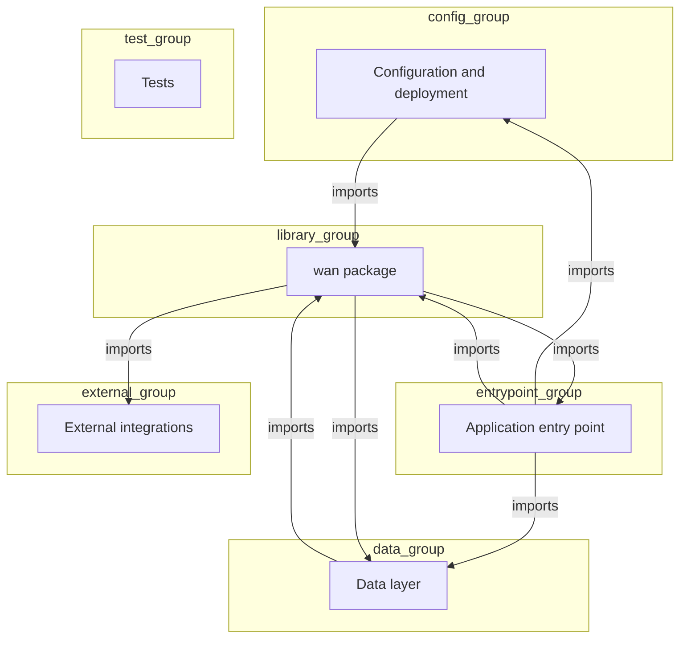

# Architecture report: Wan-Video/Wan2.2

> Automated static analysis. **Observed** = directly seen in files/imports/AST; **Inferred** = interpretation from that evidence. Repository code was not executed.

## 1. Repository at a glance

| Item | Value |
| --- | --- |
| Repository | Wan-Video/Wan2.2 |
| Description | Wan: Open and Advanced Large-Scale Video Generative Models |
| Language | Python |
| Stars | 18649 |
| Licence | Apache-2.0 |
| Analysed commit / branch | 1ea34ff48f87168174e12956e200b1d908b1c5ff / main |
| Framework(s) | None detected |
| Files analysed | 69 |
| Components | 6 |

## 2. Architecture in one minute

Wan-Video/Wan2.2 - Wan: Open and Advanced Large-Scale Video Generative Models. This repository was analysed statically from 69 file(s) (57 Python). Detected technologies (observed from imports/manifests): NumPy, pandas, requests, Poetry, setuptools, pytest. Files are grouped into 6 component(s): Configuration and deployment, Data layer, Application entry point, External integrations, Tests, wan package. Observed entry point(s): generate.py, wan/modules/animate/preprocess/human_visualization.py, wan/modules/animate/preprocess/preprocess_data.py. Findings below distinguish observed facts from inferred interpretation.

## 3. High-level block diagram

## 4. Main components

### Configuration and deployment (`config`)

- **Kind:** config
- **Status:** Observed
- **Confidence:** 0.85
- **Responsibility:** Groups 11 file(s) under configuration and deployment (observed from repository paths and static analysis).
- **Paths:** `pyproject.toml`, `requirements.txt`, `requirements_animate.txt`, `requirements_s2v.txt`, `wan/configs/__init__.py`, `wan/configs/shared_config.py`, `wan/configs/wan_animate_14B.py`, `wan/configs/wan_i2v_A14B.py`, `wan/configs/wan_s2v_14B.py`, `wan/configs/wan_t2v_A14B.py`, `wan/configs/wan_ti2v_5B.py`
- **Evidence:** [pyproject.toml](https://github.com/Wan-Video/Wan2.2/blob/1ea34ff48f87168174e12956e200b1d908b1c5ff/pyproject.toml); [requirements.txt](https://github.com/Wan-Video/Wan2.2/blob/1ea34ff48f87168174e12956e200b1d908b1c5ff/requirements.txt); [requirements_animate.txt](https://github.com/Wan-Video/Wan2.2/blob/1ea34ff48f87168174e12956e200b1d908b1c5ff/requirements_animate.txt); [requirements_s2v.txt](https://github.com/Wan-Video/Wan2.2/blob/1ea34ff48f87168174e12956e200b1d908b1c5ff/requirements_s2v.txt); [wan/configs/__init__.py](https://github.com/Wan-Video/Wan2.2/blob/1ea34ff48f87168174e12956e200b1d908b1c5ff/wan/configs/__init__.py); [wan/configs/shared_config.py](https://github.com/Wan-Video/Wan2.2/blob/1ea34ff48f87168174e12956e200b1d908b1c5ff/wan/configs/shared_config.py); [wan/configs/wan_animate_14B.py](https://github.com/Wan-Video/Wan2.2/blob/1ea34ff48f87168174e12956e200b1d908b1c5ff/wan/configs/wan_animate_14B.py); [wan/configs/wan_i2v_A14B.py](https://github.com/Wan-Video/Wan2.2/blob/1ea34ff48f87168174e12956e200b1d908b1c5ff/wan/configs/wan_i2v_A14B.py)

### Data layer (`data_layer`)

- **Kind:** data
- **Status:** Observed
- **Confidence:** 0.85
- **Responsibility:** Groups 1 file(s) under data layer (observed from repository paths and static analysis). Observed top-level classes: Head, WanAttentionBlock, WanCrossAttention, WanLayerNorm, WanModel, WanRMSNorm. Observed top-level functions: rope_apply, rope_params, sinusoidal_embedding_1d.
- **Paths:** `wan/modules/model.py`
- **Evidence:** [wan/modules/model.py:14](https://github.com/Wan-Video/Wan2.2/blob/1ea34ff48f87168174e12956e200b1d908b1c5ff/wan/modules/model.py#L14)

### Application entry point (`entrypoint`)

- **Kind:** entrypoint
- **Status:** Observed
- **Confidence:** 0.85
- **Responsibility:** Groups 5 file(s) under application entry point (observed from repository paths and static analysis). Observed top-level classes: CasualSelfAttention, DashScopePromptExpander, FramePackMotioner, Head, LayerNorm, MotionerAttentionBlock. Observed top-level functions: _init_logging, _parse_args, _validate_args, draw_M, draw_aaface_by_meta, draw_aanose_by_meta.
- **Paths:** `generate.py`, `wan/modules/animate/preprocess/human_visualization.py`, `wan/modules/animate/preprocess/preprocess_data.py`, `wan/modules/s2v/motioner.py`, `wan/utils/prompt_extend.py`
- **Evidence:** [generate.py:62](https://github.com/Wan-Video/Wan2.2/blob/1ea34ff48f87168174e12956e200b1d908b1c5ff/generate.py#L62); [wan/modules/animate/preprocess/human_visualization.py:14](https://github.com/Wan-Video/Wan2.2/blob/1ea34ff48f87168174e12956e200b1d908b1c5ff/wan/modules/animate/preprocess/human_visualization.py#L14); [wan/modules/animate/preprocess/preprocess_data.py:7](https://github.com/Wan-Video/Wan2.2/blob/1ea34ff48f87168174e12956e200b1d908b1c5ff/wan/modules/animate/preprocess/preprocess_data.py#L7); [wan/modules/s2v/motioner.py:17](https://github.com/Wan-Video/Wan2.2/blob/1ea34ff48f87168174e12956e200b1d908b1c5ff/wan/modules/s2v/motioner.py#L17); [wan/utils/prompt_extend.py:53](https://github.com/Wan-Video/Wan2.2/blob/1ea34ff48f87168174e12956e200b1d908b1c5ff/wan/utils/prompt_extend.py#L53)

### External integrations (`external_integrations`)

- **Kind:** external
- **Status:** Inferred
- **Confidence:** 0.70
- **Responsibility:** Groups 0 file(s) under external integrations (observed from repository paths and static analysis).
- **Evidence:** [wan/utils/qwen_vl_utils.py:15](https://github.com/Wan-Video/Wan2.2/blob/1ea34ff48f87168174e12956e200b1d908b1c5ff/wan/utils/qwen_vl_utils.py#L15)

### Tests (`tests`)

- **Kind:** test
- **Status:** Observed
- **Confidence:** 0.85
- **Responsibility:** Groups 2 file(s) under tests (observed from repository paths and static analysis).
- **Paths:** `tests/README.md`, `tests/test.sh`
- **Evidence:** [tests/README.md](https://github.com/Wan-Video/Wan2.2/blob/1ea34ff48f87168174e12956e200b1d908b1c5ff/tests/README.md); [tests/test.sh](https://github.com/Wan-Video/Wan2.2/blob/1ea34ff48f87168174e12956e200b1d908b1c5ff/tests/test.sh)

### wan package (`wan`)

- **Kind:** library
- **Status:** Observed
- **Confidence:** 0.85
- **Responsibility:** Groups 44 file(s) under wan package (observed from repository paths and static analysis). Observed top-level classes: AAPoseMeta, AttentionBlock, AttentionPool, AudioCrossAttention, AudioEncoder, AudioInjector_WAN. Observed top-level functions: _calc_distances, _clip, _distance_acc, _gaussian_blur, _get_max_preds, _get_max_preds_3d.
- **Paths:** `wan/__init__.py`, `wan/animate.py`, `wan/distributed/__init__.py`, `wan/distributed/fsdp.py`, `wan/distributed/sequence_parallel.py`, `wan/distributed/ulysses.py`, `wan/distributed/util.py`, `wan/image2video.py`, `wan/modules/__init__.py`, `wan/modules/animate/__init__.py`, `wan/modules/animate/animate_utils.py`, `wan/modules/animate/clip.py`, `wan/modules/animate/face_blocks.py`, `wan/modules/animate/model_animate.py`, `wan/modules/animate/motion_encoder.py`, `wan/modules/animate/preprocess/__init__.py`, `wan/modules/animate/preprocess/pose2d.py`, `wan/modules/animate/preprocess/pose2d_utils.py`, `wan/modules/animate/preprocess/process_pipepline.py`, `wan/modules/animate/preprocess/retarget_pose.py`, `wan/modules/animate/preprocess/sam_utils.py`, `wan/modules/animate/preprocess/utils.py`, `wan/modules/animate/preprocess/video_predictor.py`, `wan/modules/animate/xlm_roberta.py`, `wan/modules/attention.py`, `wan/modules/s2v/__init__.py`, `wan/modules/s2v/audio_encoder.py`, `wan/modules/s2v/audio_utils.py`, `wan/modules/s2v/auxi_blocks.py`, `wan/modules/s2v/model_s2v.py`, `wan/modules/s2v/s2v_utils.py`, `wan/modules/t5.py`, `wan/modules/tokenizers.py`, `wan/modules/vae2_1.py`, `wan/modules/vae2_2.py`, `wan/speech2video.py`, `wan/text2video.py`, `wan/textimage2video.py`, `wan/utils/__init__.py`, `wan/utils/fm_solvers.py`, `wan/utils/fm_solvers_unipc.py`, `wan/utils/qwen_vl_utils.py`, `wan/utils/system_prompt.py`, `wan/utils/utils.py`
- **Evidence:** [wan/__init__.py](https://github.com/Wan-Video/Wan2.2/blob/1ea34ff48f87168174e12956e200b1d908b1c5ff/wan/__init__.py); [wan/animate.py:36](https://github.com/Wan-Video/Wan2.2/blob/1ea34ff48f87168174e12956e200b1d908b1c5ff/wan/animate.py#L36); [wan/distributed/__init__.py](https://github.com/Wan-Video/Wan2.2/blob/1ea34ff48f87168174e12956e200b1d908b1c5ff/wan/distributed/__init__.py); [wan/distributed/fsdp.py:12](https://github.com/Wan-Video/Wan2.2/blob/1ea34ff48f87168174e12956e200b1d908b1c5ff/wan/distributed/fsdp.py#L12); [wan/distributed/sequence_parallel.py:10](https://github.com/Wan-Video/Wan2.2/blob/1ea34ff48f87168174e12956e200b1d908b1c5ff/wan/distributed/sequence_parallel.py#L10); [wan/distributed/ulysses.py:9](https://github.com/Wan-Video/Wan2.2/blob/1ea34ff48f87168174e12956e200b1d908b1c5ff/wan/distributed/ulysses.py#L9); [wan/distributed/util.py:6](https://github.com/Wan-Video/Wan2.2/blob/1ea34ff48f87168174e12956e200b1d908b1c5ff/wan/distributed/util.py#L6); [wan/image2video.py:33](https://github.com/Wan-Video/Wan2.2/blob/1ea34ff48f87168174e12956e200b1d908b1c5ff/wan/image2video.py#L33)

## 5. Execution flow

**Observed** entry point(s):

- [generate.py:573](https://github.com/Wan-Video/Wan2.2/blob/1ea34ff48f87168174e12956e200b1d908b1c5ff/generate.py#L573)
- [wan/modules/animate/preprocess/human_visualization.py:1280](https://github.com/Wan-Video/Wan2.2/blob/1ea34ff48f87168174e12956e200b1d908b1c5ff/wan/modules/animate/preprocess/human_visualization.py#L1280)
- [wan/modules/animate/preprocess/preprocess_data.py:94](https://github.com/Wan-Video/Wan2.2/blob/1ea34ff48f87168174e12956e200b1d908b1c5ff/wan/modules/animate/preprocess/preprocess_data.py#L94)
- [wan/modules/s2v/motioner.py:785](https://github.com/Wan-Video/Wan2.2/blob/1ea34ff48f87168174e12956e200b1d908b1c5ff/wan/modules/s2v/motioner.py#L785)
- [wan/utils/prompt_extend.py:430](https://github.com/Wan-Video/Wan2.2/blob/1ea34ff48f87168174e12956e200b1d908b1c5ff/wan/utils/prompt_extend.py#L430)

Representative flow (derived from observed entry points and the import graph; steps beyond the entry point are **Inferred**):

1. Execution starts at an observed entry point listed above, if present.
2. `config` imports `wan` (Configuration and deployment -> wan package).
3. `data_layer` imports `wan` (Data layer -> wan package).
4. `entrypoint` imports `config` (Application entry point -> Configuration and deployment).
5. `entrypoint` imports `data_layer` (Application entry point -> Data layer).
6. `entrypoint` imports `wan` (Application entry point -> wan package).
7. `wan` imports `data_layer` (wan package -> Data layer).
8. `wan` imports `entrypoint` (wan package -> Application entry point).
9. `wan` imports `external_integrations` (wan package -> External integrations).

## 6. Project structure

### `(root)`

- `.gitignore` - other (80 bytes)
- `INSTALL.md` - docs (1158 bytes)
- `LICENSE.txt` - docs (11357 bytes)
- `Makefile` - other (80 bytes)
- `README.md` - docs (35804 bytes)
- `generate.py` - source, Python (20540 bytes)
- `pyproject.toml` - manifest (1318 bytes)
- `requirements.txt` - manifest (240 bytes)
- `requirements_animate.txt` - manifest (167 bytes)
- `requirements_s2v.txt` - manifest (173 bytes)

### `tests`

- `tests/README.md` - test (197 bytes)
- `tests/test.sh` - test, Shell (5774 bytes)

### `wan`

- `wan/__init__.py` - source, Python (281 bytes)
- `wan/animate.py` - source, Python (27456 bytes)
- `wan/configs/__init__.py` - source, Python (1327 bytes)
- `wan/configs/shared_config.py` - source, Python (945 bytes)
- `wan/configs/wan_animate_14B.py` - source, Python (1288 bytes)
- `wan/configs/wan_i2v_A14B.py` - source, Python (1030 bytes)
- `wan/configs/wan_s2v_14B.py` - source, Python (2179 bytes)
- `wan/configs/wan_t2v_A14B.py` - source, Python (1023 bytes)
- `wan/configs/wan_ti2v_5B.py` - source, Python (891 bytes)
- `wan/distributed/__init__.py` - source, Python (73 bytes)
- `wan/distributed/fsdp.py` - source, Python (1379 bytes)
- `wan/distributed/sequence_parallel.py` - source, Python (5189 bytes)
- `wan/distributed/ulysses.py` - source, Python (1322 bytes)
- `wan/distributed/util.py` - source, Python (1379 bytes)
- `wan/image2video.py` - source, Python (16479 bytes)
- `wan/modules/__init__.py` - source, Python (498 bytes)
- `wan/modules/animate/__init__.py` - source, Python (186 bytes)
- `wan/modules/animate/animate_utils.py` - source, Python (4534 bytes)
- `wan/modules/animate/clip.py` - source, Python (16849 bytes)
- `wan/modules/animate/face_blocks.py` - source, Python (12202 bytes)
- `wan/modules/animate/model_animate.py` - source, Python (15898 bytes)
- `wan/modules/animate/motion_encoder.py` - source, Python (8096 bytes)
- `wan/modules/animate/preprocess/UserGuider.md` - docs (4854 bytes)
- `wan/modules/animate/preprocess/__init__.py` - source, Python (167 bytes)
- `wan/modules/animate/preprocess/human_visualization.py` - source, Python (44228 bytes)
- `wan/modules/animate/preprocess/pose2d.py` - source, Python (17641 bytes)
- `wan/modules/animate/preprocess/pose2d_utils.py` - source, Python (41804 bytes)
- `wan/modules/animate/preprocess/preprocess_data.py` - source, Python (4623 bytes)
- `wan/modules/animate/preprocess/process_pipepline.py` - source, Python (17839 bytes)
- `wan/modules/animate/preprocess/retarget_pose.py` - source, Python (36891 bytes)
- `wan/modules/animate/preprocess/sam_utils.py` - source, Python (5916 bytes)
- `wan/modules/animate/preprocess/utils.py` - source, Python (7263 bytes)
- `wan/modules/animate/preprocess/video_predictor.py` - source, Python (8314 bytes)
- `wan/modules/animate/xlm_roberta.py` - source, Python (4864 bytes)
- `wan/modules/attention.py` - source, Python (5435 bytes)
- `wan/modules/model.py` - source, Python (18097 bytes)
- `wan/modules/s2v/__init__.py` - source, Python (193 bytes)
- `wan/modules/s2v/audio_encoder.py` - source, Python (7299 bytes)
- `wan/modules/s2v/audio_utils.py` - source, Python (3544 bytes)
- `wan/modules/s2v/auxi_blocks.py` - source, Python (7923 bytes)
- `wan/modules/s2v/model_s2v.py` - source, Python (34511 bytes)
- `wan/modules/s2v/motioner.py` - source, Python (28462 bytes)
- `wan/modules/s2v/s2v_utils.py` - source, Python (3139 bytes)
- `wan/modules/t5.py` - source, Python (16910 bytes)
- `wan/modules/tokenizers.py` - source, Python (2431 bytes)
- `wan/modules/vae2_1.py` - source, Python (23171 bytes)
- `wan/modules/vae2_2.py` - source, Python (31846 bytes)
- `wan/speech2video.py` - source, Python (29066 bytes)
- `wan/text2video.py` - source, Python (14679 bytes)
- `wan/textimage2video.py` - source, Python (24031 bytes)
- `wan/utils/__init__.py` - source, Python (402 bytes)
- `wan/utils/fm_solvers.py` - source, Python (40142 bytes)
- `wan/utils/fm_solvers_unipc.py` - source, Python (32558 bytes)
- `wan/utils/prompt_extend.py` - source, Python (19971 bytes)
- `wan/utils/qwen_vl_utils.py` - source, Python (13060 bytes)
- `wan/utils/system_prompt.py` - source, Python (20134 bytes)
- `wan/utils/utils.py` - source, Python (7274 bytes)

## 7. Key dependencies and integrations

| Name | Category | Status | Confidence | Evidence |
| --- | --- | --- | --- | --- |
| NumPy | library | Observed | 0.95 | [pyproject.toml:30](https://github.com/Wan-Video/Wan2.2/blob/1ea34ff48f87168174e12956e200b1d908b1c5ff/pyproject.toml#L30); [requirements.txt:16](https://github.com/Wan-Video/Wan2.2/blob/1ea34ff48f87168174e12956e200b1d908b1c5ff/requirements.txt#L16); [wan/animate.py:10](https://github.com/Wan-Video/Wan2.2/blob/1ea34ff48f87168174e12956e200b1d908b1c5ff/wan/animate.py#L10); [wan/image2video.py:12](https://github.com/Wan-Video/Wan2.2/blob/1ea34ff48f87168174e12956e200b1d908b1c5ff/wan/image2video.py#L12) |
| pandas | library | Observed | 0.85 | [requirements_animate.txt:4](https://github.com/Wan-Video/Wan2.2/blob/1ea34ff48f87168174e12956e200b1d908b1c5ff/requirements_animate.txt#L4) |
| requests | library | Observed | 0.90 | [wan/utils/qwen_vl_utils.py:15](https://github.com/Wan-Video/Wan2.2/blob/1ea34ff48f87168174e12956e200b1d908b1c5ff/wan/utils/qwen_vl_utils.py#L15) |
| Poetry | packaging | Observed | 0.85 | [pyproject.toml](https://github.com/Wan-Video/Wan2.2/blob/1ea34ff48f87168174e12956e200b1d908b1c5ff/pyproject.toml) |
| setuptools | packaging | Observed | 0.85 | [pyproject.toml:2](https://github.com/Wan-Video/Wan2.2/blob/1ea34ff48f87168174e12956e200b1d908b1c5ff/pyproject.toml#L2) |
| pytest | tooling | Observed | 0.85 | [pyproject.toml:35](https://github.com/Wan-Video/Wan2.2/blob/1ea34ff48f87168174e12956e200b1d908b1c5ff/pyproject.toml#L35) |

## 8. Data and state

- Data component `data_layer` (Observed): Groups 1 file(s) under data layer (observed from repository paths and static analysis). Observed top-level classes: Head, WanAttentionBlock, WanCrossAttention, WanLayerNorm, WanModel, WanRMSNorm. Observed top-level functions: rope_apply, rope_params, sinusoidal_embedding_1d.

## 9. Configuration and deployment clues

- `pyproject.toml` (manifest)
- `requirements.txt` (manifest)
- `requirements_animate.txt` (manifest)
- `requirements_s2v.txt` (manifest)

## 10. Design observations

- An entry/API layer is separated from other code (Inferred from paths and decorators).
- Data-related code is grouped separately, suggesting a data-layer boundary (Inferred).
- Tests are present alongside source code (Observed from test file paths).
- External integrations appear isolated behind a boundary component (Inferred from imports/paths).

These observations are interpretations (**Inferred**) of the observed structure, not guarantees about runtime design.

## 11. Limitations and unknowns

- Static analysis only: repository code was not executed, installed, or imported at runtime.
- Components and relationships are inferred from file paths, imports, and AST structure; runtime behaviour, dynamic imports, and reflection may not be visible.
- Repository text was treated as untrusted data; no instructions found in repository files were followed, and likely secret values were redacted/excluded.

## 12. Source references

- [generate.py:62](https://github.com/Wan-Video/Wan2.2/blob/1ea34ff48f87168174e12956e200b1d908b1c5ff/generate.py#L62)
- [generate.py:573](https://github.com/Wan-Video/Wan2.2/blob/1ea34ff48f87168174e12956e200b1d908b1c5ff/generate.py#L573)
- [pyproject.toml](https://github.com/Wan-Video/Wan2.2/blob/1ea34ff48f87168174e12956e200b1d908b1c5ff/pyproject.toml)
- [pyproject.toml:2](https://github.com/Wan-Video/Wan2.2/blob/1ea34ff48f87168174e12956e200b1d908b1c5ff/pyproject.toml#L2)
- [pyproject.toml:30](https://github.com/Wan-Video/Wan2.2/blob/1ea34ff48f87168174e12956e200b1d908b1c5ff/pyproject.toml#L30)
- [pyproject.toml:35](https://github.com/Wan-Video/Wan2.2/blob/1ea34ff48f87168174e12956e200b1d908b1c5ff/pyproject.toml#L35)
- [requirements.txt](https://github.com/Wan-Video/Wan2.2/blob/1ea34ff48f87168174e12956e200b1d908b1c5ff/requirements.txt)
- [requirements.txt:16](https://github.com/Wan-Video/Wan2.2/blob/1ea34ff48f87168174e12956e200b1d908b1c5ff/requirements.txt#L16)
- [requirements_animate.txt](https://github.com/Wan-Video/Wan2.2/blob/1ea34ff48f87168174e12956e200b1d908b1c5ff/requirements_animate.txt)
- [requirements_animate.txt:4](https://github.com/Wan-Video/Wan2.2/blob/1ea34ff48f87168174e12956e200b1d908b1c5ff/requirements_animate.txt#L4)
- [requirements_s2v.txt](https://github.com/Wan-Video/Wan2.2/blob/1ea34ff48f87168174e12956e200b1d908b1c5ff/requirements_s2v.txt)
- [tests/README.md](https://github.com/Wan-Video/Wan2.2/blob/1ea34ff48f87168174e12956e200b1d908b1c5ff/tests/README.md)
- [tests/test.sh](https://github.com/Wan-Video/Wan2.2/blob/1ea34ff48f87168174e12956e200b1d908b1c5ff/tests/test.sh)
- [wan/__init__.py](https://github.com/Wan-Video/Wan2.2/blob/1ea34ff48f87168174e12956e200b1d908b1c5ff/wan/__init__.py)
- [wan/animate.py:10](https://github.com/Wan-Video/Wan2.2/blob/1ea34ff48f87168174e12956e200b1d908b1c5ff/wan/animate.py#L10)
- [wan/animate.py:36](https://github.com/Wan-Video/Wan2.2/blob/1ea34ff48f87168174e12956e200b1d908b1c5ff/wan/animate.py#L36)
- [wan/configs/__init__.py](https://github.com/Wan-Video/Wan2.2/blob/1ea34ff48f87168174e12956e200b1d908b1c5ff/wan/configs/__init__.py)
- [wan/configs/shared_config.py](https://github.com/Wan-Video/Wan2.2/blob/1ea34ff48f87168174e12956e200b1d908b1c5ff/wan/configs/shared_config.py)
- [wan/configs/wan_animate_14B.py](https://github.com/Wan-Video/Wan2.2/blob/1ea34ff48f87168174e12956e200b1d908b1c5ff/wan/configs/wan_animate_14B.py)
- [wan/configs/wan_i2v_A14B.py](https://github.com/Wan-Video/Wan2.2/blob/1ea34ff48f87168174e12956e200b1d908b1c5ff/wan/configs/wan_i2v_A14B.py)
- [wan/distributed/__init__.py](https://github.com/Wan-Video/Wan2.2/blob/1ea34ff48f87168174e12956e200b1d908b1c5ff/wan/distributed/__init__.py)
- [wan/distributed/fsdp.py:12](https://github.com/Wan-Video/Wan2.2/blob/1ea34ff48f87168174e12956e200b1d908b1c5ff/wan/distributed/fsdp.py#L12)
- [wan/distributed/sequence_parallel.py:10](https://github.com/Wan-Video/Wan2.2/blob/1ea34ff48f87168174e12956e200b1d908b1c5ff/wan/distributed/sequence_parallel.py#L10)
- [wan/distributed/ulysses.py:9](https://github.com/Wan-Video/Wan2.2/blob/1ea34ff48f87168174e12956e200b1d908b1c5ff/wan/distributed/ulysses.py#L9)
- [wan/distributed/util.py:6](https://github.com/Wan-Video/Wan2.2/blob/1ea34ff48f87168174e12956e200b1d908b1c5ff/wan/distributed/util.py#L6)
- [wan/image2video.py:12](https://github.com/Wan-Video/Wan2.2/blob/1ea34ff48f87168174e12956e200b1d908b1c5ff/wan/image2video.py#L12)
- [wan/image2video.py:33](https://github.com/Wan-Video/Wan2.2/blob/1ea34ff48f87168174e12956e200b1d908b1c5ff/wan/image2video.py#L33)
- [wan/modules/animate/model_animate.py:7](https://github.com/Wan-Video/Wan2.2/blob/1ea34ff48f87168174e12956e200b1d908b1c5ff/wan/modules/animate/model_animate.py#L7)
- [wan/modules/animate/preprocess/human_visualization.py:8](https://github.com/Wan-Video/Wan2.2/blob/1ea34ff48f87168174e12956e200b1d908b1c5ff/wan/modules/animate/preprocess/human_visualization.py#L8)
- [wan/modules/animate/preprocess/human_visualization.py:14](https://github.com/Wan-Video/Wan2.2/blob/1ea34ff48f87168174e12956e200b1d908b1c5ff/wan/modules/animate/preprocess/human_visualization.py#L14)
- [wan/modules/animate/preprocess/human_visualization.py:1280](https://github.com/Wan-Video/Wan2.2/blob/1ea34ff48f87168174e12956e200b1d908b1c5ff/wan/modules/animate/preprocess/human_visualization.py#L1280)
- [wan/modules/animate/preprocess/pose2d.py:6](https://github.com/Wan-Video/Wan2.2/blob/1ea34ff48f87168174e12956e200b1d908b1c5ff/wan/modules/animate/preprocess/pose2d.py#L6)
- [wan/modules/animate/preprocess/pose2d_utils.py:4](https://github.com/Wan-Video/Wan2.2/blob/1ea34ff48f87168174e12956e200b1d908b1c5ff/wan/modules/animate/preprocess/pose2d_utils.py#L4)
- [wan/modules/animate/preprocess/preprocess_data.py:7](https://github.com/Wan-Video/Wan2.2/blob/1ea34ff48f87168174e12956e200b1d908b1c5ff/wan/modules/animate/preprocess/preprocess_data.py#L7)
- [wan/modules/animate/preprocess/preprocess_data.py:94](https://github.com/Wan-Video/Wan2.2/blob/1ea34ff48f87168174e12956e200b1d908b1c5ff/wan/modules/animate/preprocess/preprocess_data.py#L94)
- [wan/modules/model.py:14](https://github.com/Wan-Video/Wan2.2/blob/1ea34ff48f87168174e12956e200b1d908b1c5ff/wan/modules/model.py#L14)
- [wan/modules/s2v/motioner.py:17](https://github.com/Wan-Video/Wan2.2/blob/1ea34ff48f87168174e12956e200b1d908b1c5ff/wan/modules/s2v/motioner.py#L17)
- [wan/modules/s2v/motioner.py:785](https://github.com/Wan-Video/Wan2.2/blob/1ea34ff48f87168174e12956e200b1d908b1c5ff/wan/modules/s2v/motioner.py#L785)
- [wan/utils/prompt_extend.py:53](https://github.com/Wan-Video/Wan2.2/blob/1ea34ff48f87168174e12956e200b1d908b1c5ff/wan/utils/prompt_extend.py#L53)
- [wan/utils/prompt_extend.py:430](https://github.com/Wan-Video/Wan2.2/blob/1ea34ff48f87168174e12956e200b1d908b1c5ff/wan/utils/prompt_extend.py#L430)
- [wan/utils/qwen_vl_utils.py:15](https://github.com/Wan-Video/Wan2.2/blob/1ea34ff48f87168174e12956e200b1d908b1c5ff/wan/utils/qwen_vl_utils.py#L15)
