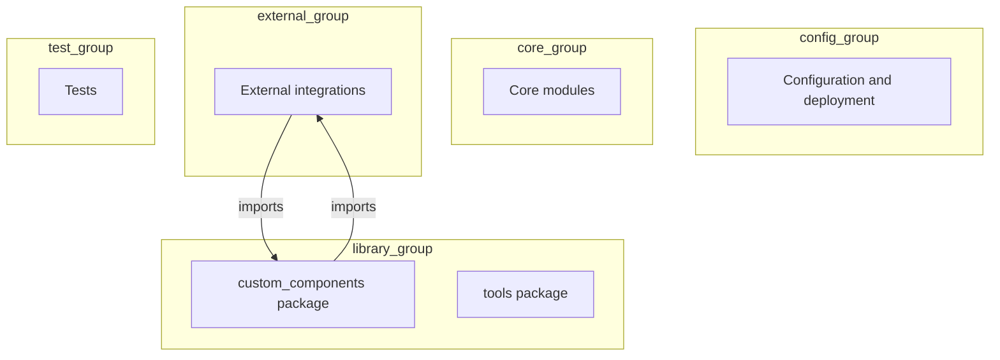

# Architecture report: XiaoMi/ha_xiaomi_home

> Automated static analysis. **Observed** = directly seen in files/imports/AST; **Inferred** = interpretation from that evidence. Repository code was not executed.

## 1. Repository at a glance

| Item | Value |
| --- | --- |
| Repository | XiaoMi/ha_xiaomi_home |
| Description | Xiaomi Home Integration for Home Assistant |
| Language | Python |
| Stars | 22343 |
| Licence | Other |
| Analysed commit / branch | 75b3acb6325a3a8d295688b13904737d6738a6a5 / main |
| Framework(s) | None detected |
| Files analysed | 100 |
| Components | 6 |

## 2. Architecture in one minute

XiaoMi/ha_xiaomi_home - Xiaomi Home Integration for Home Assistant. This repository was analysed statically from 100 file(s) (47 Python). Detected technologies (observed from imports/manifests): GitHub Actions, aiohttp, pytest. Files are grouped into 6 component(s): Configuration and deployment, Core modules, custom_components package, External integrations, Tests, tools package. Findings below distinguish observed facts from inferred interpretation.

## 3. High-level block diagram

## 4. Main components

### Configuration and deployment (`config`)

- **Kind:** config
- **Status:** Observed
- **Confidence:** 0.85
- **Responsibility:** Groups 34 file(s) under configuration and deployment (observed from repository paths and static analysis).
- **Paths:** `custom_components/xiaomi_home/manifest.json`, `custom_components/xiaomi_home/miot/i18n/de.json`, `custom_components/xiaomi_home/miot/i18n/en.json`, `custom_components/xiaomi_home/miot/i18n/es.json`, `custom_components/xiaomi_home/miot/i18n/fr.json`, `custom_components/xiaomi_home/miot/i18n/it.json`, `custom_components/xiaomi_home/miot/i18n/ja.json`, `custom_components/xiaomi_home/miot/i18n/nl.json`, `custom_components/xiaomi_home/miot/i18n/pt-BR.json`, `custom_components/xiaomi_home/miot/i18n/pt.json`, `custom_components/xiaomi_home/miot/i18n/ru.json`, `custom_components/xiaomi_home/miot/i18n/tr.json`, `custom_components/xiaomi_home/miot/i18n/zh-Hans.json`, `custom_components/xiaomi_home/miot/i18n/zh-Hant.json`, `custom_components/xiaomi_home/miot/lan/profile_models.yaml`, `custom_components/xiaomi_home/miot/specs/bool_trans.yaml`, `custom_components/xiaomi_home/miot/specs/multi_lang.json`, `custom_components/xiaomi_home/miot/specs/spec_add.json`, `custom_components/xiaomi_home/miot/specs/spec_filter.yaml`, `custom_components/xiaomi_home/miot/specs/spec_modify.yaml`, `custom_components/xiaomi_home/translations/de.json`, `custom_components/xiaomi_home/translations/en.json`, `custom_components/xiaomi_home/translations/es.json`, `custom_components/xiaomi_home/translations/fr.json`, `custom_components/xiaomi_home/translations/it.json`, `custom_components/xiaomi_home/translations/ja.json`, `custom_components/xiaomi_home/translations/nl.json`, `custom_components/xiaomi_home/translations/pt-BR.json`, `custom_components/xiaomi_home/translations/pt.json`, `custom_components/xiaomi_home/translations/ru.json`, `custom_components/xiaomi_home/translations/tr.json`, `custom_components/xiaomi_home/translations/zh-Hans.json`, `custom_components/xiaomi_home/translations/zh-Hant.json`, `hacs.json`
- **Evidence:** [custom_components/xiaomi_home/manifest.json](https://github.com/XiaoMi/ha_xiaomi_home/blob/75b3acb6325a3a8d295688b13904737d6738a6a5/custom_components/xiaomi_home/manifest.json); [custom_components/xiaomi_home/miot/i18n/de.json](https://github.com/XiaoMi/ha_xiaomi_home/blob/75b3acb6325a3a8d295688b13904737d6738a6a5/custom_components/xiaomi_home/miot/i18n/de.json); [custom_components/xiaomi_home/miot/i18n/en.json](https://github.com/XiaoMi/ha_xiaomi_home/blob/75b3acb6325a3a8d295688b13904737d6738a6a5/custom_components/xiaomi_home/miot/i18n/en.json); [custom_components/xiaomi_home/miot/i18n/es.json](https://github.com/XiaoMi/ha_xiaomi_home/blob/75b3acb6325a3a8d295688b13904737d6738a6a5/custom_components/xiaomi_home/miot/i18n/es.json); [custom_components/xiaomi_home/miot/i18n/fr.json](https://github.com/XiaoMi/ha_xiaomi_home/blob/75b3acb6325a3a8d295688b13904737d6738a6a5/custom_components/xiaomi_home/miot/i18n/fr.json); [custom_components/xiaomi_home/miot/i18n/it.json](https://github.com/XiaoMi/ha_xiaomi_home/blob/75b3acb6325a3a8d295688b13904737d6738a6a5/custom_components/xiaomi_home/miot/i18n/it.json); [custom_components/xiaomi_home/miot/i18n/ja.json](https://github.com/XiaoMi/ha_xiaomi_home/blob/75b3acb6325a3a8d295688b13904737d6738a6a5/custom_components/xiaomi_home/miot/i18n/ja.json); [custom_components/xiaomi_home/miot/i18n/nl.json](https://github.com/XiaoMi/ha_xiaomi_home/blob/75b3acb6325a3a8d295688b13904737d6738a6a5/custom_components/xiaomi_home/miot/i18n/nl.json)

### Core modules (`core`)

- **Kind:** core
- **Status:** Observed
- **Confidence:** 0.85
- **Responsibility:** Groups 1 file(s) under core modules (observed from repository paths and static analysis).
- **Paths:** `install.sh`
- **Evidence:** [install.sh](https://github.com/XiaoMi/ha_xiaomi_home/blob/75b3acb6325a3a8d295688b13904737d6738a6a5/install.sh)

### custom_components package (`custom_components`)

- **Kind:** library
- **Status:** Observed
- **Confidence:** 0.85
- **Responsibility:** Groups 34 file(s) under custom_components package (observed from repository paths and static analysis). Observed top-level classes: ActionText, AirConditioner, BinarySensor, Button, Cover, DeviceManufacturer. Observed top-level functions: _handle_devices_filter, _handle_network_detect_addr, _handle_oauth_webhook, _load_page_template, async_remove_config_entry_device, async_remove_entry.
- **Paths:** `custom_components/xiaomi_home/__init__.py`, `custom_components/xiaomi_home/binary_sensor.py`, `custom_components/xiaomi_home/button.py`, `custom_components/xiaomi_home/climate.py`, `custom_components/xiaomi_home/config_flow.py`, `custom_components/xiaomi_home/cover.py`, `custom_components/xiaomi_home/device_tracker.py`, `custom_components/xiaomi_home/event.py`, `custom_components/xiaomi_home/fan.py`, `custom_components/xiaomi_home/humidifier.py`, `custom_components/xiaomi_home/light.py`, `custom_components/xiaomi_home/media_player.py`, `custom_components/xiaomi_home/miot/common.py`, `custom_components/xiaomi_home/miot/const.py`, `custom_components/xiaomi_home/miot/miot_cloud.py`, `custom_components/xiaomi_home/miot/miot_device.py`, `custom_components/xiaomi_home/miot/miot_error.py`, `custom_components/xiaomi_home/miot/miot_i18n.py`, `custom_components/xiaomi_home/miot/miot_lan.py`, `custom_components/xiaomi_home/miot/miot_mdns.py`, `custom_components/xiaomi_home/miot/miot_mips.py`, `custom_components/xiaomi_home/miot/miot_network.py`, `custom_components/xiaomi_home/miot/miot_spec.py`, `custom_components/xiaomi_home/miot/miot_storage.py`, `custom_components/xiaomi_home/miot/specs/specv2entity.py`, `custom_components/xiaomi_home/miot/web_pages.py`, `custom_components/xiaomi_home/notify.py`, `custom_components/xiaomi_home/number.py`, `custom_components/xiaomi_home/select.py`, `custom_components/xiaomi_home/sensor.py`, `custom_components/xiaomi_home/switch.py`, `custom_components/xiaomi_home/text.py`, `custom_components/xiaomi_home/vacuum.py`, `custom_components/xiaomi_home/water_heater.py`
- **Evidence:** [custom_components/xiaomi_home/__init__.py:73](https://github.com/XiaoMi/ha_xiaomi_home/blob/75b3acb6325a3a8d295688b13904737d6738a6a5/custom_components/xiaomi_home/__init__.py#L73); [custom_components/xiaomi_home/binary_sensor.py:60](https://github.com/XiaoMi/ha_xiaomi_home/blob/75b3acb6325a3a8d295688b13904737d6738a6a5/custom_components/xiaomi_home/binary_sensor.py#L60); [custom_components/xiaomi_home/button.py:60](https://github.com/XiaoMi/ha_xiaomi_home/blob/75b3acb6325a3a8d295688b13904737d6738a6a5/custom_components/xiaomi_home/button.py#L60); [custom_components/xiaomi_home/climate.py:67](https://github.com/XiaoMi/ha_xiaomi_home/blob/75b3acb6325a3a8d295688b13904737d6738a6a5/custom_components/xiaomi_home/climate.py#L67); [custom_components/xiaomi_home/config_flow.py:110](https://github.com/XiaoMi/ha_xiaomi_home/blob/75b3acb6325a3a8d295688b13904737d6738a6a5/custom_components/xiaomi_home/config_flow.py#L110); [custom_components/xiaomi_home/cover.py:67](https://github.com/XiaoMi/ha_xiaomi_home/blob/75b3acb6325a3a8d295688b13904737d6738a6a5/custom_components/xiaomi_home/cover.py#L67); [custom_components/xiaomi_home/device_tracker.py:61](https://github.com/XiaoMi/ha_xiaomi_home/blob/75b3acb6325a3a8d295688b13904737d6738a6a5/custom_components/xiaomi_home/device_tracker.py#L61); [custom_components/xiaomi_home/event.py:64](https://github.com/XiaoMi/ha_xiaomi_home/blob/75b3acb6325a3a8d295688b13904737d6738a6a5/custom_components/xiaomi_home/event.py#L64)

### External integrations (`external_integrations`)

- **Kind:** external
- **Status:** Observed
- **Confidence:** 0.85
- **Responsibility:** Groups 1 file(s) under external integrations (observed from repository paths and static analysis). Observed top-level classes: CtrlMode, MIoTClient, MIoTClientSub. Observed top-level functions: get_miot_instance_async.
- **Paths:** `custom_components/xiaomi_home/miot/miot_client.py`
- **Evidence:** [custom_components/xiaomi_home/miot/miot_client.py:89](https://github.com/XiaoMi/ha_xiaomi_home/blob/75b3acb6325a3a8d295688b13904737d6738a6a5/custom_components/xiaomi_home/miot/miot_client.py#L89)

### Tests (`tests`)

- **Kind:** test
- **Status:** Observed
- **Confidence:** 0.85
- **Responsibility:** Groups 12 file(s) under tests (observed from repository paths and static analysis). Observed top-level functions: bool_trans, compare_dict_structure, dict_str_dict, dict_str_str, load_json_file, load_py_file.
- **Paths:** `test/.gitignore`, `test/check_rule_format.py`, `test/conftest.py`, `test/pytest.ini`, `test/test_cloud.py`, `test/test_common.py`, `test/test_lan.py`, `test/test_mdns.py`, `test/test_mips.py`, `test/test_network.py`, `test/test_spec.py`, `test/test_storage.py`
- **Evidence:** [test/.gitignore](https://github.com/XiaoMi/ha_xiaomi_home/blob/75b3acb6325a3a8d295688b13904737d6738a6a5/test/.gitignore); [test/check_rule_format.py:29](https://github.com/XiaoMi/ha_xiaomi_home/blob/75b3acb6325a3a8d295688b13904737d6738a6a5/test/check_rule_format.py#L29); [test/conftest.py:24](https://github.com/XiaoMi/ha_xiaomi_home/blob/75b3acb6325a3a8d295688b13904737d6738a6a5/test/conftest.py#L24); [test/pytest.ini](https://github.com/XiaoMi/ha_xiaomi_home/blob/75b3acb6325a3a8d295688b13904737d6738a6a5/test/pytest.ini); [test/test_cloud.py:15](https://github.com/XiaoMi/ha_xiaomi_home/blob/75b3acb6325a3a8d295688b13904737d6738a6a5/test/test_cloud.py#L15); [test/test_common.py:9](https://github.com/XiaoMi/ha_xiaomi_home/blob/75b3acb6325a3a8d295688b13904737d6738a6a5/test/test_common.py#L9); [test/test_lan.py:45](https://github.com/XiaoMi/ha_xiaomi_home/blob/75b3acb6325a3a8d295688b13904737d6738a6a5/test/test_lan.py#L45); [test/test_mdns.py:15](https://github.com/XiaoMi/ha_xiaomi_home/blob/75b3acb6325a3a8d295688b13904737d6738a6a5/test/test_mdns.py#L15)

### tools package (`tools`)

- **Kind:** library
- **Status:** Observed
- **Confidence:** 0.85
- **Responsibility:** Groups 2 file(s) under tools package (observed from repository paths and static analysis). Observed top-level functions: http_get, load_json_file, load_yaml_file, save_json_file, save_yaml_file, update_profile_model.
- **Paths:** `tools/common.py`, `tools/update_lan_rule.py`
- **Evidence:** [tools/common.py:9](https://github.com/XiaoMi/ha_xiaomi_home/blob/75b3acb6325a3a8d295688b13904737d6738a6a5/tools/common.py#L9); [tools/update_lan_rule.py:56](https://github.com/XiaoMi/ha_xiaomi_home/blob/75b3acb6325a3a8d295688b13904737d6738a6a5/tools/update_lan_rule.py#L56)

## 5. Execution flow

No entry point was observed; the startup flow below is therefore limited.

Representative flow (derived from observed entry points and the import graph; steps beyond the entry point are **Inferred**):

1. Execution starts at an observed entry point listed above, if present.
2. `custom_components` imports `external_integrations` (custom_components package -> External integrations).
3. `external_integrations` imports `custom_components` (External integrations -> custom_components package).

## 6. Project structure

### `(root)`

- `.gitignore` - other (57 bytes)
- `.pylintrc` - other (12975 bytes)
- `CHANGELOG.md` - docs (27291 bytes)
- `CLAUDE.md` - docs (7083 bytes)
- `CONTRIBUTING.md` - docs (4463 bytes)
- `LICENSE.md` - docs (4816 bytes)
- `LegalNotice.md` - docs (1804 bytes)
- `README.md` - docs (24139 bytes)
- `hacs.json` - config (85 bytes)
- `install.sh` - source, Shell (766 bytes)

### `.github`

- `.github/ISSUE_TEMPLATE/bug_report.yaml` - config (4367 bytes)
- `.github/ISSUE_TEMPLATE/config.yml` - config (460 bytes)
- `.github/workflows/release.yaml` - ci, YAML (631 bytes)
- `.github/workflows/test.yaml` - ci, YAML (674 bytes)
- `.github/workflows/validate.yaml` - ci, YAML (1766 bytes)

### `custom_components`

- `custom_components/xiaomi_home/__init__.py` - source, Python (19695 bytes)
- `custom_components/xiaomi_home/binary_sensor.py` - source, Python (4407 bytes)
- `custom_components/xiaomi_home/button.py` - source, Python (3996 bytes)
- `custom_components/xiaomi_home/climate.py` - source, Python (33347 bytes)
- `custom_components/xiaomi_home/config_flow.py` - source, Python (98423 bytes)
- `custom_components/xiaomi_home/cover.py` - source, Python (14937 bytes)
- `custom_components/xiaomi_home/device_tracker.py` - source, Python (5620 bytes)
- `custom_components/xiaomi_home/event.py` - source, Python (4269 bytes)
- `custom_components/xiaomi_home/fan.py` - source, Python (13817 bytes)
- `custom_components/xiaomi_home/humidifier.py` - source, Python (9541 bytes)
- `custom_components/xiaomi_home/light.py` - source, Python (12207 bytes)
- `custom_components/xiaomi_home/manifest.json` - config (738 bytes)
- `custom_components/xiaomi_home/media_player.py` - source, Python (20026 bytes)
- `custom_components/xiaomi_home/miot/common.py` - source, Python (7756 bytes)
- `custom_components/xiaomi_home/miot/const.py` - source, Python (6251 bytes)
- `custom_components/xiaomi_home/miot/i18n/de.json` - config (8163 bytes)
- `custom_components/xiaomi_home/miot/i18n/en.json` - config (7463 bytes)
- `custom_components/xiaomi_home/miot/i18n/es.json` - config (8322 bytes)
- `custom_components/xiaomi_home/miot/i18n/fr.json` - config (8215 bytes)
- `custom_components/xiaomi_home/miot/i18n/it.json` - config (8215 bytes)
- `custom_components/xiaomi_home/miot/i18n/ja.json` - config (8913 bytes)
- `custom_components/xiaomi_home/miot/i18n/nl.json` - config (7807 bytes)
- `custom_components/xiaomi_home/miot/i18n/pt-BR.json` - config (8107 bytes)
- `custom_components/xiaomi_home/miot/i18n/pt.json` - config (8115 bytes)
- `custom_components/xiaomi_home/miot/i18n/ru.json` - config (11059 bytes)
- `custom_components/xiaomi_home/miot/i18n/tr.json` - config (7925 bytes)
- `custom_components/xiaomi_home/miot/i18n/zh-Hans.json` - config (6907 bytes)
- `custom_components/xiaomi_home/miot/i18n/zh-Hant.json` - config (6913 bytes)
- `custom_components/xiaomi_home/miot/lan/profile_models.yaml` - config (30901 bytes)
- `custom_components/xiaomi_home/miot/miot_client.py` - source, Python (87214 bytes)
- `custom_components/xiaomi_home/miot/miot_cloud.py` - source, Python (34457 bytes)
- `custom_components/xiaomi_home/miot/miot_device.py` - source, Python (63474 bytes)
- `custom_components/xiaomi_home/miot/miot_error.py` - source, Python (4665 bytes)
- `custom_components/xiaomi_home/miot/miot_i18n.py` - source, Python (4661 bytes)
- `custom_components/xiaomi_home/miot/miot_lan.py` - source, Python (51807 bytes)
- `custom_components/xiaomi_home/miot/miot_mdns.py` - source, Python (10666 bytes)
- `custom_components/xiaomi_home/miot/miot_mips.py` - source, Python (60306 bytes)
- `custom_components/xiaomi_home/miot/miot_network.py` - source, Python (14559 bytes)
- `custom_components/xiaomi_home/miot/miot_spec.py` - source, Python (65463 bytes)
- `custom_components/xiaomi_home/miot/miot_storage.py` - source, Python (31203 bytes)
- `custom_components/xiaomi_home/miot/resource/oauth_redirect_page.html` - other (6777 bytes)
- `custom_components/xiaomi_home/miot/specs/bool_trans.yaml` - config (7405 bytes)
- `custom_components/xiaomi_home/miot/specs/multi_lang.json` - config (70587 bytes)
- `custom_components/xiaomi_home/miot/specs/spec_add.json` - config (44380 bytes)
- `custom_components/xiaomi_home/miot/specs/spec_filter.yaml` - config (1474 bytes)
- `custom_components/xiaomi_home/miot/specs/spec_modify.yaml` - config (18894 bytes)
- `custom_components/xiaomi_home/miot/specs/specv2entity.py` - source, Python (23525 bytes)
- `custom_components/xiaomi_home/miot/web_pages.py` - source, Python (3508 bytes)
- `custom_components/xiaomi_home/notify.py` - source, Python (7092 bytes)
- `custom_components/xiaomi_home/number.py` - source, Python (4750 bytes)
- `custom_components/xiaomi_home/select.py` - source, Python (4345 bytes)
- `custom_components/xiaomi_home/sensor.py` - source, Python (6183 bytes)
- `custom_components/xiaomi_home/switch.py` - source, Python (4564 bytes)
- `custom_components/xiaomi_home/text.py` - source, Python (8216 bytes)
- `custom_components/xiaomi_home/translations/de.json` - config (28506 bytes)
- `custom_components/xiaomi_home/translations/en.json` - config (25035 bytes)
- `custom_components/xiaomi_home/translations/es.json` - config (29153 bytes)
- `custom_components/xiaomi_home/translations/fr.json` - config (29501 bytes)
- `custom_components/xiaomi_home/translations/it.json` - config (28370 bytes)
- `custom_components/xiaomi_home/translations/ja.json` - config (31857 bytes)
- `custom_components/xiaomi_home/translations/nl.json` - config (26584 bytes)
- `custom_components/xiaomi_home/translations/pt-BR.json` - config (27325 bytes)
- `custom_components/xiaomi_home/translations/pt.json` - config (27402 bytes)
- `custom_components/xiaomi_home/translations/ru.json` - config (41982 bytes)
- `custom_components/xiaomi_home/translations/tr.json` - config (26957 bytes)
- `custom_components/xiaomi_home/translations/zh-Hans.json` - config (22059 bytes)
- `custom_components/xiaomi_home/translations/zh-Hant.json` - config (21925 bytes)
- `custom_components/xiaomi_home/vacuum.py` - source, Python (13668 bytes)
- `custom_components/xiaomi_home/water_heater.py` - source, Python (9169 bytes)

### `doc`

- `doc/CONTRIBUTING_zh.md` - docs (4024 bytes)
- `doc/README_zh.md` - docs (21255 bytes)

### `test`

- `test/.gitignore` - test (15 bytes)
- `test/check_rule_format.py` - test, Python (19525 bytes)
- `test/conftest.py` - test, Python (5146 bytes)
- `test/pytest.ini` - test (96 bytes)
- `test/test_cloud.py` - test, Python (21482 bytes)
- `test/test_common.py` - test, Python (1148 bytes)
- `test/test_lan.py` - test, Python (5184 bytes)
- `test/test_mdns.py` - test, Python (1253 bytes)
- `test/test_mips.py` - test, Python (10102 bytes)
- `test/test_network.py` - test, Python (1026 bytes)
- `test/test_spec.py` - test, Python (3606 bytes)
- `test/test_storage.py` - test, Python (8150 bytes)

### `tools`

- `tools/common.py` - source, Python (1278 bytes)
- `tools/update_lan_rule.py` - source, Python (3083 bytes)

## 7. Key dependencies and integrations

| Name | Category | Status | Confidence | Evidence |
| --- | --- | --- | --- | --- |
| GitHub Actions | ci | Observed | 0.90 | [.github/workflows/release.yaml](https://github.com/XiaoMi/ha_xiaomi_home/blob/75b3acb6325a3a8d295688b13904737d6738a6a5/.github/workflows/release.yaml); [.github/workflows/test.yaml](https://github.com/XiaoMi/ha_xiaomi_home/blob/75b3acb6325a3a8d295688b13904737d6738a6a5/.github/workflows/test.yaml); [.github/workflows/validate.yaml](https://github.com/XiaoMi/ha_xiaomi_home/blob/75b3acb6325a3a8d295688b13904737d6738a6a5/.github/workflows/validate.yaml) |
| aiohttp | library | Observed | 0.95 | [custom_components/xiaomi_home/config_flow.py:56](https://github.com/XiaoMi/ha_xiaomi_home/blob/75b3acb6325a3a8d295688b13904737d6738a6a5/custom_components/xiaomi_home/config_flow.py#L56); [custom_components/xiaomi_home/config_flow.py:57](https://github.com/XiaoMi/ha_xiaomi_home/blob/75b3acb6325a3a8d295688b13904737d6738a6a5/custom_components/xiaomi_home/config_flow.py#L57); [custom_components/xiaomi_home/miot/miot_cloud.py:57](https://github.com/XiaoMi/ha_xiaomi_home/blob/75b3acb6325a3a8d295688b13904737d6738a6a5/custom_components/xiaomi_home/miot/miot_cloud.py#L57); [custom_components/xiaomi_home/miot/miot_network.py:56](https://github.com/XiaoMi/ha_xiaomi_home/blob/75b3acb6325a3a8d295688b13904737d6738a6a5/custom_components/xiaomi_home/miot/miot_network.py#L56) |
| pytest | tooling | Observed | 0.95 | [.github/workflows/test.yaml:22](https://github.com/XiaoMi/ha_xiaomi_home/blob/75b3acb6325a3a8d295688b13904737d6738a6a5/.github/workflows/test.yaml#L22); [test/check_rule_format.py:7](https://github.com/XiaoMi/ha_xiaomi_home/blob/75b3acb6325a3a8d295688b13904737d6738a6a5/test/check_rule_format.py#L7); [test/conftest.py:6](https://github.com/XiaoMi/ha_xiaomi_home/blob/75b3acb6325a3a8d295688b13904737d6738a6a5/test/conftest.py#L6); [test/test_cloud.py:7](https://github.com/XiaoMi/ha_xiaomi_home/blob/75b3acb6325a3a8d295688b13904737d6738a6a5/test/test_cloud.py#L7) |

## 8. Data and state

No database, cache, queue, or persistent-state usage was observed in the analysed files. State handling, if any, may be in-memory or in files that were not analysed.

## 9. Configuration and deployment clues

- `.github/ISSUE_TEMPLATE/bug_report.yaml` (config)
- `.github/ISSUE_TEMPLATE/config.yml` (config)
- `.github/workflows/release.yaml` (ci)
- `.github/workflows/test.yaml` (ci)
- `.github/workflows/validate.yaml` (ci)
- `custom_components/xiaomi_home/manifest.json` (config)
- `custom_components/xiaomi_home/miot/i18n/de.json` (config)
- `custom_components/xiaomi_home/miot/i18n/en.json` (config)
- `custom_components/xiaomi_home/miot/i18n/es.json` (config)
- `custom_components/xiaomi_home/miot/i18n/fr.json` (config)
- `custom_components/xiaomi_home/miot/i18n/it.json` (config)
- `custom_components/xiaomi_home/miot/i18n/ja.json` (config)
- `custom_components/xiaomi_home/miot/i18n/nl.json` (config)
- `custom_components/xiaomi_home/miot/i18n/pt-BR.json` (config)
- `custom_components/xiaomi_home/miot/i18n/pt.json` (config)
- `custom_components/xiaomi_home/miot/i18n/ru.json` (config)
- `custom_components/xiaomi_home/miot/i18n/tr.json` (config)
- `custom_components/xiaomi_home/miot/i18n/zh-Hans.json` (config)
- `custom_components/xiaomi_home/miot/i18n/zh-Hant.json` (config)
- `custom_components/xiaomi_home/miot/lan/profile_models.yaml` (config)
- `custom_components/xiaomi_home/miot/specs/bool_trans.yaml` (config)
- `custom_components/xiaomi_home/miot/specs/multi_lang.json` (config)
- `custom_components/xiaomi_home/miot/specs/spec_add.json` (config)
- `custom_components/xiaomi_home/miot/specs/spec_filter.yaml` (config)
- `custom_components/xiaomi_home/miot/specs/spec_modify.yaml` (config)
- `custom_components/xiaomi_home/translations/de.json` (config)
- `custom_components/xiaomi_home/translations/en.json` (config)
- `custom_components/xiaomi_home/translations/es.json` (config)
- `custom_components/xiaomi_home/translations/fr.json` (config)
- `custom_components/xiaomi_home/translations/it.json` (config)
- `custom_components/xiaomi_home/translations/ja.json` (config)
- `custom_components/xiaomi_home/translations/nl.json` (config)
- `custom_components/xiaomi_home/translations/pt-BR.json` (config)
- `custom_components/xiaomi_home/translations/pt.json` (config)
- `custom_components/xiaomi_home/translations/ru.json` (config)
- `custom_components/xiaomi_home/translations/tr.json` (config)
- `custom_components/xiaomi_home/translations/zh-Hans.json` (config)
- `custom_components/xiaomi_home/translations/zh-Hant.json` (config)
- `hacs.json` (config)

## 10. Design observations

- Tests are present alongside source code (Observed from test file paths).
- External integrations appear isolated behind a boundary component (Inferred from imports/paths).

These observations are interpretations (**Inferred**) of the observed structure, not guarantees about runtime design.

## 11. Limitations and unknowns

- Static analysis only: repository code was not executed, installed, or imported at runtime.
- Components and relationships are inferred from file paths, imports, and AST structure; runtime behaviour, dynamic imports, and reflection may not be visible.
- No clear application entry point was observed in the analysed files.
- Repository text was treated as untrusted data; no instructions found in repository files were followed, and likely secret values were redacted/excluded.

## 12. Source references

- [.github/workflows/release.yaml](https://github.com/XiaoMi/ha_xiaomi_home/blob/75b3acb6325a3a8d295688b13904737d6738a6a5/.github/workflows/release.yaml)
- [.github/workflows/test.yaml](https://github.com/XiaoMi/ha_xiaomi_home/blob/75b3acb6325a3a8d295688b13904737d6738a6a5/.github/workflows/test.yaml)
- [.github/workflows/test.yaml:22](https://github.com/XiaoMi/ha_xiaomi_home/blob/75b3acb6325a3a8d295688b13904737d6738a6a5/.github/workflows/test.yaml#L22)
- [.github/workflows/validate.yaml](https://github.com/XiaoMi/ha_xiaomi_home/blob/75b3acb6325a3a8d295688b13904737d6738a6a5/.github/workflows/validate.yaml)
- [custom_components/xiaomi_home/__init__.py:73](https://github.com/XiaoMi/ha_xiaomi_home/blob/75b3acb6325a3a8d295688b13904737d6738a6a5/custom_components/xiaomi_home/__init__.py#L73)
- [custom_components/xiaomi_home/binary_sensor.py:60](https://github.com/XiaoMi/ha_xiaomi_home/blob/75b3acb6325a3a8d295688b13904737d6738a6a5/custom_components/xiaomi_home/binary_sensor.py#L60)
- [custom_components/xiaomi_home/button.py:60](https://github.com/XiaoMi/ha_xiaomi_home/blob/75b3acb6325a3a8d295688b13904737d6738a6a5/custom_components/xiaomi_home/button.py#L60)
- [custom_components/xiaomi_home/climate.py:67](https://github.com/XiaoMi/ha_xiaomi_home/blob/75b3acb6325a3a8d295688b13904737d6738a6a5/custom_components/xiaomi_home/climate.py#L67)
- [custom_components/xiaomi_home/config_flow.py:56](https://github.com/XiaoMi/ha_xiaomi_home/blob/75b3acb6325a3a8d295688b13904737d6738a6a5/custom_components/xiaomi_home/config_flow.py#L56)
- [custom_components/xiaomi_home/config_flow.py:57](https://github.com/XiaoMi/ha_xiaomi_home/blob/75b3acb6325a3a8d295688b13904737d6738a6a5/custom_components/xiaomi_home/config_flow.py#L57)
- [custom_components/xiaomi_home/config_flow.py:110](https://github.com/XiaoMi/ha_xiaomi_home/blob/75b3acb6325a3a8d295688b13904737d6738a6a5/custom_components/xiaomi_home/config_flow.py#L110)
- [custom_components/xiaomi_home/cover.py:67](https://github.com/XiaoMi/ha_xiaomi_home/blob/75b3acb6325a3a8d295688b13904737d6738a6a5/custom_components/xiaomi_home/cover.py#L67)
- [custom_components/xiaomi_home/device_tracker.py:61](https://github.com/XiaoMi/ha_xiaomi_home/blob/75b3acb6325a3a8d295688b13904737d6738a6a5/custom_components/xiaomi_home/device_tracker.py#L61)
- [custom_components/xiaomi_home/event.py:64](https://github.com/XiaoMi/ha_xiaomi_home/blob/75b3acb6325a3a8d295688b13904737d6738a6a5/custom_components/xiaomi_home/event.py#L64)
- [custom_components/xiaomi_home/manifest.json](https://github.com/XiaoMi/ha_xiaomi_home/blob/75b3acb6325a3a8d295688b13904737d6738a6a5/custom_components/xiaomi_home/manifest.json)
- [custom_components/xiaomi_home/miot/i18n/de.json](https://github.com/XiaoMi/ha_xiaomi_home/blob/75b3acb6325a3a8d295688b13904737d6738a6a5/custom_components/xiaomi_home/miot/i18n/de.json)
- [custom_components/xiaomi_home/miot/i18n/en.json](https://github.com/XiaoMi/ha_xiaomi_home/blob/75b3acb6325a3a8d295688b13904737d6738a6a5/custom_components/xiaomi_home/miot/i18n/en.json)
- [custom_components/xiaomi_home/miot/i18n/es.json](https://github.com/XiaoMi/ha_xiaomi_home/blob/75b3acb6325a3a8d295688b13904737d6738a6a5/custom_components/xiaomi_home/miot/i18n/es.json)
- [custom_components/xiaomi_home/miot/i18n/fr.json](https://github.com/XiaoMi/ha_xiaomi_home/blob/75b3acb6325a3a8d295688b13904737d6738a6a5/custom_components/xiaomi_home/miot/i18n/fr.json)
- [custom_components/xiaomi_home/miot/i18n/it.json](https://github.com/XiaoMi/ha_xiaomi_home/blob/75b3acb6325a3a8d295688b13904737d6738a6a5/custom_components/xiaomi_home/miot/i18n/it.json)
- [custom_components/xiaomi_home/miot/i18n/ja.json](https://github.com/XiaoMi/ha_xiaomi_home/blob/75b3acb6325a3a8d295688b13904737d6738a6a5/custom_components/xiaomi_home/miot/i18n/ja.json)
- [custom_components/xiaomi_home/miot/i18n/nl.json](https://github.com/XiaoMi/ha_xiaomi_home/blob/75b3acb6325a3a8d295688b13904737d6738a6a5/custom_components/xiaomi_home/miot/i18n/nl.json)
- [custom_components/xiaomi_home/miot/miot_client.py:89](https://github.com/XiaoMi/ha_xiaomi_home/blob/75b3acb6325a3a8d295688b13904737d6738a6a5/custom_components/xiaomi_home/miot/miot_client.py#L89)
- [custom_components/xiaomi_home/miot/miot_cloud.py:57](https://github.com/XiaoMi/ha_xiaomi_home/blob/75b3acb6325a3a8d295688b13904737d6738a6a5/custom_components/xiaomi_home/miot/miot_cloud.py#L57)
- [custom_components/xiaomi_home/miot/miot_network.py:56](https://github.com/XiaoMi/ha_xiaomi_home/blob/75b3acb6325a3a8d295688b13904737d6738a6a5/custom_components/xiaomi_home/miot/miot_network.py#L56)
- [install.sh](https://github.com/XiaoMi/ha_xiaomi_home/blob/75b3acb6325a3a8d295688b13904737d6738a6a5/install.sh)
- [test/.gitignore](https://github.com/XiaoMi/ha_xiaomi_home/blob/75b3acb6325a3a8d295688b13904737d6738a6a5/test/.gitignore)
- [test/check_rule_format.py:7](https://github.com/XiaoMi/ha_xiaomi_home/blob/75b3acb6325a3a8d295688b13904737d6738a6a5/test/check_rule_format.py#L7)
- [test/check_rule_format.py:29](https://github.com/XiaoMi/ha_xiaomi_home/blob/75b3acb6325a3a8d295688b13904737d6738a6a5/test/check_rule_format.py#L29)
- [test/conftest.py:6](https://github.com/XiaoMi/ha_xiaomi_home/blob/75b3acb6325a3a8d295688b13904737d6738a6a5/test/conftest.py#L6)
- [test/conftest.py:24](https://github.com/XiaoMi/ha_xiaomi_home/blob/75b3acb6325a3a8d295688b13904737d6738a6a5/test/conftest.py#L24)
- [test/pytest.ini](https://github.com/XiaoMi/ha_xiaomi_home/blob/75b3acb6325a3a8d295688b13904737d6738a6a5/test/pytest.ini)
- [test/test_cloud.py:7](https://github.com/XiaoMi/ha_xiaomi_home/blob/75b3acb6325a3a8d295688b13904737d6738a6a5/test/test_cloud.py#L7)
- [test/test_cloud.py:15](https://github.com/XiaoMi/ha_xiaomi_home/blob/75b3acb6325a3a8d295688b13904737d6738a6a5/test/test_cloud.py#L15)
- [test/test_common.py:3](https://github.com/XiaoMi/ha_xiaomi_home/blob/75b3acb6325a3a8d295688b13904737d6738a6a5/test/test_common.py#L3)
- [test/test_common.py:9](https://github.com/XiaoMi/ha_xiaomi_home/blob/75b3acb6325a3a8d295688b13904737d6738a6a5/test/test_common.py#L9)
- [test/test_lan.py:5](https://github.com/XiaoMi/ha_xiaomi_home/blob/75b3acb6325a3a8d295688b13904737d6738a6a5/test/test_lan.py#L5)
- [test/test_lan.py:45](https://github.com/XiaoMi/ha_xiaomi_home/blob/75b3acb6325a3a8d295688b13904737d6738a6a5/test/test_lan.py#L45)
- [test/test_mdns.py:5](https://github.com/XiaoMi/ha_xiaomi_home/blob/75b3acb6325a3a8d295688b13904737d6738a6a5/test/test_mdns.py#L5)
- [test/test_mdns.py:15](https://github.com/XiaoMi/ha_xiaomi_home/blob/75b3acb6325a3a8d295688b13904737d6738a6a5/test/test_mdns.py#L15)
- [test/test_mips.py:9](https://github.com/XiaoMi/ha_xiaomi_home/blob/75b3acb6325a3a8d295688b13904737d6738a6a5/test/test_mips.py#L9)
- [tools/common.py:9](https://github.com/XiaoMi/ha_xiaomi_home/blob/75b3acb6325a3a8d295688b13904737d6738a6a5/tools/common.py#L9)
- [tools/update_lan_rule.py:56](https://github.com/XiaoMi/ha_xiaomi_home/blob/75b3acb6325a3a8d295688b13904737d6738a6a5/tools/update_lan_rule.py#L56)
