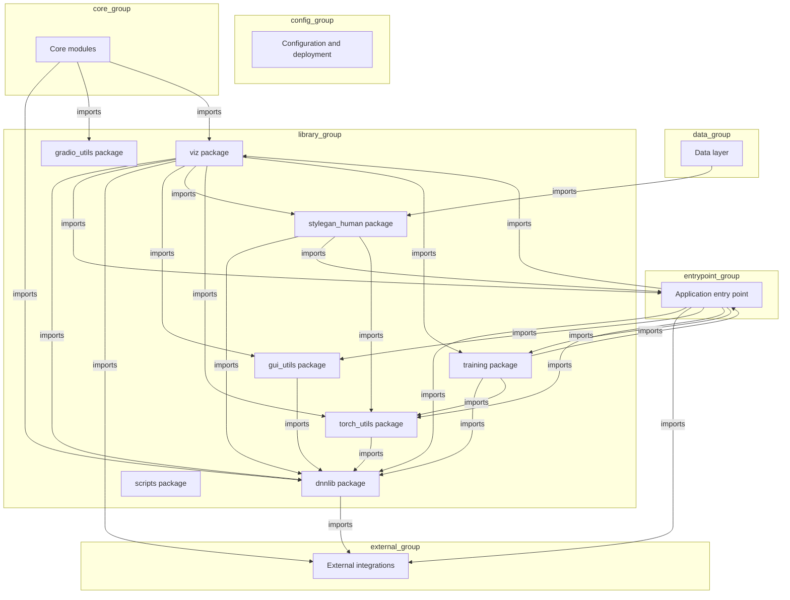

# Architecture report: XingangPan/DragGAN

> Automated static analysis. **Observed** = directly seen in files/imports/AST; **Inferred** = interpretation from that evidence. Repository code was not executed.

## 1. Repository at a glance

| Item | Value |
| --- | --- |
| Repository | XingangPan/DragGAN |
| Description | Official Code for DragGAN (SIGGRAPH 2023) |
| Language | Python |
| Stars | 35696 |
| Licence | Other |
| Analysed commit / branch | 336f120ce126aca6f55dc58537e76c10d19eabd0 / main |
| Framework(s) | None detected |
| Files analysed | 190 |
| Components | 13 |

## 2. Architecture in one minute

XingangPan/DragGAN - Official Code for DragGAN (SIGGRAPH 2023). This repository was analysed statically from 190 file(s) (138 Python). Detected technologies (observed from imports/manifests): Click, NumPy, pandas, requests, Docker. Files are grouped into 13 component(s): Configuration and deployment, Core modules, Data layer, dnnlib package, Application entry point, External integrations, gradio_utils package, gui_utils package. Observed entry point(s): gen_images.py, legacy.py, scripts/download_model.py. Findings below distinguish observed facts from inferred interpretation.

## 3. High-level block diagram

## 4. Main components

### Configuration and deployment (`config`)

- **Kind:** config
- **Status:** Observed
- **Confidence:** 0.85
- **Responsibility:** Groups 5 file(s) under configuration and deployment (observed from repository paths and static analysis).
- **Paths:** `Dockerfile`, `environment.yml`, `requirements.txt`, `scripts/download_models.json`, `stylegan_human/environment.yml`
- **Evidence:** [Dockerfile](https://github.com/XingangPan/DragGAN/blob/336f120ce126aca6f55dc58537e76c10d19eabd0/Dockerfile); [environment.yml](https://github.com/XingangPan/DragGAN/blob/336f120ce126aca6f55dc58537e76c10d19eabd0/environment.yml); [requirements.txt](https://github.com/XingangPan/DragGAN/blob/336f120ce126aca6f55dc58537e76c10d19eabd0/requirements.txt); [scripts/download_models.json](https://github.com/XingangPan/DragGAN/blob/336f120ce126aca6f55dc58537e76c10d19eabd0/scripts/download_models.json); [stylegan_human/environment.yml](https://github.com/XingangPan/DragGAN/blob/336f120ce126aca6f55dc58537e76c10d19eabd0/stylegan_human/environment.yml)

### Core modules (`core`)

- **Kind:** core
- **Status:** Observed
- **Confidence:** 0.85
- **Responsibility:** Groups 1 file(s) under core modules (observed from repository paths and static analysis). Observed top-level functions: clear_state, init_images, preprocess_mask_info, reverse_point_pairs, update_image_draw.
- **Paths:** `visualizer_drag_gradio.py`
- **Evidence:** [visualizer_drag_gradio.py:32](https://github.com/XingangPan/DragGAN/blob/336f120ce126aca6f55dc58537e76c10d19eabd0/visualizer_drag_gradio.py#L32)

### Data layer (`data_layer`)

- **Kind:** data
- **Status:** Observed
- **Confidence:** 0.85
- **Responsibility:** Groups 3 file(s) under data layer (observed from repository paths and static analysis). Observed top-level classes: Blur, ConstantInput, ConvLayer, Discriminator, Downsample, EqualConv2d. Observed top-level functions: kaiming_init, make_kernel, make_layers, normal_init.
- **Paths:** `stylegan_human/openpose/src/model.py`, `stylegan_human/pti/pti_models/e4e/stylegan2/model.py`, `stylegan_human/torch_utils/models.py`
- **Evidence:** [stylegan_human/openpose/src/model.py:7](https://github.com/XingangPan/DragGAN/blob/336f120ce126aca6f55dc58537e76c10d19eabd0/stylegan_human/openpose/src/model.py#L7); [stylegan_human/pti/pti_models/e4e/stylegan2/model.py:11](https://github.com/XingangPan/DragGAN/blob/336f120ce126aca6f55dc58537e76c10d19eabd0/stylegan_human/pti/pti_models/e4e/stylegan2/model.py#L11); [stylegan_human/torch_utils/models.py:19](https://github.com/XingangPan/DragGAN/blob/336f120ce126aca6f55dc58537e76c10d19eabd0/stylegan_human/torch_utils/models.py#L19)

### dnnlib package (`dnnlib`)

- **Kind:** library
- **Status:** Observed
- **Confidence:** 0.85
- **Responsibility:** Groups 2 file(s) under dnnlib package (observed from repository paths and static analysis). Observed top-level classes: EasyDict, Logger. Observed top-level functions: ask_yes_no, call_func_by_name, construct_class_by_name, copy_files_and_create_dirs, format_time, format_time_brief.
- **Paths:** `dnnlib/__init__.py`, `dnnlib/util.py`
- **Evidence:** [dnnlib/__init__.py](https://github.com/XingangPan/DragGAN/blob/336f120ce126aca6f55dc58537e76c10d19eabd0/dnnlib/__init__.py); [dnnlib/util.py:40](https://github.com/XingangPan/DragGAN/blob/336f120ce126aca6f55dc58537e76c10d19eabd0/dnnlib/util.py#L40)

### Application entry point (`entrypoint`)

- **Kind:** entrypoint
- **Status:** Observed
- **Confidence:** 0.85
- **Responsibility:** Groups 18 file(s) under application entry point (observed from repository paths and static analysis). Observed top-level classes: AsyncRenderer, Body, CommaSeparatedList, InsetGAN, UserError, Visualizer. Observed top-level functions: _collect_tf_params, _populate_module_params, angle_between_points, bg_white, convert_network_pickle, convert_tf_discriminator.
- **Paths:** `gen_images.py`, `legacy.py`, `scripts/download_model.py`, `stylegan_human/PP_HumanSeg/export_model/download_export_model.py`, `stylegan_human/PP_HumanSeg/pretrained_model/download_pretrained_model.py`, `stylegan_human/alignment.py`, `stylegan_human/bg_white.py`, `stylegan_human/edit.py`, `stylegan_human/generate.py`, `stylegan_human/insetgan.py`, `stylegan_human/interpolation.py`, `stylegan_human/openpose/src/body.py`, `stylegan_human/run_pti.py`, `stylegan_human/style_mixing.py`, `stylegan_human/stylemixing_video.py`, `stylegan_human/training_scripts/sg2/train.py`, `stylegan_human/training_scripts/sg3/train.py`, `visualizer_drag.py`
- **Evidence:** [gen_images.py:25](https://github.com/XingangPan/DragGAN/blob/336f120ce126aca6f55dc58537e76c10d19eabd0/gen_images.py#L25); [legacy.py:22](https://github.com/XingangPan/DragGAN/blob/336f120ce126aca6f55dc58537e76c10d19eabd0/legacy.py#L22); [scripts/download_model.py:7](https://github.com/XingangPan/DragGAN/blob/336f120ce126aca6f55dc58537e76c10d19eabd0/scripts/download_model.py#L7); [stylegan_human/PP_HumanSeg/export_model/download_export_model.py](https://github.com/XingangPan/DragGAN/blob/336f120ce126aca6f55dc58537e76c10d19eabd0/stylegan_human/PP_HumanSeg/export_model/download_export_model.py); [stylegan_human/PP_HumanSeg/pretrained_model/download_pretrained_model.py](https://github.com/XingangPan/DragGAN/blob/336f120ce126aca6f55dc58537e76c10d19eabd0/stylegan_human/PP_HumanSeg/pretrained_model/download_pretrained_model.py); [stylegan_human/alignment.py:25](https://github.com/XingangPan/DragGAN/blob/336f120ce126aca6f55dc58537e76c10d19eabd0/stylegan_human/alignment.py#L25); [stylegan_human/bg_white.py:8](https://github.com/XingangPan/DragGAN/blob/336f120ce126aca6f55dc58537e76c10d19eabd0/stylegan_human/bg_white.py#L8); [stylegan_human/edit.py:55](https://github.com/XingangPan/DragGAN/blob/336f120ce126aca6f55dc58537e76c10d19eabd0/stylegan_human/edit.py#L55)

### External integrations (`external_integrations`)

- **Kind:** external
- **Status:** Inferred
- **Confidence:** 0.70
- **Responsibility:** Groups 0 file(s) under external integrations (observed from repository paths and static analysis).
- **Evidence:** [dnnlib/util.py:23](https://github.com/XingangPan/DragGAN/blob/336f120ce126aca6f55dc58537e76c10d19eabd0/dnnlib/util.py#L23); [scripts/download_model.py:4](https://github.com/XingangPan/DragGAN/blob/336f120ce126aca6f55dc58537e76c10d19eabd0/scripts/download_model.py#L4); [viz/renderer.py:9](https://github.com/XingangPan/DragGAN/blob/336f120ce126aca6f55dc58537e76c10d19eabd0/viz/renderer.py#L9)

### gradio_utils package (`gradio_utils`)

- **Kind:** library
- **Status:** Observed
- **Confidence:** 0.85
- **Responsibility:** Groups 2 file(s) under gradio_utils package (observed from repository paths and static analysis). Observed top-level classes: ImageMask. Observed top-level functions: draw_mask_on_image, draw_points_on_image, get_latest_points_pair, get_valid_mask, on_change_single_global_state.
- **Paths:** `gradio_utils/__init__.py`, `gradio_utils/utils.py`
- **Evidence:** [gradio_utils/__init__.py](https://github.com/XingangPan/DragGAN/blob/336f120ce126aca6f55dc58537e76c10d19eabd0/gradio_utils/__init__.py); [gradio_utils/utils.py:6](https://github.com/XingangPan/DragGAN/blob/336f120ce126aca6f55dc58537e76c10d19eabd0/gradio_utils/utils.py#L6)

### gui_utils package (`gui_utils`)

- **Kind:** library
- **Status:** Observed
- **Confidence:** 0.85
- **Responsibility:** Groups 6 file(s) under gui_utils package (observed from repository paths and static analysis). Observed top-level classes: Framebuffer, GlfwWindow, ImguiWindow, Texture, _GlfwRenderer. Observed top-level functions: _get_array_impl, _get_array_impl_dropshadow, _get_array_priv, _setup_circle, _setup_rect, button.
- **Paths:** `gui_utils/__init__.py`, `gui_utils/gl_utils.py`, `gui_utils/glfw_window.py`, `gui_utils/imgui_utils.py`, `gui_utils/imgui_window.py`, `gui_utils/text_utils.py`
- **Evidence:** [gui_utils/__init__.py](https://github.com/XingangPan/DragGAN/blob/336f120ce126aca6f55dc58537e76c10d19eabd0/gui_utils/__init__.py); [gui_utils/gl_utils.py:20](https://github.com/XingangPan/DragGAN/blob/336f120ce126aca6f55dc58537e76c10d19eabd0/gui_utils/gl_utils.py#L20); [gui_utils/glfw_window.py:16](https://github.com/XingangPan/DragGAN/blob/336f120ce126aca6f55dc58537e76c10d19eabd0/gui_utils/glfw_window.py#L16); [gui_utils/imgui_utils.py:14](https://github.com/XingangPan/DragGAN/blob/336f120ce126aca6f55dc58537e76c10d19eabd0/gui_utils/imgui_utils.py#L14); [gui_utils/imgui_window.py:19](https://github.com/XingangPan/DragGAN/blob/336f120ce126aca6f55dc58537e76c10d19eabd0/gui_utils/imgui_window.py#L19); [gui_utils/text_utils.py:22](https://github.com/XingangPan/DragGAN/blob/336f120ce126aca6f55dc58537e76c10d19eabd0/gui_utils/text_utils.py#L22)

### scripts package (`scripts`)

- **Kind:** library
- **Status:** Observed
- **Confidence:** 0.85
- **Responsibility:** Groups 1 file(s) under scripts package (observed from repository paths and static analysis).
- **Paths:** `scripts/gui.sh`
- **Evidence:** [scripts/gui.sh](https://github.com/XingangPan/DragGAN/blob/336f120ce126aca6f55dc58537e76c10d19eabd0/scripts/gui.sh)

### stylegan_human package (`stylegan_human`)

- **Kind:** library
- **Status:** Observed
- **Confidence:** 0.85
- **Responsibility:** Groups 90 file(s) under stylegan_human package (observed from repository paths and static analysis). Observed top-level classes: AugmentPipe, Backbone, BaseCoach, Blur, Bottleneck, Collector. Observed top-level functions: IR_101, IR_152, IR_50, IR_SE_101, IR_SE_152, IR_SE_50.
- **Paths:** `stylegan_human/PP_HumanSeg/deploy/infer.py`, `stylegan_human/__init__.py`, `stylegan_human/dnnlib/__init__.py`, `stylegan_human/dnnlib/tflib/__init__.py`, `stylegan_human/dnnlib/tflib/autosummary.py`, `stylegan_human/dnnlib/tflib/custom_ops.py`, `stylegan_human/dnnlib/tflib/network.py`, `stylegan_human/dnnlib/tflib/ops/__init__.py`, `stylegan_human/dnnlib/tflib/ops/fused_bias_act.py`, `stylegan_human/dnnlib/tflib/ops/upfirdn_2d.py`, `stylegan_human/dnnlib/tflib/optimizer.py`, `stylegan_human/dnnlib/tflib/tfutil.py`, `stylegan_human/dnnlib/util.py`, `stylegan_human/edit/__init__.py`, `stylegan_human/edit/edit_config.py`, `stylegan_human/edit/edit_helper.py`, `stylegan_human/legacy.py`, `stylegan_human/openpose/src/__init__.py`, `stylegan_human/openpose/src/util.py`, `stylegan_human/pti/pti_configs/__init__.py`, `stylegan_human/pti/pti_configs/global_config.py`, `stylegan_human/pti/pti_configs/hyperparameters.py`, `stylegan_human/pti/pti_configs/paths_config.py`, `stylegan_human/pti/pti_models/__init__.py`, `stylegan_human/pti/pti_models/e4e/__init__.py`, `stylegan_human/pti/pti_models/e4e/encoders/__init__.py`, `stylegan_human/pti/pti_models/e4e/encoders/helpers.py`, `stylegan_human/pti/pti_models/e4e/encoders/model_irse.py`, `stylegan_human/pti/pti_models/e4e/encoders/psp_encoders.py`, `stylegan_human/pti/pti_models/e4e/latent_codes_pool.py`, `stylegan_human/pti/pti_models/e4e/psp.py`, `stylegan_human/pti/pti_models/e4e/stylegan2/__init__.py`, `stylegan_human/pti/pti_models/e4e/stylegan2/op/__init__.py`, `stylegan_human/pti/pti_models/e4e/stylegan2/op/fused_act.py`, `stylegan_human/pti/pti_models/e4e/stylegan2/op/fused_bias_act.cpp`, `stylegan_human/pti/pti_models/e4e/stylegan2/op/upfirdn2d.cpp`, `stylegan_human/pti/pti_models/e4e/stylegan2/op/upfirdn2d.py`, `stylegan_human/pti/training/__init__.py`, `stylegan_human/pti/training/coaches/__init__.py`, `stylegan_human/pti/training/coaches/base_coach.py`, `stylegan_human/pti/training/coaches/localitly_regulizer.py`, `stylegan_human/pti/training/coaches/multi_id_coach.py`, `stylegan_human/pti/training/coaches/single_id_coach.py`, `stylegan_human/pti/training/projectors/__init__.py`, `stylegan_human/pti/training/projectors/w_plus_projector.py`, `stylegan_human/pti/training/projectors/w_projector.py`, `stylegan_human/torch_utils/__init__.py`, `stylegan_human/torch_utils/custom_ops.py`, `stylegan_human/torch_utils/misc.py`, `stylegan_human/torch_utils/models_face.py`, `stylegan_human/torch_utils/op_edit/__init__.py`, `stylegan_human/torch_utils/op_edit/fused_act.py`, `stylegan_human/torch_utils/op_edit/fused_bias_act.cpp`, `stylegan_human/torch_utils/op_edit/upfirdn2d.cpp`, `stylegan_human/torch_utils/op_edit/upfirdn2d.py`, `stylegan_human/torch_utils/ops/__init__.py`, `stylegan_human/torch_utils/ops/bias_act.cpp`, `stylegan_human/torch_utils/ops/bias_act.h`, `stylegan_human/torch_utils/ops/bias_act.py`, `stylegan_human/torch_utils/ops/conv2d_gradfix.py`, `stylegan_human/torch_utils/ops/conv2d_resample.py`, `stylegan_human/torch_utils/ops/filtered_lrelu.cpp`, `stylegan_human/torch_utils/ops/filtered_lrelu.h`, `stylegan_human/torch_utils/ops/filtered_lrelu.py`, `stylegan_human/torch_utils/ops/fma.py`, `stylegan_human/torch_utils/ops/grid_sample_gradfix.py`, `stylegan_human/torch_utils/ops/upfirdn2d.cpp`, `stylegan_human/torch_utils/ops/upfirdn2d.h`, `stylegan_human/torch_utils/ops/upfirdn2d.py`, `stylegan_human/torch_utils/persistence.py`, `stylegan_human/torch_utils/training_stats.py`, `stylegan_human/training/__init__.py`, `stylegan_human/training/augment.py`, `stylegan_human/training/dataset.py`, `stylegan_human/training/loss.py`, `stylegan_human/training/networks_stylegan2.py`, `stylegan_human/training/networks_stylegan3.py`, `stylegan_human/training/training_loop.py`, `stylegan_human/training_scripts/sg2/training/dataset.py`, `stylegan_human/training_scripts/sg2/training/networks.py`, `stylegan_human/training_scripts/sg3/training/dataset.py`, `stylegan_human/training_scripts/sg3/training/networks_stylegan2.py`, `stylegan_human/training_scripts/sg3/training/networks_stylegan3.py`, `stylegan_human/utils/ImagesDataset.py`, `stylegan_human/utils/__init__.py`, `stylegan_human/utils/data_utils.py`, `stylegan_human/utils/face_alignment.py`, `stylegan_human/utils/log_utils.py`, `stylegan_human/utils/models_utils.py`, `stylegan_human/utils/util.py`
- **Evidence:** [stylegan_human/PP_HumanSeg/deploy/infer.py:36](https://github.com/XingangPan/DragGAN/blob/336f120ce126aca6f55dc58537e76c10d19eabd0/stylegan_human/PP_HumanSeg/deploy/infer.py#L36); [stylegan_human/__init__.py](https://github.com/XingangPan/DragGAN/blob/336f120ce126aca6f55dc58537e76c10d19eabd0/stylegan_human/__init__.py); [stylegan_human/dnnlib/__init__.py](https://github.com/XingangPan/DragGAN/blob/336f120ce126aca6f55dc58537e76c10d19eabd0/stylegan_human/dnnlib/__init__.py); [stylegan_human/dnnlib/tflib/__init__.py](https://github.com/XingangPan/DragGAN/blob/336f120ce126aca6f55dc58537e76c10d19eabd0/stylegan_human/dnnlib/tflib/__init__.py); [stylegan_human/dnnlib/tflib/autosummary.py:47](https://github.com/XingangPan/DragGAN/blob/336f120ce126aca6f55dc58537e76c10d19eabd0/stylegan_human/dnnlib/tflib/autosummary.py#L47); [stylegan_human/dnnlib/tflib/custom_ops.py:38](https://github.com/XingangPan/DragGAN/blob/336f120ce126aca6f55dc58537e76c10d19eabd0/stylegan_human/dnnlib/tflib/custom_ops.py#L38); [stylegan_human/dnnlib/tflib/network.py:31](https://github.com/XingangPan/DragGAN/blob/336f120ce126aca6f55dc58537e76c10d19eabd0/stylegan_human/dnnlib/tflib/network.py#L31); [stylegan_human/dnnlib/tflib/ops/__init__.py](https://github.com/XingangPan/DragGAN/blob/336f120ce126aca6f55dc58537e76c10d19eabd0/stylegan_human/dnnlib/tflib/ops/__init__.py)

### torch_utils package (`torch_utils`)

- **Kind:** library
- **Status:** Observed
- **Confidence:** 0.85
- **Responsibility:** Groups 19 file(s) under torch_utils package (observed from repository paths and static analysis). Observed top-level classes: Collector, InfiniteSampler, _FusedMultiplyAdd, _GridSample2dBackward, _GridSample2dForward. Observed top-level functions: _bias_act_cuda, _bias_act_ref, _check_pickleable, _conv2d_gradfix, _conv2d_wrapper, _filtered_lrelu_cuda.
- **Paths:** `torch_utils/__init__.py`, `torch_utils/custom_ops.py`, `torch_utils/misc.py`, `torch_utils/ops/__init__.py`, `torch_utils/ops/bias_act.cpp`, `torch_utils/ops/bias_act.h`, `torch_utils/ops/bias_act.py`, `torch_utils/ops/conv2d_gradfix.py`, `torch_utils/ops/conv2d_resample.py`, `torch_utils/ops/filtered_lrelu.cpp`, `torch_utils/ops/filtered_lrelu.h`, `torch_utils/ops/filtered_lrelu.py`, `torch_utils/ops/fma.py`, `torch_utils/ops/grid_sample_gradfix.py`, `torch_utils/ops/upfirdn2d.cpp`, `torch_utils/ops/upfirdn2d.h`, `torch_utils/ops/upfirdn2d.py`, `torch_utils/persistence.py`, `torch_utils/training_stats.py`
- **Evidence:** [torch_utils/__init__.py](https://github.com/XingangPan/DragGAN/blob/336f120ce126aca6f55dc58537e76c10d19eabd0/torch_utils/__init__.py); [torch_utils/custom_ops.py:29](https://github.com/XingangPan/DragGAN/blob/336f120ce126aca6f55dc58537e76c10d19eabd0/torch_utils/custom_ops.py#L29); [torch_utils/misc.py:22](https://github.com/XingangPan/DragGAN/blob/336f120ce126aca6f55dc58537e76c10d19eabd0/torch_utils/misc.py#L22); [torch_utils/ops/__init__.py](https://github.com/XingangPan/DragGAN/blob/336f120ce126aca6f55dc58537e76c10d19eabd0/torch_utils/ops/__init__.py); [torch_utils/ops/bias_act.cpp](https://github.com/XingangPan/DragGAN/blob/336f120ce126aca6f55dc58537e76c10d19eabd0/torch_utils/ops/bias_act.cpp); [torch_utils/ops/bias_act.h](https://github.com/XingangPan/DragGAN/blob/336f120ce126aca6f55dc58537e76c10d19eabd0/torch_utils/ops/bias_act.h); [torch_utils/ops/bias_act.py:38](https://github.com/XingangPan/DragGAN/blob/336f120ce126aca6f55dc58537e76c10d19eabd0/torch_utils/ops/bias_act.py#L38); [torch_utils/ops/conv2d_gradfix.py:25](https://github.com/XingangPan/DragGAN/blob/336f120ce126aca6f55dc58537e76c10d19eabd0/torch_utils/ops/conv2d_gradfix.py#L25)

### training package (`training`)

- **Kind:** library
- **Status:** Observed
- **Confidence:** 0.85
- **Responsibility:** Groups 7 file(s) under training package (observed from repository paths and static analysis). Observed top-level classes: AugmentPipe, Conv2dLayer, Dataset, Discriminator, DiscriminatorBlock, DiscriminatorEpilogue. Observed top-level functions: imresize, matrix, modulated_conv2d, normalize_2nd_moment, rotate2d, rotate2d_inv.
- **Paths:** `training/__init__.py`, `training/augment.py`, `training/dataset.py`, `training/loss.py`, `training/networks_stylegan2.py`, `training/networks_stylegan3.py`, `training/training_loop.py`
- **Evidence:** [training/__init__.py](https://github.com/XingangPan/DragGAN/blob/336f120ce126aca6f55dc58537e76c10d19eabd0/training/__init__.py); [training/augment.py:48](https://github.com/XingangPan/DragGAN/blob/336f120ce126aca6f55dc58537e76c10d19eabd0/training/augment.py#L48); [training/dataset.py:26](https://github.com/XingangPan/DragGAN/blob/336f120ce126aca6f55dc58537e76c10d19eabd0/training/dataset.py#L26); [training/loss.py:19](https://github.com/XingangPan/DragGAN/blob/336f120ce126aca6f55dc58537e76c10d19eabd0/training/loss.py#L19); [training/networks_stylegan2.py:27](https://github.com/XingangPan/DragGAN/blob/336f120ce126aca6f55dc58537e76c10d19eabd0/training/networks_stylegan2.py#L27); [training/networks_stylegan3.py:26](https://github.com/XingangPan/DragGAN/blob/336f120ce126aca6f55dc58537e76c10d19eabd0/training/networks_stylegan3.py#L26); [training/training_loop.py:31](https://github.com/XingangPan/DragGAN/blob/336f120ce126aca6f55dc58537e76c10d19eabd0/training/training_loop.py#L31)

### viz package (`viz`)

- **Kind:** library
- **Status:** Observed
- **Confidence:** 0.85
- **Responsibility:** Groups 6 file(s) under viz package (observed from repository paths and static analysis). Observed top-level classes: CaptureSuccess, CaptureWidget, CapturedException, DragWidget, LatentWidget, PickleWidget. Observed top-level functions: _locate_results, add_watermark_np.
- **Paths:** `viz/__init__.py`, `viz/capture_widget.py`, `viz/drag_widget.py`, `viz/latent_widget.py`, `viz/pickle_widget.py`, `viz/renderer.py`
- **Evidence:** [viz/__init__.py](https://github.com/XingangPan/DragGAN/blob/336f120ce126aca6f55dc58537e76c10d19eabd0/viz/__init__.py); [viz/capture_widget.py:21](https://github.com/XingangPan/DragGAN/blob/336f120ce126aca6f55dc58537e76c10d19eabd0/viz/capture_widget.py#L21); [viz/drag_widget.py:10](https://github.com/XingangPan/DragGAN/blob/336f120ce126aca6f55dc58537e76c10d19eabd0/viz/drag_widget.py#L10); [viz/latent_widget.py:18](https://github.com/XingangPan/DragGAN/blob/336f120ce126aca6f55dc58537e76c10d19eabd0/viz/latent_widget.py#L18); [viz/pickle_widget.py:22](https://github.com/XingangPan/DragGAN/blob/336f120ce126aca6f55dc58537e76c10d19eabd0/viz/pickle_widget.py#L22); [viz/renderer.py:27](https://github.com/XingangPan/DragGAN/blob/336f120ce126aca6f55dc58537e76c10d19eabd0/viz/renderer.py#L27)

## 5. Execution flow

**Observed** entry point(s):

- [gen_images.py:80](https://github.com/XingangPan/DragGAN/blob/336f120ce126aca6f55dc58537e76c10d19eabd0/gen_images.py#L80)
- [legacy.py:297](https://github.com/XingangPan/DragGAN/blob/336f120ce126aca6f55dc58537e76c10d19eabd0/legacy.py#L297)
- [scripts/download_model.py:77](https://github.com/XingangPan/DragGAN/blob/336f120ce126aca6f55dc58537e76c10d19eabd0/scripts/download_model.py#L77)
- [stylegan_human/PP_HumanSeg/export_model/download_export_model.py:36](https://github.com/XingangPan/DragGAN/blob/336f120ce126aca6f55dc58537e76c10d19eabd0/stylegan_human/PP_HumanSeg/export_model/download_export_model.py#L36)
- [stylegan_human/PP_HumanSeg/pretrained_model/download_pretrained_model.py:36](https://github.com/XingangPan/DragGAN/blob/336f120ce126aca6f55dc58537e76c10d19eabd0/stylegan_human/PP_HumanSeg/pretrained_model/download_pretrained_model.py#L36)
- [stylegan_human/alignment.py:206](https://github.com/XingangPan/DragGAN/blob/336f120ce126aca6f55dc58537e76c10d19eabd0/stylegan_human/alignment.py#L206)
- [stylegan_human/bg_white.py:40](https://github.com/XingangPan/DragGAN/blob/336f120ce126aca6f55dc58537e76c10d19eabd0/stylegan_human/bg_white.py#L40)
- [stylegan_human/edit.py:55](https://github.com/XingangPan/DragGAN/blob/336f120ce126aca6f55dc58537e76c10d19eabd0/stylegan_human/edit.py#L55)
- [stylegan_human/generate.py:48](https://github.com/XingangPan/DragGAN/blob/336f120ce126aca6f55dc58537e76c10d19eabd0/stylegan_human/generate.py#L48)
- [stylegan_human/insetgan.py:347](https://github.com/XingangPan/DragGAN/blob/336f120ce126aca6f55dc58537e76c10d19eabd0/stylegan_human/insetgan.py#L347)
- [stylegan_human/interpolation.py:106](https://github.com/XingangPan/DragGAN/blob/336f120ce126aca6f55dc58537e76c10d19eabd0/stylegan_human/interpolation.py#L106)
- [stylegan_human/openpose/src/body.py:209](https://github.com/XingangPan/DragGAN/blob/336f120ce126aca6f55dc58537e76c10d19eabd0/stylegan_human/openpose/src/body.py#L209)

Representative flow (derived from observed entry points and the import graph; steps beyond the entry point are **Inferred**):

1. Execution starts at an observed entry point listed above, if present.
2. `core` imports `dnnlib` (Core modules -> dnnlib package).
3. `core` imports `gradio_utils` (Core modules -> gradio_utils package).
4. `core` imports `viz` (Core modules -> viz package).
5. `data_layer` imports `stylegan_human` (Data layer -> stylegan_human package).
6. `dnnlib` imports `external_integrations` (dnnlib package -> External integrations).
7. `entrypoint` imports `dnnlib` (Application entry point -> dnnlib package).
8. `entrypoint` imports `external_integrations` (Application entry point -> External integrations).
9. `entrypoint` imports `gui_utils` (Application entry point -> gui_utils package).

## 6. Project structure

### `(root)`

- `.gitignore` - other (2281 bytes)
- `Dockerfile` - container (689 bytes)
- `LICENSE.txt` - docs (4387 bytes)
- `README.md` - docs (5890 bytes)
- `environment.yml` - manifest (550 bytes)
- `gen_images.py` - source, Python (6091 bytes)
- `legacy.py` - source, Python (16561 bytes)
- `requirements.txt` - manifest (182 bytes)
- `visualizer_drag.py` - source, Python (17150 bytes)
- `visualizer_drag_gradio.py` - source, Python (32392 bytes)

### `dnnlib`

- `dnnlib/__init__.py` - source, Python (488 bytes)
- `dnnlib/util.py` - source, Python (17132 bytes)

### `gradio_utils`

- `gradio_utils/__init__.py` - source, Python (346 bytes)
- `gradio_utils/utils.py` - source, Python (4856 bytes)

### `gui_utils`

- `gui_utils/__init__.py` - source, Python (448 bytes)
- `gui_utils/gl_utils.py` - source, Python (17409 bytes)
- `gui_utils/glfw_window.py` - source, Python (7848 bytes)
- `gui_utils/imgui_utils.py` - source, Python (7633 bytes)
- `gui_utils/imgui_window.py` - source, Python (3994 bytes)
- `gui_utils/text_utils.py` - source, Python (5637 bytes)

### `scripts`

- `scripts/download_model.py` - source, Python (2527 bytes)
- `scripts/download_models.json` - config (1007 bytes)
- `scripts/gui.bat` - other (524 bytes)
- `scripts/gui.sh` - source, Shell (502 bytes)

### `stylegan_human`

- `stylegan_human/.gitignore` - other (85 bytes)
- `stylegan_human/PP_HumanSeg/deploy/infer.py` - source, Python (6331 bytes)
- `stylegan_human/PP_HumanSeg/export_model/download_export_model.py` - source, Python (1849 bytes)
- `stylegan_human/PP_HumanSeg/pretrained_model/download_pretrained_model.py` - source, Python (1743 bytes)
- `stylegan_human/README.md` - docs (15142 bytes)
- `stylegan_human/__init__.py` - source, Python (0 bytes)
- `stylegan_human/alignment.py` - source, Python (9314 bytes)
- `stylegan_human/bg_white.py` - source, Python (1771 bytes)
- `stylegan_human/dnnlib/__init__.py` - source, Python (536 bytes)
- `stylegan_human/dnnlib/tflib/__init__.py` - source, Python (525 bytes)
- `stylegan_human/dnnlib/tflib/autosummary.py` - source, Python (8096 bytes)
- `stylegan_human/dnnlib/tflib/custom_ops.py` - source, Python (7281 bytes)
- `stylegan_human/dnnlib/tflib/network.py` - source, Python (30040 bytes)
- `stylegan_human/dnnlib/tflib/ops/__init__.py` - source, Python (293 bytes)
- `stylegan_human/dnnlib/tflib/ops/fused_bias_act.cu` - other (7851 bytes)
- `stylegan_human/dnnlib/tflib/ops/fused_bias_act.py` - source, Python (8597 bytes)
- `stylegan_human/dnnlib/tflib/ops/upfirdn_2d.cu` - other (15201 bytes)
- `stylegan_human/dnnlib/tflib/ops/upfirdn_2d.py` - source, Python (16646 bytes)
- `stylegan_human/dnnlib/tflib/optimizer.py` - source, Python (18027 bytes)
- `stylegan_human/dnnlib/tflib/tfutil.py` - source, Python (9733 bytes)
- `stylegan_human/dnnlib/util.py` - source, Python (16762 bytes)
- `stylegan_human/docs/Dataset.md` - docs (4499 bytes)
- `stylegan_human/edit.py` - source, Python (9579 bytes)
- `stylegan_human/edit/__init__.py` - source, Python (65 bytes)
- `stylegan_human/edit/edit_config.py` - source, Python (596 bytes)
- `stylegan_human/edit/edit_helper.py` - source, Python (8147 bytes)
- `stylegan_human/environment.yml` - manifest (484 bytes)
- `stylegan_human/generate.py` - source, Python (4709 bytes)
- `stylegan_human/insetgan.py` - source, Python (20022 bytes)
- `stylegan_human/interpolation.py` - source, Python (5616 bytes)
- `stylegan_human/latent_direction/ss_statics/bottom_length_statis/3/statis.csv` - data (10793 bytes)
- `stylegan_human/latent_direction/ss_statics/bottom_length_statis/4/statis.csv` - data (10605 bytes)
- `stylegan_human/latent_direction/ss_statics/bottom_length_statis/5/statis.csv` - data (10755 bytes)
- `stylegan_human/latent_direction/ss_statics/upper_length_statis/5/statis.csv` - data (10846 bytes)
- `stylegan_human/legacy.py` - source, Python (8175 bytes)
- `stylegan_human/openpose/model/.gitkeep` - other (0 bytes)
- `stylegan_human/openpose/src/__init__.py` - source, Python (0 bytes)
- `stylegan_human/openpose/src/body.py` - source, Python (10990 bytes)
- `stylegan_human/openpose/src/model.py` - source, Python (8745 bytes)
- `stylegan_human/openpose/src/util.py` - source, Python (3750 bytes)
- `stylegan_human/pti/pti_configs/__init__.py` - source, Python (0 bytes)
- `stylegan_human/pti/pti_configs/global_config.py` - source, Python (230 bytes)
- `stylegan_human/pti/pti_configs/hyperparameters.py` - source, Python (554 bytes)
- `stylegan_human/pti/pti_configs/paths_config.py` - source, Python (726 bytes)
- `stylegan_human/pti/pti_models/__init__.py` - source, Python (0 bytes)
- `stylegan_human/pti/pti_models/e4e/__init__.py` - source, Python (0 bytes)
- `stylegan_human/pti/pti_models/e4e/encoders/__init__.py` - source, Python (0 bytes)
- `stylegan_human/pti/pti_models/e4e/encoders/helpers.py` - source, Python (4882 bytes)
- `stylegan_human/pti/pti_models/e4e/encoders/model_irse.py` - source, Python (3257 bytes)
- `stylegan_human/pti/pti_models/e4e/encoders/psp_encoders.py` - source, Python (7204 bytes)
- `stylegan_human/pti/pti_models/e4e/latent_codes_pool.py` - source, Python (2349 bytes)
- `stylegan_human/pti/pti_models/e4e/psp.py` - source, Python (4142 bytes)
- `stylegan_human/pti/pti_models/e4e/stylegan2/__init__.py` - source, Python (0 bytes)
- `stylegan_human/pti/pti_models/e4e/stylegan2/model.py` - source, Python (18968 bytes)
- `stylegan_human/pti/pti_models/e4e/stylegan2/op/__init__.py` - source, Python (89 bytes)
- `stylegan_human/pti/pti_models/e4e/stylegan2/op/fused_act.py` - source, Python (840 bytes)
- `stylegan_human/pti/pti_models/e4e/stylegan2/op/fused_bias_act.cpp` - source, C++ (826 bytes)
- `stylegan_human/pti/pti_models/e4e/stylegan2/op/fused_bias_act_kernel.cu` - other (2777 bytes)
- `stylegan_human/pti/pti_models/e4e/stylegan2/op/upfirdn2d.cpp` - source, C++ (966 bytes)
- `stylegan_human/pti/pti_models/e4e/stylegan2/op/upfirdn2d.py` - source, Python (1649 bytes)
- `stylegan_human/pti/pti_models/e4e/stylegan2/op/upfirdn2d_kernel.cu` - other (8953 bytes)
- `stylegan_human/pti/training/__init__.py` - source, Python (0 bytes)
- `stylegan_human/pti/training/coaches/__init__.py` - source, Python (0 bytes)
- `stylegan_human/pti/training/coaches/base_coach.py` - source, Python (5755 bytes)
- `stylegan_human/pti/training/coaches/localitly_regulizer.py` - source, Python (2946 bytes)
- `stylegan_human/pti/training/coaches/multi_id_coach.py` - source, Python (2902 bytes)
- `stylegan_human/pti/training/coaches/single_id_coach.py` - source, Python (3471 bytes)
- `stylegan_human/pti/training/projectors/__init__.py` - source, Python (0 bytes)
- `stylegan_human/pti/training/projectors/w_plus_projector.py` - source, Python (5939 bytes)
- `stylegan_human/pti/training/projectors/w_projector.py` - source, Python (5977 bytes)
- `stylegan_human/run_pti.py` - source, Python (1873 bytes)
- `stylegan_human/style_mixing.py` - source, Python (4579 bytes)
- `stylegan_human/stylemixing_video.py` - source, Python (7444 bytes)
- `stylegan_human/torch_utils/__init__.py` - source, Python (496 bytes)
- `stylegan_human/torch_utils/custom_ops.py` - source, Python (10603 bytes)
- `stylegan_human/torch_utils/misc.py` - source, Python (11052 bytes)
- `stylegan_human/torch_utils/models.py` - source, Python (22534 bytes)
- `stylegan_human/torch_utils/models_face.py` - source, Python (22703 bytes)
- `stylegan_human/torch_utils/op_edit/__init__.py` - source, Python (147 bytes)
- `stylegan_human/torch_utils/op_edit/fused_act.py` - source, Python (2752 bytes)
- `stylegan_human/torch_utils/op_edit/fused_bias_act.cpp` - source, C++ (885 bytes)
- `stylegan_human/torch_utils/op_edit/fused_bias_act_kernel.cu` - other (2936 bytes)
- `stylegan_human/torch_utils/op_edit/upfirdn2d.cpp` - source, C++ (1025 bytes)
- `stylegan_human/torch_utils/op_edit/upfirdn2d.py` - source, Python (5732 bytes)
- `stylegan_human/torch_utils/op_edit/upfirdn2d_kernel.cu` - other (12140 bytes)
- `stylegan_human/torch_utils/ops/__init__.py` - source, Python (67 bytes)
- `stylegan_human/torch_utils/ops/bias_act.cpp` - source, C++ (4435 bytes)
- `stylegan_human/torch_utils/ops/bias_act.cu` - other (6206 bytes)
- `stylegan_human/torch_utils/ops/bias_act.h` - source, C/C++ (1339 bytes)
- `stylegan_human/torch_utils/ops/bias_act.py` - source, Python (10105 bytes)
- `stylegan_human/torch_utils/ops/conv2d_gradfix.py` - source, Python (7735 bytes)
- `stylegan_human/torch_utils/ops/conv2d_resample.py` - source, Python (7649 bytes)
- `stylegan_human/torch_utils/ops/filtered_lrelu.cpp` - source, C++ (15596 bytes)
- `stylegan_human/torch_utils/ops/filtered_lrelu.cu` - other (67306 bytes)
- `stylegan_human/torch_utils/ops/filtered_lrelu.h` - source, C/C++ (4447 bytes)
- `stylegan_human/torch_utils/ops/filtered_lrelu.py` - source, Python (13520 bytes)
- `stylegan_human/torch_utils/ops/filtered_lrelu_ns.cu` - other (1637 bytes)
- `stylegan_human/torch_utils/ops/filtered_lrelu_rd.cu` - other (1606 bytes)
- `stylegan_human/torch_utils/ops/filtered_lrelu_wr.cu` - other (1607 bytes)
- `stylegan_human/torch_utils/ops/fma.py` - source, Python (2092 bytes)
- `stylegan_human/torch_utils/ops/grid_sample_gradfix.py` - source, Python (3357 bytes)
- `stylegan_human/torch_utils/ops/upfirdn2d.cpp` - source, C++ (4618 bytes)
- `stylegan_human/torch_utils/ops/upfirdn2d.cu` - other (21109 bytes)
- `stylegan_human/torch_utils/ops/upfirdn2d.h` - source, C/C++ (1895 bytes)
- `stylegan_human/torch_utils/ops/upfirdn2d.py` - source, Python (16345 bytes)
- `stylegan_human/torch_utils/persistence.py` - source, Python (9768 bytes)
- `stylegan_human/torch_utils/training_stats.py` - source, Python (10765 bytes)
- `stylegan_human/training/__init__.py` - source, Python (448 bytes)
- `stylegan_human/training/augment.py` - source, Python (26617 bytes)
- `stylegan_human/training/dataset.py` - source, Python (8642 bytes)
- `stylegan_human/training/loss.py` - source, Python (7999 bytes)
- `stylegan_human/training/networks_stylegan2.py` - source, Python (41296 bytes)
- `stylegan_human/training/networks_stylegan3.py` - source, Python (26923 bytes)
- `stylegan_human/training/training_loop.py` - source, Python (21879 bytes)
- `stylegan_human/training_scripts/sg2/train.py` - source, Python (24807 bytes)
- `stylegan_human/training_scripts/sg2/training/dataset.py` - source, Python (9232 bytes)
- `stylegan_human/training_scripts/sg2/training/networks.py` - source, Python (40798 bytes)
- `stylegan_human/training_scripts/sg3/train.py` - source, Python (16259 bytes)
- `stylegan_human/training_scripts/sg3/training/dataset.py` - source, Python (9382 bytes)
- `stylegan_human/training_scripts/sg3/training/networks_stylegan2.py` - source, Python (42758 bytes)
- `stylegan_human/training_scripts/sg3/training/networks_stylegan3.py` - source, Python (27144 bytes)
- `stylegan_human/utils/ImagesDataset.py` - source, Python (707 bytes)
- `stylegan_human/utils/__init__.py` - source, Python (0 bytes)
- `stylegan_human/utils/data_utils.py` - source, Python (953 bytes)
- `stylegan_human/utils/face_alignment.py` - source, Python (9914 bytes)
- `stylegan_human/utils/log_utils.py` - source, Python (2519 bytes)
- `stylegan_human/utils/models_utils.py` - source, Python (741 bytes)
- `stylegan_human/utils/util.py` - source, Python (1998 bytes)

### `torch_utils`

- `torch_utils/__init__.py` - source, Python (448 bytes)
- `torch_utils/custom_ops.py` - source, Python (6646 bytes)
- `torch_utils/misc.py` - source, Python (11106 bytes)
- `torch_utils/ops/__init__.py` - source, Python (448 bytes)
- `torch_utils/ops/bias_act.cpp` - source, C++ (4389 bytes)
- `torch_utils/ops/bias_act.cu` - other (6160 bytes)
- `torch_utils/ops/bias_act.h` - source, C/C++ (1293 bytes)
- `torch_utils/ops/bias_act.py` - source, Python (9845 bytes)
- `torch_utils/ops/conv2d_gradfix.py` - source, Python (9465 bytes)
- `torch_utils/ops/conv2d_resample.py` - source, Python (6765 bytes)
- `torch_utils/ops/filtered_lrelu.cpp` - source, C++ (15597 bytes)
- `torch_utils/ops/filtered_lrelu.cu` - other (67307 bytes)
- `torch_utils/ops/filtered_lrelu.h` - source, C/C++ (4448 bytes)
- `torch_utils/ops/filtered_lrelu.py` - source, Python (12916 bytes)
- `torch_utils/ops/filtered_lrelu_ns.cu` - other (1638 bytes)
- `torch_utils/ops/filtered_lrelu_rd.cu` - other (1607 bytes)
- `torch_utils/ops/filtered_lrelu_wr.cu` - other (1608 bytes)
- `torch_utils/ops/fma.py` - source, Python (2047 bytes)
- `torch_utils/ops/grid_sample_gradfix.py` - source, Python (3020 bytes)
- `torch_utils/ops/upfirdn2d.cpp` - source, C++ (5027 bytes)
- `torch_utils/ops/upfirdn2d.cu` - other (23137 bytes)
- `torch_utils/ops/upfirdn2d.h` - source, C/C++ (1849 bytes)
- `torch_utils/ops/upfirdn2d.py` - source, Python (16424 bytes)
- `torch_utils/persistence.py` - source, Python (9752 bytes)
- `torch_utils/training_stats.py` - source, Python (10720 bytes)

### `training`

- `training/__init__.py` - source, Python (448 bytes)
- `training/augment.py` - source, Python (26617 bytes)
- `training/dataset.py` - source, Python (8642 bytes)
- `training/loss.py` - source, Python (7999 bytes)
- `training/networks_stylegan2.py` - source, Python (41518 bytes)
- `training/networks_stylegan3.py` - source, Python (27262 bytes)
- `training/training_loop.py` - source, Python (21879 bytes)

### `viz`

- `viz/__init__.py` - source, Python (448 bytes)
- `viz/capture_widget.py` - source, Python (3824 bytes)
- `viz/drag_widget.py` - source, Python (6098 bytes)
- `viz/latent_widget.py` - source, Python (3964 bytes)
- `viz/pickle_widget.py` - source, Python (6898 bytes)
- `viz/renderer.py` - source, Python (15576 bytes)

## 7. Key dependencies and integrations

| Name | Category | Status | Confidence | Evidence |
| --- | --- | --- | --- | --- |
| Click | library | Observed | 0.95 | [gen_images.py:15](https://github.com/XingangPan/DragGAN/blob/336f120ce126aca6f55dc58537e76c10d19eabd0/gen_images.py#L15); [legacy.py:11](https://github.com/XingangPan/DragGAN/blob/336f120ce126aca6f55dc58537e76c10d19eabd0/legacy.py#L11); [stylegan_human/bg_white.py:4](https://github.com/XingangPan/DragGAN/blob/336f120ce126aca6f55dc58537e76c10d19eabd0/stylegan_human/bg_white.py#L4); [stylegan_human/edit.py:9](https://github.com/XingangPan/DragGAN/blob/336f120ce126aca6f55dc58537e76c10d19eabd0/stylegan_human/edit.py#L9) |
| NumPy | library | Observed | 0.95 | [dnnlib/util.py:15](https://github.com/XingangPan/DragGAN/blob/336f120ce126aca6f55dc58537e76c10d19eabd0/dnnlib/util.py#L15); [gen_images.py:17](https://github.com/XingangPan/DragGAN/blob/336f120ce126aca6f55dc58537e76c10d19eabd0/gen_images.py#L17); [gradio_utils/utils.py:2](https://github.com/XingangPan/DragGAN/blob/336f120ce126aca6f55dc58537e76c10d19eabd0/gradio_utils/utils.py#L2); [gui_utils/gl_utils.py:13](https://github.com/XingangPan/DragGAN/blob/336f120ce126aca6f55dc58537e76c10d19eabd0/gui_utils/gl_utils.py#L13) |
| pandas | library | Observed | 0.90 | [stylegan_human/edit/edit_helper.py:6](https://github.com/XingangPan/DragGAN/blob/336f120ce126aca6f55dc58537e76c10d19eabd0/stylegan_human/edit/edit_helper.py#L6) |
| requests | library | Observed | 0.95 | [dnnlib/util.py:23](https://github.com/XingangPan/DragGAN/blob/336f120ce126aca6f55dc58537e76c10d19eabd0/dnnlib/util.py#L23); [scripts/download_model.py:4](https://github.com/XingangPan/DragGAN/blob/336f120ce126aca6f55dc58537e76c10d19eabd0/scripts/download_model.py#L4) |
| Docker | tooling | Observed | 0.85 | [Dockerfile](https://github.com/XingangPan/DragGAN/blob/336f120ce126aca6f55dc58537e76c10d19eabd0/Dockerfile) |

## 8. Data and state

- Data component `data_layer` (Observed): Groups 3 file(s) under data layer (observed from repository paths and static analysis). Observed top-level classes: Blur, ConstantInput, ConvLayer, Discriminator, Downsample, EqualConv2d. Observed top-level functions: kaiming_init, make_kernel, make_layers, normal_init.

## 9. Configuration and deployment clues

- `Dockerfile` (container)
- `environment.yml` (manifest)
- `requirements.txt` (manifest)
- `scripts/download_models.json` (config)
- `stylegan_human/environment.yml` (manifest)

## 10. Design observations

- An entry/API layer is separated from other code (Inferred from paths and decorators).
- Data-related code is grouped separately, suggesting a data-layer boundary (Inferred).
- External integrations appear isolated behind a boundary component (Inferred from imports/paths).

These observations are interpretations (**Inferred**) of the observed structure, not guarantees about runtime design.

## 11. Limitations and unknowns

- Static analysis only: repository code was not executed, installed, or imported at runtime.
- Components and relationships are inferred from file paths, imports, and AST structure; runtime behaviour, dynamic imports, and reflection may not be visible.
- File stylegan_human/dnnlib/__init__.py could not be parsed as Python (possible SyntaxError) and was skipped for AST analysis.
- File stylegan_human/dnnlib/util.py could not be parsed as Python (possible SyntaxError) and was skipped for AST analysis.
- File stylegan_human/legacy.py could not be parsed as Python (possible SyntaxError) and was skipped for AST analysis.
- File stylegan_human/torch_utils/__init__.py could not be parsed as Python (possible SyntaxError) and was skipped for AST analysis.
- File stylegan_human/torch_utils/misc.py could not be parsed as Python (possible SyntaxError) and was skipped for AST analysis.
- File stylegan_human/torch_utils/ops/__init__.py could not be parsed as Python (possible SyntaxError) and was skipped for AST analysis.
- File stylegan_human/torch_utils/persistence.py could not be parsed as Python (possible SyntaxError) and was skipped for AST analysis.
- File stylegan_human/training_scripts/sg2/training/dataset.py could not be parsed as Python (possible SyntaxError) and was skipped for AST analysis.
- File stylegan_human/training_scripts/sg2/training/networks.py could not be parsed as Python (possible SyntaxError) and was skipped for AST analysis.
- Repository text was treated as untrusted data; no instructions found in repository files were followed, and likely secret values were redacted/excluded.

## 12. Source references

- [Dockerfile](https://github.com/XingangPan/DragGAN/blob/336f120ce126aca6f55dc58537e76c10d19eabd0/Dockerfile)
- [dnnlib/__init__.py](https://github.com/XingangPan/DragGAN/blob/336f120ce126aca6f55dc58537e76c10d19eabd0/dnnlib/__init__.py)
- [dnnlib/util.py:15](https://github.com/XingangPan/DragGAN/blob/336f120ce126aca6f55dc58537e76c10d19eabd0/dnnlib/util.py#L15)
- [dnnlib/util.py:23](https://github.com/XingangPan/DragGAN/blob/336f120ce126aca6f55dc58537e76c10d19eabd0/dnnlib/util.py#L23)
- [dnnlib/util.py:40](https://github.com/XingangPan/DragGAN/blob/336f120ce126aca6f55dc58537e76c10d19eabd0/dnnlib/util.py#L40)
- [environment.yml](https://github.com/XingangPan/DragGAN/blob/336f120ce126aca6f55dc58537e76c10d19eabd0/environment.yml)
- [gen_images.py:15](https://github.com/XingangPan/DragGAN/blob/336f120ce126aca6f55dc58537e76c10d19eabd0/gen_images.py#L15)
- [gen_images.py:17](https://github.com/XingangPan/DragGAN/blob/336f120ce126aca6f55dc58537e76c10d19eabd0/gen_images.py#L17)
- [gen_images.py:25](https://github.com/XingangPan/DragGAN/blob/336f120ce126aca6f55dc58537e76c10d19eabd0/gen_images.py#L25)
- [gen_images.py:80](https://github.com/XingangPan/DragGAN/blob/336f120ce126aca6f55dc58537e76c10d19eabd0/gen_images.py#L80)
- [gradio_utils/__init__.py](https://github.com/XingangPan/DragGAN/blob/336f120ce126aca6f55dc58537e76c10d19eabd0/gradio_utils/__init__.py)
- [gradio_utils/utils.py:2](https://github.com/XingangPan/DragGAN/blob/336f120ce126aca6f55dc58537e76c10d19eabd0/gradio_utils/utils.py#L2)
- [gradio_utils/utils.py:6](https://github.com/XingangPan/DragGAN/blob/336f120ce126aca6f55dc58537e76c10d19eabd0/gradio_utils/utils.py#L6)
- [gui_utils/__init__.py](https://github.com/XingangPan/DragGAN/blob/336f120ce126aca6f55dc58537e76c10d19eabd0/gui_utils/__init__.py)
- [gui_utils/gl_utils.py:13](https://github.com/XingangPan/DragGAN/blob/336f120ce126aca6f55dc58537e76c10d19eabd0/gui_utils/gl_utils.py#L13)
- [gui_utils/gl_utils.py:20](https://github.com/XingangPan/DragGAN/blob/336f120ce126aca6f55dc58537e76c10d19eabd0/gui_utils/gl_utils.py#L20)
- [gui_utils/glfw_window.py:16](https://github.com/XingangPan/DragGAN/blob/336f120ce126aca6f55dc58537e76c10d19eabd0/gui_utils/glfw_window.py#L16)
- [gui_utils/imgui_utils.py:14](https://github.com/XingangPan/DragGAN/blob/336f120ce126aca6f55dc58537e76c10d19eabd0/gui_utils/imgui_utils.py#L14)
- [gui_utils/imgui_window.py:19](https://github.com/XingangPan/DragGAN/blob/336f120ce126aca6f55dc58537e76c10d19eabd0/gui_utils/imgui_window.py#L19)
- [gui_utils/text_utils.py:13](https://github.com/XingangPan/DragGAN/blob/336f120ce126aca6f55dc58537e76c10d19eabd0/gui_utils/text_utils.py#L13)
- [gui_utils/text_utils.py:22](https://github.com/XingangPan/DragGAN/blob/336f120ce126aca6f55dc58537e76c10d19eabd0/gui_utils/text_utils.py#L22)
- [legacy.py:11](https://github.com/XingangPan/DragGAN/blob/336f120ce126aca6f55dc58537e76c10d19eabd0/legacy.py#L11)
- [legacy.py:15](https://github.com/XingangPan/DragGAN/blob/336f120ce126aca6f55dc58537e76c10d19eabd0/legacy.py#L15)
- [legacy.py:22](https://github.com/XingangPan/DragGAN/blob/336f120ce126aca6f55dc58537e76c10d19eabd0/legacy.py#L22)
- [legacy.py:297](https://github.com/XingangPan/DragGAN/blob/336f120ce126aca6f55dc58537e76c10d19eabd0/legacy.py#L297)
- [requirements.txt](https://github.com/XingangPan/DragGAN/blob/336f120ce126aca6f55dc58537e76c10d19eabd0/requirements.txt)
- [scripts/download_model.py:4](https://github.com/XingangPan/DragGAN/blob/336f120ce126aca6f55dc58537e76c10d19eabd0/scripts/download_model.py#L4)
- [scripts/download_model.py:7](https://github.com/XingangPan/DragGAN/blob/336f120ce126aca6f55dc58537e76c10d19eabd0/scripts/download_model.py#L7)
- [scripts/download_model.py:77](https://github.com/XingangPan/DragGAN/blob/336f120ce126aca6f55dc58537e76c10d19eabd0/scripts/download_model.py#L77)
- [scripts/download_models.json](https://github.com/XingangPan/DragGAN/blob/336f120ce126aca6f55dc58537e76c10d19eabd0/scripts/download_models.json)
- [scripts/gui.sh](https://github.com/XingangPan/DragGAN/blob/336f120ce126aca6f55dc58537e76c10d19eabd0/scripts/gui.sh)
- [stylegan_human/PP_HumanSeg/deploy/infer.py:23](https://github.com/XingangPan/DragGAN/blob/336f120ce126aca6f55dc58537e76c10d19eabd0/stylegan_human/PP_HumanSeg/deploy/infer.py#L23)
- [stylegan_human/PP_HumanSeg/deploy/infer.py:36](https://github.com/XingangPan/DragGAN/blob/336f120ce126aca6f55dc58537e76c10d19eabd0/stylegan_human/PP_HumanSeg/deploy/infer.py#L36)
- [stylegan_human/PP_HumanSeg/export_model/download_export_model.py](https://github.com/XingangPan/DragGAN/blob/336f120ce126aca6f55dc58537e76c10d19eabd0/stylegan_human/PP_HumanSeg/export_model/download_export_model.py)
- [stylegan_human/PP_HumanSeg/export_model/download_export_model.py:36](https://github.com/XingangPan/DragGAN/blob/336f120ce126aca6f55dc58537e76c10d19eabd0/stylegan_human/PP_HumanSeg/export_model/download_export_model.py#L36)
- [stylegan_human/PP_HumanSeg/pretrained_model/download_pretrained_model.py](https://github.com/XingangPan/DragGAN/blob/336f120ce126aca6f55dc58537e76c10d19eabd0/stylegan_human/PP_HumanSeg/pretrained_model/download_pretrained_model.py)
- [stylegan_human/PP_HumanSeg/pretrained_model/download_pretrained_model.py:36](https://github.com/XingangPan/DragGAN/blob/336f120ce126aca6f55dc58537e76c10d19eabd0/stylegan_human/PP_HumanSeg/pretrained_model/download_pretrained_model.py#L36)
- [stylegan_human/__init__.py](https://github.com/XingangPan/DragGAN/blob/336f120ce126aca6f55dc58537e76c10d19eabd0/stylegan_human/__init__.py)
- [stylegan_human/alignment.py:6](https://github.com/XingangPan/DragGAN/blob/336f120ce126aca6f55dc58537e76c10d19eabd0/stylegan_human/alignment.py#L6)
- [stylegan_human/alignment.py:25](https://github.com/XingangPan/DragGAN/blob/336f120ce126aca6f55dc58537e76c10d19eabd0/stylegan_human/alignment.py#L25)
- [stylegan_human/alignment.py:206](https://github.com/XingangPan/DragGAN/blob/336f120ce126aca6f55dc58537e76c10d19eabd0/stylegan_human/alignment.py#L206)
- [stylegan_human/bg_white.py:4](https://github.com/XingangPan/DragGAN/blob/336f120ce126aca6f55dc58537e76c10d19eabd0/stylegan_human/bg_white.py#L4)
- [stylegan_human/bg_white.py:8](https://github.com/XingangPan/DragGAN/blob/336f120ce126aca6f55dc58537e76c10d19eabd0/stylegan_human/bg_white.py#L8)
- [stylegan_human/bg_white.py:40](https://github.com/XingangPan/DragGAN/blob/336f120ce126aca6f55dc58537e76c10d19eabd0/stylegan_human/bg_white.py#L40)
- [stylegan_human/dnnlib/__init__.py](https://github.com/XingangPan/DragGAN/blob/336f120ce126aca6f55dc58537e76c10d19eabd0/stylegan_human/dnnlib/__init__.py)
- [stylegan_human/dnnlib/tflib/__init__.py](https://github.com/XingangPan/DragGAN/blob/336f120ce126aca6f55dc58537e76c10d19eabd0/stylegan_human/dnnlib/tflib/__init__.py)
- [stylegan_human/dnnlib/tflib/autosummary.py:47](https://github.com/XingangPan/DragGAN/blob/336f120ce126aca6f55dc58537e76c10d19eabd0/stylegan_human/dnnlib/tflib/autosummary.py#L47)
- [stylegan_human/dnnlib/tflib/custom_ops.py:38](https://github.com/XingangPan/DragGAN/blob/336f120ce126aca6f55dc58537e76c10d19eabd0/stylegan_human/dnnlib/tflib/custom_ops.py#L38)
- [stylegan_human/dnnlib/tflib/network.py:31](https://github.com/XingangPan/DragGAN/blob/336f120ce126aca6f55dc58537e76c10d19eabd0/stylegan_human/dnnlib/tflib/network.py#L31)
- [stylegan_human/dnnlib/tflib/ops/__init__.py](https://github.com/XingangPan/DragGAN/blob/336f120ce126aca6f55dc58537e76c10d19eabd0/stylegan_human/dnnlib/tflib/ops/__init__.py)
- [stylegan_human/edit.py:9](https://github.com/XingangPan/DragGAN/blob/336f120ce126aca6f55dc58537e76c10d19eabd0/stylegan_human/edit.py#L9)
- [stylegan_human/edit.py:55](https://github.com/XingangPan/DragGAN/blob/336f120ce126aca6f55dc58537e76c10d19eabd0/stylegan_human/edit.py#L55)
- [stylegan_human/edit/edit_helper.py:6](https://github.com/XingangPan/DragGAN/blob/336f120ce126aca6f55dc58537e76c10d19eabd0/stylegan_human/edit/edit_helper.py#L6)
- [stylegan_human/environment.yml](https://github.com/XingangPan/DragGAN/blob/336f120ce126aca6f55dc58537e76c10d19eabd0/stylegan_human/environment.yml)
- [stylegan_human/generate.py:12](https://github.com/XingangPan/DragGAN/blob/336f120ce126aca6f55dc58537e76c10d19eabd0/stylegan_human/generate.py#L12)
- [stylegan_human/generate.py:48](https://github.com/XingangPan/DragGAN/blob/336f120ce126aca6f55dc58537e76c10d19eabd0/stylegan_human/generate.py#L48)
- [stylegan_human/insetgan.py:16](https://github.com/XingangPan/DragGAN/blob/336f120ce126aca6f55dc58537e76c10d19eabd0/stylegan_human/insetgan.py#L16)
- [stylegan_human/insetgan.py:347](https://github.com/XingangPan/DragGAN/blob/336f120ce126aca6f55dc58537e76c10d19eabd0/stylegan_human/insetgan.py#L347)
- [stylegan_human/interpolation.py:11](https://github.com/XingangPan/DragGAN/blob/336f120ce126aca6f55dc58537e76c10d19eabd0/stylegan_human/interpolation.py#L11)
- [stylegan_human/interpolation.py:16](https://github.com/XingangPan/DragGAN/blob/336f120ce126aca6f55dc58537e76c10d19eabd0/stylegan_human/interpolation.py#L16)
- [stylegan_human/interpolation.py:106](https://github.com/XingangPan/DragGAN/blob/336f120ce126aca6f55dc58537e76c10d19eabd0/stylegan_human/interpolation.py#L106)
- [stylegan_human/openpose/src/body.py:209](https://github.com/XingangPan/DragGAN/blob/336f120ce126aca6f55dc58537e76c10d19eabd0/stylegan_human/openpose/src/body.py#L209)
- [stylegan_human/openpose/src/model.py:7](https://github.com/XingangPan/DragGAN/blob/336f120ce126aca6f55dc58537e76c10d19eabd0/stylegan_human/openpose/src/model.py#L7)
- [stylegan_human/pti/pti_models/e4e/stylegan2/model.py:11](https://github.com/XingangPan/DragGAN/blob/336f120ce126aca6f55dc58537e76c10d19eabd0/stylegan_human/pti/pti_models/e4e/stylegan2/model.py#L11)
- [stylegan_human/torch_utils/models.py:19](https://github.com/XingangPan/DragGAN/blob/336f120ce126aca6f55dc58537e76c10d19eabd0/stylegan_human/torch_utils/models.py#L19)
- [torch_utils/__init__.py](https://github.com/XingangPan/DragGAN/blob/336f120ce126aca6f55dc58537e76c10d19eabd0/torch_utils/__init__.py)
- [torch_utils/custom_ops.py:29](https://github.com/XingangPan/DragGAN/blob/336f120ce126aca6f55dc58537e76c10d19eabd0/torch_utils/custom_ops.py#L29)
- [torch_utils/misc.py:22](https://github.com/XingangPan/DragGAN/blob/336f120ce126aca6f55dc58537e76c10d19eabd0/torch_utils/misc.py#L22)
- [torch_utils/ops/__init__.py](https://github.com/XingangPan/DragGAN/blob/336f120ce126aca6f55dc58537e76c10d19eabd0/torch_utils/ops/__init__.py)
- [torch_utils/ops/bias_act.cpp](https://github.com/XingangPan/DragGAN/blob/336f120ce126aca6f55dc58537e76c10d19eabd0/torch_utils/ops/bias_act.cpp)
- [torch_utils/ops/bias_act.h](https://github.com/XingangPan/DragGAN/blob/336f120ce126aca6f55dc58537e76c10d19eabd0/torch_utils/ops/bias_act.h)
- [torch_utils/ops/bias_act.py:38](https://github.com/XingangPan/DragGAN/blob/336f120ce126aca6f55dc58537e76c10d19eabd0/torch_utils/ops/bias_act.py#L38)
- [torch_utils/ops/conv2d_gradfix.py:25](https://github.com/XingangPan/DragGAN/blob/336f120ce126aca6f55dc58537e76c10d19eabd0/torch_utils/ops/conv2d_gradfix.py#L25)
- [training/__init__.py](https://github.com/XingangPan/DragGAN/blob/336f120ce126aca6f55dc58537e76c10d19eabd0/training/__init__.py)
- [training/augment.py:48](https://github.com/XingangPan/DragGAN/blob/336f120ce126aca6f55dc58537e76c10d19eabd0/training/augment.py#L48)
- [training/dataset.py:26](https://github.com/XingangPan/DragGAN/blob/336f120ce126aca6f55dc58537e76c10d19eabd0/training/dataset.py#L26)
- [training/loss.py:19](https://github.com/XingangPan/DragGAN/blob/336f120ce126aca6f55dc58537e76c10d19eabd0/training/loss.py#L19)
- [training/networks_stylegan2.py:27](https://github.com/XingangPan/DragGAN/blob/336f120ce126aca6f55dc58537e76c10d19eabd0/training/networks_stylegan2.py#L27)
- [training/networks_stylegan3.py:26](https://github.com/XingangPan/DragGAN/blob/336f120ce126aca6f55dc58537e76c10d19eabd0/training/networks_stylegan3.py#L26)
- [training/training_loop.py:31](https://github.com/XingangPan/DragGAN/blob/336f120ce126aca6f55dc58537e76c10d19eabd0/training/training_loop.py#L31)
- [visualizer_drag_gradio.py:32](https://github.com/XingangPan/DragGAN/blob/336f120ce126aca6f55dc58537e76c10d19eabd0/visualizer_drag_gradio.py#L32)
- [viz/__init__.py](https://github.com/XingangPan/DragGAN/blob/336f120ce126aca6f55dc58537e76c10d19eabd0/viz/__init__.py)
- [viz/capture_widget.py:21](https://github.com/XingangPan/DragGAN/blob/336f120ce126aca6f55dc58537e76c10d19eabd0/viz/capture_widget.py#L21)
- [viz/drag_widget.py:10](https://github.com/XingangPan/DragGAN/blob/336f120ce126aca6f55dc58537e76c10d19eabd0/viz/drag_widget.py#L10)
- [viz/latent_widget.py:18](https://github.com/XingangPan/DragGAN/blob/336f120ce126aca6f55dc58537e76c10d19eabd0/viz/latent_widget.py#L18)
- [viz/pickle_widget.py:22](https://github.com/XingangPan/DragGAN/blob/336f120ce126aca6f55dc58537e76c10d19eabd0/viz/pickle_widget.py#L22)
- [viz/renderer.py:9](https://github.com/XingangPan/DragGAN/blob/336f120ce126aca6f55dc58537e76c10d19eabd0/viz/renderer.py#L9)
- [viz/renderer.py:27](https://github.com/XingangPan/DragGAN/blob/336f120ce126aca6f55dc58537e76c10d19eabd0/viz/renderer.py#L27)
