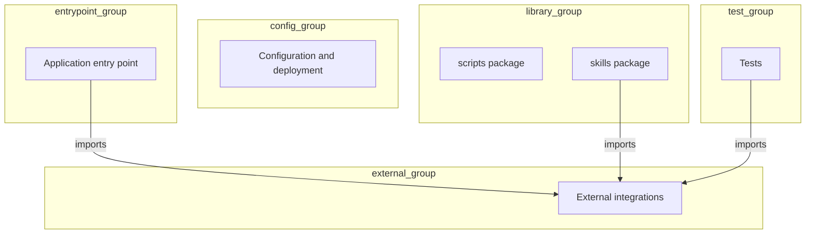

# Architecture report: Yuan1z0825/nature-skills

> Automated static analysis. **Observed** = directly seen in files/imports/AST; **Inferred** = interpretation from that evidence. Repository code was not executed.

## 1. Repository at a glance

| Item | Value |
| --- | --- |
| Repository | Yuan1z0825/nature-skills |
| Description | 符合nature论文学术表达和科研绘图的Skill |
| Language | Python |
| Stars | 53545 |
| Licence | Apache-2.0 |
| Analysed commit / branch | 7bff1d0539c0dfad6c30178bb93ce6dd8a5cebf8 / main |
| Framework(s) | Starlette |
| Files analysed | 799 |
| Components | 6 |

## 2. Architecture in one minute

Yuan1z0825/nature-skills - 符合nature论文学术表达和科研绘图的Skill. This repository was analysed statically from 799 file(s) (222 Python). Detected technologies (observed from imports/manifests): GitHub Actions, Starlette, Click, httpx, NumPy, Pydantic. Files are grouped into 6 component(s): Configuration and deployment, Application entry point, External integrations, scripts package, skills package, Tests. Observed entry point(s): scripts/generate-star-history.py, scripts/update-reference-tocs.py, scripts/validate-readme-mirror.py. Findings below distinguish observed facts from inferred interpretation.

## 3. High-level block diagram

## 4. Main components

### Configuration and deployment (`config`)

- **Kind:** config
- **Status:** Observed
- **Confidence:** 0.85
- **Responsibility:** Groups 74 file(s) under configuration and deployment (observed from repository paths and static analysis). Observed top-level classes: Config. Observed top-level functions: get_config.
- **Paths:** `assets/star-history-data.json`, `skills/nature-academic-search/agents/openai.yaml`, `skills/nature-academic-search/config/mcp-snippet.json`, `skills/nature-academic-search/config/settings-snippet.json`, `skills/nature-academic-search/config/triggers-academic-search.toml`, `skills/nature-academic-search/manifest.yaml`, `skills/nature-academic-search/mcp-server/config.toml`, `skills/nature-academic-search/mcp-server/requirements.txt`, `skills/nature-academic-search/mcp-server/utils/config.py`, `skills/nature-citation/agents/openai.yaml`, `skills/nature-citation/data/npj-journals.json`, `skills/nature-citation/evals/evals.json`, `skills/nature-citation/manifest.yaml`, `skills/nature-data/agents/openai.yaml`, `skills/nature-data/manifest.yaml`, `skills/nature-downloader/agents/openai.yaml`, `skills/nature-downloader/data/publishers.json`, `skills/nature-downloader/data/school.schema.json`, `skills/nature-downloader/data/schools.yaml`, `skills/nature-downloader/manifest.yaml`, `skills/nature-downloader/requirements.txt`, `skills/nature-experiment-log/agents/openai.yaml`, `skills/nature-experiment-log/manifest.yaml`, `skills/nature-figure/agents/openai.yaml`, `skills/nature-figure/evals/evals.json`, `skills/nature-figure/manifest.yaml`, `skills/nature-figure/requirements.txt`, `skills/nature-image2ppt/agents/openai.yaml`, `skills/nature-image2ppt/cli/pyproject.toml`, `skills/nature-image2ppt/config.example.yaml`, `skills/nature-image2ppt/manifest.yaml`, `skills/nature-image2ppt/requirements.txt`, `skills/nature-image2ppt/schemas/page-manifest-v2.schema.json`, `skills/nature-literature-pipeline/agents/openai.yaml`, `skills/nature-literature-pipeline/manifest.yaml`, `skills/nature-paper-card/agents/openai.yaml`, `skills/nature-paper-card/evals/evals.json`, `skills/nature-paper-card/manifest.yaml`, `skills/nature-paper-to-patent/agents/openai.yaml`, `skills/nature-paper-to-patent/evals/evals.json`, `skills/nature-paper-to-patent/manifest.yaml`, `skills/nature-paper-to-patent/requirements.txt`, `skills/nature-paper-to-patent/scripts/disclosure/package.json`, `skills/nature-paper-to-patent/scripts/disclosure/requirements-cnipa.txt`, `skills/nature-paper-trans/agents/openai.yaml`, `skills/nature-paper-trans/manifest.yaml`, `skills/nature-paper-trans/requirements.txt`, `skills/nature-paper-xray/agents/openai.yaml`, `skills/nature-paper-xray/manifest.yaml`, `skills/nature-paper2ppt/agents/openai.yaml`, `skills/nature-paper2ppt/manifest.yaml`, `skills/nature-paper2word/agents/openai.yaml`, `skills/nature-paper2word/manifest.yaml`, `skills/nature-polishing/agents/openai.yaml`, `skills/nature-polishing/manifest.yaml`, `skills/nature-proposal-writer/agents/openai.yaml`, `skills/nature-proposal-writer/manifest.yaml`, `skills/nature-reader/agents/openai.yaml`, `skills/nature-reader/evals/evals.json`, `skills/nature-reader/manifest.yaml`, `skills/nature-ref-verifier/agents/openai.yaml`, `skills/nature-ref-verifier/manifest.yaml`, `skills/nature-response/agents/openai.yaml`, `skills/nature-response/manifest.yaml`, `skills/nature-reviewer/agents/openai.yaml`, `skills/nature-reviewer/manifest.yaml`, `skills/nature-shared/agents/openai.yaml`, `skills/nature-shared/manifest.yaml`, `skills/nature-social-science/agents/openai.yaml`, `skills/nature-social-science/manifest.yaml`, `skills/nature-statistics/agents/openai.yaml`, `skills/nature-statistics/manifest.yaml`, `skills/nature-writing/agents/openai.yaml`, `skills/nature-writing/manifest.yaml`
- **Evidence:** [assets/star-history-data.json](https://github.com/Yuan1z0825/nature-skills/blob/7bff1d0539c0dfad6c30178bb93ce6dd8a5cebf8/assets/star-history-data.json); [skills/nature-academic-search/agents/openai.yaml](https://github.com/Yuan1z0825/nature-skills/blob/7bff1d0539c0dfad6c30178bb93ce6dd8a5cebf8/skills/nature-academic-search/agents/openai.yaml); [skills/nature-academic-search/config/mcp-snippet.json](https://github.com/Yuan1z0825/nature-skills/blob/7bff1d0539c0dfad6c30178bb93ce6dd8a5cebf8/skills/nature-academic-search/config/mcp-snippet.json); [skills/nature-academic-search/config/settings-snippet.json](https://github.com/Yuan1z0825/nature-skills/blob/7bff1d0539c0dfad6c30178bb93ce6dd8a5cebf8/skills/nature-academic-search/config/settings-snippet.json); [skills/nature-academic-search/config/triggers-academic-search.toml](https://github.com/Yuan1z0825/nature-skills/blob/7bff1d0539c0dfad6c30178bb93ce6dd8a5cebf8/skills/nature-academic-search/config/triggers-academic-search.toml); [skills/nature-academic-search/manifest.yaml](https://github.com/Yuan1z0825/nature-skills/blob/7bff1d0539c0dfad6c30178bb93ce6dd8a5cebf8/skills/nature-academic-search/manifest.yaml); [skills/nature-academic-search/mcp-server/config.toml](https://github.com/Yuan1z0825/nature-skills/blob/7bff1d0539c0dfad6c30178bb93ce6dd8a5cebf8/skills/nature-academic-search/mcp-server/config.toml); [skills/nature-academic-search/mcp-server/requirements.txt](https://github.com/Yuan1z0825/nature-skills/blob/7bff1d0539c0dfad6c30178bb93ce6dd8a5cebf8/skills/nature-academic-search/mcp-server/requirements.txt)

### Application entry point (`entrypoint`)

- **Kind:** entrypoint
- **Status:** Observed
- **Confidence:** 0.85
- **Responsibility:** Groups 106 file(s) under application entry point (observed from repository paths and static analysis). Observed top-level classes: Arrow3D, Candidate, CollisionFinding, EpubSearchHit, FilledRegion, Finding. Observed top-level functions: _abs_url, _add_body_paragraph, _add_code_block, _add_heading, _add_horizontal_rule, _add_inline_to_paragraph.
- **Paths:** `scripts/generate-star-history.py`, `scripts/update-reference-tocs.py`, `scripts/validate-readme-mirror.py`, `scripts/validate-readmes.py`, `scripts/validate-repository.py`, `scripts/validate-skill-index.py`, `scripts/validate-skill-metadata.py`, `scripts/validate-workflows.py`, `skills/nature-academic-search/mcp-server/academic_search_server.py`, `skills/nature-academic-search/scripts/academic_search.py`, `skills/nature-academic-search/scripts/format-converter.py`, `skills/nature-academic-search/scripts/preflight.py`, `skills/nature-citation/scripts/nature_citation.py`, `skills/nature-downloader/scripts/configure_credentials.py`, `skills/nature-downloader/scripts/configure_school.py`, `skills/nature-downloader/scripts/extract_pdf_text.py`, `skills/nature-downloader/src/config.py`, `skills/nature-downloader/src/health_check.py`, `skills/nature-downloader/src/schools_loader.py`, `skills/nature-downloader/src/validators.py`, `skills/nature-downloader/src/wizard.py`, `skills/nature-figure/assets/figures4papers/figure_CellSpliceNet/plot_ablation.py`, `skills/nature-figure/assets/figures4papers/figure_CellSpliceNet/plot_comparison.py`, `skills/nature-figure/assets/figures4papers/figure_CellSpliceNet/plot_comparison_cross_species.py`, `skills/nature-figure/assets/figures4papers/figure_Cflows/diffusion_swiss_roll.py`, `skills/nature-figure/assets/figures4papers/figure_Cflows/plot_comparison_Ablation.py`, `skills/nature-figure/assets/figures4papers/figure_Cflows/plot_comparison_GeneRegulatory.py`, `skills/nature-figure/assets/figures4papers/figure_Cflows/plot_comparison_Trajectory.py`, `skills/nature-figure/assets/figures4papers/figure_Dispersion/plot_idea.py`, `skills/nature-figure/assets/figures4papers/figure_Dispersion/plot_illustration.py`, `skills/nature-figure/assets/figures4papers/figure_FPGM/plot_freq_prior.py`, `skills/nature-figure/assets/figures4papers/figure_ImmunoStruct/plot_bars.py`, `skills/nature-figure/assets/figures4papers/figure_RNAGenScape/plot_comparison.py`, `skills/nature-figure/assets/figures4papers/figure_RNAGenScape/plot_manifold.py`, `skills/nature-figure/assets/figures4papers/figure_RNAGenScape/plot_sweep.py`, `skills/nature-figure/assets/figures4papers/figure_VIGIL/plot_ablation.py`, `skills/nature-figure/assets/figures4papers/figure_VIGIL/plot_comparison_radar.py`, `skills/nature-figure/assets/figures4papers/figure_VIGIL/plot_concept.py`, `skills/nature-figure/assets/figures4papers/figure_VIGIL/plot_posttraining.py`, `skills/nature-figure/assets/figures4papers/figure_brainteaser/plot_brute_force.py`, `skills/nature-figure/assets/figures4papers/figure_brainteaser/plot_correctness_by_category.py`, `skills/nature-figure/assets/figures4papers/figure_brainteaser/plot_correctness_by_subcategory.py`, `skills/nature-figure/assets/figures4papers/figure_brainteaser/plot_rewriting.py`, `skills/nature-figure/assets/figures4papers/figure_brainteaser/plot_selfcorrection_math.py`, `skills/nature-figure/assets/figures4papers/figure_ophthal_review/plot_composition.py`, `skills/nature-figure/assets/figures4papers/figure_ophthal_review/plot_trend.py`, `skills/nature-figure/scripts/audit_figure_collisions.py`, `skills/nature-figure/scripts/audit_panel_alignment.py`, `skills/nature-figure/scripts/audit_pdf_text.py`, `skills/nature-figure/scripts/audit_svg_schematic.py`, `skills/nature-figure/scripts/generate_openrouter_schematic.py`, `skills/nature-figure/scripts/nature_figure_backend.py`, `skills/nature-figure/scripts/plot_templates.py`, `skills/nature-figure/scripts/validate_figure.py`, `skills/nature-image2ppt/cli/image2ppt/cli.py`, `skills/nature-image2ppt/cli/image2ppt/runtime/build_pptx_from_manifest.py`, `skills/nature-image2ppt/cli/image2ppt/runtime/configure_image_backend.py`, `skills/nature-image2ppt/cli/image2ppt/runtime/deck_text_hints.py`, `skills/nature-image2ppt/cli/image2ppt/runtime/finalize_deck_run.py`, `skills/nature-image2ppt/cli/image2ppt/runtime/image_gen.py`, `skills/nature-image2ppt/cli/image2ppt/runtime/main.py`, `skills/nature-image2ppt/cli/image2ppt/runtime/make_page_contact_sheet.py`, `skills/nature-image2ppt/cli/image2ppt/runtime/paddle_text_hints.py`, `skills/nature-image2ppt/cli/image2ppt/runtime/page_job_status.py`, `skills/nature-image2ppt/cli/image2ppt/runtime/prepare_deck_run.py`, `skills/nature-image2ppt/cli/image2ppt/runtime/process_asset_sheet.py`, `skills/nature-image2ppt/cli/image2ppt/runtime/record_imagegen_result.py`, `skills/nature-image2ppt/cli/image2ppt/runtime/record_page_dispatch.py`, `skills/nature-image2ppt/cli/image2ppt/runtime/record_page_result.py`, `skills/nature-image2ppt/cli/image2ppt/runtime/remove_chroma_key.py`, `skills/nature-image2ppt/cli/image2ppt/runtime/reset_page_job.py`, `skills/nature-image2ppt/cli/image2ppt/runtime/runtime_env.py`, `skills/nature-image2ppt/cli/image2ppt/runtime/split_alpha_components.py`, `skills/nature-image2ppt/cli/image2ppt/runtime/text_hints.py`, `skills/nature-image2ppt/cli/image2ppt/runtime/validate_pptx.py`, `skills/nature-image2ppt/scripts/build_page_worker_prompt.py`, `skills/nature-image2ppt/scripts/inspect_arrow_atomicity.py`, `skills/nature-image2ppt/scripts/inspect_region_decomposition.py`, `skills/nature-image2ppt/scripts/postprocess_manifest_arrows.py`, `skills/nature-image2ppt/scripts/render_image2ppt_qa.py`, `skills/nature-image2ppt/scripts/run_final_image2ppt_qa.py`, `skills/nature-image2ppt/scripts/run_image2ppt_qa.py`, `skills/nature-paper-card/scripts/audit_paper_card.py`, `skills/nature-paper-card/scripts/prepare_paper.py`, `skills/nature-paper-to-patent/scripts/audit_claims.py`, `skills/nature-paper-to-patent/scripts/build_patent_package.py`, `skills/nature-paper-to-patent/scripts/disclosure/cnipa_epub_crawler.py`, `skills/nature-paper-to-patent/scripts/disclosure/cnipa_epub_parse.py`, `skills/nature-paper-to-patent/scripts/disclosure/cnipa_epub_search.py`, `skills/nature-paper-to-patent/scripts/disclosure/docx_to_md.py`, `skills/nature-paper-to-patent/scripts/disclosure/iteration_dialog_log.py`, `skills/nature-paper-to-patent/scripts/disclosure/math_render.py`, `skills/nature-paper-to-patent/scripts/disclosure/md_to_docx.py`, `skills/nature-paper-to-patent/scripts/disclosure/mermaid_render.py`, `skills/nature-paper-to-patent/scripts/disclosure/pptx_to_md.py`, `skills/nature-paper-to-patent/scripts/extract_pdf_text.py`, `skills/nature-paper-to-patent/scripts/init_patent_project.py`, `skills/nature-paper-to-patent/scripts/render_flowchart_svg.py`, `skills/nature-paper-to-patent/scripts/render_patent_docx.py`, `skills/nature-paper-to-patent/scripts/validate_patent_draft.py`, `skills/nature-paper-trans/scripts/pages.py`, `skills/nature-paper2ppt/scripts/audit_pptx_quality.py`, `skills/nature-paper2word/scripts/reference_layout.py`, `skills/nature-reader/scripts/validate_reader_math.py`, `skills/nature-response/scripts/check_package_consistency.py`, `skills/nature-shared/scripts/check_consistency.py`
- **Evidence:** [scripts/generate-star-history.py:56](https://github.com/Yuan1z0825/nature-skills/blob/7bff1d0539c0dfad6c30178bb93ce6dd8a5cebf8/scripts/generate-star-history.py#L56); [scripts/update-reference-tocs.py:18](https://github.com/Yuan1z0825/nature-skills/blob/7bff1d0539c0dfad6c30178bb93ce6dd8a5cebf8/scripts/update-reference-tocs.py#L18); [scripts/validate-readme-mirror.py:21](https://github.com/Yuan1z0825/nature-skills/blob/7bff1d0539c0dfad6c30178bb93ce6dd8a5cebf8/scripts/validate-readme-mirror.py#L21); [scripts/validate-readmes.py:15](https://github.com/Yuan1z0825/nature-skills/blob/7bff1d0539c0dfad6c30178bb93ce6dd8a5cebf8/scripts/validate-readmes.py#L15); [scripts/validate-repository.py:36](https://github.com/Yuan1z0825/nature-skills/blob/7bff1d0539c0dfad6c30178bb93ce6dd8a5cebf8/scripts/validate-repository.py#L36); [scripts/validate-skill-index.py:23](https://github.com/Yuan1z0825/nature-skills/blob/7bff1d0539c0dfad6c30178bb93ce6dd8a5cebf8/scripts/validate-skill-index.py#L23); [scripts/validate-skill-metadata.py:46](https://github.com/Yuan1z0825/nature-skills/blob/7bff1d0539c0dfad6c30178bb93ce6dd8a5cebf8/scripts/validate-skill-metadata.py#L46); [scripts/validate-workflows.py:28](https://github.com/Yuan1z0825/nature-skills/blob/7bff1d0539c0dfad6c30178bb93ce6dd8a5cebf8/scripts/validate-workflows.py#L28)

### External integrations (`external_integrations`)

- **Kind:** external
- **Status:** Inferred
- **Confidence:** 0.70
- **Responsibility:** Groups 0 file(s) under external integrations (observed from repository paths and static analysis).
- **Evidence:** [skills/nature-academic-search/mcp-server/sources/arxiv.py:12](https://github.com/Yuan1z0825/nature-skills/blob/7bff1d0539c0dfad6c30178bb93ce6dd8a5cebf8/skills/nature-academic-search/mcp-server/sources/arxiv.py#L12); [skills/nature-academic-search/mcp-server/sources/crossref.py:5](https://github.com/Yuan1z0825/nature-skills/blob/7bff1d0539c0dfad6c30178bb93ce6dd8a5cebf8/skills/nature-academic-search/mcp-server/sources/crossref.py#L5); [skills/nature-academic-search/mcp-server/sources/pubmed.py:12](https://github.com/Yuan1z0825/nature-skills/blob/7bff1d0539c0dfad6c30178bb93ce6dd8a5cebf8/skills/nature-academic-search/mcp-server/sources/pubmed.py#L12); [skills/nature-academic-search/mcp-server/tests/test_sources.py:183](https://github.com/Yuan1z0825/nature-skills/blob/7bff1d0539c0dfad6c30178bb93ce6dd8a5cebf8/skills/nature-academic-search/mcp-server/tests/test_sources.py#L183); [skills/nature-academic-search/scripts/format-converter.py:32](https://github.com/Yuan1z0825/nature-skills/blob/7bff1d0539c0dfad6c30178bb93ce6dd8a5cebf8/skills/nature-academic-search/scripts/format-converter.py#L32); [skills/nature-downloader/src/validators.py:13](https://github.com/Yuan1z0825/nature-skills/blob/7bff1d0539c0dfad6c30178bb93ce6dd8a5cebf8/skills/nature-downloader/src/validators.py#L13)

### scripts package (`scripts`)

- **Kind:** library
- **Status:** Observed
- **Confidence:** 0.85
- **Responsibility:** Groups 2 file(s) under scripts package (observed from repository paths and static analysis).
- **Paths:** `scripts/autoupdate-skills.sh`, `scripts/update-codex-skills.sh`
- **Evidence:** [scripts/autoupdate-skills.sh](https://github.com/Yuan1z0825/nature-skills/blob/7bff1d0539c0dfad6c30178bb93ce6dd8a5cebf8/scripts/autoupdate-skills.sh); [scripts/update-codex-skills.sh](https://github.com/Yuan1z0825/nature-skills/blob/7bff1d0539c0dfad6c30178bb93ce6dd8a5cebf8/scripts/update-codex-skills.sh)

### skills package (`skills`)

- **Kind:** library
- **Status:** Observed
- **Confidence:** 0.85
- **Responsibility:** Groups 48 file(s) under skills package (observed from repository paths and static analysis). Observed top-level classes: AcademicSearchError, ArxivSource, ConfigError, CrossRefSource, DataSourceError, FormulaRenderError. Observed top-level functions: _append_children, _append_mathml, _as_list, _authors, _check_keep_workdir, _date_to_ts.
- **Paths:** `skills/nature-academic-search/install.sh`, `skills/nature-academic-search/mcp-server/sources/__init__.py`, `skills/nature-academic-search/mcp-server/sources/arxiv.py`, `skills/nature-academic-search/mcp-server/sources/crossref.py`, `skills/nature-academic-search/mcp-server/sources/elsevier_common.py`, `skills/nature-academic-search/mcp-server/sources/pubmed.py`, `skills/nature-academic-search/mcp-server/sources/sciencedirect.py`, `skills/nature-academic-search/mcp-server/sources/scopus.py`, `skills/nature-academic-search/mcp-server/utils/__init__.py`, `skills/nature-academic-search/mcp-server/utils/errors.py`, `skills/nature-academic-search/mcp-server/utils/logging.py`, `skills/nature-academic-search/scripts/converters.py`, `skills/nature-downloader/scripts/batch_download.mjs`, `skills/nature-downloader/scripts/browser_pdf_downloader.mjs`, `skills/nature-downloader/scripts/cdp_open_url.mjs`, `skills/nature-downloader/scripts/lib/anti-bot.mjs`, `skills/nature-downloader/scripts/lib/cdp-utils.mjs`, `skills/nature-downloader/scripts/lib/cnki.mjs`, `skills/nature-downloader/scripts/lib/credentials.mjs`, `skills/nature-downloader/scripts/lib/direct-download.mjs`, `skills/nature-downloader/scripts/lib/manifest.mjs`, `skills/nature-downloader/scripts/lib/metadata.mjs`, `skills/nature-downloader/scripts/lib/open-access-provider.mjs`, `skills/nature-downloader/scripts/lib/open-access.mjs`, `skills/nature-downloader/scripts/lib/pdf-utils.mjs`, `skills/nature-downloader/scripts/lib/provider-registry.mjs`, `skills/nature-downloader/scripts/lib/provider-utils.mjs`, `skills/nature-downloader/scripts/lib/publisher-providers.mjs`, `skills/nature-downloader/scripts/lib/routing.mjs`, `skills/nature-downloader/scripts/lib/school-config.mjs`, `skills/nature-downloader/scripts/lib/settings.mjs`, `skills/nature-downloader/scripts/lib/status-codes.mjs`, `skills/nature-downloader/scripts/lib/wos-supporting-information.mjs`, `skills/nature-downloader/scripts/retry_elsevier_api.mjs`, `skills/nature-figure/assets/figures4papers/figure_ImmunoStruct/raw_data.py`, `skills/nature-figure/assets/figures4papers/figure_RNAGenScape/plot_hole_manifold.py`, `skills/nature-figure/scripts/figure_safety.py`, `skills/nature-image2ppt/cli/image2ppt/__init__.py`, `skills/nature-image2ppt/cli/image2ppt/runtime/__init__.py`, `skills/nature-image2ppt/cli/image2ppt/runtime/_input_normalization.py`, `skills/nature-image2ppt/cli/image2ppt/runtime/_page_artifacts.py`, `skills/nature-image2ppt/cli/image2ppt/runtime/deck_run_state.py`, `skills/nature-image2ppt/cli/image2ppt/runtime/formula_renderer.py`, `skills/nature-image2ppt/cli/image2ppt/runtime/page_text_metrics.py`, `skills/nature-image2ppt/scripts/runtime_paths.py`, `skills/nature-image2ppt/scripts/visual_review_evidence.py`, `skills/nature-paper-to-patent/scripts/math_to_omml.py`, `skills/nature-proposal-writer/scripts/build_proposal_docx.py`
- **Evidence:** [skills/nature-academic-search/install.sh](https://github.com/Yuan1z0825/nature-skills/blob/7bff1d0539c0dfad6c30178bb93ce6dd8a5cebf8/skills/nature-academic-search/install.sh); [skills/nature-academic-search/mcp-server/sources/__init__.py](https://github.com/Yuan1z0825/nature-skills/blob/7bff1d0539c0dfad6c30178bb93ce6dd8a5cebf8/skills/nature-academic-search/mcp-server/sources/__init__.py); [skills/nature-academic-search/mcp-server/sources/arxiv.py:31](https://github.com/Yuan1z0825/nature-skills/blob/7bff1d0539c0dfad6c30178bb93ce6dd8a5cebf8/skills/nature-academic-search/mcp-server/sources/arxiv.py#L31); [skills/nature-academic-search/mcp-server/sources/crossref.py:13](https://github.com/Yuan1z0825/nature-skills/blob/7bff1d0539c0dfad6c30178bb93ce6dd8a5cebf8/skills/nature-academic-search/mcp-server/sources/crossref.py#L13); [skills/nature-academic-search/mcp-server/sources/elsevier_common.py:19](https://github.com/Yuan1z0825/nature-skills/blob/7bff1d0539c0dfad6c30178bb93ce6dd8a5cebf8/skills/nature-academic-search/mcp-server/sources/elsevier_common.py#L19); [skills/nature-academic-search/mcp-server/sources/pubmed.py:30](https://github.com/Yuan1z0825/nature-skills/blob/7bff1d0539c0dfad6c30178bb93ce6dd8a5cebf8/skills/nature-academic-search/mcp-server/sources/pubmed.py#L30); [skills/nature-academic-search/mcp-server/sources/sciencedirect.py:17](https://github.com/Yuan1z0825/nature-skills/blob/7bff1d0539c0dfad6c30178bb93ce6dd8a5cebf8/skills/nature-academic-search/mcp-server/sources/sciencedirect.py#L17); [skills/nature-academic-search/mcp-server/sources/scopus.py:30](https://github.com/Yuan1z0825/nature-skills/blob/7bff1d0539c0dfad6c30178bb93ce6dd8a5cebf8/skills/nature-academic-search/mcp-server/sources/scopus.py#L30)

### Tests (`tests`)

- **Kind:** test
- **Status:** Observed
- **Confidence:** 0.85
- **Responsibility:** Groups 126 file(s) under tests (observed from repository paths and static analysis). Observed routes: PATCH sources.crossref.get_config, PATCH sources.crossref.requests.get, PATCH academic_search_server._crossref, PATCH sources.crossref.get_config, PATCH sources.crossref.requests.get. Observed top-level classes: AntecedentBasisTests, AuthorExportTests, BackendConfigTests, CollisionAuditInputTests, CollisionGeometryTests, CollisionPdfEndToEndTests. Observed top-level functions: _args, _article, _build_arxiv_xml, _call_tool_json, _crossref_config, _feed.
- **Paths:** `scripts/tests/test-autoupdate-dest-tilde.sh`, `scripts/tests/test-autoupdate-state-isolation.sh`, `scripts/tests/test-update-codex-skills-dest-tilde.sh`, `scripts/tests/test-update-codex-skills-safety.sh`, `scripts/tests/test_academic_search_openalex_key.py`, `scripts/tests/test_discussion_argument_language.py`, `scripts/tests/test_generate_star_history.py`, `scripts/tests/test_main_text_discipline.py`, `scripts/tests/test_nature_abstract_guidance.py`, `scripts/tests/test_nature_figure_ai_graphical_abstract.py`, `scripts/tests/test_nature_figure_collision_audit.py`, `scripts/tests/test_nature_figure_multipanel_evidence.py`, `scripts/tests/test_nature_figure_openrouter_errors.py`, `scripts/tests/test_nature_figure_panel_alignment.py`, `scripts/tests/test_nature_figure_pdf_text_audit.py`, `scripts/tests/test_nature_figure_script_regressions.py`, `scripts/tests/test_nature_figure_svg_audit.py`, `scripts/tests/test_nature_introduction_guidance.py`, `scripts/tests/test_nature_results_discussion_guidance.py`, `scripts/tests/test_nature_social_science.py`, `scripts/tests/test_nature_submission_requirements.py`, `scripts/tests/test_nmi_submission_requirements.py`, `scripts/tests/test_paper2ppt_group_bounds.py`, `scripts/tests/test_update_reference_tocs.py`, `scripts/tests/test_validate_skill_metadata.py`, `scripts/tests/test_validate_workflows.py`, `skills/nature-academic-search/mcp-server/tests/__init__.py`, `skills/nature-academic-search/mcp-server/tests/test_arxiv_error_entries.py`, `skills/nature-academic-search/mcp-server/tests/test_citation_errors.py`, `skills/nature-academic-search/mcp-server/tests/test_elsevier_live.py`, `skills/nature-academic-search/mcp-server/tests/test_format_converter_hardening.py`, `skills/nature-academic-search/mcp-server/tests/test_mcp_tools.py`, `skills/nature-academic-search/mcp-server/tests/test_pubmed_parsing.py`, `skills/nature-academic-search/mcp-server/tests/test_scopus_empty_result.py`, `skills/nature-academic-search/mcp-server/tests/test_script_converters.py`, `skills/nature-academic-search/mcp-server/tests/test_sources.py`, `skills/nature-citation/tests/test_author_exports.py`, `skills/nature-citation/tests/test_journal_scope.py`, `skills/nature-downloader/tests/python/test_config_credentials.py`, `skills/nature-downloader/tests/python/test_config_wizard.py`, `skills/nature-downloader/tests/python/test_credential_validation.py`, `skills/nature-downloader/tests/python/test_springer_services.py`, `skills/nature-downloader/tests/unit/batch-cli.test.mjs`, `skills/nature-downloader/tests/unit/cnki.test.mjs`, `skills/nature-downloader/tests/unit/credentials.test.mjs`, `skills/nature-downloader/tests/unit/direct-download-collision.test.mjs`, `skills/nature-downloader/tests/unit/generic-package.test.mjs`, `skills/nature-downloader/tests/unit/manifest.test.mjs`, `skills/nature-downloader/tests/unit/metadata.test.mjs`, `skills/nature-downloader/tests/unit/open-access-provider.test.mjs`, `skills/nature-downloader/tests/unit/open-access.test.mjs`, `skills/nature-downloader/tests/unit/pdf-utils-atomic-write.test.mjs`, `skills/nature-downloader/tests/unit/provider-utils.test.mjs`, `skills/nature-downloader/tests/unit/publisher-providers.test.mjs`, `skills/nature-downloader/tests/unit/routing.test.mjs`, `skills/nature-downloader/tests/unit/school-config.test.mjs`, `skills/nature-downloader/tests/unit/springer-services.test.mjs`, `skills/nature-downloader/tests/unit/status-codes.test.mjs`, `skills/nature-downloader/tests/unit/wos-supporting-information.test.mjs`, `skills/nature-figure/tests/test_figure_safety.py`, `skills/nature-figure/tests/test_schematic_url_safety.py`, `skills/nature-image2ppt/tests/support.py`, `skills/nature-image2ppt/tests/test_console_portability.py`, `skills/nature-image2ppt/tests/test_deck_slide_size.py`, `skills/nature-image2ppt/tests/test_dispatch_concurrency.py`, `skills/nature-image2ppt/tests/test_formula_renderer.py`, `skills/nature-image2ppt/tests/test_independence.py`, `skills/nature-image2ppt/tests/test_input_normalization_alpha.py`, `skills/nature-image2ppt/tests/test_input_normalization_opc_targets.py`, `skills/nature-image2ppt/tests/test_isolated_lifecycle.py`, `skills/nature-image2ppt/tests/test_manifest_arrows.py`, `skills/nature-image2ppt/tests/test_migration_parity.py`, `skills/nature-image2ppt/tests/test_multi_agent_backend.py`, `skills/nature-image2ppt/tests/test_ocr_http.py`, `skills/nature-image2ppt/tests/test_paddle_result_url_safety.py`, `skills/nature-image2ppt/tests/test_page_hints.py`, `skills/nature-image2ppt/tests/test_path_confinement.py`, `skills/nature-image2ppt/tests/test_pdf_backend.py`, `skills/nature-image2ppt/tests/test_project_metadata.py`, `skills/nature-image2ppt/tests/test_quality_contracts.py`, `skills/nature-image2ppt/tests/test_region_decomposition.py`, `skills/nature-image2ppt/tests/test_render_guard.py`, `skills/nature-image2ppt/tests/test_runtime_config.py`, `skills/nature-image2ppt/tests/test_runtime_paths.py`, `skills/nature-image2ppt/tests/test_script_inventory.py`, `skills/nature-image2ppt/tests/test_slide_layout.py`, `skills/nature-image2ppt/tests/test_state_e2e.py`, `skills/nature-image2ppt/tests/test_structure_reconstruction.py`, `skills/nature-image2ppt/tests/test_thin_profile.py`, `skills/nature-image2ppt/tests/test_visual_review_evidence.py`, `skills/nature-image2ppt/tests/test_visual_review_runtime.py`, `skills/nature-paper-card/tests/test_audit_page_ranges.py`, `skills/nature-paper-card/tests/test_prepare_paper.py`, `skills/nature-paper-to-patent/tests/test_audit_claims.py`, `skills/nature-paper-to-patent/tests/test_inline_math_paren.py`, `skills/nature-paper-to-patent/tests/test_math_to_omml_superscript.py`, `skills/nature-paper-to-patent/tests/test_md_to_docx_source_overwrite.py`, `skills/nature-paper-to-patent/tests/test_mermaid_render.py`, `skills/nature-paper-to-patent/tests/test_validation.py`, `skills/nature-paper-to-patent/tests/test_validation_figure_node_ids.py`, `skills/nature-paper-trans/tests/test_json_channel.py`, `skills/nature-paper-trans/tests/test_pages.py`, `skills/nature-paper-trans/tests/test_pdf_publication.py`, `skills/nature-paper-trans/tests/test_review_gate.py`, `skills/nature-paper2word/tests/test_reference_layout.py`, `skills/nature-proposal-writer/tests/test_source_preservation.py`, `skills/nature-proposal-writer/tests/test_table_delimiters.py`, `skills/nature-response/tests/conflicting-reviewers.md`, `skills/nature-response/tests/defensive-draft-audit.md`, `skills/nature-response/tests/evaluation-summary.md`, `skills/nature-response/tests/impossible-experiment.md`, `skills/nature-response/tests/local-edit-without-decision.md`, `skills/nature-response/tests/major-revision-missing-evidence.md`, `skills/nature-response/tests/minor-revision.md`, `skills/nature-response/tests/reviewer-visibility.md`, `skills/nature-response/tests/rubric.md`, `skills/nature-response/tests/task-status-tracking.md`, `skills/nature-response/tests/test_package_consistency.py`, `skills/nature-response/tests/test_response_instruction_contracts.py`, `skills/nature-response/tests/unclear-decision-type.md`, `skills/nature-reviewer/tests/punctuation-style.md`, `skills/nature-reviewer/tests/reviewer-independence.md`, `skills/nature-reviewer/tests/severity-tiering.md`, `skills/nature-reviewer/tests/test_reviewer_instruction_contracts.py`, `skills/nature-reviewer/tests/traceable-review.md`, `skills/nature-shared/tests/test_check_consistency.py`
- **Evidence:** [scripts/tests/test-autoupdate-dest-tilde.sh](https://github.com/Yuan1z0825/nature-skills/blob/7bff1d0539c0dfad6c30178bb93ce6dd8a5cebf8/scripts/tests/test-autoupdate-dest-tilde.sh); [scripts/tests/test-autoupdate-state-isolation.sh](https://github.com/Yuan1z0825/nature-skills/blob/7bff1d0539c0dfad6c30178bb93ce6dd8a5cebf8/scripts/tests/test-autoupdate-state-isolation.sh); [scripts/tests/test-update-codex-skills-dest-tilde.sh](https://github.com/Yuan1z0825/nature-skills/blob/7bff1d0539c0dfad6c30178bb93ce6dd8a5cebf8/scripts/tests/test-update-codex-skills-dest-tilde.sh); [scripts/tests/test-update-codex-skills-safety.sh](https://github.com/Yuan1z0825/nature-skills/blob/7bff1d0539c0dfad6c30178bb93ce6dd8a5cebf8/scripts/tests/test-update-codex-skills-safety.sh); [scripts/tests/test_academic_search_openalex_key.py:21](https://github.com/Yuan1z0825/nature-skills/blob/7bff1d0539c0dfad6c30178bb93ce6dd8a5cebf8/scripts/tests/test_academic_search_openalex_key.py#L21); [scripts/tests/test_discussion_argument_language.py:11](https://github.com/Yuan1z0825/nature-skills/blob/7bff1d0539c0dfad6c30178bb93ce6dd8a5cebf8/scripts/tests/test_discussion_argument_language.py#L11); [scripts/tests/test_generate_star_history.py:18](https://github.com/Yuan1z0825/nature-skills/blob/7bff1d0539c0dfad6c30178bb93ce6dd8a5cebf8/scripts/tests/test_generate_star_history.py#L18); [scripts/tests/test_main_text_discipline.py:11](https://github.com/Yuan1z0825/nature-skills/blob/7bff1d0539c0dfad6c30178bb93ce6dd8a5cebf8/scripts/tests/test_main_text_discipline.py#L11)

## 5. Execution flow

**Observed** entry point(s):

- [scripts/generate-star-history.py:804](https://github.com/Yuan1z0825/nature-skills/blob/7bff1d0539c0dfad6c30178bb93ce6dd8a5cebf8/scripts/generate-star-history.py#L804)
- [scripts/update-reference-tocs.py:79](https://github.com/Yuan1z0825/nature-skills/blob/7bff1d0539c0dfad6c30178bb93ce6dd8a5cebf8/scripts/update-reference-tocs.py#L79)
- [scripts/validate-readme-mirror.py:88](https://github.com/Yuan1z0825/nature-skills/blob/7bff1d0539c0dfad6c30178bb93ce6dd8a5cebf8/scripts/validate-readme-mirror.py#L88)
- [scripts/validate-readmes.py:83](https://github.com/Yuan1z0825/nature-skills/blob/7bff1d0539c0dfad6c30178bb93ce6dd8a5cebf8/scripts/validate-readmes.py#L83)
- [scripts/validate-repository.py:162](https://github.com/Yuan1z0825/nature-skills/blob/7bff1d0539c0dfad6c30178bb93ce6dd8a5cebf8/scripts/validate-repository.py#L162)
- [scripts/validate-skill-index.py:95](https://github.com/Yuan1z0825/nature-skills/blob/7bff1d0539c0dfad6c30178bb93ce6dd8a5cebf8/scripts/validate-skill-index.py#L95)
- [scripts/validate-skill-metadata.py:286](https://github.com/Yuan1z0825/nature-skills/blob/7bff1d0539c0dfad6c30178bb93ce6dd8a5cebf8/scripts/validate-skill-metadata.py#L286)
- [skills/nature-downloader/src/config.py:158](https://github.com/Yuan1z0825/nature-skills/blob/7bff1d0539c0dfad6c30178bb93ce6dd8a5cebf8/skills/nature-downloader/src/config.py#L158)
- [skills/nature-downloader/src/health_check.py:148](https://github.com/Yuan1z0825/nature-skills/blob/7bff1d0539c0dfad6c30178bb93ce6dd8a5cebf8/skills/nature-downloader/src/health_check.py#L148)
- [skills/nature-downloader/src/schools_loader.py:126](https://github.com/Yuan1z0825/nature-skills/blob/7bff1d0539c0dfad6c30178bb93ce6dd8a5cebf8/skills/nature-downloader/src/schools_loader.py#L126)
- [skills/nature-downloader/src/validators.py:186](https://github.com/Yuan1z0825/nature-skills/blob/7bff1d0539c0dfad6c30178bb93ce6dd8a5cebf8/skills/nature-downloader/src/validators.py#L186)
- [skills/nature-downloader/src/wizard.py:573](https://github.com/Yuan1z0825/nature-skills/blob/7bff1d0539c0dfad6c30178bb93ce6dd8a5cebf8/skills/nature-downloader/src/wizard.py#L573)

**Observed** routes (from decorators):

- `PATCH sources.crossref.get_config` -> `test_crossref_404_raises_instead_of_returning_a_fake_citation` in `skills/nature-academic-search/mcp-server/tests/test_citation_errors.py:22`
- `PATCH sources.crossref.requests.get` -> `test_crossref_404_raises_instead_of_returning_a_fake_citation` in `skills/nature-academic-search/mcp-server/tests/test_citation_errors.py:22`
- `PATCH academic_search_server._crossref` -> `test_get_citation_tool_reports_an_error_for_an_unknown_doi` in `skills/nature-academic-search/mcp-server/tests/test_citation_errors.py:33`
- `PATCH sources.crossref.get_config` -> `test_search_returns_unified_format` in `skills/nature-academic-search/mcp-server/tests/test_sources.py:54`
- `PATCH sources.crossref.requests.get` -> `test_search_returns_unified_format` in `skills/nature-academic-search/mcp-server/tests/test_sources.py:54`
- `PATCH sources.crossref.get_config` -> `test_search_with_type_filter` in `skills/nature-academic-search/mcp-server/tests/test_sources.py:101`
- `PATCH sources.crossref.requests.get` -> `test_search_with_type_filter` in `skills/nature-academic-search/mcp-server/tests/test_sources.py:101`
- `PATCH sources.crossref.get_config` -> `test_search_empty_items` in `skills/nature-academic-search/mcp-server/tests/test_sources.py:122`
- `PATCH sources.crossref.requests.get` -> `test_search_empty_items` in `skills/nature-academic-search/mcp-server/tests/test_sources.py:122`
- `PATCH sources.crossref.get_config` -> `test_get_by_doi` in `skills/nature-academic-search/mcp-server/tests/test_sources.py:143`
- `PATCH sources.crossref.requests.get` -> `test_get_by_doi` in `skills/nature-academic-search/mcp-server/tests/test_sources.py:143`
- `PATCH sources.crossref.get_config` -> `test_search_http_error` in `skills/nature-academic-search/mcp-server/tests/test_sources.py:182`
- `PATCH sources.crossref.requests.get` -> `test_search_http_error` in `skills/nature-academic-search/mcp-server/tests/test_sources.py:182`
- `PATCH sources.crossref.get_config` -> `test_get_citation` in `skills/nature-academic-search/mcp-server/tests/test_sources.py:203`
- `PATCH sources.crossref.requests.get` -> `test_get_citation` in `skills/nature-academic-search/mcp-server/tests/test_sources.py:203`
- `PATCH sources.pubmed.get_config` -> `test_search_esearch_efetch_flow` in `skills/nature-academic-search/mcp-server/tests/test_sources.py:231`
- `PATCH sources.pubmed._get` -> `test_search_esearch_efetch_flow` in `skills/nature-academic-search/mcp-server/tests/test_sources.py:231`
- `PATCH sources.pubmed.get_config` -> `test_search_no_results` in `skills/nature-academic-search/mcp-server/tests/test_sources.py:313`
- `PATCH sources.pubmed._get` -> `test_search_no_results` in `skills/nature-academic-search/mcp-server/tests/test_sources.py:313`
- `PATCH sources.pubmed.get_config` -> `test_get_by_pmid` in `skills/nature-academic-search/mcp-server/tests/test_sources.py:337`
- `PATCH sources.pubmed._get` -> `test_get_by_pmid` in `skills/nature-academic-search/mcp-server/tests/test_sources.py:337`
- `PATCH sources.pubmed.get_config` -> `test_search_empty_query_raises` in `skills/nature-academic-search/mcp-server/tests/test_sources.py:382`
- `PATCH sources.pubmed.get_config` -> `test_search_no_email_raises` in `skills/nature-academic-search/mcp-server/tests/test_sources.py:393`
- `PATCH sources.pubmed.get_config` -> `test_search_multiple_articles` in `skills/nature-academic-search/mcp-server/tests/test_sources.py:407`
- `PATCH sources.pubmed._get` -> `test_search_multiple_articles` in `skills/nature-academic-search/mcp-server/tests/test_sources.py:407`
- `PATCH sources.pubmed.get_config` -> `test_lookup_mesh_returns_canonical_ui` in `skills/nature-academic-search/mcp-server/tests/test_sources.py:476`
- `PATCH sources.pubmed._get` -> `test_lookup_mesh_returns_canonical_ui` in `skills/nature-academic-search/mcp-server/tests/test_sources.py:476`
- `PATCH sources.pubmed.get_config` -> `test_lookup_mesh_nonexistent_term_returns_empty` in `skills/nature-academic-search/mcp-server/tests/test_sources.py:519`
- `PATCH sources.pubmed._get` -> `test_lookup_mesh_nonexistent_term_returns_empty` in `skills/nature-academic-search/mcp-server/tests/test_sources.py:519`
- `PATCH sources.pubmed.get_config` -> `test_lookup_mesh_invalid_esummary_json_raises` in `skills/nature-academic-search/mcp-server/tests/test_sources.py:546`
- `PATCH sources.pubmed._get` -> `test_lookup_mesh_invalid_esummary_json_raises` in `skills/nature-academic-search/mcp-server/tests/test_sources.py:546`
- `PATCH sources.pubmed.get_config` -> `test_lookup_mesh_missing_ui_raises` in `skills/nature-academic-search/mcp-server/tests/test_sources.py:565`
- `PATCH sources.pubmed._get` -> `test_lookup_mesh_missing_ui_raises` in `skills/nature-academic-search/mcp-server/tests/test_sources.py:565`
- `PATCH sources.arxiv.get_config` -> `test_search_returns_unified_format` in `skills/nature-academic-search/mcp-server/tests/test_sources.py:646`
- `PATCH sources.arxiv.get_config` -> `test_search_with_date_filter` in `skills/nature-academic-search/mcp-server/tests/test_sources.py:684`
- `PATCH sources.arxiv.get_config` -> `test_search_with_categories` in `skills/nature-academic-search/mcp-server/tests/test_sources.py:705`
- `PATCH sources.arxiv.get_config` -> `test_get_by_id` in `skills/nature-academic-search/mcp-server/tests/test_sources.py:726`
- `PATCH sources.arxiv.get_config` -> `test_get_by_id_not_found` in `skills/nature-academic-search/mcp-server/tests/test_sources.py:755`

Representative flow (derived from observed entry points and the import graph; steps beyond the entry point are **Inferred**):

1. Execution starts at an observed entry point listed above, if present.
2. `entrypoint` imports `external_integrations` (Application entry point -> External integrations).
3. `skills` imports `external_integrations` (skills package -> External integrations).
4. `tests` imports `external_integrations` (Tests -> External integrations).

## 6. Project structure

### `(root)`

- `.gitattributes` - other (95 bytes)
- `.gitignore` - other (137 bytes)
- `LICENSE` - docs (11357 bytes)
- `README.md` - docs (38112 bytes)
- `README_EN.md` - docs (39521 bytes)
- `index.html` - other (105527 bytes)
- `pr-body-readme-mirror.md` - docs (637 bytes)
- `pr-body-skill-index.md` - docs (518 bytes)
- `pr-body-workflow.md` - docs (776 bytes)

### `.agents`

- `.agents/plugins/marketplace.json` - config (357 bytes)

### `.codex-plugin`

- `.codex-plugin/plugin.json` - config (1418 bytes)

### `.github`

- `.github/requirements-ci.txt` - manifest (1062 bytes)
- `.github/workflows/test-content-contracts.yml` - ci, YAML (1274 bytes)
- `.github/workflows/test-paper-trans.yml` - ci, YAML (1260 bytes)
- `.github/workflows/test-skill-tooling.yml` - ci, YAML (7915 bytes)
- `.github/workflows/update-star-history.yml` - ci, YAML (1420 bytes)
- `.github/workflows/validate-readme-mirror.yml` - ci, YAML (925 bytes)
- `.github/workflows/validate-repository.yml` - ci, YAML (1778 bytes)
- `.github/workflows/validate-skill-index.yml` - ci, YAML (801 bytes)
- `.github/workflows/validate-skill-metadata.yml` - ci, YAML (1227 bytes)
- `.github/workflows/validate-workflows.yml` - ci, YAML (1072 bytes)

### `RDA-results`

- `RDA-results/README.md` - docs (2745 bytes)
- `RDA-results/SHA256SUMS.txt` - docs (413 bytes)
- `RDA-results/analysis.R` - other (16274 bytes)

### `assets`

- `assets/star-history-20261113T022420Z.svg` - other (6445 bytes)
- `assets/star-history-data.json` - config (4340 bytes)
- `assets/star-history.svg` - other (6445 bytes)

### `docs`

- `docs/nature-paper-card-tutorial.md` - docs (3120 bytes)
- `docs/nature-paper-card-tutorial_EN.md` - docs (3428 bytes)
- `docs/open-source-agent-frameworks.md` - docs (5412 bytes)
- `docs/open-source-agent-frameworks_EN.md` - docs (5419 bytes)
- `docs/skill-scope-smoke-evaluation.md` - docs (4371 bytes)

### `scripts`

- `scripts/autoupdate-skills.sh` - source, Shell (7336 bytes)
- `scripts/generate-star-history.py` - source, Python (30393 bytes)
- `scripts/tests/test-autoupdate-dest-tilde.sh` - test, Shell (1509 bytes)
- `scripts/tests/test-autoupdate-state-isolation.sh` - test, Shell (3815 bytes)
- `scripts/tests/test-update-codex-skills-dest-tilde.sh` - test, Shell (822 bytes)
- `scripts/tests/test-update-codex-skills-safety.sh` - test, Shell (2498 bytes)
- `scripts/tests/test_academic_search_openalex_key.py` - test, Python (3005 bytes)
- `scripts/tests/test_discussion_argument_language.py` - test, Python (3529 bytes)
- `scripts/tests/test_generate_star_history.py` - test, Python (12680 bytes)
- `scripts/tests/test_main_text_discipline.py` - test, Python (5213 bytes)
- `scripts/tests/test_nature_abstract_guidance.py` - test, Python (3099 bytes)
- `scripts/tests/test_nature_figure_ai_graphical_abstract.py` - test, Python (2867 bytes)
- `scripts/tests/test_nature_figure_collision_audit.py` - test, Python (8001 bytes)
- `scripts/tests/test_nature_figure_multipanel_evidence.py` - test, Python (4287 bytes)
- `scripts/tests/test_nature_figure_openrouter_errors.py` - test, Python (2256 bytes)
- `scripts/tests/test_nature_figure_panel_alignment.py` - test, Python (20735 bytes)
- `scripts/tests/test_nature_figure_pdf_text_audit.py` - test, Python (3117 bytes)
- `scripts/tests/test_nature_figure_script_regressions.py` - test, Python (3280 bytes)
- `scripts/tests/test_nature_figure_svg_audit.py` - test, Python (4272 bytes)
- `scripts/tests/test_nature_introduction_guidance.py` - test, Python (3249 bytes)
- `scripts/tests/test_nature_results_discussion_guidance.py` - test, Python (4767 bytes)
- `scripts/tests/test_nature_social_science.py` - test, Python (3497 bytes)
- `scripts/tests/test_nature_submission_requirements.py` - test, Python (4813 bytes)
- `scripts/tests/test_nmi_submission_requirements.py` - test, Python (6783 bytes)
- `scripts/tests/test_paper2ppt_group_bounds.py` - test, Python (2753 bytes)
- `scripts/tests/test_update_reference_tocs.py` - test, Python (1924 bytes)
- `scripts/tests/test_validate_skill_metadata.py` - test, Python (6066 bytes)
- `scripts/tests/test_validate_workflows.py` - test, Python (1554 bytes)
- `scripts/update-codex-skills.sh` - source, Shell (10618 bytes)
- `scripts/update-reference-tocs.py` - source, Python (2567 bytes)
- `scripts/validate-readme-mirror.py` - source, Python (2968 bytes)
- `scripts/validate-readmes.py` - source, Python (2816 bytes)
- `scripts/validate-repository.py` - source, Python (5981 bytes)
- `scripts/validate-skill-index.py` - source, Python (3081 bytes)
- `scripts/validate-skill-metadata.py` - source, Python (10773 bytes)
- `scripts/validate-workflows.py` - source, Python (4833 bytes)

### `skills`

- `skills/nature-academic-search/README.md` - docs (2700 bytes)
- `skills/nature-academic-search/README_EN.md` - docs (3025 bytes)
- `skills/nature-academic-search/SKILL.md` - docs (3610 bytes)
- `skills/nature-academic-search/agents/openai.yaml` - config (265 bytes)
- `skills/nature-academic-search/config/mcp-snippet.json` - config (502 bytes)
- `skills/nature-academic-search/config/settings-snippet.json` - config (59 bytes)
- `skills/nature-academic-search/config/triggers-academic-search.toml` - config (978 bytes)
- `skills/nature-academic-search/install.sh` - source, Shell (4442 bytes)
- `skills/nature-academic-search/manifest.yaml` - config (3154 bytes)
- `skills/nature-academic-search/mcp-server/README.md` - docs (1959 bytes)
- `skills/nature-academic-search/mcp-server/academic_search_server.py` - source, Python (21382 bytes)
- `skills/nature-academic-search/mcp-server/config.toml` - config (249 bytes)
- `skills/nature-academic-search/mcp-server/requirements.txt` - manifest (134 bytes)
- `skills/nature-academic-search/mcp-server/sources/__init__.py` - source, Python (352 bytes)
- `skills/nature-academic-search/mcp-server/sources/arxiv.py` - source, Python (11659 bytes)
- `skills/nature-academic-search/mcp-server/sources/crossref.py` - source, Python (7080 bytes)
- `skills/nature-academic-search/mcp-server/sources/elsevier_common.py` - source, Python (2498 bytes)
- `skills/nature-academic-search/mcp-server/sources/pubmed.py` - source, Python (13440 bytes)
- `skills/nature-academic-search/mcp-server/sources/sciencedirect.py` - source, Python (7057 bytes)
- `skills/nature-academic-search/mcp-server/sources/scopus.py` - source, Python (19499 bytes)
- `skills/nature-academic-search/mcp-server/tests/__init__.py` - test, Python (40 bytes)
- `skills/nature-academic-search/mcp-server/tests/test_arxiv_error_entries.py` - test, Python (1462 bytes)
- `skills/nature-academic-search/mcp-server/tests/test_citation_errors.py` - test, Python (1669 bytes)
- `skills/nature-academic-search/mcp-server/tests/test_elsevier_live.py` - test, Python (2639 bytes)
- `skills/nature-academic-search/mcp-server/tests/test_format_converter_hardening.py` - test, Python (4263 bytes)
- `skills/nature-academic-search/mcp-server/tests/test_mcp_tools.py` - test, Python (2699 bytes)
- `skills/nature-academic-search/mcp-server/tests/test_pubmed_parsing.py` - test, Python (894 bytes)
- `skills/nature-academic-search/mcp-server/tests/test_scopus_empty_result.py` - test, Python (1006 bytes)
- `skills/nature-academic-search/mcp-server/tests/test_script_converters.py` - test, Python (2938 bytes)
- `skills/nature-academic-search/mcp-server/tests/test_sources.py` - test, Python (31209 bytes)
- `skills/nature-academic-search/mcp-server/utils/__init__.py` - source, Python (359 bytes)
- `skills/nature-academic-search/mcp-server/utils/config.py` - source, Python (1398 bytes)
- `skills/nature-academic-search/mcp-server/utils/errors.py` - source, Python (620 bytes)
- `skills/nature-academic-search/mcp-server/utils/logging.py` - source, Python (1166 bytes)
- `skills/nature-academic-search/references/citation-parser.md` - docs (2715 bytes)
- `skills/nature-academic-search/references/dedup-engine.md` - docs (1947 bytes)
- `skills/nature-academic-search/references/pubmed-28344011.bib` - other (3410 bytes)
- `skills/nature-academic-search/references/pubmed-28344011.nbib` - other (12205 bytes)
- `skills/nature-academic-search/references/pubmed-28344011.ris` - other (3513 bytes)
- `skills/nature-academic-search/references/ris-bibtex-format.md` - docs (4629 bytes)
- `skills/nature-academic-search/references/search-strategy.md` - docs (2067 bytes)
- `skills/nature-academic-search/references/source-tiers.md` - docs (2744 bytes)
- `skills/nature-academic-search/references/workflows/wf1-multi-source-search.md` - docs (1913 bytes)
- `skills/nature-academic-search/references/workflows/wf2-citation-verification.md` - docs (1650 bytes)
- `skills/nature-academic-search/references/workflows/wf3-mesh-strategy.md` - docs (538 bytes)
- `skills/nature-academic-search/references/workflows/wf4-citation-file-mgmt.md` - docs (1921 bytes)
- `skills/nature-academic-search/references/workflows/wf5-reference-mgmt.md` - docs (1533 bytes)
- `skills/nature-academic-search/references/workflows/wf6-strict-other-citation-impact-audit.md` - docs (11497 bytes)
- `skills/nature-academic-search/scripts/academic_search.py` - source, Python (21383 bytes)
- `skills/nature-academic-search/scripts/converters.py` - source, Python (18981 bytes)
- `skills/nature-academic-search/scripts/format-converter.py` - source, Python (19995 bytes)
- `skills/nature-academic-search/scripts/preflight.py` - source, Python (3780 bytes)
- `skills/nature-academic-search/static/core/routing-and-ops.md` - docs (6263 bytes)
- `skills/nature-academic-search/static/core/tools.md` - docs (3041 bytes)
- `skills/nature-citation/README.md` - docs (2121 bytes)
- `skills/nature-citation/README_EN.md` - docs (2266 bytes)
- `skills/nature-citation/SKILL.md` - docs (3096 bytes)
- `skills/nature-citation/agents/openai.yaml` - config (230 bytes)
- `skills/nature-citation/data/npj-journals.json` - config (2528 bytes)
- `skills/nature-citation/evals/evals.json` - config (1854 bytes)
- `skills/nature-citation/manifest.yaml` - config (1726 bytes)
- `skills/nature-citation/references/journal-scope.md` - docs (2334 bytes)
- `skills/nature-citation/references/ris-endnote.md` - docs (3800 bytes)
- `skills/nature-citation/references/script-usage.md` - docs (4311 bytes)
- `skills/nature-citation/references/search-strategy.md` - docs (2952 bytes)
- `skills/nature-citation/scripts/nature_citation.py` - source, Python (86617 bytes)
- `skills/nature-citation/static/core/chinese-mode.md` - docs (767 bytes)
- `skills/nature-citation/static/core/principles.md` - docs (3469 bytes)
- `skills/nature-citation/static/core/workflow.md` - docs (6474 bytes)
- `skills/nature-citation/tests/test_author_exports.py` - test, Python (8283 bytes)
- `skills/nature-citation/tests/test_journal_scope.py` - test, Python (1423 bytes)
- `skills/nature-data/README.md` - docs (2273 bytes)
- `skills/nature-data/README_EN.md` - docs (2506 bytes)
- `skills/nature-data/SKILL.md` - docs (3888 bytes)
- `skills/nature-data/agents/openai.yaml` - config (236 bytes)
- `skills/nature-data/manifest.yaml` - config (2373 bytes)
- `skills/nature-data/references/chinese-author-alignment.md` - docs (5010 bytes)
- `skills/nature-data/references/fair-metadata-checklist.md` - docs (4649 bytes)
- `skills/nature-data/references/nature-article-requirements.md` - docs (5103 bytes)
- `skills/nature-data/references/policy-principles.md` - docs (5875 bytes)
- `skills/nature-data/references/repository-and-identifiers.md` - docs (4390 bytes)
- `skills/nature-data/references/source-basis.md` - docs (5391 bytes)
- `skills/nature-data/references/statement-patterns.md` - docs (8088 bytes)
- `skills/nature-data/static/core/chinese-mode.md` - docs (1193 bytes)
- `skills/nature-data/static/core/stance.md` - docs (1910 bytes)
- `skills/nature-data/static/core/workflow.md` - docs (1896 bytes)
- `skills/nature-downloader/.gitattributes` - other (139 bytes)
- `skills/nature-downloader/.gitignore` - other (132 bytes)
- `skills/nature-downloader/LICENSE` - docs (1065 bytes)
- `skills/nature-downloader/README.md` - docs (7311 bytes)
- `skills/nature-downloader/README_EN.md` - docs (7040 bytes)
- `skills/nature-downloader/SKILL.md` - docs (26505 bytes)
- `skills/nature-downloader/agents/openai.yaml` - config (260 bytes)
- `skills/nature-downloader/data/publishers.json` - config (947 bytes)
- `skills/nature-downloader/data/school.schema.json` - config (3334 bytes)
- `skills/nature-downloader/data/schools.yaml` - config (271 bytes)
- `skills/nature-downloader/docs/nature-downloader-reference-research-2026-07-15.md` - docs (21863 bytes)
- `skills/nature-downloader/docs/superpowers/plans/2026-06-21-nature-downloader-merge.md` - docs (2964 bytes)
- `skills/nature-downloader/examples/carsi-retry-template.tsv` - data (406 bytes)
- `skills/nature-downloader/examples/manifest-template.tsv` - data (494 bytes)
- `skills/nature-downloader/examples/publisher-verification-template.tsv` - data (425 bytes)
- `skills/nature-downloader/manifest.yaml` - config (1719 bytes)
- `skills/nature-downloader/references/delivery-verification-and-failures.md` - docs (7529 bytes)
- `skills/nature-downloader/references/institutional-browser-workflow.md` - docs (12486 bytes)
- `skills/nature-downloader/requirements.txt` - manifest (64 bytes)
- `skills/nature-downloader/scripts/batch_download.mjs` - source, JavaScript (36282 bytes)
- `skills/nature-downloader/scripts/browser_pdf_downloader.mjs` - source, JavaScript (5499 bytes)
- `skills/nature-downloader/scripts/cdp_open_url.mjs` - source, JavaScript (1773 bytes)
- `skills/nature-downloader/scripts/configure_credentials.py` - source, Python (8731 bytes)
- `skills/nature-downloader/scripts/configure_school.py` - source, Python (4500 bytes)
- `skills/nature-downloader/scripts/extract_pdf_text.py` - source, Python (2889 bytes)
- `skills/nature-downloader/scripts/lib/anti-bot.mjs` - source, JavaScript (34116 bytes)
- `skills/nature-downloader/scripts/lib/cdp-utils.mjs` - source, JavaScript (5277 bytes)
- `skills/nature-downloader/scripts/lib/cnki.mjs` - source, JavaScript (15060 bytes)
- `skills/nature-downloader/scripts/lib/credentials.mjs` - source, JavaScript (2753 bytes)
- `skills/nature-downloader/scripts/lib/direct-download.mjs` - source, JavaScript (2170 bytes)
- `skills/nature-downloader/scripts/lib/manifest.mjs` - source, JavaScript (1265 bytes)
- `skills/nature-downloader/scripts/lib/metadata.mjs` - source, JavaScript (2148 bytes)
- `skills/nature-downloader/scripts/lib/open-access-provider.mjs` - source, JavaScript (4999 bytes)
- `skills/nature-downloader/scripts/lib/open-access.mjs` - source, JavaScript (4925 bytes)
- `skills/nature-downloader/scripts/lib/pdf-utils.mjs` - source, JavaScript (7895 bytes)
- `skills/nature-downloader/scripts/lib/provider-registry.mjs` - source, JavaScript (365 bytes)
- `skills/nature-downloader/scripts/lib/provider-utils.mjs` - source, JavaScript (1909 bytes)
- `skills/nature-downloader/scripts/lib/publisher-providers.mjs` - source, JavaScript (6077 bytes)
- `skills/nature-downloader/scripts/lib/routing.mjs` - source, JavaScript (2658 bytes)
- `skills/nature-downloader/scripts/lib/school-config.mjs` - source, JavaScript (1016 bytes)
- `skills/nature-downloader/scripts/lib/settings.mjs` - source, JavaScript (501 bytes)
- `skills/nature-downloader/scripts/lib/status-codes.mjs` - source, JavaScript (7057 bytes)
- `skills/nature-downloader/scripts/lib/wos-supporting-information.mjs` - source, JavaScript (9156 bytes)
- `skills/nature-downloader/scripts/retry_elsevier_api.mjs` - source, JavaScript (801 bytes)
- `skills/nature-downloader/src/config.py` - source, Python (5334 bytes)
- `skills/nature-downloader/src/health_check.py` - source, Python (4383 bytes)
- `skills/nature-downloader/src/schools_loader.py` - source, Python (3703 bytes)
- `skills/nature-downloader/src/validators.py` - source, Python (6180 bytes)
- `skills/nature-downloader/src/wizard.py` - source, Python (23905 bytes)
- `skills/nature-downloader/tests/python/test_config_credentials.py` - test, Python (1285 bytes)
- `skills/nature-downloader/tests/python/test_config_wizard.py` - test, Python (7390 bytes)
- `skills/nature-downloader/tests/python/test_credential_validation.py` - test, Python (3290 bytes)
- `skills/nature-downloader/tests/python/test_springer_services.py` - test, Python (5164 bytes)
- `skills/nature-downloader/tests/unit/batch-cli.test.mjs` - test, JavaScript (3216 bytes)
- `skills/nature-downloader/tests/unit/cnki.test.mjs` - test, JavaScript (2656 bytes)
- `skills/nature-downloader/tests/unit/credentials.test.mjs` - test, JavaScript (1179 bytes)
- `skills/nature-downloader/tests/unit/direct-download-collision.test.mjs` - test, JavaScript (1990 bytes)
- `skills/nature-downloader/tests/unit/generic-package.test.mjs` - test, JavaScript (1799 bytes)
- `skills/nature-downloader/tests/unit/manifest.test.mjs` - test, JavaScript (1027 bytes)
- `skills/nature-downloader/tests/unit/metadata.test.mjs` - test, JavaScript (1032 bytes)
- `skills/nature-downloader/tests/unit/open-access-provider.test.mjs` - test, JavaScript (4707 bytes)
- `skills/nature-downloader/tests/unit/open-access.test.mjs` - test, JavaScript (2833 bytes)
- `skills/nature-downloader/tests/unit/pdf-utils-atomic-write.test.mjs` - test, JavaScript (2508 bytes)
- `skills/nature-downloader/tests/unit/provider-utils.test.mjs` - test, JavaScript (1426 bytes)
- `skills/nature-downloader/tests/unit/publisher-providers.test.mjs` - test, JavaScript (5390 bytes)
- `skills/nature-downloader/tests/unit/routing.test.mjs` - test, JavaScript (3995 bytes)
- `skills/nature-downloader/tests/unit/school-config.test.mjs` - test, JavaScript (1229 bytes)
- `skills/nature-downloader/tests/unit/springer-services.test.mjs` - test, JavaScript (6747 bytes)
- `skills/nature-downloader/tests/unit/status-codes.test.mjs` - test, JavaScript (8246 bytes)
- `skills/nature-downloader/tests/unit/wos-supporting-information.test.mjs` - test, JavaScript (9374 bytes)
- `skills/nature-experiment-log/README.md` - docs (2212 bytes)
- `skills/nature-experiment-log/README_EN.md` - docs (2345 bytes)
- `skills/nature-experiment-log/SKILL.md` - docs (6416 bytes)
- `skills/nature-experiment-log/agents/openai.yaml` - config (238 bytes)
- `skills/nature-experiment-log/manifest.yaml` - config (1501 bytes)
- `skills/nature-experiment-log/references/example-electrochemical.md` - docs (1874 bytes)
- `skills/nature-experiment-log/references/example-log.md` - docs (2038 bytes)
- `skills/nature-experiment-log/references/example-thermal-stability.md` - docs (1769 bytes)
- `skills/nature-experiment-log/templates/anomaly-log.md` - docs (577 bytes)
- `skills/nature-experiment-log/templates/equipment-tracking.md` - docs (870 bytes)
- `skills/nature-experiment-log/templates/experiment-index.md` - docs (653 bytes)
- `skills/nature-figure/.gitignore` - other (10 bytes)
- `skills/nature-figure/README.md` - docs (9387 bytes)
- `skills/nature-figure/README_EN.md` - docs (10581 bytes)
- `skills/nature-figure/SKILL.md` - docs (12367 bytes)
- `skills/nature-figure/agents/openai.yaml` - config (232 bytes)
- `skills/nature-figure/assets/figures4papers/THIRD_PARTY_NOTICES.md` - docs (982 bytes)
- `skills/nature-figure/assets/figures4papers/figure_CellSpliceNet/plot_ablation.py` - source, Python (2964 bytes)
- `skills/nature-figure/assets/figures4papers/figure_CellSpliceNet/plot_comparison.py` - source, Python (3909 bytes)
- `skills/nature-figure/assets/figures4papers/figure_CellSpliceNet/plot_comparison_cross_species.py` - source, Python (6532 bytes)
- `skills/nature-figure/assets/figures4papers/figure_Cflows/diffusion_swiss_roll.py` - source, Python (3545 bytes)
- `skills/nature-figure/assets/figures4papers/figure_Cflows/plot_comparison_Ablation.py` - source, Python (2506 bytes)
- `skills/nature-figure/assets/figures4papers/figure_Cflows/plot_comparison_GeneRegulatory.py` - source, Python (3022 bytes)
- `skills/nature-figure/assets/figures4papers/figure_Cflows/plot_comparison_Trajectory.py` - source, Python (2941 bytes)
- `skills/nature-figure/assets/figures4papers/figure_Dispersion/plot_idea.py` - source, Python (2432 bytes)
- `skills/nature-figure/assets/figures4papers/figure_Dispersion/plot_illustration.py` - source, Python (15472 bytes)
- `skills/nature-figure/assets/figures4papers/figure_FPGM/plot_freq_prior.py` - source, Python (6578 bytes)
- `skills/nature-figure/assets/figures4papers/figure_ImmunoStruct/plot_bars.py` - source, Python (7707 bytes)
- `skills/nature-figure/assets/figures4papers/figure_ImmunoStruct/raw_data.py` - source, Python (4459 bytes)
- `skills/nature-figure/assets/figures4papers/figure_RNAGenScape/plot_comparison.py` - source, Python (11236 bytes)
- `skills/nature-figure/assets/figures4papers/figure_RNAGenScape/plot_hole_manifold.py` - source, Python (2547 bytes)
- `skills/nature-figure/assets/figures4papers/figure_RNAGenScape/plot_manifold.py` - source, Python (1811 bytes)
- `skills/nature-figure/assets/figures4papers/figure_RNAGenScape/plot_sweep.py` - source, Python (2873 bytes)
- `skills/nature-figure/assets/figures4papers/figure_VIGIL/plot_ablation.py` - source, Python (6038 bytes)
- `skills/nature-figure/assets/figures4papers/figure_VIGIL/plot_comparison_radar.py` - source, Python (7397 bytes)
- `skills/nature-figure/assets/figures4papers/figure_VIGIL/plot_concept.py` - source, Python (9205 bytes)
- `skills/nature-figure/assets/figures4papers/figure_VIGIL/plot_posttraining.py` - source, Python (2948 bytes)
- `skills/nature-figure/assets/figures4papers/figure_brainteaser/plot_brute_force.py` - source, Python (10181 bytes)
- `skills/nature-figure/assets/figures4papers/figure_brainteaser/plot_correctness_by_category.py` - source, Python (6403 bytes)
- `skills/nature-figure/assets/figures4papers/figure_brainteaser/plot_correctness_by_subcategory.py` - source, Python (6505 bytes)
- `skills/nature-figure/assets/figures4papers/figure_brainteaser/plot_rewriting.py` - source, Python (3694 bytes)
- `skills/nature-figure/assets/figures4papers/figure_brainteaser/plot_selfcorrection_math.py` - source, Python (4015 bytes)
- `skills/nature-figure/assets/figures4papers/figure_ophthal_review/plot_composition.py` - source, Python (3032 bytes)
- `skills/nature-figure/assets/figures4papers/figure_ophthal_review/plot_trend.py` - source, Python (5531 bytes)
- `skills/nature-figure/evals/evals.json` - config (22195 bytes)
- `skills/nature-figure/manifest.yaml` - config (7782 bytes)
- `skills/nature-figure/references/ai-graphical-abstract-workflow.md` - docs (6263 bytes)
- `skills/nature-figure/references/api.md` - docs (20759 bytes)
- `skills/nature-figure/references/asset-adaptation.md` - docs (5149 bytes)
- `skills/nature-figure/references/backend-selection.md` - docs (5937 bytes)
- `skills/nature-figure/references/chart-types.md` - docs (11883 bytes)
- `skills/nature-figure/references/common-patterns.md` - docs (11668 bytes)
- `skills/nature-figure/references/demos.md` - docs (3282 bytes)
- `skills/nature-figure/references/design-theory.md` - docs (18102 bytes)
- `skills/nature-figure/references/figure-contract.md` - docs (5703 bytes)
- `skills/nature-figure/references/figure-legend-conventions.md` - docs (5165 bytes)
- `skills/nature-figure/references/multipanel-evidence-architecture.md` - docs (12732 bytes)
- `skills/nature-figure/references/nature-2026-observations.md` - docs (6270 bytes)
- `skills/nature-figure/references/nature-article-requirements.md` - docs (5822 bytes)
- `skills/nature-figure/references/openrouter-image-generation.md` - docs (5928 bytes)
- `skills/nature-figure/references/qa-contract.md` - docs (24785 bytes)
- `skills/nature-figure/references/r-template-index.md` - docs (3903 bytes)
- `skills/nature-figure/references/r-workflow.md` - docs (8070 bytes)
- `skills/nature-figure/references/template-catalog.md` - docs (2227 bytes)
- `skills/nature-figure/references/tutorials.md` - docs (8728 bytes)
- `skills/nature-figure/references/vector-schematic-style-rules.md` - docs (7230 bytes)
- `skills/nature-figure/references/vector-schematic-workflow.md` - docs (6629 bytes)
- `skills/nature-figure/requirements.txt` - manifest (23 bytes)
- `skills/nature-figure/scripts/audit_figure_collisions.py` - source, Python (27709 bytes)
- `skills/nature-figure/scripts/audit_panel_alignment.py` - source, Python (39469 bytes)
- `skills/nature-figure/scripts/audit_pdf_text.py` - source, Python (8586 bytes)
- `skills/nature-figure/scripts/audit_svg_schematic.py` - source, Python (12722 bytes)
- `skills/nature-figure/scripts/figure_safety.py` - source, Python (2216 bytes)
- `skills/nature-figure/scripts/generate_openrouter_schematic.py` - source, Python (10586 bytes)
- `skills/nature-figure/scripts/nature_figure_backend.py` - source, Python (2737 bytes)
- `skills/nature-figure/scripts/panel_alignment.R` - other (6233 bytes)
- `skills/nature-figure/scripts/plot_templates.py` - source, Python (29761 bytes)
- `skills/nature-figure/scripts/validate_figure.py` - source, Python (33447 bytes)
- `skills/nature-figure/static/core/contract.md` - docs (6274 bytes)
- `skills/nature-figure/static/core/stance.md` - docs (4595 bytes)
- `skills/nature-figure/static/fragments/backend/python.md` - docs (3535 bytes)
- `skills/nature-figure/static/fragments/backend/r.md` - docs (3299 bytes)
- `skills/nature-figure/tests/test_figure_safety.py` - test, Python (8478 bytes)
- `skills/nature-figure/tests/test_schematic_url_safety.py` - test, Python (2439 bytes)
- `skills/nature-image2ppt/.gitignore` - other (573 bytes)
- `skills/nature-image2ppt/LICENSE` - docs (1107 bytes)
- `skills/nature-image2ppt/README.md` - docs (4049 bytes)
- `skills/nature-image2ppt/README_EN.md` - docs (4447 bytes)
- `skills/nature-image2ppt/SKILL.md` - docs (10064 bytes)
- `skills/nature-image2ppt/agents/openai.yaml` - config (272 bytes)
- `skills/nature-image2ppt/cli/image2ppt/__init__.py` - source, Python (22 bytes)
- `skills/nature-image2ppt/cli/image2ppt/cli.py` - source, Python (698 bytes)
- `skills/nature-image2ppt/cli/image2ppt/runtime/__init__.py` - source, Python (69 bytes)
- `skills/nature-image2ppt/cli/image2ppt/runtime/_input_normalization.py` - source, Python (16262 bytes)
- `skills/nature-image2ppt/cli/image2ppt/runtime/_page_artifacts.py` - source, Python (4590 bytes)
- `skills/nature-image2ppt/cli/image2ppt/runtime/build_pptx_from_manifest.py` - source, Python (55253 bytes)
- `skills/nature-image2ppt/cli/image2ppt/runtime/configure_image_backend.py` - source, Python (5909 bytes)
- `skills/nature-image2ppt/cli/image2ppt/runtime/deck_run_state.py` - source, Python (5710 bytes)
- `skills/nature-image2ppt/cli/image2ppt/runtime/deck_text_hints.py` - source, Python (6844 bytes)
- `skills/nature-image2ppt/cli/image2ppt/runtime/finalize_deck_run.py` - source, Python (3024 bytes)
- `skills/nature-image2ppt/cli/image2ppt/runtime/formula_renderer.py` - source, Python (9871 bytes)
- `skills/nature-image2ppt/cli/image2ppt/runtime/image_gen.py` - source, Python (37829 bytes)
- `skills/nature-image2ppt/cli/image2ppt/runtime/main.py` - source, Python (40507 bytes)
- `skills/nature-image2ppt/cli/image2ppt/runtime/make_page_contact_sheet.py` - source, Python (1110 bytes)
- `skills/nature-image2ppt/cli/image2ppt/runtime/paddle_text_hints.py` - source, Python (10810 bytes)
- `skills/nature-image2ppt/cli/image2ppt/runtime/page_job_status.py` - source, Python (2147 bytes)
- `skills/nature-image2ppt/cli/image2ppt/runtime/page_text_metrics.py` - source, Python (11869 bytes)
- `skills/nature-image2ppt/cli/image2ppt/runtime/prepare_deck_run.py` - source, Python (7504 bytes)
- `skills/nature-image2ppt/cli/image2ppt/runtime/process_asset_sheet.py` - source, Python (6140 bytes)
- `skills/nature-image2ppt/cli/image2ppt/runtime/record_imagegen_result.py` - source, Python (6090 bytes)
- `skills/nature-image2ppt/cli/image2ppt/runtime/record_page_dispatch.py` - source, Python (2862 bytes)
- `skills/nature-image2ppt/cli/image2ppt/runtime/record_page_result.py` - source, Python (4574 bytes)
- `skills/nature-image2ppt/cli/image2ppt/runtime/remove_chroma_key.py` - source, Python (13858 bytes)
- `skills/nature-image2ppt/cli/image2ppt/runtime/reset_page_job.py` - source, Python (2626 bytes)
- `skills/nature-image2ppt/cli/image2ppt/runtime/runtime_env.py` - source, Python (19115 bytes)
- `skills/nature-image2ppt/cli/image2ppt/runtime/split_alpha_components.py` - source, Python (9451 bytes)
- `skills/nature-image2ppt/cli/image2ppt/runtime/text_hints.py` - source, Python (14291 bytes)
- `skills/nature-image2ppt/cli/image2ppt/runtime/validate_pptx.py` - source, Python (39588 bytes)
- `skills/nature-image2ppt/cli/pyproject.toml` - manifest (570 bytes)
- `skills/nature-image2ppt/config.example.yaml` - config (1029 bytes)
- `skills/nature-image2ppt/manifest.yaml` - config (480 bytes)
- `skills/nature-image2ppt/prompts/page-worker-base.md` - docs (7552 bytes)
- `skills/nature-image2ppt/prompts/page-worker.md` - docs (5231 bytes)
- `skills/nature-image2ppt/references/assets-provenance-contract.md` - docs (2997 bytes)
- `skills/nature-image2ppt/references/cli-helper.md` - docs (18246 bytes)
- `skills/nature-image2ppt/references/manifest-arrow-extension.md` - docs (2569 bytes)
- `skills/nature-image2ppt/references/manifest-schema.md` - docs (20370 bytes)
- `skills/nature-image2ppt/references/object-routing.md` - docs (3530 bytes)
- `skills/nature-image2ppt/references/ocr-text-hints-contract.md` - docs (3107 bytes)
- `skills/nature-image2ppt/references/page-decision-tree.md` - docs (22228 bytes)
- `skills/nature-image2ppt/references/qa-contract.md` - docs (5479 bytes)
- `skills/nature-image2ppt/references/region-decomposition.md` - docs (6699 bytes)
- `skills/nature-image2ppt/references/runtime-dependencies.md` - docs (2551 bytes)
- `skills/nature-image2ppt/references/workflow.md` - docs (6822 bytes)
- `skills/nature-image2ppt/requirements.txt` - manifest (176 bytes)
- `skills/nature-image2ppt/schemas/page-manifest-v2.schema.json` - config (2966 bytes)
- `skills/nature-image2ppt/scripts/build_page_worker_prompt.py` - source, Python (4200 bytes)
- `skills/nature-image2ppt/scripts/inspect_arrow_atomicity.py` - source, Python (7515 bytes)
- `skills/nature-image2ppt/scripts/inspect_region_decomposition.py` - source, Python (18496 bytes)
- `skills/nature-image2ppt/scripts/postprocess_manifest_arrows.py` - source, Python (18864 bytes)
- `skills/nature-image2ppt/scripts/render_image2ppt_qa.py` - source, Python (11372 bytes)
- `skills/nature-image2ppt/scripts/run_final_image2ppt_qa.py` - source, Python (9241 bytes)
- `skills/nature-image2ppt/scripts/run_image2ppt_qa.py` - source, Python (9542 bytes)
- `skills/nature-image2ppt/scripts/runtime_paths.py` - source, Python (4131 bytes)
- `skills/nature-image2ppt/scripts/visual_review_evidence.py` - source, Python (5580 bytes)
- `skills/nature-image2ppt/tests/support.py` - test, Python (6539 bytes)
- `skills/nature-image2ppt/tests/test_console_portability.py` - test, Python (1021 bytes)
- `skills/nature-image2ppt/tests/test_deck_slide_size.py` - test, Python (1153 bytes)
- `skills/nature-image2ppt/tests/test_dispatch_concurrency.py` - test, Python (2919 bytes)
- `skills/nature-image2ppt/tests/test_formula_renderer.py` - test, Python (4358 bytes)
- `skills/nature-image2ppt/tests/test_independence.py` - test, Python (2244 bytes)
- `skills/nature-image2ppt/tests/test_input_normalization_alpha.py` - test, Python (2371 bytes)
- `skills/nature-image2ppt/tests/test_input_normalization_opc_targets.py` - test, Python (1978 bytes)
- `skills/nature-image2ppt/tests/test_isolated_lifecycle.py` - test, Python (9754 bytes)
- `skills/nature-image2ppt/tests/test_manifest_arrows.py` - test, Python (8832 bytes)
- `skills/nature-image2ppt/tests/test_migration_parity.py` - test, Python (3293 bytes)
- `skills/nature-image2ppt/tests/test_multi_agent_backend.py` - test, Python (82755 bytes)
- `skills/nature-image2ppt/tests/test_ocr_http.py` - test, Python (17065 bytes)
- `skills/nature-image2ppt/tests/test_paddle_result_url_safety.py` - test, Python (3259 bytes)
- `skills/nature-image2ppt/tests/test_page_hints.py` - test, Python (10688 bytes)
- `skills/nature-image2ppt/tests/test_path_confinement.py` - test, Python (7682 bytes)
- `skills/nature-image2ppt/tests/test_pdf_backend.py` - test, Python (4412 bytes)
- `skills/nature-image2ppt/tests/test_project_metadata.py` - test, Python (4778 bytes)
- `skills/nature-image2ppt/tests/test_quality_contracts.py` - test, Python (9279 bytes)
- `skills/nature-image2ppt/tests/test_region_decomposition.py` - test, Python (6357 bytes)
- `skills/nature-image2ppt/tests/test_render_guard.py` - test, Python (2489 bytes)
- `skills/nature-image2ppt/tests/test_runtime_config.py` - test, Python (2652 bytes)
- `skills/nature-image2ppt/tests/test_runtime_paths.py` - test, Python (2231 bytes)
- `skills/nature-image2ppt/tests/test_script_inventory.py` - test, Python (2186 bytes)
- `skills/nature-image2ppt/tests/test_slide_layout.py` - test, Python (9539 bytes)
- `skills/nature-image2ppt/tests/test_state_e2e.py` - test, Python (8026 bytes)
- `skills/nature-image2ppt/tests/test_structure_reconstruction.py` - test, Python (12822 bytes)
- `skills/nature-image2ppt/tests/test_thin_profile.py` - test, Python (4059 bytes)
- `skills/nature-image2ppt/tests/test_visual_review_evidence.py` - test, Python (2355 bytes)
- `skills/nature-image2ppt/tests/test_visual_review_runtime.py` - test, Python (2976 bytes)
- `skills/nature-literature-pipeline/README.md` - docs (2111 bytes)
- `skills/nature-literature-pipeline/README_EN.md` - docs (2340 bytes)
- `skills/nature-literature-pipeline/SKILL.md` - docs (4770 bytes)
- `skills/nature-literature-pipeline/agents/openai.yaml` - config (273 bytes)
- `skills/nature-literature-pipeline/manifest.yaml` - config (1691 bytes)
- `skills/nature-literature-pipeline/references/cron-setup.md` - docs (2820 bytes)
- `skills/nature-literature-pipeline/references/gap-analysis.md` - docs (2442 bytes)
- `skills/nature-literature-pipeline/references/note-template.md` - docs (4793 bytes)
- `skills/nature-literature-pipeline/references/push-format.md` - docs (3525 bytes)
- `skills/nature-literature-pipeline/references/review-compilation-workflow.md` - docs (4602 bytes)
- `skills/nature-literature-pipeline/references/scoring-system.md` - docs (2503 bytes)
- `skills/nature-literature-pipeline/templates/literature-push-template.md` - docs (5009 bytes)
- `skills/nature-paper-card/README.md` - docs (3863 bytes)
- `skills/nature-paper-card/README_EN.md` - docs (4348 bytes)
- `skills/nature-paper-card/SKILL.md` - docs (8368 bytes)
- `skills/nature-paper-card/agents/openai.yaml` - config (244 bytes)
- `skills/nature-paper-card/evals/evals.json` - config (3030 bytes)
- `skills/nature-paper-card/manifest.yaml` - config (2755 bytes)
- `skills/nature-paper-card/references/card-schema.md` - docs (5296 bytes)
- `skills/nature-paper-card/references/evidence-and-provenance.md` - docs (2918 bytes)
- `skills/nature-paper-card/references/research-idea-gates.md` - docs (1204 bytes)
- `skills/nature-paper-card/scripts/audit_paper_card.py` - source, Python (15382 bytes)
- `skills/nature-paper-card/scripts/prepare_paper.py` - source, Python (17979 bytes)
- `skills/nature-paper-card/static/core/output-contract.md` - docs (2890 bytes)
- `skills/nature-paper-card/static/core/principles.md` - docs (2412 bytes)
- `skills/nature-paper-card/static/core/workflow.md` - docs (5636 bytes)
- `skills/nature-paper-card/static/fragments/paper_type/clinical.md` - docs (722 bytes)
- `skills/nature-paper-card/static/fragments/paper_type/discovery.md` - docs (614 bytes)
- `skills/nature-paper-card/static/fragments/paper_type/materials.md` - docs (710 bytes)
- `skills/nature-paper-card/static/fragments/paper_type/methods.md` - docs (873 bytes)
- `skills/nature-paper-card/static/fragments/paper_type/resource.md` - docs (837 bytes)
- `skills/nature-paper-card/static/fragments/paper_type/review.md` - docs (764 bytes)
- `skills/nature-paper-card/tests/test_audit_page_ranges.py` - test, Python (2679 bytes)
- `skills/nature-paper-card/tests/test_prepare_paper.py` - test, Python (5773 bytes)
- `skills/nature-paper-to-patent/README.md` - docs (2996 bytes)
- `skills/nature-paper-to-patent/README_EN.md` - docs (3411 bytes)
- `skills/nature-paper-to-patent/SKILL.md` - docs (4577 bytes)
- `skills/nature-paper-to-patent/agents/openai.yaml` - config (248 bytes)
- `skills/nature-paper-to-patent/evals/evals.json` - config (1579 bytes)
- `skills/nature-paper-to-patent/manifest.yaml` - config (3170 bytes)
- `skills/nature-paper-to-patent/references/cn-patent-drafting-guide.md` - docs (8141 bytes)
- `skills/nature-paper-to-patent/references/corpus-derived-patterns.md` - docs (3546 bytes)
- `skills/nature-paper-to-patent/references/corpus-pair-audit.md` - docs (3005 bytes)
- `skills/nature-paper-to-patent/references/disclosure/correction_handler.md` - docs (2875 bytes)
- `skills/nature-paper-to-patent/references/disclosure/disclosure_builder.md` - docs (12434 bytes)
- `skills/nature-paper-to-patent/references/disclosure/disclosure_preview.md` - docs (917 bytes)
- `skills/nature-paper-to-patent/references/disclosure/disclosure_self_check.md` - docs (6068 bytes)
- `skills/nature-paper-to-patent/references/disclosure/intake.md` - docs (943 bytes)
- `skills/nature-paper-to-patent/references/disclosure/iteration_context.md` - docs (4366 bytes)
- `skills/nature-paper-to-patent/references/disclosure/merger.md` - docs (3437 bytes)
- `skills/nature-paper-to-patent/references/disclosure/patent-disclosure-skill-MIT-LICENSE.txt` - docs (1070 bytes)
- `skills/nature-paper-to-patent/references/disclosure/patent_points_analyzer.md` - docs (951 bytes)
- `skills/nature-paper-to-patent/references/disclosure/prior_art_search.md` - docs (10638 bytes)
- `skills/nature-paper-to-patent/references/disclosure/project_scan.md` - docs (3657 bytes)
- `skills/nature-paper-to-patent/references/disclosure/template_reference.md` - docs (9470 bytes)
- `skills/nature-paper-to-patent/references/disclosure/tooling.md` - docs (16630 bytes)
- `skills/nature-paper-to-patent/references/draft-schema.md` - docs (9237 bytes)
- `skills/nature-paper-to-patent/references/patent-figure-guide.md` - docs (2935 bytes)
- `skills/nature-paper-to-patent/requirements.txt` - manifest (121 bytes)
- `skills/nature-paper-to-patent/scripts/audit_claims.py` - source, Python (6588 bytes)
- `skills/nature-paper-to-patent/scripts/build_patent_package.py` - source, Python (6624 bytes)
- `skills/nature-paper-to-patent/scripts/disclosure/cnipa_epub_crawler.py` - source, Python (10790 bytes)
- `skills/nature-paper-to-patent/scripts/disclosure/cnipa_epub_parse.py` - source, Python (8826 bytes)
- `skills/nature-paper-to-patent/scripts/disclosure/cnipa_epub_search.py` - source, Python (5889 bytes)
- `skills/nature-paper-to-patent/scripts/disclosure/docx_to_md.py` - source, Python (3835 bytes)
- `skills/nature-paper-to-patent/scripts/disclosure/iteration_dialog_log.py` - source, Python (3245 bytes)
- `skills/nature-paper-to-patent/scripts/disclosure/math_render.py` - source, Python (13043 bytes)
- `skills/nature-paper-to-patent/scripts/disclosure/md_to_docx.py` - source, Python (32941 bytes)
- `skills/nature-paper-to-patent/scripts/disclosure/mermaid_render.py` - source, Python (15595 bytes)
- `skills/nature-paper-to-patent/scripts/disclosure/package.json` - manifest (279 bytes)
- `skills/nature-paper-to-patent/scripts/disclosure/pptx_to_md.py` - source, Python (5040 bytes)
- `skills/nature-paper-to-patent/scripts/disclosure/requirements-cnipa.txt` - manifest (172 bytes)
- `skills/nature-paper-to-patent/scripts/extract_pdf_text.py` - source, Python (2362 bytes)
- `skills/nature-paper-to-patent/scripts/init_patent_project.py` - source, Python (3179 bytes)
- `skills/nature-paper-to-patent/scripts/math_to_omml.py` - source, Python (4870 bytes)
- `skills/nature-paper-to-patent/scripts/render_flowchart_svg.py` - source, Python (14626 bytes)
- `skills/nature-paper-to-patent/scripts/render_patent_docx.py` - source, Python (10589 bytes)
- `skills/nature-paper-to-patent/scripts/validate_patent_draft.py` - source, Python (14955 bytes)
- `skills/nature-paper-to-patent/static/core/output-contract.md` - docs (2007 bytes)
- `skills/nature-paper-to-patent/static/core/principles.md` - docs (1016 bytes)
- `skills/nature-paper-to-patent/static/core/workflow.md` - docs (3920 bytes)
- `skills/nature-paper-to-patent/static/fragments/invention/algorithm-software.md` - docs (366 bytes)
- `skills/nature-paper-to-patent/static/fragments/invention/apparatus-system.md` - docs (288 bytes)
- `skills/nature-paper-to-patent/static/fragments/invention/mixed.md` - docs (255 bytes)
- `skills/nature-paper-to-patent/static/fragments/invention/process-material.md` - docs (278 bytes)
- `skills/nature-paper-to-patent/static/fragments/source/mixed-project.md` - docs (369 bytes)
- `skills/nature-paper-to-patent/static/fragments/source/pasted-text.md` - docs (316 bytes)
- `skills/nature-paper-to-patent/static/fragments/source/pdf-text.md` - docs (290 bytes)
- `skills/nature-paper-to-patent/static/fragments/source/scanned-pdf.md` - docs (272 bytes)
- `skills/nature-paper-to-patent/static/fragments/task/claim-set.md` - docs (249 bytes)
- `skills/nature-paper-to-patent/static/fragments/task/disclosure-analysis.md` - docs (236 bytes)
- `skills/nature-paper-to-patent/static/fragments/task/disclosure-iteration.md` - docs (1005 bytes)
- `skills/nature-paper-to-patent/static/fragments/task/full-draft.md` - docs (247 bytes)
- `skills/nature-paper-to-patent/static/fragments/task/paper-patent-audit.md` - docs (280 bytes)
- `skills/nature-paper-to-patent/static/fragments/task/technical-disclosure.md` - docs (1587 bytes)
- `skills/nature-paper-to-patent/tests/test_audit_claims.py` - test, Python (1661 bytes)
- `skills/nature-paper-to-patent/tests/test_inline_math_paren.py` - test, Python (1789 bytes)
- `skills/nature-paper-to-patent/tests/test_math_to_omml_superscript.py` - test, Python (2231 bytes)
- `skills/nature-paper-to-patent/tests/test_md_to_docx_source_overwrite.py` - test, Python (1406 bytes)
- `skills/nature-paper-to-patent/tests/test_mermaid_render.py` - test, Python (2356 bytes)
- `skills/nature-paper-to-patent/tests/test_validation.py` - test, Python (6104 bytes)
- `skills/nature-paper-to-patent/tests/test_validation_figure_node_ids.py` - test, Python (614 bytes)
- `skills/nature-paper-trans/README.md` - docs (4189 bytes)
- `skills/nature-paper-trans/README_EN.md` - docs (4850 bytes)
- `skills/nature-paper-trans/SKILL.md` - docs (9521 bytes)
- `skills/nature-paper-trans/agents/openai.yaml` - config (362 bytes)
- `skills/nature-paper-trans/manifest.yaml` - config (669 bytes)
- `skills/nature-paper-trans/references/image-translation-prompt.md` - docs (5992 bytes)
- `skills/nature-paper-trans/requirements.txt` - manifest (23 bytes)
- `skills/nature-paper-trans/scripts/pages.py` - source, Python (45702 bytes)
- `skills/nature-paper-trans/tests/test_json_channel.py` - test, Python (1244 bytes)
- `skills/nature-paper-trans/tests/test_pages.py` - test, Python (33789 bytes)
- `skills/nature-paper-trans/tests/test_pdf_publication.py` - test, Python (1542 bytes)
- `skills/nature-paper-trans/tests/test_review_gate.py` - test, Python (2163 bytes)
- `skills/nature-paper-xray/README.md` - docs (3243 bytes)
- `skills/nature-paper-xray/README_EN.md` - docs (3749 bytes)
- `skills/nature-paper-xray/SKILL.md` - docs (6190 bytes)
- `skills/nature-paper-xray/agents/openai.yaml` - config (395 bytes)
- `skills/nature-paper-xray/manifest.yaml` - config (1147 bytes)
- `skills/nature-paper-xray/references/deep-reading-protocol.md` - docs (3518 bytes)
- `skills/nature-paper-xray/references/evidence-boundary.md` - docs (3396 bytes)
- `skills/nature-paper2ppt/README.md` - docs (1851 bytes)
- `skills/nature-paper2ppt/README_EN.md` - docs (2139 bytes)
- `skills/nature-paper2ppt/SKILL.md` - docs (4269 bytes)
- `skills/nature-paper2ppt/agents/openai.yaml` - config (254 bytes)
- `skills/nature-paper2ppt/manifest.yaml` - config (2860 bytes)
- `skills/nature-paper2ppt/references/design-and-layout.md` - docs (14768 bytes)
- `skills/nature-paper2ppt/references/figure-assets.md` - docs (4693 bytes)
- `skills/nature-paper2ppt/references/self-review.md` - docs (6919 bytes)
- `skills/nature-paper2ppt/scripts/audit_pptx_quality.py` - source, Python (15526 bytes)
- `skills/nature-paper2ppt/static/core/output-and-quality.md` - docs (5314 bytes)
- `skills/nature-paper2ppt/static/core/principles.md` - docs (3106 bytes)
- `skills/nature-paper2ppt/static/core/toolchain.md` - docs (2601 bytes)
- `skills/nature-paper2ppt/static/core/workflow.md` - docs (6384 bytes)
- `skills/nature-paper2ppt/static/fragments/paper_type/clinical.md` - docs (1210 bytes)
- `skills/nature-paper2ppt/static/fragments/paper_type/discovery.md` - docs (1300 bytes)
- `skills/nature-paper2ppt/static/fragments/paper_type/materials.md` - docs (1221 bytes)
- `skills/nature-paper2ppt/static/fragments/paper_type/methods.md` - docs (1275 bytes)
- `skills/nature-paper2ppt/static/fragments/paper_type/resource.md` - docs (1162 bytes)
- `skills/nature-paper2ppt/static/fragments/paper_type/review.md` - docs (1035 bytes)
- `skills/nature-paper2word/README.md` - docs (4716 bytes)
- `skills/nature-paper2word/README_EN.md` - docs (5400 bytes)
- `skills/nature-paper2word/SKILL.md` - docs (13348 bytes)
- `skills/nature-paper2word/UPSTREAM-LICENSE.txt` - docs (1340 bytes)
- `skills/nature-paper2word/agents/openai.yaml` - config (282 bytes)
- `skills/nature-paper2word/manifest.yaml` - config (841 bytes)
- `skills/nature-paper2word/references/format-requirements.md` - docs (3284 bytes)
- `skills/nature-paper2word/references/reference-layout.md` - docs (4019 bytes)
- `skills/nature-paper2word/scripts/reference_layout.py` - source, Python (8856 bytes)
- `skills/nature-paper2word/tests/test_reference_layout.py` - test, Python (5023 bytes)
- `skills/nature-polishing/README.md` - docs (3677 bytes)
- `skills/nature-polishing/README_EN.md` - docs (4282 bytes)
- `skills/nature-polishing/SKILL.md` - docs (6091 bytes)
- `skills/nature-polishing/agents/openai.yaml` - config (263 bytes)
- `skills/nature-polishing/manifest.yaml` - config (6568 bytes)
- `skills/nature-polishing/references/latex-layout.md` - docs (10636 bytes)
- `skills/nature-polishing/references/nat-comms-2025-diction.md` - docs (4009 bytes)
- `skills/nature-polishing/references/phrasebank-playbook.md` - docs (4156 bytes)
- `skills/nature-polishing/references/published-article-patterns.md` - docs (4719 bytes)
- `skills/nature-polishing/references/section-moves.md` - docs (6000 bytes)
- `skills/nature-polishing/references/style-guardrails.md` - docs (2669 bytes)
- `skills/nature-polishing/references/writing-strategy.md` - docs (4856 bytes)
- `skills/nature-polishing/static/core/failure-modes.md` - docs (1337 bytes)
- `skills/nature-polishing/static/core/output-format.md` - docs (840 bytes)
- `skills/nature-polishing/static/core/stance.md` - docs (1672 bytes)
- `skills/nature-polishing/static/fragments/journal/generic.md` - docs (1022 bytes)
- `skills/nature-polishing/static/fragments/journal/nat-comms.md` - docs (2457 bytes)
- `skills/nature-polishing/static/fragments/journal/nat-mach-intell.md` - docs (4711 bytes)
- `skills/nature-polishing/static/fragments/journal/nature.md` - docs (1185 bytes)
- `skills/nature-polishing/static/fragments/language/en.md` - docs (1214 bytes)
- `skills/nature-polishing/static/fragments/language/zh-to-en.md` - docs (1241 bytes)
- `skills/nature-polishing/static/fragments/paper_type/algorithmic.md` - docs (953 bytes)
- `skills/nature-polishing/static/fragments/paper_type/hypothesis.md` - docs (765 bytes)
- `skills/nature-polishing/static/fragments/paper_type/methods.md` - docs (806 bytes)
- `skills/nature-polishing/static/fragments/paper_type/research.md` - docs (785 bytes)
- `skills/nature-polishing/static/fragments/paper_type/review.md` - docs (994 bytes)
- `skills/nature-polishing/static/fragments/section/abstract.md` - docs (1139 bytes)
- `skills/nature-polishing/static/fragments/section/conclusion.md` - docs (512 bytes)
- `skills/nature-polishing/static/fragments/section/discussion.md` - docs (1714 bytes)
- `skills/nature-polishing/static/fragments/section/intro.md` - docs (1292 bytes)
- `skills/nature-polishing/static/fragments/section/methods.md` - docs (815 bytes)
- `skills/nature-polishing/static/fragments/section/results.md` - docs (2808 bytes)
- `skills/nature-polishing/static/fragments/section/title.md` - docs (645 bytes)
- `skills/nature-proposal-writer/README.md` - docs (2666 bytes)
- `skills/nature-proposal-writer/README_EN.md` - docs (3019 bytes)
- `skills/nature-proposal-writer/SKILL.md` - docs (6888 bytes)
- `skills/nature-proposal-writer/agents/openai.yaml` - config (254 bytes)
- `skills/nature-proposal-writer/manifest.yaml` - config (4568 bytes)
- `skills/nature-proposal-writer/references/chinese-review-writing-style.md` - docs (4363 bytes)
- `skills/nature-proposal-writer/references/compose-mode.md` - docs (11364 bytes)
- `skills/nature-proposal-writer/references/evaluation-rubric.md` - docs (6514 bytes)
- `skills/nature-proposal-writer/references/export-archive.md` - docs (1763 bytes)
- `skills/nature-proposal-writer/references/foundation-files.md` - docs (1129 bytes)
- `skills/nature-proposal-writer/references/gpt-handoff-revision-brief.md` - docs (1401 bytes)
- `skills/nature-proposal-writer/references/hybrid-mode.md` - docs (560 bytes)
- `skills/nature-proposal-writer/references/partial-proposal-scope.md` - docs (1594 bytes)
- `skills/nature-proposal-writer/references/professor-dispatch.md` - docs (5782 bytes)
- `skills/nature-proposal-writer/references/project-structure.md` - docs (870 bytes)
- `skills/nature-proposal-writer/references/ref-renumbering-cascade.md` - docs (1747 bytes)
- `skills/nature-proposal-writer/references/research-anti-slop.md` - docs (1096 bytes)
- `skills/nature-proposal-writer/references/review-critique-methodology.md` - docs (8286 bytes)
- `skills/nature-proposal-writer/references/review-paper-framework.md` - docs (8119 bytes)
- `skills/nature-proposal-writer/references/revise-mode.md` - docs (8873 bytes)
- `skills/nature-proposal-writer/references/stopping-rules.md` - docs (497 bytes)
- `skills/nature-proposal-writer/references/validation-checklist.md` - docs (1765 bytes)
- `skills/nature-proposal-writer/references/within-approved-proposal.md` - docs (4878 bytes)
- `skills/nature-proposal-writer/references/worked-example-quaternary-proposal.md` - docs (3596 bytes)
- `skills/nature-proposal-writer/references/降承诺提案模式.md` - docs (2302 bytes)
- `skills/nature-proposal-writer/scripts/build_proposal_docx.py` - source, Python (7264 bytes)
- `skills/nature-proposal-writer/templates/00_scope.md` - docs (339 bytes)
- `skills/nature-proposal-writer/templates/01_research_canon.md` - docs (192 bytes)
- `skills/nature-proposal-writer/templates/02_evidence_table.md` - docs (200 bytes)
- `skills/nature-proposal-writer/templates/03_argument_map.md` - docs (389 bytes)
- `skills/nature-proposal-writer/templates/04_section_contracts.md` - docs (140 bytes)
- `skills/nature-proposal-writer/templates/05_style_guide.md` - docs (226 bytes)
- `skills/nature-proposal-writer/templates/qa_report.md` - docs (344 bytes)
- `skills/nature-proposal-writer/templates/revision_brief.md` - docs (190 bytes)
- `skills/nature-proposal-writer/tests/test_source_preservation.py` - test, Python (1837 bytes)
- `skills/nature-proposal-writer/tests/test_table_delimiters.py` - test, Python (1448 bytes)
- `skills/nature-reader/README.md` - docs (2108 bytes)
- `skills/nature-reader/README_EN.md` - docs (2398 bytes)
- `skills/nature-reader/SKILL.md` - docs (3902 bytes)
- `skills/nature-reader/agents/openai.yaml` - config (218 bytes)
- `skills/nature-reader/evals/evals.json` - config (3601 bytes)
- `skills/nature-reader/manifest.yaml` - config (2194 bytes)
- `skills/nature-reader/references/article-anatomy.md` - docs (3363 bytes)
- `skills/nature-reader/references/equation-handling.md` - docs (5214 bytes)
- `skills/nature-reader/references/figure-extraction.md` - docs (2054 bytes)
- `skills/nature-reader/references/grounding-rules.md` - docs (2259 bytes)
- `skills/nature-reader/references/output-spec.md` - docs (4967 bytes)
- `skills/nature-reader/scripts/validate_reader_math.py` - source, Python (17840 bytes)
- `skills/nature-reader/static/core/output-contract.md` - docs (2159 bytes)
- `skills/nature-reader/static/core/principles.md` - docs (3807 bytes)
- `skills/nature-reader/static/core/workflow.md` - docs (5213 bytes)
- `skills/nature-reader/static/fragments/source/doi-arxiv.md` - docs (1251 bytes)
- `skills/nature-reader/static/fragments/source/html.md` - docs (1206 bytes)
- `skills/nature-reader/static/fragments/source/pasted-text.md` - docs (1236 bytes)
- `skills/nature-reader/static/fragments/source/pdf-text.md` - docs (1295 bytes)
- `skills/nature-reader/static/fragments/source/scanned-pdf.md` - docs (1230 bytes)
- `skills/nature-ref-verifier/README.md` - docs (1930 bytes)
- `skills/nature-ref-verifier/README_EN.md` - docs (2089 bytes)
- `skills/nature-ref-verifier/SKILL.md` - docs (9756 bytes)
- `skills/nature-ref-verifier/agents/openai.yaml` - config (258 bytes)
- `skills/nature-ref-verifier/manifest.yaml` - config (793 bytes)
- `skills/nature-ref-verifier/references/common-patterns.md` - docs (3623 bytes)
- `skills/nature-response/README.md` - docs (3843 bytes)
- `skills/nature-response/README_EN.md` - docs (4272 bytes)
- `skills/nature-response/SKILL.md` - docs (5970 bytes)
- `skills/nature-response/agents/openai.yaml` - config (248 bytes)
- `skills/nature-response/examples/conflicting-reviewers.md` - docs (1882 bytes)
- `skills/nature-response/examples/major-revision-with-missing-evidence.md` - docs (1502 bytes)
- `skills/nature-response/examples/minor-revision.md` - docs (1848 bytes)
- `skills/nature-response/manifest.yaml` - config (4189 bytes)
- `skills/nature-response/references/action-mapping.md` - docs (8166 bytes)
- `skills/nature-response/references/chinese-author-alignment.md` - docs (3341 bytes)
- `skills/nature-response/references/comment-taxonomy.md` - docs (4168 bytes)
- `skills/nature-response/references/difficult-cases.md` - docs (5817 bytes)
- `skills/nature-response/references/intake-and-routing.md` - docs (9829 bytes)
- `skills/nature-response/references/latex-templates.md` - docs (3172 bytes)
- `skills/nature-response/references/package-consistency-audit.md` - docs (10721 bytes)
- `skills/nature-response/references/qa-checklist.md` - docs (7400 bytes)
- `skills/nature-response/references/response-structure.md` - docs (8851 bytes)
- `skills/nature-response/references/source-basis.md` - docs (3432 bytes)
- `skills/nature-response/references/tone-and-stance.md` - docs (4760 bytes)
- `skills/nature-response/scripts/check_package_consistency.py` - source, Python (10364 bytes)
- `skills/nature-response/static/core/stance.md` - docs (5867 bytes)
- `skills/nature-response/static/core/workflow.md` - docs (9859 bytes)
- `skills/nature-response/templates/cover-letter.tex` - other (1429 bytes)
- `skills/nature-response/templates/response-to-reviewers.tex` - other (2066 bytes)
- `skills/nature-response/templates/revised-manuscript-redline.tex` - other (1343 bytes)
- `skills/nature-response/tests/conflicting-reviewers.md` - test (2534 bytes)
- `skills/nature-response/tests/defensive-draft-audit.md` - test (2380 bytes)
- `skills/nature-response/tests/evaluation-summary.md` - test (3067 bytes)
- `skills/nature-response/tests/impossible-experiment.md` - test (1673 bytes)
- `skills/nature-response/tests/local-edit-without-decision.md` - test (1210 bytes)
- `skills/nature-response/tests/major-revision-missing-evidence.md` - test (1818 bytes)
- `skills/nature-response/tests/minor-revision.md` - test (1396 bytes)
- `skills/nature-response/tests/reviewer-visibility.md` - test (1934 bytes)
- `skills/nature-response/tests/rubric.md` - test (5974 bytes)
- `skills/nature-response/tests/task-status-tracking.md` - test (1263 bytes)
- `skills/nature-response/tests/test_package_consistency.py` - test, Python (7572 bytes)
- `skills/nature-response/tests/test_response_instruction_contracts.py` - test, Python (1424 bytes)
- `skills/nature-response/tests/unclear-decision-type.md` - test (1528 bytes)
- `skills/nature-reviewer/CHANGELOG.md` - docs (4192 bytes)
- `skills/nature-reviewer/README.md` - docs (3407 bytes)
- `skills/nature-reviewer/README_EN.md` - docs (3869 bytes)
- `skills/nature-reviewer/SKILL.md` - docs (12931 bytes)
- `skills/nature-reviewer/agents/openai.yaml` - config (253 bytes)
- `skills/nature-reviewer/manifest.yaml` - config (2823 bytes)
- `skills/nature-reviewer/references/domain-specific-review-gates.md` - docs (10432 bytes)
- `skills/nature-reviewer/references/editorial criteria and processes.md` - docs (4391 bytes)
- `skills/nature-reviewer/references/forensic-consistency-audit.md` - docs (8494 bytes)
- `skills/nature-reviewer/references/qa-checklist.md` - docs (8450 bytes)
- `skills/nature-reviewer/references/report-structure.md` - docs (5718 bytes)
- `skills/nature-reviewer/references/review-axes.md` - docs (3439 bytes)
- `skills/nature-reviewer/references/reviewer-workflow.md` - docs (8617 bytes)
- `skills/nature-reviewer/references/role-boundaries.md` - docs (3421 bytes)
- `skills/nature-reviewer/references/source-basis.md` - docs (5473 bytes)
- `skills/nature-reviewer/references/technical-concern-taxonomy.md` - docs (6421 bytes)
- `skills/nature-reviewer/tests/punctuation-style.md` - test (1812 bytes)
- `skills/nature-reviewer/tests/reviewer-independence.md` - test (2738 bytes)
- `skills/nature-reviewer/tests/severity-tiering.md` - test (2738 bytes)
- `skills/nature-reviewer/tests/test_reviewer_instruction_contracts.py` - test, Python (1978 bytes)
- `skills/nature-reviewer/tests/traceable-review.md` - test (1746 bytes)
- `skills/nature-shared/README.md` - docs (3351 bytes)
- `skills/nature-shared/README_EN.md` - docs (3441 bytes)
- `skills/nature-shared/SKILL.md` - docs (2130 bytes)
- `skills/nature-shared/agents/openai.yaml` - config (271 bytes)
- `skills/nature-shared/core/consistency-sweep.md` - docs (7990 bytes)
- `skills/nature-shared/core/discussion-argument-language.md` - docs (9457 bytes)
- `skills/nature-shared/core/ethics.md` - docs (3424 bytes)
- `skills/nature-shared/core/main-text-discipline.md` - docs (9168 bytes)
- `skills/nature-shared/core/nature-abstract.md` - docs (7951 bytes)
- `skills/nature-shared/core/nature-introduction.md` - docs (7680 bytes)
- `skills/nature-shared/core/nature-results-discussion.md` - docs (10288 bytes)
- `skills/nature-shared/core/paper-type-taxonomy.md` - docs (2435 bytes)
- `skills/nature-shared/core/reader-workflow.md` - docs (977 bytes)
- `skills/nature-shared/core/research-compliance.md` - docs (7717 bytes)
- `skills/nature-shared/core/terminology-ledger.md` - docs (2768 bytes)
- `skills/nature-shared/journal-formats/nat-comms.md` - docs (7045 bytes)
- `skills/nature-shared/journal-formats/nature-machine-intelligence.md` - docs (18975 bytes)
- `skills/nature-shared/journal-formats/nature.md` - docs (13555 bytes)
- `skills/nature-shared/manifest.yaml` - config (4518 bytes)
- `skills/nature-shared/scripts/check_consistency.py` - source, Python (8977 bytes)
- `skills/nature-shared/tests/test_check_consistency.py` - test, Python (3488 bytes)
- `skills/nature-social-science/README.md` - docs (3002 bytes)
- `skills/nature-social-science/README_EN.md` - docs (3451 bytes)
- `skills/nature-social-science/SKILL.md` - docs (11755 bytes)
- `skills/nature-social-science/agents/openai.yaml` - config (308 bytes)
- `skills/nature-social-science/manifest.yaml` - config (2424 bytes)
- `skills/nature-social-science/references/01-foundations.md` - docs (13189 bytes)
- `skills/nature-social-science/references/02-workflow-steps1-3.md` - docs (39220 bytes)
- `skills/nature-social-science/references/03-workflow-steps4-5.md` - docs (29243 bytes)
- `skills/nature-social-science/references/04-workflow-steps6-8.md` - docs (41334 bytes)
- `skills/nature-social-science/references/05-prompt-library.md` - docs (54545 bytes)
- `skills/nature-social-science/references/06-worksheets.md` - docs (13045 bytes)
- `skills/nature-social-science/references/07-status-terminology.md` - docs (11523 bytes)
- `skills/nature-social-science/references/08-usage-handoff.md` - docs (8888 bytes)
- `skills/nature-social-science/references/09-academic-expression.md` - docs (13519 bytes)
- `skills/nature-statistics/README.md` - docs (2453 bytes)
- `skills/nature-statistics/README_EN.md` - docs (2889 bytes)
- `skills/nature-statistics/SKILL.md` - docs (8287 bytes)
- `skills/nature-statistics/agents/openai.yaml` - config (254 bytes)
- `skills/nature-statistics/manifest.yaml` - config (2117 bytes)
- `skills/nature-statistics/references/common-failure-modes.md` - docs (4206 bytes)
- `skills/nature-statistics/references/figure-statistics.md` - docs (2905 bytes)
- `skills/nature-statistics/references/nature-article-requirements.md` - docs (3420 bytes)
- `skills/nature-statistics/references/reviewer-checklist.md` - docs (3591 bytes)
- `skills/nature-statistics/references/source-basis.md` - docs (3638 bytes)
- `skills/nature-statistics/references/statistical-reporting.md` - docs (4037 bytes)
- `skills/nature-writing/README.md` - docs (4381 bytes)
- `skills/nature-writing/README_EN.md` - docs (4988 bytes)
- `skills/nature-writing/SKILL.md` - docs (8278 bytes)
- `skills/nature-writing/agents/openai.yaml` - config (253 bytes)
- `skills/nature-writing/manifest.yaml` - config (8678 bytes)
- `skills/nature-writing/references/abstract.md` - docs (4067 bytes)
- `skills/nature-writing/references/article-architecture.md` - docs (3434 bytes)
- `skills/nature-writing/references/chinese-author-workflow.md` - docs (1821 bytes)
- `skills/nature-writing/references/conclusion.md` - docs (1244 bytes)
- `skills/nature-writing/references/examples/abstract-examples.md` - docs (875 bytes)
- `skills/nature-writing/references/examples/abstract/template-a.md` - docs (950 bytes)
- `skills/nature-writing/references/examples/abstract/template-b.md` - docs (3265 bytes)
- `skills/nature-writing/references/examples/abstract/template-c.md` - docs (1750 bytes)
- `skills/nature-writing/references/examples/index.md` - docs (2402 bytes)
- `skills/nature-writing/references/examples/introduction-examples.md` - docs (1544 bytes)
- `skills/nature-writing/references/examples/introduction/novel-task-challenge-decomposition.md` - docs (1550 bytes)
- `skills/nature-writing/references/examples/introduction/pipeline-not-recommended-abstract-only.md` - docs (2976 bytes)
- `skills/nature-writing/references/examples/introduction/pipeline-version-1-one-contribution-multi-advantages.md` - docs (2039 bytes)
- `skills/nature-writing/references/examples/introduction/pipeline-version-2-two-contributions.md` - docs (2049 bytes)
- `skills/nature-writing/references/examples/introduction/pipeline-version-3-new-module-on-existing-pipeline.md` - docs (1514 bytes)
- `skills/nature-writing/references/examples/introduction/pipeline-version-4-observation-driven.md` - docs (1441 bytes)
- `skills/nature-writing/references/examples/introduction/technical-challenge-version-1-existing-task.md` - docs (2690 bytes)
- `skills/nature-writing/references/examples/introduction/technical-challenge-version-2-existing-task-insight-backed-by-traditional.md` - docs (3848 bytes)
- `skills/nature-writing/references/examples/introduction/technical-challenge-version-3-novel-task.md` - docs (1629 bytes)
- `skills/nature-writing/references/examples/introduction/version-1-task-then-application.md` - docs (727 bytes)
- `skills/nature-writing/references/examples/introduction/version-2-application-first.md` - docs (405 bytes)
- `skills/nature-writing/references/examples/introduction/version-3-general-to-specific-setting.md` - docs (847 bytes)
- `skills/nature-writing/references/examples/introduction/version-4-open-with-challenge.md` - docs (1753 bytes)
- `skills/nature-writing/references/examples/method-examples.md` - docs (1028 bytes)
- `skills/nature-writing/references/examples/method/example-of-the-three-elements.md` - docs (7440 bytes)
- `skills/nature-writing/references/examples/method/method-writing-common-issues-note.md` - docs (355 bytes)
- `skills/nature-writing/references/examples/method/module-design-instant-ngp.md` - docs (4557 bytes)
- `skills/nature-writing/references/examples/method/module-motivation-patterns.md` - docs (410 bytes)
- `skills/nature-writing/references/examples/method/module-triad-neural-body.md` - docs (763 bytes)
- `skills/nature-writing/references/examples/method/neural-body-annotated-figure-text.md` - docs (2845 bytes)
- `skills/nature-writing/references/examples/method/overview-template.md` - docs (2054 bytes)
- `skills/nature-writing/references/examples/method/pre-writing-questions.md` - docs (479 bytes)
- `skills/nature-writing/references/examples/method/section-skeleton.md` - docs (110 bytes)
- `skills/nature-writing/references/experiments.md` - docs (4860 bytes)
- `skills/nature-writing/references/introduction.md` - docs (15709 bytes)
- `skills/nature-writing/references/method.md` - docs (7102 bytes)
- `skills/nature-writing/references/nat-comms-2025-corpus.md` - docs (7457 bytes)
- `skills/nature-writing/references/nature-summary-paragraph.md` - docs (10587 bytes)
- `skills/nature-writing/references/paper-review.md` - docs (5428 bytes)
- `skills/nature-writing/references/paragraph-flow.md` - docs (1695 bytes)
- `skills/nature-writing/references/related-work.md` - docs (1283 bytes)
- `skills/nature-writing/references/submission-package.md` - docs (8066 bytes)
- `skills/nature-writing/static/core/output-format.md` - docs (1828 bytes)
- `skills/nature-writing/static/core/stance.md` - docs (2278 bytes)
- `skills/nature-writing/static/core/workflow.md` - docs (5269 bytes)

## 7. Key dependencies and integrations

| Name | Category | Status | Confidence | Evidence |
| --- | --- | --- | --- | --- |
| GitHub Actions | ci | Observed | 0.90 | [.github/workflows/test-content-contracts.yml](https://github.com/Yuan1z0825/nature-skills/blob/7bff1d0539c0dfad6c30178bb93ce6dd8a5cebf8/.github/workflows/test-content-contracts.yml); [.github/workflows/test-paper-trans.yml](https://github.com/Yuan1z0825/nature-skills/blob/7bff1d0539c0dfad6c30178bb93ce6dd8a5cebf8/.github/workflows/test-paper-trans.yml); [.github/workflows/test-skill-tooling.yml](https://github.com/Yuan1z0825/nature-skills/blob/7bff1d0539c0dfad6c30178bb93ce6dd8a5cebf8/.github/workflows/test-skill-tooling.yml); [.github/workflows/update-star-history.yml](https://github.com/Yuan1z0825/nature-skills/blob/7bff1d0539c0dfad6c30178bb93ce6dd8a5cebf8/.github/workflows/update-star-history.yml) |
| Starlette | framework | Observed | 0.85 | [.github/requirements-ci.txt:45](https://github.com/Yuan1z0825/nature-skills/blob/7bff1d0539c0dfad6c30178bb93ce6dd8a5cebf8/.github/requirements-ci.txt#L45) |
| Click | library | Observed | 0.85 | [.github/requirements-ci.txt:10](https://github.com/Yuan1z0825/nature-skills/blob/7bff1d0539c0dfad6c30178bb93ce6dd8a5cebf8/.github/requirements-ci.txt#L10) |
| httpx | library | Observed | 0.85 | [.github/requirements-ci.txt:14](https://github.com/Yuan1z0825/nature-skills/blob/7bff1d0539c0dfad6c30178bb93ce6dd8a5cebf8/.github/requirements-ci.txt#L14) |
| NumPy | library | Observed | 0.95 | [skills/nature-figure/assets/figures4papers/figure_CellSpliceNet/plot_ablation.py:2](https://github.com/Yuan1z0825/nature-skills/blob/7bff1d0539c0dfad6c30178bb93ce6dd8a5cebf8/skills/nature-figure/assets/figures4papers/figure_CellSpliceNet/plot_ablation.py#L2); [skills/nature-figure/assets/figures4papers/figure_CellSpliceNet/plot_comparison.py:2](https://github.com/Yuan1z0825/nature-skills/blob/7bff1d0539c0dfad6c30178bb93ce6dd8a5cebf8/skills/nature-figure/assets/figures4papers/figure_CellSpliceNet/plot_comparison.py#L2); [skills/nature-figure/assets/figures4papers/figure_CellSpliceNet/plot_comparison_cross_species.py:2](https://github.com/Yuan1z0825/nature-skills/blob/7bff1d0539c0dfad6c30178bb93ce6dd8a5cebf8/skills/nature-figure/assets/figures4papers/figure_CellSpliceNet/plot_comparison_cross_species.py#L2); [skills/nature-figure/assets/figures4papers/figure_Cflows/diffusion_swiss_roll.py:1](https://github.com/Yuan1z0825/nature-skills/blob/7bff1d0539c0dfad6c30178bb93ce6dd8a5cebf8/skills/nature-figure/assets/figures4papers/figure_Cflows/diffusion_swiss_roll.py#L1) |
| Pydantic | library | Observed | 0.85 | [.github/requirements-ci.txt:29](https://github.com/Yuan1z0825/nature-skills/blob/7bff1d0539c0dfad6c30178bb93ce6dd8a5cebf8/.github/requirements-ci.txt#L29) |
| requests | library | Observed | 0.95 | [.github/requirements-ci.txt:43](https://github.com/Yuan1z0825/nature-skills/blob/7bff1d0539c0dfad6c30178bb93ce6dd8a5cebf8/.github/requirements-ci.txt#L43); [skills/nature-academic-search/mcp-server/requirements.txt:2](https://github.com/Yuan1z0825/nature-skills/blob/7bff1d0539c0dfad6c30178bb93ce6dd8a5cebf8/skills/nature-academic-search/mcp-server/requirements.txt#L2); [skills/nature-academic-search/mcp-server/sources/arxiv.py:12](https://github.com/Yuan1z0825/nature-skills/blob/7bff1d0539c0dfad6c30178bb93ce6dd8a5cebf8/skills/nature-academic-search/mcp-server/sources/arxiv.py#L12); [skills/nature-academic-search/mcp-server/sources/crossref.py:5](https://github.com/Yuan1z0825/nature-skills/blob/7bff1d0539c0dfad6c30178bb93ce6dd8a5cebf8/skills/nature-academic-search/mcp-server/sources/crossref.py#L5) |
| Uvicorn | library | Observed | 0.85 | [.github/requirements-ci.txt:52](https://github.com/Yuan1z0825/nature-skills/blob/7bff1d0539c0dfad6c30178bb93ce6dd8a5cebf8/.github/requirements-ci.txt#L52) |
| Poetry | packaging | Observed | 0.85 | [skills/nature-image2ppt/cli/pyproject.toml](https://github.com/Yuan1z0825/nature-skills/blob/7bff1d0539c0dfad6c30178bb93ce6dd8a5cebf8/skills/nature-image2ppt/cli/pyproject.toml) |
| pytest | tooling | Observed | 0.95 | [.github/requirements-ci.txt:37](https://github.com/Yuan1z0825/nature-skills/blob/7bff1d0539c0dfad6c30178bb93ce6dd8a5cebf8/.github/requirements-ci.txt#L37); [.github/workflows/test-content-contracts.yml:43](https://github.com/Yuan1z0825/nature-skills/blob/7bff1d0539c0dfad6c30178bb93ce6dd8a5cebf8/.github/workflows/test-content-contracts.yml#L43); [.github/workflows/test-paper-trans.yml:35](https://github.com/Yuan1z0825/nature-skills/blob/7bff1d0539c0dfad6c30178bb93ce6dd8a5cebf8/.github/workflows/test-paper-trans.yml#L35); [.github/workflows/test-skill-tooling.yml:82](https://github.com/Yuan1z0825/nature-skills/blob/7bff1d0539c0dfad6c30178bb93ce6dd8a5cebf8/.github/workflows/test-skill-tooling.yml#L82) |
| unittest | tooling | Observed | 0.95 | [scripts/tests/test_academic_search_openalex_key.py:8](https://github.com/Yuan1z0825/nature-skills/blob/7bff1d0539c0dfad6c30178bb93ce6dd8a5cebf8/scripts/tests/test_academic_search_openalex_key.py#L8); [scripts/tests/test_academic_search_openalex_key.py:11](https://github.com/Yuan1z0825/nature-skills/blob/7bff1d0539c0dfad6c30178bb93ce6dd8a5cebf8/scripts/tests/test_academic_search_openalex_key.py#L11); [scripts/tests/test_discussion_argument_language.py:3](https://github.com/Yuan1z0825/nature-skills/blob/7bff1d0539c0dfad6c30178bb93ce6dd8a5cebf8/scripts/tests/test_discussion_argument_language.py#L3); [scripts/tests/test_generate_star_history.py:6](https://github.com/Yuan1z0825/nature-skills/blob/7bff1d0539c0dfad6c30178bb93ce6dd8a5cebf8/scripts/tests/test_generate_star_history.py#L6) |

## 8. Data and state

No database, cache, queue, or persistent-state usage was observed in the analysed files. State handling, if any, may be in-memory or in files that were not analysed.

## 9. Configuration and deployment clues

- `.agents/plugins/marketplace.json` (config)
- `.codex-plugin/plugin.json` (config)
- `.github/requirements-ci.txt` (manifest)
- `.github/workflows/test-content-contracts.yml` (ci)
- `.github/workflows/test-paper-trans.yml` (ci)
- `.github/workflows/test-skill-tooling.yml` (ci)
- `.github/workflows/update-star-history.yml` (ci)
- `.github/workflows/validate-readme-mirror.yml` (ci)
- `.github/workflows/validate-repository.yml` (ci)
- `.github/workflows/validate-skill-index.yml` (ci)
- `.github/workflows/validate-skill-metadata.yml` (ci)
- `.github/workflows/validate-workflows.yml` (ci)
- `assets/star-history-data.json` (config)
- `skills/nature-academic-search/agents/openai.yaml` (config)
- `skills/nature-academic-search/config/mcp-snippet.json` (config)
- `skills/nature-academic-search/config/settings-snippet.json` (config)
- `skills/nature-academic-search/config/triggers-academic-search.toml` (config)
- `skills/nature-academic-search/manifest.yaml` (config)
- `skills/nature-academic-search/mcp-server/config.toml` (config)
- `skills/nature-academic-search/mcp-server/requirements.txt` (manifest)
- `skills/nature-citation/agents/openai.yaml` (config)
- `skills/nature-citation/data/npj-journals.json` (config)
- `skills/nature-citation/evals/evals.json` (config)
- `skills/nature-citation/manifest.yaml` (config)
- `skills/nature-data/agents/openai.yaml` (config)
- `skills/nature-data/manifest.yaml` (config)
- `skills/nature-downloader/agents/openai.yaml` (config)
- `skills/nature-downloader/data/publishers.json` (config)
- `skills/nature-downloader/data/school.schema.json` (config)
- `skills/nature-downloader/data/schools.yaml` (config)
- `skills/nature-downloader/manifest.yaml` (config)
- `skills/nature-downloader/requirements.txt` (manifest)
- `skills/nature-experiment-log/agents/openai.yaml` (config)
- `skills/nature-experiment-log/manifest.yaml` (config)
- `skills/nature-figure/agents/openai.yaml` (config)
- `skills/nature-figure/evals/evals.json` (config)
- `skills/nature-figure/manifest.yaml` (config)
- `skills/nature-figure/requirements.txt` (manifest)
- `skills/nature-image2ppt/agents/openai.yaml` (config)
- `skills/nature-image2ppt/cli/pyproject.toml` (manifest)
- `skills/nature-image2ppt/config.example.yaml` (config)
- `skills/nature-image2ppt/manifest.yaml` (config)
- `skills/nature-image2ppt/requirements.txt` (manifest)
- `skills/nature-image2ppt/schemas/page-manifest-v2.schema.json` (config)
- `skills/nature-literature-pipeline/agents/openai.yaml` (config)
- `skills/nature-literature-pipeline/manifest.yaml` (config)
- `skills/nature-paper-card/agents/openai.yaml` (config)
- `skills/nature-paper-card/evals/evals.json` (config)
- `skills/nature-paper-card/manifest.yaml` (config)
- `skills/nature-paper-to-patent/agents/openai.yaml` (config)
- `skills/nature-paper-to-patent/evals/evals.json` (config)
- `skills/nature-paper-to-patent/manifest.yaml` (config)
- `skills/nature-paper-to-patent/requirements.txt` (manifest)
- `skills/nature-paper-to-patent/scripts/disclosure/package.json` (manifest)
- `skills/nature-paper-to-patent/scripts/disclosure/requirements-cnipa.txt` (manifest)
- `skills/nature-paper-trans/agents/openai.yaml` (config)
- `skills/nature-paper-trans/manifest.yaml` (config)
- `skills/nature-paper-trans/requirements.txt` (manifest)
- `skills/nature-paper-xray/agents/openai.yaml` (config)
- `skills/nature-paper-xray/manifest.yaml` (config)
- `skills/nature-paper2ppt/agents/openai.yaml` (config)
- `skills/nature-paper2ppt/manifest.yaml` (config)
- `skills/nature-paper2word/agents/openai.yaml` (config)
- `skills/nature-paper2word/manifest.yaml` (config)
- `skills/nature-polishing/agents/openai.yaml` (config)
- `skills/nature-polishing/manifest.yaml` (config)
- `skills/nature-proposal-writer/agents/openai.yaml` (config)
- `skills/nature-proposal-writer/manifest.yaml` (config)
- `skills/nature-reader/agents/openai.yaml` (config)
- `skills/nature-reader/evals/evals.json` (config)
- `skills/nature-reader/manifest.yaml` (config)
- `skills/nature-ref-verifier/agents/openai.yaml` (config)
- `skills/nature-ref-verifier/manifest.yaml` (config)
- `skills/nature-response/agents/openai.yaml` (config)
- `skills/nature-response/manifest.yaml` (config)
- `skills/nature-reviewer/agents/openai.yaml` (config)
- `skills/nature-reviewer/manifest.yaml` (config)
- `skills/nature-shared/agents/openai.yaml` (config)
- `skills/nature-shared/manifest.yaml` (config)
- `skills/nature-social-science/agents/openai.yaml` (config)
- `skills/nature-social-science/manifest.yaml` (config)
- `skills/nature-statistics/agents/openai.yaml` (config)
- `skills/nature-statistics/manifest.yaml` (config)
- `skills/nature-writing/agents/openai.yaml` (config)
- `skills/nature-writing/manifest.yaml` (config)

Console scripts declared in packaging metadata (**Observed**):

- `image2ppt` -> `image2ppt.cli:main`

## 10. Design observations

- An entry/API layer is separated from other code (Inferred from paths and decorators).
- Tests are present alongside source code (Observed from test file paths).
- External integrations appear isolated behind a boundary component (Inferred from imports/paths).

These observations are interpretations (**Inferred**) of the observed structure, not guarantees about runtime design.

## 11. Limitations and unknowns

- Static analysis only: repository code was not executed, installed, or imported at runtime.
- Components and relationships are inferred from file paths, imports, and AST structure; runtime behaviour, dynamic imports, and reflection may not be visible.
- 1 file(s) were skipped during inventory (1 x lockfile excluded).
- Repository text was treated as untrusted data; no instructions found in repository files were followed, and likely secret values were redacted/excluded.

## 12. Source references

- [.github/requirements-ci.txt:10](https://github.com/Yuan1z0825/nature-skills/blob/7bff1d0539c0dfad6c30178bb93ce6dd8a5cebf8/.github/requirements-ci.txt#L10)
- [.github/requirements-ci.txt:14](https://github.com/Yuan1z0825/nature-skills/blob/7bff1d0539c0dfad6c30178bb93ce6dd8a5cebf8/.github/requirements-ci.txt#L14)
- [.github/requirements-ci.txt:29](https://github.com/Yuan1z0825/nature-skills/blob/7bff1d0539c0dfad6c30178bb93ce6dd8a5cebf8/.github/requirements-ci.txt#L29)
- [.github/requirements-ci.txt:37](https://github.com/Yuan1z0825/nature-skills/blob/7bff1d0539c0dfad6c30178bb93ce6dd8a5cebf8/.github/requirements-ci.txt#L37)
- [.github/requirements-ci.txt:43](https://github.com/Yuan1z0825/nature-skills/blob/7bff1d0539c0dfad6c30178bb93ce6dd8a5cebf8/.github/requirements-ci.txt#L43)
- [.github/requirements-ci.txt:45](https://github.com/Yuan1z0825/nature-skills/blob/7bff1d0539c0dfad6c30178bb93ce6dd8a5cebf8/.github/requirements-ci.txt#L45)
- [.github/requirements-ci.txt:52](https://github.com/Yuan1z0825/nature-skills/blob/7bff1d0539c0dfad6c30178bb93ce6dd8a5cebf8/.github/requirements-ci.txt#L52)
- [.github/workflows/test-content-contracts.yml](https://github.com/Yuan1z0825/nature-skills/blob/7bff1d0539c0dfad6c30178bb93ce6dd8a5cebf8/.github/workflows/test-content-contracts.yml)
- [.github/workflows/test-content-contracts.yml:43](https://github.com/Yuan1z0825/nature-skills/blob/7bff1d0539c0dfad6c30178bb93ce6dd8a5cebf8/.github/workflows/test-content-contracts.yml#L43)
- [.github/workflows/test-paper-trans.yml](https://github.com/Yuan1z0825/nature-skills/blob/7bff1d0539c0dfad6c30178bb93ce6dd8a5cebf8/.github/workflows/test-paper-trans.yml)
- [.github/workflows/test-paper-trans.yml:35](https://github.com/Yuan1z0825/nature-skills/blob/7bff1d0539c0dfad6c30178bb93ce6dd8a5cebf8/.github/workflows/test-paper-trans.yml#L35)
- [.github/workflows/test-skill-tooling.yml](https://github.com/Yuan1z0825/nature-skills/blob/7bff1d0539c0dfad6c30178bb93ce6dd8a5cebf8/.github/workflows/test-skill-tooling.yml)
- [.github/workflows/test-skill-tooling.yml:82](https://github.com/Yuan1z0825/nature-skills/blob/7bff1d0539c0dfad6c30178bb93ce6dd8a5cebf8/.github/workflows/test-skill-tooling.yml#L82)
- [.github/workflows/update-star-history.yml](https://github.com/Yuan1z0825/nature-skills/blob/7bff1d0539c0dfad6c30178bb93ce6dd8a5cebf8/.github/workflows/update-star-history.yml)
- [.github/workflows/validate-readme-mirror.yml](https://github.com/Yuan1z0825/nature-skills/blob/7bff1d0539c0dfad6c30178bb93ce6dd8a5cebf8/.github/workflows/validate-readme-mirror.yml)
- [.github/workflows/validate-repository.yml](https://github.com/Yuan1z0825/nature-skills/blob/7bff1d0539c0dfad6c30178bb93ce6dd8a5cebf8/.github/workflows/validate-repository.yml)
- [.github/workflows/validate-skill-index.yml](https://github.com/Yuan1z0825/nature-skills/blob/7bff1d0539c0dfad6c30178bb93ce6dd8a5cebf8/.github/workflows/validate-skill-index.yml)
- [.github/workflows/validate-skill-metadata.yml](https://github.com/Yuan1z0825/nature-skills/blob/7bff1d0539c0dfad6c30178bb93ce6dd8a5cebf8/.github/workflows/validate-skill-metadata.yml)
- [assets/star-history-data.json](https://github.com/Yuan1z0825/nature-skills/blob/7bff1d0539c0dfad6c30178bb93ce6dd8a5cebf8/assets/star-history-data.json)
- [scripts/autoupdate-skills.sh](https://github.com/Yuan1z0825/nature-skills/blob/7bff1d0539c0dfad6c30178bb93ce6dd8a5cebf8/scripts/autoupdate-skills.sh)
- [scripts/generate-star-history.py:56](https://github.com/Yuan1z0825/nature-skills/blob/7bff1d0539c0dfad6c30178bb93ce6dd8a5cebf8/scripts/generate-star-history.py#L56)
- [scripts/generate-star-history.py:804](https://github.com/Yuan1z0825/nature-skills/blob/7bff1d0539c0dfad6c30178bb93ce6dd8a5cebf8/scripts/generate-star-history.py#L804)
- [scripts/tests/test-autoupdate-dest-tilde.sh](https://github.com/Yuan1z0825/nature-skills/blob/7bff1d0539c0dfad6c30178bb93ce6dd8a5cebf8/scripts/tests/test-autoupdate-dest-tilde.sh)
- [scripts/tests/test-autoupdate-state-isolation.sh](https://github.com/Yuan1z0825/nature-skills/blob/7bff1d0539c0dfad6c30178bb93ce6dd8a5cebf8/scripts/tests/test-autoupdate-state-isolation.sh)
- [scripts/tests/test-update-codex-skills-dest-tilde.sh](https://github.com/Yuan1z0825/nature-skills/blob/7bff1d0539c0dfad6c30178bb93ce6dd8a5cebf8/scripts/tests/test-update-codex-skills-dest-tilde.sh)
- [scripts/tests/test-update-codex-skills-safety.sh](https://github.com/Yuan1z0825/nature-skills/blob/7bff1d0539c0dfad6c30178bb93ce6dd8a5cebf8/scripts/tests/test-update-codex-skills-safety.sh)
- [scripts/tests/test_academic_search_openalex_key.py:8](https://github.com/Yuan1z0825/nature-skills/blob/7bff1d0539c0dfad6c30178bb93ce6dd8a5cebf8/scripts/tests/test_academic_search_openalex_key.py#L8)
- [scripts/tests/test_academic_search_openalex_key.py:11](https://github.com/Yuan1z0825/nature-skills/blob/7bff1d0539c0dfad6c30178bb93ce6dd8a5cebf8/scripts/tests/test_academic_search_openalex_key.py#L11)
- [scripts/tests/test_academic_search_openalex_key.py:21](https://github.com/Yuan1z0825/nature-skills/blob/7bff1d0539c0dfad6c30178bb93ce6dd8a5cebf8/scripts/tests/test_academic_search_openalex_key.py#L21)
- [scripts/tests/test_discussion_argument_language.py:3](https://github.com/Yuan1z0825/nature-skills/blob/7bff1d0539c0dfad6c30178bb93ce6dd8a5cebf8/scripts/tests/test_discussion_argument_language.py#L3)
- [scripts/tests/test_discussion_argument_language.py:11](https://github.com/Yuan1z0825/nature-skills/blob/7bff1d0539c0dfad6c30178bb93ce6dd8a5cebf8/scripts/tests/test_discussion_argument_language.py#L11)
- [scripts/tests/test_generate_star_history.py:6](https://github.com/Yuan1z0825/nature-skills/blob/7bff1d0539c0dfad6c30178bb93ce6dd8a5cebf8/scripts/tests/test_generate_star_history.py#L6)
- [scripts/tests/test_generate_star_history.py:8](https://github.com/Yuan1z0825/nature-skills/blob/7bff1d0539c0dfad6c30178bb93ce6dd8a5cebf8/scripts/tests/test_generate_star_history.py#L8)
- [scripts/tests/test_generate_star_history.py:18](https://github.com/Yuan1z0825/nature-skills/blob/7bff1d0539c0dfad6c30178bb93ce6dd8a5cebf8/scripts/tests/test_generate_star_history.py#L18)
- [scripts/tests/test_main_text_discipline.py:3](https://github.com/Yuan1z0825/nature-skills/blob/7bff1d0539c0dfad6c30178bb93ce6dd8a5cebf8/scripts/tests/test_main_text_discipline.py#L3)
- [scripts/tests/test_main_text_discipline.py:11](https://github.com/Yuan1z0825/nature-skills/blob/7bff1d0539c0dfad6c30178bb93ce6dd8a5cebf8/scripts/tests/test_main_text_discipline.py#L11)
- [scripts/tests/test_nature_abstract_guidance.py:3](https://github.com/Yuan1z0825/nature-skills/blob/7bff1d0539c0dfad6c30178bb93ce6dd8a5cebf8/scripts/tests/test_nature_abstract_guidance.py#L3)
- [scripts/tests/test_nature_figure_ai_graphical_abstract.py:4](https://github.com/Yuan1z0825/nature-skills/blob/7bff1d0539c0dfad6c30178bb93ce6dd8a5cebf8/scripts/tests/test_nature_figure_ai_graphical_abstract.py#L4)
- [scripts/update-codex-skills.sh](https://github.com/Yuan1z0825/nature-skills/blob/7bff1d0539c0dfad6c30178bb93ce6dd8a5cebf8/scripts/update-codex-skills.sh)
- [scripts/update-reference-tocs.py:18](https://github.com/Yuan1z0825/nature-skills/blob/7bff1d0539c0dfad6c30178bb93ce6dd8a5cebf8/scripts/update-reference-tocs.py#L18)
- [scripts/update-reference-tocs.py:79](https://github.com/Yuan1z0825/nature-skills/blob/7bff1d0539c0dfad6c30178bb93ce6dd8a5cebf8/scripts/update-reference-tocs.py#L79)
- [scripts/validate-readme-mirror.py:21](https://github.com/Yuan1z0825/nature-skills/blob/7bff1d0539c0dfad6c30178bb93ce6dd8a5cebf8/scripts/validate-readme-mirror.py#L21)
- [scripts/validate-readme-mirror.py:88](https://github.com/Yuan1z0825/nature-skills/blob/7bff1d0539c0dfad6c30178bb93ce6dd8a5cebf8/scripts/validate-readme-mirror.py#L88)
- [scripts/validate-readmes.py:15](https://github.com/Yuan1z0825/nature-skills/blob/7bff1d0539c0dfad6c30178bb93ce6dd8a5cebf8/scripts/validate-readmes.py#L15)
- [scripts/validate-readmes.py:83](https://github.com/Yuan1z0825/nature-skills/blob/7bff1d0539c0dfad6c30178bb93ce6dd8a5cebf8/scripts/validate-readmes.py#L83)
- [scripts/validate-repository.py:36](https://github.com/Yuan1z0825/nature-skills/blob/7bff1d0539c0dfad6c30178bb93ce6dd8a5cebf8/scripts/validate-repository.py#L36)
- [scripts/validate-repository.py:162](https://github.com/Yuan1z0825/nature-skills/blob/7bff1d0539c0dfad6c30178bb93ce6dd8a5cebf8/scripts/validate-repository.py#L162)
- [scripts/validate-skill-index.py:23](https://github.com/Yuan1z0825/nature-skills/blob/7bff1d0539c0dfad6c30178bb93ce6dd8a5cebf8/scripts/validate-skill-index.py#L23)
- [scripts/validate-skill-index.py:95](https://github.com/Yuan1z0825/nature-skills/blob/7bff1d0539c0dfad6c30178bb93ce6dd8a5cebf8/scripts/validate-skill-index.py#L95)
- [scripts/validate-skill-metadata.py:46](https://github.com/Yuan1z0825/nature-skills/blob/7bff1d0539c0dfad6c30178bb93ce6dd8a5cebf8/scripts/validate-skill-metadata.py#L46)
- [scripts/validate-skill-metadata.py:286](https://github.com/Yuan1z0825/nature-skills/blob/7bff1d0539c0dfad6c30178bb93ce6dd8a5cebf8/scripts/validate-skill-metadata.py#L286)
- [scripts/validate-workflows.py:28](https://github.com/Yuan1z0825/nature-skills/blob/7bff1d0539c0dfad6c30178bb93ce6dd8a5cebf8/scripts/validate-workflows.py#L28)
- [skills/nature-academic-search/agents/openai.yaml](https://github.com/Yuan1z0825/nature-skills/blob/7bff1d0539c0dfad6c30178bb93ce6dd8a5cebf8/skills/nature-academic-search/agents/openai.yaml)
- [skills/nature-academic-search/config/mcp-snippet.json](https://github.com/Yuan1z0825/nature-skills/blob/7bff1d0539c0dfad6c30178bb93ce6dd8a5cebf8/skills/nature-academic-search/config/mcp-snippet.json)
- [skills/nature-academic-search/config/settings-snippet.json](https://github.com/Yuan1z0825/nature-skills/blob/7bff1d0539c0dfad6c30178bb93ce6dd8a5cebf8/skills/nature-academic-search/config/settings-snippet.json)
- [skills/nature-academic-search/config/triggers-academic-search.toml](https://github.com/Yuan1z0825/nature-skills/blob/7bff1d0539c0dfad6c30178bb93ce6dd8a5cebf8/skills/nature-academic-search/config/triggers-academic-search.toml)
- [skills/nature-academic-search/install.sh](https://github.com/Yuan1z0825/nature-skills/blob/7bff1d0539c0dfad6c30178bb93ce6dd8a5cebf8/skills/nature-academic-search/install.sh)
- [skills/nature-academic-search/manifest.yaml](https://github.com/Yuan1z0825/nature-skills/blob/7bff1d0539c0dfad6c30178bb93ce6dd8a5cebf8/skills/nature-academic-search/manifest.yaml)
- [skills/nature-academic-search/mcp-server/config.toml](https://github.com/Yuan1z0825/nature-skills/blob/7bff1d0539c0dfad6c30178bb93ce6dd8a5cebf8/skills/nature-academic-search/mcp-server/config.toml)
- [skills/nature-academic-search/mcp-server/requirements.txt](https://github.com/Yuan1z0825/nature-skills/blob/7bff1d0539c0dfad6c30178bb93ce6dd8a5cebf8/skills/nature-academic-search/mcp-server/requirements.txt)
- [skills/nature-academic-search/mcp-server/requirements.txt:2](https://github.com/Yuan1z0825/nature-skills/blob/7bff1d0539c0dfad6c30178bb93ce6dd8a5cebf8/skills/nature-academic-search/mcp-server/requirements.txt#L2)
- [skills/nature-academic-search/mcp-server/sources/__init__.py](https://github.com/Yuan1z0825/nature-skills/blob/7bff1d0539c0dfad6c30178bb93ce6dd8a5cebf8/skills/nature-academic-search/mcp-server/sources/__init__.py)
- [skills/nature-academic-search/mcp-server/sources/arxiv.py:12](https://github.com/Yuan1z0825/nature-skills/blob/7bff1d0539c0dfad6c30178bb93ce6dd8a5cebf8/skills/nature-academic-search/mcp-server/sources/arxiv.py#L12)
- [skills/nature-academic-search/mcp-server/sources/arxiv.py:31](https://github.com/Yuan1z0825/nature-skills/blob/7bff1d0539c0dfad6c30178bb93ce6dd8a5cebf8/skills/nature-academic-search/mcp-server/sources/arxiv.py#L31)
- [skills/nature-academic-search/mcp-server/sources/crossref.py:5](https://github.com/Yuan1z0825/nature-skills/blob/7bff1d0539c0dfad6c30178bb93ce6dd8a5cebf8/skills/nature-academic-search/mcp-server/sources/crossref.py#L5)
- [skills/nature-academic-search/mcp-server/sources/crossref.py:13](https://github.com/Yuan1z0825/nature-skills/blob/7bff1d0539c0dfad6c30178bb93ce6dd8a5cebf8/skills/nature-academic-search/mcp-server/sources/crossref.py#L13)
- [skills/nature-academic-search/mcp-server/sources/elsevier_common.py:19](https://github.com/Yuan1z0825/nature-skills/blob/7bff1d0539c0dfad6c30178bb93ce6dd8a5cebf8/skills/nature-academic-search/mcp-server/sources/elsevier_common.py#L19)
- [skills/nature-academic-search/mcp-server/sources/pubmed.py:12](https://github.com/Yuan1z0825/nature-skills/blob/7bff1d0539c0dfad6c30178bb93ce6dd8a5cebf8/skills/nature-academic-search/mcp-server/sources/pubmed.py#L12)
- [skills/nature-academic-search/mcp-server/sources/pubmed.py:30](https://github.com/Yuan1z0825/nature-skills/blob/7bff1d0539c0dfad6c30178bb93ce6dd8a5cebf8/skills/nature-academic-search/mcp-server/sources/pubmed.py#L30)
- [skills/nature-academic-search/mcp-server/sources/sciencedirect.py:17](https://github.com/Yuan1z0825/nature-skills/blob/7bff1d0539c0dfad6c30178bb93ce6dd8a5cebf8/skills/nature-academic-search/mcp-server/sources/sciencedirect.py#L17)
- [skills/nature-academic-search/mcp-server/sources/scopus.py:30](https://github.com/Yuan1z0825/nature-skills/blob/7bff1d0539c0dfad6c30178bb93ce6dd8a5cebf8/skills/nature-academic-search/mcp-server/sources/scopus.py#L30)
- [skills/nature-academic-search/mcp-server/tests/test_arxiv_error_entries.py:7](https://github.com/Yuan1z0825/nature-skills/blob/7bff1d0539c0dfad6c30178bb93ce6dd8a5cebf8/skills/nature-academic-search/mcp-server/tests/test_arxiv_error_entries.py#L7)
- [skills/nature-academic-search/mcp-server/tests/test_citation_errors.py:8](https://github.com/Yuan1z0825/nature-skills/blob/7bff1d0539c0dfad6c30178bb93ce6dd8a5cebf8/skills/nature-academic-search/mcp-server/tests/test_citation_errors.py#L8)
- [skills/nature-academic-search/mcp-server/tests/test_elsevier_live.py:13](https://github.com/Yuan1z0825/nature-skills/blob/7bff1d0539c0dfad6c30178bb93ce6dd8a5cebf8/skills/nature-academic-search/mcp-server/tests/test_elsevier_live.py#L13)
- [skills/nature-academic-search/mcp-server/tests/test_sources.py:13](https://github.com/Yuan1z0825/nature-skills/blob/7bff1d0539c0dfad6c30178bb93ce6dd8a5cebf8/skills/nature-academic-search/mcp-server/tests/test_sources.py#L13)
- [skills/nature-academic-search/mcp-server/tests/test_sources.py:183](https://github.com/Yuan1z0825/nature-skills/blob/7bff1d0539c0dfad6c30178bb93ce6dd8a5cebf8/skills/nature-academic-search/mcp-server/tests/test_sources.py#L183)
- [skills/nature-academic-search/scripts/format-converter.py:32](https://github.com/Yuan1z0825/nature-skills/blob/7bff1d0539c0dfad6c30178bb93ce6dd8a5cebf8/skills/nature-academic-search/scripts/format-converter.py#L32)
- [skills/nature-downloader/src/config.py:158](https://github.com/Yuan1z0825/nature-skills/blob/7bff1d0539c0dfad6c30178bb93ce6dd8a5cebf8/skills/nature-downloader/src/config.py#L158)
- [skills/nature-downloader/src/health_check.py:148](https://github.com/Yuan1z0825/nature-skills/blob/7bff1d0539c0dfad6c30178bb93ce6dd8a5cebf8/skills/nature-downloader/src/health_check.py#L148)
- [skills/nature-downloader/src/schools_loader.py:126](https://github.com/Yuan1z0825/nature-skills/blob/7bff1d0539c0dfad6c30178bb93ce6dd8a5cebf8/skills/nature-downloader/src/schools_loader.py#L126)
- [skills/nature-downloader/src/validators.py:13](https://github.com/Yuan1z0825/nature-skills/blob/7bff1d0539c0dfad6c30178bb93ce6dd8a5cebf8/skills/nature-downloader/src/validators.py#L13)
- [skills/nature-downloader/src/validators.py:186](https://github.com/Yuan1z0825/nature-skills/blob/7bff1d0539c0dfad6c30178bb93ce6dd8a5cebf8/skills/nature-downloader/src/validators.py#L186)
- [skills/nature-downloader/src/wizard.py:573](https://github.com/Yuan1z0825/nature-skills/blob/7bff1d0539c0dfad6c30178bb93ce6dd8a5cebf8/skills/nature-downloader/src/wizard.py#L573)
- [skills/nature-figure/assets/figures4papers/figure_CellSpliceNet/plot_ablation.py:2](https://github.com/Yuan1z0825/nature-skills/blob/7bff1d0539c0dfad6c30178bb93ce6dd8a5cebf8/skills/nature-figure/assets/figures4papers/figure_CellSpliceNet/plot_ablation.py#L2)
- [skills/nature-figure/assets/figures4papers/figure_CellSpliceNet/plot_comparison.py:2](https://github.com/Yuan1z0825/nature-skills/blob/7bff1d0539c0dfad6c30178bb93ce6dd8a5cebf8/skills/nature-figure/assets/figures4papers/figure_CellSpliceNet/plot_comparison.py#L2)
- [skills/nature-figure/assets/figures4papers/figure_CellSpliceNet/plot_comparison_cross_species.py:2](https://github.com/Yuan1z0825/nature-skills/blob/7bff1d0539c0dfad6c30178bb93ce6dd8a5cebf8/skills/nature-figure/assets/figures4papers/figure_CellSpliceNet/plot_comparison_cross_species.py#L2)
- [skills/nature-figure/assets/figures4papers/figure_Cflows/diffusion_swiss_roll.py:1](https://github.com/Yuan1z0825/nature-skills/blob/7bff1d0539c0dfad6c30178bb93ce6dd8a5cebf8/skills/nature-figure/assets/figures4papers/figure_Cflows/diffusion_swiss_roll.py#L1)
- [skills/nature-figure/assets/figures4papers/figure_Cflows/plot_comparison_Ablation.py:2](https://github.com/Yuan1z0825/nature-skills/blob/7bff1d0539c0dfad6c30178bb93ce6dd8a5cebf8/skills/nature-figure/assets/figures4papers/figure_Cflows/plot_comparison_Ablation.py#L2)
- [skills/nature-figure/assets/figures4papers/figure_Cflows/plot_comparison_GeneRegulatory.py:2](https://github.com/Yuan1z0825/nature-skills/blob/7bff1d0539c0dfad6c30178bb93ce6dd8a5cebf8/skills/nature-figure/assets/figures4papers/figure_Cflows/plot_comparison_GeneRegulatory.py#L2)
- [skills/nature-figure/assets/figures4papers/figure_Cflows/plot_comparison_Trajectory.py:2](https://github.com/Yuan1z0825/nature-skills/blob/7bff1d0539c0dfad6c30178bb93ce6dd8a5cebf8/skills/nature-figure/assets/figures4papers/figure_Cflows/plot_comparison_Trajectory.py#L2)
- [skills/nature-figure/assets/figures4papers/figure_Dispersion/plot_idea.py:2](https://github.com/Yuan1z0825/nature-skills/blob/7bff1d0539c0dfad6c30178bb93ce6dd8a5cebf8/skills/nature-figure/assets/figures4papers/figure_Dispersion/plot_idea.py#L2)
- [skills/nature-image2ppt/cli/image2ppt/runtime/paddle_text_hints.py:27](https://github.com/Yuan1z0825/nature-skills/blob/7bff1d0539c0dfad6c30178bb93ce6dd8a5cebf8/skills/nature-image2ppt/cli/image2ppt/runtime/paddle_text_hints.py#L27)
- [skills/nature-image2ppt/cli/pyproject.toml](https://github.com/Yuan1z0825/nature-skills/blob/7bff1d0539c0dfad6c30178bb93ce6dd8a5cebf8/skills/nature-image2ppt/cli/pyproject.toml)
