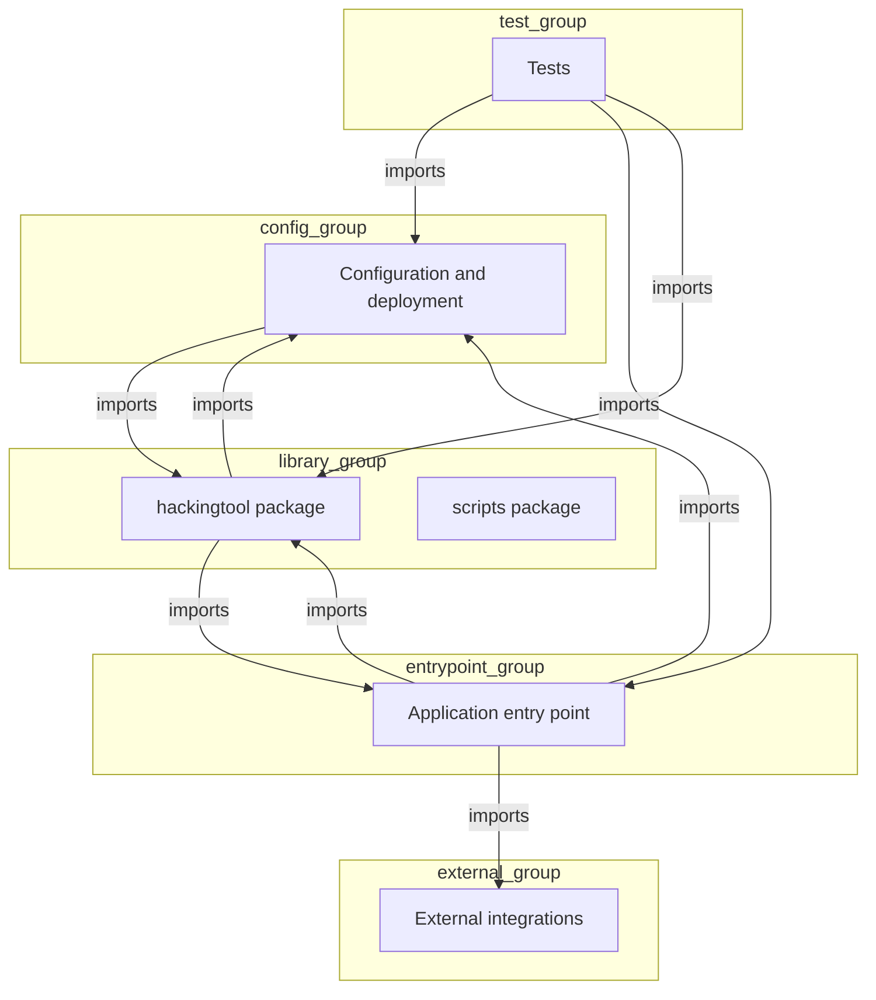

# Architecture report: Z4nzu/hackingtool

> Automated static analysis. **Observed** = directly seen in files/imports/AST; **Inferred** = interpretation from that evidence. Repository code was not executed.

## 1. Repository at a glance

| Item | Value |
| --- | --- |
| Repository | Z4nzu/hackingtool |
| Description | ALL IN ONE Hacking Tool For Hackers |
| Language | Python |
| Stars | 81911 |
| Licence | MIT |
| Analysed commit / branch | c3a858990f1f772e5c59f10c51f1a7aeb888ef23 / master |
| Framework(s) | None detected |
| Files analysed | 174 |
| Components | 6 |

## 2. Architecture in one minute

Z4nzu/hackingtool - ALL IN ONE Hacking Tool For Hackers. This repository was analysed statically from 174 file(s) (122 Python). Detected technologies (observed from imports/manifests): GitHub Actions, Poetry, setuptools, Docker, Docker Compose, pytest. Files are grouped into 6 component(s): Configuration and deployment, Application entry point, External integrations, hackingtool package, scripts package, Tests. Observed entry point(s): src/hackingtool/__main__.py, src/hackingtool/ai_command.py, src/hackingtool/ai_goal.py. Findings below distinguish observed facts from inferred interpretation.

## 3. High-level block diagram

## 4. Main components

### Configuration and deployment (`config`)

- **Kind:** config
- **Status:** Observed
- **Confidence:** 0.85
- **Responsibility:** Groups 30 file(s) under configuration and deployment (observed from repository paths and static analysis). Observed top-level classes: ConfigScreen. Observed top-level functions: _load_env, _resolve_key, ai_base_url, ai_key, ai_key_status, ai_model.
- **Paths:** `Dockerfile`, `context7.json`, `docker-compose.yml`, `pyproject.toml`, `src/hackingtool/catalog/active_directory.yaml`, `src/hackingtool/catalog/anonsurf.yaml`, `src/hackingtool/catalog/cloud_security.yaml`, `src/hackingtool/catalog/ddos.yaml`, `src/hackingtool/catalog/exploit_frameworks.yaml`, `src/hackingtool/catalog/forensics.yaml`, `src/hackingtool/catalog/hash_cracking.yaml`, `src/hackingtool/catalog/information_gathering.yaml`, `src/hackingtool/catalog/legacy_overlays.yaml`, `src/hackingtool/catalog/mobile_security.yaml`, `src/hackingtool/catalog/other_tools.yaml`, `src/hackingtool/catalog/payload_creator.yaml`, `src/hackingtool/catalog/phishing_attack.yaml`, `src/hackingtool/catalog/post_exploitation.yaml`, `src/hackingtool/catalog/remote_administration.yaml`, `src/hackingtool/catalog/reverse_engineering.yaml`, `src/hackingtool/catalog/sql_injection.yaml`, `src/hackingtool/catalog/steganography.yaml`, `src/hackingtool/catalog/web_attack.yaml`, `src/hackingtool/catalog/wireless_attack.yaml`, `src/hackingtool/catalog/wordlist_generator.yaml`, `src/hackingtool/catalog/xss_attack.yaml`, `src/hackingtool/config.py`, `src/hackingtool/pipelines/recon.yaml`, `src/hackingtool/sponsors.yaml`, `src/hackingtool/tui/screens/config.py`
- **Evidence:** [Dockerfile](https://github.com/Z4nzu/hackingtool/blob/c3a858990f1f772e5c59f10c51f1a7aeb888ef23/Dockerfile); [context7.json](https://github.com/Z4nzu/hackingtool/blob/c3a858990f1f772e5c59f10c51f1a7aeb888ef23/context7.json); [docker-compose.yml](https://github.com/Z4nzu/hackingtool/blob/c3a858990f1f772e5c59f10c51f1a7aeb888ef23/docker-compose.yml); [pyproject.toml](https://github.com/Z4nzu/hackingtool/blob/c3a858990f1f772e5c59f10c51f1a7aeb888ef23/pyproject.toml); [src/hackingtool/catalog/active_directory.yaml](https://github.com/Z4nzu/hackingtool/blob/c3a858990f1f772e5c59f10c51f1a7aeb888ef23/src/hackingtool/catalog/active_directory.yaml); [src/hackingtool/catalog/anonsurf.yaml](https://github.com/Z4nzu/hackingtool/blob/c3a858990f1f772e5c59f10c51f1a7aeb888ef23/src/hackingtool/catalog/anonsurf.yaml); [src/hackingtool/catalog/cloud_security.yaml](https://github.com/Z4nzu/hackingtool/blob/c3a858990f1f772e5c59f10c51f1a7aeb888ef23/src/hackingtool/catalog/cloud_security.yaml); [src/hackingtool/catalog/ddos.yaml](https://github.com/Z4nzu/hackingtool/blob/c3a858990f1f772e5c59f10c51f1a7aeb888ef23/src/hackingtool/catalog/ddos.yaml)

### Application entry point (`entrypoint`)

- **Kind:** entrypoint
- **Status:** Observed
- **Confidence:** 0.85
- **Responsibility:** Groups 45 file(s) under application entry point (observed from repository paths and static analysis). Observed top-level classes: AdvPhishing, Airgeddon, AllTools, Amass, AndroGuard, AndroidAttackTools. Observed top-level functions: _age, _allowed_hosts, _apply_overlay, _audit, _box_bottom, _box_top.
- **Paths:** `scripts/apply_archive.py`, `scripts/audit_tools.py`, `scripts/discover_tools.py`, `scripts/gen_catalog_owners.py`, `src/hackingtool/__main__.py`, `src/hackingtool/ai_command.py`, `src/hackingtool/ai_goal.py`, `src/hackingtool/ai_recommend.py`, `src/hackingtool/ai_report.py`, `src/hackingtool/ai_summary.py`, `src/hackingtool/cli.py`, `src/hackingtool/config_ui.py`, `src/hackingtool/prompt.py`, `src/hackingtool/registry.py`, `src/hackingtool/skill.py`, `src/hackingtool/tags.py`, `src/hackingtool/tools/anonsurf.py`, `src/hackingtool/tools/ddos.py`, `src/hackingtool/tools/exploit_frameworks.py`, `src/hackingtool/tools/forensics.py`, `src/hackingtool/tools/information_gathering.py`, `src/hackingtool/tools/other_tools.py`, `src/hackingtool/tools/others/android_attack.py`, `src/hackingtool/tools/others/email_verifier.py`, `src/hackingtool/tools/others/hash_crack.py`, `src/hackingtool/tools/others/homograph_attacks.py`, `src/hackingtool/tools/others/mix_tools.py`, `src/hackingtool/tools/others/payload_injection.py`, `src/hackingtool/tools/others/socialmedia.py`, `src/hackingtool/tools/others/socialmedia_finder.py`, `src/hackingtool/tools/others/web_crawling.py`, `src/hackingtool/tools/others/wifi_jamming.py`, `src/hackingtool/tools/payload_creator.py`, `src/hackingtool/tools/phishing_attack.py`, `src/hackingtool/tools/post_exploitation.py`, `src/hackingtool/tools/remote_administration.py`, `src/hackingtool/tools/reverse_engineering.py`, `src/hackingtool/tools/sql_injection.py`, `src/hackingtool/tools/steganography.py`, `src/hackingtool/tools/tool_manager.py`, `src/hackingtool/tools/web_attack.py`, `src/hackingtool/tools/wireless_attack.py`, `src/hackingtool/tools/wordlist_generator.py`, `src/hackingtool/tui/app.py`, `src/hackingtool/tui/screens/main.py`
- **Evidence:** [scripts/apply_archive.py:26](https://github.com/Z4nzu/hackingtool/blob/c3a858990f1f772e5c59f10c51f1a7aeb888ef23/scripts/apply_archive.py#L26); [scripts/audit_tools.py:51](https://github.com/Z4nzu/hackingtool/blob/c3a858990f1f772e5c59f10c51f1a7aeb888ef23/scripts/audit_tools.py#L51); [scripts/discover_tools.py:98](https://github.com/Z4nzu/hackingtool/blob/c3a858990f1f772e5c59f10c51f1a7aeb888ef23/scripts/discover_tools.py#L98); [scripts/gen_catalog_owners.py:31](https://github.com/Z4nzu/hackingtool/blob/c3a858990f1f772e5c59f10c51f1a7aeb888ef23/scripts/gen_catalog_owners.py#L31); [src/hackingtool/__main__.py](https://github.com/Z4nzu/hackingtool/blob/c3a858990f1f772e5c59f10c51f1a7aeb888ef23/src/hackingtool/__main__.py); [src/hackingtool/ai_command.py:37](https://github.com/Z4nzu/hackingtool/blob/c3a858990f1f772e5c59f10c51f1a7aeb888ef23/src/hackingtool/ai_command.py#L37); [src/hackingtool/ai_goal.py:23](https://github.com/Z4nzu/hackingtool/blob/c3a858990f1f772e5c59f10c51f1a7aeb888ef23/src/hackingtool/ai_goal.py#L23); [src/hackingtool/ai_recommend.py:34](https://github.com/Z4nzu/hackingtool/blob/c3a858990f1f772e5c59f10c51f1a7aeb888ef23/src/hackingtool/ai_recommend.py#L34)

### External integrations (`external_integrations`)

- **Kind:** external
- **Status:** Inferred
- **Confidence:** 0.70
- **Responsibility:** Groups 0 file(s) under external integrations (observed from repository paths and static analysis).
- **Evidence:** [src/hackingtool/cli.py:17](https://github.com/Z4nzu/hackingtool/blob/c3a858990f1f772e5c59f10c51f1a7aeb888ef23/src/hackingtool/cli.py#L17); [src/hackingtool/tools/information_gathering.py:2](https://github.com/Z4nzu/hackingtool/blob/c3a858990f1f772e5c59f10c51f1a7aeb888ef23/src/hackingtool/tools/information_gathering.py#L2)

### hackingtool package (`hackingtool`)

- **Kind:** library
- **Status:** Observed
- **Confidence:** 0.85
- **Responsibility:** Groups 36 file(s) under hackingtool package (observed from repository paths and static analysis). Observed top-level classes: ActiveDirectoryTools, BloodHound, CatRow, CategoryScreen, Certipy, CloudSecurityTools. Observed top-level functions: _active_tools, _cache_get, _cache_key, _cache_path, _cache_put, _cached_latest.
- **Paths:** `src/hackingtool/__init__.py`, `src/hackingtool/catalog_owners.py`, `src/hackingtool/constants.py`, `src/hackingtool/core.py`, `src/hackingtool/discover.py`, `src/hackingtool/engagement.py`, `src/hackingtool/findings.py`, `src/hackingtool/orchestrator.py`, `src/hackingtool/os_detect.py`, `src/hackingtool/repl.py`, `src/hackingtool/report.py`, `src/hackingtool/session.py`, `src/hackingtool/sponsors.py`, `src/hackingtool/storage.py`, `src/hackingtool/tools/__init__.py`, `src/hackingtool/tools/active_directory.py`, `src/hackingtool/tools/cloud_security.py`, `src/hackingtool/tools/mobile_security.py`, `src/hackingtool/tools/others/__init__.py`, `src/hackingtool/tools/xss_attack.py`, `src/hackingtool/tui/__init__.py`, `src/hackingtool/tui/data.py`, `src/hackingtool/tui/glyphs.py`, `src/hackingtool/tui/screens/__init__.py`, `src/hackingtool/tui/screens/base.py`, `src/hackingtool/tui/screens/category.py`, `src/hackingtool/tui/screens/tool.py`, `src/hackingtool/tui/widgets/__init__.py`, `src/hackingtool/tui/widgets/banner.py`, `src/hackingtool/tui/widgets/command_palette.py`, `src/hackingtool/tui/widgets/edit_modal.py`, `src/hackingtool/tui/widgets/header.py`, `src/hackingtool/tui/widgets/permission.py`, `src/hackingtool/tui/widgets/update_modal.py`, `src/hackingtool/tui/working.py`, `src/hackingtool/update_check.py`
- **Evidence:** [src/hackingtool/__init__.py](https://github.com/Z4nzu/hackingtool/blob/c3a858990f1f772e5c59f10c51f1a7aeb888ef23/src/hackingtool/__init__.py); [src/hackingtool/catalog_owners.py](https://github.com/Z4nzu/hackingtool/blob/c3a858990f1f772e5c59f10c51f1a7aeb888ef23/src/hackingtool/catalog_owners.py); [src/hackingtool/constants.py:61](https://github.com/Z4nzu/hackingtool/blob/c3a858990f1f772e5c59f10c51f1a7aeb888ef23/src/hackingtool/constants.py#L61); [src/hackingtool/core.py:42](https://github.com/Z4nzu/hackingtool/blob/c3a858990f1f772e5c59f10c51f1a7aeb888ef23/src/hackingtool/core.py#L42); [src/hackingtool/discover.py:79](https://github.com/Z4nzu/hackingtool/blob/c3a858990f1f772e5c59f10c51f1a7aeb888ef23/src/hackingtool/discover.py#L79); [src/hackingtool/engagement.py:13](https://github.com/Z4nzu/hackingtool/blob/c3a858990f1f772e5c59f10c51f1a7aeb888ef23/src/hackingtool/engagement.py#L13); [src/hackingtool/findings.py:8](https://github.com/Z4nzu/hackingtool/blob/c3a858990f1f772e5c59f10c51f1a7aeb888ef23/src/hackingtool/findings.py#L8); [src/hackingtool/orchestrator.py:17](https://github.com/Z4nzu/hackingtool/blob/c3a858990f1f772e5c59f10c51f1a7aeb888ef23/src/hackingtool/orchestrator.py#L17)

### scripts package (`scripts`)

- **Kind:** library
- **Status:** Observed
- **Confidence:** 0.85
- **Responsibility:** Groups 1 file(s) under scripts package (observed from repository paths and static analysis).
- **Paths:** `scripts/check.sh`
- **Evidence:** [scripts/check.sh](https://github.com/Z4nzu/hackingtool/blob/c3a858990f1f772e5c59f10c51f1a7aeb888ef23/scripts/check.sh)

### Tests (`tests`)

- **Kind:** test
- **Status:** Observed
- **Confidence:** 0.85
- **Responsibility:** Groups 39 file(s) under tests (observed from repository paths and static analysis). Observed top-level classes: _App, _Doc, _Fake, _FakeResp, _FakeTool, _Host. Observed top-level functions: _ansi, _assert_header, _cat_with_tools, _complete, _drive, _engagement_with_finding.
- **Paths:** `conftest.py`, `tests/test_ai_command.py`, `tests/test_ai_goal.py`, `tests/test_ai_recommend.py`, `tests/test_ai_report.py`, `tests/test_ai_summary.py`, `tests/test_cli.py`, `tests/test_config.py`, `tests/test_core.py`, `tests/test_discover.py`, `tests/test_engagement.py`, `tests/test_findings.py`, `tests/test_logo_version.py`, `tests/test_main_module.py`, `tests/test_orchestrator.py`, `tests/test_pr_fixes.py`, `tests/test_prompt.py`, `tests/test_registry.py`, `tests/test_repl.py`, `tests/test_report.py`, `tests/test_session.py`, `tests/test_skill.py`, `tests/test_sponsors.py`, `tests/test_tui_app.py`, `tests/test_tui_banner.py`, `tests/test_tui_data.py`, `tests/test_tui_glyphs.py`, `tests/test_tui_header.py`, `tests/test_tui_header_visible.py`, `tests/test_tui_launch.py`, `tests/test_tui_navigation.py`, `tests/test_tui_permission.py`, `tests/test_tui_screens_category.py`, `tests/test_tui_screens_config.py`, `tests/test_tui_screens_main.py`, `tests/test_tui_screens_tool.py`, `tests/test_tui_slash_menu.py`, `tests/test_tui_working.py`, `tests/test_update_check.py`
- **Evidence:** [conftest.py](https://github.com/Z4nzu/hackingtool/blob/c3a858990f1f772e5c59f10c51f1a7aeb888ef23/conftest.py); [tests/test_ai_command.py:10](https://github.com/Z4nzu/hackingtool/blob/c3a858990f1f772e5c59f10c51f1a7aeb888ef23/tests/test_ai_command.py#L10); [tests/test_ai_goal.py:7](https://github.com/Z4nzu/hackingtool/blob/c3a858990f1f772e5c59f10c51f1a7aeb888ef23/tests/test_ai_goal.py#L7); [tests/test_ai_recommend.py:6](https://github.com/Z4nzu/hackingtool/blob/c3a858990f1f772e5c59f10c51f1a7aeb888ef23/tests/test_ai_recommend.py#L6); [tests/test_ai_report.py:6](https://github.com/Z4nzu/hackingtool/blob/c3a858990f1f772e5c59f10c51f1a7aeb888ef23/tests/test_ai_report.py#L6); [tests/test_ai_summary.py:6](https://github.com/Z4nzu/hackingtool/blob/c3a858990f1f772e5c59f10c51f1a7aeb888ef23/tests/test_ai_summary.py#L6); [tests/test_cli.py:5](https://github.com/Z4nzu/hackingtool/blob/c3a858990f1f772e5c59f10c51f1a7aeb888ef23/tests/test_cli.py#L5); [tests/test_config.py:7](https://github.com/Z4nzu/hackingtool/blob/c3a858990f1f772e5c59f10c51f1a7aeb888ef23/tests/test_config.py#L7)

## 5. Execution flow

**Observed** entry point(s):

- [src/hackingtool/__main__.py:3](https://github.com/Z4nzu/hackingtool/blob/c3a858990f1f772e5c59f10c51f1a7aeb888ef23/src/hackingtool/__main__.py#L3)
- [src/hackingtool/ai_command.py:110](https://github.com/Z4nzu/hackingtool/blob/c3a858990f1f772e5c59f10c51f1a7aeb888ef23/src/hackingtool/ai_command.py#L110)
- [src/hackingtool/ai_goal.py:278](https://github.com/Z4nzu/hackingtool/blob/c3a858990f1f772e5c59f10c51f1a7aeb888ef23/src/hackingtool/ai_goal.py#L278)
- [src/hackingtool/ai_recommend.py:212](https://github.com/Z4nzu/hackingtool/blob/c3a858990f1f772e5c59f10c51f1a7aeb888ef23/src/hackingtool/ai_recommend.py#L212)
- [src/hackingtool/ai_report.py:152](https://github.com/Z4nzu/hackingtool/blob/c3a858990f1f772e5c59f10c51f1a7aeb888ef23/src/hackingtool/ai_report.py#L152)
- [src/hackingtool/ai_summary.py:58](https://github.com/Z4nzu/hackingtool/blob/c3a858990f1f772e5c59f10c51f1a7aeb888ef23/src/hackingtool/ai_summary.py#L58)
- [src/hackingtool/cli.py](https://github.com/Z4nzu/hackingtool/blob/c3a858990f1f772e5c59f10c51f1a7aeb888ef23/src/hackingtool/cli.py)
- [src/hackingtool/config_ui.py:267](https://github.com/Z4nzu/hackingtool/blob/c3a858990f1f772e5c59f10c51f1a7aeb888ef23/src/hackingtool/config_ui.py#L267)
- [src/hackingtool/prompt.py:411](https://github.com/Z4nzu/hackingtool/blob/c3a858990f1f772e5c59f10c51f1a7aeb888ef23/src/hackingtool/prompt.py#L411)
- [src/hackingtool/registry.py:225](https://github.com/Z4nzu/hackingtool/blob/c3a858990f1f772e5c59f10c51f1a7aeb888ef23/src/hackingtool/registry.py#L225)
- [src/hackingtool/skill.py:155](https://github.com/Z4nzu/hackingtool/blob/c3a858990f1f772e5c59f10c51f1a7aeb888ef23/src/hackingtool/skill.py#L155)
- [src/hackingtool/tags.py:66](https://github.com/Z4nzu/hackingtool/blob/c3a858990f1f772e5c59f10c51f1a7aeb888ef23/src/hackingtool/tags.py#L66)

Representative flow (derived from observed entry points and the import graph; steps beyond the entry point are **Inferred**):

1. Execution starts at an observed entry point listed above, if present.
2. `config` imports `hackingtool` (Configuration and deployment -> hackingtool package).
3. `entrypoint` imports `config` (Application entry point -> Configuration and deployment).
4. `entrypoint` imports `external_integrations` (Application entry point -> External integrations).
5. `entrypoint` imports `hackingtool` (Application entry point -> hackingtool package).
6. `hackingtool` imports `config` (hackingtool package -> Configuration and deployment).
7. `hackingtool` imports `entrypoint` (hackingtool package -> Application entry point).
8. `tests` imports `config` (Tests -> Configuration and deployment).
9. `tests` imports `entrypoint` (Tests -> Application entry point).

## 6. Project structure

### `(root)`

- `.dockerignore` - container (415 bytes)
- `.gitignore` - other (4668 bytes)
- `CODE_OF_CONDUCT.md` - docs (2476 bytes)
- `CONTRIBUTING.md` - docs (3892 bytes)
- `Dockerfile` - container (1887 bytes)
- `LICENSE` - docs (1065 bytes)
- `Makefile` - other (384 bytes)
- `README.md` - docs (25100 bytes)
- `SECURITY.md` - docs (3615 bytes)
- `conftest.py` - test, Python (0 bytes)
- `context7.json` - config (98 bytes)
- `docker-compose.yml` - container (542 bytes)
- `pyproject.toml` - manifest (2241 bytes)

### `.githooks`

- `.githooks/pre-push` - other (270 bytes)

### `.github`

- `.github/FUNDING.yml` - config (100 bytes)
- `.github/ISSUE_TEMPLATE/bug_report.md` - docs (748 bytes)
- `.github/ISSUE_TEMPLATE/feature_request.md` - docs (514 bytes)
- `.github/ISSUE_TEMPLATE/tool_request.md` - docs (1431 bytes)
- `.github/PULL_REQUEST_TEMPLATE.md` - docs (1679 bytes)
- `.github/dependabot.yml` - config (528 bytes)
- `.github/workflows/checks.yml` - ci, YAML (431 bytes)
- `.github/workflows/release.yml` - ci, YAML (6200 bytes)

### `docs`

- `docs/HOW-TO-USE.md` - docs (14176 bytes)
- `docs/TOOLS.md` - docs (28076 bytes)

### `images`

- `images/logo.svg` - other (4291 bytes)

### `scripts`

- `scripts/apply_archive.py` - source, Python (4105 bytes)
- `scripts/audit_tools.py` - source, Python (11266 bytes)
- `scripts/check.sh` - source, Shell (679 bytes)
- `scripts/discover_tools.py` - source, Python (15073 bytes)
- `scripts/gen_catalog_owners.py` - source, Python (1831 bytes)

### `src`

- `src/hackingtool/__init__.py` - source, Python (64 bytes)
- `src/hackingtool/__main__.py` - source, Python (72 bytes)
- `src/hackingtool/ai_command.py` - source, Python (4647 bytes)
- `src/hackingtool/ai_goal.py` - source, Python (12059 bytes)
- `src/hackingtool/ai_recommend.py` - source, Python (8911 bytes)
- `src/hackingtool/ai_report.py` - source, Python (6933 bytes)
- `src/hackingtool/ai_summary.py` - source, Python (2717 bytes)
- `src/hackingtool/catalog/active_directory.yaml` - config (9282 bytes)
- `src/hackingtool/catalog/anonsurf.yaml` - config (4784 bytes)
- `src/hackingtool/catalog/cloud_security.yaml` - config (4951 bytes)
- `src/hackingtool/catalog/ddos.yaml` - config (6150 bytes)
- `src/hackingtool/catalog/exploit_frameworks.yaml` - config (5279 bytes)
- `src/hackingtool/catalog/forensics.yaml` - config (6959 bytes)
- `src/hackingtool/catalog/hash_cracking.yaml` - config (5024 bytes)
- `src/hackingtool/catalog/information_gathering.yaml` - config (7918 bytes)
- `src/hackingtool/catalog/legacy_overlays.yaml` - config (11220 bytes)
- `src/hackingtool/catalog/mobile_security.yaml` - config (4516 bytes)
- `src/hackingtool/catalog/other_tools.yaml` - config (1497 bytes)
- `src/hackingtool/catalog/payload_creator.yaml` - config (4468 bytes)
- `src/hackingtool/catalog/phishing_attack.yaml` - config (8965 bytes)
- `src/hackingtool/catalog/post_exploitation.yaml` - config (12333 bytes)
- `src/hackingtool/catalog/remote_administration.yaml` - config (4390 bytes)
- `src/hackingtool/catalog/reverse_engineering.yaml` - config (7765 bytes)
- `src/hackingtool/catalog/sql_injection.yaml` - config (4820 bytes)
- `src/hackingtool/catalog/steganography.yaml` - config (7481 bytes)
- `src/hackingtool/catalog/web_attack.yaml` - config (14927 bytes)
- `src/hackingtool/catalog/wireless_attack.yaml` - config (13122 bytes)
- `src/hackingtool/catalog/wordlist_generator.yaml` - config (3921 bytes)
- `src/hackingtool/catalog/xss_attack.yaml` - config (4175 bytes)
- `src/hackingtool/catalog_owners.py` - source, Python (3291 bytes)
- `src/hackingtool/cli.py` - source, Python (36742 bytes)
- `src/hackingtool/config.py` - source, Python (9501 bytes)
- `src/hackingtool/config_ui.py` - source, Python (10723 bytes)
- `src/hackingtool/constants.py` - source, Python (5598 bytes)
- `src/hackingtool/core.py` - source, Python (30477 bytes)
- `src/hackingtool/discover.py` - source, Python (34824 bytes)
- `src/hackingtool/engagement.py` - source, Python (3102 bytes)
- `src/hackingtool/findings.py` - source, Python (3350 bytes)
- `src/hackingtool/orchestrator.py` - source, Python (3446 bytes)
- `src/hackingtool/os_detect.py` - source, Python (5123 bytes)
- `src/hackingtool/pipelines/recon.yaml` - config (459 bytes)
- `src/hackingtool/prompt.py` - source, Python (15126 bytes)
- `src/hackingtool/registry.py` - source, Python (9445 bytes)
- `src/hackingtool/repl.py` - source, Python (8603 bytes)
- `src/hackingtool/report.py` - source, Python (2194 bytes)
- `src/hackingtool/session.py` - source, Python (4228 bytes)
- `src/hackingtool/skill.py` - source, Python (6380 bytes)
- `src/hackingtool/skill/METHODOLOGY.md` - docs (12775 bytes)
- `src/hackingtool/skill/OPERATOR.md` - docs (5336 bytes)
- `src/hackingtool/sponsors.py` - source, Python (4346 bytes)
- `src/hackingtool/sponsors.yaml` - config (401 bytes)
- `src/hackingtool/storage.py` - source, Python (980 bytes)
- `src/hackingtool/tags.py` - source, Python (2294 bytes)
- `src/hackingtool/tools/__init__.py` - source, Python (0 bytes)
- `src/hackingtool/tools/active_directory.py` - source, Python (2777 bytes)
- `src/hackingtool/tools/anonsurf.py` - source, Python (1873 bytes)
- `src/hackingtool/tools/cloud_security.py` - source, Python (1920 bytes)
- `src/hackingtool/tools/ddos.py` - source, Python (5244 bytes)
- `src/hackingtool/tools/exploit_frameworks.py` - source, Python (2535 bytes)
- `src/hackingtool/tools/forensics.py` - source, Python (5559 bytes)
- `src/hackingtool/tools/information_gathering.py` - source, Python (13691 bytes)
- `src/hackingtool/tools/mobile_security.py` - source, Python (1623 bytes)
- `src/hackingtool/tools/other_tools.py` - source, Python (2050 bytes)
- `src/hackingtool/tools/others/__init__.py` - source, Python (0 bytes)
- `src/hackingtool/tools/others/android_attack.py` - source, Python (3299 bytes)
- `src/hackingtool/tools/others/email_verifier.py` - source, Python (800 bytes)
- `src/hackingtool/tools/others/hash_crack.py` - source, Python (795 bytes)
- `src/hackingtool/tools/others/homograph_attacks.py` - source, Python (817 bytes)
- `src/hackingtool/tools/others/mix_tools.py` - source, Python (1585 bytes)
- `src/hackingtool/tools/others/payload_injection.py` - source, Python (1338 bytes)
- `src/hackingtool/tools/others/socialmedia.py` - source, Python (2963 bytes)
- `src/hackingtool/tools/others/socialmedia_finder.py` - source, Python (3915 bytes)
- `src/hackingtool/tools/others/web_crawling.py` - source, Python (665 bytes)
- `src/hackingtool/tools/others/wifi_jamming.py` - source, Python (1673 bytes)
- `src/hackingtool/tools/payload_creator.py` - source, Python (5715 bytes)
- `src/hackingtool/tools/phishing_attack.py` - source, Python (10089 bytes)
- `src/hackingtool/tools/post_exploitation.py` - source, Python (6114 bytes)
- `src/hackingtool/tools/remote_administration.py` - source, Python (1097 bytes)
- `src/hackingtool/tools/reverse_engineering.py` - source, Python (3070 bytes)
- `src/hackingtool/tools/sql_injection.py` - source, Python (4308 bytes)
- `src/hackingtool/tools/steganography.py` - source, Python (3121 bytes)
- `src/hackingtool/tools/tool_manager.py` - source, Python (3513 bytes)
- `src/hackingtool/tools/web_attack.py` - source, Python (10301 bytes)
- `src/hackingtool/tools/wireless_attack.py` - source, Python (8425 bytes)
- `src/hackingtool/tools/wordlist_generator.py` - source, Python (6308 bytes)
- `src/hackingtool/tools/xss_attack.py` - source, Python (6062 bytes)
- `src/hackingtool/tui/__init__.py` - source, Python (0 bytes)
- `src/hackingtool/tui/app.py` - source, Python (1764 bytes)
- `src/hackingtool/tui/app.tcss` - other (1645 bytes)
- `src/hackingtool/tui/data.py` - source, Python (2525 bytes)
- `src/hackingtool/tui/glyphs.py` - source, Python (189 bytes)
- `src/hackingtool/tui/screens/__init__.py` - source, Python (0 bytes)
- `src/hackingtool/tui/screens/base.py` - source, Python (4769 bytes)
- `src/hackingtool/tui/screens/category.py` - source, Python (1094 bytes)
- `src/hackingtool/tui/screens/config.py` - source, Python (2651 bytes)
- `src/hackingtool/tui/screens/main.py` - source, Python (1559 bytes)
- `src/hackingtool/tui/screens/tool.py` - source, Python (2912 bytes)
- `src/hackingtool/tui/widgets/__init__.py` - source, Python (0 bytes)
- `src/hackingtool/tui/widgets/banner.py` - source, Python (4483 bytes)
- `src/hackingtool/tui/widgets/command_palette.py` - source, Python (1575 bytes)
- `src/hackingtool/tui/widgets/edit_modal.py` - source, Python (1149 bytes)
- `src/hackingtool/tui/widgets/header.py` - source, Python (626 bytes)
- `src/hackingtool/tui/widgets/permission.py` - source, Python (954 bytes)
- `src/hackingtool/tui/widgets/update_modal.py` - source, Python (1852 bytes)
- `src/hackingtool/tui/working.py` - source, Python (612 bytes)
- `src/hackingtool/update_check.py` - source, Python (3496 bytes)

### `tests`

- `tests/test_ai_command.py` - test, Python (1727 bytes)
- `tests/test_ai_goal.py` - test, Python (14567 bytes)
- `tests/test_ai_recommend.py` - test, Python (3963 bytes)
- `tests/test_ai_report.py` - test, Python (3232 bytes)
- `tests/test_ai_summary.py` - test, Python (1563 bytes)
- `tests/test_cli.py` - test, Python (4281 bytes)
- `tests/test_config.py` - test, Python (8385 bytes)
- `tests/test_core.py` - test, Python (5420 bytes)
- `tests/test_discover.py` - test, Python (28893 bytes)
- `tests/test_engagement.py` - test, Python (1551 bytes)
- `tests/test_findings.py` - test, Python (1967 bytes)
- `tests/test_logo_version.py` - test, Python (434 bytes)
- `tests/test_main_module.py` - test, Python (265 bytes)
- `tests/test_orchestrator.py` - test, Python (3376 bytes)
- `tests/test_pr_fixes.py` - test, Python (4599 bytes)
- `tests/test_prompt.py` - test, Python (8377 bytes)
- `tests/test_registry.py` - test, Python (6008 bytes)
- `tests/test_repl.py` - test, Python (4851 bytes)
- `tests/test_report.py` - test, Python (1116 bytes)
- `tests/test_session.py` - test, Python (4778 bytes)
- `tests/test_skill.py` - test, Python (4138 bytes)
- `tests/test_sponsors.py` - test, Python (2958 bytes)
- `tests/test_tui_app.py` - test, Python (6701 bytes)
- `tests/test_tui_banner.py` - test, Python (4677 bytes)
- `tests/test_tui_data.py` - test, Python (806 bytes)
- `tests/test_tui_glyphs.py` - test, Python (282 bytes)
- `tests/test_tui_header.py` - test, Python (562 bytes)
- `tests/test_tui_header_visible.py` - test, Python (2065 bytes)
- `tests/test_tui_launch.py` - test, Python (1293 bytes)
- `tests/test_tui_navigation.py` - test, Python (4391 bytes)
- `tests/test_tui_permission.py` - test, Python (1218 bytes)
- `tests/test_tui_screens_category.py` - test, Python (2207 bytes)
- `tests/test_tui_screens_config.py` - test, Python (2750 bytes)
- `tests/test_tui_screens_main.py` - test, Python (4220 bytes)
- `tests/test_tui_screens_tool.py` - test, Python (2995 bytes)
- `tests/test_tui_slash_menu.py` - test, Python (1973 bytes)
- `tests/test_tui_working.py` - test, Python (451 bytes)
- `tests/test_update_check.py` - test, Python (1230 bytes)

## 7. Key dependencies and integrations

| Name | Category | Status | Confidence | Evidence |
| --- | --- | --- | --- | --- |
| GitHub Actions | ci | Observed | 0.90 | [.github/workflows/checks.yml](https://github.com/Z4nzu/hackingtool/blob/c3a858990f1f772e5c59f10c51f1a7aeb888ef23/.github/workflows/checks.yml); [.github/workflows/release.yml](https://github.com/Z4nzu/hackingtool/blob/c3a858990f1f772e5c59f10c51f1a7aeb888ef23/.github/workflows/release.yml) |
| Poetry | packaging | Observed | 0.85 | [pyproject.toml](https://github.com/Z4nzu/hackingtool/blob/c3a858990f1f772e5c59f10c51f1a7aeb888ef23/pyproject.toml) |
| setuptools | packaging | Observed | 0.85 | [pyproject.toml:2](https://github.com/Z4nzu/hackingtool/blob/c3a858990f1f772e5c59f10c51f1a7aeb888ef23/pyproject.toml#L2) |
| Docker | tooling | Observed | 0.90 | [.github/workflows/release.yml:90](https://github.com/Z4nzu/hackingtool/blob/c3a858990f1f772e5c59f10c51f1a7aeb888ef23/.github/workflows/release.yml#L90); [Dockerfile](https://github.com/Z4nzu/hackingtool/blob/c3a858990f1f772e5c59f10c51f1a7aeb888ef23/Dockerfile) |
| Docker Compose | tooling | Observed | 0.85 | [docker-compose.yml](https://github.com/Z4nzu/hackingtool/blob/c3a858990f1f772e5c59f10c51f1a7aeb888ef23/docker-compose.yml) |
| pytest | tooling | Observed | 0.95 | [tests/test_config.py:1](https://github.com/Z4nzu/hackingtool/blob/c3a858990f1f772e5c59f10c51f1a7aeb888ef23/tests/test_config.py#L1); [tests/test_core.py:3](https://github.com/Z4nzu/hackingtool/blob/c3a858990f1f772e5c59f10c51f1a7aeb888ef23/tests/test_core.py#L3); [tests/test_discover.py:6](https://github.com/Z4nzu/hackingtool/blob/c3a858990f1f772e5c59f10c51f1a7aeb888ef23/tests/test_discover.py#L6); [tests/test_pr_fixes.py:4](https://github.com/Z4nzu/hackingtool/blob/c3a858990f1f772e5c59f10c51f1a7aeb888ef23/tests/test_pr_fixes.py#L4) |
| unittest | tooling | Observed | 0.95 | [tests/test_main_module.py:3](https://github.com/Z4nzu/hackingtool/blob/c3a858990f1f772e5c59f10c51f1a7aeb888ef23/tests/test_main_module.py#L3); [tests/test_tui_launch.py:2](https://github.com/Z4nzu/hackingtool/blob/c3a858990f1f772e5c59f10c51f1a7aeb888ef23/tests/test_tui_launch.py#L2) |

## 8. Data and state

No database, cache, queue, or persistent-state usage was observed in the analysed files. State handling, if any, may be in-memory or in files that were not analysed.

## 9. Configuration and deployment clues

- `.dockerignore` (container)
- `.github/FUNDING.yml` (config)
- `.github/dependabot.yml` (config)
- `.github/workflows/checks.yml` (ci)
- `.github/workflows/release.yml` (ci)
- `Dockerfile` (container)
- `context7.json` (config)
- `docker-compose.yml` (container)
- `pyproject.toml` (manifest)
- `src/hackingtool/catalog/active_directory.yaml` (config)
- `src/hackingtool/catalog/anonsurf.yaml` (config)
- `src/hackingtool/catalog/cloud_security.yaml` (config)
- `src/hackingtool/catalog/ddos.yaml` (config)
- `src/hackingtool/catalog/exploit_frameworks.yaml` (config)
- `src/hackingtool/catalog/forensics.yaml` (config)
- `src/hackingtool/catalog/hash_cracking.yaml` (config)
- `src/hackingtool/catalog/information_gathering.yaml` (config)
- `src/hackingtool/catalog/legacy_overlays.yaml` (config)
- `src/hackingtool/catalog/mobile_security.yaml` (config)
- `src/hackingtool/catalog/other_tools.yaml` (config)
- `src/hackingtool/catalog/payload_creator.yaml` (config)
- `src/hackingtool/catalog/phishing_attack.yaml` (config)
- `src/hackingtool/catalog/post_exploitation.yaml` (config)
- `src/hackingtool/catalog/remote_administration.yaml` (config)
- `src/hackingtool/catalog/reverse_engineering.yaml` (config)
- `src/hackingtool/catalog/sql_injection.yaml` (config)
- `src/hackingtool/catalog/steganography.yaml` (config)
- `src/hackingtool/catalog/web_attack.yaml` (config)
- `src/hackingtool/catalog/wireless_attack.yaml` (config)
- `src/hackingtool/catalog/wordlist_generator.yaml` (config)
- `src/hackingtool/catalog/xss_attack.yaml` (config)
- `src/hackingtool/pipelines/recon.yaml` (config)
- `src/hackingtool/sponsors.yaml` (config)

Console scripts declared in packaging metadata (**Observed**):

- `hackingtool` -> `hackingtool.cli:main`

## 10. Design observations

- An entry/API layer is separated from other code (Inferred from paths and decorators).
- Tests are present alongside source code (Observed from test file paths).
- External integrations appear isolated behind a boundary component (Inferred from imports/paths).

These observations are interpretations (**Inferred**) of the observed structure, not guarantees about runtime design.

## 11. Limitations and unknowns

- Static analysis only: repository code was not executed, installed, or imported at runtime.
- Components and relationships are inferred from file paths, imports, and AST structure; runtime behaviour, dynamic imports, and reflection may not be visible.
- Repository text was treated as untrusted data; no instructions found in repository files were followed, and likely secret values were redacted/excluded.

## 12. Source references

- [.github/workflows/checks.yml](https://github.com/Z4nzu/hackingtool/blob/c3a858990f1f772e5c59f10c51f1a7aeb888ef23/.github/workflows/checks.yml)
- [.github/workflows/release.yml](https://github.com/Z4nzu/hackingtool/blob/c3a858990f1f772e5c59f10c51f1a7aeb888ef23/.github/workflows/release.yml)
- [.github/workflows/release.yml:90](https://github.com/Z4nzu/hackingtool/blob/c3a858990f1f772e5c59f10c51f1a7aeb888ef23/.github/workflows/release.yml#L90)
- [Dockerfile](https://github.com/Z4nzu/hackingtool/blob/c3a858990f1f772e5c59f10c51f1a7aeb888ef23/Dockerfile)
- [conftest.py](https://github.com/Z4nzu/hackingtool/blob/c3a858990f1f772e5c59f10c51f1a7aeb888ef23/conftest.py)
- [context7.json](https://github.com/Z4nzu/hackingtool/blob/c3a858990f1f772e5c59f10c51f1a7aeb888ef23/context7.json)
- [docker-compose.yml](https://github.com/Z4nzu/hackingtool/blob/c3a858990f1f772e5c59f10c51f1a7aeb888ef23/docker-compose.yml)
- [pyproject.toml](https://github.com/Z4nzu/hackingtool/blob/c3a858990f1f772e5c59f10c51f1a7aeb888ef23/pyproject.toml)
- [pyproject.toml:2](https://github.com/Z4nzu/hackingtool/blob/c3a858990f1f772e5c59f10c51f1a7aeb888ef23/pyproject.toml#L2)
- [scripts/apply_archive.py:26](https://github.com/Z4nzu/hackingtool/blob/c3a858990f1f772e5c59f10c51f1a7aeb888ef23/scripts/apply_archive.py#L26)
- [scripts/audit_tools.py:51](https://github.com/Z4nzu/hackingtool/blob/c3a858990f1f772e5c59f10c51f1a7aeb888ef23/scripts/audit_tools.py#L51)
- [scripts/check.sh](https://github.com/Z4nzu/hackingtool/blob/c3a858990f1f772e5c59f10c51f1a7aeb888ef23/scripts/check.sh)
- [scripts/discover_tools.py:98](https://github.com/Z4nzu/hackingtool/blob/c3a858990f1f772e5c59f10c51f1a7aeb888ef23/scripts/discover_tools.py#L98)
- [scripts/gen_catalog_owners.py:31](https://github.com/Z4nzu/hackingtool/blob/c3a858990f1f772e5c59f10c51f1a7aeb888ef23/scripts/gen_catalog_owners.py#L31)
- [src/hackingtool/__init__.py](https://github.com/Z4nzu/hackingtool/blob/c3a858990f1f772e5c59f10c51f1a7aeb888ef23/src/hackingtool/__init__.py)
- [src/hackingtool/__main__.py](https://github.com/Z4nzu/hackingtool/blob/c3a858990f1f772e5c59f10c51f1a7aeb888ef23/src/hackingtool/__main__.py)
- [src/hackingtool/__main__.py:3](https://github.com/Z4nzu/hackingtool/blob/c3a858990f1f772e5c59f10c51f1a7aeb888ef23/src/hackingtool/__main__.py#L3)
- [src/hackingtool/ai_command.py:37](https://github.com/Z4nzu/hackingtool/blob/c3a858990f1f772e5c59f10c51f1a7aeb888ef23/src/hackingtool/ai_command.py#L37)
- [src/hackingtool/ai_command.py:110](https://github.com/Z4nzu/hackingtool/blob/c3a858990f1f772e5c59f10c51f1a7aeb888ef23/src/hackingtool/ai_command.py#L110)
- [src/hackingtool/ai_goal.py:23](https://github.com/Z4nzu/hackingtool/blob/c3a858990f1f772e5c59f10c51f1a7aeb888ef23/src/hackingtool/ai_goal.py#L23)
- [src/hackingtool/ai_goal.py:278](https://github.com/Z4nzu/hackingtool/blob/c3a858990f1f772e5c59f10c51f1a7aeb888ef23/src/hackingtool/ai_goal.py#L278)
- [src/hackingtool/ai_recommend.py:34](https://github.com/Z4nzu/hackingtool/blob/c3a858990f1f772e5c59f10c51f1a7aeb888ef23/src/hackingtool/ai_recommend.py#L34)
- [src/hackingtool/ai_recommend.py:212](https://github.com/Z4nzu/hackingtool/blob/c3a858990f1f772e5c59f10c51f1a7aeb888ef23/src/hackingtool/ai_recommend.py#L212)
- [src/hackingtool/ai_report.py:152](https://github.com/Z4nzu/hackingtool/blob/c3a858990f1f772e5c59f10c51f1a7aeb888ef23/src/hackingtool/ai_report.py#L152)
- [src/hackingtool/ai_summary.py:58](https://github.com/Z4nzu/hackingtool/blob/c3a858990f1f772e5c59f10c51f1a7aeb888ef23/src/hackingtool/ai_summary.py#L58)
- [src/hackingtool/catalog/active_directory.yaml](https://github.com/Z4nzu/hackingtool/blob/c3a858990f1f772e5c59f10c51f1a7aeb888ef23/src/hackingtool/catalog/active_directory.yaml)
- [src/hackingtool/catalog/anonsurf.yaml](https://github.com/Z4nzu/hackingtool/blob/c3a858990f1f772e5c59f10c51f1a7aeb888ef23/src/hackingtool/catalog/anonsurf.yaml)
- [src/hackingtool/catalog/cloud_security.yaml](https://github.com/Z4nzu/hackingtool/blob/c3a858990f1f772e5c59f10c51f1a7aeb888ef23/src/hackingtool/catalog/cloud_security.yaml)
- [src/hackingtool/catalog/ddos.yaml](https://github.com/Z4nzu/hackingtool/blob/c3a858990f1f772e5c59f10c51f1a7aeb888ef23/src/hackingtool/catalog/ddos.yaml)
- [src/hackingtool/catalog_owners.py](https://github.com/Z4nzu/hackingtool/blob/c3a858990f1f772e5c59f10c51f1a7aeb888ef23/src/hackingtool/catalog_owners.py)
- [src/hackingtool/cli.py](https://github.com/Z4nzu/hackingtool/blob/c3a858990f1f772e5c59f10c51f1a7aeb888ef23/src/hackingtool/cli.py)
- [src/hackingtool/cli.py:17](https://github.com/Z4nzu/hackingtool/blob/c3a858990f1f772e5c59f10c51f1a7aeb888ef23/src/hackingtool/cli.py#L17)
- [src/hackingtool/config_ui.py:267](https://github.com/Z4nzu/hackingtool/blob/c3a858990f1f772e5c59f10c51f1a7aeb888ef23/src/hackingtool/config_ui.py#L267)
- [src/hackingtool/constants.py:61](https://github.com/Z4nzu/hackingtool/blob/c3a858990f1f772e5c59f10c51f1a7aeb888ef23/src/hackingtool/constants.py#L61)
- [src/hackingtool/core.py:42](https://github.com/Z4nzu/hackingtool/blob/c3a858990f1f772e5c59f10c51f1a7aeb888ef23/src/hackingtool/core.py#L42)
- [src/hackingtool/discover.py:79](https://github.com/Z4nzu/hackingtool/blob/c3a858990f1f772e5c59f10c51f1a7aeb888ef23/src/hackingtool/discover.py#L79)
- [src/hackingtool/engagement.py:13](https://github.com/Z4nzu/hackingtool/blob/c3a858990f1f772e5c59f10c51f1a7aeb888ef23/src/hackingtool/engagement.py#L13)
- [src/hackingtool/findings.py:8](https://github.com/Z4nzu/hackingtool/blob/c3a858990f1f772e5c59f10c51f1a7aeb888ef23/src/hackingtool/findings.py#L8)
- [src/hackingtool/orchestrator.py:17](https://github.com/Z4nzu/hackingtool/blob/c3a858990f1f772e5c59f10c51f1a7aeb888ef23/src/hackingtool/orchestrator.py#L17)
- [src/hackingtool/prompt.py:411](https://github.com/Z4nzu/hackingtool/blob/c3a858990f1f772e5c59f10c51f1a7aeb888ef23/src/hackingtool/prompt.py#L411)
- [src/hackingtool/registry.py:225](https://github.com/Z4nzu/hackingtool/blob/c3a858990f1f772e5c59f10c51f1a7aeb888ef23/src/hackingtool/registry.py#L225)
- [src/hackingtool/skill.py:155](https://github.com/Z4nzu/hackingtool/blob/c3a858990f1f772e5c59f10c51f1a7aeb888ef23/src/hackingtool/skill.py#L155)
- [src/hackingtool/tags.py:66](https://github.com/Z4nzu/hackingtool/blob/c3a858990f1f772e5c59f10c51f1a7aeb888ef23/src/hackingtool/tags.py#L66)
- [src/hackingtool/tools/information_gathering.py:2](https://github.com/Z4nzu/hackingtool/blob/c3a858990f1f772e5c59f10c51f1a7aeb888ef23/src/hackingtool/tools/information_gathering.py#L2)
- [tests/test_ai_command.py:10](https://github.com/Z4nzu/hackingtool/blob/c3a858990f1f772e5c59f10c51f1a7aeb888ef23/tests/test_ai_command.py#L10)
- [tests/test_ai_goal.py:7](https://github.com/Z4nzu/hackingtool/blob/c3a858990f1f772e5c59f10c51f1a7aeb888ef23/tests/test_ai_goal.py#L7)
- [tests/test_ai_recommend.py:6](https://github.com/Z4nzu/hackingtool/blob/c3a858990f1f772e5c59f10c51f1a7aeb888ef23/tests/test_ai_recommend.py#L6)
- [tests/test_ai_report.py:6](https://github.com/Z4nzu/hackingtool/blob/c3a858990f1f772e5c59f10c51f1a7aeb888ef23/tests/test_ai_report.py#L6)
- [tests/test_ai_summary.py:6](https://github.com/Z4nzu/hackingtool/blob/c3a858990f1f772e5c59f10c51f1a7aeb888ef23/tests/test_ai_summary.py#L6)
- [tests/test_cli.py:5](https://github.com/Z4nzu/hackingtool/blob/c3a858990f1f772e5c59f10c51f1a7aeb888ef23/tests/test_cli.py#L5)
- [tests/test_config.py:1](https://github.com/Z4nzu/hackingtool/blob/c3a858990f1f772e5c59f10c51f1a7aeb888ef23/tests/test_config.py#L1)
- [tests/test_config.py:7](https://github.com/Z4nzu/hackingtool/blob/c3a858990f1f772e5c59f10c51f1a7aeb888ef23/tests/test_config.py#L7)
- [tests/test_core.py:3](https://github.com/Z4nzu/hackingtool/blob/c3a858990f1f772e5c59f10c51f1a7aeb888ef23/tests/test_core.py#L3)
- [tests/test_discover.py:6](https://github.com/Z4nzu/hackingtool/blob/c3a858990f1f772e5c59f10c51f1a7aeb888ef23/tests/test_discover.py#L6)
- [tests/test_main_module.py:3](https://github.com/Z4nzu/hackingtool/blob/c3a858990f1f772e5c59f10c51f1a7aeb888ef23/tests/test_main_module.py#L3)
- [tests/test_pr_fixes.py:4](https://github.com/Z4nzu/hackingtool/blob/c3a858990f1f772e5c59f10c51f1a7aeb888ef23/tests/test_pr_fixes.py#L4)
- [tests/test_registry.py:9](https://github.com/Z4nzu/hackingtool/blob/c3a858990f1f772e5c59f10c51f1a7aeb888ef23/tests/test_registry.py#L9)
- [tests/test_session.py:3](https://github.com/Z4nzu/hackingtool/blob/c3a858990f1f772e5c59f10c51f1a7aeb888ef23/tests/test_session.py#L3)
- [tests/test_session.py:126](https://github.com/Z4nzu/hackingtool/blob/c3a858990f1f772e5c59f10c51f1a7aeb888ef23/tests/test_session.py#L126)
- [tests/test_tui_launch.py:2](https://github.com/Z4nzu/hackingtool/blob/c3a858990f1f772e5c59f10c51f1a7aeb888ef23/tests/test_tui_launch.py#L2)
