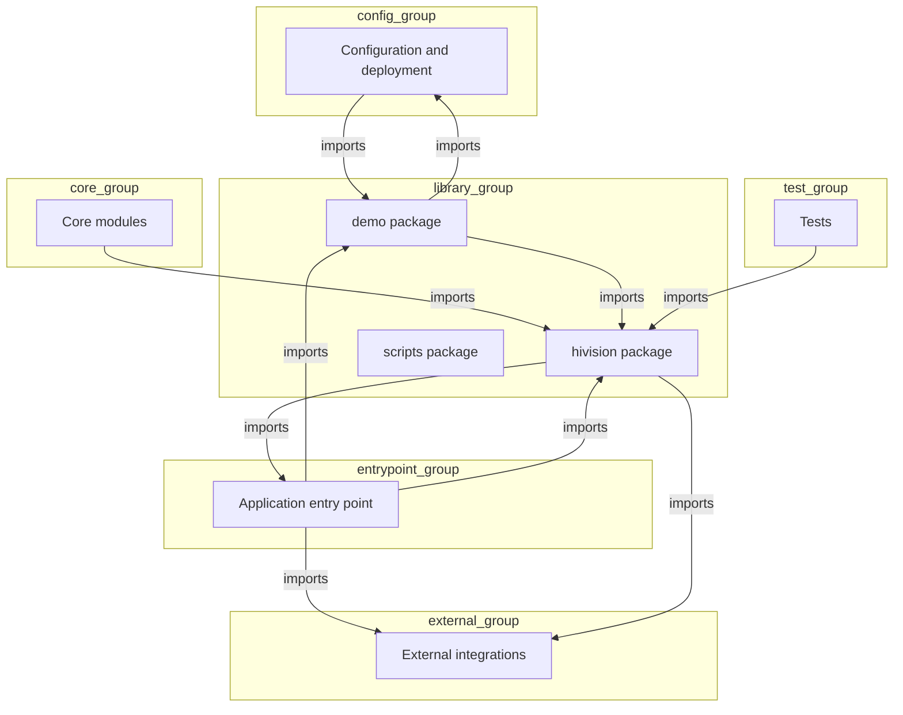

# Architecture report: Zeyi-Lin/HivisionIDPhotos

> Automated static analysis. **Observed** = directly seen in files/imports/AST; **Inferred** = interpretation from that evidence. Repository code was not executed.

## 1. Repository at a glance

| Item | Value |
| --- | --- |
| Repository | Zeyi-Lin/HivisionIDPhotos |
| Description | ⚡️HivisionIDPhotos: a lightweight and efficient AI ID photos tools. 一个轻量级的AI证件照制作算法。 |
| Language | Python |
| Stars | 21723 |
| Licence | Apache-2.0 |
| Analysed commit / branch | 5c191e2577f14755a69d9df6db415fab23aca484 / master |
| Framework(s) | FastAPI, Starlette |
| Files analysed | 69 |
| Components | 8 |

## 2. Architecture in one minute

Zeyi-Lin/HivisionIDPhotos - ⚡️HivisionIDPhotos: a lightweight and efficient AI ID photos tools. 一个轻量级的AI证件照制作算法。. This repository was analysed statically from 69 file(s) (38 Python). Detected technologies (observed from imports/manifests): GitHub Actions, FastAPI, Starlette, NumPy, requests, Uvicorn. Files are grouped into 8 component(s): Configuration and deployment, Core modules, demo package, Application entry point, External integrations, hivision package, scripts package, Tests. Observed entry point(s): app.py, deploy_api.py, hivision/creator/move_image.py. Findings below distinguish observed facts from inferred interpretation.

## 3. High-level block diagram

## 4. Main components

### Configuration and deployment (`config`)

- **Kind:** config
- **Status:** Observed
- **Confidence:** 0.85
- **Responsibility:** Groups 7 file(s) under configuration and deployment (observed from repository paths and static analysis). Observed top-level functions: load_configuration.
- **Paths:** `Dockerfile`, `demo/config.py`, `docker-compose.yml`, `hivision/plugin/template/assets/template_config.json`, `requirements-app.txt`, `requirements-dev.txt`, `requirements.txt`
- **Evidence:** [Dockerfile](https://github.com/Zeyi-Lin/HivisionIDPhotos/blob/5c191e2577f14755a69d9df6db415fab23aca484/Dockerfile); [demo/config.py:5](https://github.com/Zeyi-Lin/HivisionIDPhotos/blob/5c191e2577f14755a69d9df6db415fab23aca484/demo/config.py#L5); [docker-compose.yml](https://github.com/Zeyi-Lin/HivisionIDPhotos/blob/5c191e2577f14755a69d9df6db415fab23aca484/docker-compose.yml); [hivision/plugin/template/assets/template_config.json](https://github.com/Zeyi-Lin/HivisionIDPhotos/blob/5c191e2577f14755a69d9df6db415fab23aca484/hivision/plugin/template/assets/template_config.json); [requirements-app.txt](https://github.com/Zeyi-Lin/HivisionIDPhotos/blob/5c191e2577f14755a69d9df6db415fab23aca484/requirements-app.txt); [requirements-dev.txt](https://github.com/Zeyi-Lin/HivisionIDPhotos/blob/5c191e2577f14755a69d9df6db415fab23aca484/requirements-dev.txt); [requirements.txt](https://github.com/Zeyi-Lin/HivisionIDPhotos/blob/5c191e2577f14755a69d9df6db415fab23aca484/requirements.txt)

### Core modules (`core`)

- **Kind:** core
- **Status:** Observed
- **Confidence:** 0.85
- **Responsibility:** Groups 1 file(s) under core modules (observed from repository paths and static analysis).
- **Paths:** `inference.py`
- **Evidence:** [inference.py](https://github.com/Zeyi-Lin/HivisionIDPhotos/blob/5c191e2577f14755a69d9df6db415fab23aca484/inference.py)

### demo package (`demo`)

- **Kind:** library
- **Status:** Observed
- **Confidence:** 0.85
- **Responsibility:** Groups 4 file(s) under demo package (observed from repository paths and static analysis). Observed top-level classes: IDPhotoProcessor. Observed top-level functions: create_ui, csv_to_color_list, csv_to_size_list, load_description, range_check.
- **Paths:** `demo/locales.py`, `demo/processor.py`, `demo/ui.py`, `demo/utils.py`
- **Evidence:** [demo/locales.py](https://github.com/Zeyi-Lin/HivisionIDPhotos/blob/5c191e2577f14755a69d9df6db415fab23aca484/demo/locales.py); [demo/processor.py:27](https://github.com/Zeyi-Lin/HivisionIDPhotos/blob/5c191e2577f14755a69d9df6db415fab23aca484/demo/processor.py#L27); [demo/ui.py:13](https://github.com/Zeyi-Lin/HivisionIDPhotos/blob/5c191e2577f14755a69d9df6db415fab23aca484/demo/ui.py#L13); [demo/utils.py:4](https://github.com/Zeyi-Lin/HivisionIDPhotos/blob/5c191e2577f14755a69d9df6db415fab23aca484/demo/utils.py#L4)

### Application entry point (`entrypoint`)

- **Kind:** entrypoint
- **Status:** Observed
- **Confidence:** 0.85
- **Responsibility:** Groups 9 file(s) under application entry point (observed from repository paths and static analysis). Observed application object created via FastAPI. Observed routes: POST /idphoto, POST /human_matting, POST /add_background, POST /generate_layout_photos, POST /watermark. Observed top-level classes: LutWhite, MakeWhiter, Watermarker, WatermarkerStyles. Observed top-level functions: adjust_brightness_contrast_sharpen_saturation, adjust_saturation, annotate_image, base_adjustment, download_file, download_models.
- **Paths:** `app.py`, `deploy_api.py`, `hivision/creator/move_image.py`, `hivision/creator/retinaface/inference.py`, `hivision/plugin/beauty/base_adjust.py`, `hivision/plugin/beauty/grind_skin.py`, `hivision/plugin/beauty/whitening.py`, `hivision/plugin/watermark.py`, `scripts/download_model.py`
- **Evidence:** [app.py](https://github.com/Zeyi-Lin/HivisionIDPhotos/blob/5c191e2577f14755a69d9df6db415fab23aca484/app.py); [deploy_api.py:28](https://github.com/Zeyi-Lin/HivisionIDPhotos/blob/5c191e2577f14755a69d9df6db415fab23aca484/deploy_api.py#L28); [hivision/creator/move_image.py:14](https://github.com/Zeyi-Lin/HivisionIDPhotos/blob/5c191e2577f14755a69d9df6db415fab23aca484/hivision/creator/move_image.py#L14); [hivision/creator/retinaface/inference.py:8](https://github.com/Zeyi-Lin/HivisionIDPhotos/blob/5c191e2577f14755a69d9df6db415fab23aca484/hivision/creator/retinaface/inference.py#L8); [hivision/plugin/beauty/base_adjust.py:9](https://github.com/Zeyi-Lin/HivisionIDPhotos/blob/5c191e2577f14755a69d9df6db415fab23aca484/hivision/plugin/beauty/base_adjust.py#L9); [hivision/plugin/beauty/grind_skin.py:7](https://github.com/Zeyi-Lin/HivisionIDPhotos/blob/5c191e2577f14755a69d9df6db415fab23aca484/hivision/plugin/beauty/grind_skin.py#L7); [hivision/plugin/beauty/whitening.py:7](https://github.com/Zeyi-Lin/HivisionIDPhotos/blob/5c191e2577f14755a69d9df6db415fab23aca484/hivision/plugin/beauty/whitening.py#L7); [hivision/plugin/watermark.py:15](https://github.com/Zeyi-Lin/HivisionIDPhotos/blob/5c191e2577f14755a69d9df6db415fab23aca484/hivision/plugin/watermark.py#L15)

### External integrations (`external_integrations`)

- **Kind:** external
- **Status:** Inferred
- **Confidence:** 0.70
- **Responsibility:** Groups 0 file(s) under external integrations (observed from repository paths and static analysis).
- **Evidence:** [hivision/creator/face_detector.py:20](https://github.com/Zeyi-Lin/HivisionIDPhotos/blob/5c191e2577f14755a69d9df6db415fab23aca484/hivision/creator/face_detector.py#L20); [scripts/download_model.py:2](https://github.com/Zeyi-Lin/HivisionIDPhotos/blob/5c191e2577f14755a69d9df6db415fab23aca484/scripts/download_model.py#L2)

### hivision package (`hivision`)

- **Kind:** library
- **Status:** Observed
- **Confidence:** 0.85
- **Responsibility:** Groups 21 file(s) under hivision package (observed from repository paths and static analysis). Observed top-level classes: APIError, Context, FaceError, IDCreator, Params, PriorBox. Observed top-level functions: BeautyTools, IDphotos_cut, NNormalize, NTo_Tensor, NUnsqueeze, add_background.
- **Paths:** `hivision/__init__.py`, `hivision/creator/__init__.py`, `hivision/creator/choose_handler.py`, `hivision/creator/context.py`, `hivision/creator/face_detector.py`, `hivision/creator/human_matting.py`, `hivision/creator/layout_calculator.py`, `hivision/creator/photo_adjuster.py`, `hivision/creator/retinaface/__init__.py`, `hivision/creator/retinaface/box_utils.py`, `hivision/creator/retinaface/prior_box.py`, `hivision/creator/rotation_adjust.py`, `hivision/creator/tensor2numpy.py`, `hivision/creator/utils.py`, `hivision/error.py`, `hivision/plugin/beauty/__init__.py`, `hivision/plugin/beauty/beauty_tools.py`, `hivision/plugin/beauty/handler.py`, `hivision/plugin/beauty/thin_face.py`, `hivision/plugin/template/template_calculator.py`, `hivision/utils.py`
- **Evidence:** [hivision/__init__.py](https://github.com/Zeyi-Lin/HivisionIDPhotos/blob/5c191e2577f14755a69d9df6db415fab23aca484/hivision/__init__.py); [hivision/creator/__init__.py:22](https://github.com/Zeyi-Lin/HivisionIDPhotos/blob/5c191e2577f14755a69d9df6db415fab23aca484/hivision/creator/__init__.py#L22); [hivision/creator/choose_handler.py:15](https://github.com/Zeyi-Lin/HivisionIDPhotos/blob/5c191e2577f14755a69d9df6db415fab23aca484/hivision/creator/choose_handler.py#L15); [hivision/creator/context.py:14](https://github.com/Zeyi-Lin/HivisionIDPhotos/blob/5c191e2577f14755a69d9df6db415fab23aca484/hivision/creator/context.py#L14); [hivision/creator/face_detector.py:31](https://github.com/Zeyi-Lin/HivisionIDPhotos/blob/5c191e2577f14755a69d9df6db415fab23aca484/hivision/creator/face_detector.py#L31); [hivision/creator/human_matting.py:51](https://github.com/Zeyi-Lin/HivisionIDPhotos/blob/5c191e2577f14755a69d9df6db415fab23aca484/hivision/creator/human_matting.py#L51); [hivision/creator/layout_calculator.py:15](https://github.com/Zeyi-Lin/HivisionIDPhotos/blob/5c191e2577f14755a69d9df6db415fab23aca484/hivision/creator/layout_calculator.py#L15); [hivision/creator/photo_adjuster.py:18](https://github.com/Zeyi-Lin/HivisionIDPhotos/blob/5c191e2577f14755a69d9df6db415fab23aca484/hivision/creator/photo_adjuster.py#L18)

### scripts package (`scripts`)

- **Kind:** library
- **Status:** Observed
- **Confidence:** 0.85
- **Responsibility:** Groups 1 file(s) under scripts package (observed from repository paths and static analysis).
- **Paths:** `scripts/build_pypi.py`
- **Evidence:** [scripts/build_pypi.py](https://github.com/Zeyi-Lin/HivisionIDPhotos/blob/5c191e2577f14755a69d9df6db415fab23aca484/scripts/build_pypi.py)

### Tests (`tests`)

- **Kind:** test
- **Status:** Observed
- **Confidence:** 0.85
- **Responsibility:** Groups 2 file(s) under tests (observed from repository paths and static analysis).
- **Paths:** `test/create_id_photo.py`, `test/temp/.gitkeep`
- **Evidence:** [test/create_id_photo.py](https://github.com/Zeyi-Lin/HivisionIDPhotos/blob/5c191e2577f14755a69d9df6db415fab23aca484/test/create_id_photo.py); [test/temp/.gitkeep](https://github.com/Zeyi-Lin/HivisionIDPhotos/blob/5c191e2577f14755a69d9df6db415fab23aca484/test/temp/.gitkeep)

## 5. Execution flow

**Observed** entry point(s):

- [app.py:43](https://github.com/Zeyi-Lin/HivisionIDPhotos/blob/5c191e2577f14755a69d9df6db415fab23aca484/app.py#L43)
- [deploy_api.py:28](https://github.com/Zeyi-Lin/HivisionIDPhotos/blob/5c191e2577f14755a69d9df6db415fab23aca484/deploy_api.py#L28)
- [hivision/creator/move_image.py:133](https://github.com/Zeyi-Lin/HivisionIDPhotos/blob/5c191e2577f14755a69d9df6db415fab23aca484/hivision/creator/move_image.py#L133)
- [hivision/creator/retinaface/inference.py:181](https://github.com/Zeyi-Lin/HivisionIDPhotos/blob/5c191e2577f14755a69d9df6db415fab23aca484/hivision/creator/retinaface/inference.py#L181)
- [hivision/plugin/beauty/base_adjust.py:114](https://github.com/Zeyi-Lin/HivisionIDPhotos/blob/5c191e2577f14755a69d9df6db415fab23aca484/hivision/plugin/beauty/base_adjust.py#L114)
- [hivision/plugin/beauty/grind_skin.py:115](https://github.com/Zeyi-Lin/HivisionIDPhotos/blob/5c191e2577f14755a69d9df6db415fab23aca484/hivision/plugin/beauty/grind_skin.py#L115)
- [hivision/plugin/beauty/whitening.py:80](https://github.com/Zeyi-Lin/HivisionIDPhotos/blob/5c191e2577f14755a69d9df6db415fab23aca484/hivision/plugin/beauty/whitening.py#L80)
- [hivision/plugin/watermark.py:212](https://github.com/Zeyi-Lin/HivisionIDPhotos/blob/5c191e2577f14755a69d9df6db415fab23aca484/hivision/plugin/watermark.py#L212)
- [scripts/download_model.py:107](https://github.com/Zeyi-Lin/HivisionIDPhotos/blob/5c191e2577f14755a69d9df6db415fab23aca484/scripts/download_model.py#L107)

**Observed** routes (from decorators):

- `POST /idphoto` -> `idphoto_inference` in `deploy_api.py:45`
- `POST /human_matting` -> `human_matting_inference` in `deploy_api.py:116`
- `POST /add_background` -> `photo_add_background` in `deploy_api.py:151`
- `POST /generate_layout_photos` -> `generate_layout_photos` in `deploy_api.py:193`
- `POST /watermark` -> `watermark` in `deploy_api.py:239`
- `POST /set_kb` -> `set_kb` in `deploy_api.py:283`
- `POST /idphoto_crop` -> `idphoto_crop_inference` in `deploy_api.py:316`

Representative flow (derived from observed entry points and the import graph; steps beyond the entry point are **Inferred**):

1. Execution starts at an observed entry point listed above, if present.
2. `config` imports `demo` (Configuration and deployment -> demo package).
3. `core` imports `hivision` (Core modules -> hivision package).
4. `demo` imports `config` (demo package -> Configuration and deployment).
5. `demo` imports `hivision` (demo package -> hivision package).
6. `entrypoint` imports `demo` (Application entry point -> demo package).
7. `entrypoint` imports `external_integrations` (Application entry point -> External integrations).
8. `entrypoint` imports `hivision` (Application entry point -> hivision package).
9. `hivision` imports `entrypoint` (hivision package -> Application entry point).

## 6. Project structure

### `(root)`

- `.gitignore` - other (394 bytes)
- `Dockerfile` - container (452 bytes)
- `LICENSE` - docs (11323 bytes)
- `README.md` - docs (24317 bytes)
- `README_EN.md` - docs (23581 bytes)
- `README_JP.md` - docs (25029 bytes)
- `README_KO.md` - docs (23861 bytes)
- `app.py` - source, Python (2573 bytes)
- `app.spec` - other (946 bytes)
- `deploy_api.py` - source, Python (12023 bytes)
- `docker-compose.yml` - container (416 bytes)
- `inference.py` - source, Python (5919 bytes)
- `requirements-app.txt` - manifest (22 bytes)
- `requirements-dev.txt` - manifest (5 bytes)
- `requirements.txt` - manifest (96 bytes)

### `.devcontainer`

- `.devcontainer/devcontainer.json` - config (1015 bytes)
- `.devcontainer/start.sh` - source, Shell (378 bytes)

### `.github`

- `.github/workflows/build-image.yml` - ci, YAML (1105 bytes)

### `.vscode`

- `.vscode/extensions.json` - config (405 bytes)
- `.vscode/settings.json` - config (1646 bytes)

### `demo`

- `demo/assets/color_list_CN.csv` - data (98 bytes)
- `demo/assets/color_list_EN.csv` - data (102 bytes)
- `demo/assets/size_list_CN.csv` - data (406 bytes)
- `demo/assets/size_list_EN.csv` - data (507 bytes)
- `demo/assets/title.md` - docs (1598 bytes)
- `demo/config.py` - source, Python (624 bytes)
- `demo/locales.py` - source, Python (20275 bytes)
- `demo/processor.py` - source, Python (23847 bytes)
- `demo/ui.py` - source, Python (34617 bytes)
- `demo/utils.py` - source, Python (1150 bytes)

### `docs`

- `docs/api_CN.md` - docs (17067 bytes)
- `docs/api_EN.md` - docs (19630 bytes)
- `docs/face++_CN.md` - docs (1912 bytes)
- `docs/face++_EN.md` - docs (2156 bytes)

### `hivision`

- `hivision/__init__.py` - source, Python (139 bytes)
- `hivision/creator/__init__.py` - source, Python (7672 bytes)
- `hivision/creator/choose_handler.py` - source, Python (1298 bytes)
- `hivision/creator/context.py` - source, Python (4818 bytes)
- `hivision/creator/face_detector.py` - source, Python (7693 bytes)
- `hivision/creator/human_matting.py` - source, Python (14596 bytes)
- `hivision/creator/layout_calculator.py` - source, Python (6296 bytes)
- `hivision/creator/move_image.py` - source, Python (3992 bytes)
- `hivision/creator/photo_adjuster.py` - source, Python (8498 bytes)
- `hivision/creator/retinaface/__init__.py` - source, Python (47 bytes)
- `hivision/creator/retinaface/box_utils.py` - source, Python (1748 bytes)
- `hivision/creator/retinaface/inference.py` - source, Python (5470 bytes)
- `hivision/creator/retinaface/prior_box.py` - source, Python (1404 bytes)
- `hivision/creator/retinaface/weights/.gitkeep` - other (0 bytes)
- `hivision/creator/rotation_adjust.py` - source, Python (2537 bytes)
- `hivision/creator/tensor2numpy.py` - source, Python (1967 bytes)
- `hivision/creator/utils.py` - source, Python (7846 bytes)
- `hivision/creator/weights/.gitkeep` - other (0 bytes)
- `hivision/error.py` - source, Python (796 bytes)
- `hivision/plugin/beauty/__init__.py` - source, Python (38 bytes)
- `hivision/plugin/beauty/base_adjust.py` - source, Python (4217 bytes)
- `hivision/plugin/beauty/beauty_tools.py` - source, Python (1731 bytes)
- `hivision/plugin/beauty/grind_skin.py` - source, Python (3475 bytes)
- `hivision/plugin/beauty/handler.py` - source, Python (1630 bytes)
- `hivision/plugin/beauty/thin_face.py` - source, Python (12924 bytes)
- `hivision/plugin/beauty/whitening.py` - source, Python (2777 bytes)
- `hivision/plugin/font/.gitkeep` - other (0 bytes)
- `hivision/plugin/template/assets/template_config.json` - config (592 bytes)
- `hivision/plugin/template/template_calculator.py` - source, Python (2861 bytes)
- `hivision/plugin/watermark.py` - source, Python (7440 bytes)
- `hivision/utils.py` - source, Python (12396 bytes)

### `scripts`

- `scripts/build_pypi.py` - source, Python (144 bytes)
- `scripts/download_model.py` - source, Python (4523 bytes)

### `test`

- `test/create_id_photo.py` - test, Python (597 bytes)
- `test/temp/.gitkeep` - test (30 bytes)

## 7. Key dependencies and integrations

| Name | Category | Status | Confidence | Evidence |
| --- | --- | --- | --- | --- |
| GitHub Actions | ci | Observed | 0.85 | [.github/workflows/build-image.yml](https://github.com/Zeyi-Lin/HivisionIDPhotos/blob/5c191e2577f14755a69d9df6db415fab23aca484/.github/workflows/build-image.yml) |
| FastAPI | framework | Observed | 0.90 | [deploy_api.py:1](https://github.com/Zeyi-Lin/HivisionIDPhotos/blob/5c191e2577f14755a69d9df6db415fab23aca484/deploy_api.py#L1); [requirements-app.txt:2](https://github.com/Zeyi-Lin/HivisionIDPhotos/blob/5c191e2577f14755a69d9df6db415fab23aca484/requirements-app.txt#L2) |
| Starlette | framework | Observed | 0.95 | [deploy_api.py:20](https://github.com/Zeyi-Lin/HivisionIDPhotos/blob/5c191e2577f14755a69d9df6db415fab23aca484/deploy_api.py#L20); [deploy_api.py:21](https://github.com/Zeyi-Lin/HivisionIDPhotos/blob/5c191e2577f14755a69d9df6db415fab23aca484/deploy_api.py#L21); [requirements.txt:7](https://github.com/Zeyi-Lin/HivisionIDPhotos/blob/5c191e2577f14755a69d9df6db415fab23aca484/requirements.txt#L7) |
| NumPy | library | Observed | 0.95 | [demo/processor.py:1](https://github.com/Zeyi-Lin/HivisionIDPhotos/blob/5c191e2577f14755a69d9df6db415fab23aca484/demo/processor.py#L1); [deploy_api.py:18](https://github.com/Zeyi-Lin/HivisionIDPhotos/blob/5c191e2577f14755a69d9df6db415fab23aca484/deploy_api.py#L18); [hivision/creator/__init__.py:10](https://github.com/Zeyi-Lin/HivisionIDPhotos/blob/5c191e2577f14755a69d9df6db415fab23aca484/hivision/creator/__init__.py#L10); [hivision/creator/context.py:11](https://github.com/Zeyi-Lin/HivisionIDPhotos/blob/5c191e2577f14755a69d9df6db415fab23aca484/hivision/creator/context.py#L11) |
| requests | library | Observed | 0.95 | [hivision/creator/face_detector.py:20](https://github.com/Zeyi-Lin/HivisionIDPhotos/blob/5c191e2577f14755a69d9df6db415fab23aca484/hivision/creator/face_detector.py#L20); [requirements.txt:4](https://github.com/Zeyi-Lin/HivisionIDPhotos/blob/5c191e2577f14755a69d9df6db415fab23aca484/requirements.txt#L4); [scripts/download_model.py:2](https://github.com/Zeyi-Lin/HivisionIDPhotos/blob/5c191e2577f14755a69d9df6db415fab23aca484/scripts/download_model.py#L2) |
| Uvicorn | library | Observed | 0.90 | [deploy_api.py:370](https://github.com/Zeyi-Lin/HivisionIDPhotos/blob/5c191e2577f14755a69d9df6db415fab23aca484/deploy_api.py#L370) |
| Docker | tooling | Observed | 0.90 | [.github/workflows/build-image.yml:9](https://github.com/Zeyi-Lin/HivisionIDPhotos/blob/5c191e2577f14755a69d9df6db415fab23aca484/.github/workflows/build-image.yml#L9); [Dockerfile](https://github.com/Zeyi-Lin/HivisionIDPhotos/blob/5c191e2577f14755a69d9df6db415fab23aca484/Dockerfile) |
| Docker Compose | tooling | Observed | 0.85 | [docker-compose.yml](https://github.com/Zeyi-Lin/HivisionIDPhotos/blob/5c191e2577f14755a69d9df6db415fab23aca484/docker-compose.yml) |

## 8. Data and state

No database, cache, queue, or persistent-state usage was observed in the analysed files. State handling, if any, may be in-memory or in files that were not analysed.

## 9. Configuration and deployment clues

- `.devcontainer/devcontainer.json` (config)
- `.github/workflows/build-image.yml` (ci)
- `.vscode/extensions.json` (config)
- `.vscode/settings.json` (config)
- `Dockerfile` (container)
- `docker-compose.yml` (container)
- `hivision/plugin/template/assets/template_config.json` (config)
- `requirements-app.txt` (manifest)
- `requirements-dev.txt` (manifest)
- `requirements.txt` (manifest)

## 10. Design observations

- An entry/API layer is separated from other code (Inferred from paths and decorators).
- Tests are present alongside source code (Observed from test file paths).
- External integrations appear isolated behind a boundary component (Inferred from imports/paths).

These observations are interpretations (**Inferred**) of the observed structure, not guarantees about runtime design.

## 11. Limitations and unknowns

- Static analysis only: repository code was not executed, installed, or imported at runtime.
- Components and relationships are inferred from file paths, imports, and AST structure; runtime behaviour, dynamic imports, and reflection may not be visible.
- Repository text was treated as untrusted data; no instructions found in repository files were followed, and likely secret values were redacted/excluded.

## 12. Source references

- [.github/workflows/build-image.yml](https://github.com/Zeyi-Lin/HivisionIDPhotos/blob/5c191e2577f14755a69d9df6db415fab23aca484/.github/workflows/build-image.yml)
- [.github/workflows/build-image.yml:9](https://github.com/Zeyi-Lin/HivisionIDPhotos/blob/5c191e2577f14755a69d9df6db415fab23aca484/.github/workflows/build-image.yml#L9)
- [Dockerfile](https://github.com/Zeyi-Lin/HivisionIDPhotos/blob/5c191e2577f14755a69d9df6db415fab23aca484/Dockerfile)
- [app.py](https://github.com/Zeyi-Lin/HivisionIDPhotos/blob/5c191e2577f14755a69d9df6db415fab23aca484/app.py)
- [app.py:43](https://github.com/Zeyi-Lin/HivisionIDPhotos/blob/5c191e2577f14755a69d9df6db415fab23aca484/app.py#L43)
- [demo/config.py:5](https://github.com/Zeyi-Lin/HivisionIDPhotos/blob/5c191e2577f14755a69d9df6db415fab23aca484/demo/config.py#L5)
- [demo/locales.py](https://github.com/Zeyi-Lin/HivisionIDPhotos/blob/5c191e2577f14755a69d9df6db415fab23aca484/demo/locales.py)
- [demo/processor.py:1](https://github.com/Zeyi-Lin/HivisionIDPhotos/blob/5c191e2577f14755a69d9df6db415fab23aca484/demo/processor.py#L1)
- [demo/processor.py:27](https://github.com/Zeyi-Lin/HivisionIDPhotos/blob/5c191e2577f14755a69d9df6db415fab23aca484/demo/processor.py#L27)
- [demo/ui.py:13](https://github.com/Zeyi-Lin/HivisionIDPhotos/blob/5c191e2577f14755a69d9df6db415fab23aca484/demo/ui.py#L13)
- [demo/utils.py:4](https://github.com/Zeyi-Lin/HivisionIDPhotos/blob/5c191e2577f14755a69d9df6db415fab23aca484/demo/utils.py#L4)
- [deploy_api.py:1](https://github.com/Zeyi-Lin/HivisionIDPhotos/blob/5c191e2577f14755a69d9df6db415fab23aca484/deploy_api.py#L1)
- [deploy_api.py:18](https://github.com/Zeyi-Lin/HivisionIDPhotos/blob/5c191e2577f14755a69d9df6db415fab23aca484/deploy_api.py#L18)
- [deploy_api.py:20](https://github.com/Zeyi-Lin/HivisionIDPhotos/blob/5c191e2577f14755a69d9df6db415fab23aca484/deploy_api.py#L20)
- [deploy_api.py:21](https://github.com/Zeyi-Lin/HivisionIDPhotos/blob/5c191e2577f14755a69d9df6db415fab23aca484/deploy_api.py#L21)
- [deploy_api.py:28](https://github.com/Zeyi-Lin/HivisionIDPhotos/blob/5c191e2577f14755a69d9df6db415fab23aca484/deploy_api.py#L28)
- [deploy_api.py:370](https://github.com/Zeyi-Lin/HivisionIDPhotos/blob/5c191e2577f14755a69d9df6db415fab23aca484/deploy_api.py#L370)
- [docker-compose.yml](https://github.com/Zeyi-Lin/HivisionIDPhotos/blob/5c191e2577f14755a69d9df6db415fab23aca484/docker-compose.yml)
- [hivision/__init__.py](https://github.com/Zeyi-Lin/HivisionIDPhotos/blob/5c191e2577f14755a69d9df6db415fab23aca484/hivision/__init__.py)
- [hivision/creator/__init__.py:10](https://github.com/Zeyi-Lin/HivisionIDPhotos/blob/5c191e2577f14755a69d9df6db415fab23aca484/hivision/creator/__init__.py#L10)
- [hivision/creator/__init__.py:22](https://github.com/Zeyi-Lin/HivisionIDPhotos/blob/5c191e2577f14755a69d9df6db415fab23aca484/hivision/creator/__init__.py#L22)
- [hivision/creator/choose_handler.py:15](https://github.com/Zeyi-Lin/HivisionIDPhotos/blob/5c191e2577f14755a69d9df6db415fab23aca484/hivision/creator/choose_handler.py#L15)
- [hivision/creator/context.py:11](https://github.com/Zeyi-Lin/HivisionIDPhotos/blob/5c191e2577f14755a69d9df6db415fab23aca484/hivision/creator/context.py#L11)
- [hivision/creator/context.py:14](https://github.com/Zeyi-Lin/HivisionIDPhotos/blob/5c191e2577f14755a69d9df6db415fab23aca484/hivision/creator/context.py#L14)
- [hivision/creator/face_detector.py:20](https://github.com/Zeyi-Lin/HivisionIDPhotos/blob/5c191e2577f14755a69d9df6db415fab23aca484/hivision/creator/face_detector.py#L20)
- [hivision/creator/face_detector.py:23](https://github.com/Zeyi-Lin/HivisionIDPhotos/blob/5c191e2577f14755a69d9df6db415fab23aca484/hivision/creator/face_detector.py#L23)
- [hivision/creator/face_detector.py:31](https://github.com/Zeyi-Lin/HivisionIDPhotos/blob/5c191e2577f14755a69d9df6db415fab23aca484/hivision/creator/face_detector.py#L31)
- [hivision/creator/human_matting.py:10](https://github.com/Zeyi-Lin/HivisionIDPhotos/blob/5c191e2577f14755a69d9df6db415fab23aca484/hivision/creator/human_matting.py#L10)
- [hivision/creator/human_matting.py:51](https://github.com/Zeyi-Lin/HivisionIDPhotos/blob/5c191e2577f14755a69d9df6db415fab23aca484/hivision/creator/human_matting.py#L51)
- [hivision/creator/layout_calculator.py:12](https://github.com/Zeyi-Lin/HivisionIDPhotos/blob/5c191e2577f14755a69d9df6db415fab23aca484/hivision/creator/layout_calculator.py#L12)
- [hivision/creator/layout_calculator.py:15](https://github.com/Zeyi-Lin/HivisionIDPhotos/blob/5c191e2577f14755a69d9df6db415fab23aca484/hivision/creator/layout_calculator.py#L15)
- [hivision/creator/move_image.py:7](https://github.com/Zeyi-Lin/HivisionIDPhotos/blob/5c191e2577f14755a69d9df6db415fab23aca484/hivision/creator/move_image.py#L7)
- [hivision/creator/move_image.py:14](https://github.com/Zeyi-Lin/HivisionIDPhotos/blob/5c191e2577f14755a69d9df6db415fab23aca484/hivision/creator/move_image.py#L14)
- [hivision/creator/move_image.py:133](https://github.com/Zeyi-Lin/HivisionIDPhotos/blob/5c191e2577f14755a69d9df6db415fab23aca484/hivision/creator/move_image.py#L133)
- [hivision/creator/photo_adjuster.py:18](https://github.com/Zeyi-Lin/HivisionIDPhotos/blob/5c191e2577f14755a69d9df6db415fab23aca484/hivision/creator/photo_adjuster.py#L18)
- [hivision/creator/retinaface/inference.py:8](https://github.com/Zeyi-Lin/HivisionIDPhotos/blob/5c191e2577f14755a69d9df6db415fab23aca484/hivision/creator/retinaface/inference.py#L8)
- [hivision/creator/retinaface/inference.py:181](https://github.com/Zeyi-Lin/HivisionIDPhotos/blob/5c191e2577f14755a69d9df6db415fab23aca484/hivision/creator/retinaface/inference.py#L181)
- [hivision/plugin/beauty/base_adjust.py:9](https://github.com/Zeyi-Lin/HivisionIDPhotos/blob/5c191e2577f14755a69d9df6db415fab23aca484/hivision/plugin/beauty/base_adjust.py#L9)
- [hivision/plugin/beauty/base_adjust.py:114](https://github.com/Zeyi-Lin/HivisionIDPhotos/blob/5c191e2577f14755a69d9df6db415fab23aca484/hivision/plugin/beauty/base_adjust.py#L114)
- [hivision/plugin/beauty/grind_skin.py:7](https://github.com/Zeyi-Lin/HivisionIDPhotos/blob/5c191e2577f14755a69d9df6db415fab23aca484/hivision/plugin/beauty/grind_skin.py#L7)
- [hivision/plugin/beauty/grind_skin.py:115](https://github.com/Zeyi-Lin/HivisionIDPhotos/blob/5c191e2577f14755a69d9df6db415fab23aca484/hivision/plugin/beauty/grind_skin.py#L115)
- [hivision/plugin/beauty/whitening.py:7](https://github.com/Zeyi-Lin/HivisionIDPhotos/blob/5c191e2577f14755a69d9df6db415fab23aca484/hivision/plugin/beauty/whitening.py#L7)
- [hivision/plugin/beauty/whitening.py:80](https://github.com/Zeyi-Lin/HivisionIDPhotos/blob/5c191e2577f14755a69d9df6db415fab23aca484/hivision/plugin/beauty/whitening.py#L80)
- [hivision/plugin/template/assets/template_config.json](https://github.com/Zeyi-Lin/HivisionIDPhotos/blob/5c191e2577f14755a69d9df6db415fab23aca484/hivision/plugin/template/assets/template_config.json)
- [hivision/plugin/watermark.py:15](https://github.com/Zeyi-Lin/HivisionIDPhotos/blob/5c191e2577f14755a69d9df6db415fab23aca484/hivision/plugin/watermark.py#L15)
- [hivision/plugin/watermark.py:212](https://github.com/Zeyi-Lin/HivisionIDPhotos/blob/5c191e2577f14755a69d9df6db415fab23aca484/hivision/plugin/watermark.py#L212)
- [inference.py](https://github.com/Zeyi-Lin/HivisionIDPhotos/blob/5c191e2577f14755a69d9df6db415fab23aca484/inference.py)
- [requirements-app.txt](https://github.com/Zeyi-Lin/HivisionIDPhotos/blob/5c191e2577f14755a69d9df6db415fab23aca484/requirements-app.txt)
- [requirements-app.txt:2](https://github.com/Zeyi-Lin/HivisionIDPhotos/blob/5c191e2577f14755a69d9df6db415fab23aca484/requirements-app.txt#L2)
- [requirements-dev.txt](https://github.com/Zeyi-Lin/HivisionIDPhotos/blob/5c191e2577f14755a69d9df6db415fab23aca484/requirements-dev.txt)
- [requirements.txt](https://github.com/Zeyi-Lin/HivisionIDPhotos/blob/5c191e2577f14755a69d9df6db415fab23aca484/requirements.txt)
- [requirements.txt:4](https://github.com/Zeyi-Lin/HivisionIDPhotos/blob/5c191e2577f14755a69d9df6db415fab23aca484/requirements.txt#L4)
- [requirements.txt:7](https://github.com/Zeyi-Lin/HivisionIDPhotos/blob/5c191e2577f14755a69d9df6db415fab23aca484/requirements.txt#L7)
- [scripts/build_pypi.py](https://github.com/Zeyi-Lin/HivisionIDPhotos/blob/5c191e2577f14755a69d9df6db415fab23aca484/scripts/build_pypi.py)
- [scripts/download_model.py:2](https://github.com/Zeyi-Lin/HivisionIDPhotos/blob/5c191e2577f14755a69d9df6db415fab23aca484/scripts/download_model.py#L2)
- [scripts/download_model.py:107](https://github.com/Zeyi-Lin/HivisionIDPhotos/blob/5c191e2577f14755a69d9df6db415fab23aca484/scripts/download_model.py#L107)
- [test/create_id_photo.py](https://github.com/Zeyi-Lin/HivisionIDPhotos/blob/5c191e2577f14755a69d9df6db415fab23aca484/test/create_id_photo.py)
- [test/temp/.gitkeep](https://github.com/Zeyi-Lin/HivisionIDPhotos/blob/5c191e2577f14755a69d9df6db415fab23aca484/test/temp/.gitkeep)
