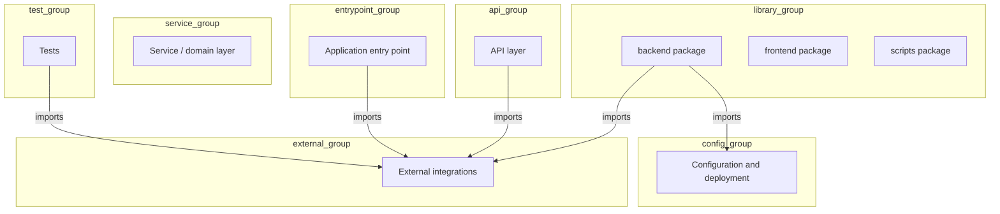

# Architecture report: abi/screenshot-to-code

> Automated static analysis. **Observed** = directly seen in files/imports/AST; **Inferred** = interpretation from that evidence. Repository code was not executed.

## 1. Repository at a glance

| Item | Value |
| --- | --- |
| Repository | abi/screenshot-to-code |
| Description | Drop in a screenshot and convert it to clean code (HTML/Tailwind/React/Vue) |
| Language | Python |
| Stars | 81207 |
| Licence | MIT |
| Analysed commit / branch | 0a77981c6eb4a4f4450690f21e4addc93522da9e / main |
| Framework(s) | FastAPI, React, Starlette |
| Files analysed | 301 |
| Components | 9 |

## 2. Architecture in one minute

abi/screenshot-to-code - Drop in a screenshot and convert it to clean code (HTML/Tailwind/React/Vue). This repository was analysed statically from 301 file(s) (135 Python). Detected technologies (observed from imports/manifests): SQLite, FastAPI, React, Starlette, aiohttp, httpx. Files are grouped into 9 component(s): API layer, backend package, Configuration and deployment, Application entry point, External integrations, frontend package, scripts package, Service / domain layer. Observed entry point(s): backend/evals/asset_extraction_benchmark.py, backend/main.py, backend/run_evals.py. Findings below distinguish observed facts from inferred interpretation.

## 3. High-level block diagram

## 4. Main components

### API layer (`api_layer`)

- **Kind:** api
- **Status:** Observed
- **Confidence:** 0.85
- **Responsibility:** Groups 11 file(s) under api layer (observed from repository paths and static analysis). Observed routes: GET /agent-runs, GET /agent-runs/{run_id}, GET /agent-runs/{run_id}/output, GET /agent-runs/{run_id}/assets/{filename}, POST /agent-runs/prune. Observed top-level classes: AgentRunDetailResponse, AgentRunListResponse, AgentRunSummary, AgenticGenerationStage, AssetCandidate, BestOfNEvalsResponse. Observed top-level functions: _count_eval_files, _default_models_for_set, _directory_size_bytes, _fetch_run, _is_stale_running, _load_openai_input_compare_payload.
- **Paths:** `backend/routes/agent_runs.py`, `backend/routes/capabilities.py`, `backend/routes/design_systems.py`, `backend/routes/eval_sets.py`, `backend/routes/evals.py`, `backend/routes/export.py`, `backend/routes/generate_code.py`, `backend/routes/home.py`, `backend/routes/model_choice_sets.py`, `backend/routes/prompt_reports.py`, `backend/routes/screenshot.py`
- **Evidence:** [backend/routes/agent_runs.py:64](https://github.com/abi/screenshot-to-code/blob/0a77981c6eb4a4f4450690f21e4addc93522da9e/backend/routes/agent_runs.py#L64); [backend/routes/capabilities.py:9](https://github.com/abi/screenshot-to-code/blob/0a77981c6eb4a4f4450690f21e4addc93522da9e/backend/routes/capabilities.py#L9); [backend/routes/design_systems.py:14](https://github.com/abi/screenshot-to-code/blob/0a77981c6eb4a4f4450690f21e4addc93522da9e/backend/routes/design_systems.py#L14); [backend/routes/eval_sets.py:23](https://github.com/abi/screenshot-to-code/blob/0a77981c6eb4a4f4450690f21e4addc93522da9e/backend/routes/eval_sets.py#L23); [backend/routes/evals.py:28](https://github.com/abi/screenshot-to-code/blob/0a77981c6eb4a4f4450690f21e4addc93522da9e/backend/routes/evals.py#L28); [backend/routes/export.py:62](https://github.com/abi/screenshot-to-code/blob/0a77981c6eb4a4f4450690f21e4addc93522da9e/backend/routes/export.py#L62); [backend/routes/generate_code.py:87](https://github.com/abi/screenshot-to-code/blob/0a77981c6eb4a4f4450690f21e4addc93522da9e/backend/routes/generate_code.py#L87); [backend/routes/home.py:8](https://github.com/abi/screenshot-to-code/blob/0a77981c6eb4a4f4450690f21e4addc93522da9e/backend/routes/home.py#L8)

### backend package (`backend`)

- **Kind:** library
- **Status:** Observed
- **Confidence:** 0.85
- **Responsibility:** Groups 76 file(s) under backend package (observed from repository paths and static analysis). Observed top-level classes: Agent, AgentEngine, AgentFileState, AgentRunRecorder, AgentToolRuntime, AnthropicParseState. Observed top-level functions: _activate_in_transaction, _anthropic_image_blocks, _append_dict_path, _append_list_path, _as_json_dict, _as_json_list.
- **Paths:** `backend/agent/engine.py`, `backend/agent/providers/__init__.py`, `backend/agent/providers/anthropic/__init__.py`, `backend/agent/providers/anthropic/image.py`, `backend/agent/providers/anthropic/provider.py`, `backend/agent/providers/base.py`, `backend/agent/providers/factory.py`, `backend/agent/providers/gemini.py`, `backend/agent/providers/openai.py`, `backend/agent/providers/types.py`, `backend/agent/runner.py`, `backend/agent/state.py`, `backend/agent/tools/__init__.py`, `backend/agent/tools/definitions.py`, `backend/agent/tools/extract_assets.py`, `backend/agent/tools/local_assets.py`, `backend/agent/tools/parsing.py`, `backend/agent/tools/runtime.py`, `backend/agent/tools/screenshot_preview.py`, `backend/agent/tools/summaries.py`, `backend/agent/tools/types.py`, `backend/asset_extraction.py`, `backend/babel_cdn.py`, `backend/codegen/__init__.py`, `backend/codegen/utils.py`, `backend/costs/__init__.py`, `backend/costs/pricing.py`, `backend/costs/token_usage.py`, `backend/custom_types.py`, `backend/debug/DebugFileWriter.py`, `backend/debug/__init__.py`, `backend/evals/__init__.py`, `backend/evals/core.py`, `backend/evals/runner.py`, `backend/evals/sessions.py`, `backend/evals/sets.py`, `backend/evals/utils.py`, `backend/fs_logging/__init__.py`, `backend/fs_logging/agent_runs.py`, `backend/fs_logging/openai_input_compare.py`, `backend/fs_logging/openai_input_formatting.py`, `backend/fs_logging/prompt_reports.py`, `backend/image_generation/__init__.py`, `backend/image_generation/core.py`, `backend/image_generation/generation.py`, `backend/image_generation/replicate.py`, `backend/llm.py`, `backend/preview_screenshot/__init__.py`, `backend/preview_screenshot/base.py`, `backend/preview_screenshot/playwright_backend.py`, `backend/preview_screenshot/registry.py`, `backend/prompts/__init__.py`, `backend/prompts/create/__init__.py`, `backend/prompts/create/image.py`, `backend/prompts/create/text.py`, `backend/prompts/create/video.py`, `backend/prompts/design_system.py`, `backend/prompts/message_builder.py`, `backend/prompts/pipeline.py`, `backend/prompts/plan.py`, `backend/prompts/policies.py`, `backend/prompts/prompt_types.py`, `backend/prompts/request_parsing.py`, `backend/prompts/system_prompt.py`, `backend/prompts/update/__init__.py`, `backend/prompts/update/from_file_snapshot.py`, `backend/prompts/update/from_history.py`, `backend/uploaded_assets/__init__.py`, `backend/uploaded_assets/prompts.py`, `backend/uploaded_assets/store.py`, `backend/uploaded_assets/tools.py`, `backend/utils.py`, `backend/video/__init__.py`, `backend/video/utils.py`, `backend/ws/__init__.py`, `backend/ws/constants.py`
- **Evidence:** [backend/agent/engine.py:25](https://github.com/abi/screenshot-to-code/blob/0a77981c6eb4a4f4450690f21e4addc93522da9e/backend/agent/engine.py#L25); [backend/agent/providers/__init__.py](https://github.com/abi/screenshot-to-code/blob/0a77981c6eb4a4f4450690f21e4addc93522da9e/backend/agent/providers/__init__.py); [backend/agent/providers/anthropic/__init__.py](https://github.com/abi/screenshot-to-code/blob/0a77981c6eb4a4f4450690f21e4addc93522da9e/backend/agent/providers/anthropic/__init__.py); [backend/agent/providers/anthropic/image.py:49](https://github.com/abi/screenshot-to-code/blob/0a77981c6eb4a4f4450690f21e4addc93522da9e/backend/agent/providers/anthropic/image.py#L49); [backend/agent/providers/anthropic/provider.py:81](https://github.com/abi/screenshot-to-code/blob/0a77981c6eb4a4f4450690f21e4addc93522da9e/backend/agent/providers/anthropic/provider.py#L81); [backend/agent/providers/base.py:15](https://github.com/abi/screenshot-to-code/blob/0a77981c6eb4a4f4450690f21e4addc93522da9e/backend/agent/providers/base.py#L15); [backend/agent/providers/factory.py:19](https://github.com/abi/screenshot-to-code/blob/0a77981c6eb4a4f4450690f21e4addc93522da9e/backend/agent/providers/factory.py#L19); [backend/agent/providers/gemini.py:32](https://github.com/abi/screenshot-to-code/blob/0a77981c6eb4a4f4450690f21e4addc93522da9e/backend/agent/providers/gemini.py#L32)

### Configuration and deployment (`config`)

- **Kind:** config
- **Status:** Observed
- **Confidence:** 0.85
- **Responsibility:** Groups 21 file(s) under configuration and deployment (observed from repository paths and static analysis).
- **Paths:** `backend/.pre-commit-config.yaml`, `backend/Dockerfile`, `backend/config.py`, `backend/evals/config.py`, `backend/pyproject.toml`, `backend/pyrightconfig.json`, `backend/pytest.ini`, `docker-compose.yml`, `frontend/.env.example`, `frontend/Dockerfile`, `frontend/components.json`, `frontend/package.json`, `frontend/src/components/settings/DesignSystemSelector.tsx`, `frontend/src/components/settings/DesignSystemsManager.tsx`, `frontend/src/components/settings/DesignSystemsModal.tsx`, `frontend/src/components/settings/GenerationSettings.tsx`, `frontend/src/components/settings/OutputSettingsSection.tsx`, `frontend/src/components/settings/SettingsTab.tsx`, `frontend/tsconfig.json`, `frontend/tsconfig.node.json`, `package.json`
- **Evidence:** [backend/.pre-commit-config.yaml](https://github.com/abi/screenshot-to-code/blob/0a77981c6eb4a4f4450690f21e4addc93522da9e/backend/.pre-commit-config.yaml); [backend/Dockerfile](https://github.com/abi/screenshot-to-code/blob/0a77981c6eb4a4f4450690f21e4addc93522da9e/backend/Dockerfile); [backend/config.py](https://github.com/abi/screenshot-to-code/blob/0a77981c6eb4a4f4450690f21e4addc93522da9e/backend/config.py); [backend/evals/config.py](https://github.com/abi/screenshot-to-code/blob/0a77981c6eb4a4f4450690f21e4addc93522da9e/backend/evals/config.py); [backend/pyproject.toml](https://github.com/abi/screenshot-to-code/blob/0a77981c6eb4a4f4450690f21e4addc93522da9e/backend/pyproject.toml); [backend/pyrightconfig.json](https://github.com/abi/screenshot-to-code/blob/0a77981c6eb4a4f4450690f21e4addc93522da9e/backend/pyrightconfig.json); [backend/pytest.ini](https://github.com/abi/screenshot-to-code/blob/0a77981c6eb4a4f4450690f21e4addc93522da9e/backend/pytest.ini); [docker-compose.yml](https://github.com/abi/screenshot-to-code/blob/0a77981c6eb4a4f4450690f21e4addc93522da9e/docker-compose.yml)

### Application entry point (`entrypoint`)

- **Kind:** entrypoint
- **Status:** Observed
- **Confidence:** 0.85
- **Responsibility:** Groups 5 file(s) under application entry point (observed from repository paths and static analysis). Observed application object created via FastAPI. Observed top-level classes: BenchmarkFixture, BenchmarkTarget, EvalResult, PromptItem. Observed top-level functions: _build_first_screenshot, _build_second_screenshot, _decode_crop, _draw_star, _evaluate_profile, _font.
- **Paths:** `backend/evals/asset_extraction_benchmark.py`, `backend/main.py`, `backend/run_evals.py`, `backend/run_image_generation_evals.py`, `backend/start.py`
- **Evidence:** [backend/evals/asset_extraction_benchmark.py:48](https://github.com/abi/screenshot-to-code/blob/0a77981c6eb4a4f4450690f21e4addc93522da9e/backend/evals/asset_extraction_benchmark.py#L48); [backend/main.py:24](https://github.com/abi/screenshot-to-code/blob/0a77981c6eb4a4f4450690f21e4addc93522da9e/backend/main.py#L24); [backend/run_evals.py:10](https://github.com/abi/screenshot-to-code/blob/0a77981c6eb4a4f4450690f21e4addc93522da9e/backend/run_evals.py#L10); [backend/run_image_generation_evals.py:25](https://github.com/abi/screenshot-to-code/blob/0a77981c6eb4a4f4450690f21e4addc93522da9e/backend/run_image_generation_evals.py#L25); [backend/start.py:7](https://github.com/abi/screenshot-to-code/blob/0a77981c6eb4a4f4450690f21e4addc93522da9e/backend/start.py#L7)

### External integrations (`external_integrations`)

- **Kind:** external
- **Status:** Inferred
- **Confidence:** 0.70
- **Responsibility:** Groups 0 file(s) under external integrations (observed from repository paths and static analysis).
- **Evidence:** [backend/agent/providers/gemini.py:6](https://github.com/abi/screenshot-to-code/blob/0a77981c6eb4a4f4450690f21e4addc93522da9e/backend/agent/providers/gemini.py#L6); [backend/evals/sessions.py:14](https://github.com/abi/screenshot-to-code/blob/0a77981c6eb4a4f4450690f21e4addc93522da9e/backend/evals/sessions.py#L14); [backend/fs_logging/agent_runs.py:32](https://github.com/abi/screenshot-to-code/blob/0a77981c6eb4a4f4450690f21e4addc93522da9e/backend/fs_logging/agent_runs.py#L32); [backend/fs_logging/agent_runs.py:688](https://github.com/abi/screenshot-to-code/blob/0a77981c6eb4a4f4450690f21e4addc93522da9e/backend/fs_logging/agent_runs.py#L688); [backend/fs_logging/agent_runs.py:923](https://github.com/abi/screenshot-to-code/blob/0a77981c6eb4a4f4450690f21e4addc93522da9e/backend/fs_logging/agent_runs.py#L923); [backend/image_generation/replicate.py:2](https://github.com/abi/screenshot-to-code/blob/0a77981c6eb4a4f4450690f21e4addc93522da9e/backend/image_generation/replicate.py#L2)

### frontend package (`frontend`)

- **Kind:** library
- **Status:** Observed
- **Confidence:** 0.85
- **Responsibility:** Groups 109 file(s) under frontend package (observed from repository paths and static analysis).
- **Paths:** `frontend/.eslintrc.cjs`, `frontend/jest.config.js`, `frontend/postcss.config.js`, `frontend/src/App.tsx`, `frontend/src/components/ImageLightbox.tsx`, `frontend/src/components/ImportCodeSection.tsx`, `frontend/src/components/TermsOfServiceDialog.tsx`, `frontend/src/components/UpdateImageUpload.tsx`, `frontend/src/components/agent/AgentActivity.tsx`, `frontend/src/components/agent/activity-order.test.ts`, `frontend/src/components/agent/activity-order.ts`, `frontend/src/components/agent/generation-time.test.ts`, `frontend/src/components/agent/generation-time.ts`, `frontend/src/components/commits/types.ts`, `frontend/src/components/commits/utils.ts`, `frontend/src/components/evals/AgentRunsPage.tsx`, `frontend/src/components/evals/AllEvalsPage.tsx`, `frontend/src/components/evals/BestOfNEvalsPage.tsx`, `frontend/src/components/evals/EvalComparePage.tsx`, `frontend/src/components/evals/EvalNavigation.tsx`, `frontend/src/components/evals/EvalSessionsPage.tsx`, `frontend/src/components/evals/InputFileSelector.tsx`, `frontend/src/components/evals/OpenAIInputComparePage.tsx`, `frontend/src/components/evals/PromptReportsPage.tsx`, `frontend/src/components/evals/RatingPicker.tsx`, `frontend/src/components/evals/RunEvalsPage.tsx`, `frontend/src/components/evals/agent-run-timeline.tsx`, `frontend/src/components/evals/agent-run-tool-preview.tsx`, `frontend/src/components/evals/image-lightbox.tsx`, `frontend/src/components/evals/report-format.ts`, `frontend/src/components/evals/report-json.tsx`, `frontend/src/components/generate-from-text/GenerateFromText.tsx`, `frontend/src/components/history/HistoryDisplay.tsx`, `frontend/src/components/history/utils.test.ts`, `frontend/src/components/history/utils.ts`, `frontend/src/components/messages/OnboardingNote.tsx`, `frontend/src/components/messages/TipLink.tsx`, `frontend/src/components/preview/CodeMirror.tsx`, `frontend/src/components/preview/CodePreview.tsx`, `frontend/src/components/preview/CodeTab.tsx`, `frontend/src/components/preview/ImageScanningPreview.tsx`, `frontend/src/components/preview/PreviewComponent.tsx`, `frontend/src/components/preview/PreviewPane.tsx`, `frontend/src/components/preview/download.ts`, `frontend/src/components/preview/extractHtml.ts`, `frontend/src/components/preview/simpleHash.ts`, `frontend/src/components/recording/ScreenRecorder.tsx`, `frontend/src/components/recording/utils.ts`, `frontend/src/components/select-and-edit/SelectAndEditControls.tsx`, `frontend/src/components/select-and-edit/overlays.test.ts`, `frontend/src/components/select-and-edit/overlays.ts`, `frontend/src/components/select-and-edit/useEscapeToExitSelectMode.ts`, `frontend/src/components/select-and-edit/utils.test.ts`, `frontend/src/components/select-and-edit/utils.ts`, `frontend/src/components/sidebar/IconStrip.tsx`, `frontend/src/components/sidebar/Sidebar.tsx`, `frontend/src/components/start-pane/StartPane.tsx`, `frontend/src/components/thinking/ThinkingIndicator.tsx`, `frontend/src/components/ui/accordion.tsx`, `frontend/src/components/ui/alert-dialog.tsx`, `frontend/src/components/ui/badge.tsx`, `frontend/src/components/ui/button.tsx`, `frontend/src/components/ui/checkbox.tsx`, `frontend/src/components/ui/collapsible.tsx`, `frontend/src/components/ui/dialog.tsx`, `frontend/src/components/ui/hover-card.tsx`, `frontend/src/components/ui/input.tsx`, `frontend/src/components/ui/label.tsx`, `frontend/src/components/ui/popover.tsx`, `frontend/src/components/ui/progress.tsx`, `frontend/src/components/ui/scroll-area.tsx`, `frontend/src/components/ui/select.tsx`, `frontend/src/components/ui/separator.tsx`, `frontend/src/components/ui/switch.tsx`, `frontend/src/components/ui/tabs.tsx`, `frontend/src/components/ui/textarea.tsx`, `frontend/src/components/unified-input/ScreenshotToCodeControls.tsx`, `frontend/src/components/unified-input/UnifiedInputPane.tsx`, `frontend/src/components/unified-input/tabs/ImportTab.tsx`, `frontend/src/components/unified-input/tabs/TextTab.tsx`, `frontend/src/components/unified-input/tabs/UploadTab.tsx`, `frontend/src/components/unified-input/tabs/UrlTab.tsx`, `frontend/src/components/variants/Variants.tsx`, `frontend/src/config.ts`, `frontend/src/constants.ts`, `frontend/src/generateCode.ts`, `frontend/src/hooks/useBrowserTabIndicator.ts`, `frontend/src/hooks/useDesignSystems.ts`, `frontend/src/hooks/usePersistedState.ts`, `frontend/src/hooks/useThrottle.ts`, `frontend/src/lib/babelCdn.ts`, `frontend/src/lib/design-systems.ts`, `frontend/src/lib/models.test.ts`, `frontend/src/lib/models.ts`, `frontend/src/lib/prompt-history.test.ts`, `frontend/src/lib/prompt-history.ts`, `frontend/src/lib/stacks.ts`, `frontend/src/lib/takeScreenshot.ts`, `frontend/src/lib/utils.ts`, `frontend/src/main.tsx`, `frontend/src/setupTests.ts`, `frontend/src/store/app-store.ts`, `frontend/src/store/project-store.test.ts`, `frontend/src/store/project-store.ts`, `frontend/src/types.ts`, `frontend/src/urls.ts`, `frontend/src/vite-env.d.ts`, `frontend/tailwind.config.js`, `frontend/vite.config.ts`
- **Evidence:** [frontend/.eslintrc.cjs](https://github.com/abi/screenshot-to-code/blob/0a77981c6eb4a4f4450690f21e4addc93522da9e/frontend/.eslintrc.cjs); [frontend/jest.config.js](https://github.com/abi/screenshot-to-code/blob/0a77981c6eb4a4f4450690f21e4addc93522da9e/frontend/jest.config.js); [frontend/postcss.config.js](https://github.com/abi/screenshot-to-code/blob/0a77981c6eb4a4f4450690f21e4addc93522da9e/frontend/postcss.config.js); [frontend/src/App.tsx](https://github.com/abi/screenshot-to-code/blob/0a77981c6eb4a4f4450690f21e4addc93522da9e/frontend/src/App.tsx); [frontend/src/components/ImageLightbox.tsx](https://github.com/abi/screenshot-to-code/blob/0a77981c6eb4a4f4450690f21e4addc93522da9e/frontend/src/components/ImageLightbox.tsx); [frontend/src/components/ImportCodeSection.tsx](https://github.com/abi/screenshot-to-code/blob/0a77981c6eb4a4f4450690f21e4addc93522da9e/frontend/src/components/ImportCodeSection.tsx); [frontend/src/components/TermsOfServiceDialog.tsx](https://github.com/abi/screenshot-to-code/blob/0a77981c6eb4a4f4450690f21e4addc93522da9e/frontend/src/components/TermsOfServiceDialog.tsx); [frontend/src/components/UpdateImageUpload.tsx](https://github.com/abi/screenshot-to-code/blob/0a77981c6eb4a4f4450690f21e4addc93522da9e/frontend/src/components/UpdateImageUpload.tsx)

### scripts package (`scripts`)

- **Kind:** library
- **Status:** Observed
- **Confidence:** 0.85
- **Responsibility:** Groups 1 file(s) under scripts package (observed from repository paths and static analysis).
- **Paths:** `scripts/cursor-cloud-install.sh`
- **Evidence:** [scripts/cursor-cloud-install.sh](https://github.com/abi/screenshot-to-code/blob/0a77981c6eb4a4f4450690f21e4addc93522da9e/scripts/cursor-cloud-install.sh)

### Service / domain layer (`service_layer`)

- **Kind:** service
- **Status:** Observed
- **Confidence:** 0.85
- **Responsibility:** Groups 4 file(s) under service / domain layer (observed from repository paths and static analysis).
- **Paths:** `frontend/src/components/core/KeyboardShortcutBadge.tsx`, `frontend/src/components/core/Spinner.tsx`, `frontend/src/components/core/StackLabel.tsx`, `frontend/src/components/core/WorkingPulse.tsx`
- **Evidence:** [frontend/src/components/core/KeyboardShortcutBadge.tsx](https://github.com/abi/screenshot-to-code/blob/0a77981c6eb4a4f4450690f21e4addc93522da9e/frontend/src/components/core/KeyboardShortcutBadge.tsx); [frontend/src/components/core/Spinner.tsx](https://github.com/abi/screenshot-to-code/blob/0a77981c6eb4a4f4450690f21e4addc93522da9e/frontend/src/components/core/Spinner.tsx); [frontend/src/components/core/StackLabel.tsx](https://github.com/abi/screenshot-to-code/blob/0a77981c6eb4a4f4450690f21e4addc93522da9e/frontend/src/components/core/StackLabel.tsx); [frontend/src/components/core/WorkingPulse.tsx](https://github.com/abi/screenshot-to-code/blob/0a77981c6eb4a4f4450690f21e4addc93522da9e/frontend/src/components/core/WorkingPulse.tsx)

### Tests (`tests`)

- **Kind:** test
- **Status:** Observed
- **Confidence:** 0.85
- **Responsibility:** Groups 43 file(s) under tests (observed from repository paths and static analysis). Observed top-level classes: ExpectedResult, NoToolProviderSession, TestAccumulate, TestAnthropicExtract, TestCacheHitRate, TestCost. Observed top-level functions: _active_count, _anthropic_message, _data_url, _data_url_size, _db_row, _decode_png_data_url.
- **Paths:** `backend/codegen/test_utils.py`, `backend/tests/__init__.py`, `backend/tests/test_agent_engine.py`, `backend/tests/test_agent_runs.py`, `backend/tests/test_agent_tool_runtime.py`, `backend/tests/test_agent_tools.py`, `backend/tests/test_anthropic_many_image_limit.py`, `backend/tests/test_anthropic_provider_config.py`, `backend/tests/test_asset_extraction.py`, `backend/tests/test_asset_extraction_benchmark.py`, `backend/tests/test_babel_cdn.py`, `backend/tests/test_batching.py`, `backend/tests/test_capabilities.py`, `backend/tests/test_codegen_utils.py`, `backend/tests/test_design_systems.py`, `backend/tests/test_eval_runner.py`, `backend/tests/test_eval_sessions.py`, `backend/tests/test_eval_sets.py`, `backend/tests/test_evals_openai_input_compare.py`, `backend/tests/test_export.py`, `backend/tests/test_gemini_provider_config.py`, `backend/tests/test_gemini_provider_session.py`, `backend/tests/test_image_generation_replicate.py`, `backend/tests/test_local_assets.py`, `backend/tests/test_model_selection.py`, `backend/tests/test_openai_input_compare.py`, `backend/tests/test_openai_provider_session.py`, `backend/tests/test_openai_reasoning_parser.py`, `backend/tests/test_parameter_extraction_stage.py`, `backend/tests/test_prompt_reports.py`, `backend/tests/test_prompt_summary.py`, `backend/tests/test_prompts.py`, `backend/tests/test_request_parsing.py`, `backend/tests/test_screenshot.py`, `backend/tests/test_start.py`, `backend/tests/test_status_broadcast.py`, `backend/tests/test_token_usage.py`, `backend/tests/test_tool_image_outputs.py`, `backend/tests/test_update_from_file_snapshot.py`, `backend/tests/test_uploaded_assets.py`, `backend/tests/test_websocket_communicator.py`, `frontend/src/tests/fixtures/simple_page.html`, `frontend/src/tests/qa.test.ts`
- **Evidence:** [backend/codegen/test_utils.py:5](https://github.com/abi/screenshot-to-code/blob/0a77981c6eb4a4f4450690f21e4addc93522da9e/backend/codegen/test_utils.py#L5); [backend/tests/__init__.py](https://github.com/abi/screenshot-to-code/blob/0a77981c6eb4a4f4450690f21e4addc93522da9e/backend/tests/__init__.py); [backend/tests/test_agent_engine.py:11](https://github.com/abi/screenshot-to-code/blob/0a77981c6eb4a4f4450690f21e4addc93522da9e/backend/tests/test_agent_engine.py#L11); [backend/tests/test_agent_runs.py:22](https://github.com/abi/screenshot-to-code/blob/0a77981c6eb4a4f4450690f21e4addc93522da9e/backend/tests/test_agent_runs.py#L22); [backend/tests/test_agent_tool_runtime.py:13](https://github.com/abi/screenshot-to-code/blob/0a77981c6eb4a4f4450690f21e4addc93522da9e/backend/tests/test_agent_tool_runtime.py#L13); [backend/tests/test_agent_tools.py:13](https://github.com/abi/screenshot-to-code/blob/0a77981c6eb4a4f4450690f21e4addc93522da9e/backend/tests/test_agent_tools.py#L13); [backend/tests/test_anthropic_many_image_limit.py:16](https://github.com/abi/screenshot-to-code/blob/0a77981c6eb4a4f4450690f21e4addc93522da9e/backend/tests/test_anthropic_many_image_limit.py#L16); [backend/tests/test_anthropic_provider_config.py:9](https://github.com/abi/screenshot-to-code/blob/0a77981c6eb4a4f4450690f21e4addc93522da9e/backend/tests/test_anthropic_provider_config.py#L9)

## 5. Execution flow

**Observed** entry point(s):

- [backend/evals/asset_extraction_benchmark.py:864](https://github.com/abi/screenshot-to-code/blob/0a77981c6eb4a4f4450690f21e4addc93522da9e/backend/evals/asset_extraction_benchmark.py#L864)
- [backend/main.py:24](https://github.com/abi/screenshot-to-code/blob/0a77981c6eb4a4f4450690f21e4addc93522da9e/backend/main.py#L24)
- [backend/run_evals.py:14](https://github.com/abi/screenshot-to-code/blob/0a77981c6eb4a4f4450690f21e4addc93522da9e/backend/run_evals.py#L14)
- [backend/run_image_generation_evals.py:305](https://github.com/abi/screenshot-to-code/blob/0a77981c6eb4a4f4450690f21e4addc93522da9e/backend/run_image_generation_evals.py#L305)
- [backend/start.py:29](https://github.com/abi/screenshot-to-code/blob/0a77981c6eb4a4f4450690f21e4addc93522da9e/backend/start.py#L29)
- [frontend/src/App.tsx](https://github.com/abi/screenshot-to-code/blob/0a77981c6eb4a4f4450690f21e4addc93522da9e/frontend/src/App.tsx)
- [frontend/src/main.tsx](https://github.com/abi/screenshot-to-code/blob/0a77981c6eb4a4f4450690f21e4addc93522da9e/frontend/src/main.tsx)

**Observed** routes (from decorators):

- `GET /agent-runs` -> `list_agent_runs` in `backend/routes/agent_runs.py:154`
- `GET /agent-runs/{run_id}` -> `get_agent_run` in `backend/routes/agent_runs.py:179`
- `GET /agent-runs/{run_id}/output` -> `get_agent_run_output` in `backend/routes/agent_runs.py:203`
- `GET /agent-runs/{run_id}/assets/{filename}` -> `get_agent_run_asset` in `backend/routes/agent_runs.py:215`
- `POST /agent-runs/prune` -> `prune_agent_runs` in `backend/routes/agent_runs.py:229`
- `GET /api/capabilities` -> `get_capabilities` in `backend/routes/capabilities.py:14`
- `GET /api/design-systems` -> `list_design_systems` in `backend/routes/design_systems.py:105`
- `POST /api/design-systems` -> `create_design_system` in `backend/routes/design_systems.py:110`
- `PATCH /api/design-systems/{design_system_id}` -> `update_design_system` in `backend/routes/design_systems.py:126`
- `DELETE /api/design-systems/{design_system_id}` -> `delete_design_system` in `backend/routes/design_systems.py:153`
- `GET /eval-sets` -> `list_eval_sets` in `backend/routes/eval_sets.py:145`
- `GET /eval-sets/{set_name}` -> `get_eval_set` in `backend/routes/eval_sets.py:150`
- `GET /eval-sets/{set_name}/images/{filename}` -> `get_eval_set_image` in `backend/routes/eval_sets.py:185`
- `GET /eval-sessions` -> `list_eval_sessions` in `backend/routes/eval_sets.py:198`
- `GET /eval-sessions/active` -> `get_active_eval_session` in `backend/routes/eval_sets.py:208`
- `POST /eval-sessions` -> `create_eval_session` in `backend/routes/eval_sets.py:214`
- `POST /eval-sessions/{session_id}/activate` -> `activate_eval_session` in `backend/routes/eval_sets.py:230`
- `GET /eval-sessions/{session_id}/matrix` -> `get_session_matrix` in `backend/routes/eval_sets.py:251`
- `PUT /eval-sessions/{session_id}/model-order` -> `set_session_model_order` in `backend/routes/eval_sets.py:387`
- `PUT /eval-sessions/{session_id}/model-notes` -> `set_session_model_notes` in `backend/routes/eval_sets.py:397`
- `GET /eval_input_files` -> `get_eval_input_files` in `backend/routes/evals.py:39`
- `GET /evals` -> `get_evals` in `backend/routes/evals.py:56`
- `POST /openai-input-compare` -> `compare_openai_inputs_for_evals` in `backend/routes/evals.py:198`
- `POST /run_evals` -> `run_evals` in `backend/routes/evals.py:226`
- `POST /run_evals_stream` -> `run_evals_stream` in `backend/routes/evals.py:264`
- `GET /models` -> `get_models` in `backend/routes/evals.py:386`
- `GET /best-of-n-evals` -> `get_best_of_n_evals` in `backend/routes/evals.py:401`
- `GET /output_folders` -> `get_output_folders` in `backend/routes/evals.py:486`
- `POST /api/export` -> `export_code` in `backend/routes/export.py:453`
- `GET /` -> `get_status` in `backend/routes/home.py:8`
- `GET /prompt-reports` -> `list_prompt_reports` in `backend/routes/prompt_reports.py:125`
- `GET /prompt-reports/content` -> `get_prompt_report_content` in `backend/routes/prompt_reports.py:152`
- `POST /prompt-reports/prune` -> `prune_prompt_reports` in `backend/routes/prompt_reports.py:168`
- `POST /api/screenshot` -> `app_screenshot` in `backend/routes/screenshot.py:86`

Representative flow (derived from observed entry points and the import graph; steps beyond the entry point are **Inferred**):

1. Execution starts at an observed entry point listed above, if present.
2. `api_layer` imports `external_integrations` (API layer -> External integrations).
3. `backend` imports `config` (backend package -> Configuration and deployment).
4. `backend` imports `external_integrations` (backend package -> External integrations).
5. `entrypoint` imports `external_integrations` (Application entry point -> External integrations).
6. `tests` imports `external_integrations` (Tests -> External integrations).

## 6. Project structure

### `(root)`

- `.gitattributes` - other (66 bytes)
- `.gitignore` - other (339 bytes)
- `AGENTS.md` - docs (3383 bytes)
- `Evaluation.md` - docs (1193 bytes)
- `LICENSE` - docs (1065 bytes)
- `QA.md` - docs (1896 bytes)
- `README.md` - docs (7373 bytes)
- `TESTING.md` - docs (1793 bytes)
- `Troubleshooting.md` - docs (1851 bytes)
- `docker-compose.yml` - container (609 bytes)
- `package.json` - manifest (368 bytes)
- `plan.md` - docs (5056 bytes)

### `.claude`

- `.claude/launch.json` - config (530 bytes)

### `.github`

- `.github/FUNDING.yml` - config (14 bytes)
- `.github/ISSUE_TEMPLATE/bug_report.md` - docs (416 bytes)
- `.github/ISSUE_TEMPLATE/custom.md` - docs (126 bytes)
- `.github/ISSUE_TEMPLATE/feature_request.md` - docs (595 bytes)

### `.vscode`

- `.vscode/settings.json` - config (149 bytes)

### `.zed`

- `.zed/tasks.json` - config (632 bytes)

### `backend`

- `backend/.gitignore` - other (2860 bytes)
- `backend/.pre-commit-config.yaml` - config (805 bytes)
- `backend/Dockerfile` - container (601 bytes)
- `backend/README.md` - docs (260 bytes)
- `backend/agent/engine.py` - source, Python (15267 bytes)
- `backend/agent/providers/__init__.py` - source, Python (806 bytes)
- `backend/agent/providers/anthropic/__init__.py` - source, Python (254 bytes)
- `backend/agent/providers/anthropic/image.py` - source, Python (3998 bytes)
- `backend/agent/providers/anthropic/provider.py` - source, Python (18656 bytes)
- `backend/agent/providers/base.py` - source, Python (1257 bytes)
- `backend/agent/providers/factory.py` - source, Python (3093 bytes)
- `backend/agent/providers/gemini.py` - source, Python (15235 bytes)
- `backend/agent/providers/openai.py` - source, Python (22967 bytes)
- `backend/agent/providers/types.py` - source, Python (297 bytes)
- `backend/agent/runner.py` - source, Python (74 bytes)
- `backend/agent/state.py` - source, Python (1903 bytes)
- `backend/agent/tools/__init__.py` - source, Python (728 bytes)
- `backend/agent/tools/definitions.py` - source, Python (10480 bytes)
- `backend/agent/tools/extract_assets.py` - source, Python (8621 bytes)
- `backend/agent/tools/local_assets.py` - source, Python (2622 bytes)
- `backend/agent/tools/parsing.py` - source, Python (2826 bytes)
- `backend/agent/tools/runtime.py` - source, Python (22555 bytes)
- `backend/agent/tools/screenshot_preview.py` - source, Python (3439 bytes)
- `backend/agent/tools/summaries.py` - source, Python (3706 bytes)
- `backend/agent/tools/types.py` - source, Python (1859 bytes)
- `backend/asset_extraction.py` - source, Python (16008 bytes)
- `backend/babel_cdn.py` - source, Python (1167 bytes)
- `backend/codegen/__init__.py` - source, Python (0 bytes)
- `backend/codegen/test_utils.py` - test, Python (2328 bytes)
- `backend/codegen/utils.py` - source, Python (1048 bytes)
- `backend/config.py` - source, Python (1478 bytes)
- `backend/costs/__init__.py` - source, Python (255 bytes)
- `backend/costs/pricing.py` - source, Python (2710 bytes)
- `backend/costs/token_usage.py` - source, Python (2448 bytes)
- `backend/custom_types.py` - source, Python (90 bytes)
- `backend/debug/DebugFileWriter.py` - source, Python (987 bytes)
- `backend/debug/__init__.py` - source, Python (0 bytes)
- `backend/evals/__init__.py` - source, Python (0 bytes)
- `backend/evals/asset_extraction_benchmark.py` - source, Python (33650 bytes)
- `backend/evals/config.py` - source, Python (67 bytes)
- `backend/evals/core.py` - source, Python (3845 bytes)
- `backend/evals/runner.py` - source, Python (17508 bytes)
- `backend/evals/sessions.py` - source, Python (7091 bytes)
- `backend/evals/sets.py` - source, Python (9562 bytes)
- `backend/evals/utils.py` - source, Python (228 bytes)
- `backend/fs_logging/__init__.py` - source, Python (0 bytes)
- `backend/fs_logging/agent_runs.py` - source, Python (38862 bytes)
- `backend/fs_logging/openai_input_compare.py` - source, Python (8126 bytes)
- `backend/fs_logging/openai_input_formatting.py` - source, Python (7728 bytes)
- `backend/fs_logging/prompt_reports.py` - source, Python (5440 bytes)
- `backend/image_generation/__init__.py` - source, Python (0 bytes)
- `backend/image_generation/core.py` - source, Python (162 bytes)
- `backend/image_generation/generation.py` - source, Python (1913 bytes)
- `backend/image_generation/replicate.py` - source, Python (6150 bytes)
- `backend/llm.py` - source, Python (8893 bytes)
- `backend/main.py` - source, Python (1624 bytes)
- `backend/preview_screenshot/__init__.py` - source, Python (1002 bytes)
- `backend/preview_screenshot/base.py` - source, Python (983 bytes)
- `backend/preview_screenshot/playwright_backend.py` - source, Python (3192 bytes)
- `backend/preview_screenshot/registry.py` - source, Python (1903 bytes)
- `backend/prompts/__init__.py` - source, Python (84 bytes)
- `backend/prompts/create/__init__.py` - source, Python (1732 bytes)
- `backend/prompts/create/image.py` - source, Python (3238 bytes)
- `backend/prompts/create/text.py` - source, Python (1124 bytes)
- `backend/prompts/create/video.py` - source, Python (2301 bytes)
- `backend/prompts/design_system.py` - source, Python (328 bytes)
- `backend/prompts/message_builder.py` - source, Python (1670 bytes)
- `backend/prompts/pipeline.py` - source, Python (1699 bytes)
- `backend/prompts/plan.py` - source, Python (1033 bytes)
- `backend/prompts/policies.py` - source, Python (585 bytes)
- `backend/prompts/prompt_types.py` - source, Python (1212 bytes)
- `backend/prompts/request_parsing.py` - source, Python (1815 bytes)
- `backend/prompts/system_prompt.py` - source, Python (6263 bytes)
- `backend/prompts/update/__init__.py` - source, Python (259 bytes)
- `backend/prompts/update/from_file_snapshot.py` - source, Python (1978 bytes)
- `backend/prompts/update/from_history.py` - source, Python (2193 bytes)
- `backend/pyproject.toml` - manifest (779 bytes)
- `backend/pyrightconfig.json` - config (150 bytes)
- `backend/pytest.ini` - config (145 bytes)
- `backend/routes/agent_runs.py` - source, Python (8679 bytes)
- `backend/routes/capabilities.py` - source, Python (469 bytes)
- `backend/routes/design_systems.py` - source, Python (4862 bytes)
- `backend/routes/eval_sets.py` - source, Python (13199 bytes)
- `backend/routes/evals.py` - source, Python (18392 bytes)
- `backend/routes/export.py` - source, Python (14364 bytes)
- `backend/routes/generate_code.py` - source, Python (32701 bytes)
- `backend/routes/home.py` - source, Python (323 bytes)
- `backend/routes/model_choice_sets.py` - source, Python (1750 bytes)
- `backend/routes/prompt_reports.py` - source, Python (6666 bytes)
- `backend/routes/screenshot.py` - source, Python (3180 bytes)
- `backend/run_evals.py` - source, Python (239 bytes)
- `backend/run_image_generation_evals.py` - source, Python (9155 bytes)
- `backend/start.py` - source, Python (1224 bytes)
- `backend/tests/__init__.py` - test, Python (0 bytes)
- `backend/tests/test_agent_engine.py` - test, Python (3248 bytes)
- `backend/tests/test_agent_runs.py` - test, Python (32330 bytes)
- `backend/tests/test_agent_tool_runtime.py` - test, Python (17202 bytes)
- `backend/tests/test_agent_tools.py` - test, Python (11151 bytes)
- `backend/tests/test_anthropic_many_image_limit.py` - test, Python (4525 bytes)
- `backend/tests/test_anthropic_provider_config.py` - test, Python (1746 bytes)
- `backend/tests/test_asset_extraction.py` - test, Python (19426 bytes)
- `backend/tests/test_asset_extraction_benchmark.py` - test, Python (1714 bytes)
- `backend/tests/test_babel_cdn.py` - test, Python (1241 bytes)
- `backend/tests/test_batching.py` - test, Python (7251 bytes)
- `backend/tests/test_capabilities.py` - test, Python (902 bytes)
- `backend/tests/test_codegen_utils.py` - test, Python (303 bytes)
- `backend/tests/test_design_systems.py` - test, Python (1285 bytes)
- `backend/tests/test_eval_runner.py` - test, Python (1317 bytes)
- `backend/tests/test_eval_sessions.py` - test, Python (16479 bytes)
- `backend/tests/test_eval_sets.py` - test, Python (7339 bytes)
- `backend/tests/test_evals_openai_input_compare.py` - test, Python (1492 bytes)
- `backend/tests/test_export.py` - test, Python (2837 bytes)
- `backend/tests/test_gemini_provider_config.py` - test, Python (668 bytes)
- `backend/tests/test_gemini_provider_session.py` - test, Python (3129 bytes)
- `backend/tests/test_image_generation_replicate.py` - test, Python (4730 bytes)
- `backend/tests/test_local_assets.py` - test, Python (1875 bytes)
- `backend/tests/test_model_selection.py` - test, Python (7197 bytes)
- `backend/tests/test_openai_input_compare.py` - test, Python (3070 bytes)
- `backend/tests/test_openai_provider_session.py` - test, Python (15225 bytes)
- `backend/tests/test_openai_reasoning_parser.py` - test, Python (2609 bytes)
- `backend/tests/test_parameter_extraction_stage.py` - test, Python (3297 bytes)
- `backend/tests/test_prompt_reports.py` - test, Python (6990 bytes)
- `backend/tests/test_prompt_summary.py` - test, Python (5132 bytes)
- `backend/tests/test_prompts.py` - test, Python (33298 bytes)
- `backend/tests/test_request_parsing.py` - test, Python (2781 bytes)
- `backend/tests/test_screenshot.py` - test, Python (3004 bytes)
- `backend/tests/test_start.py` - test, Python (261 bytes)
- `backend/tests/test_status_broadcast.py` - test, Python (3364 bytes)
- `backend/tests/test_token_usage.py` - test, Python (10909 bytes)
- `backend/tests/test_tool_image_outputs.py` - test, Python (14320 bytes)
- `backend/tests/test_update_from_file_snapshot.py` - test, Python (1818 bytes)
- `backend/tests/test_uploaded_assets.py` - test, Python (4031 bytes)
- `backend/tests/test_websocket_communicator.py` - test, Python (2315 bytes)
- `backend/uploaded_assets/__init__.py` - source, Python (695 bytes)
- `backend/uploaded_assets/prompts.py` - source, Python (2357 bytes)
- `backend/uploaded_assets/store.py` - source, Python (8556 bytes)
- `backend/uploaded_assets/tools.py` - source, Python (4504 bytes)
- `backend/utils.py` - source, Python (7000 bytes)
- `backend/video/__init__.py` - source, Python (167 bytes)
- `backend/video/utils.py` - source, Python (812 bytes)
- `backend/ws/__init__.py` - source, Python (0 bytes)
- `backend/ws/constants.py` - source, Python (129 bytes)

### `blog`

- `blog/evaluating-claude.md` - docs (5101 bytes)

### `design-docs`

- `design-docs/agent-tool-calling-flow.md` - docs (5419 bytes)
- `design-docs/agentic-runner-refactor.md` - docs (2606 bytes)
- `design-docs/commits-and-variants.md` - docs (6950 bytes)
- `design-docs/general.md` - docs (266 bytes)
- `design-docs/images-in-update-history.md` - docs (1138 bytes)
- `design-docs/prompt-history-refactor.md` - docs (5464 bytes)
- `design-docs/variant-system.md` - docs (2334 bytes)

### `frontend`

- `frontend/.env.example` - config (40 bytes)
- `frontend/.eslintrc.cjs` - source, JavaScript (436 bytes)
- `frontend/.gitignore` - other (305 bytes)
- `frontend/Dockerfile` - container (496 bytes)
- `frontend/components.json` - config (324 bytes)
- `frontend/index.html` - other (1809 bytes)
- `frontend/jest.config.js` - source, JavaScript (187 bytes)
- `frontend/package.json` - manifest (2876 bytes)
- `frontend/postcss.config.js` - source, JavaScript (80 bytes)
- `frontend/public/legal/terms-of-service.html` - other (5355 bytes)
- `frontend/src/App.tsx` - source, TypeScript (31937 bytes)
- `frontend/src/components/ImageLightbox.tsx` - source, TypeScript (8577 bytes)
- `frontend/src/components/ImportCodeSection.tsx` - source, TypeScript (1950 bytes)
- `frontend/src/components/TermsOfServiceDialog.tsx` - source, TypeScript (3499 bytes)
- `frontend/src/components/UpdateImageUpload.tsx` - source, TypeScript (4540 bytes)
- `frontend/src/components/agent/AgentActivity.tsx` - source, TypeScript (45164 bytes)
- `frontend/src/components/agent/activity-order.test.ts` - source, TypeScript (1602 bytes)
- `frontend/src/components/agent/activity-order.ts` - source, TypeScript (834 bytes)
- `frontend/src/components/agent/generation-time.test.ts` - source, TypeScript (1227 bytes)
- `frontend/src/components/agent/generation-time.ts` - source, TypeScript (1388 bytes)
- `frontend/src/components/commits/types.ts` - source, TypeScript (1565 bytes)
- `frontend/src/components/commits/utils.ts` - source, TypeScript (675 bytes)
- `frontend/src/components/core/KeyboardShortcutBadge.tsx` - source, TypeScript (586 bytes)
- `frontend/src/components/core/Spinner.tsx` - source, TypeScript (1481 bytes)
- `frontend/src/components/core/StackLabel.tsx` - source, TypeScript (1719 bytes)
- `frontend/src/components/core/WorkingPulse.tsx` - source, TypeScript (605 bytes)
- `frontend/src/components/evals/AgentRunsPage.tsx` - source, TypeScript (20913 bytes)
- `frontend/src/components/evals/AllEvalsPage.tsx` - source, TypeScript (2407 bytes)
- `frontend/src/components/evals/BestOfNEvalsPage.tsx` - source, TypeScript (36011 bytes)
- `frontend/src/components/evals/EvalComparePage.tsx` - source, TypeScript (18443 bytes)
- `frontend/src/components/evals/EvalNavigation.tsx` - source, TypeScript (1764 bytes)
- `frontend/src/components/evals/EvalSessionsPage.tsx` - source, TypeScript (28423 bytes)
- `frontend/src/components/evals/InputFileSelector.tsx` - source, TypeScript (4601 bytes)
- `frontend/src/components/evals/OpenAIInputComparePage.tsx` - source, TypeScript (10072 bytes)
- `frontend/src/components/evals/PromptReportsPage.tsx` - source, TypeScript (14942 bytes)
- `frontend/src/components/evals/RatingPicker.tsx` - source, TypeScript (737 bytes)
- `frontend/src/components/evals/RunEvalsPage.tsx` - source, TypeScript (29087 bytes)
- `frontend/src/components/evals/agent-run-timeline.tsx` - source, TypeScript (12217 bytes)
- `frontend/src/components/evals/agent-run-tool-preview.tsx` - source, TypeScript (14891 bytes)
- `frontend/src/components/evals/image-lightbox.tsx` - source, TypeScript (12317 bytes)
- `frontend/src/components/evals/report-format.ts` - source, TypeScript (1801 bytes)
- `frontend/src/components/evals/report-json.tsx` - source, TypeScript (7971 bytes)
- `frontend/src/components/generate-from-text/GenerateFromText.tsx` - source, TypeScript (2057 bytes)
- `frontend/src/components/history/HistoryDisplay.tsx` - source, TypeScript (8908 bytes)
- `frontend/src/components/history/utils.test.ts` - source, TypeScript (4388 bytes)
- `frontend/src/components/history/utils.ts` - source, TypeScript (2801 bytes)
- `frontend/src/components/messages/OnboardingNote.tsx` - source, TypeScript (936 bytes)
- `frontend/src/components/messages/TipLink.tsx` - source, TypeScript (279 bytes)
- `frontend/src/components/preview/CodeMirror.tsx` - source, TypeScript (2193 bytes)
- `frontend/src/components/preview/CodePreview.tsx` - source, TypeScript (545 bytes)
- `frontend/src/components/preview/CodeTab.tsx` - source, TypeScript (2987 bytes)
- `frontend/src/components/preview/ImageScanningPreview.tsx` - source, TypeScript (1669 bytes)
- `frontend/src/components/preview/PreviewComponent.tsx` - source, TypeScript (11228 bytes)
- `frontend/src/components/preview/PreviewPane.tsx` - source, TypeScript (10850 bytes)
- `frontend/src/components/preview/download.ts` - source, TypeScript (1384 bytes)
- `frontend/src/components/preview/extractHtml.ts` - source, TypeScript (836 bytes)
- `frontend/src/components/preview/simpleHash.ts` - source, TypeScript (251 bytes)
- `frontend/src/components/recording/ScreenRecorder.tsx` - source, TypeScript (5030 bytes)
- `frontend/src/components/recording/utils.ts` - source, TypeScript (895 bytes)
- `frontend/src/components/select-and-edit/SelectAndEditControls.tsx` - source, TypeScript (1438 bytes)
- `frontend/src/components/select-and-edit/overlays.test.ts` - source, TypeScript (3102 bytes)
- `frontend/src/components/select-and-edit/overlays.ts` - source, TypeScript (5474 bytes)
- `frontend/src/components/select-and-edit/useEscapeToExitSelectMode.ts` - source, TypeScript (664 bytes)
- `frontend/src/components/select-and-edit/utils.test.ts` - source, TypeScript (4289 bytes)
- `frontend/src/components/select-and-edit/utils.ts` - source, TypeScript (2836 bytes)
- `frontend/src/components/settings/DesignSystemSelector.tsx` - source, TypeScript (4461 bytes)
- `frontend/src/components/settings/DesignSystemsManager.tsx` - source, TypeScript (8660 bytes)
- `frontend/src/components/settings/DesignSystemsModal.tsx` - source, TypeScript (1804 bytes)
- `frontend/src/components/settings/GenerationSettings.tsx` - source, TypeScript (1736 bytes)
- `frontend/src/components/settings/OutputSettingsSection.tsx` - source, TypeScript (1982 bytes)
- `frontend/src/components/settings/SettingsTab.tsx` - source, TypeScript (14890 bytes)
- `frontend/src/components/sidebar/IconStrip.tsx` - source, TypeScript (3741 bytes)
- `frontend/src/components/sidebar/Sidebar.tsx` - source, TypeScript (26691 bytes)
- `frontend/src/components/start-pane/StartPane.tsx` - source, TypeScript (1315 bytes)
- `frontend/src/components/thinking/ThinkingIndicator.tsx` - source, TypeScript (5386 bytes)
- `frontend/src/components/ui/accordion.tsx` - source, TypeScript (2008 bytes)
- `frontend/src/components/ui/alert-dialog.tsx` - source, TypeScript (4441 bytes)
- `frontend/src/components/ui/badge.tsx` - source, TypeScript (1140 bytes)
- `frontend/src/components/ui/button.tsx` - source, TypeScript (1924 bytes)
- `frontend/src/components/ui/checkbox.tsx` - source, TypeScript (1029 bytes)
- `frontend/src/components/ui/collapsible.tsx` - source, TypeScript (315 bytes)
- `frontend/src/components/ui/dialog.tsx` - source, TypeScript (3883 bytes)
- `frontend/src/components/ui/hover-card.tsx` - source, TypeScript (1184 bytes)
- `frontend/src/components/ui/input.tsx` - source, TypeScript (801 bytes)
- `frontend/src/components/ui/label.tsx` - source, TypeScript (710 bytes)
- `frontend/src/components/ui/popover.tsx` - source, TypeScript (1230 bytes)
- `frontend/src/components/ui/progress.tsx` - source, TypeScript (778 bytes)
- `frontend/src/components/ui/scroll-area.tsx` - source, TypeScript (1642 bytes)
- `frontend/src/components/ui/select.tsx` - source, TypeScript (6178 bytes)
- `frontend/src/components/ui/separator.tsx` - source, TypeScript (756 bytes)
- `frontend/src/components/ui/switch.tsx` - source, TypeScript (1154 bytes)
- `frontend/src/components/ui/tabs.tsx` - source, TypeScript (1877 bytes)
- `frontend/src/components/ui/textarea.tsx` - source, TypeScript (732 bytes)
- `frontend/src/components/unified-input/ScreenshotToCodeControls.tsx` - source, TypeScript (8075 bytes)
- `frontend/src/components/unified-input/UnifiedInputPane.tsx` - source, TypeScript (5831 bytes)
- `frontend/src/components/unified-input/tabs/ImportTab.tsx` - source, TypeScript (4324 bytes)
- `frontend/src/components/unified-input/tabs/TextTab.tsx` - source, TypeScript (4636 bytes)
- `frontend/src/components/unified-input/tabs/UploadTab.tsx` - source, TypeScript (18471 bytes)
- `frontend/src/components/unified-input/tabs/UrlTab.tsx` - source, TypeScript (5994 bytes)
- `frontend/src/components/variants/Variants.tsx` - source, TypeScript (6303 bytes)
- `frontend/src/config.ts` - source, TypeScript (897 bytes)
- `frontend/src/constants.ts` - source, TypeScript (193 bytes)
- `frontend/src/generateCode.ts` - source, TypeScript (4543 bytes)
- `frontend/src/hooks/useBrowserTabIndicator.ts` - source, TypeScript (2831 bytes)
- `frontend/src/hooks/useDesignSystems.ts` - source, TypeScript (1959 bytes)
- `frontend/src/hooks/usePersistedState.ts` - source, TypeScript (544 bytes)
- `frontend/src/hooks/useThrottle.ts` - source, TypeScript (939 bytes)
- `frontend/src/index.css` - other (4614 bytes)
- `frontend/src/lib/babelCdn.ts` - source, TypeScript (820 bytes)
- `frontend/src/lib/design-systems.ts` - source, TypeScript (3289 bytes)
- `frontend/src/lib/models.test.ts` - source, TypeScript (2959 bytes)
- `frontend/src/lib/models.ts` - source, TypeScript (7924 bytes)
- `frontend/src/lib/prompt-history.test.ts` - source, TypeScript (6011 bytes)
- `frontend/src/lib/prompt-history.ts` - source, TypeScript (4019 bytes)
- `frontend/src/lib/stacks.ts` - source, TypeScript (812 bytes)
- `frontend/src/lib/takeScreenshot.ts` - source, TypeScript (413 bytes)
- `frontend/src/lib/utils.ts` - source, TypeScript (267 bytes)
- `frontend/src/main.tsx` - source, TypeScript (1701 bytes)
- `frontend/src/setupTests.ts` - source, TypeScript (120 bytes)
- `frontend/src/store/app-store.ts` - source, TypeScript (1800 bytes)
- `frontend/src/store/project-store.test.ts` - source, TypeScript (2487 bytes)
- `frontend/src/store/project-store.ts` - source, TypeScript (14662 bytes)
- `frontend/src/tests/fixtures/simple_page.html` - test (470 bytes)
- `frontend/src/tests/qa.test.ts` - test, TypeScript (15146 bytes)
- `frontend/src/types.ts` - source, TypeScript (2217 bytes)
- `frontend/src/urls.ts` - source, TypeScript (159 bytes)
- `frontend/src/vite-env.d.ts` - source, TypeScript (38 bytes)
- `frontend/tailwind.config.js` - source, JavaScript (2184 bytes)
- `frontend/tsconfig.json` - config (673 bytes)
- `frontend/tsconfig.node.json` - config (213 bytes)
- `frontend/vite.config.ts` - source, TypeScript (1461 bytes)

### `scripts`

- `scripts/cursor-cloud-install.sh` - source, Shell (546 bytes)

## 7. Key dependencies and integrations

| Name | Category | Status | Confidence | Evidence |
| --- | --- | --- | --- | --- |
| SQLite | database | Observed | 0.95 | [backend/evals/sessions.py:14](https://github.com/abi/screenshot-to-code/blob/0a77981c6eb4a4f4450690f21e4addc93522da9e/backend/evals/sessions.py#L14); [backend/fs_logging/agent_runs.py:32](https://github.com/abi/screenshot-to-code/blob/0a77981c6eb4a4f4450690f21e4addc93522da9e/backend/fs_logging/agent_runs.py#L32); [backend/routes/agent_runs.py:12](https://github.com/abi/screenshot-to-code/blob/0a77981c6eb4a4f4450690f21e4addc93522da9e/backend/routes/agent_runs.py#L12); [backend/tests/test_agent_runs.py:2](https://github.com/abi/screenshot-to-code/blob/0a77981c6eb4a4f4450690f21e4addc93522da9e/backend/tests/test_agent_runs.py#L2) |
| FastAPI | framework | Observed | 0.95 | [backend/main.py:7](https://github.com/abi/screenshot-to-code/blob/0a77981c6eb4a4f4450690f21e4addc93522da9e/backend/main.py#L7); [backend/main.py:8](https://github.com/abi/screenshot-to-code/blob/0a77981c6eb4a4f4450690f21e4addc93522da9e/backend/main.py#L8); [backend/pyproject.toml:11](https://github.com/abi/screenshot-to-code/blob/0a77981c6eb4a4f4450690f21e4addc93522da9e/backend/pyproject.toml#L11); [backend/routes/agent_runs.py:16](https://github.com/abi/screenshot-to-code/blob/0a77981c6eb4a4f4450690f21e4addc93522da9e/backend/routes/agent_runs.py#L16) |
| React | framework | Observed | 0.90 | [frontend/package.json:22](https://github.com/abi/screenshot-to-code/blob/0a77981c6eb4a4f4450690f21e4addc93522da9e/frontend/package.json#L22); [frontend/package.json:47](https://github.com/abi/screenshot-to-code/blob/0a77981c6eb4a4f4450690f21e4addc93522da9e/frontend/package.json#L47) |
| Starlette | framework | Observed | 0.95 | [backend/routes/generate_code.py:10](https://github.com/abi/screenshot-to-code/blob/0a77981c6eb4a4f4450690f21e4addc93522da9e/backend/routes/generate_code.py#L10); [backend/tests/test_websocket_communicator.py:5](https://github.com/abi/screenshot-to-code/blob/0a77981c6eb4a4f4450690f21e4addc93522da9e/backend/tests/test_websocket_communicator.py#L5) |
| aiohttp | library | Observed | 0.90 | [backend/pyproject.toml:23](https://github.com/abi/screenshot-to-code/blob/0a77981c6eb4a4f4450690f21e4addc93522da9e/backend/pyproject.toml#L23); [backend/run_image_generation_evals.py:11](https://github.com/abi/screenshot-to-code/blob/0a77981c6eb4a4f4450690f21e4addc93522da9e/backend/run_image_generation_evals.py#L11) |
| httpx | library | Observed | 0.95 | [backend/agent/providers/gemini.py:6](https://github.com/abi/screenshot-to-code/blob/0a77981c6eb4a4f4450690f21e4addc93522da9e/backend/agent/providers/gemini.py#L6); [backend/fs_logging/agent_runs.py:688](https://github.com/abi/screenshot-to-code/blob/0a77981c6eb4a4f4450690f21e4addc93522da9e/backend/fs_logging/agent_runs.py#L688); [backend/fs_logging/agent_runs.py:923](https://github.com/abi/screenshot-to-code/blob/0a77981c6eb4a4f4450690f21e4addc93522da9e/backend/fs_logging/agent_runs.py#L923); [backend/image_generation/replicate.py:2](https://github.com/abi/screenshot-to-code/blob/0a77981c6eb4a4f4450690f21e4addc93522da9e/backend/image_generation/replicate.py#L2) |
| Pydantic | library | Observed | 0.95 | [backend/asset_extraction.py:15](https://github.com/abi/screenshot-to-code/blob/0a77981c6eb4a4f4450690f21e4addc93522da9e/backend/asset_extraction.py#L15); [backend/pyproject.toml:24](https://github.com/abi/screenshot-to-code/blob/0a77981c6eb4a4f4450690f21e4addc93522da9e/backend/pyproject.toml#L24); [backend/routes/agent_runs.py:18](https://github.com/abi/screenshot-to-code/blob/0a77981c6eb4a4f4450690f21e4addc93522da9e/backend/routes/agent_runs.py#L18); [backend/routes/capabilities.py:2](https://github.com/abi/screenshot-to-code/blob/0a77981c6eb4a4f4450690f21e4addc93522da9e/backend/routes/capabilities.py#L2) |
| React Router | library | Observed | 0.85 | [frontend/package.json:52](https://github.com/abi/screenshot-to-code/blob/0a77981c6eb4a4f4450690f21e4addc93522da9e/frontend/package.json#L52) |
| Tailwind CSS | library | Observed | 0.85 | [frontend/package.json:55](https://github.com/abi/screenshot-to-code/blob/0a77981c6eb4a4f4450690f21e4addc93522da9e/frontend/package.json#L55) |
| Uvicorn | library | Observed | 0.90 | [backend/pyproject.toml:12](https://github.com/abi/screenshot-to-code/blob/0a77981c6eb4a4f4450690f21e4addc93522da9e/backend/pyproject.toml#L12); [backend/start.py:4](https://github.com/abi/screenshot-to-code/blob/0a77981c6eb4a4f4450690f21e4addc93522da9e/backend/start.py#L4) |
| Poetry | packaging | Observed | 0.85 | [backend/pyproject.toml:1](https://github.com/abi/screenshot-to-code/blob/0a77981c6eb4a4f4450690f21e4addc93522da9e/backend/pyproject.toml#L1) |
| Docker | tooling | Observed | 0.90 | [backend/Dockerfile](https://github.com/abi/screenshot-to-code/blob/0a77981c6eb4a4f4450690f21e4addc93522da9e/backend/Dockerfile); [frontend/Dockerfile](https://github.com/abi/screenshot-to-code/blob/0a77981c6eb4a4f4450690f21e4addc93522da9e/frontend/Dockerfile) |
| Docker Compose | tooling | Observed | 0.85 | [docker-compose.yml](https://github.com/abi/screenshot-to-code/blob/0a77981c6eb4a4f4450690f21e4addc93522da9e/docker-compose.yml) |
| Jest | tooling | Observed | 0.85 | [frontend/package.json:13](https://github.com/abi/screenshot-to-code/blob/0a77981c6eb4a4f4450690f21e4addc93522da9e/frontend/package.json#L13) |
| pytest | tooling | Observed | 0.95 | [backend/tests/test_agent_engine.py:3](https://github.com/abi/screenshot-to-code/blob/0a77981c6eb4a4f4450690f21e4addc93522da9e/backend/tests/test_agent_engine.py#L3); [backend/tests/test_agent_runs.py:6](https://github.com/abi/screenshot-to-code/blob/0a77981c6eb4a4f4450690f21e4addc93522da9e/backend/tests/test_agent_runs.py#L6); [backend/tests/test_agent_tool_runtime.py:5](https://github.com/abi/screenshot-to-code/blob/0a77981c6eb4a4f4450690f21e4addc93522da9e/backend/tests/test_agent_tool_runtime.py#L5); [backend/tests/test_agent_tools.py:3](https://github.com/abi/screenshot-to-code/blob/0a77981c6eb4a4f4450690f21e4addc93522da9e/backend/tests/test_agent_tools.py#L3) |
| TypeScript | tooling | Observed | 0.85 | [frontend/package.json:67](https://github.com/abi/screenshot-to-code/blob/0a77981c6eb4a4f4450690f21e4addc93522da9e/frontend/package.json#L67) |
| unittest | tooling | Observed | 0.95 | [backend/codegen/test_utils.py:1](https://github.com/abi/screenshot-to-code/blob/0a77981c6eb4a4f4450690f21e4addc93522da9e/backend/codegen/test_utils.py#L1); [backend/tests/test_model_selection.py:2](https://github.com/abi/screenshot-to-code/blob/0a77981c6eb4a4f4450690f21e4addc93522da9e/backend/tests/test_model_selection.py#L2); [backend/tests/test_parameter_extraction_stage.py:1](https://github.com/abi/screenshot-to-code/blob/0a77981c6eb4a4f4450690f21e4addc93522da9e/backend/tests/test_parameter_extraction_stage.py#L1); [backend/tests/test_prompts.py:2](https://github.com/abi/screenshot-to-code/blob/0a77981c6eb4a4f4450690f21e4addc93522da9e/backend/tests/test_prompts.py#L2) |
| Vite | tooling | Observed | 0.85 | [frontend/package.json:7](https://github.com/abi/screenshot-to-code/blob/0a77981c6eb4a4f4450690f21e4addc93522da9e/frontend/package.json#L7) |
| Vitest | tooling | Observed | 0.85 | [frontend/package.json:83](https://github.com/abi/screenshot-to-code/blob/0a77981c6eb4a4f4450690f21e4addc93522da9e/frontend/package.json#L83) |

## 8. Data and state

- **SQLite** (Observed, confidence 0.95) - evidence: [backend/evals/sessions.py:14](https://github.com/abi/screenshot-to-code/blob/0a77981c6eb4a4f4450690f21e4addc93522da9e/backend/evals/sessions.py#L14); [backend/fs_logging/agent_runs.py:32](https://github.com/abi/screenshot-to-code/blob/0a77981c6eb4a4f4450690f21e4addc93522da9e/backend/fs_logging/agent_runs.py#L32); [backend/routes/agent_runs.py:12](https://github.com/abi/screenshot-to-code/blob/0a77981c6eb4a4f4450690f21e4addc93522da9e/backend/routes/agent_runs.py#L12); [backend/tests/test_agent_runs.py:2](https://github.com/abi/screenshot-to-code/blob/0a77981c6eb4a4f4450690f21e4addc93522da9e/backend/tests/test_agent_runs.py#L2)

## 9. Configuration and deployment clues

- `.claude/launch.json` (config)
- `.github/FUNDING.yml` (config)
- `.vscode/settings.json` (config)
- `.zed/tasks.json` (config)
- `backend/.pre-commit-config.yaml` (config)
- `backend/Dockerfile` (container)
- `backend/pyproject.toml` (manifest)
- `backend/pyrightconfig.json` (config)
- `backend/pytest.ini` (config)
- `docker-compose.yml` (container)
- `frontend/.env.example` (config)
- `frontend/Dockerfile` (container)
- `frontend/components.json` (config)
- `frontend/package.json` (manifest)
- `frontend/tsconfig.json` (config)
- `frontend/tsconfig.node.json` (config)
- `package.json` (manifest)

Environment variable *names* seen in example env files (values never recorded):

- `frontend/.env.example`: `VITE_WS_BACKEND_URL`

## 10. Design observations

- An entry/API layer is separated from other code (Inferred from paths and decorators).
- Service/domain code is distinct from entry and data code, suggesting layered separation (Inferred).
- Tests are present alongside source code (Observed from test file paths).
- External integrations appear isolated behind a boundary component (Inferred from imports/paths).

These observations are interpretations (**Inferred**) of the observed structure, not guarantees about runtime design.

## 11. Limitations and unknowns

- Static analysis only: repository code was not executed, installed, or imported at runtime.
- Components and relationships are inferred from file paths, imports, and AST structure; runtime behaviour, dynamic imports, and reflection may not be visible.
- 1 file(s) were skipped during inventory (1 x likely secret file excluded).
- Repository text was treated as untrusted data; no instructions found in repository files were followed, and likely secret values were redacted/excluded.

## 12. Source references

- [backend/.pre-commit-config.yaml](https://github.com/abi/screenshot-to-code/blob/0a77981c6eb4a4f4450690f21e4addc93522da9e/backend/.pre-commit-config.yaml)
- [backend/Dockerfile](https://github.com/abi/screenshot-to-code/blob/0a77981c6eb4a4f4450690f21e4addc93522da9e/backend/Dockerfile)
- [backend/agent/engine.py:25](https://github.com/abi/screenshot-to-code/blob/0a77981c6eb4a4f4450690f21e4addc93522da9e/backend/agent/engine.py#L25)
- [backend/agent/providers/__init__.py](https://github.com/abi/screenshot-to-code/blob/0a77981c6eb4a4f4450690f21e4addc93522da9e/backend/agent/providers/__init__.py)
- [backend/agent/providers/anthropic/__init__.py](https://github.com/abi/screenshot-to-code/blob/0a77981c6eb4a4f4450690f21e4addc93522da9e/backend/agent/providers/anthropic/__init__.py)
- [backend/agent/providers/anthropic/image.py:49](https://github.com/abi/screenshot-to-code/blob/0a77981c6eb4a4f4450690f21e4addc93522da9e/backend/agent/providers/anthropic/image.py#L49)
- [backend/agent/providers/anthropic/provider.py:81](https://github.com/abi/screenshot-to-code/blob/0a77981c6eb4a4f4450690f21e4addc93522da9e/backend/agent/providers/anthropic/provider.py#L81)
- [backend/agent/providers/base.py:15](https://github.com/abi/screenshot-to-code/blob/0a77981c6eb4a4f4450690f21e4addc93522da9e/backend/agent/providers/base.py#L15)
- [backend/agent/providers/factory.py:19](https://github.com/abi/screenshot-to-code/blob/0a77981c6eb4a4f4450690f21e4addc93522da9e/backend/agent/providers/factory.py#L19)
- [backend/agent/providers/gemini.py:6](https://github.com/abi/screenshot-to-code/blob/0a77981c6eb4a4f4450690f21e4addc93522da9e/backend/agent/providers/gemini.py#L6)
- [backend/agent/providers/gemini.py:32](https://github.com/abi/screenshot-to-code/blob/0a77981c6eb4a4f4450690f21e4addc93522da9e/backend/agent/providers/gemini.py#L32)
- [backend/asset_extraction.py:15](https://github.com/abi/screenshot-to-code/blob/0a77981c6eb4a4f4450690f21e4addc93522da9e/backend/asset_extraction.py#L15)
- [backend/codegen/test_utils.py:1](https://github.com/abi/screenshot-to-code/blob/0a77981c6eb4a4f4450690f21e4addc93522da9e/backend/codegen/test_utils.py#L1)
- [backend/codegen/test_utils.py:5](https://github.com/abi/screenshot-to-code/blob/0a77981c6eb4a4f4450690f21e4addc93522da9e/backend/codegen/test_utils.py#L5)
- [backend/config.py](https://github.com/abi/screenshot-to-code/blob/0a77981c6eb4a4f4450690f21e4addc93522da9e/backend/config.py)
- [backend/evals/asset_extraction_benchmark.py:48](https://github.com/abi/screenshot-to-code/blob/0a77981c6eb4a4f4450690f21e4addc93522da9e/backend/evals/asset_extraction_benchmark.py#L48)
- [backend/evals/asset_extraction_benchmark.py:864](https://github.com/abi/screenshot-to-code/blob/0a77981c6eb4a4f4450690f21e4addc93522da9e/backend/evals/asset_extraction_benchmark.py#L864)
- [backend/evals/config.py](https://github.com/abi/screenshot-to-code/blob/0a77981c6eb4a4f4450690f21e4addc93522da9e/backend/evals/config.py)
- [backend/evals/sessions.py:14](https://github.com/abi/screenshot-to-code/blob/0a77981c6eb4a4f4450690f21e4addc93522da9e/backend/evals/sessions.py#L14)
- [backend/fs_logging/agent_runs.py:32](https://github.com/abi/screenshot-to-code/blob/0a77981c6eb4a4f4450690f21e4addc93522da9e/backend/fs_logging/agent_runs.py#L32)
- [backend/fs_logging/agent_runs.py:688](https://github.com/abi/screenshot-to-code/blob/0a77981c6eb4a4f4450690f21e4addc93522da9e/backend/fs_logging/agent_runs.py#L688)
- [backend/fs_logging/agent_runs.py:923](https://github.com/abi/screenshot-to-code/blob/0a77981c6eb4a4f4450690f21e4addc93522da9e/backend/fs_logging/agent_runs.py#L923)
- [backend/image_generation/replicate.py:2](https://github.com/abi/screenshot-to-code/blob/0a77981c6eb4a4f4450690f21e4addc93522da9e/backend/image_generation/replicate.py#L2)
- [backend/main.py:7](https://github.com/abi/screenshot-to-code/blob/0a77981c6eb4a4f4450690f21e4addc93522da9e/backend/main.py#L7)
- [backend/main.py:8](https://github.com/abi/screenshot-to-code/blob/0a77981c6eb4a4f4450690f21e4addc93522da9e/backend/main.py#L8)
- [backend/main.py:24](https://github.com/abi/screenshot-to-code/blob/0a77981c6eb4a4f4450690f21e4addc93522da9e/backend/main.py#L24)
- [backend/pyproject.toml](https://github.com/abi/screenshot-to-code/blob/0a77981c6eb4a4f4450690f21e4addc93522da9e/backend/pyproject.toml)
- [backend/pyproject.toml:1](https://github.com/abi/screenshot-to-code/blob/0a77981c6eb4a4f4450690f21e4addc93522da9e/backend/pyproject.toml#L1)
- [backend/pyproject.toml:11](https://github.com/abi/screenshot-to-code/blob/0a77981c6eb4a4f4450690f21e4addc93522da9e/backend/pyproject.toml#L11)
- [backend/pyproject.toml:12](https://github.com/abi/screenshot-to-code/blob/0a77981c6eb4a4f4450690f21e4addc93522da9e/backend/pyproject.toml#L12)
- [backend/pyproject.toml:17](https://github.com/abi/screenshot-to-code/blob/0a77981c6eb4a4f4450690f21e4addc93522da9e/backend/pyproject.toml#L17)
- [backend/pyproject.toml:23](https://github.com/abi/screenshot-to-code/blob/0a77981c6eb4a4f4450690f21e4addc93522da9e/backend/pyproject.toml#L23)
- [backend/pyproject.toml:24](https://github.com/abi/screenshot-to-code/blob/0a77981c6eb4a4f4450690f21e4addc93522da9e/backend/pyproject.toml#L24)
- [backend/pyrightconfig.json](https://github.com/abi/screenshot-to-code/blob/0a77981c6eb4a4f4450690f21e4addc93522da9e/backend/pyrightconfig.json)
- [backend/pytest.ini](https://github.com/abi/screenshot-to-code/blob/0a77981c6eb4a4f4450690f21e4addc93522da9e/backend/pytest.ini)
- [backend/routes/agent_runs.py:12](https://github.com/abi/screenshot-to-code/blob/0a77981c6eb4a4f4450690f21e4addc93522da9e/backend/routes/agent_runs.py#L12)
- [backend/routes/agent_runs.py:16](https://github.com/abi/screenshot-to-code/blob/0a77981c6eb4a4f4450690f21e4addc93522da9e/backend/routes/agent_runs.py#L16)
- [backend/routes/agent_runs.py:17](https://github.com/abi/screenshot-to-code/blob/0a77981c6eb4a4f4450690f21e4addc93522da9e/backend/routes/agent_runs.py#L17)
- [backend/routes/agent_runs.py:18](https://github.com/abi/screenshot-to-code/blob/0a77981c6eb4a4f4450690f21e4addc93522da9e/backend/routes/agent_runs.py#L18)
- [backend/routes/agent_runs.py:64](https://github.com/abi/screenshot-to-code/blob/0a77981c6eb4a4f4450690f21e4addc93522da9e/backend/routes/agent_runs.py#L64)
- [backend/routes/capabilities.py:1](https://github.com/abi/screenshot-to-code/blob/0a77981c6eb4a4f4450690f21e4addc93522da9e/backend/routes/capabilities.py#L1)
- [backend/routes/capabilities.py:2](https://github.com/abi/screenshot-to-code/blob/0a77981c6eb4a4f4450690f21e4addc93522da9e/backend/routes/capabilities.py#L2)
- [backend/routes/capabilities.py:9](https://github.com/abi/screenshot-to-code/blob/0a77981c6eb4a4f4450690f21e4addc93522da9e/backend/routes/capabilities.py#L9)
- [backend/routes/design_systems.py:8](https://github.com/abi/screenshot-to-code/blob/0a77981c6eb4a4f4450690f21e4addc93522da9e/backend/routes/design_systems.py#L8)
- [backend/routes/design_systems.py:9](https://github.com/abi/screenshot-to-code/blob/0a77981c6eb4a4f4450690f21e4addc93522da9e/backend/routes/design_systems.py#L9)
- [backend/routes/design_systems.py:14](https://github.com/abi/screenshot-to-code/blob/0a77981c6eb4a4f4450690f21e4addc93522da9e/backend/routes/design_systems.py#L14)
- [backend/routes/eval_sets.py:6](https://github.com/abi/screenshot-to-code/blob/0a77981c6eb4a4f4450690f21e4addc93522da9e/backend/routes/eval_sets.py#L6)
- [backend/routes/eval_sets.py:8](https://github.com/abi/screenshot-to-code/blob/0a77981c6eb4a4f4450690f21e4addc93522da9e/backend/routes/eval_sets.py#L8)
- [backend/routes/eval_sets.py:23](https://github.com/abi/screenshot-to-code/blob/0a77981c6eb4a4f4450690f21e4addc93522da9e/backend/routes/eval_sets.py#L23)
- [backend/routes/evals.py:6](https://github.com/abi/screenshot-to-code/blob/0a77981c6eb4a4f4450690f21e4addc93522da9e/backend/routes/evals.py#L6)
- [backend/routes/evals.py:28](https://github.com/abi/screenshot-to-code/blob/0a77981c6eb4a4f4450690f21e4addc93522da9e/backend/routes/evals.py#L28)
- [backend/routes/export.py:12](https://github.com/abi/screenshot-to-code/blob/0a77981c6eb4a4f4450690f21e4addc93522da9e/backend/routes/export.py#L12)
- [backend/routes/export.py:17](https://github.com/abi/screenshot-to-code/blob/0a77981c6eb4a4f4450690f21e4addc93522da9e/backend/routes/export.py#L17)
- [backend/routes/export.py:62](https://github.com/abi/screenshot-to-code/blob/0a77981c6eb4a4f4450690f21e4addc93522da9e/backend/routes/export.py#L62)
- [backend/routes/generate_code.py:10](https://github.com/abi/screenshot-to-code/blob/0a77981c6eb4a4f4450690f21e4addc93522da9e/backend/routes/generate_code.py#L10)
- [backend/routes/generate_code.py:87](https://github.com/abi/screenshot-to-code/blob/0a77981c6eb4a4f4450690f21e4addc93522da9e/backend/routes/generate_code.py#L87)
- [backend/routes/home.py:8](https://github.com/abi/screenshot-to-code/blob/0a77981c6eb4a4f4450690f21e4addc93522da9e/backend/routes/home.py#L8)
- [backend/routes/screenshot.py:4](https://github.com/abi/screenshot-to-code/blob/0a77981c6eb4a4f4450690f21e4addc93522da9e/backend/routes/screenshot.py#L4)
- [backend/run_evals.py:10](https://github.com/abi/screenshot-to-code/blob/0a77981c6eb4a4f4450690f21e4addc93522da9e/backend/run_evals.py#L10)
- [backend/run_evals.py:14](https://github.com/abi/screenshot-to-code/blob/0a77981c6eb4a4f4450690f21e4addc93522da9e/backend/run_evals.py#L14)
- [backend/run_image_generation_evals.py:11](https://github.com/abi/screenshot-to-code/blob/0a77981c6eb4a4f4450690f21e4addc93522da9e/backend/run_image_generation_evals.py#L11)
- [backend/run_image_generation_evals.py:25](https://github.com/abi/screenshot-to-code/blob/0a77981c6eb4a4f4450690f21e4addc93522da9e/backend/run_image_generation_evals.py#L25)
- [backend/run_image_generation_evals.py:305](https://github.com/abi/screenshot-to-code/blob/0a77981c6eb4a4f4450690f21e4addc93522da9e/backend/run_image_generation_evals.py#L305)
- [backend/start.py:4](https://github.com/abi/screenshot-to-code/blob/0a77981c6eb4a4f4450690f21e4addc93522da9e/backend/start.py#L4)
- [backend/start.py:7](https://github.com/abi/screenshot-to-code/blob/0a77981c6eb4a4f4450690f21e4addc93522da9e/backend/start.py#L7)
- [backend/start.py:29](https://github.com/abi/screenshot-to-code/blob/0a77981c6eb4a4f4450690f21e4addc93522da9e/backend/start.py#L29)
- [backend/tests/__init__.py](https://github.com/abi/screenshot-to-code/blob/0a77981c6eb4a4f4450690f21e4addc93522da9e/backend/tests/__init__.py)
- [backend/tests/test_agent_engine.py:3](https://github.com/abi/screenshot-to-code/blob/0a77981c6eb4a4f4450690f21e4addc93522da9e/backend/tests/test_agent_engine.py#L3)
- [backend/tests/test_agent_engine.py:11](https://github.com/abi/screenshot-to-code/blob/0a77981c6eb4a4f4450690f21e4addc93522da9e/backend/tests/test_agent_engine.py#L11)
- [backend/tests/test_agent_runs.py:2](https://github.com/abi/screenshot-to-code/blob/0a77981c6eb4a4f4450690f21e4addc93522da9e/backend/tests/test_agent_runs.py#L2)
- [backend/tests/test_agent_runs.py:6](https://github.com/abi/screenshot-to-code/blob/0a77981c6eb4a4f4450690f21e4addc93522da9e/backend/tests/test_agent_runs.py#L6)
- [backend/tests/test_agent_runs.py:22](https://github.com/abi/screenshot-to-code/blob/0a77981c6eb4a4f4450690f21e4addc93522da9e/backend/tests/test_agent_runs.py#L22)
- [backend/tests/test_agent_runs.py:362](https://github.com/abi/screenshot-to-code/blob/0a77981c6eb4a4f4450690f21e4addc93522da9e/backend/tests/test_agent_runs.py#L362)
- [backend/tests/test_agent_tool_runtime.py:5](https://github.com/abi/screenshot-to-code/blob/0a77981c6eb4a4f4450690f21e4addc93522da9e/backend/tests/test_agent_tool_runtime.py#L5)
- [backend/tests/test_agent_tool_runtime.py:13](https://github.com/abi/screenshot-to-code/blob/0a77981c6eb4a4f4450690f21e4addc93522da9e/backend/tests/test_agent_tool_runtime.py#L13)
- [backend/tests/test_agent_tools.py:3](https://github.com/abi/screenshot-to-code/blob/0a77981c6eb4a4f4450690f21e4addc93522da9e/backend/tests/test_agent_tools.py#L3)
- [backend/tests/test_agent_tools.py:13](https://github.com/abi/screenshot-to-code/blob/0a77981c6eb4a4f4450690f21e4addc93522da9e/backend/tests/test_agent_tools.py#L13)
- [backend/tests/test_anthropic_many_image_limit.py:5](https://github.com/abi/screenshot-to-code/blob/0a77981c6eb4a4f4450690f21e4addc93522da9e/backend/tests/test_anthropic_many_image_limit.py#L5)
- [backend/tests/test_anthropic_many_image_limit.py:16](https://github.com/abi/screenshot-to-code/blob/0a77981c6eb4a4f4450690f21e4addc93522da9e/backend/tests/test_anthropic_many_image_limit.py#L16)
- [backend/tests/test_anthropic_provider_config.py:9](https://github.com/abi/screenshot-to-code/blob/0a77981c6eb4a4f4450690f21e4addc93522da9e/backend/tests/test_anthropic_provider_config.py#L9)
- [backend/tests/test_asset_extraction.py:8](https://github.com/abi/screenshot-to-code/blob/0a77981c6eb4a4f4450690f21e4addc93522da9e/backend/tests/test_asset_extraction.py#L8)
- [backend/tests/test_asset_extraction_benchmark.py:3](https://github.com/abi/screenshot-to-code/blob/0a77981c6eb4a4f4450690f21e4addc93522da9e/backend/tests/test_asset_extraction_benchmark.py#L3)
- [backend/tests/test_batching.py:4](https://github.com/abi/screenshot-to-code/blob/0a77981c6eb4a4f4450690f21e4addc93522da9e/backend/tests/test_batching.py#L4)
- [backend/tests/test_eval_sessions.py:2](https://github.com/abi/screenshot-to-code/blob/0a77981c6eb4a4f4450690f21e4addc93522da9e/backend/tests/test_eval_sessions.py#L2)
- [backend/tests/test_model_selection.py:2](https://github.com/abi/screenshot-to-code/blob/0a77981c6eb4a4f4450690f21e4addc93522da9e/backend/tests/test_model_selection.py#L2)
- [backend/tests/test_parameter_extraction_stage.py:1](https://github.com/abi/screenshot-to-code/blob/0a77981c6eb4a4f4450690f21e4addc93522da9e/backend/tests/test_parameter_extraction_stage.py#L1)
- [backend/tests/test_prompts.py:2](https://github.com/abi/screenshot-to-code/blob/0a77981c6eb4a4f4450690f21e4addc93522da9e/backend/tests/test_prompts.py#L2)
- [backend/tests/test_status_broadcast.py:2](https://github.com/abi/screenshot-to-code/blob/0a77981c6eb4a4f4450690f21e4addc93522da9e/backend/tests/test_status_broadcast.py#L2)
- [backend/tests/test_websocket_communicator.py:2](https://github.com/abi/screenshot-to-code/blob/0a77981c6eb4a4f4450690f21e4addc93522da9e/backend/tests/test_websocket_communicator.py#L2)
- [backend/tests/test_websocket_communicator.py:5](https://github.com/abi/screenshot-to-code/blob/0a77981c6eb4a4f4450690f21e4addc93522da9e/backend/tests/test_websocket_communicator.py#L5)
- [docker-compose.yml](https://github.com/abi/screenshot-to-code/blob/0a77981c6eb4a4f4450690f21e4addc93522da9e/docker-compose.yml)
- [frontend/.eslintrc.cjs](https://github.com/abi/screenshot-to-code/blob/0a77981c6eb4a4f4450690f21e4addc93522da9e/frontend/.eslintrc.cjs)
- [frontend/Dockerfile](https://github.com/abi/screenshot-to-code/blob/0a77981c6eb4a4f4450690f21e4addc93522da9e/frontend/Dockerfile)
- [frontend/jest.config.js](https://github.com/abi/screenshot-to-code/blob/0a77981c6eb4a4f4450690f21e4addc93522da9e/frontend/jest.config.js)
- [frontend/package.json:7](https://github.com/abi/screenshot-to-code/blob/0a77981c6eb4a4f4450690f21e4addc93522da9e/frontend/package.json#L7)
- [frontend/package.json:13](https://github.com/abi/screenshot-to-code/blob/0a77981c6eb4a4f4450690f21e4addc93522da9e/frontend/package.json#L13)
- [frontend/package.json:22](https://github.com/abi/screenshot-to-code/blob/0a77981c6eb4a4f4450690f21e4addc93522da9e/frontend/package.json#L22)
- [frontend/package.json:47](https://github.com/abi/screenshot-to-code/blob/0a77981c6eb4a4f4450690f21e4addc93522da9e/frontend/package.json#L47)
- [frontend/package.json:52](https://github.com/abi/screenshot-to-code/blob/0a77981c6eb4a4f4450690f21e4addc93522da9e/frontend/package.json#L52)
- [frontend/package.json:55](https://github.com/abi/screenshot-to-code/blob/0a77981c6eb4a4f4450690f21e4addc93522da9e/frontend/package.json#L55)
- [frontend/package.json:67](https://github.com/abi/screenshot-to-code/blob/0a77981c6eb4a4f4450690f21e4addc93522da9e/frontend/package.json#L67)
- [frontend/package.json:83](https://github.com/abi/screenshot-to-code/blob/0a77981c6eb4a4f4450690f21e4addc93522da9e/frontend/package.json#L83)
- [frontend/postcss.config.js](https://github.com/abi/screenshot-to-code/blob/0a77981c6eb4a4f4450690f21e4addc93522da9e/frontend/postcss.config.js)
- [frontend/src/App.tsx](https://github.com/abi/screenshot-to-code/blob/0a77981c6eb4a4f4450690f21e4addc93522da9e/frontend/src/App.tsx)
- [frontend/src/components/ImageLightbox.tsx](https://github.com/abi/screenshot-to-code/blob/0a77981c6eb4a4f4450690f21e4addc93522da9e/frontend/src/components/ImageLightbox.tsx)
- [frontend/src/components/ImportCodeSection.tsx](https://github.com/abi/screenshot-to-code/blob/0a77981c6eb4a4f4450690f21e4addc93522da9e/frontend/src/components/ImportCodeSection.tsx)
- [frontend/src/components/TermsOfServiceDialog.tsx](https://github.com/abi/screenshot-to-code/blob/0a77981c6eb4a4f4450690f21e4addc93522da9e/frontend/src/components/TermsOfServiceDialog.tsx)
- [frontend/src/components/UpdateImageUpload.tsx](https://github.com/abi/screenshot-to-code/blob/0a77981c6eb4a4f4450690f21e4addc93522da9e/frontend/src/components/UpdateImageUpload.tsx)
- [frontend/src/components/core/KeyboardShortcutBadge.tsx](https://github.com/abi/screenshot-to-code/blob/0a77981c6eb4a4f4450690f21e4addc93522da9e/frontend/src/components/core/KeyboardShortcutBadge.tsx)
- [frontend/src/components/core/Spinner.tsx](https://github.com/abi/screenshot-to-code/blob/0a77981c6eb4a4f4450690f21e4addc93522da9e/frontend/src/components/core/Spinner.tsx)
- [frontend/src/components/core/StackLabel.tsx](https://github.com/abi/screenshot-to-code/blob/0a77981c6eb4a4f4450690f21e4addc93522da9e/frontend/src/components/core/StackLabel.tsx)
- [frontend/src/components/core/WorkingPulse.tsx](https://github.com/abi/screenshot-to-code/blob/0a77981c6eb4a4f4450690f21e4addc93522da9e/frontend/src/components/core/WorkingPulse.tsx)
- [frontend/src/main.tsx](https://github.com/abi/screenshot-to-code/blob/0a77981c6eb4a4f4450690f21e4addc93522da9e/frontend/src/main.tsx)
- [scripts/cursor-cloud-install.sh](https://github.com/abi/screenshot-to-code/blob/0a77981c6eb4a4f4450690f21e4addc93522da9e/scripts/cursor-cloud-install.sh)
