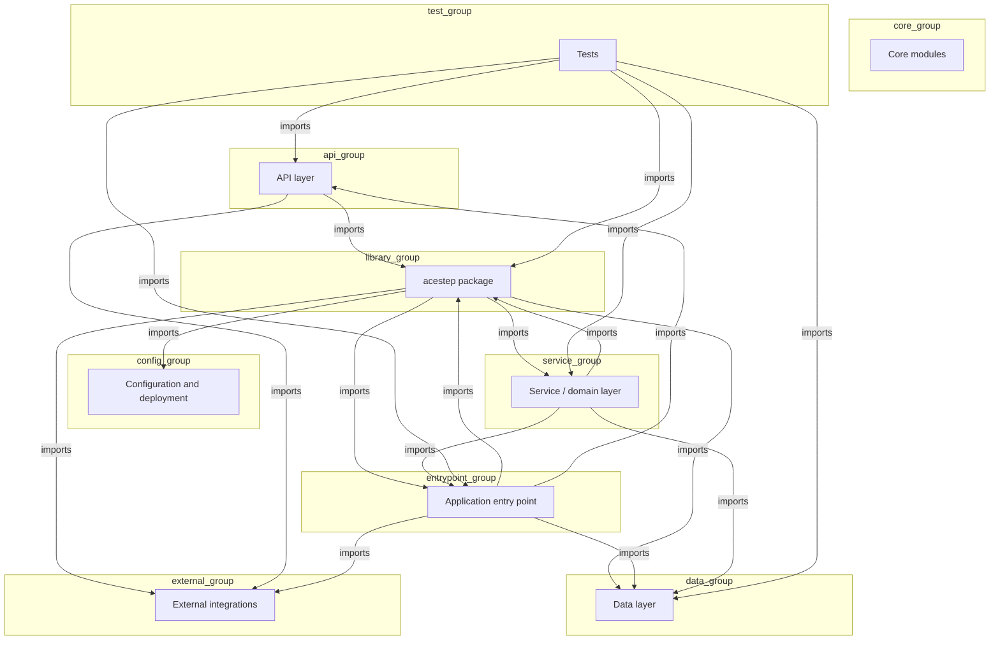

# Architecture report: ace-step/ACE-Step-1.5

> Automated static analysis. **Observed** = directly seen in files/imports/AST; **Inferred** = interpretation from that evidence. Repository code was not executed.

## 1. Repository at a glance

| Item | Value |
| --- | --- |
| Repository | ace-step/ACE-Step-1.5 |
| Description | The most powerful local music generation model that outperforms almost all commercial alternatives, supporting Mac, AMD, Intel, and CUDA devices. |
| Language | Python |
| Stars | 14757 |
| Licence | MIT |
| Analysed commit / branch | ca1e85fe9430179831e6bc6be790c332190a3866 / main |
| Framework(s) | FastAPI, React, Starlette |
| Files analysed | 799 |
| Components | 9 |

## 2. Architecture in one minute

ace-step/ACE-Step-1.5 - The most powerful local music generation model that outperforms almost all commercial alternatives, supporting Mac, AMD, Intel, and CUDA devices.. This repository was analysed statically from 799 file(s) (598 Python). Detected technologies (observed from imports/manifests): GitHub Actions, FastAPI, React, Starlette, NumPy, Pydantic. Files are grouped into 9 component(s): acestep package, API layer, Configuration and deployment, Core modules, Data layer, Application entry point, External integrations, Service / domain layer. Observed entry point(s): acestep/acestep_v15_pipeline.py, acestep/acestep_v15_pipeline_test.py, acestep/api/http/audio_route_http_test.py. Findings below distinguish observed facts from inferred interpretation.

## 3. High-level block diagram

## 4. Main components

### acestep package (`acestep`)

- **Kind:** library
- **Status:** Observed
- **Confidence:** 0.85
- **Responsibility:** Groups 228 file(s) under acestep package (observed from repository paths and static analysis). Observed top-level classes: AceStepDataModule, AceStepHandler, AceStepTrainingDataset, AssistantMessage, Attention, AudioConfig. Observed top-level functions: __dir__, __getattr__, _add_common_training_args, _add_device_args, _add_estimation_args, _add_fixed_args.
- **Paths:** `acestep/__init__.py`, `acestep/audio_utils.py`, `acestep/cli_args.py`, `acestep/constants.py`, `acestep/constrained_logits_processor.py`, `acestep/dataset/__init__.py`, `acestep/dataset/builder/__init__.py`, `acestep/dataset/runtime/__init__.py`, `acestep/dataset_handler.py`, `acestep/debug_utils.py`, `acestep/gpu_config.py`, `acestep/handler.py`, `acestep/inference.py`, `acestep/launcher_compat.py`, `acestep/llm_backend_compat.py`, `acestep/llm_inference.py`, `acestep/local_cache.py`, `acestep/openrouter_adapter.py`, `acestep/openrouter_models.py`, `acestep/text_tasks/__init__.py`, `acestep/text_tasks/external_ai_json_parsing.py`, `acestep/text_tasks/external_ai_protocols.py`, `acestep/text_tasks/external_ai_request_helpers.py`, `acestep/text_tasks/external_ai_response_parsing.py`, `acestep/text_tasks/external_ai_types.py`, `acestep/text_tasks/external_lm_captioning.py`, `acestep/text_tasks/external_lm_captioning_fallback_locale.py`, `acestep/text_tasks/external_lm_model_cache.py`, `acestep/text_tasks/external_lm_model_discovery.py`, `acestep/text_tasks/external_lm_providers.py`, `acestep/text_tasks/external_lm_runtime_store.py`, `acestep/text_tasks/passphrase_store.py`, `acestep/text_tasks/secure_secret_store.py`, `acestep/third_parts/nano-vllm/nanovllm/__init__.py`, `acestep/third_parts/nano-vllm/nanovllm/distributed.py`, `acestep/third_parts/nano-vllm/nanovllm/engine/block_manager.py`, `acestep/third_parts/nano-vllm/nanovllm/engine/llm_engine.py`, `acestep/third_parts/nano-vllm/nanovllm/engine/model_runner.py`, `acestep/third_parts/nano-vllm/nanovllm/engine/scheduler.py`, `acestep/third_parts/nano-vllm/nanovllm/engine/sequence.py`, `acestep/third_parts/nano-vllm/nanovllm/layers/activation.py`, `acestep/third_parts/nano-vllm/nanovllm/layers/attention.py`, `acestep/third_parts/nano-vllm/nanovllm/layers/embed_head.py`, `acestep/third_parts/nano-vllm/nanovllm/layers/layernorm.py`, `acestep/third_parts/nano-vllm/nanovllm/layers/linear.py`, `acestep/third_parts/nano-vllm/nanovllm/layers/rotary_embedding.py`, `acestep/third_parts/nano-vllm/nanovllm/layers/sampler.py`, `acestep/third_parts/nano-vllm/nanovllm/llm.py`, `acestep/third_parts/nano-vllm/nanovllm/sampling_params.py`, `acestep/third_parts/nano-vllm/nanovllm/utils/compat.py`, `acestep/third_parts/nano-vllm/nanovllm/utils/context.py`, `acestep/third_parts/nano-vllm/nanovllm/utils/loader.py`, `acestep/training/__init__.py`, `acestep/training/configs.py`, `acestep/training/data_module.py`, `acestep/training/dataset_builder.py`, `acestep/training/dataset_builder_modules/__init__.py`, `acestep/training/dataset_builder_modules/audio_io.py`, `acestep/training/dataset_builder_modules/builder.py`, `acestep/training/dataset_builder_modules/core.py`, `acestep/training/dataset_builder_modules/csv_metadata.py`, `acestep/training/dataset_builder_modules/dataframe.py`, `acestep/training/dataset_builder_modules/label_all.py`, `acestep/training/dataset_builder_modules/label_single.py`, `acestep/training/dataset_builder_modules/label_utils.py`, `acestep/training/dataset_builder_modules/metadata.py`, `acestep/training/dataset_builder_modules/preprocess.py`, `acestep/training/dataset_builder_modules/preprocess_audio.py`, `acestep/training/dataset_builder_modules/preprocess_context.py`, `acestep/training/dataset_builder_modules/preprocess_encoder.py`, `acestep/training/dataset_builder_modules/preprocess_lyrics.py`, `acestep/training/dataset_builder_modules/preprocess_manifest.py`, `acestep/training/dataset_builder_modules/preprocess_text.py`, `acestep/training/dataset_builder_modules/preprocess_utils.py`, `acestep/training/dataset_builder_modules/preprocess_vae.py`, `acestep/training/dataset_builder_modules/scan.py`, `acestep/training/dataset_builder_modules/serialization.py`, `acestep/training/dataset_builder_modules/update_sample.py`, `acestep/training/lokr_utils.py`, `acestep/training/lora_checkpoint.py`, `acestep/training/lora_injection.py`, `acestep/training/lora_utils.py`, `acestep/training/path_safety.py`, `acestep/training/trainer.py`, `acestep/training_v2/__init__.py`, `acestep/training_v2/cli/__init__.py`, `acestep/training_v2/cli/args.py`, `acestep/training_v2/cli/common.py`, `acestep/training_v2/cli/config_builder.py`, `acestep/training_v2/cli/train_vanilla.py`, `acestep/training_v2/cli/validation.py`, `acestep/training_v2/configs.py`, `acestep/training_v2/estimate.py`, `acestep/training_v2/fixed_lora_module.py`, `acestep/training_v2/gpu_utils.py`, `acestep/training_v2/model_discovery.py`, `acestep/training_v2/model_loader.py`, `acestep/training_v2/optim.py`, `acestep/training_v2/preprocess.py`, `acestep/training_v2/preprocess_discovery.py`, `acestep/training_v2/preprocess_prompt.py`, `acestep/training_v2/preprocess_vae.py`, `acestep/training_v2/tensorboard_utils.py`, `acestep/training_v2/timestep_sampling.py`, `acestep/training_v2/trainer_basic_loop.py`, `acestep/training_v2/trainer_fixed.py`, `acestep/training_v2/trainer_helpers.py`, `acestep/training_v2/trainer_vanilla.py`, `acestep/training_v2/ui/__init__.py`, `acestep/training_v2/ui/banner.py`, `acestep/training_v2/ui/config_panel.py`, `acestep/training_v2/ui/errors.py`, `acestep/training_v2/ui/flows.py`, `acestep/training_v2/ui/flows_common.py`, `acestep/training_v2/ui/flows_estimate.py`, `acestep/training_v2/ui/flows_preprocess.py`, `acestep/training_v2/ui/flows_setup.py`, `acestep/training_v2/ui/flows_train.py`, `acestep/training_v2/ui/flows_train_steps.py`, `acestep/training_v2/ui/gpu_monitor.py`, `acestep/training_v2/ui/help_formatter.py`, `acestep/training_v2/ui/presets.py`, `acestep/training_v2/ui/progress.py`, `acestep/training_v2/ui/prompt_helpers.py`, `acestep/training_v2/ui/summary.py`, `acestep/training_v2/ui/wizard.py`, `acestep/training_v2/ui/wizard_menus.py`, `acestep/ui/__init__.py`, `acestep/ui/gradio/__init__.py`, `acestep/ui/gradio/events/__init__.py`, `acestep/ui/gradio/events/dcw_defaults.py`, `acestep/ui/gradio/events/generation/__init__.py`, `acestep/ui/gradio/events/generation/llm_action_params.py`, `acestep/ui/gradio/events/generation/llm_actions.py`, `acestep/ui/gradio/events/generation/llm_analysis_actions.py`, `acestep/ui/gradio/events/generation/llm_format_actions.py`, `acestep/ui/gradio/events/generation/llm_sample_actions.py`, `acestep/ui/gradio/events/generation/metadata_loading.py`, `acestep/ui/gradio/events/generation/mode_ui.py`, `acestep/ui/gradio/events/generation/mode_ui_helpers.py`, `acestep/ui/gradio/events/generation/model_config.py`, `acestep/ui/gradio/events/generation/service_init.py`, `acestep/ui/gradio/events/generation/ui_helpers.py`, `acestep/ui/gradio/events/generation/validation.py`, `acestep/ui/gradio/events/generation_handlers.py`, `acestep/ui/gradio/events/results/__init__.py`, `acestep/ui/gradio/events/results/_batch_management_test_support.py`, `acestep/ui/gradio/events/results/audio_playback_updates.py`, `acestep/ui/gradio/events/results/audio_transfer.py`, `acestep/ui/gradio/events/results/batch_management.py`, `acestep/ui/gradio/events/results/batch_management_background.py`, `acestep/ui/gradio/events/results/batch_management_helpers.py`, `acestep/ui/gradio/events/results/batch_management_wrapper.py`, `acestep/ui/gradio/events/results/batch_navigation.py`, `acestep/ui/gradio/events/results/batch_queue.py`, `acestep/ui/gradio/events/results/generation_info.py`, `acestep/ui/gradio/events/results/generation_progress.py`, `acestep/ui/gradio/events/results/generation_task_type.py`, `acestep/ui/gradio/events/results/lrc_utils.py`, `acestep/ui/gradio/events/results/scoring.py`, `acestep/ui/gradio/events/results/session_artifacts.py`, `acestep/ui/gradio/events/results_handlers.py`, `acestep/ui/gradio/events/training/__init__.py`, `acestep/ui/gradio/events/training/dataset_ops.py`, `acestep/ui/gradio/events/training/lokr_training.py`, `acestep/ui/gradio/events/training/lora_training.py`, `acestep/ui/gradio/events/training/preprocess.py`, `acestep/ui/gradio/events/training/training_utils.py`, `acestep/ui/gradio/events/training_handlers.py`, `acestep/ui/gradio/events/wiring/__init__.py`, `acestep/ui/gradio/events/wiring/ast_test_utils.py`, `acestep/ui/gradio/events/wiring/context.py`, `acestep/ui/gradio/events/wiring/decomposition_contract_helpers.py`, `acestep/ui/gradio/events/wiring/generation_batch_navigation_wiring.py`, `acestep/ui/gradio/events/wiring/generation_metadata_file_wiring.py`, `acestep/ui/gradio/events/wiring/generation_metadata_wiring.py`, `acestep/ui/gradio/events/wiring/generation_mode_wiring.py`, `acestep/ui/gradio/events/wiring/generation_run_wiring.py`, `acestep/ui/gradio/events/wiring/generation_service_wiring.py`, `acestep/ui/gradio/events/wiring/generation_text_format_wiring.py`, `acestep/ui/gradio/events/wiring/results_aux_wiring.py`, `acestep/ui/gradio/events/wiring/results_display_wiring.py`, `acestep/ui/gradio/events/wiring/training_dataset_builder_wiring.py`, `acestep/ui/gradio/events/wiring/training_dataset_preprocess_wiring.py`, `acestep/ui/gradio/events/wiring/training_lokr_wiring.py`, `acestep/ui/gradio/events/wiring/training_run_wiring.py`, `acestep/ui/gradio/help_content.py`, `acestep/ui/gradio/help_content_test_helpers.py`, `acestep/ui/gradio/i18n/__init__.py`, `acestep/ui/gradio/i18n/i18n.py`, `acestep/ui/gradio/interfaces/__init__.py`, `acestep/ui/gradio/interfaces/audio_player_preferences.js`, `acestep/ui/gradio/interfaces/audio_player_preferences.py`, `acestep/ui/gradio/interfaces/dataset.py`, `acestep/ui/gradio/interfaces/generation.py`, `acestep/ui/gradio/interfaces/generation_advanced_dit_controls.py`, `acestep/ui/gradio/interfaces/generation_advanced_output_controls.py`, `acestep/ui/gradio/interfaces/generation_advanced_primary_controls.py`, `acestep/ui/gradio/interfaces/generation_advanced_settings.py`, `acestep/ui/gradio/interfaces/generation_contract_ast_utils.py`, `acestep/ui/gradio/interfaces/generation_defaults.py`, `acestep/ui/gradio/interfaces/generation_service_config.py`, `acestep/ui/gradio/interfaces/generation_service_config_rows.py`, `acestep/ui/gradio/interfaces/generation_service_config_toggles.py`, `acestep/ui/gradio/interfaces/generation_tab_generate_controls.py`, `acestep/ui/gradio/interfaces/generation_tab_optional_controls.py`, `acestep/ui/gradio/interfaces/generation_tab_primary_controls.py`, `acestep/ui/gradio/interfaces/generation_tab_runtime_controls.py`, `acestep/ui/gradio/interfaces/generation_tab_secondary_controls.py`, `acestep/ui/gradio/interfaces/generation_tab_section.py`, `acestep/ui/gradio/interfaces/generation_tab_simple_controls.py`, `acestep/ui/gradio/interfaces/generation_tab_source_controls.py`, `acestep/ui/gradio/interfaces/generation_tab_variation_morph_controls.py`, `acestep/ui/gradio/interfaces/result.py`, `acestep/ui/gradio/interfaces/training.py`, `acestep/ui/gradio/interfaces/training_contract_ast_utils.py`, `acestep/ui/gradio/interfaces/training_dataset_builder_tab.py`, `acestep/ui/gradio/interfaces/training_dataset_tab_label_preview.py`, `acestep/ui/gradio/interfaces/training_dataset_tab_save_preprocess.py`, `acestep/ui/gradio/interfaces/training_dataset_tab_scan_settings.py`, `acestep/ui/gradio/interfaces/training_lokr_tab.py`, `acestep/ui/gradio/interfaces/training_lokr_tab_dataset.py`, `acestep/ui/gradio/interfaces/training_lokr_tab_run_export.py`, `acestep/ui/gradio/interfaces/training_lora_tab.py`, `acestep/ui/gradio/interfaces/training_lora_tab_dataset.py`, `acestep/ui/gradio/interfaces/training_lora_tab_run_export.py`, `acestep/ui/gradio/interfaces/user_preferences.js`, `acestep/ui/gradio/interfaces/user_preferences.py`
- **Evidence:** [acestep/__init__.py](https://github.com/ace-step/ACE-Step-1.5/blob/ca1e85fe9430179831e6bc6be790c332190a3866/acestep/__init__.py); [acestep/audio_utils.py:25](https://github.com/ace-step/ACE-Step-1.5/blob/ca1e85fe9430179831e6bc6be790c332190a3866/acestep/audio_utils.py#L25); [acestep/cli_args.py:15](https://github.com/ace-step/ACE-Step-1.5/blob/ca1e85fe9430179831e6bc6be790c332190a3866/acestep/cli_args.py#L15); [acestep/constants.py](https://github.com/ace-step/ACE-Step-1.5/blob/ca1e85fe9430179831e6bc6be790c332190a3866/acestep/constants.py); [acestep/constrained_logits_processor.py:53](https://github.com/ace-step/ACE-Step-1.5/blob/ca1e85fe9430179831e6bc6be790c332190a3866/acestep/constrained_logits_processor.py#L53); [acestep/dataset/__init__.py](https://github.com/ace-step/ACE-Step-1.5/blob/ca1e85fe9430179831e6bc6be790c332190a3866/acestep/dataset/__init__.py); [acestep/dataset/builder/__init__.py](https://github.com/ace-step/ACE-Step-1.5/blob/ca1e85fe9430179831e6bc6be790c332190a3866/acestep/dataset/builder/__init__.py); [acestep/dataset/runtime/__init__.py](https://github.com/ace-step/ACE-Step-1.5/blob/ca1e85fe9430179831e6bc6be790c332190a3866/acestep/dataset/runtime/__init__.py)

### API layer (`api_layer`)

- **Kind:** api
- **Status:** Observed
- **Confidence:** 0.85
- **Responsibility:** Groups 60 file(s) under api layer (observed from repository paths and static analysis). Observed routes: GET /health, GET /v1/models, GET /v1/audio, POST /create_random_sample, POST /query_result. Observed top-level classes: AutoLabelRequest, AutoLabelTask, CreateJobResponse, ExportLoRARequest, GenerateMusicRequest, GenerationSetup. Observed top-level functions: _add_cors_middleware, _add_cors_middleware_post_launch, _append_jsonl, _atomic_write_json, _build_running_result_payload, _build_store_result_payload.
- **Paths:** `acestep/api/__init__.py`, `acestep/api/http/__init__.py`, `acestep/api/http/audio_route.py`, `acestep/api/http/auth.py`, `acestep/api/http/lora_routes.py`, `acestep/api/http/model_init_service.py`, `acestep/api/http/model_service_routes.py`, `acestep/api/http/query_result_route.py`, `acestep/api/http/query_result_service.py`, `acestep/api/http/reinitialize_route.py`, `acestep/api/http/release_task_audio_paths.py`, `acestep/api/http/release_task_models.py`, `acestep/api/http/release_task_param_parser.py`, `acestep/api/http/release_task_request_builder.py`, `acestep/api/http/release_task_request_parser.py`, `acestep/api/http/release_task_route.py`, `acestep/api/http/sample_format_routes.py`, `acestep/api/job_analysis_runtime.py`, `acestep/api/job_blocking_generation.py`, `acestep/api/job_execution_runtime.py`, `acestep/api/job_generation_runtime.py`, `acestep/api/job_generation_setup.py`, `acestep/api/job_llm_preparation.py`, `acestep/api/job_model_selection.py`, `acestep/api/job_result_payload.py`, `acestep/api/job_runtime_state.py`, `acestep/api/jobs/__init__.py`, `acestep/api/jobs/local_cache_updates.py`, `acestep/api/jobs/models.py`, `acestep/api/jobs/store.py`, `acestep/api/jobs/worker_loops.py`, `acestep/api/lifespan_runtime.py`, `acestep/api/llm_generation_inputs.py`, `acestep/api/llm_readiness.py`, `acestep/api/log_capture.py`, `acestep/api/model_download.py`, `acestep/api/route_setup.py`, `acestep/api/runtime_helpers.py`, `acestep/api/server_cli.py`, `acestep/api/server_utils.py`, `acestep/api/startup_llm_init.py`, `acestep/api/startup_model_init.py`, `acestep/api/train_api_dataset_auto_label_async_route.py`, `acestep/api/train_api_dataset_auto_label_routes.py`, `acestep/api/train_api_dataset_auto_label_status_route.py`, `acestep/api/train_api_dataset_auto_label_sync_route.py`, `acestep/api/train_api_dataset_models.py`, `acestep/api/train_api_dataset_preprocess_routes.py`, `acestep/api/train_api_dataset_sample_routes.py`, `acestep/api/train_api_dataset_scan_load_routes.py`, `acestep/api/train_api_dataset_service.py`, `acestep/api/train_api_dataset_status_routes.py`, `acestep/api/train_api_lokr_start_route.py`, `acestep/api/train_api_lora_start_route.py`, `acestep/api/train_api_models.py`, `acestep/api/train_api_runtime.py`, `acestep/api/train_api_service.py`, `acestep/api/worker_runtime.py`, `acestep/ui/gradio/api/__init__.py`, `acestep/ui/gradio/api/api_routes.py`
- **Evidence:** [acestep/api/__init__.py](https://github.com/ace-step/ACE-Step-1.5/blob/ca1e85fe9430179831e6bc6be790c332190a3866/acestep/api/__init__.py); [acestep/api/http/__init__.py](https://github.com/ace-step/ACE-Step-1.5/blob/ca1e85fe9430179831e6bc6be790c332190a3866/acestep/api/http/__init__.py); [acestep/api/http/audio_route.py:11](https://github.com/ace-step/ACE-Step-1.5/blob/ca1e85fe9430179831e6bc6be790c332190a3866/acestep/api/http/audio_route.py#L11); [acestep/api/http/auth.py:12](https://github.com/ace-step/ACE-Step-1.5/blob/ca1e85fe9430179831e6bc6be790c332190a3866/acestep/api/http/auth.py#L12); [acestep/api/http/lora_routes.py:16](https://github.com/ace-step/ACE-Step-1.5/blob/ca1e85fe9430179831e6bc6be790c332190a3866/acestep/api/http/lora_routes.py#L16); [acestep/api/http/model_init_service.py:15](https://github.com/ace-step/ACE-Step-1.5/blob/ca1e85fe9430179831e6bc6be790c332190a3866/acestep/api/http/model_init_service.py#L15); [acestep/api/http/model_service_routes.py:17](https://github.com/ace-step/ACE-Step-1.5/blob/ca1e85fe9430179831e6bc6be790c332190a3866/acestep/api/http/model_service_routes.py#L17); [acestep/api/http/query_result_route.py:12](https://github.com/ace-step/ACE-Step-1.5/blob/ca1e85fe9430179831e6bc6be790c332190a3866/acestep/api/http/query_result_route.py#L12)

### Configuration and deployment (`config`)

- **Kind:** config
- **Status:** Observed
- **Confidence:** 0.85
- **Responsibility:** Groups 19 file(s) under configuration and deployment (observed from repository paths and static analysis). Observed top-level classes: Config. Observed top-level functions: _default_settings, get_checkpoint_dir, is_first_run, load_settings, save_settings, settings_dir.
- **Paths:** `Dockerfile`, `Dockerfile.jetson`, `acestep/third_parts/nano-vllm/nanovllm/config.py`, `acestep/third_parts/nano-vllm/pyproject.toml`, `acestep/training_v2/presets/high_quality.json`, `acestep/training_v2/presets/quick_test.json`, `acestep/training_v2/presets/recommended.json`, `acestep/training_v2/presets/vram_12gb.json`, `acestep/training_v2/presets/vram_16gb.json`, `acestep/training_v2/presets/vram_24gb_plus.json`, `acestep/training_v2/presets/vram_8gb.json`, `acestep/training_v2/settings.py`, `acestep/ui/gradio/i18n/en.json`, `acestep/ui/gradio/i18n/he.json`, `acestep/ui/gradio/i18n/ja.json`, `acestep/ui/gradio/i18n/pt.json`, `acestep/ui/gradio/i18n/zh.json`, `docker-compose.jetson.yml`, `docker-compose.yml`
- **Evidence:** [Dockerfile](https://github.com/ace-step/ACE-Step-1.5/blob/ca1e85fe9430179831e6bc6be790c332190a3866/Dockerfile); [Dockerfile.jetson](https://github.com/ace-step/ACE-Step-1.5/blob/ca1e85fe9430179831e6bc6be790c332190a3866/Dockerfile.jetson); [acestep/third_parts/nano-vllm/nanovllm/config.py:7](https://github.com/ace-step/ACE-Step-1.5/blob/ca1e85fe9430179831e6bc6be790c332190a3866/acestep/third_parts/nano-vllm/nanovllm/config.py#L7); [acestep/third_parts/nano-vllm/pyproject.toml](https://github.com/ace-step/ACE-Step-1.5/blob/ca1e85fe9430179831e6bc6be790c332190a3866/acestep/third_parts/nano-vllm/pyproject.toml); [acestep/training_v2/presets/high_quality.json](https://github.com/ace-step/ACE-Step-1.5/blob/ca1e85fe9430179831e6bc6be790c332190a3866/acestep/training_v2/presets/high_quality.json); [acestep/training_v2/presets/quick_test.json](https://github.com/ace-step/ACE-Step-1.5/blob/ca1e85fe9430179831e6bc6be790c332190a3866/acestep/training_v2/presets/quick_test.json); [acestep/training_v2/presets/recommended.json](https://github.com/ace-step/ACE-Step-1.5/blob/ca1e85fe9430179831e6bc6be790c332190a3866/acestep/training_v2/presets/recommended.json); [acestep/training_v2/presets/vram_12gb.json](https://github.com/ace-step/ACE-Step-1.5/blob/ca1e85fe9430179831e6bc6be790c332190a3866/acestep/training_v2/presets/vram_12gb.json)

### Core modules (`core`)

- **Kind:** core
- **Status:** Observed
- **Confidence:** 0.85
- **Responsibility:** Groups 2 file(s) under core modules (observed from repository paths and static analysis).
- **Paths:** `check_update.sh`, `close_api_server.sh`
- **Evidence:** [check_update.sh](https://github.com/ace-step/ACE-Step-1.5/blob/ca1e85fe9430179831e6bc6be790c332190a3866/check_update.sh); [close_api_server.sh](https://github.com/ace-step/ACE-Step-1.5/blob/ca1e85fe9430179831e6bc6be790c332190a3866/close_api_server.sh)

### Data layer (`data_layer`)

- **Kind:** data
- **Status:** Observed
- **Confidence:** 0.85
- **Responsibility:** Groups 36 file(s) under data layer (observed from repository paths and static analysis). Observed top-level classes: AceStepConfig, AudioSample, DCWCorrector, DatasetMetadata, MLXAttention, MLXAutoEncoderOobleck. Observed top-level functions: _apply_rotary_pos_emb, _bct_to_btc, _btc_to_bct, _create_sliding_window_mask, _dwt_pair, _fuse_weight_norm.
- **Paths:** `acestep/models/__init__.py`, `acestep/models/base/__init__.py`, `acestep/models/base/apg_guidance.py`, `acestep/models/base/configuration_acestep_v15.py`, `acestep/models/common/__init__.py`, `acestep/models/common/_flow_edit_test_support.py`, `acestep/models/common/apg_guidance.py`, `acestep/models/common/configuration_acestep_v15.py`, `acestep/models/common/dcw_correction.py`, `acestep/models/common/dcw_loader.py`, `acestep/models/common/dcw_primitives.py`, `acestep/models/common/flow_edit.py`, `acestep/models/common/flow_edit_helpers.py`, `acestep/models/common/flow_edit_pipeline.py`, `acestep/models/mlx/__init__.py`, `acestep/models/mlx/dcw_correction_mlx.py`, `acestep/models/mlx/dit_convert.py`, `acestep/models/mlx/dit_generate.py`, `acestep/models/mlx/dit_model.py`, `acestep/models/mlx/vae_convert.py`, `acestep/models/mlx/vae_model.py`, `acestep/models/sft/__init__.py`, `acestep/models/sft/apg_guidance.py`, `acestep/models/sft/configuration_acestep_v15.py`, `acestep/models/turbo/__init__.py`, `acestep/models/turbo/configuration_acestep_v15.py`, `acestep/models/xl_base/__init__.py`, `acestep/models/xl_base/apg_guidance.py`, `acestep/models/xl_base/configuration_acestep_v15.py`, `acestep/models/xl_sft/__init__.py`, `acestep/models/xl_sft/apg_guidance.py`, `acestep/models/xl_sft/configuration_acestep_v15.py`, `acestep/models/xl_turbo/__init__.py`, `acestep/models/xl_turbo/configuration_acestep_v15.py`, `acestep/third_parts/nano-vllm/nanovllm/models/qwen3.py`, `acestep/training/dataset_builder_modules/models.py`
- **Evidence:** [acestep/models/__init__.py](https://github.com/ace-step/ACE-Step-1.5/blob/ca1e85fe9430179831e6bc6be790c332190a3866/acestep/models/__init__.py); [acestep/models/base/__init__.py](https://github.com/ace-step/ACE-Step-1.5/blob/ca1e85fe9430179831e6bc6be790c332190a3866/acestep/models/base/__init__.py); [acestep/models/base/apg_guidance.py](https://github.com/ace-step/ACE-Step-1.5/blob/ca1e85fe9430179831e6bc6be790c332190a3866/acestep/models/base/apg_guidance.py); [acestep/models/base/configuration_acestep_v15.py](https://github.com/ace-step/ACE-Step-1.5/blob/ca1e85fe9430179831e6bc6be790c332190a3866/acestep/models/base/configuration_acestep_v15.py); [acestep/models/common/__init__.py](https://github.com/ace-step/ACE-Step-1.5/blob/ca1e85fe9430179831e6bc6be790c332190a3866/acestep/models/common/__init__.py); [acestep/models/common/_flow_edit_test_support.py:13](https://github.com/ace-step/ACE-Step-1.5/blob/ca1e85fe9430179831e6bc6be790c332190a3866/acestep/models/common/_flow_edit_test_support.py#L13); [acestep/models/common/apg_guidance.py:5](https://github.com/ace-step/ACE-Step-1.5/blob/ca1e85fe9430179831e6bc6be790c332190a3866/acestep/models/common/apg_guidance.py#L5); [acestep/models/common/configuration_acestep_v15.py:25](https://github.com/ace-step/ACE-Step-1.5/blob/ca1e85fe9430179831e6bc6be790c332190a3866/acestep/models/common/configuration_acestep_v15.py#L25)

### Application entry point (`entrypoint`)

- **Kind:** entrypoint
- **Status:** Observed
- **Confidence:** 0.85
- **Responsibility:** Groups 14 file(s) under application entry point (observed from repository paths and static analysis). Observed application object created via FastAPI. Observed top-level classes: AceStepAttention, AceStepAudioTokenizer, AceStepConditionEncoder, AceStepConditionGenerationModel, AceStepDiTLayer, AceStepDiTModel. Observed top-level functions: _apply_optional_defaults, _build_meta_dict, _can_access_google, _check_code_mismatch, _cleanup_gpu, _configure_logging.
- **Paths:** `acestep/acestep_v15_pipeline.py`, `acestep/api_server.py`, `acestep/model_downloader.py`, `acestep/models/base/modeling_acestep_v15_base.py`, `acestep/models/sft/modeling_acestep_v15_base.py`, `acestep/models/turbo/modeling_acestep_v15_turbo.py`, `acestep/models/xl_base/modeling_acestep_v15_xl_base.py`, `acestep/models/xl_sft/modeling_acestep_v15_xl_base.py`, `acestep/models/xl_turbo/modeling_acestep_v15_xl_turbo.py`, `acestep/third_parts/nano-vllm/bench.py`, `acestep/third_parts/nano-vllm/example.py`, `acestep/training_v2/cli/train_fixed.py`, `acestep/training_v2/make_test_fixtures.py`, `cli.py`
- **Evidence:** [acestep/acestep_v15_pipeline.py:87](https://github.com/ace-step/ACE-Step-1.5/blob/ca1e85fe9430179831e6bc6be790c332190a3866/acestep/acestep_v15_pipeline.py#L87); [acestep/api_server.py:317](https://github.com/ace-step/ACE-Step-1.5/blob/ca1e85fe9430179831e6bc6be790c332190a3866/acestep/api_server.py#L317); [acestep/model_downloader.py:46](https://github.com/ace-step/ACE-Step-1.5/blob/ca1e85fe9430179831e6bc6be790c332190a3866/acestep/model_downloader.py#L46); [acestep/models/base/modeling_acestep_v15_base.py:62](https://github.com/ace-step/ACE-Step-1.5/blob/ca1e85fe9430179831e6bc6be790c332190a3866/acestep/models/base/modeling_acestep_v15_base.py#L62); [acestep/models/sft/modeling_acestep_v15_base.py:62](https://github.com/ace-step/ACE-Step-1.5/blob/ca1e85fe9430179831e6bc6be790c332190a3866/acestep/models/sft/modeling_acestep_v15_base.py#L62); [acestep/models/turbo/modeling_acestep_v15_turbo.py:59](https://github.com/ace-step/ACE-Step-1.5/blob/ca1e85fe9430179831e6bc6be790c332190a3866/acestep/models/turbo/modeling_acestep_v15_turbo.py#L59); [acestep/models/xl_base/modeling_acestep_v15_xl_base.py:62](https://github.com/ace-step/ACE-Step-1.5/blob/ca1e85fe9430179831e6bc6be790c332190a3866/acestep/models/xl_base/modeling_acestep_v15_xl_base.py#L62); [acestep/models/xl_sft/modeling_acestep_v15_xl_base.py:62](https://github.com/ace-step/ACE-Step-1.5/blob/ca1e85fe9430179831e6bc6be790c332190a3866/acestep/models/xl_sft/modeling_acestep_v15_xl_base.py#L62)

### External integrations (`external_integrations`)

- **Kind:** external
- **Status:** Inferred
- **Confidence:** 0.70
- **Responsibility:** Groups 0 file(s) under external integrations (observed from repository paths and static analysis).
- **Evidence:** [acestep/api/model_download.py:26](https://github.com/ace-step/ACE-Step-1.5/blob/ca1e85fe9430179831e6bc6be790c332190a3866/acestep/api/model_download.py#L26); [acestep/model_downloader.py:150](https://github.com/ace-step/ACE-Step-1.5/blob/ca1e85fe9430179831e6bc6be790c332190a3866/acestep/model_downloader.py#L150); [acestep/third_parts/nano-vllm/nanovllm/engine/model_runner.py:26](https://github.com/ace-step/ACE-Step-1.5/blob/ca1e85fe9430179831e6bc6be790c332190a3866/acestep/third_parts/nano-vllm/nanovllm/engine/model_runner.py#L26)

### Service / domain layer (`service_layer`)

- **Kind:** service
- **Status:** Observed
- **Confidence:** 0.85
- **Responsibility:** Groups 76 file(s) under service / domain layer (observed from repository paths and static analysis). Observed top-level classes: AudioCodesMixin, BatchPrepMixin, ConditioningBatchMixin, ConditioningEmbedMixin, ConditioningMaskMixin, ConditioningTargetMixin. Observed top-level functions: _apply_malloc_mmap_threshold, _backtrace, _build_waveform_crossfade_mask, _calculate_log_prob, _calculate_metadata_recall, _calculate_topk_recall.
- **Paths:** `acestep/core/__init__.py`, `acestep/core/audio/__init__.py`, `acestep/core/generation/__init__.py`, `acestep/core/generation/handler/__init__.py`, `acestep/core/generation/handler/_flow_edit_dispatch_test_support.py`, `acestep/core/generation/handler/audio_codes.py`, `acestep/core/generation/handler/batch_prep.py`, `acestep/core/generation/handler/conditioning_batch.py`, `acestep/core/generation/handler/conditioning_embed.py`, `acestep/core/generation/handler/conditioning_masks.py`, `acestep/core/generation/handler/conditioning_target.py`, `acestep/core/generation/handler/conditioning_text.py`, `acestep/core/generation/handler/diffusion.py`, `acestep/core/generation/handler/generate_music.py`, `acestep/core/generation/handler/generate_music_decode.py`, `acestep/core/generation/handler/generate_music_execute.py`, `acestep/core/generation/handler/generate_music_payload.py`, `acestep/core/generation/handler/generate_music_request.py`, `acestep/core/generation/handler/init_service.py`, `acestep/core/generation/handler/init_service_catalog.py`, `acestep/core/generation/handler/init_service_downloads.py`, `acestep/core/generation/handler/init_service_loader.py`, `acestep/core/generation/handler/init_service_loader_components.py`, `acestep/core/generation/handler/init_service_memory_basic.py`, `acestep/core/generation/handler/init_service_memory_transfer.py`, `acestep/core/generation/handler/init_service_offload_context.py`, `acestep/core/generation/handler/init_service_orchestrator.py`, `acestep/core/generation/handler/init_service_setup.py`, `acestep/core/generation/handler/io_audio.py`, `acestep/core/generation/handler/lora/__init__.py`, `acestep/core/generation/handler/lora/adapter_discovery.py`, `acestep/core/generation/handler/lora/controls.py`, `acestep/core/generation/handler/lora/lifecycle.py`, `acestep/core/generation/handler/lora/registry_builder.py`, `acestep/core/generation/handler/lora/registry_state.py`, `acestep/core/generation/handler/lora/scale_apply.py`, `acestep/core/generation/handler/lora_manager.py`, `acestep/core/generation/handler/lyric_alignment_common.py`, `acestep/core/generation/handler/lyric_score.py`, `acestep/core/generation/handler/lyric_timestamp.py`, `acestep/core/generation/handler/memory_utils.py`, `acestep/core/generation/handler/metadata_utils.py`, `acestep/core/generation/handler/mlx_dit_init.py`, `acestep/core/generation/handler/mlx_vae_decode_native.py`, `acestep/core/generation/handler/mlx_vae_encode_native.py`, `acestep/core/generation/handler/mlx_vae_init.py`, `acestep/core/generation/handler/padding_utils.py`, `acestep/core/generation/handler/progress.py`, `acestep/core/generation/handler/prompt_utils.py`, `acestep/core/generation/handler/repaint_step_injection.py`, `acestep/core/generation/handler/repaint_waveform_splice.py`, `acestep/core/generation/handler/service_generate.py`, `acestep/core/generation/handler/service_generate_execute.py`, `acestep/core/generation/handler/service_generate_flow_edit.py`, `acestep/core/generation/handler/service_generate_flow_edit_source.py`, `acestep/core/generation/handler/service_generate_outputs.py`, `acestep/core/generation/handler/service_generate_request.py`, `acestep/core/generation/handler/task_utils.py`, `acestep/core/generation/handler/training_preset.py`, `acestep/core/generation/handler/vae_decode.py`, `acestep/core/generation/handler/vae_decode_chunks.py`, `acestep/core/generation/handler/vae_decode_test_helpers.py`, `acestep/core/generation/handler/vae_encode.py`, `acestep/core/generation/handler/vae_encode_chunks.py`, `acestep/core/llm/__init__.py`, `acestep/core/lora/__init__.py`, `acestep/core/lora/introspection.py`, `acestep/core/lora/registry.py`, `acestep/core/lora/scaling.py`, `acestep/core/lora/service.py`, `acestep/core/scoring/__init__.py`, `acestep/core/scoring/_dtw.py`, `acestep/core/scoring/dit_alignment.py`, `acestep/core/scoring/dit_score.py`, `acestep/core/scoring/lm_score.py`, `acestep/core/system/__init__.py`
- **Evidence:** [acestep/core/__init__.py](https://github.com/ace-step/ACE-Step-1.5/blob/ca1e85fe9430179831e6bc6be790c332190a3866/acestep/core/__init__.py); [acestep/core/audio/__init__.py](https://github.com/ace-step/ACE-Step-1.5/blob/ca1e85fe9430179831e6bc6be790c332190a3866/acestep/core/audio/__init__.py); [acestep/core/generation/__init__.py](https://github.com/ace-step/ACE-Step-1.5/blob/ca1e85fe9430179831e6bc6be790c332190a3866/acestep/core/generation/__init__.py); [acestep/core/generation/handler/__init__.py](https://github.com/ace-step/ACE-Step-1.5/blob/ca1e85fe9430179831e6bc6be790c332190a3866/acestep/core/generation/handler/__init__.py); [acestep/core/generation/handler/_flow_edit_dispatch_test_support.py:12](https://github.com/ace-step/ACE-Step-1.5/blob/ca1e85fe9430179831e6bc6be790c332190a3866/acestep/core/generation/handler/_flow_edit_dispatch_test_support.py#L12); [acestep/core/generation/handler/audio_codes.py:11](https://github.com/ace-step/ACE-Step-1.5/blob/ca1e85fe9430179831e6bc6be790c332190a3866/acestep/core/generation/handler/audio_codes.py#L11); [acestep/core/generation/handler/batch_prep.py:10](https://github.com/ace-step/ACE-Step-1.5/blob/ca1e85fe9430179831e6bc6be790c332190a3866/acestep/core/generation/handler/batch_prep.py#L10); [acestep/core/generation/handler/conditioning_batch.py:10](https://github.com/ace-step/ACE-Step-1.5/blob/ca1e85fe9430179831e6bc6be790c332190a3866/acestep/core/generation/handler/conditioning_batch.py#L10)

### Tests (`tests`)

- **Kind:** test
- **Status:** Observed
- **Confidence:** 0.85
- **Responsibility:** Groups 184 file(s) under tests (observed from repository paths and static analysis). Observed application object created via FastAPI. Observed routes: PATCH acestep.api.job_runtime_state.update_local_cache, PATCH acestep.api.job_runtime_state.update_local_cache_progress, PATCH acestep.api.lifespan_runtime._initialize_local_cache, PATCH acestep.api.lifespan_runtime.os.makedirs, PATCH acestep.api.lifespan_runtime._initialize_local_cache. Observed top-level classes: ApiAutoDurationTests, ApiKeyLockTests, ApiRoutesResourceCleanupTests, ApplyCfgBranchTests, ApplyFadeTests, ApplyVelocityClampTests.…
- **Paths:** `acestep/acestep_v15_pipeline_test.py`, `acestep/api/http/audio_route_http_test.py`, `acestep/api/http/audio_route_test.py`, `acestep/api/http/auth_test.py`, `acestep/api/http/lora_routes_http_test.py`, `acestep/api/http/lora_routes_test.py`, `acestep/api/http/model_init_service_test.py`, `acestep/api/http/model_service_routes_http_test.py`, `acestep/api/http/model_service_routes_test.py`, `acestep/api/http/query_result_route_http_test.py`, `acestep/api/http/query_result_route_test.py`, `acestep/api/http/reinitialize_route_http_test.py`, `acestep/api/http/reinitialize_route_test.py`, `acestep/api/http/release_task_audio_paths_test.py`, `acestep/api/http/release_task_models_test.py`, `acestep/api/http/release_task_param_parser_test.py`, `acestep/api/http/release_task_request_builder_test.py`, `acestep/api/http/release_task_request_parser_test.py`, `acestep/api/http/release_task_route_http_test.py`, `acestep/api/http/sample_format_routes_http_test.py`, `acestep/api/http/sample_format_routes_test.py`, `acestep/api/job_analysis_runtime_test.py`, `acestep/api/job_blocking_generation_test.py`, `acestep/api/job_execution_runtime_test.py`, `acestep/api/job_generation_runtime_test.py`, `acestep/api/job_generation_setup_test.py`, `acestep/api/job_llm_preparation_test.py`, `acestep/api/job_model_selection_on_demand_test.py`, `acestep/api/job_model_selection_test.py`, `acestep/api/job_result_payload_test.py`, `acestep/api/job_runtime_state_test.py`, `acestep/api/jobs/local_cache_updates_test.py`, `acestep/api/jobs/store_test.py`, `acestep/api/jobs/test_fakes.py`, `acestep/api/jobs/worker_loops_test.py`, `acestep/api/lifespan_runtime_test.py`, `acestep/api/log_capture_test.py`, `acestep/api/model_download_test.py`, `acestep/api/route_setup_test.py`, `acestep/api/runtime_helpers_test.py`, `acestep/api/server_cli_test.py`, `acestep/api/server_utils_test.py`, `acestep/api/startup_llm_init_test.py`, `acestep/api/startup_model_init_test.py`, `acestep/api/train_api_dataset_auto_label_routes_http_test.py`, `acestep/api/train_api_dataset_models_test.py`, `acestep/api/train_api_dataset_preprocess_routes_http_test.py`, `acestep/api/train_api_dataset_sample_routes_http_test.py`, `acestep/api/train_api_dataset_scan_load_routes_http_test.py`, `acestep/api/train_api_dataset_service_http_test.py`, `acestep/api/train_api_dataset_status_routes_http_test.py`, `acestep/api/train_api_service_http_test.py`, `acestep/api/worker_runtime_test.py`, `acestep/audio_utils_test.py`, `acestep/audio_utils_uuid_test.py`, `acestep/cli_args_test.py`, `acestep/core/generation/handler/conditioning_batch_test.py`, `acestep/core/generation/handler/conditioning_embed_test.py`, `acestep/core/generation/handler/conditioning_masks_test.py`, `acestep/core/generation/handler/conditioning_target_test.py`, `acestep/core/generation/handler/cover_noise_strength_forwarding_test.py`, `acestep/core/generation/handler/diffusion_test.py`, `acestep/core/generation/handler/generate_music_dcw_test.py`, `acestep/core/generation/handler/generate_music_decode_test.py`, `acestep/core/generation/handler/generate_music_execute_test.py`, `acestep/core/generation/handler/generate_music_payload_test.py`, `acestep/core/generation/handler/generate_music_request_test.py`, `acestep/core/generation/handler/generate_music_test.py`, `acestep/core/generation/handler/init_service_test.py`, `acestep/core/generation/handler/io_audio_test.py`, `acestep/core/generation/handler/lora/controls_test.py`, `acestep/core/generation/handler/lora/lifecycle_test.py`, `acestep/core/generation/handler/lora_integration_test.py`, `acestep/core/generation/handler/lyric_alignment_test.py`, `acestep/core/generation/handler/mlx_dit_init_test.py`, `acestep/core/generation/handler/mlx_vae_init_test.py`, `acestep/core/generation/handler/mlx_vae_native_test.py`, `acestep/core/generation/handler/progress_project_root_test.py`, `acestep/core/generation/handler/reference_audio_validation_test.py`, `acestep/core/generation/handler/repaint_step_injection_test.py`, `acestep/core/generation/handler/repaint_waveform_splice_test.py`, `acestep/core/generation/handler/resolve_repaint_config_test.py`, `acestep/core/generation/handler/retake_test.py`, `acestep/core/generation/handler/service_generate_execute_test.py`, `acestep/core/generation/handler/service_generate_flow_edit_test.py`, `acestep/core/generation/handler/service_generate_request_test.py`, `acestep/core/generation/handler/service_generate_test.py`, `acestep/core/generation/handler/task_utils_test.py`, `acestep/core/generation/handler/training_preset_test.py`, `acestep/core/generation/handler/vae_decode_chunks_test.py`, `acestep/core/generation/handler/vae_decode_mixin_test.py`, `acestep/core/generation/handler/vae_encode_test.py`, `acestep/core/lora/service_test.py`, `acestep/core/scoring/lm_score_test.py`, `acestep/core/scoring/scoring_test.py`, `acestep/direct_conditioning_tasks_test.py`, `acestep/gpu_config_effective_free_vram_test.py`, `acestep/gpu_config_lm_memory_ratio_test.py`, `acestep/gpu_config_test.py`, `acestep/inference_repaint_cache_test.py`, `acestep/inference_seed_fallback_test.py`, `acestep/launcher_compat_test.py`, `acestep/launcher_legacy_torch_fix_test.py`, `acestep/llm_backend_compat_test.py`, `acestep/llm_inference_cache_cleanup_test.py`, `acestep/llm_inference_cfg_fixes_test.py`, `acestep/llm_inference_dist_cleanup_test.py`, `acestep/llm_inference_enforce_eager_test.py`, `acestep/local_cache_thread_safety_test.py`, `acestep/model_downloader_test.py`, `acestep/models/common/dcw_correction_test.py`, `acestep/models/common/flow_edit_helpers_test.py`, `acestep/models/common/flow_edit_helpers_velocity_test.py`, `acestep/models/common/flow_edit_pipeline_test.py`, `acestep/models/common/flow_edit_test.py`, `acestep/models/mlx/dcw_correction_mlx_test.py`, `acestep/models/mlx/dit_generate_sampler_test.py`, `acestep/models/mlx/dit_model_static_buffers_test.py`, `acestep/null_duration_fixes_test.py`, `acestep/text2music_src_audio_test.py`, `acestep/text_tasks/external_ai_json_parsing_test.py`, `acestep/text_tasks/external_ai_protocols_test.py`, `acestep/text_tasks/external_ai_request_helpers_test.py`, `acestep/text_tasks/external_ai_response_parsing_test.py`, `acestep/text_tasks/external_ai_types_test.py`, `acestep/text_tasks/external_lm_captioning_test.py`, `acestep/text_tasks/external_lm_model_cache_test.py`, `acestep/text_tasks/external_lm_model_discovery_test.py`, `acestep/text_tasks/external_lm_providers_test.py`, `acestep/text_tasks/external_lm_runtime_store_persistence_test.py`, `acestep/text_tasks/external_lm_runtime_store_test.py`, `acestep/text_tasks/passphrase_store_test.py`, `acestep/text_tasks/secure_secret_store_test.py`, `acestep/third_parts/nano-vllm/nanovllm/engine/model_runner_shm_test.py`, `acestep/third_parts/nano-vllm/nanovllm/utils/compat_test.py`, `acestep/training/data_module_test.py`, `acestep/training/test_lora_utils.py`, `acestep/training_v2/cli/train_fixed_standalone_test.py`, `acestep/training_v2/fixed_lora_module_precision_test.py`, `acestep/training_v2/trainer_helpers_test.py`, `acestep/ui/gradio/api/api_routes_resource_test.py`, `acestep/ui/gradio/api/api_routes_thread_safety_test.py`, `acestep/ui/gradio/events/generation/mode_ui_test.py`, `acestep/ui/gradio/events/generation/model_config_test.py`, `acestep/ui/gradio/events/generation/service_init_test.py`, `acestep/ui/gradio/events/generation/ui_helpers_test.py`, `acestep/ui/gradio/events/generation_handlers_test.py`, `acestep/ui/gradio/events/results/audio_playback_updates_test.py`, `acestep/ui/gradio/events/results/audio_transfer_test.py`, `acestep/ui/gradio/events/results/batch_management_background_test.py`, `acestep/ui/gradio/events/results/batch_management_helpers_test.py`, `acestep/ui/gradio/events/results/batch_management_test.py`, `acestep/ui/gradio/events/results/batch_navigation_test.py`, `acestep/ui/gradio/events/results/batch_queue_test.py`, `acestep/ui/gradio/events/results/generation_info_test.py`, `acestep/ui/gradio/events/results/generation_progress_repaint_cache_test.py`, `acestep/ui/gradio/events/results/generation_task_type_test.py`, `acestep/ui/gradio/events/results/lrc_utils_test.py`, `acestep/ui/gradio/events/results/scoring_test.py`, `acestep/ui/gradio/events/results/session_artifacts_test.py`, `acestep/ui/gradio/events/results/session_artifacts_usage_test.py`, `acestep/ui/gradio/events/results_handlers_facade_test.py`, `acestep/ui/gradio/events/training/dataset_ops_test.py`, `acestep/ui/gradio/events/training/preprocess_test.py`, `acestep/ui/gradio/events/training/training_facade_test.py`, `acestep/ui/gradio/events/training/training_utils_test.py`, `acestep/ui/gradio/events/wiring/context_test.py`, `acestep/ui/gradio/events/wiring/decomposition_contract_generation_test.py`, `acestep/ui/gradio/events/wiring/decomposition_contract_training_test.py`, `acestep/ui/gradio/events/wiring/docstring_coverage_test.py`, `acestep/ui/gradio/events/wiring/generation_metadata_file_wiring_test.py`, `acestep/ui/gradio/events/wiring/generation_service_wiring_test.py`, `acestep/ui/gradio/events/wiring/results_display_wiring_test.py`, `acestep/ui/gradio/help_content_i18n_test.py`, `acestep/ui/gradio/help_content_md_test.py`, `acestep/ui/gradio/help_content_misc_test.py`, `acestep/ui/gradio/help_content_test.py`, `acestep/ui/gradio/i18n/i18n_thread_safety_test.py`, `acestep/ui/gradio/interfaces/audio_player_preferences_test.py`, `acestep/ui/gradio/interfaces/generation_decomposition_contract_test.py`, `acestep/ui/gradio/interfaces/generation_service_config_rows_test.py`, `acestep/ui/gradio/interfaces/generation_tab_optional_controls_test.py`, `acestep/ui/gradio/interfaces/training_decomposition_contract_test.py`, `acestep/ui/gradio/interfaces/user_preferences_test.py`
- **Evidence:** [acestep/acestep_v15_pipeline_test.py:15](https://github.com/ace-step/ACE-Step-1.5/blob/ca1e85fe9430179831e6bc6be790c332190a3866/acestep/acestep_v15_pipeline_test.py#L15); [acestep/api/http/audio_route_http_test.py:27](https://github.com/ace-step/ACE-Step-1.5/blob/ca1e85fe9430179831e6bc6be790c332190a3866/acestep/api/http/audio_route_http_test.py#L27); [acestep/api/http/audio_route_test.py:34](https://github.com/ace-step/ACE-Step-1.5/blob/ca1e85fe9430179831e6bc6be790c332190a3866/acestep/api/http/audio_route_test.py#L34); [acestep/api/http/auth_test.py:13](https://github.com/ace-step/ACE-Step-1.5/blob/ca1e85fe9430179831e6bc6be790c332190a3866/acestep/api/http/auth_test.py#L13); [acestep/api/http/lora_routes_http_test.py:76](https://github.com/ace-step/ACE-Step-1.5/blob/ca1e85fe9430179831e6bc6be790c332190a3866/acestep/api/http/lora_routes_http_test.py#L76); [acestep/api/http/lora_routes_test.py:83](https://github.com/ace-step/ACE-Step-1.5/blob/ca1e85fe9430179831e6bc6be790c332190a3866/acestep/api/http/lora_routes_test.py#L83); [acestep/api/http/model_init_service_test.py:11](https://github.com/ace-step/ACE-Step-1.5/blob/ca1e85fe9430179831e6bc6be790c332190a3866/acestep/api/http/model_init_service_test.py#L11); [acestep/api/http/model_service_routes_http_test.py:75](https://github.com/ace-step/ACE-Step-1.5/blob/ca1e85fe9430179831e6bc6be790c332190a3866/acestep/api/http/model_service_routes_http_test.py#L75)

## 5. Execution flow

**Observed** entry point(s):

- [acestep/acestep_v15_pipeline.py:708](https://github.com/ace-step/ACE-Step-1.5/blob/ca1e85fe9430179831e6bc6be790c332190a3866/acestep/acestep_v15_pipeline.py#L708)
- [acestep/acestep_v15_pipeline_test.py:152](https://github.com/ace-step/ACE-Step-1.5/blob/ca1e85fe9430179831e6bc6be790c332190a3866/acestep/acestep_v15_pipeline_test.py#L152)
- [acestep/api/http/audio_route_http_test.py:27](https://github.com/ace-step/ACE-Step-1.5/blob/ca1e85fe9430179831e6bc6be790c332190a3866/acestep/api/http/audio_route_http_test.py#L27)
- [acestep/api/http/audio_route_test.py:34](https://github.com/ace-step/ACE-Step-1.5/blob/ca1e85fe9430179831e6bc6be790c332190a3866/acestep/api/http/audio_route_test.py#L34)
- [acestep/api/http/auth_test.py:83](https://github.com/ace-step/ACE-Step-1.5/blob/ca1e85fe9430179831e6bc6be790c332190a3866/acestep/api/http/auth_test.py#L83)
- [acestep/api/http/lora_routes_http_test.py:76](https://github.com/ace-step/ACE-Step-1.5/blob/ca1e85fe9430179831e6bc6be790c332190a3866/acestep/api/http/lora_routes_http_test.py#L76)
- [acestep/api/http/lora_routes_test.py:83](https://github.com/ace-step/ACE-Step-1.5/blob/ca1e85fe9430179831e6bc6be790c332190a3866/acestep/api/http/lora_routes_test.py#L83)
- [acestep/api/http/model_init_service_test.py:316](https://github.com/ace-step/ACE-Step-1.5/blob/ca1e85fe9430179831e6bc6be790c332190a3866/acestep/api/http/model_init_service_test.py#L316)
- [acestep/api/http/model_service_routes_http_test.py:75](https://github.com/ace-step/ACE-Step-1.5/blob/ca1e85fe9430179831e6bc6be790c332190a3866/acestep/api/http/model_service_routes_http_test.py#L75)
- [acestep/api/http/model_service_routes_test.py:56](https://github.com/ace-step/ACE-Step-1.5/blob/ca1e85fe9430179831e6bc6be790c332190a3866/acestep/api/http/model_service_routes_test.py#L56)
- [acestep/api/http/query_result_route_http_test.py:62](https://github.com/ace-step/ACE-Step-1.5/blob/ca1e85fe9430179831e6bc6be790c332190a3866/acestep/api/http/query_result_route_http_test.py#L62)
- [acestep/api/http/query_result_route_test.py:72](https://github.com/ace-step/ACE-Step-1.5/blob/ca1e85fe9430179831e6bc6be790c332190a3866/acestep/api/http/query_result_route_test.py#L72)

**Observed** routes (from decorators):

- `PATCH acestep.api.job_runtime_state.update_local_cache` -> `test_cache_helpers_delegate_to_local_cache_update_functions` in `acestep/api/job_runtime_state_test.py:162`
- `PATCH acestep.api.job_runtime_state.update_local_cache_progress` -> `test_cache_helpers_delegate_to_local_cache_update_functions` in `acestep/api/job_runtime_state_test.py:162`
- `PATCH acestep.api.lifespan_runtime._initialize_local_cache` -> `test_initialize_lifespan_runtime_sets_expected_default_state` in `acestep/api/lifespan_runtime_test.py:18`
- `PATCH acestep.api.lifespan_runtime.os.makedirs` -> `test_initialize_lifespan_runtime_sets_expected_default_state` in `acestep/api/lifespan_runtime_test.py:18`
- `PATCH acestep.api.lifespan_runtime._initialize_local_cache` -> `test_initialize_lifespan_runtime_supports_secondary_and_third_model_handlers` in `acestep/api/lifespan_runtime_test.py:59`
- `PATCH acestep.api.lifespan_runtime.os.makedirs` -> `test_initialize_lifespan_runtime_supports_secondary_and_third_model_handlers` in `acestep/api/lifespan_runtime_test.py:59`
- `PATCH acestep.api.route_setup.register_query_result_route` -> `test_configure_api_routes_registers_all_routes_and_middleware` in `acestep/api/route_setup_test.py:26`
- `PATCH acestep.api.route_setup.register_release_task_route` -> `test_configure_api_routes_registers_all_routes_and_middleware` in `acestep/api/route_setup_test.py:26`
- `PATCH acestep.api.route_setup.register_audio_route` -> `test_configure_api_routes_registers_all_routes_and_middleware` in `acestep/api/route_setup_test.py:26`
- `PATCH acestep.api.route_setup.register_training_api_routes` -> `test_configure_api_routes_registers_all_routes_and_middleware` in `acestep/api/route_setup_test.py:26`
- `PATCH acestep.api.route_setup.register_reinitialize_route` -> `test_configure_api_routes_registers_all_routes_and_middleware` in `acestep/api/route_setup_test.py:26`
- `PATCH acestep.api.route_setup.register_lora_routes` -> `test_configure_api_routes_registers_all_routes_and_middleware` in `acestep/api/route_setup_test.py:26`
- `PATCH acestep.api.route_setup.register_sample_format_routes` -> `test_configure_api_routes_registers_all_routes_and_middleware` in `acestep/api/route_setup_test.py:26`
- `PATCH acestep.api.route_setup.register_model_service_routes` -> `test_configure_api_routes_registers_all_routes_and_middleware` in `acestep/api/route_setup_test.py:26`
- `PATCH acestep.api.route_setup.create_openrouter_router` -> `test_configure_api_routes_registers_all_routes_and_middleware` in `acestep/api/route_setup_test.py:26`
- `PATCH acestep.api.startup_llm_init.is_lm_model_supported` -> `test_initialize_llm_at_startup_loads_recommended_model` in `acestep/api/startup_llm_init_test.py:48`
- `PATCH acestep.api.startup_llm_init.get_recommended_lm_model` -> `test_initialize_llm_at_startup_loads_recommended_model` in `acestep/api/startup_llm_init_test.py:48`
- `PATCH acestep.api.startup_model_init.initialize_llm_at_startup` -> `test_initialize_models_at_startup_skips_model_init_in_no_init_mode` in `acestep/api/startup_model_init_test.py:34`
- `PATCH acestep.api.startup_model_init.set_global_gpu_config` -> `test_initialize_models_at_startup_skips_model_init_in_no_init_mode` in `acestep/api/startup_model_init_test.py:34`
- `PATCH acestep.api.startup_model_init.get_gpu_config` -> `test_initialize_models_at_startup_skips_model_init_in_no_init_mode` in `acestep/api/startup_model_init_test.py:34`
- `PATCH acestep.api.startup_model_init.initialize_llm_at_startup` -> `test_initialize_models_default_lazy_mode_skips_loading` in `acestep/api/startup_model_init_test.py:71`
- `PATCH acestep.api.startup_model_init.set_global_gpu_config` -> `test_initialize_models_default_lazy_mode_skips_loading` in `acestep/api/startup_model_init_test.py:71`
- `PATCH acestep.api.startup_model_init.get_gpu_config` -> `test_initialize_models_default_lazy_mode_skips_loading` in `acestep/api/startup_model_init_test.py:71`
- `PATCH acestep.api.startup_model_init.initialize_llm_at_startup` -> `test_initialize_models_at_startup_initializes_primary_and_calls_llm` in `acestep/api/startup_model_init_test.py:108`
- `PATCH acestep.api.startup_model_init.set_global_gpu_config` -> `test_initialize_models_at_startup_initializes_primary_and_calls_llm` in `acestep/api/startup_model_init_test.py:108`
- `PATCH acestep.api.startup_model_init.get_gpu_config` -> `test_initialize_models_at_startup_initializes_primary_and_calls_llm` in `acestep/api/startup_model_init_test.py:108`
- `PATCH acestep.api.startup_model_init.initialize_llm_at_startup` -> `test_initialize_models_at_startup_raises_on_primary_init_failure` in `acestep/api/startup_model_init_test.py:162`
- `PATCH acestep.api.startup_model_init.set_global_gpu_config` -> `test_initialize_models_at_startup_raises_on_primary_init_failure` in `acestep/api/startup_model_init_test.py:162`
- `PATCH acestep.api.startup_model_init.get_gpu_config` -> `test_initialize_models_at_startup_raises_on_primary_init_failure` in `acestep/api/startup_model_init_test.py:162`
- `PATCH acestep.api.train_api_dataset_auto_label_sync_route.RuntimeComponentManager` -> `test_auto_label_accepts_legacy_alias_fields` in `acestep/api/train_api_dataset_service_http_test.py:174`
- `PATCH acestep.api.worker_runtime.run_job_store_cleanup_loop` -> `test_start_and_stop_worker_tasks_processes_queue_items` in `acestep/api/worker_runtime_test.py:19`
- `PATCH acestep.api.worker_runtime.process_queue_item` -> `test_start_and_stop_worker_tasks_processes_queue_items` in `acestep/api/worker_runtime_test.py:19`
- `PATCH torch.cuda.synchronize` -> `test_initialize_skips_vllm_when_windows_triton_is_unavailable` in `acestep/llm_backend_compat_test.py:65`
- `PATCH torch.cuda.empty_cache` -> `test_initialize_skips_vllm_when_windows_triton_is_unavailable` in `acestep/llm_backend_compat_test.py:65`
- `PATCH torch.cuda.is_available` -> `test_initialize_skips_vllm_when_windows_triton_is_unavailable` in `acestep/llm_backend_compat_test.py:65`
- `PATCH acestep.llm_inference.MetadataConstrainedLogitsProcessor` -> `test_initialize_skips_vllm_when_windows_triton_is_unavailable` in `acestep/llm_backend_compat_test.py:65`
- `PATCH acestep.llm_inference.get_global_gpu_config` -> `test_initialize_skips_vllm_when_windows_triton_is_unavailable` in `acestep/llm_backend_compat_test.py:65`
- `PATCH acestep.llm_inference.AutoTokenizer.from_pretrained` -> `test_initialize_skips_vllm_when_windows_triton_is_unavailable` in `acestep/llm_backend_compat_test.py:65`
- `PATCH acestep.llm_inference.get_vllm_preflight_warning` -> `test_initialize_skips_vllm_when_windows_triton_is_unavailable` in `acestep/llm_backend_compat_test.py:65`
- `PATCH torch.cuda.synchronize` -> `test_initialize_falls_back_when_vllm_returns_triton_error` in `acestep/llm_backend_compat_test.py:117`
- `PATCH torch.cuda.empty_cache` -> `test_initialize_falls_back_when_vllm_returns_triton_error` in `acestep/llm_backend_compat_test.py:117`
- `PATCH torch.cuda.is_available` -> `test_initialize_falls_back_when_vllm_returns_triton_error` in `acestep/llm_backend_compat_test.py:117`
- `PATCH acestep.llm_inference.MetadataConstrainedLogitsProcessor` -> `test_initialize_falls_back_when_vllm_returns_triton_error` in `acestep/llm_backend_compat_test.py:117`
- `PATCH acestep.llm_inference.get_global_gpu_config` -> `test_initialize_falls_back_when_vllm_returns_triton_error` in `acestep/llm_backend_compat_test.py:117`
- `PATCH acestep.llm_inference.AutoTokenizer.from_pretrained` -> `test_initialize_falls_back_when_vllm_returns_triton_error` in `acestep/llm_backend_compat_test.py:117`
- `PATCH acestep.llm_inference.get_gpu_memory_gb` -> `test_initialize_falls_back_when_vllm_returns_triton_error` in `acestep/llm_backend_compat_test.py:117`
- `PATCH torch.cuda.mem_get_info` -> `test_initialize_falls_back_when_vllm_returns_triton_error` in `acestep/llm_backend_compat_test.py:117`
- `PATCH acestep.inference.generate_music` -> `test_generate_music_passes_none_src_audio_for_text2music` in `acestep/text2music_src_audio_test.py:46`
- `PATCH acestep.text_tasks.external_lm_model_discovery.request.urlopen` -> `test_discover_external_models_reads_ollama_tags_payload` in `acestep/text_tasks/external_lm_model_discovery_test.py:69`
- `PATCH acestep.text_tasks.external_lm_model_discovery.request.urlopen` -> `test_discover_external_models_rejects_non_http_schemes` in `acestep/text_tasks/external_lm_model_discovery_test.py:91`
- `GET /health` -> `health_check` in `acestep/ui/gradio/api/api_routes.py:200`
- `GET /v1/models` -> `list_models` in `acestep/ui/gradio/api/api_routes.py:210`
- `GET /v1/audio` -> `get_audio` in `acestep/ui/gradio/api/api_routes.py:232`
- `POST /create_random_sample` -> `create_random_sample` in `acestep/ui/gradio/api/api_routes.py:255`
- `POST /query_result` -> `query_result` in `acestep/ui/gradio/api/api_routes.py:281`
- `POST /format_input` -> `format_input` in `acestep/ui/gradio/api/api_routes.py:320`
- `POST /release_task` -> `release_task` in `acestep/ui/gradio/api/api_routes.py:368`
- `PATCH acestep.ui.gradio.events.generation.service_init.get_global_gpu_config` -> `test_passes_project_root_not_checkpoint_dir` in `acestep/ui/gradio/events/generation/service_init_test.py:19`
- `PATCH acestep.ui.gradio.events.generation.service_init.get_global_gpu_config` -> `test_project_root_is_consistent_with_checkpoint_dir` in `acestep/ui/gradio/events/generation/service_init_test.py:81`
- `PATCH acestep.ui.gradio.events.generation.service_init.get_global_gpu_config` -> `test_reinit_without_llm_preserves_resolved_device` in `acestep/ui/gradio/events/generation/service_init_test.py:145`
- `PATCH acestep.ui.gradio.events.generation.service_init.get_global_gpu_config` -> `test_init_llm_with_auto_device_calls_initialize` in `acestep/ui/gradio/events/generation/service_init_test.py:202`
- `PATCH acestep.ui.gradio.events.generation.service_init.get_global_gpu_config` -> `test_legacy_cuda_config_forces_pt_backend` in `acestep/ui/gradio/events/generation/service_init_test.py:255`
- `PATCH acestep.ui.gradio.events.generation.llm_analysis_actions.gr.Warning` -> `test_analyze_src_audio_rejects_non_audio_code_output` in `acestep/ui/gradio/events/generation_handlers_test.py:36`
- `PATCH acestep.ui.gradio.events.generation.llm_analysis_actions.understand_music` -> `test_analyze_src_audio_rejects_non_audio_code_output` in `acestep/ui/gradio/events/generation_handlers_test.py:36`
- `PATCH acestep.ui.gradio.events.generation.llm_analysis_actions.gr.Warning` -> `test_analyze_src_audio_allows_valid_audio_code_output` in `acestep/ui/gradio/events/generation_handlers_test.py:65`
- `PATCH acestep.ui.gradio.events.generation.llm_analysis_actions.understand_music` -> `test_analyze_src_audio_allows_valid_audio_code_output` in `acestep/ui/gradio/events/generation_handlers_test.py:65`
- `PATCH acestep.ui.gradio.events.generation.service_init.get_global_gpu_config` -> `test_init_service_wrapper_preserves_batch_size` in `acestep/ui/gradio/events/generation_handlers_test.py:99`
- `PATCH acestep.ui.gradio.events.generation.service_init.get_model_type_ui_settings` -> `test_init_service_wrapper_preserves_batch_size` in `acestep/ui/gradio/events/generation_handlers_test.py:99`
- `PATCH acestep.ui.gradio.events.generation.service_init.get_global_gpu_config` -> `test_init_service_wrapper_defaults_batch_size_when_none` in `acestep/ui/gradio/events/generation_handlers_test.py:156`
- `PATCH acestep.ui.gradio.events.generation.service_init.get_model_type_ui_settings` -> `test_init_service_wrapper_defaults_batch_size_when_none` in `acestep/ui/gradio/events/generation_handlers_test.py:156`
- `PATCH acestep.ui.gradio.events.generation.validation.gr.Warning` -> `test_validate_uploaded_audio_file_returns_none_for_invalid_file` in `acestep/ui/gradio/events/generation_handlers_test.py:211`
- `PATCH acestep.ui.gradio.events.generation.validation.soundfile.info` -> `test_validate_uploaded_audio_file_returns_none_for_invalid_file` in `acestep/ui/gradio/events/generation_handlers_test.py:211`
- `PATCH acestep.ui.gradio.events.generation.validation.gr.Warning` -> `test_validate_uploaded_audio_file_keeps_valid_file` in `acestep/ui/gradio/events/generation_handlers_test.py:224`
- `PATCH acestep.ui.gradio.events.generation.validation.soundfile.info` -> `test_validate_uploaded_audio_file_keeps_valid_file` in `acestep/ui/gradio/events/generation_handlers_test.py:224`
- `PATCH acestep.ui.gradio.events.generation.validation.gr.Warning` -> `test_validate_uploaded_audio_file_shows_source_role_message` in `acestep/ui/gradio/events/generation_handlers_test.py:237`
- `PATCH acestep.ui.gradio.events.generation.validation.soundfile.info` -> `test_validate_uploaded_audio_file_shows_source_role_message` in `acestep/ui/gradio/events/generation_handlers_test.py:237`
- `PATCH acestep.ui.gradio.events.generation.llm_sample_actions.gr.Info` -> `test_handle_create_sample_success_path` in `acestep/ui/gradio/events/generation_handlers_test.py:254`
- `PATCH acestep.ui.gradio.events.generation.llm_sample_actions.create_sample` -> `test_handle_create_sample_success_path` in `acestep/ui/gradio/events/generation_handlers_test.py:254`
- `PATCH acestep.ui.gradio.events.generation.llm_format_actions.gr.Warning` -> `test_handle_format_caption_lm_not_initialized_regression` in `acestep/ui/gradio/events/generation_handlers_test.py:298`
- `PATCH acestep.ui.gradio.events.generation.llm_format_actions.gr.Info` -> `test_handle_format_lyrics_strips_quotes` in `acestep/ui/gradio/events/generation_handlers_test.py:321`
- `PATCH acestep.ui.gradio.events.generation.llm_format_actions.format_sample` -> `test_handle_format_lyrics_strips_quotes` in `acestep/ui/gradio/events/generation_handlers_test.py:321`
- `PATCH acestep.ui.gradio.events.generation.llm_format_actions.gr.Info` -> `test_handle_format_sample_preserves_output_contract` in `acestep/ui/gradio/events/generation_handlers_test.py:359`
- `PATCH acestep.ui.gradio.events.generation.llm_format_actions.format_sample` -> `test_handle_format_sample_preserves_output_contract` in `acestep/ui/gradio/events/generation_handlers_test.py:359`
- `PATCH acestep.ui.gradio.events.generation.metadata_loading.gr.Info` -> `test_think_set_false_when_audio_codes_present` in `acestep/ui/gradio/events/generation_handlers_test.py:409`
- `PATCH acestep.ui.gradio.events.generation.metadata_loading.get_global_gpu_config` -> `test_think_set_false_when_audio_codes_present` in `acestep/ui/gradio/events/generation_handlers_test.py:409`
- `PATCH acestep.ui.gradio.events.generation.metadata_loading.gr.Info` -> `test_think_unchanged_when_audio_codes_empty` in `acestep/ui/gradio/events/generation_handlers_test.py:434`
- `PATCH acestep.ui.gradio.events.generation.metadata_loading.get_global_gpu_config` -> `test_think_unchanged_when_audio_codes_empty` in `acestep/ui/gradio/events/generation_handlers_test.py:434`
- `PATCH acestep.ui.gradio.events.generation.metadata_loading.gr.Info` -> `test_load_metadata_normalizes_mp3_values_from_json` in `acestep/ui/gradio/events/generation_handlers_test.py:471`
- `PATCH acestep.ui.gradio.events.generation.metadata_loading.get_global_gpu_config` -> `test_load_metadata_normalizes_mp3_values_from_json` in `acestep/ui/gradio/events/generation_handlers_test.py:471`
- `PATCH acestep.ui.gradio.events.generation.metadata_loading.gr.Info` -> `test_load_metadata_falls_back_for_invalid_mp3_values` in `acestep/ui/gradio/events/generation_handlers_test.py:494`
- `PATCH acestep.ui.gradio.events.generation.metadata_loading.get_global_gpu_config` -> `test_load_metadata_falls_back_for_invalid_mp3_values` in `acestep/ui/gradio/events/generation_handlers_test.py:494`

Representative flow (derived from observed entry points and the import graph; steps beyond the entry point are **Inferred**):

1. Execution starts at an observed entry point listed above, if present.
2. `acestep` imports `config` (acestep package -> Configuration and deployment).
3. `acestep` imports `data_layer` (acestep package -> Data layer).
4. `acestep` imports `entrypoint` (acestep package -> Application entry point).
5. `acestep` imports `external_integrations` (acestep package -> External integrations).
6. `acestep` imports `service_layer` (acestep package -> Service / domain layer).
7. `api_layer` imports `acestep` (API layer -> acestep package).
8. `api_layer` imports `external_integrations` (API layer -> External integrations).
9. `entrypoint` imports `acestep` (Application entry point -> acestep package).

## 6. Project structure

### `(root)`

- `.dockerignore` - container (1171 bytes)
- `.editorconfig` - config (258 bytes)
- `.env.example` - config (3211 bytes)
- `.gitignore` - other (5475 bytes)
- `AGENTS.md` - docs (7908 bytes)
- `CONTRIBUTING.md` - docs (6172 bytes)
- `Dockerfile` - container (5515 bytes)
- `Dockerfile.jetson` - container (14451 bytes)
- `LICENSE` - docs (1064 bytes)
- `README-XPU.md` - docs (4586 bytes)
- `README.md` - docs (20439 bytes)
- `SECURITY.md` - docs (964 bytes)
- `check_update.bat` - other (22283 bytes)
- `check_update.sh` - source, Shell (11125 bytes)
- `cli.py` - source, Python (90684 bytes)
- `close_api_server.sh` - source, Shell (3109 bytes)
- `docker-compose.jetson.yml` - config (4823 bytes)
- `docker-compose.yml` - container (2197 bytes)

### `.claude`

- `.claude/skills/acestep-docs/SKILL.md` - docs (3288 bytes)
- `.claude/skills/acestep-docs/api/API.md` - docs (21920 bytes)
- `.claude/skills/acestep-docs/api/Openrouter_API.md` - docs (15287 bytes)
- `.claude/skills/acestep-docs/getting-started/ABOUT.md` - docs (3531 bytes)
- `.claude/skills/acestep-docs/getting-started/README.md` - docs (6800 bytes)
- `.claude/skills/acestep-docs/getting-started/Tutorial.md` - docs (47406 bytes)
- `.claude/skills/acestep-docs/guides/ENVIRONMENT_SETUP.md` - docs (15030 bytes)
- `.claude/skills/acestep-docs/guides/GPU_COMPATIBILITY.md` - docs (5513 bytes)
- `.claude/skills/acestep-docs/guides/GRADIO_GUIDE.md` - docs (17013 bytes)
- `.claude/skills/acestep-docs/guides/INFERENCE.md` - docs (36909 bytes)
- `.claude/skills/acestep-docs/guides/SCRIPT_CONFIGURATION.md` - docs (17294 bytes)
- `.claude/skills/acestep-docs/guides/UPDATE_AND_BACKUP.md` - docs (13779 bytes)
- `.claude/skills/acestep-lyrics-transcription/SKILL.md` - docs (7511 bytes)
- `.claude/skills/acestep-lyrics-transcription/scripts/acestep-lyrics-transcription.sh` - source, Shell (18150 bytes)
- `.claude/skills/acestep-lyrics-transcription/scripts/config.example.json` - config (278 bytes)
- `.claude/skills/acestep-simplemv/SKILL.md` - docs (7080 bytes)
- `.claude/skills/acestep-simplemv/scripts/package.json` - manifest (613 bytes)
- `.claude/skills/acestep-simplemv/scripts/remotion.config.ts` - source, TypeScript (115 bytes)
- `.claude/skills/acestep-simplemv/scripts/render-mv.sh` - source, Shell (8565 bytes)
- `.claude/skills/acestep-simplemv/scripts/render.mjs` - source, JavaScript (13138 bytes)
- `.claude/skills/acestep-simplemv/scripts/render.sh` - source, Shell (391 bytes)
- `.claude/skills/acestep-simplemv/scripts/src/AudioVisualization.tsx` - source, TypeScript (10766 bytes)
- `.claude/skills/acestep-simplemv/scripts/src/Root.tsx` - source, TypeScript (770 bytes)
- `.claude/skills/acestep-simplemv/scripts/src/index.ts` - source, TypeScript (105 bytes)
- `.claude/skills/acestep-simplemv/scripts/src/parseLrc.ts` - source, TypeScript (1263 bytes)
- `.claude/skills/acestep-simplemv/scripts/src/types.ts` - source, TypeScript (1069 bytes)
- `.claude/skills/acestep-simplemv/scripts/tsconfig.json` - config (437 bytes)
- `.claude/skills/acestep-songwriting/SKILL.md` - docs (7876 bytes)
- `.claude/skills/acestep-thumbnail/SKILL.md` - docs (5167 bytes)
- `.claude/skills/acestep-thumbnail/scripts/acestep-thumbnail.sh` - source, Shell (9715 bytes)
- `.claude/skills/acestep-thumbnail/scripts/config.example.json` - config (156 bytes)
- `.claude/skills/acestep/SKILL.md` - docs (12894 bytes)
- `.claude/skills/acestep/api-reference.md` - docs (4870 bytes)
- `.claude/skills/acestep/scripts/acestep.sh` - source, Shell (44798 bytes)
- `.claude/skills/acestep/scripts/config.example.json` - config (293 bytes)

### `.githooks`

- `.githooks/pre-push` - other (1406 bytes)

### `.github`

- `.github/ISSUE_TEMPLATE/bug_report.md` - docs (1213 bytes)
- `.github/ISSUE_TEMPLATE/feature_request.md` - docs (940 bytes)
- `.github/codeql-config.yml` - config (1089 bytes)
- `.github/copilot-instructions.md` - docs (2615 bytes)
- `.github/workflows/close-inactive-issues.yml` - ci, YAML (1018 bytes)
- `.github/workflows/codeql.yml` - ci, YAML (4497 bytes)
- `.github/workflows/container.yml` - ci, YAML (1770 bytes)
- `.github/workflows/docs.yml` - ci, YAML (1129 bytes)

### `acestep`

- `acestep/__init__.py` - source, Python (24 bytes)
- `acestep/acestep_v15_pipeline.py` - source, Python (27255 bytes)
- `acestep/acestep_v15_pipeline_test.py` - test, Python (5632 bytes)
- `acestep/api/__init__.py` - source, Python (90 bytes)
- `acestep/api/http/__init__.py` - source, Python (78 bytes)
- `acestep/api/http/audio_route.py` - source, Python (1381 bytes)
- `acestep/api/http/audio_route_http_test.py` - test, Python (2101 bytes)
- `acestep/api/http/audio_route_test.py` - test, Python (2870 bytes)
- `acestep/api/http/auth.py` - source, Python (2222 bytes)
- `acestep/api/http/auth_test.py` - test, Python (3283 bytes)
- `acestep/api/http/lora_routes.py` - source, Python (6348 bytes)
- `acestep/api/http/lora_routes_http_test.py` - test, Python (5109 bytes)
- `acestep/api/http/lora_routes_test.py` - test, Python (5122 bytes)
- `acestep/api/http/model_init_service.py` - source, Python (6327 bytes)
- `acestep/api/http/model_init_service_test.py` - test, Python (12809 bytes)
- `acestep/api/http/model_service_routes.py` - source, Python (9251 bytes)
- `acestep/api/http/model_service_routes_http_test.py` - test, Python (9776 bytes)
- `acestep/api/http/model_service_routes_test.py` - test, Python (4537 bytes)
- `acestep/api/http/query_result_route.py` - source, Python (2514 bytes)
- `acestep/api/http/query_result_route_http_test.py` - test, Python (8374 bytes)
- `acestep/api/http/query_result_route_test.py` - test, Python (6492 bytes)
- `acestep/api/http/query_result_service.py` - source, Python (6613 bytes)
- `acestep/api/http/reinitialize_route.py` - source, Python (4669 bytes)
- `acestep/api/http/reinitialize_route_http_test.py` - test, Python (3512 bytes)
- `acestep/api/http/reinitialize_route_test.py` - test, Python (5428 bytes)
- `acestep/api/http/release_task_audio_paths.py` - source, Python (2653 bytes)
- `acestep/api/http/release_task_audio_paths_test.py` - test, Python (4207 bytes)
- `acestep/api/http/release_task_models.py` - source, Python (6355 bytes)
- `acestep/api/http/release_task_models_test.py` - test, Python (1542 bytes)
- `acestep/api/http/release_task_param_parser.py` - source, Python (6226 bytes)
- `acestep/api/http/release_task_param_parser_test.py` - test, Python (2731 bytes)
- `acestep/api/http/release_task_request_builder.py` - source, Python (4831 bytes)
- `acestep/api/http/release_task_request_builder_test.py` - test, Python (5134 bytes)
- `acestep/api/http/release_task_request_parser.py` - source, Python (8290 bytes)
- `acestep/api/http/release_task_request_parser_test.py` - test, Python (9773 bytes)
- `acestep/api/http/release_task_route.py` - source, Python (3476 bytes)
- `acestep/api/http/release_task_route_http_test.py` - test, Python (6086 bytes)
- `acestep/api/http/sample_format_routes.py` - source, Python (11439 bytes)
- `acestep/api/http/sample_format_routes_http_test.py` - test, Python (4105 bytes)
- `acestep/api/http/sample_format_routes_test.py` - test, Python (5480 bytes)
- `acestep/api/job_analysis_runtime.py` - source, Python (4311 bytes)
- `acestep/api/job_analysis_runtime_test.py` - test, Python (7135 bytes)
- `acestep/api/job_blocking_generation.py` - source, Python (7598 bytes)
- `acestep/api/job_blocking_generation_test.py` - test, Python (7613 bytes)
- `acestep/api/job_execution_runtime.py` - source, Python (4617 bytes)
- `acestep/api/job_execution_runtime_test.py` - test, Python (10188 bytes)
- `acestep/api/job_generation_runtime.py` - source, Python (3849 bytes)
- `acestep/api/job_generation_runtime_test.py` - test, Python (3788 bytes)
- `acestep/api/job_generation_setup.py` - source, Python (8743 bytes)
- `acestep/api/job_generation_setup_test.py` - test, Python (12088 bytes)
- `acestep/api/job_llm_preparation.py` - source, Python (340 bytes)
- `acestep/api/job_llm_preparation_test.py` - test, Python (4838 bytes)
- `acestep/api/job_model_selection.py` - source, Python (8261 bytes)
- `acestep/api/job_model_selection_on_demand_test.py` - test, Python (8194 bytes)
- `acestep/api/job_model_selection_test.py` - test, Python (3391 bytes)
- `acestep/api/job_result_payload.py` - source, Python (4937 bytes)
- `acestep/api/job_result_payload_test.py` - test, Python (3142 bytes)
- `acestep/api/job_runtime_state.py` - source, Python (5675 bytes)
- `acestep/api/job_runtime_state_test.py` - test, Python (7710 bytes)
- `acestep/api/jobs/__init__.py` - source, Python (76 bytes)
- `acestep/api/jobs/local_cache_updates.py` - source, Python (5387 bytes)
- `acestep/api/jobs/local_cache_updates_test.py` - test, Python (7358 bytes)
- `acestep/api/jobs/models.py` - source, Python (1503 bytes)
- `acestep/api/jobs/store.py` - source, Python (7058 bytes)
- `acestep/api/jobs/store_test.py` - test, Python (4789 bytes)
- `acestep/api/jobs/test_fakes.py` - test, Python (1951 bytes)
- `acestep/api/jobs/worker_loops.py` - source, Python (2760 bytes)
- `acestep/api/jobs/worker_loops_test.py` - test, Python (6938 bytes)
- `acestep/api/lifespan_runtime.py` - source, Python (4895 bytes)
- `acestep/api/lifespan_runtime_test.py` - test, Python (4299 bytes)
- `acestep/api/llm_generation_inputs.py` - source, Python (7719 bytes)
- `acestep/api/llm_readiness.py` - source, Python (3607 bytes)
- `acestep/api/log_capture.py` - source, Python (1857 bytes)
- `acestep/api/log_capture_test.py` - test, Python (2038 bytes)
- `acestep/api/model_download.py` - source, Python (4973 bytes)
- `acestep/api/model_download_test.py` - test, Python (5933 bytes)
- `acestep/api/route_setup.py` - source, Python (5935 bytes)
- `acestep/api/route_setup_test.py` - test, Python (3906 bytes)
- `acestep/api/runtime_helpers.py` - source, Python (6429 bytes)
- `acestep/api/runtime_helpers_test.py` - test, Python (9176 bytes)
- `acestep/api/server_cli.py` - source, Python (3304 bytes)
- `acestep/api/server_cli_test.py` - test, Python (3027 bytes)
- `acestep/api/server_utils.py` - source, Python (3808 bytes)
- `acestep/api/server_utils_test.py` - test, Python (3185 bytes)
- `acestep/api/startup_llm_init.py` - source, Python (4445 bytes)
- `acestep/api/startup_llm_init_test.py` - test, Python (4842 bytes)
- `acestep/api/startup_model_init.py` - source, Python (9348 bytes)
- `acestep/api/startup_model_init_test.py` - test, Python (8182 bytes)
- `acestep/api/train_api_dataset_auto_label_async_route.py` - source, Python (9231 bytes)
- `acestep/api/train_api_dataset_auto_label_routes.py` - source, Python (1772 bytes)
- `acestep/api/train_api_dataset_auto_label_routes_http_test.py` - test, Python (7172 bytes)
- `acestep/api/train_api_dataset_auto_label_status_route.py` - source, Python (1638 bytes)
- `acestep/api/train_api_dataset_auto_label_sync_route.py` - source, Python (5056 bytes)
- `acestep/api/train_api_dataset_models.py` - source, Python (5300 bytes)
- `acestep/api/train_api_dataset_models_test.py` - test, Python (4483 bytes)
- `acestep/api/train_api_dataset_preprocess_routes.py` - source, Python (7922 bytes)
- `acestep/api/train_api_dataset_preprocess_routes_http_test.py` - test, Python (4628 bytes)
- `acestep/api/train_api_dataset_sample_routes.py` - source, Python (4556 bytes)
- `acestep/api/train_api_dataset_sample_routes_http_test.py` - test, Python (5134 bytes)
- `acestep/api/train_api_dataset_scan_load_routes.py` - source, Python (3634 bytes)
- `acestep/api/train_api_dataset_scan_load_routes_http_test.py` - test, Python (6545 bytes)
- `acestep/api/train_api_dataset_service.py` - source, Python (2044 bytes)
- `acestep/api/train_api_dataset_service_http_test.py` - test, Python (7011 bytes)
- `acestep/api/train_api_dataset_status_routes.py` - source, Python (3794 bytes)
- `acestep/api/train_api_dataset_status_routes_http_test.py` - test, Python (4030 bytes)
- `acestep/api/train_api_lokr_start_route.py` - source, Python (7569 bytes)
- `acestep/api/train_api_lora_start_route.py` - source, Python (6717 bytes)
- `acestep/api/train_api_models.py` - source, Python (5591 bytes)
- `acestep/api/train_api_runtime.py` - source, Python (6579 bytes)
- `acestep/api/train_api_service.py` - source, Python (7993 bytes)
- `acestep/api/train_api_service_http_test.py` - test, Python (5215 bytes)
- `acestep/api/worker_runtime.py` - source, Python (2564 bytes)
- `acestep/api/worker_runtime_test.py` - test, Python (2348 bytes)
- `acestep/api_server.py` - source, Python (13543 bytes)
- `acestep/audio_utils.py` - source, Python (22462 bytes)
- `acestep/audio_utils_test.py` - test, Python (18222 bytes)
- `acestep/audio_utils_uuid_test.py` - test, Python (9716 bytes)
- `acestep/cli_args.py` - source, Python (1059 bytes)
- `acestep/cli_args_test.py` - test, Python (1585 bytes)
- `acestep/constants.py` - source, Python (8333 bytes)
- `acestep/constrained_logits_processor.py` - source, Python (114461 bytes)
- `acestep/core/__init__.py` - source, Python (89 bytes)
- `acestep/core/audio/__init__.py` - source, Python (80 bytes)
- `acestep/core/generation/__init__.py` - source, Python (93 bytes)
- `acestep/core/generation/handler/__init__.py` - source, Python (2858 bytes)
- `acestep/core/generation/handler/_flow_edit_dispatch_test_support.py` - source, Python (3609 bytes)
- `acestep/core/generation/handler/audio_codes.py` - source, Python (4456 bytes)
- `acestep/core/generation/handler/batch_prep.py` - source, Python (4266 bytes)
- `acestep/core/generation/handler/conditioning_batch.py` - source, Python (6868 bytes)
- `acestep/core/generation/handler/conditioning_batch_test.py` - test, Python (6518 bytes)
- `acestep/core/generation/handler/conditioning_embed.py` - source, Python (6741 bytes)
- `acestep/core/generation/handler/conditioning_embed_test.py` - test, Python (4702 bytes)
- `acestep/core/generation/handler/conditioning_masks.py` - source, Python (4738 bytes)
- `acestep/core/generation/handler/conditioning_masks_test.py` - test, Python (10562 bytes)
- `acestep/core/generation/handler/conditioning_target.py` - source, Python (8663 bytes)
- `acestep/core/generation/handler/conditioning_target_test.py` - test, Python (3051 bytes)
- `acestep/core/generation/handler/conditioning_text.py` - source, Python (9177 bytes)
- `acestep/core/generation/handler/cover_noise_strength_forwarding_test.py` - test, Python (3374 bytes)
- `acestep/core/generation/handler/diffusion.py` - source, Python (8717 bytes)
- `acestep/core/generation/handler/diffusion_test.py` - test, Python (6707 bytes)
- `acestep/core/generation/handler/generate_music.py` - source, Python (23020 bytes)
- `acestep/core/generation/handler/generate_music_dcw_test.py` - test, Python (2050 bytes)
- `acestep/core/generation/handler/generate_music_decode.py` - source, Python (10402 bytes)
- `acestep/core/generation/handler/generate_music_decode_test.py` - test, Python (12102 bytes)
- `acestep/core/generation/handler/generate_music_execute.py` - source, Python (7628 bytes)
- `acestep/core/generation/handler/generate_music_execute_test.py` - test, Python (3128 bytes)
- `acestep/core/generation/handler/generate_music_payload.py` - source, Python (4835 bytes)
- `acestep/core/generation/handler/generate_music_payload_test.py` - test, Python (7650 bytes)
- `acestep/core/generation/handler/generate_music_request.py` - source, Python (13102 bytes)
- `acestep/core/generation/handler/generate_music_request_test.py` - test, Python (8963 bytes)
- `acestep/core/generation/handler/generate_music_test.py` - test, Python (15614 bytes)
- `acestep/core/generation/handler/init_service.py` - source, Python (919 bytes)
- `acestep/core/generation/handler/init_service_catalog.py` - source, Python (2933 bytes)
- `acestep/core/generation/handler/init_service_downloads.py` - source, Python (3184 bytes)
- `acestep/core/generation/handler/init_service_loader.py` - source, Python (9463 bytes)
- `acestep/core/generation/handler/init_service_loader_components.py` - source, Python (4227 bytes)
- `acestep/core/generation/handler/init_service_memory_basic.py` - source, Python (9513 bytes)
- `acestep/core/generation/handler/init_service_memory_transfer.py` - source, Python (6370 bytes)
- `acestep/core/generation/handler/init_service_offload_context.py` - source, Python (3486 bytes)
- `acestep/core/generation/handler/init_service_orchestrator.py` - source, Python (8568 bytes)
- `acestep/core/generation/handler/init_service_setup.py` - source, Python (7339 bytes)
- `acestep/core/generation/handler/init_service_test.py` - test, Python (54937 bytes)
- `acestep/core/generation/handler/io_audio.py` - source, Python (6810 bytes)
- `acestep/core/generation/handler/io_audio_test.py` - test, Python (6539 bytes)
- `acestep/core/generation/handler/lora/__init__.py` - source, Python (46 bytes)
- `acestep/core/generation/handler/lora/adapter_discovery.py` - source, Python (256 bytes)
- `acestep/core/generation/handler/lora/controls.py` - source, Python (9791 bytes)
- `acestep/core/generation/handler/lora/controls_test.py` - test, Python (7405 bytes)
- `acestep/core/generation/handler/lora/lifecycle.py` - source, Python (21772 bytes)
- `acestep/core/generation/handler/lora/lifecycle_test.py` - test, Python (11799 bytes)
- `acestep/core/generation/handler/lora/registry_builder.py` - source, Python (971 bytes)
- `acestep/core/generation/handler/lora/registry_state.py` - source, Python (2366 bytes)
- `acestep/core/generation/handler/lora/scale_apply.py` - source, Python (794 bytes)
- `acestep/core/generation/handler/lora_integration_test.py` - test, Python (3509 bytes)
- `acestep/core/generation/handler/lora_manager.py` - source, Python (1387 bytes)
- `acestep/core/generation/handler/lyric_alignment_common.py` - source, Python (5371 bytes)
- `acestep/core/generation/handler/lyric_alignment_test.py` - test, Python (11810 bytes)
- `acestep/core/generation/handler/lyric_score.py` - source, Python (8002 bytes)
- `acestep/core/generation/handler/lyric_timestamp.py` - source, Python (6592 bytes)
- `acestep/core/generation/handler/memory_utils.py` - source, Python (8146 bytes)
- `acestep/core/generation/handler/metadata_utils.py` - source, Python (3062 bytes)
- `acestep/core/generation/handler/mlx_dit_init.py` - source, Python (1686 bytes)
- `acestep/core/generation/handler/mlx_dit_init_test.py` - test, Python (3811 bytes)
- `acestep/core/generation/handler/mlx_vae_decode_native.py` - source, Python (4571 bytes)
- `acestep/core/generation/handler/mlx_vae_encode_native.py` - source, Python (5149 bytes)
- `acestep/core/generation/handler/mlx_vae_init.py` - source, Python (3922 bytes)
- `acestep/core/generation/handler/mlx_vae_init_test.py` - test, Python (7873 bytes)
- `acestep/core/generation/handler/mlx_vae_native_test.py` - test, Python (11909 bytes)
- `acestep/core/generation/handler/padding_utils.py` - source, Python (8425 bytes)
- `acestep/core/generation/handler/progress.py` - source, Python (8083 bytes)
- `acestep/core/generation/handler/progress_project_root_test.py` - test, Python (3136 bytes)
- `acestep/core/generation/handler/prompt_utils.py` - source, Python (6826 bytes)
- `acestep/core/generation/handler/reference_audio_validation_test.py` - test, Python (1816 bytes)
- `acestep/core/generation/handler/repaint_step_injection.py` - source, Python (3513 bytes)
- `acestep/core/generation/handler/repaint_step_injection_test.py` - test, Python (6411 bytes)
- `acestep/core/generation/handler/repaint_waveform_splice.py` - source, Python (3898 bytes)
- `acestep/core/generation/handler/repaint_waveform_splice_test.py` - test, Python (5865 bytes)
- `acestep/core/generation/handler/resolve_repaint_config_test.py` - test, Python (2178 bytes)
- `acestep/core/generation/handler/retake_test.py` - test, Python (6296 bytes)
- `acestep/core/generation/handler/service_generate.py` - source, Python (8362 bytes)
- `acestep/core/generation/handler/service_generate_execute.py` - source, Python (14558 bytes)
- `acestep/core/generation/handler/service_generate_execute_test.py` - test, Python (6376 bytes)
- `acestep/core/generation/handler/service_generate_flow_edit.py` - source, Python (9206 bytes)
- `acestep/core/generation/handler/service_generate_flow_edit_source.py` - source, Python (3218 bytes)
- `acestep/core/generation/handler/service_generate_flow_edit_test.py` - test, Python (6421 bytes)
- `acestep/core/generation/handler/service_generate_outputs.py` - source, Python (1263 bytes)
- `acestep/core/generation/handler/service_generate_request.py` - source, Python (5246 bytes)
- `acestep/core/generation/handler/service_generate_request_test.py` - test, Python (12113 bytes)
- `acestep/core/generation/handler/service_generate_test.py` - test, Python (7186 bytes)
- `acestep/core/generation/handler/task_utils.py` - source, Python (5568 bytes)
- `acestep/core/generation/handler/task_utils_test.py` - test, Python (3115 bytes)
- `acestep/core/generation/handler/training_preset.py` - source, Python (1703 bytes)
- `acestep/core/generation/handler/training_preset_test.py` - test, Python (7126 bytes)
- `acestep/core/generation/handler/vae_decode.py` - source, Python (5178 bytes)
- `acestep/core/generation/handler/vae_decode_chunks.py` - source, Python (7805 bytes)
- `acestep/core/generation/handler/vae_decode_chunks_test.py` - test, Python (3279 bytes)
- `acestep/core/generation/handler/vae_decode_mixin_test.py` - test, Python (2940 bytes)
- `acestep/core/generation/handler/vae_decode_test_helpers.py` - source, Python (3541 bytes)
- `acestep/core/generation/handler/vae_encode.py` - source, Python (3140 bytes)
- `acestep/core/generation/handler/vae_encode_chunks.py` - source, Python (4415 bytes)
- `acestep/core/generation/handler/vae_encode_test.py` - test, Python (5355 bytes)
- `acestep/core/llm/__init__.py` - source, Python (84 bytes)
- `acestep/core/lora/__init__.py` - source, Python (330 bytes)
- `acestep/core/lora/introspection.py` - source, Python (4760 bytes)
- `acestep/core/lora/registry.py` - source, Python (3876 bytes)
- `acestep/core/lora/scaling.py` - source, Python (6606 bytes)
- `acestep/core/lora/service.py` - source, Python (5548 bytes)
- `acestep/core/lora/service_test.py` - test, Python (4865 bytes)
- `acestep/core/scoring/__init__.py` - source, Python (550 bytes)
- `acestep/core/scoring/_dtw.py` - source, Python (2699 bytes)
- `acestep/core/scoring/dit_alignment.py` - source, Python (15091 bytes)
- `acestep/core/scoring/dit_score.py` - source, Python (12100 bytes)
- `acestep/core/scoring/lm_score.py` - source, Python (22018 bytes)
- `acestep/core/scoring/lm_score_test.py` - test, Python (4604 bytes)
- `acestep/core/scoring/scoring_test.py` - test, Python (5132 bytes)
- `acestep/core/system/__init__.py` - source, Python (90 bytes)
- `acestep/dataset/__init__.py` - source, Python (90 bytes)
- `acestep/dataset/builder/__init__.py` - source, Python (98 bytes)
- `acestep/dataset/runtime/__init__.py` - source, Python (91 bytes)
- `acestep/dataset_handler.py` - source, Python (3244 bytes)
- `acestep/debug_utils.py` - source, Python (7134 bytes)
- `acestep/direct_conditioning_tasks_test.py` - test, Python (8690 bytes)
- `acestep/gpu_config.py` - source, Python (62678 bytes)
- `acestep/gpu_config_effective_free_vram_test.py` - test, Python (6243 bytes)
- `acestep/gpu_config_lm_memory_ratio_test.py` - test, Python (5373 bytes)
- `acestep/gpu_config_test.py` - test, Python (3699 bytes)
- `acestep/handler.py` - source, Python (5589 bytes)
- `acestep/inference.py` - source, Python (71074 bytes)
- `acestep/inference_repaint_cache_test.py` - test, Python (5019 bytes)
- `acestep/inference_seed_fallback_test.py` - test, Python (4937 bytes)
- `acestep/launcher_compat.py` - source, Python (2884 bytes)
- `acestep/launcher_compat_test.py` - test, Python (4174 bytes)
- `acestep/launcher_legacy_torch_fix_test.py` - test, Python (3523 bytes)
- `acestep/llm_backend_compat.py` - source, Python (1286 bytes)
- `acestep/llm_backend_compat_test.py` - test, Python (6898 bytes)
- `acestep/llm_inference.py` - source, Python (192383 bytes)
- `acestep/llm_inference_cache_cleanup_test.py` - test, Python (3627 bytes)
- `acestep/llm_inference_cfg_fixes_test.py` - test, Python (20041 bytes)
- `acestep/llm_inference_dist_cleanup_test.py` - test, Python (1570 bytes)
- `acestep/llm_inference_enforce_eager_test.py` - test, Python (4584 bytes)
- `acestep/local_cache.py` - source, Python (3895 bytes)
- `acestep/local_cache_thread_safety_test.py` - test, Python (496 bytes)
- `acestep/model_downloader.py` - source, Python (34773 bytes)
- `acestep/model_downloader_test.py` - test, Python (16408 bytes)
- `acestep/models/__init__.py` - source, Python (149 bytes)
- `acestep/models/base/__init__.py` - source, Python (0 bytes)
- `acestep/models/base/apg_guidance.py` - source, Python (602 bytes)
- `acestep/models/base/configuration_acestep_v15.py` - source, Python (212 bytes)
- `acestep/models/base/modeling_acestep_v15_base.py` - source, Python (108564 bytes)
- `acestep/models/common/__init__.py` - source, Python (0 bytes)
- `acestep/models/common/_flow_edit_test_support.py` - source, Python (2450 bytes)
- `acestep/models/common/apg_guidance.py` - source, Python (8340 bytes)
- `acestep/models/common/configuration_acestep_v15.py` - source, Python (13225 bytes)
- `acestep/models/common/dcw_correction.py` - source, Python (5320 bytes)
- `acestep/models/common/dcw_correction_test.py` - test, Python (8983 bytes)
- `acestep/models/common/dcw_loader.py` - source, Python (3530 bytes)
- `acestep/models/common/dcw_primitives.py` - source, Python (4488 bytes)
- `acestep/models/common/flow_edit.py` - source, Python (9161 bytes)
- `acestep/models/common/flow_edit_helpers.py` - source, Python (6224 bytes)
- `acestep/models/common/flow_edit_helpers_test.py` - test, Python (5578 bytes)
- `acestep/models/common/flow_edit_helpers_velocity_test.py` - test, Python (3427 bytes)
- `acestep/models/common/flow_edit_pipeline.py` - source, Python (7530 bytes)
- `acestep/models/common/flow_edit_pipeline_test.py` - test, Python (3282 bytes)
- `acestep/models/common/flow_edit_test.py` - test, Python (8235 bytes)
- `acestep/models/mlx/__init__.py` - source, Python (839 bytes)
- `acestep/models/mlx/dcw_correction_mlx.py` - source, Python (7848 bytes)
- `acestep/models/mlx/dcw_correction_mlx_test.py` - test, Python (8789 bytes)
- `acestep/models/mlx/dit_convert.py` - source, Python (2875 bytes)
- `acestep/models/mlx/dit_generate.py` - source, Python (22060 bytes)
- `acestep/models/mlx/dit_generate_sampler_test.py` - test, Python (12907 bytes)
- `acestep/models/mlx/dit_model.py` - source, Python (24814 bytes)
- `acestep/models/mlx/dit_model_static_buffers_test.py` - test, Python (5481 bytes)
- `acestep/models/mlx/vae_convert.py` - source, Python (5448 bytes)
- `acestep/models/mlx/vae_model.py` - source, Python (12496 bytes)
- `acestep/models/sft/__init__.py` - source, Python (0 bytes)
- `acestep/models/sft/apg_guidance.py` - source, Python (602 bytes)
- `acestep/models/sft/configuration_acestep_v15.py` - source, Python (212 bytes)
- `acestep/models/sft/modeling_acestep_v15_base.py` - source, Python (107952 bytes)
- `acestep/models/turbo/__init__.py` - source, Python (0 bytes)
- `acestep/models/turbo/configuration_acestep_v15.py` - source, Python (212 bytes)
- `acestep/models/turbo/modeling_acestep_v15_turbo.py` - source, Python (108712 bytes)
- `acestep/models/xl_base/__init__.py` - source, Python (0 bytes)
- `acestep/models/xl_base/apg_guidance.py` - source, Python (602 bytes)
- `acestep/models/xl_base/configuration_acestep_v15.py` - source, Python (212 bytes)
- `acestep/models/xl_base/modeling_acestep_v15_xl_base.py` - source, Python (108816 bytes)
- `acestep/models/xl_sft/__init__.py` - source, Python (0 bytes)
- `acestep/models/xl_sft/apg_guidance.py` - source, Python (602 bytes)
- `acestep/models/xl_sft/configuration_acestep_v15.py` - source, Python (212 bytes)
- `acestep/models/xl_sft/modeling_acestep_v15_xl_base.py` - source, Python (108816 bytes)
- `acestep/models/xl_turbo/__init__.py` - source, Python (0 bytes)
- `acestep/models/xl_turbo/configuration_acestep_v15.py` - source, Python (212 bytes)
- `acestep/models/xl_turbo/modeling_acestep_v15_xl_turbo.py` - source, Python (109260 bytes)
- `acestep/null_duration_fixes_test.py` - test, Python (11083 bytes)
- `acestep/openrouter_adapter.py` - source, Python (27304 bytes)
- `acestep/openrouter_models.py` - source, Python (10353 bytes)
- `acestep/text2music_src_audio_test.py` - test, Python (7342 bytes)
- `acestep/text_tasks/__init__.py` - source, Python (68 bytes)
- `acestep/text_tasks/external_ai_json_parsing.py` - source, Python (6366 bytes)
- `acestep/text_tasks/external_ai_json_parsing_test.py` - test, Python (4584 bytes)
- `acestep/text_tasks/external_ai_protocols.py` - source, Python (2800 bytes)
- `acestep/text_tasks/external_ai_protocols_test.py` - test, Python (3138 bytes)
- `acestep/text_tasks/external_ai_request_helpers.py` - source, Python (7758 bytes)
- `acestep/text_tasks/external_ai_request_helpers_test.py` - test, Python (9188 bytes)
- `acestep/text_tasks/external_ai_response_parsing.py` - source, Python (4271 bytes)
- `acestep/text_tasks/external_ai_response_parsing_test.py` - test, Python (3023 bytes)
- `acestep/text_tasks/external_ai_types.py` - source, Python (852 bytes)
- `acestep/text_tasks/external_ai_types_test.py` - test, Python (1022 bytes)
- `acestep/text_tasks/external_lm_captioning.py` - source, Python (3840 bytes)
- `acestep/text_tasks/external_lm_captioning_fallback_locale.py` - source, Python (4772 bytes)
- `acestep/text_tasks/external_lm_captioning_test.py` - test, Python (8815 bytes)
- `acestep/text_tasks/external_lm_model_cache.py` - source, Python (4951 bytes)
- `acestep/text_tasks/external_lm_model_cache_test.py` - test, Python (7577 bytes)
- `acestep/text_tasks/external_lm_model_discovery.py` - source, Python (5412 bytes)
- `acestep/text_tasks/external_lm_model_discovery_test.py` - test, Python (3231 bytes)
- `acestep/text_tasks/external_lm_providers.py` - source, Python (4962 bytes)
- `acestep/text_tasks/external_lm_providers_test.py` - test, Python (1186 bytes)
- `acestep/text_tasks/external_lm_runtime_store.py` - source, Python (6132 bytes)
- `acestep/text_tasks/external_lm_runtime_store_persistence_test.py` - test, Python (6141 bytes)
- `acestep/text_tasks/external_lm_runtime_store_test.py` - test, Python (4367 bytes)
- `acestep/text_tasks/passphrase_store.py` - source, Python (6910 bytes)
- `acestep/text_tasks/passphrase_store_test.py` - test, Python (7229 bytes)
- `acestep/text_tasks/secure_secret_store.py` - source, Python (8591 bytes)
- `acestep/text_tasks/secure_secret_store_test.py` - test, Python (8000 bytes)
- `acestep/third_parts/nano-vllm/LICENSE` - docs (1067 bytes)
- `acestep/third_parts/nano-vllm/README.md` - docs (2185 bytes)
- `acestep/third_parts/nano-vllm/bench.py` - source, Python (1123 bytes)
- `acestep/third_parts/nano-vllm/example.py` - source, Python (916 bytes)
- `acestep/third_parts/nano-vllm/nanovllm/__init__.py` - source, Python (81 bytes)
- `acestep/third_parts/nano-vllm/nanovllm/config.py` - source, Python (845 bytes)
- `acestep/third_parts/nano-vllm/nanovllm/distributed.py` - source, Python (2795 bytes)
- `acestep/third_parts/nano-vllm/nanovllm/engine/block_manager.py` - source, Python (5741 bytes)
- `acestep/third_parts/nano-vllm/nanovllm/engine/llm_engine.py` - source, Python (8598 bytes)
- `acestep/third_parts/nano-vllm/nanovllm/engine/model_runner.py` - source, Python (39273 bytes)
- `acestep/third_parts/nano-vllm/nanovllm/engine/model_runner_shm_test.py` - test, Python (7370 bytes)
- `acestep/third_parts/nano-vllm/nanovllm/engine/scheduler.py` - source, Python (13483 bytes)
- `acestep/third_parts/nano-vllm/nanovllm/engine/sequence.py` - source, Python (3507 bytes)
- `acestep/third_parts/nano-vllm/nanovllm/layers/activation.py` - source, Python (333 bytes)
- `acestep/third_parts/nano-vllm/nanovllm/layers/attention.py` - source, Python (14187 bytes)
- `acestep/third_parts/nano-vllm/nanovllm/layers/embed_head.py` - source, Python (2567 bytes)
- `acestep/third_parts/nano-vllm/nanovllm/layers/layernorm.py` - source, Python (1369 bytes)
- `acestep/third_parts/nano-vllm/nanovllm/layers/linear.py` - source, Python (5270 bytes)
- `acestep/third_parts/nano-vllm/nanovllm/layers/rotary_embedding.py` - source, Python (1759 bytes)
- `acestep/third_parts/nano-vllm/nanovllm/layers/sampler.py` - source, Python (3953 bytes)
- `acestep/third_parts/nano-vllm/nanovllm/llm.py` - source, Python (82 bytes)
- `acestep/third_parts/nano-vllm/nanovllm/models/qwen3.py` - source, Python (7548 bytes)
- `acestep/third_parts/nano-vllm/nanovllm/sampling_params.py` - source, Python (1513 bytes)
- `acestep/third_parts/nano-vllm/nanovllm/utils/compat.py` - source, Python (2692 bytes)
- `acestep/third_parts/nano-vllm/nanovllm/utils/compat_test.py` - test, Python (1939 bytes)
- `acestep/third_parts/nano-vllm/nanovllm/utils/context.py` - source, Python (1830 bytes)
- `acestep/third_parts/nano-vllm/nanovllm/utils/loader.py` - source, Python (2587 bytes)
- `acestep/third_parts/nano-vllm/pyproject.toml` - manifest (1381 bytes)
- `acestep/training/__init__.py` - source, Python (2420 bytes)
- `acestep/training/configs.py` - source, Python (5693 bytes)
- `acestep/training/data_module.py` - source, Python (20823 bytes)
- `acestep/training/data_module_test.py` - test, Python (7494 bytes)
- `acestep/training/dataset_builder.py` - source, Python (345 bytes)
- `acestep/training/dataset_builder_modules/__init__.py` - source, Python (220 bytes)
- `acestep/training/dataset_builder_modules/audio_io.py` - source, Python (3679 bytes)
- `acestep/training/dataset_builder_modules/builder.py` - source, Python (623 bytes)
- `acestep/training/dataset_builder_modules/core.py` - source, Python (559 bytes)
- `acestep/training/dataset_builder_modules/csv_metadata.py` - source, Python (2605 bytes)
- `acestep/training/dataset_builder_modules/dataframe.py` - source, Python (1827 bytes)
- `acestep/training/dataset_builder_modules/label_all.py` - source, Python (2030 bytes)
- `acestep/training/dataset_builder_modules/label_single.py` - source, Python (4743 bytes)
- `acestep/training/dataset_builder_modules/label_utils.py` - source, Python (1006 bytes)
- `acestep/training/dataset_builder_modules/metadata.py` - source, Python (1037 bytes)
- `acestep/training/dataset_builder_modules/models.py` - source, Python (4006 bytes)
- `acestep/training/dataset_builder_modules/preprocess.py` - source, Python (14113 bytes)
- `acestep/training/dataset_builder_modules/preprocess_audio.py` - source, Python (635 bytes)
- `acestep/training/dataset_builder_modules/preprocess_context.py` - source, Python (1116 bytes)
- `acestep/training/dataset_builder_modules/preprocess_encoder.py` - source, Python (1507 bytes)
- `acestep/training/dataset_builder_modules/preprocess_lyrics.py` - source, Python (944 bytes)
- `acestep/training/dataset_builder_modules/preprocess_manifest.py` - source, Python (1153 bytes)
- `acestep/training/dataset_builder_modules/preprocess_text.py` - source, Python (1356 bytes)
- `acestep/training/dataset_builder_modules/preprocess_utils.py` - source, Python (825 bytes)
- `acestep/training/dataset_builder_modules/preprocess_vae.py` - source, Python (5135 bytes)
- `acestep/training/dataset_builder_modules/scan.py` - source, Python (5009 bytes)
- `acestep/training/dataset_builder_modules/serialization.py` - source, Python (2988 bytes)
- `acestep/training/dataset_builder_modules/update_sample.py` - source, Python (640 bytes)
- `acestep/training/lokr_utils.py` - source, Python (8632 bytes)
- `acestep/training/lora_checkpoint.py` - source, Python (8537 bytes)
- `acestep/training/lora_injection.py` - source, Python (7525 bytes)
- `acestep/training/lora_utils.py` - source, Python (2128 bytes)
- `acestep/training/path_safety.py` - source, Python (3560 bytes)
- `acestep/training/test_lora_utils.py` - test, Python (8512 bytes)
- `acestep/training/trainer.py` - source, Python (78819 bytes)
- `acestep/training_v2/__init__.py` - source, Python (661 bytes)
- `acestep/training_v2/cli/__init__.py` - source, Python (113 bytes)
- `acestep/training_v2/cli/args.py` - source, Python (15288 bytes)
- `acestep/training_v2/cli/common.py` - source, Python (1048 bytes)
- `acestep/training_v2/cli/config_builder.py` - source, Python (7618 bytes)
- `acestep/training_v2/cli/train_fixed.py` - source, Python (7942 bytes)
- `acestep/training_v2/cli/train_fixed_standalone_test.py` - test, Python (10471 bytes)
- `acestep/training_v2/cli/train_vanilla.py` - source, Python (9752 bytes)
- `acestep/training_v2/cli/validation.py` - source, Python (3160 bytes)
- `acestep/training_v2/configs.py` - source, Python (11223 bytes)
- `acestep/training_v2/estimate.py` - source, Python (9466 bytes)
- `acestep/training_v2/fixed_lora_module.py` - source, Python (13541 bytes)
- `acestep/training_v2/fixed_lora_module_precision_test.py` - test, Python (6877 bytes)
- `acestep/training_v2/gpu_utils.py` - source, Python (8030 bytes)
- `acestep/training_v2/make_test_fixtures.py` - source, Python (4938 bytes)
- `acestep/training_v2/model_discovery.py` - source, Python (9062 bytes)
- `acestep/training_v2/model_loader.py` - source, Python (13018 bytes)
- `acestep/training_v2/optim.py` - source, Python (6092 bytes)
- `acestep/training_v2/preprocess.py` - source, Python (17420 bytes)
- `acestep/training_v2/preprocess_discovery.py` - source, Python (7143 bytes)
- `acestep/training_v2/preprocess_prompt.py` - source, Python (2490 bytes)
- `acestep/training_v2/preprocess_vae.py` - source, Python (4516 bytes)
- `acestep/training_v2/presets/high_quality.json` - config (711 bytes)
- `acestep/training_v2/presets/quick_test.json` - config (698 bytes)
- `acestep/training_v2/presets/recommended.json` - config (703 bytes)
- `acestep/training_v2/presets/vram_12gb.json` - config (741 bytes)
- `acestep/training_v2/presets/vram_16gb.json` - config (730 bytes)
- `acestep/training_v2/presets/vram_24gb_plus.json` - config (741 bytes)
- `acestep/training_v2/presets/vram_8gb.json` - config (732 bytes)
- `acestep/training_v2/settings.py` - source, Python (3413 bytes)
- `acestep/training_v2/tensorboard_utils.py` - source, Python (5609 bytes)
- `acestep/training_v2/timestep_sampling.py` - source, Python (4656 bytes)
- `acestep/training_v2/trainer_basic_loop.py` - source, Python (10235 bytes)
- `acestep/training_v2/trainer_fixed.py` - source, Python (23467 bytes)
- `acestep/training_v2/trainer_helpers.py` - source, Python (15139 bytes)
- `acestep/training_v2/trainer_helpers_test.py` - test, Python (5303 bytes)
- `acestep/training_v2/trainer_vanilla.py` - source, Python (8623 bytes)
- `acestep/training_v2/ui/__init__.py` - source, Python (2839 bytes)
- `acestep/training_v2/ui/banner.py` - source, Python (9817 bytes)
- `acestep/training_v2/ui/config_panel.py` - source, Python (8434 bytes)
- `acestep/training_v2/ui/errors.py` - source, Python (6683 bytes)
- `acestep/training_v2/ui/flows.py` - source, Python (513 bytes)
- `acestep/training_v2/ui/flows_common.py` - source, Python (3581 bytes)
- `acestep/training_v2/ui/flows_estimate.py` - source, Python (6207 bytes)
- `acestep/training_v2/ui/flows_preprocess.py` - source, Python (9002 bytes)
- `acestep/training_v2/ui/flows_setup.py` - source, Python (5858 bytes)
- `acestep/training_v2/ui/flows_train.py` - source, Python (7307 bytes)
- `acestep/training_v2/ui/flows_train_steps.py` - source, Python (13100 bytes)
- `acestep/training_v2/ui/gpu_monitor.py` - source, Python (3794 bytes)
- `acestep/training_v2/ui/help_formatter.py` - source, Python (3590 bytes)
- `acestep/training_v2/ui/presets.py` - source, Python (11778 bytes)
- `acestep/training_v2/ui/progress.py` - source, Python (17674 bytes)
- `acestep/training_v2/ui/prompt_helpers.py` - source, Python (10442 bytes)
- `acestep/training_v2/ui/summary.py` - source, Python (8983 bytes)
- `acestep/training_v2/ui/wizard.py` - source, Python (6663 bytes)
- `acestep/training_v2/ui/wizard_menus.py` - source, Python (4820 bytes)
- `acestep/ui/__init__.py` - source, Python (93 bytes)
- `acestep/ui/gradio/__init__.py` - source, Python (662 bytes)
- `acestep/ui/gradio/api/__init__.py` - source, Python (140 bytes)
- `acestep/ui/gradio/api/api_routes.py` - source, Python (24733 bytes)
- `acestep/ui/gradio/api/api_routes_resource_test.py` - test, Python (1843 bytes)
- `acestep/ui/gradio/api/api_routes_thread_safety_test.py` - test, Python (3549 bytes)
- `acestep/ui/gradio/events/__init__.py` - source, Python (6003 bytes)
- `acestep/ui/gradio/events/dcw_defaults.py` - source, Python (638 bytes)
- `acestep/ui/gradio/events/generation/__init__.py` - source, Python (1748 bytes)
- `acestep/ui/gradio/events/generation/llm_action_params.py` - source, Python (1765 bytes)
- `acestep/ui/gradio/events/generation/llm_actions.py` - source, Python (571 bytes)
- `acestep/ui/gradio/events/generation/llm_analysis_actions.py` - source, Python (4221 bytes)
- `acestep/ui/gradio/events/generation/llm_format_actions.py` - source, Python (6097 bytes)
- `acestep/ui/gradio/events/generation/llm_sample_actions.py` - source, Python (3179 bytes)
- `acestep/ui/gradio/events/generation/metadata_loading.py` - source, Python (14187 bytes)
- `acestep/ui/gradio/events/generation/mode_ui.py` - source, Python (11908 bytes)
- `acestep/ui/gradio/events/generation/mode_ui_helpers.py` - source, Python (4336 bytes)
- `acestep/ui/gradio/events/generation/mode_ui_test.py` - test, Python (18240 bytes)
- `acestep/ui/gradio/events/generation/model_config.py` - source, Python (7233 bytes)
- `acestep/ui/gradio/events/generation/model_config_test.py` - test, Python (6571 bytes)
- `acestep/ui/gradio/events/generation/service_init.py` - source, Python (12674 bytes)
- `acestep/ui/gradio/events/generation/service_init_test.py` - test, Python (13713 bytes)
- `acestep/ui/gradio/events/generation/ui_helpers.py` - source, Python (8512 bytes)
- `acestep/ui/gradio/events/generation/ui_helpers_test.py` - test, Python (1453 bytes)
- `acestep/ui/gradio/events/generation/validation.py` - source, Python (4814 bytes)
- `acestep/ui/gradio/events/generation_handlers.py` - source, Python (2028 bytes)
- `acestep/ui/gradio/events/generation_handlers_test.py` - test, Python (25535 bytes)
- `acestep/ui/gradio/events/results/__init__.py` - source, Python (150 bytes)
- `acestep/ui/gradio/events/results/_batch_management_test_support.py` - source, Python (7405 bytes)
- `acestep/ui/gradio/events/results/audio_playback_updates.py` - source, Python (1119 bytes)
- `acestep/ui/gradio/events/results/audio_playback_updates_test.py` - test, Python (2321 bytes)
- `acestep/ui/gradio/events/results/audio_transfer.py` - source, Python (6425 bytes)
- `acestep/ui/gradio/events/results/audio_transfer_test.py` - test, Python (2576 bytes)
- `acestep/ui/gradio/events/results/batch_management.py` - source, Python (1012 bytes)
- `acestep/ui/gradio/events/results/batch_management_background.py` - source, Python (8643 bytes)
- `acestep/ui/gradio/events/results/batch_management_background_test.py` - test, Python (9721 bytes)
- `acestep/ui/gradio/events/results/batch_management_helpers.py` - source, Python (8284 bytes)
- `acestep/ui/gradio/events/results/batch_management_helpers_test.py` - test, Python (7892 bytes)
- `acestep/ui/gradio/events/results/batch_management_test.py` - test, Python (13679 bytes)
- `acestep/ui/gradio/events/results/batch_management_wrapper.py` - source, Python (9378 bytes)
- `acestep/ui/gradio/events/results/batch_navigation.py` - source, Python (6682 bytes)
- `acestep/ui/gradio/events/results/batch_navigation_test.py` - test, Python (3799 bytes)
- `acestep/ui/gradio/events/results/batch_queue.py` - source, Python (10291 bytes)
- `acestep/ui/gradio/events/results/batch_queue_test.py` - test, Python (10942 bytes)
- `acestep/ui/gradio/events/results/generation_info.py` - source, Python (4038 bytes)
- `acestep/ui/gradio/events/results/generation_info_test.py` - test, Python (5499 bytes)
- `acestep/ui/gradio/events/results/generation_progress.py` - source, Python (22438 bytes)
- `acestep/ui/gradio/events/results/generation_progress_repaint_cache_test.py` - test, Python (2128 bytes)
- `acestep/ui/gradio/events/results/generation_task_type.py` - source, Python (995 bytes)
- `acestep/ui/gradio/events/results/generation_task_type_test.py` - test, Python (1663 bytes)
- `acestep/ui/gradio/events/results/lrc_utils.py` - source, Python (11877 bytes)
- `acestep/ui/gradio/events/results/lrc_utils_test.py` - test, Python (5030 bytes)
- `acestep/ui/gradio/events/results/scoring.py` - source, Python (14319 bytes)
- `acestep/ui/gradio/events/results/scoring_test.py` - test, Python (7523 bytes)
- `acestep/ui/gradio/events/results/session_artifacts.py` - source, Python (6978 bytes)
- `acestep/ui/gradio/events/results/session_artifacts_test.py` - test, Python (5151 bytes)
- `acestep/ui/gradio/events/results/session_artifacts_usage_test.py` - test, Python (4639 bytes)
- `acestep/ui/gradio/events/results_handlers.py` - source, Python (3462 bytes)
- `acestep/ui/gradio/events/results_handlers_facade_test.py` - test, Python (2392 bytes)
- `acestep/ui/gradio/events/training/__init__.py` - source, Python (887 bytes)
- `acestep/ui/gradio/events/training/dataset_ops.py` - source, Python (8427 bytes)
- `acestep/ui/gradio/events/training/dataset_ops_test.py` - test, Python (3214 bytes)
- `acestep/ui/gradio/events/training/lokr_training.py` - source, Python (13226 bytes)
- `acestep/ui/gradio/events/training/lora_training.py` - source, Python (11806 bytes)
- `acestep/ui/gradio/events/training/preprocess.py` - source, Python (8108 bytes)
- `acestep/ui/gradio/events/training/preprocess_test.py` - test, Python (3013 bytes)
- `acestep/ui/gradio/events/training/training_facade_test.py` - test, Python (1602 bytes)
- `acestep/ui/gradio/events/training/training_utils.py` - source, Python (3642 bytes)
- `acestep/ui/gradio/events/training/training_utils_test.py` - test, Python (2935 bytes)
- `acestep/ui/gradio/events/training_handlers.py` - source, Python (996 bytes)
- `acestep/ui/gradio/events/wiring/__init__.py` - source, Python (2066 bytes)
- `acestep/ui/gradio/events/wiring/ast_test_utils.py` - source, Python (545 bytes)
- `acestep/ui/gradio/events/wiring/context.py` - source, Python (3219 bytes)
- `acestep/ui/gradio/events/wiring/context_test.py` - test, Python (4484 bytes)
- `acestep/ui/gradio/events/wiring/decomposition_contract_generation_test.py` - test, Python (8436 bytes)
- `acestep/ui/gradio/events/wiring/decomposition_contract_helpers.py` - source, Python (5002 bytes)
- `acestep/ui/gradio/events/wiring/decomposition_contract_training_test.py` - test, Python (4511 bytes)
- `acestep/ui/gradio/events/wiring/docstring_coverage_test.py` - test, Python (2263 bytes)
- `acestep/ui/gradio/events/wiring/generation_batch_navigation_wiring.py` - source, Python (10067 bytes)
- `acestep/ui/gradio/events/wiring/generation_metadata_file_wiring.py` - source, Python (2308 bytes)
- `acestep/ui/gradio/events/wiring/generation_metadata_file_wiring_test.py` - test, Python (3988 bytes)
- `acestep/ui/gradio/events/wiring/generation_metadata_wiring.py` - source, Python (6509 bytes)
- `acestep/ui/gradio/events/wiring/generation_mode_wiring.py` - source, Python (8582 bytes)
- `acestep/ui/gradio/events/wiring/generation_run_wiring.py` - source, Python (9567 bytes)
- `acestep/ui/gradio/events/wiring/generation_service_wiring.py` - source, Python (9684 bytes)
- `acestep/ui/gradio/events/wiring/generation_service_wiring_test.py` - test, Python (1987 bytes)
- `acestep/ui/gradio/events/wiring/generation_text_format_wiring.py` - source, Python (5092 bytes)
- `acestep/ui/gradio/events/wiring/results_aux_wiring.py` - source, Python (7117 bytes)
- `acestep/ui/gradio/events/wiring/results_display_wiring.py` - source, Python (5618 bytes)
- `acestep/ui/gradio/events/wiring/results_display_wiring_test.py` - test, Python (4800 bytes)
- `acestep/ui/gradio/events/wiring/training_dataset_builder_wiring.py` - source, Python (6000 bytes)
- `acestep/ui/gradio/events/wiring/training_dataset_preprocess_wiring.py` - source, Python (2483 bytes)
- `acestep/ui/gradio/events/wiring/training_lokr_wiring.py` - source, Python (5065 bytes)
- `acestep/ui/gradio/events/wiring/training_run_wiring.py` - source, Python (4400 bytes)
- `acestep/ui/gradio/help_content.py` - source, Python (9025 bytes)
- `acestep/ui/gradio/help_content_i18n_test.py` - test, Python (2880 bytes)
- `acestep/ui/gradio/help_content_md_test.py` - test, Python (3978 bytes)
- `acestep/ui/gradio/help_content_misc_test.py` - test, Python (3091 bytes)
- `acestep/ui/gradio/help_content_test.py` - test, Python (223 bytes)
- `acestep/ui/gradio/help_content_test_helpers.py` - source, Python (291 bytes)
- `acestep/ui/gradio/i18n/__init__.py` - source, Python (242 bytes)
- `acestep/ui/gradio/i18n/en.json` - config (63878 bytes)
- `acestep/ui/gradio/i18n/he.json` - config (50460 bytes)
- `acestep/ui/gradio/i18n/i18n.py` - source, Python (7489 bytes)
- `acestep/ui/gradio/i18n/i18n_thread_safety_test.py` - test, Python (9149 bytes)
- `acestep/ui/gradio/i18n/ja.json` - config (58561 bytes)
- `acestep/ui/gradio/i18n/pt.json` - config (66859 bytes)
- `acestep/ui/gradio/i18n/zh.json` - config (47519 bytes)
- `acestep/ui/gradio/interfaces/__init__.py` - source, Python (16239 bytes)
- `acestep/ui/gradio/interfaces/audio_player_preferences.js` - source, JavaScript (11644 bytes)
- `acestep/ui/gradio/interfaces/audio_player_preferences.py` - source, Python (819 bytes)
- `acestep/ui/gradio/interfaces/audio_player_preferences_test.py` - test, Python (3324 bytes)
- `acestep/ui/gradio/interfaces/dataset.py` - source, Python (3614 bytes)
- `acestep/ui/gradio/interfaces/generation.py` - source, Python (2327 bytes)
- `acestep/ui/gradio/interfaces/generation_advanced_dit_controls.py` - source, Python (8943 bytes)
- `acestep/ui/gradio/interfaces/generation_advanced_output_controls.py` - source, Python (9048 bytes)
- `acestep/ui/gradio/interfaces/generation_advanced_primary_controls.py` - source, Python (6678 bytes)
- `acestep/ui/gradio/interfaces/generation_advanced_settings.py` - source, Python (3228 bytes)
- `acestep/ui/gradio/interfaces/generation_contract_ast_utils.py` - source, Python (3709 bytes)
- `acestep/ui/gradio/interfaces/generation_decomposition_contract_test.py` - test, Python (8093 bytes)
- `acestep/ui/gradio/interfaces/generation_defaults.py` - source, Python (4841 bytes)
- `acestep/ui/gradio/interfaces/generation_service_config.py` - source, Python (4741 bytes)
- `acestep/ui/gradio/interfaces/generation_service_config_rows.py` - source, Python (9031 bytes)
- `acestep/ui/gradio/interfaces/generation_service_config_rows_test.py` - test, Python (1538 bytes)
- `acestep/ui/gradio/interfaces/generation_service_config_toggles.py` - source, Python (5949 bytes)
- `acestep/ui/gradio/interfaces/generation_tab_generate_controls.py` - source, Python (3903 bytes)
- `acestep/ui/gradio/interfaces/generation_tab_optional_controls.py` - source, Python (5299 bytes)
- `acestep/ui/gradio/interfaces/generation_tab_optional_controls_test.py` - test, Python (1876 bytes)
- `acestep/ui/gradio/interfaces/generation_tab_primary_controls.py` - source, Python (2594 bytes)
- `acestep/ui/gradio/interfaces/generation_tab_runtime_controls.py` - source, Python (213 bytes)
- `acestep/ui/gradio/interfaces/generation_tab_secondary_controls.py` - source, Python (6484 bytes)
- `acestep/ui/gradio/interfaces/generation_tab_section.py` - source, Python (4095 bytes)
- `acestep/ui/gradio/interfaces/generation_tab_simple_controls.py` - source, Python (4080 bytes)
- `acestep/ui/gradio/interfaces/generation_tab_source_controls.py` - source, Python (5428 bytes)
- `acestep/ui/gradio/interfaces/generation_tab_variation_morph_controls.py` - source, Python (5895 bytes)
- `acestep/ui/gradio/interfaces/result.py` - source, Python (7973 bytes)
- `acestep/ui/gradio/interfaces/training.py` - source, Python (2284 bytes)
- `acestep/ui/gradio/interfaces/training_contract_ast_utils.py` - source, Python (3062 bytes)
- `acestep/ui/gradio/interfaces/training_dataset_builder_tab.py` - source, Python (1134 bytes)
- `acestep/ui/gradio/interfaces/training_dataset_tab_label_preview.py` - source, Python (6045 bytes)
- `acestep/ui/gradio/interfaces/training_dataset_tab_save_preprocess.py` - source, Python (3460 bytes)
- `acestep/ui/gradio/interfaces/training_dataset_tab_scan_settings.py` - source, Python (5410 bytes)
- `acestep/ui/gradio/interfaces/training_decomposition_contract_test.py` - test, Python (6518 bytes)
- `acestep/ui/gradio/interfaces/training_lokr_tab.py` - source, Python (886 bytes)
- `acestep/ui/gradio/interfaces/training_lokr_tab_dataset.py` - source, Python (3706 bytes)
- `acestep/ui/gradio/interfaces/training_lokr_tab_run_export.py` - source, Python (4970 bytes)
- `acestep/ui/gradio/interfaces/training_lora_tab.py` - source, Python (1116 bytes)
- `acestep/ui/gradio/interfaces/training_lora_tab_dataset.py` - source, Python (2331 bytes)
- `acestep/ui/gradio/interfaces/training_lora_tab_run_export.py` - source, Python (4815 bytes)
- `acestep/ui/gradio/interfaces/user_preferences.js` - source, JavaScript (6289 bytes)
- `acestep/ui/gradio/interfaces/user_preferences.py` - source, Python (10476 bytes)
- `acestep/ui/gradio/interfaces/user_preferences_test.py` - test, Python (9402 bytes)

### `assets`

- `assets/acemusic-logo.svg` - other (4655 bytes)

### `docs`

- `docs/.vitepress/config.mts` - docs (11628 bytes)
- `docs/.vitepress/theme/custom.css` - docs (1012 bytes)
- `docs/.vitepress/theme/index.ts` - docs (94 bytes)
- `docs/en/ACE-Step1.5-Rocm-Manual-Linux.md` - docs (1444 bytes)
- `docs/en/ALT_VAE.md` - docs (3912 bytes)
- `docs/en/API.md` - docs (26880 bytes)
- `docs/en/BENCHMARK.md` - docs (16859 bytes)
- `docs/en/CLI.md` - docs (2854 bytes)
- `docs/en/DCW.md` - docs (7988 bytes)
- `docs/en/GPU_COMPATIBILITY.md` - docs (10568 bytes)
- `docs/en/GPU_TROUBLESHOOTING.md` - docs (8828 bytes)
- `docs/en/GRADIO_GUIDE.md` - docs (21403 bytes)
- `docs/en/INFERENCE.md` - docs (40049 bytes)
- `docs/en/INSTALL.md` - docs (23702 bytes)
- `docs/en/Large_Scale_SFT_Training_Guide.md` - docs (23698 bytes)
- `docs/en/LoRA_Training_Tutorial.md` - docs (17528 bytes)
- `docs/en/Openrouter_API_DOC.md` - docs (19257 bytes)
- `docs/en/Tutorial.md` - docs (48790 bytes)
- `docs/en/UI_SUPPORT.md` - docs (8684 bytes)
- `docs/en/ace_step_musicians_guide.md` - docs (31224 bytes)
- `docs/en/index.md` - docs (1419 bytes)
- `docs/index.md` - docs (1121 bytes)
- `docs/ja/API.md` - docs (25783 bytes)
- `docs/ja/GPU_COMPATIBILITY.md` - docs (10277 bytes)
- `docs/ja/GRADIO_GUIDE.md` - docs (26316 bytes)
- `docs/ja/INFERENCE.md` - docs (27726 bytes)
- `docs/ja/INSTALL.md` - docs (20875 bytes)
- `docs/ja/LoRA_Training_Tutorial.md` - docs (17031 bytes)
- `docs/ja/Openrouter_API_DOC.md` - docs (21560 bytes)
- `docs/ja/Tutorial.md` - docs (61348 bytes)
- `docs/ja/index.md` - docs (1208 bytes)
- `docs/ko/API.md` - docs (17923 bytes)
- `docs/ko/GPU_COMPATIBILITY.md` - docs (9403 bytes)
- `docs/ko/GRADIO_GUIDE.md` - docs (21619 bytes)
- `docs/ko/INFERENCE.md` - docs (10635 bytes)
- `docs/ko/LoRA_Training_Tutorial.md` - docs (15229 bytes)
- `docs/ko/Openrouter_API_DOC.md` - docs (19957 bytes)
- `docs/ko/Tutorial.md` - docs (24168 bytes)
- `docs/ko/index.md` - docs (1075 bytes)
- `docs/public/favicon.svg` - docs (113 bytes)
- `docs/sidestep/Dataset Preparation.md` - docs (11696 bytes)
- `docs/sidestep/End-to-End Tutorial.md` - docs (6721 bytes)
- `docs/sidestep/Estimation Guide.md` - docs (6611 bytes)
- `docs/sidestep/Getting Started.md` - docs (3500 bytes)
- `docs/sidestep/Model Management.md` - docs (4460 bytes)
- `docs/sidestep/ObsidianREADME.md` - docs (1643 bytes)
- `docs/sidestep/Preset Management.md` - docs (6549 bytes)
- `docs/sidestep/RepositoryREADME.md` - docs (33992 bytes)
- `docs/sidestep/Shift and Timestep Sampling.md` - docs (7457 bytes)
- `docs/sidestep/The Settings Wizard.md` - docs (7375 bytes)
- `docs/sidestep/Training Guide.md` - docs (8294 bytes)
- `docs/sidestep/Using Your Adapter.md` - docs (5879 bytes)
- `docs/sidestep/VRAM Optimization Guide.md` - docs (5889 bytes)
- `docs/sidestep/Windows Notes.md` - docs (5100 bytes)
- `docs/zh/API.md` - docs (21585 bytes)
- `docs/zh/BENCHMARK.md` - docs (16066 bytes)
- `docs/zh/GPU_COMPATIBILITY.md` - docs (8521 bytes)
- `docs/zh/GRADIO_GUIDE.md` - docs (18443 bytes)
- `docs/zh/INFERENCE.md` - docs (33024 bytes)
- `docs/zh/INSTALL.md` - docs (16918 bytes)
- `docs/zh/LoRA_Training_Tutorial.md` - docs (12988 bytes)
- `docs/zh/Openrouter_API_DOC.md` - docs (18555 bytes)
- `docs/zh/Tutorial.md` - docs (44552 bytes)
- `docs/zh/index.md` - docs (1068 bytes)

### `examples`

- `examples/simple_mode/example_01.json` - config (125 bytes)
- `examples/simple_mode/example_02.json` - config (124 bytes)
- `examples/simple_mode/example_03.json` - config (136 bytes)
- `examples/simple_mode/example_04.json` - config (141 bytes)
- `examples/simple_mode/example_05.json` - config (123 bytes)
- `examples/simple_mode/example_06.json` - config (130 bytes)
- `examples/simple_mode/example_07.json` - config (129 bytes)
- `examples/simple_mode/example_08.json` - config (133 bytes)
- `examples/simple_mode/example_09.json` - config (138 bytes)
- `examples/simple_mode/example_10.json` - config (136 bytes)
- `examples/simple_mode/example_100.json` - config (160 bytes)
- `examples/simple_mode/example_101.json` - config (156 bytes)
- `examples/simple_mode/example_102.json` - config (150 bytes)
- `examples/simple_mode/example_103.json` - config (156 bytes)
- `examples/simple_mode/example_104.json` - config (149 bytes)
- `examples/simple_mode/example_105.json` - config (142 bytes)
- `examples/simple_mode/example_106.json` - config (137 bytes)
- `examples/simple_mode/example_107.json` - config (149 bytes)
- `examples/simple_mode/example_108.json` - config (143 bytes)
- `examples/simple_mode/example_109.json` - config (136 bytes)
- `examples/simple_mode/example_11.json` - config (155 bytes)
- `examples/simple_mode/example_110.json` - config (137 bytes)
- `examples/simple_mode/example_111.json` - config (254 bytes)
- `examples/simple_mode/example_112.json` - config (236 bytes)
- `examples/simple_mode/example_113.json` - config (245 bytes)
- `examples/simple_mode/example_114.json` - config (230 bytes)
- `examples/simple_mode/example_115.json` - config (227 bytes)
- `examples/simple_mode/example_116.json` - config (249 bytes)
- `examples/simple_mode/example_117.json` - config (244 bytes)
- `examples/simple_mode/example_118.json` - config (238 bytes)
- `examples/simple_mode/example_119.json` - config (227 bytes)
- `examples/simple_mode/example_12.json` - config (157 bytes)
- `examples/simple_mode/example_120.json` - config (235 bytes)
- `examples/simple_mode/example_121.json` - config (235 bytes)
- `examples/simple_mode/example_122.json` - config (216 bytes)
- `examples/simple_mode/example_123.json` - config (230 bytes)
- `examples/simple_mode/example_124.json` - config (247 bytes)
- `examples/simple_mode/example_125.json` - config (246 bytes)
- `examples/simple_mode/example_126.json` - config (189 bytes)
- `examples/simple_mode/example_127.json` - config (178 bytes)
- `examples/simple_mode/example_128.json` - config (180 bytes)
- `examples/simple_mode/example_129.json` - config (179 bytes)
- `examples/simple_mode/example_13.json` - config (144 bytes)
- `examples/simple_mode/example_130.json` - config (192 bytes)
- `examples/simple_mode/example_131.json` - config (175 bytes)
- `examples/simple_mode/example_132.json` - config (176 bytes)
- `examples/simple_mode/example_133.json` - config (162 bytes)
- `examples/simple_mode/example_134.json` - config (180 bytes)
- `examples/simple_mode/example_135.json` - config (181 bytes)
- `examples/simple_mode/example_136.json` - config (171 bytes)
- `examples/simple_mode/example_137.json` - config (171 bytes)
- `examples/simple_mode/example_138.json` - config (169 bytes)
- `examples/simple_mode/example_139.json` - config (168 bytes)
- `examples/simple_mode/example_14.json` - config (150 bytes)
- `examples/simple_mode/example_140.json` - config (170 bytes)
- `examples/simple_mode/example_141.json` - config (138 bytes)
- `examples/simple_mode/example_142.json` - config (129 bytes)
- `examples/simple_mode/example_143.json` - config (135 bytes)

## 7. Key dependencies and integrations

| Name | Category | Status | Confidence | Evidence |
| --- | --- | --- | --- | --- |
| GitHub Actions | ci | Observed | 0.90 | [.github/workflows/close-inactive-issues.yml](https://github.com/ace-step/ACE-Step-1.5/blob/ca1e85fe9430179831e6bc6be790c332190a3866/.github/workflows/close-inactive-issues.yml); [.github/workflows/codeql.yml](https://github.com/ace-step/ACE-Step-1.5/blob/ca1e85fe9430179831e6bc6be790c332190a3866/.github/workflows/codeql.yml); [.github/workflows/container.yml](https://github.com/ace-step/ACE-Step-1.5/blob/ca1e85fe9430179831e6bc6be790c332190a3866/.github/workflows/container.yml); [.github/workflows/docs.yml](https://github.com/ace-step/ACE-Step-1.5/blob/ca1e85fe9430179831e6bc6be790c332190a3866/.github/workflows/docs.yml) |
| FastAPI | framework | Observed | 0.95 | [acestep/api/http/audio_route.py:8](https://github.com/ace-step/ACE-Step-1.5/blob/ca1e85fe9430179831e6bc6be790c332190a3866/acestep/api/http/audio_route.py#L8); [acestep/api/http/audio_route.py:21](https://github.com/ace-step/ACE-Step-1.5/blob/ca1e85fe9430179831e6bc6be790c332190a3866/acestep/api/http/audio_route.py#L21); [acestep/api/http/audio_route_http_test.py:7](https://github.com/ace-step/ACE-Step-1.5/blob/ca1e85fe9430179831e6bc6be790c332190a3866/acestep/api/http/audio_route_http_test.py#L7); [acestep/api/http/audio_route_http_test.py:8](https://github.com/ace-step/ACE-Step-1.5/blob/ca1e85fe9430179831e6bc6be790c332190a3866/acestep/api/http/audio_route_http_test.py#L8) |
| React | framework | Observed | 0.90 | [.claude/skills/acestep-simplemv/scripts/package.json:19](https://github.com/ace-step/ACE-Step-1.5/blob/ca1e85fe9430179831e6bc6be790c332190a3866/.claude/skills/acestep-simplemv/scripts/package.json#L19); [.claude/skills/acestep-simplemv/scripts/package.json:20](https://github.com/ace-step/ACE-Step-1.5/blob/ca1e85fe9430179831e6bc6be790c332190a3866/.claude/skills/acestep-simplemv/scripts/package.json#L20) |
| Starlette | framework | Observed | 0.95 | [acestep/api/http/audio_route_http_test.py:9](https://github.com/ace-step/ACE-Step-1.5/blob/ca1e85fe9430179831e6bc6be790c332190a3866/acestep/api/http/audio_route_http_test.py#L9); [acestep/api/http/release_task_audio_paths.py:11](https://github.com/ace-step/ACE-Step-1.5/blob/ca1e85fe9430179831e6bc6be790c332190a3866/acestep/api/http/release_task_audio_paths.py#L11); [acestep/api/route_setup.py:10](https://github.com/ace-step/ACE-Step-1.5/blob/ca1e85fe9430179831e6bc6be790c332190a3866/acestep/api/route_setup.py#L10); [acestep/ui/gradio/api/api_routes.py:618](https://github.com/ace-step/ACE-Step-1.5/blob/ca1e85fe9430179831e6bc6be790c332190a3866/acestep/ui/gradio/api/api_routes.py#L618) |
| NumPy | library | Observed | 0.95 | [acestep/audio_utils.py:20](https://github.com/ace-step/ACE-Step-1.5/blob/ca1e85fe9430179831e6bc6be790c332190a3866/acestep/audio_utils.py#L20); [acestep/audio_utils_test.py:10](https://github.com/ace-step/ACE-Step-1.5/blob/ca1e85fe9430179831e6bc6be790c332190a3866/acestep/audio_utils_test.py#L10); [acestep/core/generation/handler/diffusion.py:90](https://github.com/ace-step/ACE-Step-1.5/blob/ca1e85fe9430179831e6bc6be790c332190a3866/acestep/core/generation/handler/diffusion.py#L90); [acestep/core/generation/handler/diffusion_test.py:4](https://github.com/ace-step/ACE-Step-1.5/blob/ca1e85fe9430179831e6bc6be790c332190a3866/acestep/core/generation/handler/diffusion_test.py#L4) |
| Pydantic | library | Observed | 0.95 | [acestep/api/http/lora_routes.py:8](https://github.com/ace-step/ACE-Step-1.5/blob/ca1e85fe9430179831e6bc6be790c332190a3866/acestep/api/http/lora_routes.py#L8); [acestep/api/http/model_service_routes.py:11](https://github.com/ace-step/ACE-Step-1.5/blob/ca1e85fe9430179831e6bc6be790c332190a3866/acestep/api/http/model_service_routes.py#L11); [acestep/api/http/release_task_models.py:7](https://github.com/ace-step/ACE-Step-1.5/blob/ca1e85fe9430179831e6bc6be790c332190a3866/acestep/api/http/release_task_models.py#L7); [acestep/api/jobs/models.py:7](https://github.com/ace-step/ACE-Step-1.5/blob/ca1e85fe9430179831e6bc6be790c332190a3866/acestep/api/jobs/models.py#L7) |
| Uvicorn | library | Observed | 0.90 | [acestep/api/server_cli.py:9](https://github.com/ace-step/ACE-Step-1.5/blob/ca1e85fe9430179831e6bc6be790c332190a3866/acestep/api/server_cli.py#L9) |
| Poetry | packaging | Observed | 0.85 | [acestep/third_parts/nano-vllm/pyproject.toml](https://github.com/ace-step/ACE-Step-1.5/blob/ca1e85fe9430179831e6bc6be790c332190a3866/acestep/third_parts/nano-vllm/pyproject.toml) |
| setuptools | packaging | Observed | 0.85 | [acestep/third_parts/nano-vllm/pyproject.toml:2](https://github.com/ace-step/ACE-Step-1.5/blob/ca1e85fe9430179831e6bc6be790c332190a3866/acestep/third_parts/nano-vllm/pyproject.toml#L2) |
| Docker | tooling | Observed | 0.90 | [.github/workflows/container.yml:28](https://github.com/ace-step/ACE-Step-1.5/blob/ca1e85fe9430179831e6bc6be790c332190a3866/.github/workflows/container.yml#L28); [Dockerfile](https://github.com/ace-step/ACE-Step-1.5/blob/ca1e85fe9430179831e6bc6be790c332190a3866/Dockerfile); [Dockerfile.jetson](https://github.com/ace-step/ACE-Step-1.5/blob/ca1e85fe9430179831e6bc6be790c332190a3866/Dockerfile.jetson) |
| Docker Compose | tooling | Observed | 0.85 | [docker-compose.yml](https://github.com/ace-step/ACE-Step-1.5/blob/ca1e85fe9430179831e6bc6be790c332190a3866/docker-compose.yml) |
| pytest | tooling | Observed | 0.95 | [acestep/models/common/dcw_correction_test.py:10](https://github.com/ace-step/ACE-Step-1.5/blob/ca1e85fe9430179831e6bc6be790c332190a3866/acestep/models/common/dcw_correction_test.py#L10); [acestep/models/mlx/dcw_correction_mlx_test.py:10](https://github.com/ace-step/ACE-Step-1.5/blob/ca1e85fe9430179831e6bc6be790c332190a3866/acestep/models/mlx/dcw_correction_mlx_test.py#L10) |
| TypeScript | tooling | Observed | 0.85 | [.claude/skills/acestep-simplemv/scripts/package.json:25](https://github.com/ace-step/ACE-Step-1.5/blob/ca1e85fe9430179831e6bc6be790c332190a3866/.claude/skills/acestep-simplemv/scripts/package.json#L25) |
| unittest | tooling | Observed | 0.95 | [acestep/acestep_v15_pipeline_test.py:8](https://github.com/ace-step/ACE-Step-1.5/blob/ca1e85fe9430179831e6bc6be790c332190a3866/acestep/acestep_v15_pipeline_test.py#L8); [acestep/acestep_v15_pipeline_test.py:10](https://github.com/ace-step/ACE-Step-1.5/blob/ca1e85fe9430179831e6bc6be790c332190a3866/acestep/acestep_v15_pipeline_test.py#L10); [acestep/api/http/audio_route_http_test.py:3](https://github.com/ace-step/ACE-Step-1.5/blob/ca1e85fe9430179831e6bc6be790c332190a3866/acestep/api/http/audio_route_http_test.py#L3); [acestep/api/http/audio_route_http_test.py:5](https://github.com/ace-step/ACE-Step-1.5/blob/ca1e85fe9430179831e6bc6be790c332190a3866/acestep/api/http/audio_route_http_test.py#L5) |

## 8. Data and state

- Data component `data_layer` (Observed): Groups 36 file(s) under data layer (observed from repository paths and static analysis). Observed top-level classes: AceStepConfig, AudioSample, DCWCorrector, DatasetMetadata, MLXAttention, MLXAutoEncoderOobleck. Observed top-level functions: _apply_rotary_pos_emb, _bct_to_btc, _btc_to_bct, _create…

## 9. Configuration and deployment clues

- `.claude/skills/acestep-lyrics-transcription/scripts/config.example.json` (config)
- `.claude/skills/acestep-simplemv/scripts/package.json` (manifest)
- `.claude/skills/acestep-simplemv/scripts/tsconfig.json` (config)
- `.claude/skills/acestep-thumbnail/scripts/config.example.json` (config)
- `.claude/skills/acestep/scripts/config.example.json` (config)
- `.dockerignore` (container)
- `.editorconfig` (config)
- `.env.example` (config)
- `.github/codeql-config.yml` (config)
- `.github/workflows/close-inactive-issues.yml` (ci)
- `.github/workflows/codeql.yml` (ci)
- `.github/workflows/container.yml` (ci)
- `.github/workflows/docs.yml` (ci)
- `Dockerfile` (container)
- `Dockerfile.jetson` (container)
- `acestep/third_parts/nano-vllm/pyproject.toml` (manifest)
- `acestep/training_v2/presets/high_quality.json` (config)
- `acestep/training_v2/presets/quick_test.json` (config)
- `acestep/training_v2/presets/recommended.json` (config)
- `acestep/training_v2/presets/vram_12gb.json` (config)
- `acestep/training_v2/presets/vram_16gb.json` (config)
- `acestep/training_v2/presets/vram_24gb_plus.json` (config)
- `acestep/training_v2/presets/vram_8gb.json` (config)
- `acestep/ui/gradio/i18n/en.json` (config)
- `acestep/ui/gradio/i18n/he.json` (config)
- `acestep/ui/gradio/i18n/ja.json` (config)
- `acestep/ui/gradio/i18n/pt.json` (config)
- `acestep/ui/gradio/i18n/zh.json` (config)
- `docker-compose.jetson.yml` (config)
- `docker-compose.yml` (container)
- `examples/simple_mode/example_01.json` (config)
- `examples/simple_mode/example_02.json` (config)
- `examples/simple_mode/example_03.json` (config)
- `examples/simple_mode/example_04.json` (config)
- `examples/simple_mode/example_05.json` (config)
- `examples/simple_mode/example_06.json` (config)
- `examples/simple_mode/example_07.json` (config)
- `examples/simple_mode/example_08.json` (config)
- `examples/simple_mode/example_09.json` (config)
- `examples/simple_mode/example_10.json` (config)
- `examples/simple_mode/example_100.json` (config)
- `examples/simple_mode/example_101.json` (config)
- `examples/simple_mode/example_102.json` (config)
- `examples/simple_mode/example_103.json` (config)
- `examples/simple_mode/example_104.json` (config)
- `examples/simple_mode/example_105.json` (config)
- `examples/simple_mode/example_106.json` (config)
- `examples/simple_mode/example_107.json` (config)
- `examples/simple_mode/example_108.json` (config)
- `examples/simple_mode/example_109.json` (config)
- `examples/simple_mode/example_11.json` (config)
- `examples/simple_mode/example_110.json` (config)
- `examples/simple_mode/example_111.json` (config)
- `examples/simple_mode/example_112.json` (config)
- `examples/simple_mode/example_113.json` (config)
- `examples/simple_mode/example_114.json` (config)
- `examples/simple_mode/example_115.json` (config)
- `examples/simple_mode/example_116.json` (config)
- `examples/simple_mode/example_117.json` (config)
- `examples/simple_mode/example_118.json` (config)
- `examples/simple_mode/example_119.json` (config)
- `examples/simple_mode/example_12.json` (config)
- `examples/simple_mode/example_120.json` (config)
- `examples/simple_mode/example_121.json` (config)
- `examples/simple_mode/example_122.json` (config)
- `examples/simple_mode/example_123.json` (config)
- `examples/simple_mode/example_124.json` (config)
- `examples/simple_mode/example_125.json` (config)
- `examples/simple_mode/example_126.json` (config)
- `examples/simple_mode/example_127.json` (config)
- `examples/simple_mode/example_128.json` (config)
- `examples/simple_mode/example_129.json` (config)
- `examples/simple_mode/example_13.json` (config)
- `examples/simple_mode/example_130.json` (config)
- `examples/simple_mode/example_131.json` (config)
- `examples/simple_mode/example_132.json` (config)
- `examples/simple_mode/example_133.json` (config)
- `examples/simple_mode/example_134.json` (config)
- `examples/simple_mode/example_135.json` (config)
- `examples/simple_mode/example_136.json` (config)
- `examples/simple_mode/example_137.json` (config)
- `examples/simple_mode/example_138.json` (config)
- `examples/simple_mode/example_139.json` (config)
- `examples/simple_mode/example_14.json` (config)
- `examples/simple_mode/example_140.json` (config)
- `examples/simple_mode/example_141.json` (config)
- `examples/simple_mode/example_142.json` (config)
- `examples/simple_mode/example_143.json` (config)

Environment variable *names* seen in example env files (values never recorded):

- `.env.example`: `ACESTEP_CONFIG_PATH`, `ACESTEP_DEVICE`, `ACESTEP_INIT_LLM`, `ACESTEP_LM_BACKEND`, `ACESTEP_LM_MODEL_PATH`

## 10. Design observations

- An entry/API layer is separated from other code (Inferred from paths and decorators).
- Data-related code is grouped separately, suggesting a data-layer boundary (Inferred).
- Service/domain code is distinct from entry and data code, suggesting layered separation (Inferred).
- Tests are present alongside source code (Observed from test file paths).
- External integrations appear isolated behind a boundary component (Inferred from imports/paths).

These observations are interpretations (**Inferred**) of the observed structure, not guarantees about runtime design.

## 11. Limitations and unknowns

- Static analysis only: repository code was not executed, installed, or imported at runtime.
- Components and relationships are inferred from file paths, imports, and AST structure; runtime behaviour, dynamic imports, and reflection may not be visible.
- 1 file(s) were skipped during inventory (1 x lockfile excluded).
- Repository text was treated as untrusted data; no instructions found in repository files were followed, and likely secret values were redacted/excluded.

## 12. Source references

- [.claude/skills/acestep-simplemv/scripts/package.json:19](https://github.com/ace-step/ACE-Step-1.5/blob/ca1e85fe9430179831e6bc6be790c332190a3866/.claude/skills/acestep-simplemv/scripts/package.json#L19)
- [.claude/skills/acestep-simplemv/scripts/package.json:20](https://github.com/ace-step/ACE-Step-1.5/blob/ca1e85fe9430179831e6bc6be790c332190a3866/.claude/skills/acestep-simplemv/scripts/package.json#L20)
- [.claude/skills/acestep-simplemv/scripts/package.json:25](https://github.com/ace-step/ACE-Step-1.5/blob/ca1e85fe9430179831e6bc6be790c332190a3866/.claude/skills/acestep-simplemv/scripts/package.json#L25)
- [.github/workflows/close-inactive-issues.yml](https://github.com/ace-step/ACE-Step-1.5/blob/ca1e85fe9430179831e6bc6be790c332190a3866/.github/workflows/close-inactive-issues.yml)
- [.github/workflows/codeql.yml](https://github.com/ace-step/ACE-Step-1.5/blob/ca1e85fe9430179831e6bc6be790c332190a3866/.github/workflows/codeql.yml)
- [.github/workflows/container.yml](https://github.com/ace-step/ACE-Step-1.5/blob/ca1e85fe9430179831e6bc6be790c332190a3866/.github/workflows/container.yml)
- [.github/workflows/container.yml:28](https://github.com/ace-step/ACE-Step-1.5/blob/ca1e85fe9430179831e6bc6be790c332190a3866/.github/workflows/container.yml#L28)
- [.github/workflows/docs.yml](https://github.com/ace-step/ACE-Step-1.5/blob/ca1e85fe9430179831e6bc6be790c332190a3866/.github/workflows/docs.yml)
- [Dockerfile](https://github.com/ace-step/ACE-Step-1.5/blob/ca1e85fe9430179831e6bc6be790c332190a3866/Dockerfile)
- [Dockerfile.jetson](https://github.com/ace-step/ACE-Step-1.5/blob/ca1e85fe9430179831e6bc6be790c332190a3866/Dockerfile.jetson)
- [acestep/__init__.py](https://github.com/ace-step/ACE-Step-1.5/blob/ca1e85fe9430179831e6bc6be790c332190a3866/acestep/__init__.py)
- [acestep/acestep_v15_pipeline.py:87](https://github.com/ace-step/ACE-Step-1.5/blob/ca1e85fe9430179831e6bc6be790c332190a3866/acestep/acestep_v15_pipeline.py#L87)
- [acestep/acestep_v15_pipeline.py:708](https://github.com/ace-step/ACE-Step-1.5/blob/ca1e85fe9430179831e6bc6be790c332190a3866/acestep/acestep_v15_pipeline.py#L708)
- [acestep/acestep_v15_pipeline_test.py:8](https://github.com/ace-step/ACE-Step-1.5/blob/ca1e85fe9430179831e6bc6be790c332190a3866/acestep/acestep_v15_pipeline_test.py#L8)
- [acestep/acestep_v15_pipeline_test.py:10](https://github.com/ace-step/ACE-Step-1.5/blob/ca1e85fe9430179831e6bc6be790c332190a3866/acestep/acestep_v15_pipeline_test.py#L10)
- [acestep/acestep_v15_pipeline_test.py:15](https://github.com/ace-step/ACE-Step-1.5/blob/ca1e85fe9430179831e6bc6be790c332190a3866/acestep/acestep_v15_pipeline_test.py#L15)
- [acestep/acestep_v15_pipeline_test.py:152](https://github.com/ace-step/ACE-Step-1.5/blob/ca1e85fe9430179831e6bc6be790c332190a3866/acestep/acestep_v15_pipeline_test.py#L152)
- [acestep/api/__init__.py](https://github.com/ace-step/ACE-Step-1.5/blob/ca1e85fe9430179831e6bc6be790c332190a3866/acestep/api/__init__.py)
- [acestep/api/http/__init__.py](https://github.com/ace-step/ACE-Step-1.5/blob/ca1e85fe9430179831e6bc6be790c332190a3866/acestep/api/http/__init__.py)
- [acestep/api/http/audio_route.py:8](https://github.com/ace-step/ACE-Step-1.5/blob/ca1e85fe9430179831e6bc6be790c332190a3866/acestep/api/http/audio_route.py#L8)
- [acestep/api/http/audio_route.py:11](https://github.com/ace-step/ACE-Step-1.5/blob/ca1e85fe9430179831e6bc6be790c332190a3866/acestep/api/http/audio_route.py#L11)
- [acestep/api/http/audio_route.py:21](https://github.com/ace-step/ACE-Step-1.5/blob/ca1e85fe9430179831e6bc6be790c332190a3866/acestep/api/http/audio_route.py#L21)
- [acestep/api/http/audio_route_http_test.py:3](https://github.com/ace-step/ACE-Step-1.5/blob/ca1e85fe9430179831e6bc6be790c332190a3866/acestep/api/http/audio_route_http_test.py#L3)
- [acestep/api/http/audio_route_http_test.py:5](https://github.com/ace-step/ACE-Step-1.5/blob/ca1e85fe9430179831e6bc6be790c332190a3866/acestep/api/http/audio_route_http_test.py#L5)
- [acestep/api/http/audio_route_http_test.py:7](https://github.com/ace-step/ACE-Step-1.5/blob/ca1e85fe9430179831e6bc6be790c332190a3866/acestep/api/http/audio_route_http_test.py#L7)
- [acestep/api/http/audio_route_http_test.py:8](https://github.com/ace-step/ACE-Step-1.5/blob/ca1e85fe9430179831e6bc6be790c332190a3866/acestep/api/http/audio_route_http_test.py#L8)
- [acestep/api/http/audio_route_http_test.py:9](https://github.com/ace-step/ACE-Step-1.5/blob/ca1e85fe9430179831e6bc6be790c332190a3866/acestep/api/http/audio_route_http_test.py#L9)
- [acestep/api/http/audio_route_http_test.py:27](https://github.com/ace-step/ACE-Step-1.5/blob/ca1e85fe9430179831e6bc6be790c332190a3866/acestep/api/http/audio_route_http_test.py#L27)
- [acestep/api/http/audio_route_test.py:4](https://github.com/ace-step/ACE-Step-1.5/blob/ca1e85fe9430179831e6bc6be790c332190a3866/acestep/api/http/audio_route_test.py#L4)
- [acestep/api/http/audio_route_test.py:7](https://github.com/ace-step/ACE-Step-1.5/blob/ca1e85fe9430179831e6bc6be790c332190a3866/acestep/api/http/audio_route_test.py#L7)
- [acestep/api/http/audio_route_test.py:8](https://github.com/ace-step/ACE-Step-1.5/blob/ca1e85fe9430179831e6bc6be790c332190a3866/acestep/api/http/audio_route_test.py#L8)
- [acestep/api/http/audio_route_test.py:34](https://github.com/ace-step/ACE-Step-1.5/blob/ca1e85fe9430179831e6bc6be790c332190a3866/acestep/api/http/audio_route_test.py#L34)
- [acestep/api/http/auth.py:7](https://github.com/ace-step/ACE-Step-1.5/blob/ca1e85fe9430179831e6bc6be790c332190a3866/acestep/api/http/auth.py#L7)
- [acestep/api/http/auth.py:12](https://github.com/ace-step/ACE-Step-1.5/blob/ca1e85fe9430179831e6bc6be790c332190a3866/acestep/api/http/auth.py#L12)
- [acestep/api/http/auth_test.py:6](https://github.com/ace-step/ACE-Step-1.5/blob/ca1e85fe9430179831e6bc6be790c332190a3866/acestep/api/http/auth_test.py#L6)
- [acestep/api/http/auth_test.py:8](https://github.com/ace-step/ACE-Step-1.5/blob/ca1e85fe9430179831e6bc6be790c332190a3866/acestep/api/http/auth_test.py#L8)
- [acestep/api/http/auth_test.py:13](https://github.com/ace-step/ACE-Step-1.5/blob/ca1e85fe9430179831e6bc6be790c332190a3866/acestep/api/http/auth_test.py#L13)
- [acestep/api/http/auth_test.py:83](https://github.com/ace-step/ACE-Step-1.5/blob/ca1e85fe9430179831e6bc6be790c332190a3866/acestep/api/http/auth_test.py#L83)
- [acestep/api/http/lora_routes.py:8](https://github.com/ace-step/ACE-Step-1.5/blob/ca1e85fe9430179831e6bc6be790c332190a3866/acestep/api/http/lora_routes.py#L8)
- [acestep/api/http/lora_routes.py:16](https://github.com/ace-step/ACE-Step-1.5/blob/ca1e85fe9430179831e6bc6be790c332190a3866/acestep/api/http/lora_routes.py#L16)
- [acestep/api/http/lora_routes_http_test.py:3](https://github.com/ace-step/ACE-Step-1.5/blob/ca1e85fe9430179831e6bc6be790c332190a3866/acestep/api/http/lora_routes_http_test.py#L3)
- [acestep/api/http/lora_routes_http_test.py:76](https://github.com/ace-step/ACE-Step-1.5/blob/ca1e85fe9430179831e6bc6be790c332190a3866/acestep/api/http/lora_routes_http_test.py#L76)
- [acestep/api/http/lora_routes_test.py:4](https://github.com/ace-step/ACE-Step-1.5/blob/ca1e85fe9430179831e6bc6be790c332190a3866/acestep/api/http/lora_routes_test.py#L4)
- [acestep/api/http/lora_routes_test.py:83](https://github.com/ace-step/ACE-Step-1.5/blob/ca1e85fe9430179831e6bc6be790c332190a3866/acestep/api/http/lora_routes_test.py#L83)
- [acestep/api/http/model_init_service.py:15](https://github.com/ace-step/ACE-Step-1.5/blob/ca1e85fe9430179831e6bc6be790c332190a3866/acestep/api/http/model_init_service.py#L15)
- [acestep/api/http/model_init_service_test.py:11](https://github.com/ace-step/ACE-Step-1.5/blob/ca1e85fe9430179831e6bc6be790c332190a3866/acestep/api/http/model_init_service_test.py#L11)
- [acestep/api/http/model_init_service_test.py:316](https://github.com/ace-step/ACE-Step-1.5/blob/ca1e85fe9430179831e6bc6be790c332190a3866/acestep/api/http/model_init_service_test.py#L316)
- [acestep/api/http/model_service_routes.py:11](https://github.com/ace-step/ACE-Step-1.5/blob/ca1e85fe9430179831e6bc6be790c332190a3866/acestep/api/http/model_service_routes.py#L11)
- [acestep/api/http/model_service_routes.py:17](https://github.com/ace-step/ACE-Step-1.5/blob/ca1e85fe9430179831e6bc6be790c332190a3866/acestep/api/http/model_service_routes.py#L17)
- [acestep/api/http/model_service_routes_http_test.py:75](https://github.com/ace-step/ACE-Step-1.5/blob/ca1e85fe9430179831e6bc6be790c332190a3866/acestep/api/http/model_service_routes_http_test.py#L75)
- [acestep/api/http/model_service_routes_test.py:56](https://github.com/ace-step/ACE-Step-1.5/blob/ca1e85fe9430179831e6bc6be790c332190a3866/acestep/api/http/model_service_routes_test.py#L56)
- [acestep/api/http/query_result_route.py:12](https://github.com/ace-step/ACE-Step-1.5/blob/ca1e85fe9430179831e6bc6be790c332190a3866/acestep/api/http/query_result_route.py#L12)
- [acestep/api/http/query_result_route_http_test.py:62](https://github.com/ace-step/ACE-Step-1.5/blob/ca1e85fe9430179831e6bc6be790c332190a3866/acestep/api/http/query_result_route_http_test.py#L62)
- [acestep/api/http/query_result_route_test.py:72](https://github.com/ace-step/ACE-Step-1.5/blob/ca1e85fe9430179831e6bc6be790c332190a3866/acestep/api/http/query_result_route_test.py#L72)
- [acestep/api/http/release_task_audio_paths.py:11](https://github.com/ace-step/ACE-Step-1.5/blob/ca1e85fe9430179831e6bc6be790c332190a3866/acestep/api/http/release_task_audio_paths.py#L11)
- [acestep/api/http/release_task_models.py:7](https://github.com/ace-step/ACE-Step-1.5/blob/ca1e85fe9430179831e6bc6be790c332190a3866/acestep/api/http/release_task_models.py#L7)
- [acestep/api/jobs/models.py:7](https://github.com/ace-step/ACE-Step-1.5/blob/ca1e85fe9430179831e6bc6be790c332190a3866/acestep/api/jobs/models.py#L7)
- [acestep/api/model_download.py:26](https://github.com/ace-step/ACE-Step-1.5/blob/ca1e85fe9430179831e6bc6be790c332190a3866/acestep/api/model_download.py#L26)
- [acestep/api/route_setup.py:10](https://github.com/ace-step/ACE-Step-1.5/blob/ca1e85fe9430179831e6bc6be790c332190a3866/acestep/api/route_setup.py#L10)
- [acestep/api/server_cli.py:9](https://github.com/ace-step/ACE-Step-1.5/blob/ca1e85fe9430179831e6bc6be790c332190a3866/acestep/api/server_cli.py#L9)
- [acestep/api/train_api_dataset_models.py:7](https://github.com/ace-step/ACE-Step-1.5/blob/ca1e85fe9430179831e6bc6be790c332190a3866/acestep/api/train_api_dataset_models.py#L7)
- [acestep/api/train_api_models.py:10](https://github.com/ace-step/ACE-Step-1.5/blob/ca1e85fe9430179831e6bc6be790c332190a3866/acestep/api/train_api_models.py#L10)
- [acestep/api_server.py:317](https://github.com/ace-step/ACE-Step-1.5/blob/ca1e85fe9430179831e6bc6be790c332190a3866/acestep/api_server.py#L317)
- [acestep/audio_utils.py:20](https://github.com/ace-step/ACE-Step-1.5/blob/ca1e85fe9430179831e6bc6be790c332190a3866/acestep/audio_utils.py#L20)
- [acestep/audio_utils.py:25](https://github.com/ace-step/ACE-Step-1.5/blob/ca1e85fe9430179831e6bc6be790c332190a3866/acestep/audio_utils.py#L25)
- [acestep/audio_utils_test.py:10](https://github.com/ace-step/ACE-Step-1.5/blob/ca1e85fe9430179831e6bc6be790c332190a3866/acestep/audio_utils_test.py#L10)
- [acestep/cli_args.py:15](https://github.com/ace-step/ACE-Step-1.5/blob/ca1e85fe9430179831e6bc6be790c332190a3866/acestep/cli_args.py#L15)
- [acestep/constants.py](https://github.com/ace-step/ACE-Step-1.5/blob/ca1e85fe9430179831e6bc6be790c332190a3866/acestep/constants.py)
- [acestep/constrained_logits_processor.py:53](https://github.com/ace-step/ACE-Step-1.5/blob/ca1e85fe9430179831e6bc6be790c332190a3866/acestep/constrained_logits_processor.py#L53)
- [acestep/core/__init__.py](https://github.com/ace-step/ACE-Step-1.5/blob/ca1e85fe9430179831e6bc6be790c332190a3866/acestep/core/__init__.py)
- [acestep/core/audio/__init__.py](https://github.com/ace-step/ACE-Step-1.5/blob/ca1e85fe9430179831e6bc6be790c332190a3866/acestep/core/audio/__init__.py)
- [acestep/core/generation/__init__.py](https://github.com/ace-step/ACE-Step-1.5/blob/ca1e85fe9430179831e6bc6be790c332190a3866/acestep/core/generation/__init__.py)
- [acestep/core/generation/handler/__init__.py](https://github.com/ace-step/ACE-Step-1.5/blob/ca1e85fe9430179831e6bc6be790c332190a3866/acestep/core/generation/handler/__init__.py)
- [acestep/core/generation/handler/_flow_edit_dispatch_test_support.py:12](https://github.com/ace-step/ACE-Step-1.5/blob/ca1e85fe9430179831e6bc6be790c332190a3866/acestep/core/generation/handler/_flow_edit_dispatch_test_support.py#L12)
- [acestep/core/generation/handler/audio_codes.py:11](https://github.com/ace-step/ACE-Step-1.5/blob/ca1e85fe9430179831e6bc6be790c332190a3866/acestep/core/generation/handler/audio_codes.py#L11)
- [acestep/core/generation/handler/batch_prep.py:10](https://github.com/ace-step/ACE-Step-1.5/blob/ca1e85fe9430179831e6bc6be790c332190a3866/acestep/core/generation/handler/batch_prep.py#L10)
- [acestep/core/generation/handler/conditioning_batch.py:10](https://github.com/ace-step/ACE-Step-1.5/blob/ca1e85fe9430179831e6bc6be790c332190a3866/acestep/core/generation/handler/conditioning_batch.py#L10)
- [acestep/core/generation/handler/diffusion.py:90](https://github.com/ace-step/ACE-Step-1.5/blob/ca1e85fe9430179831e6bc6be790c332190a3866/acestep/core/generation/handler/diffusion.py#L90)
- [acestep/core/generation/handler/diffusion_test.py:4](https://github.com/ace-step/ACE-Step-1.5/blob/ca1e85fe9430179831e6bc6be790c332190a3866/acestep/core/generation/handler/diffusion_test.py#L4)
- [acestep/core/generation/handler/io_audio.py:7](https://github.com/ace-step/ACE-Step-1.5/blob/ca1e85fe9430179831e6bc6be790c332190a3866/acestep/core/generation/handler/io_audio.py#L7)
- [acestep/core/generation/handler/io_audio_test.py:9](https://github.com/ace-step/ACE-Step-1.5/blob/ca1e85fe9430179831e6bc6be790c332190a3866/acestep/core/generation/handler/io_audio_test.py#L9)
- [acestep/core/generation/handler/mlx_vae_decode_native.py:6](https://github.com/ace-step/ACE-Step-1.5/blob/ca1e85fe9430179831e6bc6be790c332190a3866/acestep/core/generation/handler/mlx_vae_decode_native.py#L6)
- [acestep/core/generation/handler/mlx_vae_encode_native.py:6](https://github.com/ace-step/ACE-Step-1.5/blob/ca1e85fe9430179831e6bc6be790c332190a3866/acestep/core/generation/handler/mlx_vae_encode_native.py#L6)
- [acestep/dataset/__init__.py](https://github.com/ace-step/ACE-Step-1.5/blob/ca1e85fe9430179831e6bc6be790c332190a3866/acestep/dataset/__init__.py)
- [acestep/dataset/builder/__init__.py](https://github.com/ace-step/ACE-Step-1.5/blob/ca1e85fe9430179831e6bc6be790c332190a3866/acestep/dataset/builder/__init__.py)
- [acestep/dataset/runtime/__init__.py](https://github.com/ace-step/ACE-Step-1.5/blob/ca1e85fe9430179831e6bc6be790c332190a3866/acestep/dataset/runtime/__init__.py)
- [acestep/model_downloader.py:46](https://github.com/ace-step/ACE-Step-1.5/blob/ca1e85fe9430179831e6bc6be790c332190a3866/acestep/model_downloader.py#L46)
- [acestep/model_downloader.py:150](https://github.com/ace-step/ACE-Step-1.5/blob/ca1e85fe9430179831e6bc6be790c332190a3866/acestep/model_downloader.py#L150)
- [acestep/models/__init__.py](https://github.com/ace-step/ACE-Step-1.5/blob/ca1e85fe9430179831e6bc6be790c332190a3866/acestep/models/__init__.py)
- [acestep/models/base/__init__.py](https://github.com/ace-step/ACE-Step-1.5/blob/ca1e85fe9430179831e6bc6be790c332190a3866/acestep/models/base/__init__.py)
- [acestep/models/base/apg_guidance.py](https://github.com/ace-step/ACE-Step-1.5/blob/ca1e85fe9430179831e6bc6be790c332190a3866/acestep/models/base/apg_guidance.py)
- [acestep/models/base/configuration_acestep_v15.py](https://github.com/ace-step/ACE-Step-1.5/blob/ca1e85fe9430179831e6bc6be790c332190a3866/acestep/models/base/configuration_acestep_v15.py)
- [acestep/models/base/modeling_acestep_v15_base.py:62](https://github.com/ace-step/ACE-Step-1.5/blob/ca1e85fe9430179831e6bc6be790c332190a3866/acestep/models/base/modeling_acestep_v15_base.py#L62)
- [acestep/models/common/__init__.py](https://github.com/ace-step/ACE-Step-1.5/blob/ca1e85fe9430179831e6bc6be790c332190a3866/acestep/models/common/__init__.py)
- [acestep/models/common/_flow_edit_test_support.py:13](https://github.com/ace-step/ACE-Step-1.5/blob/ca1e85fe9430179831e6bc6be790c332190a3866/acestep/models/common/_flow_edit_test_support.py#L13)
- [acestep/models/common/apg_guidance.py:5](https://github.com/ace-step/ACE-Step-1.5/blob/ca1e85fe9430179831e6bc6be790c332190a3866/acestep/models/common/apg_guidance.py#L5)
- [acestep/models/common/configuration_acestep_v15.py:25](https://github.com/ace-step/ACE-Step-1.5/blob/ca1e85fe9430179831e6bc6be790c332190a3866/acestep/models/common/configuration_acestep_v15.py#L25)
- [acestep/models/common/dcw_correction_test.py:10](https://github.com/ace-step/ACE-Step-1.5/blob/ca1e85fe9430179831e6bc6be790c332190a3866/acestep/models/common/dcw_correction_test.py#L10)
- [acestep/models/mlx/dcw_correction_mlx_test.py:10](https://github.com/ace-step/ACE-Step-1.5/blob/ca1e85fe9430179831e6bc6be790c332190a3866/acestep/models/mlx/dcw_correction_mlx_test.py#L10)
- [acestep/models/sft/modeling_acestep_v15_base.py:62](https://github.com/ace-step/ACE-Step-1.5/blob/ca1e85fe9430179831e6bc6be790c332190a3866/acestep/models/sft/modeling_acestep_v15_base.py#L62)
- [acestep/models/turbo/modeling_acestep_v15_turbo.py:59](https://github.com/ace-step/ACE-Step-1.5/blob/ca1e85fe9430179831e6bc6be790c332190a3866/acestep/models/turbo/modeling_acestep_v15_turbo.py#L59)
- [acestep/models/xl_base/modeling_acestep_v15_xl_base.py:62](https://github.com/ace-step/ACE-Step-1.5/blob/ca1e85fe9430179831e6bc6be790c332190a3866/acestep/models/xl_base/modeling_acestep_v15_xl_base.py#L62)
- [acestep/models/xl_sft/modeling_acestep_v15_xl_base.py:62](https://github.com/ace-step/ACE-Step-1.5/blob/ca1e85fe9430179831e6bc6be790c332190a3866/acestep/models/xl_sft/modeling_acestep_v15_xl_base.py#L62)
- [acestep/openrouter_models.py:10](https://github.com/ace-step/ACE-Step-1.5/blob/ca1e85fe9430179831e6bc6be790c332190a3866/acestep/openrouter_models.py#L10)
- [acestep/third_parts/nano-vllm/nanovllm/config.py:7](https://github.com/ace-step/ACE-Step-1.5/blob/ca1e85fe9430179831e6bc6be790c332190a3866/acestep/third_parts/nano-vllm/nanovllm/config.py#L7)
- [acestep/third_parts/nano-vllm/nanovllm/engine/model_runner.py:26](https://github.com/ace-step/ACE-Step-1.5/blob/ca1e85fe9430179831e6bc6be790c332190a3866/acestep/third_parts/nano-vllm/nanovllm/engine/model_runner.py#L26)
- [acestep/third_parts/nano-vllm/pyproject.toml](https://github.com/ace-step/ACE-Step-1.5/blob/ca1e85fe9430179831e6bc6be790c332190a3866/acestep/third_parts/nano-vllm/pyproject.toml)
- [acestep/third_parts/nano-vllm/pyproject.toml:2](https://github.com/ace-step/ACE-Step-1.5/blob/ca1e85fe9430179831e6bc6be790c332190a3866/acestep/third_parts/nano-vllm/pyproject.toml#L2)
- [acestep/training_v2/presets/high_quality.json](https://github.com/ace-step/ACE-Step-1.5/blob/ca1e85fe9430179831e6bc6be790c332190a3866/acestep/training_v2/presets/high_quality.json)
- [acestep/training_v2/presets/quick_test.json](https://github.com/ace-step/ACE-Step-1.5/blob/ca1e85fe9430179831e6bc6be790c332190a3866/acestep/training_v2/presets/quick_test.json)
- [acestep/training_v2/presets/recommended.json](https://github.com/ace-step/ACE-Step-1.5/blob/ca1e85fe9430179831e6bc6be790c332190a3866/acestep/training_v2/presets/recommended.json)
- [acestep/training_v2/presets/vram_12gb.json](https://github.com/ace-step/ACE-Step-1.5/blob/ca1e85fe9430179831e6bc6be790c332190a3866/acestep/training_v2/presets/vram_12gb.json)
- [acestep/ui/gradio/api/api_routes.py:618](https://github.com/ace-step/ACE-Step-1.5/blob/ca1e85fe9430179831e6bc6be790c332190a3866/acestep/ui/gradio/api/api_routes.py#L618)
- [check_update.sh](https://github.com/ace-step/ACE-Step-1.5/blob/ca1e85fe9430179831e6bc6be790c332190a3866/check_update.sh)
- [close_api_server.sh](https://github.com/ace-step/ACE-Step-1.5/blob/ca1e85fe9430179831e6bc6be790c332190a3866/close_api_server.sh)
- [docker-compose.yml](https://github.com/ace-step/ACE-Step-1.5/blob/ca1e85fe9430179831e6bc6be790c332190a3866/docker-compose.yml)
