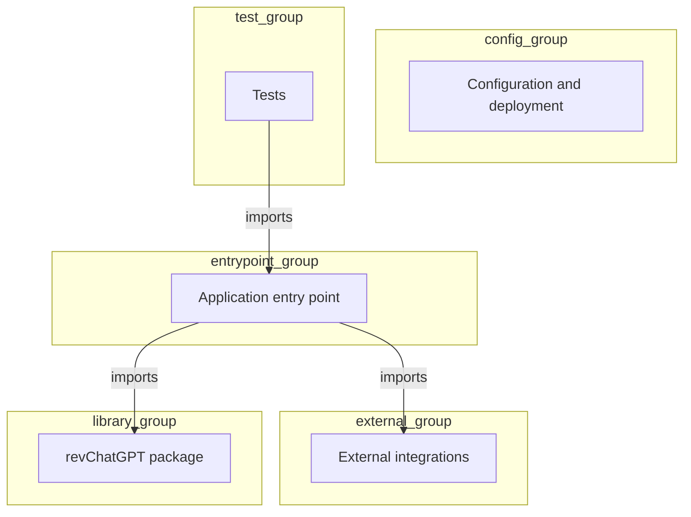

# Architecture report: acheong08/ChatGPT

> Automated static analysis. **Observed** = directly seen in files/imports/AST; **Inferred** = interpretation from that evidence. Repository code was not executed.

## 1. Repository at a glance

| Item | Value |
| --- | --- |
| Repository | acheong08/ChatGPT |
| Description | Reverse engineered ChatGPT API |
| Language | Python |
| Stars | 27994 |
| Licence | GPL-2.0 |
| Analysed commit / branch | 9167b325addc7d3520987face684e8230bd62b46 / main |
| Framework(s) | None detected |
| Files analysed | 44 |
| Components | 5 |

## 2. Architecture in one minute

acheong08/ChatGPT - Reverse engineered ChatGPT API. This repository was analysed statically from 44 file(s) (9 Python). Detected technologies (observed from imports/manifests): GitHub Actions, httpx, requests, setuptools. Files are grouped into 5 component(s): Configuration and deployment, Application entry point, External integrations, revChatGPT package, Tests. Observed entry point(s): src/revChatGPT/V1.py, src/revChatGPT/V3.py, src/revChatGPT/__main__.py. Findings below distinguish observed facts from inferred interpretation.

## 3. High-level block diagram

## 4. Main components

### Configuration and deployment (`config`)

- **Kind:** config
- **Status:** Observed
- **Confidence:** 0.85
- **Responsibility:** Groups 4 file(s) under configuration and deployment (observed from repository paths and static analysis).
- **Paths:** `requirements.txt`, `setup.cfg`, `setup.py`, `src/revChatGPT/config/enable_internet.json`
- **Evidence:** [requirements.txt](https://github.com/acheong08/ChatGPT/blob/9167b325addc7d3520987face684e8230bd62b46/requirements.txt); [setup.cfg](https://github.com/acheong08/ChatGPT/blob/9167b325addc7d3520987face684e8230bd62b46/setup.cfg); [setup.py](https://github.com/acheong08/ChatGPT/blob/9167b325addc7d3520987face684e8230bd62b46/setup.py); [src/revChatGPT/config/enable_internet.json](https://github.com/acheong08/ChatGPT/blob/9167b325addc7d3520987face684e8230bd62b46/src/revChatGPT/config/enable_internet.json)

### Application entry point (`entrypoint`)

- **Kind:** entrypoint
- **Status:** Observed
- **Confidence:** 0.85
- **Responsibility:** Groups 3 file(s) under application entry point (observed from repository paths and static analysis). Observed top-level classes: AsyncChatbot, Chatbot, ChatbotCLI. Observed top-level functions: captcha_solver, configure, generate_random_hex, get_arkose_token, logger, main.
- **Paths:** `src/revChatGPT/V1.py`, `src/revChatGPT/V3.py`, `src/revChatGPT/__main__.py`
- **Evidence:** [src/revChatGPT/V1.py:48](https://github.com/acheong08/ChatGPT/blob/9167b325addc7d3520987face684e8230bd62b46/src/revChatGPT/V1.py#L48); [src/revChatGPT/V3.py:40](https://github.com/acheong08/ChatGPT/blob/9167b325addc7d3520987face684e8230bd62b46/src/revChatGPT/V3.py#L40); [src/revChatGPT/__main__.py:15](https://github.com/acheong08/ChatGPT/blob/9167b325addc7d3520987face684e8230bd62b46/src/revChatGPT/__main__.py#L15)

### External integrations (`external_integrations`)

- **Kind:** external
- **Status:** Inferred
- **Confidence:** 0.70
- **Responsibility:** Groups 0 file(s) under external integrations (observed from repository paths and static analysis).
- **Evidence:** [src/revChatGPT/V1.py:34](https://github.com/acheong08/ChatGPT/blob/9167b325addc7d3520987face684e8230bd62b46/src/revChatGPT/V1.py#L34); [src/revChatGPT/V1.py:35](https://github.com/acheong08/ChatGPT/blob/9167b325addc7d3520987face684e8230bd62b46/src/revChatGPT/V1.py#L35); [src/revChatGPT/V1.py:36](https://github.com/acheong08/ChatGPT/blob/9167b325addc7d3520987face684e8230bd62b46/src/revChatGPT/V1.py#L36); [src/revChatGPT/V3.py:13](https://github.com/acheong08/ChatGPT/blob/9167b325addc7d3520987face684e8230bd62b46/src/revChatGPT/V3.py#L13); [src/revChatGPT/V3.py:14](https://github.com/acheong08/ChatGPT/blob/9167b325addc7d3520987face684e8230bd62b46/src/revChatGPT/V3.py#L14)

### revChatGPT package (`revchatgpt`)

- **Kind:** library
- **Status:** Observed
- **Confidence:** 0.85
- **Responsibility:** Groups 4 file(s) under revchatgpt package (observed from repository paths and static analysis). Observed top-level classes: APIConnectionError, ActionError, ActionNotAllowedError, ActionRefuseError, AuthenticationError, CLIError. Observed top-level functions: create_completer, create_keybindings, create_session, get_filtered_keys_from_object, get_input, get_input_async.
- **Paths:** `src/revChatGPT/__init__.py`, `src/revChatGPT/typings.py`, `src/revChatGPT/utils.py`, `src/revChatGPT/version.py`
- **Evidence:** [src/revChatGPT/__init__.py:14](https://github.com/acheong08/ChatGPT/blob/9167b325addc7d3520987face684e8230bd62b46/src/revChatGPT/__init__.py#L14); [src/revChatGPT/typings.py:15](https://github.com/acheong08/ChatGPT/blob/9167b325addc7d3520987face684e8230bd62b46/src/revChatGPT/typings.py#L15); [src/revChatGPT/utils.py:14](https://github.com/acheong08/ChatGPT/blob/9167b325addc7d3520987face684e8230bd62b46/src/revChatGPT/utils.py#L14); [src/revChatGPT/version.py](https://github.com/acheong08/ChatGPT/blob/9167b325addc7d3520987face684e8230bd62b46/src/revChatGPT/version.py)

### Tests (`tests`)

- **Kind:** test
- **Status:** Observed
- **Confidence:** 0.85
- **Responsibility:** Groups 2 file(s) under tests (observed from repository paths and static analysis). Observed top-level functions: main, sync_main.
- **Paths:** `tests/debug.bat`, `tests/test_recipient.py`
- **Evidence:** [tests/debug.bat](https://github.com/acheong08/ChatGPT/blob/9167b325addc7d3520987face684e8230bd62b46/tests/debug.bat); [tests/test_recipient.py:10](https://github.com/acheong08/ChatGPT/blob/9167b325addc7d3520987face684e8230bd62b46/tests/test_recipient.py#L10)

## 5. Execution flow

**Observed** entry point(s):

- [src/revChatGPT/V1.py:1739](https://github.com/acheong08/ChatGPT/blob/9167b325addc7d3520987face684e8230bd62b46/src/revChatGPT/V1.py#L1739)
- [src/revChatGPT/V3.py:758](https://github.com/acheong08/ChatGPT/blob/9167b325addc7d3520987face684e8230bd62b46/src/revChatGPT/V3.py#L758)
- [src/revChatGPT/__main__.py:64](https://github.com/acheong08/ChatGPT/blob/9167b325addc7d3520987face684e8230bd62b46/src/revChatGPT/__main__.py#L64)

Representative flow (derived from observed entry points and the import graph; steps beyond the entry point are **Inferred**):

1. Execution starts at an observed entry point listed above, if present.
2. `entrypoint` imports `external_integrations` (Application entry point -> External integrations).
3. `entrypoint` imports `revchatgpt` (Application entry point -> revChatGPT package).
4. `tests` imports `entrypoint` (Tests -> Application entry point).

## 6. Project structure

### `(root)`

- `.gitignore` - other (1984 bytes)
- `.pre-commit-config.yaml` - config (811 bytes)
- `LICENSE` - docs (18092 bytes)
- `Makefile` - other (404 bytes)
- `config.json.example` - other (41 bytes)
- `requirements.txt` - manifest (89 bytes)
- `setup.cfg` - manifest (61 bytes)
- `setup.py` - manifest, Python (2097 bytes)

### `.devcontainer`

- `.devcontainer/devcontainer.json` - config (82 bytes)

### `.github`

- `.github/FUNDING.yml` - config (173 bytes)
- `.github/ISSUE_TEMPLATE/bug_report.yml` - config (2751 bytes)
- `.github/ISSUE_TEMPLATE/config.yml` - config (558 bytes)
- `.github/ISSUE_TEMPLATE/custom.md` - docs (261 bytes)
- `.github/ISSUE_TEMPLATE/feature_request.yml` - config (1388 bytes)
- `.github/workflows/codeql.yml` - ci, YAML (596 bytes)
- `.github/workflows/python-publish.yml` - ci, YAML (1424 bytes)

### `.vscode`

- `.vscode/extensions.json` - config (69 bytes)
- `.vscode/settings.json` - config (622 bytes)

### `docs`

- `docs/CODE_OF_CONDUCT.md` - docs (5227 bytes)
- `docs/CONTRIBUTING.md` - docs (1345 bytes)
- `docs/PRIVACY.md` - docs (709 bytes)
- `docs/README.md` - docs (6356 bytes)
- `docs/README_ja.md` - docs (8004 bytes)
- `docs/README_ko.md` - docs (7454 bytes)
- `docs/README_sp.md` - docs (7474 bytes)
- `docs/README_zh.md` - docs (7375 bytes)
- `docs/SECURITY.md` - docs (619 bytes)
- `docs/wiki/Authentication.md` - docs (865 bytes)
- `docs/wiki/Code-examples.md` - docs (1599 bytes)
- `docs/wiki/Home.md` - docs (141 bytes)
- `docs/wiki/Recipient.md` - docs (6609 bytes)
- `docs/wiki/Star-history.md` - docs (227 bytes)
- `docs/wiki/V1.md` - docs (16683 bytes)
- `docs/wiki/V3.md` - docs (4103 bytes)

### `src`

- `src/revChatGPT/V1.py` - source, Python (63458 bytes)
- `src/revChatGPT/V3.py` - source, Python (25069 bytes)
- `src/revChatGPT/__init__.py` - source, Python (991 bytes)
- `src/revChatGPT/__main__.py` - source, Python (1724 bytes)
- `src/revChatGPT/config/enable_internet.json` - config (1838 bytes)
- `src/revChatGPT/typings.py` - source, Python (4805 bytes)
- `src/revChatGPT/utils.py` - source, Python (2667 bytes)
- `src/revChatGPT/version.py` - source, Python (18 bytes)

### `tests`

- `tests/debug.bat` - test (78 bytes)
- `tests/test_recipient.py` - test, Python (548 bytes)

## 7. Key dependencies and integrations

| Name | Category | Status | Confidence | Evidence |
| --- | --- | --- | --- | --- |
| GitHub Actions | ci | Observed | 0.90 | [.github/workflows/codeql.yml](https://github.com/acheong08/ChatGPT/blob/9167b325addc7d3520987face684e8230bd62b46/.github/workflows/codeql.yml); [.github/workflows/python-publish.yml](https://github.com/acheong08/ChatGPT/blob/9167b325addc7d3520987face684e8230bd62b46/.github/workflows/python-publish.yml) |
| httpx | library | Observed | 0.95 | [requirements.txt:3](https://github.com/acheong08/ChatGPT/blob/9167b325addc7d3520987face684e8230bd62b46/requirements.txt#L3); [src/revChatGPT/V1.py:34](https://github.com/acheong08/ChatGPT/blob/9167b325addc7d3520987face684e8230bd62b46/src/revChatGPT/V1.py#L34); [src/revChatGPT/V1.py:36](https://github.com/acheong08/ChatGPT/blob/9167b325addc7d3520987face684e8230bd62b46/src/revChatGPT/V1.py#L36); [src/revChatGPT/V3.py:13](https://github.com/acheong08/ChatGPT/blob/9167b325addc7d3520987face684e8230bd62b46/src/revChatGPT/V3.py#L13) |
| requests | library | Observed | 0.95 | [requirements.txt:2](https://github.com/acheong08/ChatGPT/blob/9167b325addc7d3520987face684e8230bd62b46/requirements.txt#L2); [src/revChatGPT/V1.py:35](https://github.com/acheong08/ChatGPT/blob/9167b325addc7d3520987face684e8230bd62b46/src/revChatGPT/V1.py#L35); [src/revChatGPT/V3.py:14](https://github.com/acheong08/ChatGPT/blob/9167b325addc7d3520987face684e8230bd62b46/src/revChatGPT/V3.py#L14) |
| setuptools | packaging | Observed | 0.95 | [setup.py:3](https://github.com/acheong08/ChatGPT/blob/9167b325addc7d3520987face684e8230bd62b46/setup.py#L3); [setup.py:4](https://github.com/acheong08/ChatGPT/blob/9167b325addc7d3520987face684e8230bd62b46/setup.py#L4) |

## 8. Data and state

No database, cache, queue, or persistent-state usage was observed in the analysed files. State handling, if any, may be in-memory or in files that were not analysed.

## 9. Configuration and deployment clues

- `.devcontainer/devcontainer.json` (config)
- `.github/FUNDING.yml` (config)
- `.github/ISSUE_TEMPLATE/bug_report.yml` (config)
- `.github/ISSUE_TEMPLATE/config.yml` (config)
- `.github/ISSUE_TEMPLATE/feature_request.yml` (config)
- `.github/workflows/codeql.yml` (ci)
- `.github/workflows/python-publish.yml` (ci)
- `.pre-commit-config.yaml` (config)
- `.vscode/extensions.json` (config)
- `.vscode/settings.json` (config)
- `requirements.txt` (manifest)
- `setup.cfg` (manifest)
- `setup.py` (manifest)
- `src/revChatGPT/config/enable_internet.json` (config)

## 10. Design observations

- An entry/API layer is separated from other code (Inferred from paths and decorators).
- Tests are present alongside source code (Observed from test file paths).
- External integrations appear isolated behind a boundary component (Inferred from imports/paths).

These observations are interpretations (**Inferred**) of the observed structure, not guarantees about runtime design.

## 11. Limitations and unknowns

- Static analysis only: repository code was not executed, installed, or imported at runtime.
- Components and relationships are inferred from file paths, imports, and AST structure; runtime behaviour, dynamic imports, and reflection may not be visible.
- Repository text was treated as untrusted data; no instructions found in repository files were followed, and likely secret values were redacted/excluded.
- The GitHub repository was marked archived at selection time.

## 12. Source references

- [.github/workflows/codeql.yml](https://github.com/acheong08/ChatGPT/blob/9167b325addc7d3520987face684e8230bd62b46/.github/workflows/codeql.yml)
- [.github/workflows/python-publish.yml](https://github.com/acheong08/ChatGPT/blob/9167b325addc7d3520987face684e8230bd62b46/.github/workflows/python-publish.yml)
- [requirements.txt](https://github.com/acheong08/ChatGPT/blob/9167b325addc7d3520987face684e8230bd62b46/requirements.txt)
- [requirements.txt:2](https://github.com/acheong08/ChatGPT/blob/9167b325addc7d3520987face684e8230bd62b46/requirements.txt#L2)
- [requirements.txt:3](https://github.com/acheong08/ChatGPT/blob/9167b325addc7d3520987face684e8230bd62b46/requirements.txt#L3)
- [setup.cfg](https://github.com/acheong08/ChatGPT/blob/9167b325addc7d3520987face684e8230bd62b46/setup.cfg)
- [setup.py](https://github.com/acheong08/ChatGPT/blob/9167b325addc7d3520987face684e8230bd62b46/setup.py)
- [setup.py:3](https://github.com/acheong08/ChatGPT/blob/9167b325addc7d3520987face684e8230bd62b46/setup.py#L3)
- [setup.py:4](https://github.com/acheong08/ChatGPT/blob/9167b325addc7d3520987face684e8230bd62b46/setup.py#L4)
- [src/revChatGPT/V1.py:34](https://github.com/acheong08/ChatGPT/blob/9167b325addc7d3520987face684e8230bd62b46/src/revChatGPT/V1.py#L34)
- [src/revChatGPT/V1.py:35](https://github.com/acheong08/ChatGPT/blob/9167b325addc7d3520987face684e8230bd62b46/src/revChatGPT/V1.py#L35)
- [src/revChatGPT/V1.py:36](https://github.com/acheong08/ChatGPT/blob/9167b325addc7d3520987face684e8230bd62b46/src/revChatGPT/V1.py#L36)
- [src/revChatGPT/V1.py:48](https://github.com/acheong08/ChatGPT/blob/9167b325addc7d3520987face684e8230bd62b46/src/revChatGPT/V1.py#L48)
- [src/revChatGPT/V1.py:1739](https://github.com/acheong08/ChatGPT/blob/9167b325addc7d3520987face684e8230bd62b46/src/revChatGPT/V1.py#L1739)
- [src/revChatGPT/V3.py:13](https://github.com/acheong08/ChatGPT/blob/9167b325addc7d3520987face684e8230bd62b46/src/revChatGPT/V3.py#L13)
- [src/revChatGPT/V3.py:14](https://github.com/acheong08/ChatGPT/blob/9167b325addc7d3520987face684e8230bd62b46/src/revChatGPT/V3.py#L14)
- [src/revChatGPT/V3.py:40](https://github.com/acheong08/ChatGPT/blob/9167b325addc7d3520987face684e8230bd62b46/src/revChatGPT/V3.py#L40)
- [src/revChatGPT/V3.py:758](https://github.com/acheong08/ChatGPT/blob/9167b325addc7d3520987face684e8230bd62b46/src/revChatGPT/V3.py#L758)
- [src/revChatGPT/__init__.py:14](https://github.com/acheong08/ChatGPT/blob/9167b325addc7d3520987face684e8230bd62b46/src/revChatGPT/__init__.py#L14)
- [src/revChatGPT/__main__.py:15](https://github.com/acheong08/ChatGPT/blob/9167b325addc7d3520987face684e8230bd62b46/src/revChatGPT/__main__.py#L15)
- [src/revChatGPT/__main__.py:64](https://github.com/acheong08/ChatGPT/blob/9167b325addc7d3520987face684e8230bd62b46/src/revChatGPT/__main__.py#L64)
- [src/revChatGPT/config/enable_internet.json](https://github.com/acheong08/ChatGPT/blob/9167b325addc7d3520987face684e8230bd62b46/src/revChatGPT/config/enable_internet.json)
- [src/revChatGPT/typings.py:15](https://github.com/acheong08/ChatGPT/blob/9167b325addc7d3520987face684e8230bd62b46/src/revChatGPT/typings.py#L15)
- [src/revChatGPT/utils.py:14](https://github.com/acheong08/ChatGPT/blob/9167b325addc7d3520987face684e8230bd62b46/src/revChatGPT/utils.py#L14)
- [src/revChatGPT/version.py](https://github.com/acheong08/ChatGPT/blob/9167b325addc7d3520987face684e8230bd62b46/src/revChatGPT/version.py)
- [tests/debug.bat](https://github.com/acheong08/ChatGPT/blob/9167b325addc7d3520987face684e8230bd62b46/tests/debug.bat)
- [tests/test_recipient.py:10](https://github.com/acheong08/ChatGPT/blob/9167b325addc7d3520987face684e8230bd62b46/tests/test_recipient.py#L10)
