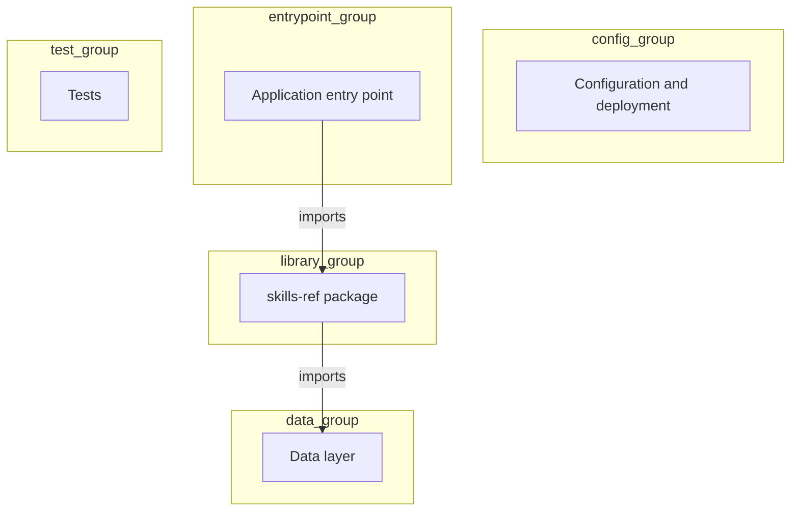

# Architecture report: agentskills/agentskills

> Automated static analysis. **Observed** = directly seen in files/imports/AST; **Inferred** = interpretation from that evidence. Repository code was not executed.

## 1. Repository at a glance

| Item | Value |
| --- | --- |
| Repository | agentskills/agentskills |
| Description | Specification and documentation for Agent Skills |
| Language | Python |
| Stars | 27291 |
| Licence | Apache-2.0 |
| Analysed commit / branch | 83021e2be457a9b6679148719c1f6074f0ad975e / main |
| Framework(s) | None detected |
| Files analysed | 133 |
| Components | 5 |

## 2. Architecture in one minute

agentskills/agentskills - Specification and documentation for Agent Skills. This repository was analysed statically from 133 file(s) (11 Python). Detected technologies (observed from imports/manifests): Click, Poetry, pytest. Files are grouped into 5 component(s): Configuration and deployment, Data layer, Application entry point, skills-ref package, Tests. Observed entry point(s): skills-ref/src/skills_ref/cli.py. Findings below distinguish observed facts from inferred interpretation.

## 3. High-level block diagram

## 4. Main components

### Configuration and deployment (`config`)

- **Kind:** config
- **Status:** Observed
- **Confidence:** 0.85
- **Responsibility:** Groups 2 file(s) under configuration and deployment (observed from repository paths and static analysis).
- **Paths:** `package.json`, `skills-ref/pyproject.toml`
- **Evidence:** [package.json](https://github.com/agentskills/agentskills/blob/83021e2be457a9b6679148719c1f6074f0ad975e/package.json); [skills-ref/pyproject.toml](https://github.com/agentskills/agentskills/blob/83021e2be457a9b6679148719c1f6074f0ad975e/skills-ref/pyproject.toml)

### Data layer (`data_layer`)

- **Kind:** data
- **Status:** Observed
- **Confidence:** 0.85
- **Responsibility:** Groups 1 file(s) under data layer (observed from repository paths and static analysis). Observed top-level classes: SkillProperties.
- **Paths:** `skills-ref/src/skills_ref/models.py`
- **Evidence:** [skills-ref/src/skills_ref/models.py:8](https://github.com/agentskills/agentskills/blob/83021e2be457a9b6679148719c1f6074f0ad975e/skills-ref/src/skills_ref/models.py#L8)

### Application entry point (`entrypoint`)

- **Kind:** entrypoint
- **Status:** Observed
- **Confidence:** 0.85
- **Responsibility:** Groups 1 file(s) under application entry point (observed from repository paths and static analysis). Observed top-level functions: _is_skill_md_file, main, read_properties_cmd, to_prompt_cmd, validate_cmd.
- **Paths:** `skills-ref/src/skills_ref/cli.py`
- **Evidence:** [skills-ref/src/skills_ref/cli.py:15](https://github.com/agentskills/agentskills/blob/83021e2be457a9b6679148719c1f6074f0ad975e/skills-ref/src/skills_ref/cli.py#L15)

### skills-ref package (`skills_ref`)

- **Kind:** library
- **Status:** Observed
- **Confidence:** 0.85
- **Responsibility:** Groups 5 file(s) under skills-ref package (observed from repository paths and static analysis). Observed top-level classes: ParseError, SkillError, ValidationError. Observed top-level functions: _validate_compatibility, _validate_description, _validate_metadata_fields, _validate_name, find_skill_md, parse_frontmatter.
- **Paths:** `skills-ref/src/skills_ref/__init__.py`, `skills-ref/src/skills_ref/errors.py`, `skills-ref/src/skills_ref/parser.py`, `skills-ref/src/skills_ref/prompt.py`, `skills-ref/src/skills_ref/validator.py`
- **Evidence:** [skills-ref/src/skills_ref/__init__.py](https://github.com/agentskills/agentskills/blob/83021e2be457a9b6679148719c1f6074f0ad975e/skills-ref/src/skills_ref/__init__.py); [skills-ref/src/skills_ref/errors.py:4](https://github.com/agentskills/agentskills/blob/83021e2be457a9b6679148719c1f6074f0ad975e/skills-ref/src/skills_ref/errors.py#L4); [skills-ref/src/skills_ref/parser.py:12](https://github.com/agentskills/agentskills/blob/83021e2be457a9b6679148719c1f6074f0ad975e/skills-ref/src/skills_ref/parser.py#L12); [skills-ref/src/skills_ref/prompt.py:9](https://github.com/agentskills/agentskills/blob/83021e2be457a9b6679148719c1f6074f0ad975e/skills-ref/src/skills_ref/prompt.py#L9); [skills-ref/src/skills_ref/validator.py:25](https://github.com/agentskills/agentskills/blob/83021e2be457a9b6679148719c1f6074f0ad975e/skills-ref/src/skills_ref/validator.py#L25)

### Tests (`tests`)

- **Kind:** test
- **Status:** Observed
- **Confidence:** 0.85
- **Responsibility:** Groups 4 file(s) under tests (observed from repository paths and static analysis). Observed top-level functions: test_allowed_tools_accepted, test_compatibility_too_long, test_description_too_long, test_empty_list, test_find_skill_md_accepts_lowercase, test_find_skill_md_prefers_uppercase.
- **Paths:** `skills-ref/tests/__init__.py`, `skills-ref/tests/test_parser.py`, `skills-ref/tests/test_prompt.py`, `skills-ref/tests/test_validator.py`
- **Evidence:** [skills-ref/tests/__init__.py](https://github.com/agentskills/agentskills/blob/83021e2be457a9b6679148719c1f6074f0ad975e/skills-ref/tests/__init__.py); [skills-ref/tests/test_parser.py:14](https://github.com/agentskills/agentskills/blob/83021e2be457a9b6679148719c1f6074f0ad975e/skills-ref/tests/test_parser.py#L14); [skills-ref/tests/test_prompt.py:6](https://github.com/agentskills/agentskills/blob/83021e2be457a9b6679148719c1f6074f0ad975e/skills-ref/tests/test_prompt.py#L6); [skills-ref/tests/test_validator.py:6](https://github.com/agentskills/agentskills/blob/83021e2be457a9b6679148719c1f6074f0ad975e/skills-ref/tests/test_validator.py#L6)

## 5. Execution flow

**Observed** entry point(s):

- [skills-ref/src/skills_ref/cli.py:22](https://github.com/agentskills/agentskills/blob/83021e2be457a9b6679148719c1f6074f0ad975e/skills-ref/src/skills_ref/cli.py#L22)

Representative flow (derived from observed entry points and the import graph; steps beyond the entry point are **Inferred**):

1. Execution starts at an observed entry point listed above, if present.
2. `entrypoint` imports `skills_ref` (Application entry point -> skills-ref package).
3. `skills_ref` imports `data_layer` (skills-ref package -> Data layer).

## 6. Project structure

### `(root)`

- `.gitignore` - other (72 bytes)
- `AGENTS.md` - docs (1960 bytes)
- `CONTRIBUTING.md` - docs (6019 bytes)
- `GOVERNANCE.md` - docs (15883 bytes)
- `LICENSE` - docs (11344 bytes)
- `MAINTAINERS.md` - docs (843 bytes)
- `README.md` - docs (3361 bytes)
- `package.json` - manifest (104 bytes)

### `.claude`

- `.claude/hooks/session-start.sh` - source, Shell (268 bytes)
- `.claude/settings.json` - config (205 bytes)

### `docs`

- `docs/LICENSE` - docs (18656 bytes)
- `docs/README.md` - docs (482 bytes)
- `docs/client-implementation/adding-skills-support.mdx` - docs (20254 bytes)
- `docs/clients.mdx` - docs (252 bytes)
- `docs/docs.json` - config (1512 bytes)
- `docs/favicon.svg` - docs (190 bytes)
- `docs/footer.js` - docs (1106 bytes)
- `docs/home.mdx` - docs (3314 bytes)
- `docs/images/logos/agentman/agentman-wordmark-dark.svg` - docs (8570 bytes)
- `docs/images/logos/agentman/agentman-wordmark-light.svg` - docs (8559 bytes)
- `docs/images/logos/amp/amp-logo-dark.svg` - docs (1713 bytes)
- `docs/images/logos/amp/amp-logo-light.svg` - docs (1713 bytes)
- `docs/images/logos/autohand/autohand-dark.svg` - docs (1353 bytes)
- `docs/images/logos/autohand/autohand-light.svg` - docs (1401 bytes)
- `docs/images/logos/block/block-lockup_black.svg` - docs (3352 bytes)
- `docs/images/logos/block/block-lockup_white.svg` - docs (3352 bytes)
- `docs/images/logos/bub/bub-dark.svg` - docs (24527 bytes)
- `docs/images/logos/bub/bub-light.svg` - docs (24519 bytes)
- `docs/images/logos/chatgpt/dark.svg` - docs (5420 bytes)
- `docs/images/logos/chatgpt/light.svg` - docs (5420 bytes)
- `docs/images/logos/claude-ai/Claude-logo-Ivory.svg` - docs (6337 bytes)
- `docs/images/logos/claude-ai/Claude-logo-One-color.svg` - docs (6315 bytes)
- `docs/images/logos/claude-ai/Claude-logo-Slate.svg` - docs (6316 bytes)
- `docs/images/logos/claude-code/Claude-Code-logo-Ivory.svg` - docs (10027 bytes)
- `docs/images/logos/claude-code/Claude-Code-logo-One-color.svg` - docs (9987 bytes)
- `docs/images/logos/claude-code/Claude-Code-logo-Slate.svg` - docs (10022 bytes)
- `docs/images/logos/command-code/command-code-logo-for-dark.svg` - docs (7602 bytes)
- `docs/images/logos/command-code/command-code-logo-for-light.svg` - docs (8507 bytes)
- `docs/images/logos/cursor/LOCKUP_HORIZONTAL_2D_DARK.svg` - docs (2523 bytes)
- `docs/images/logos/cursor/LOCKUP_HORIZONTAL_2D_LIGHT.svg` - docs (2523 bytes)
- `docs/images/logos/databricks/databricks-logo-dark.svg` - docs (5598 bytes)
- `docs/images/logos/databricks/databricks-logo-light.svg` - docs (5620 bytes)
- `docs/images/logos/deepcode/deepcode-logo-dark.svg` - docs (6588 bytes)
- `docs/images/logos/deepcode/deepcode-logo-light.svg` - docs (6588 bytes)
- `docs/images/logos/emdash/emdash-logo-dark.svg` - docs (3337 bytes)
- `docs/images/logos/emdash/emdash-logo-light.svg` - docs (3337 bytes)
- `docs/images/logos/factory/factory-logo-dark.svg` - docs (7694 bytes)
- `docs/images/logos/factory/factory-logo-light.svg` - docs (7694 bytes)
- `docs/images/logos/fast-agent/fast-agent-dark.svg` - docs (7093 bytes)
- `docs/images/logos/fast-agent/fast-agent-light.svg` - docs (7095 bytes)
- `docs/images/logos/firebender/firebender-wordmark-dark.svg` - docs (4990 bytes)
- `docs/images/logos/firebender/firebender-wordmark-light.svg` - docs (4988 bytes)
- `docs/images/logos/gemini-cli/gemini-cli-logo_dark.svg` - docs (14907 bytes)
- `docs/images/logos/gemini-cli/gemini-cli-logo_light.svg` - docs (14903 bytes)
- `docs/images/logos/github/GitHub_Lockup_Dark.svg` - docs (3088 bytes)
- `docs/images/logos/github/GitHub_Lockup_Light.svg` - docs (3088 bytes)
- `docs/images/logos/google-ai-edge-gallery/google-ai-edge-gallery-dark.svg` - docs (1924 bytes)
- `docs/images/logos/google-ai-edge-gallery/google-ai-edge-gallery-light.svg` - docs (1924 bytes)
- `docs/images/logos/hermes-agent/hermes-agent-logo-dark.svg` - docs (152289 bytes)
- `docs/images/logos/hermes-agent/hermes-agent-logo-light.svg` - docs (152289 bytes)
- `docs/images/logos/junie/junie-logo-on-dark.svg` - docs (3522 bytes)
- `docs/images/logos/junie/junie-logo-on-white.svg` - docs (3517 bytes)
- `docs/images/logos/kiro/kiro-logo-dark.svg` - docs (7058 bytes)
- `docs/images/logos/kiro/kiro-logo-light.svg` - docs (9880 bytes)
- `docs/images/logos/laravel-boost/boost-dark-mode.svg` - docs (11214 bytes)
- `docs/images/logos/laravel-boost/boost-light-mode.svg` - docs (11594 bytes)
- `docs/images/logos/letta/Letta-logo-RGB_GreyonTransparent.svg` - docs (2181 bytes)
- `docs/images/logos/letta/Letta-logo-RGB_OffBlackonTransparent.svg` - docs (2181 bytes)
- `docs/images/logos/mistral-vibe/vibe-logo.svg` - docs (902 bytes)
- `docs/images/logos/mistral-vibe/vibe-logo_black.svg` - docs (922 bytes)
- `docs/images/logos/mistral-vibe/vibe-logo_white.svg` - docs (922 bytes)
- `docs/images/logos/mux/mux-editor-dark.svg` - docs (1751 bytes)
- `docs/images/logos/mux/mux-editor-light.svg` - docs (1751 bytes)
- `docs/images/logos/ona/ona-wordmark-dark.svg` - docs (2143 bytes)
- `docs/images/logos/ona/ona-wordmark-light.svg` - docs (2162 bytes)
- `docs/images/logos/openclaw/dark.svg` - docs (1339 bytes)
- `docs/images/logos/openclaw/light.svg` - docs (1339 bytes)
- `docs/images/logos/opencode/opencode-wordmark-dark.svg` - docs (2136 bytes)
- `docs/images/logos/opencode/opencode-wordmark-light.svg` - docs (2118 bytes)
- `docs/images/logos/openhands/openhands-logo-dark.svg` - docs (14667 bytes)
- `docs/images/logos/openhands/openhands-logo-light.svg` - docs (14669 bytes)
- `docs/images/logos/pi/pi-logo-dark.svg` - docs (473 bytes)
- `docs/images/logos/pi/pi-logo-light.svg` - docs (479 bytes)
- `docs/images/logos/piebald/Piebald_wordmark_dark.svg` - docs (9879 bytes)
- `docs/images/logos/piebald/Piebald_wordmark_light.svg` - docs (9879 bytes)
- `docs/images/logos/pulumi-neo/pulumi-neo-logo-dark.svg` - docs (6173 bytes)
- `docs/images/logos/pulumi-neo/pulumi-neo-logo-light.svg` - docs (6173 bytes)
- `docs/images/logos/qodo/qodo-logo-dark.svg` - docs (6165 bytes)
- `docs/images/logos/roo-code/roo-code-logo-black.svg` - docs (10759 bytes)
- `docs/images/logos/roo-code/roo-code-logo-white.svg` - docs (10759 bytes)
- `docs/images/logos/snowflake/snowflake-logo-dark.svg` - docs (61862 bytes)
- `docs/images/logos/snowflake/snowflake-logo-light.svg` - docs (61862 bytes)
- `docs/images/logos/spring-ai/spring-ai-logo-dark.svg` - docs (8708 bytes)
- `docs/images/logos/spring-ai/spring-ai-logo-light.svg` - docs (8732 bytes)
- `docs/images/logos/superconductor/superconductor-wordmark-dark.svg` - docs (6000 bytes)
- `docs/images/logos/superconductor/superconductor-wordmark-light.svg` - docs (6028 bytes)
- `docs/images/logos/tabnine/tabnine-logo-dark.svg` - docs (2951 bytes)
- `docs/images/logos/tabnine/tabnine-logo-light.svg` - docs (2965 bytes)
- `docs/images/logos/trae/trae-logo-darkmode.svg` - docs (3073 bytes)
- `docs/images/logos/trae/trae-logo-lightmode.svg` - docs (3073 bytes)
- `docs/images/logos/vita/logo-horizontal-dark.svg` - docs (2802 bytes)
- `docs/images/logos/vita/logo-horizontal-light.svg` - docs (2802 bytes)
- `docs/images/logos/vscode/vscode-alt.svg` - docs (6206 bytes)
- `docs/images/logos/vscode/vscode.svg` - docs (6207 bytes)
- `docs/images/logos/vtcode/vt_code_dark.svg` - docs (303 bytes)
- `docs/images/logos/vtcode/vt_code_light.svg` - docs (303 bytes)
- `docs/images/logos/workshop/workshop-logo-dark.svg` - docs (8943 bytes)
- `docs/images/logos/workshop/workshop-logo-light.svg` - docs (8954 bytes)
- `docs/skill-creation/best-practices.mdx` - docs (14608 bytes)
- `docs/skill-creation/evaluating-skills.mdx` - docs (16755 bytes)
- `docs/skill-creation/optimizing-descriptions.mdx` - docs (13151 bytes)
- `docs/skill-creation/quickstart.mdx` - docs (3844 bytes)
- `docs/skill-creation/using-scripts.mdx` - docs (12405 bytes)
- `docs/snippets/ClientShowcase.jsx` - docs (3680 bytes)
- `docs/snippets/LogoCarousel.jsx` - docs (1667 bytes)
- `docs/snippets/clients.jsx` - docs (22852 bytes)
- `docs/specification.mdx` - docs (7166 bytes)
- `docs/style.css` - docs (2796 bytes)

### `skills-ref`

- `skills-ref/.gitignore` - other (200 bytes)
- `skills-ref/LICENSE` - docs (11357 bytes)
- `skills-ref/README.md` - docs (2166 bytes)
- `skills-ref/pyproject.toml` - manifest (571 bytes)
- `skills-ref/src/skills_ref/__init__.py` - source, Python (449 bytes)
- `skills-ref/src/skills_ref/cli.py` - source, Python (2697 bytes)
- `skills-ref/src/skills_ref/errors.py` - source, Python (572 bytes)
- `skills-ref/src/skills_ref/models.py` - source, Python (1461 bytes)
- `skills-ref/src/skills_ref/parser.py` - source, Python (3413 bytes)
- `skills-ref/src/skills_ref/prompt.py` - source, Python (1724 bytes)
- `skills-ref/src/skills_ref/validator.py` - source, Python (5154 bytes)
- `skills-ref/tests/__init__.py` - test, Python (36 bytes)
- `skills-ref/tests/test_parser.py` - test, Python (4765 bytes)
- `skills-ref/tests/test_prompt.py` - test, Python (1713 bytes)
- `skills-ref/tests/test_validator.py` - test, Python (7220 bytes)

## 7. Key dependencies and integrations

| Name | Category | Status | Confidence | Evidence |
| --- | --- | --- | --- | --- |
| Click | library | Observed | 0.90 | [skills-ref/pyproject.toml:12](https://github.com/agentskills/agentskills/blob/83021e2be457a9b6679148719c1f6074f0ad975e/skills-ref/pyproject.toml#L12); [skills-ref/src/skills_ref/cli.py:7](https://github.com/agentskills/agentskills/blob/83021e2be457a9b6679148719c1f6074f0ad975e/skills-ref/src/skills_ref/cli.py#L7) |
| Poetry | packaging | Observed | 0.85 | [skills-ref/pyproject.toml](https://github.com/agentskills/agentskills/blob/83021e2be457a9b6679148719c1f6074f0ad975e/skills-ref/pyproject.toml) |
| pytest | tooling | Observed | 0.90 | [skills-ref/tests/test_parser.py:3](https://github.com/agentskills/agentskills/blob/83021e2be457a9b6679148719c1f6074f0ad975e/skills-ref/tests/test_parser.py#L3) |

## 8. Data and state

- Data component `data_layer` (Observed): Groups 1 file(s) under data layer (observed from repository paths and static analysis). Observed top-level classes: SkillProperties.

## 9. Configuration and deployment clues

- `.claude/settings.json` (config)
- `docs/docs.json` (config)
- `package.json` (manifest)
- `skills-ref/pyproject.toml` (manifest)

Console scripts declared in packaging metadata (**Observed**):

- `skills-ref` -> `skills_ref.cli:main`

## 10. Design observations

- An entry/API layer is separated from other code (Inferred from paths and decorators).
- Data-related code is grouped separately, suggesting a data-layer boundary (Inferred).
- Tests are present alongside source code (Observed from test file paths).

These observations are interpretations (**Inferred**) of the observed structure, not guarantees about runtime design.

## 11. Limitations and unknowns

- Static analysis only: repository code was not executed, installed, or imported at runtime.
- Components and relationships are inferred from file paths, imports, and AST structure; runtime behaviour, dynamic imports, and reflection may not be visible.
- 1 file(s) were skipped during inventory (1 x lockfile excluded).
- Repository text was treated as untrusted data; no instructions found in repository files were followed, and likely secret values were redacted/excluded.

## 12. Source references

- [package.json](https://github.com/agentskills/agentskills/blob/83021e2be457a9b6679148719c1f6074f0ad975e/package.json)
- [skills-ref/pyproject.toml](https://github.com/agentskills/agentskills/blob/83021e2be457a9b6679148719c1f6074f0ad975e/skills-ref/pyproject.toml)
- [skills-ref/pyproject.toml:12](https://github.com/agentskills/agentskills/blob/83021e2be457a9b6679148719c1f6074f0ad975e/skills-ref/pyproject.toml#L12)
- [skills-ref/src/skills_ref/__init__.py](https://github.com/agentskills/agentskills/blob/83021e2be457a9b6679148719c1f6074f0ad975e/skills-ref/src/skills_ref/__init__.py)
- [skills-ref/src/skills_ref/cli.py:7](https://github.com/agentskills/agentskills/blob/83021e2be457a9b6679148719c1f6074f0ad975e/skills-ref/src/skills_ref/cli.py#L7)
- [skills-ref/src/skills_ref/cli.py:15](https://github.com/agentskills/agentskills/blob/83021e2be457a9b6679148719c1f6074f0ad975e/skills-ref/src/skills_ref/cli.py#L15)
- [skills-ref/src/skills_ref/cli.py:22](https://github.com/agentskills/agentskills/blob/83021e2be457a9b6679148719c1f6074f0ad975e/skills-ref/src/skills_ref/cli.py#L22)
- [skills-ref/src/skills_ref/errors.py:4](https://github.com/agentskills/agentskills/blob/83021e2be457a9b6679148719c1f6074f0ad975e/skills-ref/src/skills_ref/errors.py#L4)
- [skills-ref/src/skills_ref/models.py:8](https://github.com/agentskills/agentskills/blob/83021e2be457a9b6679148719c1f6074f0ad975e/skills-ref/src/skills_ref/models.py#L8)
- [skills-ref/src/skills_ref/parser.py:12](https://github.com/agentskills/agentskills/blob/83021e2be457a9b6679148719c1f6074f0ad975e/skills-ref/src/skills_ref/parser.py#L12)
- [skills-ref/src/skills_ref/prompt.py:9](https://github.com/agentskills/agentskills/blob/83021e2be457a9b6679148719c1f6074f0ad975e/skills-ref/src/skills_ref/prompt.py#L9)
- [skills-ref/src/skills_ref/validator.py:25](https://github.com/agentskills/agentskills/blob/83021e2be457a9b6679148719c1f6074f0ad975e/skills-ref/src/skills_ref/validator.py#L25)
- [skills-ref/tests/__init__.py](https://github.com/agentskills/agentskills/blob/83021e2be457a9b6679148719c1f6074f0ad975e/skills-ref/tests/__init__.py)
- [skills-ref/tests/test_parser.py:3](https://github.com/agentskills/agentskills/blob/83021e2be457a9b6679148719c1f6074f0ad975e/skills-ref/tests/test_parser.py#L3)
- [skills-ref/tests/test_parser.py:14](https://github.com/agentskills/agentskills/blob/83021e2be457a9b6679148719c1f6074f0ad975e/skills-ref/tests/test_parser.py#L14)
- [skills-ref/tests/test_prompt.py:6](https://github.com/agentskills/agentskills/blob/83021e2be457a9b6679148719c1f6074f0ad975e/skills-ref/tests/test_prompt.py#L6)
- [skills-ref/tests/test_validator.py:6](https://github.com/agentskills/agentskills/blob/83021e2be457a9b6679148719c1f6074f0ad975e/skills-ref/tests/test_validator.py#L6)
