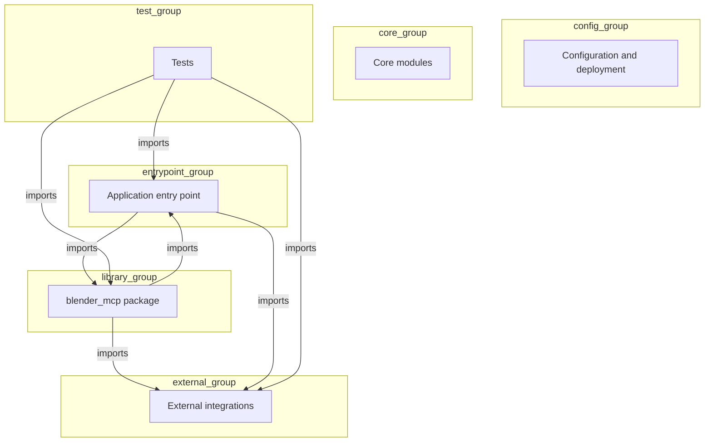

# Architecture report: ahujasid/mcp-for-blender

> Automated static analysis. **Observed** = directly seen in files/imports/AST; **Inferred** = interpretation from that evidence. Repository code was not executed.

## 1. Repository at a glance

| Item | Value |
| --- | --- |
| Repository | ahujasid/mcp-for-blender |
| Description | Community plugin to control Blender 3D with any LLM of your choice. Not affiliated with the official Blender Foundation. |
| Language | Python |
| Stars | 34429 |
| Licence | MIT |
| Analysed commit / branch | 8f40787fbde8e6d8fe51c5a3553e5635fff40d2b / main |
| Framework(s) | None detected |
| Files analysed | 79 |
| Components | 6 |

## 2. Architecture in one minute

ahujasid/mcp-for-blender - Community plugin to control Blender 3D with any LLM of your choice. Not affiliated with the official Blender Foundation.. This repository was analysed statically from 79 file(s) (51 Python). Detected technologies (observed from imports/manifests): httpx, Pydantic, Poetry, setuptools, Docker, pytest. Files are grouped into 6 component(s): blender_mcp package, Configuration and deployment, Core modules, Application entry point, External integrations, Tests. Observed entry point(s): main.py, src/blender_mcp/server.py. Findings below distinguish observed facts from inferred interpretation.

## 3. High-level block diagram

## 4. Main components

### blender_mcp package (`blender_mcp`)

- **Kind:** library
- **Status:** Observed
- **Confidence:** 0.85
- **Responsibility:** Groups 16 file(s) under blender_mcp package (observed from repository paths and static analysis). Observed top-level classes: AddonHandshake, AddonInstallResult, AddonOutcome, AddonStatusReport, AddonUpdate, Client. Observed top-level functions: _already_answered, _antigravity_config, _appdata, _append_note, _apply_consent, _ask.
- **Paths:** `src/blender_mcp/__init__.py`, `src/blender_mcp/addon_manager.py`, `src/blender_mcp/blender_scripts.py`, `src/blender_mcp/bundled/__init__.py`, `src/blender_mcp/consent_prompt.py`, `src/blender_mcp/context_log.py`, `src/blender_mcp/generation.py`, `src/blender_mcp/guides.py`, `src/blender_mcp/openai_apps.py`, `src/blender_mcp/premium_hint.py`, `src/blender_mcp/safe_mode.py`, `src/blender_mcp/setup_cli.py`, `src/blender_mcp/telemetry.py`, `src/blender_mcp/telemetry_decorator.py`, `src/blender_mcp/trajectory.py`, `src/blender_mcp/update_cli.py`
- **Evidence:** [src/blender_mcp/__init__.py](https://github.com/ahujasid/mcp-for-blender/blob/8f40787fbde8e6d8fe51c5a3553e5635fff40d2b/src/blender_mcp/__init__.py); [src/blender_mcp/addon_manager.py:36](https://github.com/ahujasid/mcp-for-blender/blob/8f40787fbde8e6d8fe51c5a3553e5635fff40d2b/src/blender_mcp/addon_manager.py#L36); [src/blender_mcp/blender_scripts.py:15](https://github.com/ahujasid/mcp-for-blender/blob/8f40787fbde8e6d8fe51c5a3553e5635fff40d2b/src/blender_mcp/blender_scripts.py#L15); [src/blender_mcp/bundled/__init__.py](https://github.com/ahujasid/mcp-for-blender/blob/8f40787fbde8e6d8fe51c5a3553e5635fff40d2b/src/blender_mcp/bundled/__init__.py); [src/blender_mcp/consent_prompt.py:67](https://github.com/ahujasid/mcp-for-blender/blob/8f40787fbde8e6d8fe51c5a3553e5635fff40d2b/src/blender_mcp/consent_prompt.py#L67); [src/blender_mcp/context_log.py:28](https://github.com/ahujasid/mcp-for-blender/blob/8f40787fbde8e6d8fe51c5a3553e5635fff40d2b/src/blender_mcp/context_log.py#L28); [src/blender_mcp/generation.py:91](https://github.com/ahujasid/mcp-for-blender/blob/8f40787fbde8e6d8fe51c5a3553e5635fff40d2b/src/blender_mcp/generation.py#L91); [src/blender_mcp/guides.py:15](https://github.com/ahujasid/mcp-for-blender/blob/8f40787fbde8e6d8fe51c5a3553e5635fff40d2b/src/blender_mcp/guides.py#L15)

### Configuration and deployment (`config`)

- **Kind:** config
- **Status:** Observed
- **Confidence:** 0.85
- **Responsibility:** Groups 7 file(s) under configuration and deployment (observed from repository paths and static analysis).
- **Paths:** `Dockerfile`, `integrations/claude/mcp-for-blender/.claude-plugin/plugin.json`, `integrations/claude/mcp-for-blender/.mcp.json`, `integrations/codex/.agents/plugins/marketplace.json`, `integrations/codex/plugins/mcp-for-blender/.codex-plugin/plugin.json`, `integrations/codex/plugins/mcp-for-blender/.mcp.json`, `pyproject.toml`
- **Evidence:** [Dockerfile](https://github.com/ahujasid/mcp-for-blender/blob/8f40787fbde8e6d8fe51c5a3553e5635fff40d2b/Dockerfile); [integrations/claude/mcp-for-blender/.claude-plugin/plugin.json](https://github.com/ahujasid/mcp-for-blender/blob/8f40787fbde8e6d8fe51c5a3553e5635fff40d2b/integrations/claude/mcp-for-blender/.claude-plugin/plugin.json); [integrations/claude/mcp-for-blender/.mcp.json](https://github.com/ahujasid/mcp-for-blender/blob/8f40787fbde8e6d8fe51c5a3553e5635fff40d2b/integrations/claude/mcp-for-blender/.mcp.json); [integrations/codex/.agents/plugins/marketplace.json](https://github.com/ahujasid/mcp-for-blender/blob/8f40787fbde8e6d8fe51c5a3553e5635fff40d2b/integrations/codex/.agents/plugins/marketplace.json); [integrations/codex/plugins/mcp-for-blender/.codex-plugin/plugin.json](https://github.com/ahujasid/mcp-for-blender/blob/8f40787fbde8e6d8fe51c5a3553e5635fff40d2b/integrations/codex/plugins/mcp-for-blender/.codex-plugin/plugin.json); [integrations/codex/plugins/mcp-for-blender/.mcp.json](https://github.com/ahujasid/mcp-for-blender/blob/8f40787fbde8e6d8fe51c5a3553e5635fff40d2b/integrations/codex/plugins/mcp-for-blender/.mcp.json); [pyproject.toml](https://github.com/ahujasid/mcp-for-blender/blob/8f40787fbde8e6d8fe51c5a3553e5635fff40d2b/pyproject.toml)

### Core modules (`core`)

- **Kind:** core
- **Status:** Observed
- **Confidence:** 0.85
- **Responsibility:** Groups 1 file(s) under core modules (observed from repository paths and static analysis).
- **Paths:** `install.sh`
- **Evidence:** [install.sh](https://github.com/ahujasid/mcp-for-blender/blob/8f40787fbde8e6d8fe51c5a3553e5635fff40d2b/install.sh)

### Application entry point (`entrypoint`)

- **Kind:** entrypoint
- **Status:** Observed
- **Confidence:** 0.85
- **Responsibility:** Groups 2 file(s) under application entry point (observed from repository paths and static analysis). Observed top-level classes: AddonTooOld, BlenderConnection, _LookRefused. Observed top-level functions: _addon_lacks, _addon_outdated, _addon_protocol, _app_error, _capture_viewport, _describe_world.
- **Paths:** `main.py`, `src/blender_mcp/server.py`
- **Evidence:** [main.py:3](https://github.com/ahujasid/mcp-for-blender/blob/8f40787fbde8e6d8fe51c5a3553e5635fff40d2b/main.py#L3); [src/blender_mcp/server.py:61](https://github.com/ahujasid/mcp-for-blender/blob/8f40787fbde8e6d8fe51c5a3553e5635fff40d2b/src/blender_mcp/server.py#L61)

### External integrations (`external_integrations`)

- **Kind:** external
- **Status:** Inferred
- **Confidence:** 0.70
- **Responsibility:** Groups 0 file(s) under external integrations (observed from repository paths and static analysis).
- **Evidence:** [src/blender_mcp/server.py:4](https://github.com/ahujasid/mcp-for-blender/blob/8f40787fbde8e6d8fe51c5a3553e5635fff40d2b/src/blender_mcp/server.py#L4); [src/blender_mcp/telemetry.py:21](https://github.com/ahujasid/mcp-for-blender/blob/8f40787fbde8e6d8fe51c5a3553e5635fff40d2b/src/blender_mcp/telemetry.py#L21); [src/blender_mcp/trajectory.py:21](https://github.com/ahujasid/mcp-for-blender/blob/8f40787fbde8e6d8fe51c5a3553e5635fff40d2b/src/blender_mcp/trajectory.py#L21); [src/blender_mcp/update_cli.py:47](https://github.com/ahujasid/mcp-for-blender/blob/8f40787fbde8e6d8fe51c5a3553e5635fff40d2b/src/blender_mcp/update_cli.py#L47); [tests/test_addon_autostart.py:11](https://github.com/ahujasid/mcp-for-blender/blob/8f40787fbde8e6d8fe51c5a3553e5635fff40d2b/tests/test_addon_autostart.py#L11); [tests/test_image_input_security.py:8](https://github.com/ahujasid/mcp-for-blender/blob/8f40787fbde8e6d8fe51c5a3553e5635fff40d2b/tests/test_image_input_security.py#L8)

### Tests (`tests`)

- **Kind:** test
- **Status:** Observed
- **Confidence:** 0.85
- **Responsibility:** Groups 33 file(s) under tests (observed from repository paths and static analysis). Observed top-level classes: CustomPropMixin, FakeAddon, FakeBlender, FakeCollection, FakeCollections, FakeColorspace. Observed top-level functions: _accepts_null, _addon_source, _asset, _blend_bytes, _blend_with_includes, _capture.
- **Paths:** `tests/blender_bind_address_smoke.py`, `tests/conftest.py`, `tests/test_addon_autostart.py`, `tests/test_addon_compat.py`, `tests/test_addon_manager.py`, `tests/test_addon_updater.py`, `tests/test_claude_plugin.py`, `tests/test_compat_matrix.py`, `tests/test_connection_args.py`, `tests/test_consolidated_tools.py`, `tests/test_context_log.py`, `tests/test_export_scene.py`, `tests/test_generation.py`, `tests/test_hunyuan_api_profile.py`, `tests/test_hunyuan_import_security.py`, `tests/test_image_input_security.py`, `tests/test_look_telemetry.py`, `tests/test_meshy.py`, `tests/test_openai_apps.py`, `tests/test_polyhaven.py`, `tests/test_polypizza.py`, `tests/test_premium_guidance.py`, `tests/test_process_bbox_validation.py`, `tests/test_safe_mode.py`, `tests/test_server_instructions.py`, `tests/test_server_threading.py`, `tests/test_setup_cli.py`, `tests/test_sketchfab_status.py`, `tests/test_socket_unicode.py`, `tests/test_tool_schemas.py`, `tests/test_tripo.py`, `tests/test_update_cli.py`, `tests/test_worldlabs.py`
- **Evidence:** [tests/blender_bind_address_smoke.py:26](https://github.com/ahujasid/mcp-for-blender/blob/8f40787fbde8e6d8fe51c5a3553e5635fff40d2b/tests/blender_bind_address_smoke.py#L26); [tests/conftest.py](https://github.com/ahujasid/mcp-for-blender/blob/8f40787fbde8e6d8fe51c5a3553e5635fff40d2b/tests/conftest.py); [tests/test_addon_autostart.py:29](https://github.com/ahujasid/mcp-for-blender/blob/8f40787fbde8e6d8fe51c5a3553e5635fff40d2b/tests/test_addon_autostart.py#L29); [tests/test_addon_compat.py:12](https://github.com/ahujasid/mcp-for-blender/blob/8f40787fbde8e6d8fe51c5a3553e5635fff40d2b/tests/test_addon_compat.py#L12); [tests/test_addon_manager.py:19](https://github.com/ahujasid/mcp-for-blender/blob/8f40787fbde8e6d8fe51c5a3553e5635fff40d2b/tests/test_addon_manager.py#L19); [tests/test_addon_updater.py:16](https://github.com/ahujasid/mcp-for-blender/blob/8f40787fbde8e6d8fe51c5a3553e5635fff40d2b/tests/test_addon_updater.py#L16); [tests/test_claude_plugin.py:19](https://github.com/ahujasid/mcp-for-blender/blob/8f40787fbde8e6d8fe51c5a3553e5635fff40d2b/tests/test_claude_plugin.py#L19); [tests/test_compat_matrix.py:56](https://github.com/ahujasid/mcp-for-blender/blob/8f40787fbde8e6d8fe51c5a3553e5635fff40d2b/tests/test_compat_matrix.py#L56)

## 5. Execution flow

**Observed** entry point(s):

- [main.py:7](https://github.com/ahujasid/mcp-for-blender/blob/8f40787fbde8e6d8fe51c5a3553e5635fff40d2b/main.py#L7)
- [src/blender_mcp/server.py](https://github.com/ahujasid/mcp-for-blender/blob/8f40787fbde8e6d8fe51c5a3553e5635fff40d2b/src/blender_mcp/server.py)

Representative flow (derived from observed entry points and the import graph; steps beyond the entry point are **Inferred**):

1. Execution starts at an observed entry point listed above, if present.
2. `blender_mcp` imports `entrypoint` (blender_mcp package -> Application entry point).
3. `blender_mcp` imports `external_integrations` (blender_mcp package -> External integrations).
4. `entrypoint` imports `blender_mcp` (Application entry point -> blender_mcp package).
5. `entrypoint` imports `external_integrations` (Application entry point -> External integrations).
6. `tests` imports `blender_mcp` (Tests -> blender_mcp package).
7. `tests` imports `entrypoint` (Tests -> Application entry point).
8. `tests` imports `external_integrations` (Tests -> External integrations).

## 6. Project structure

### `(root)`

- `.dockerignore` - container (353 bytes)
- `.gitignore` - other (472 bytes)
- `.python-version` - other (5 bytes)
- `Dockerfile` - container (679 bytes)
- `LICENSE` - docs (1071 bytes)
- `README.md` - docs (39908 bytes)
- `TERMS_AND_CONDITIONS.md` - docs (7807 bytes)
- `install.ps1` - other (2013 bytes)
- `install.sh` - source, Shell (2235 bytes)
- `main.py` - source, Python (175 bytes)
- `pyproject.toml` - manifest (998 bytes)

### `.claude-plugin`

- `.claude-plugin/marketplace.json` - config (442 bytes)

### `assets`

- `assets/logo-banner.svg` - other (109558 bytes)

### `integrations`

- `integrations/claude/mcp-for-blender/.claude-plugin/plugin.json` - config (830 bytes)
- `integrations/claude/mcp-for-blender/.mcp.json` - config (188 bytes)
- `integrations/claude/mcp-for-blender/LICENSE` - docs (1071 bytes)
- `integrations/claude/mcp-for-blender/README.md` - docs (5921 bytes)
- `integrations/codex/.agents/plugins/marketplace.json` - config (384 bytes)
- `integrations/codex/plugins/mcp-for-blender/.codex-plugin/plugin.json` - config (1334 bytes)
- `integrations/codex/plugins/mcp-for-blender/.mcp.json` - config (422 bytes)
- `integrations/codex/plugins/mcp-for-blender/assets/icon.svg` - other (272 bytes)

### `src`

- `src/blender_mcp/__init__.py` - source, Python (632 bytes)
- `src/blender_mcp/addon_manager.py` - source, Python (22113 bytes)
- `src/blender_mcp/apps/viewport.html` - other (17298 bytes)
- `src/blender_mcp/blender_scripts.py` - source, Python (21521 bytes)
- `src/blender_mcp/bundled/__init__.py` - source, Python (0 bytes)
- `src/blender_mcp/consent_prompt.py` - source, Python (8051 bytes)
- `src/blender_mcp/context_log.py` - source, Python (5865 bytes)
- `src/blender_mcp/generation.py` - source, Python (27919 bytes)
- `src/blender_mcp/guides.py` - source, Python (1640 bytes)
- `src/blender_mcp/guides/animation.md` - docs (2791 bytes)
- `src/blender_mcp/guides/bpy.md` - docs (3964 bytes)
- `src/blender_mcp/guides/level-design.md` - docs (2441 bytes)
- `src/blender_mcp/guides/materials.md` - docs (2474 bytes)
- `src/blender_mcp/guides/retopology.md` - docs (3301 bytes)
- `src/blender_mcp/guides/rigging.md` - docs (3051 bytes)
- `src/blender_mcp/guides/scene.md` - docs (3203 bytes)
- `src/blender_mcp/openai_apps.py` - source, Python (12859 bytes)
- `src/blender_mcp/premium_hint.py` - source, Python (2576 bytes)
- `src/blender_mcp/safe_mode.py` - source, Python (45052 bytes)
- `src/blender_mcp/server.py` - source, Python (106253 bytes)
- `src/blender_mcp/setup_cli.py` - source, Python (34621 bytes)
- `src/blender_mcp/telemetry.py` - source, Python (13866 bytes)
- `src/blender_mcp/telemetry_decorator.py` - source, Python (20862 bytes)
- `src/blender_mcp/trajectory.py` - source, Python (57987 bytes)
- `src/blender_mcp/update_cli.py` - source, Python (7449 bytes)

### `tests`

- `tests/blender_bind_address_smoke.py` - test, Python (3860 bytes)
- `tests/conftest.py` - test, Python (339 bytes)
- `tests/test_addon_autostart.py` - test, Python (13979 bytes)
- `tests/test_addon_compat.py` - test, Python (2655 bytes)
- `tests/test_addon_manager.py` - test, Python (8336 bytes)
- `tests/test_addon_updater.py` - test, Python (5061 bytes)
- `tests/test_claude_plugin.py` - test, Python (1745 bytes)
- `tests/test_compat_matrix.py` - test, Python (12971 bytes)
- `tests/test_connection_args.py` - test, Python (3604 bytes)
- `tests/test_consolidated_tools.py` - test, Python (8437 bytes)
- `tests/test_context_log.py` - test, Python (3396 bytes)
- `tests/test_export_scene.py` - test, Python (6492 bytes)
- `tests/test_generation.py` - test, Python (38727 bytes)
- `tests/test_hunyuan_api_profile.py` - test, Python (6793 bytes)
- `tests/test_hunyuan_import_security.py` - test, Python (4831 bytes)
- `tests/test_image_input_security.py` - test, Python (7576 bytes)
- `tests/test_look_telemetry.py` - test, Python (3563 bytes)
- `tests/test_meshy.py` - test, Python (22277 bytes)
- `tests/test_openai_apps.py` - test, Python (25708 bytes)
- `tests/test_polyhaven.py` - test, Python (92723 bytes)
- `tests/test_polypizza.py` - test, Python (18184 bytes)
- `tests/test_premium_guidance.py` - test, Python (2460 bytes)
- `tests/test_process_bbox_validation.py` - test, Python (457 bytes)
- `tests/test_safe_mode.py` - test, Python (12226 bytes)
- `tests/test_server_instructions.py` - test, Python (1659 bytes)
- `tests/test_server_threading.py` - test, Python (7791 bytes)
- `tests/test_setup_cli.py` - test, Python (17548 bytes)
- `tests/test_sketchfab_status.py` - test, Python (3717 bytes)
- `tests/test_socket_unicode.py` - test, Python (4166 bytes)
- `tests/test_tool_schemas.py` - test, Python (902 bytes)
- `tests/test_tripo.py` - test, Python (18782 bytes)
- `tests/test_update_cli.py` - test, Python (6597 bytes)
- `tests/test_worldlabs.py` - test, Python (21805 bytes)

## 7. Key dependencies and integrations

| Name | Category | Status | Confidence | Evidence |
| --- | --- | --- | --- | --- |
| httpx | library | Observed | 0.95 | [pyproject.toml:17](https://github.com/ahujasid/mcp-for-blender/blob/8f40787fbde8e6d8fe51c5a3553e5635fff40d2b/pyproject.toml#L17); [src/blender_mcp/telemetry.py:21](https://github.com/ahujasid/mcp-for-blender/blob/8f40787fbde8e6d8fe51c5a3553e5635fff40d2b/src/blender_mcp/telemetry.py#L21); [src/blender_mcp/trajectory.py:21](https://github.com/ahujasid/mcp-for-blender/blob/8f40787fbde8e6d8fe51c5a3553e5635fff40d2b/src/blender_mcp/trajectory.py#L21); [src/blender_mcp/update_cli.py:47](https://github.com/ahujasid/mcp-for-blender/blob/8f40787fbde8e6d8fe51c5a3553e5635fff40d2b/src/blender_mcp/update_cli.py#L47) |
| Pydantic | library | Observed | 0.90 | [src/blender_mcp/openai_apps.py:32](https://github.com/ahujasid/mcp-for-blender/blob/8f40787fbde8e6d8fe51c5a3553e5635fff40d2b/src/blender_mcp/openai_apps.py#L32) |
| Poetry | packaging | Observed | 0.85 | [pyproject.toml](https://github.com/ahujasid/mcp-for-blender/blob/8f40787fbde8e6d8fe51c5a3553e5635fff40d2b/pyproject.toml) |
| setuptools | packaging | Observed | 0.85 | [pyproject.toml:28](https://github.com/ahujasid/mcp-for-blender/blob/8f40787fbde8e6d8fe51c5a3553e5635fff40d2b/pyproject.toml#L28) |
| Docker | tooling | Observed | 0.85 | [Dockerfile](https://github.com/ahujasid/mcp-for-blender/blob/8f40787fbde8e6d8fe51c5a3553e5635fff40d2b/Dockerfile) |
| pytest | tooling | Observed | 0.95 | [tests/test_addon_autostart.py:15](https://github.com/ahujasid/mcp-for-blender/blob/8f40787fbde8e6d8fe51c5a3553e5635fff40d2b/tests/test_addon_autostart.py#L15); [tests/test_addon_compat.py:6](https://github.com/ahujasid/mcp-for-blender/blob/8f40787fbde8e6d8fe51c5a3553e5635fff40d2b/tests/test_addon_compat.py#L6); [tests/test_addon_updater.py:8](https://github.com/ahujasid/mcp-for-blender/blob/8f40787fbde8e6d8fe51c5a3553e5635fff40d2b/tests/test_addon_updater.py#L8); [tests/test_compat_matrix.py:17](https://github.com/ahujasid/mcp-for-blender/blob/8f40787fbde8e6d8fe51c5a3553e5635fff40d2b/tests/test_compat_matrix.py#L17) |
| unittest | tooling | Observed | 0.90 | [tests/test_addon_manager.py:6](https://github.com/ahujasid/mcp-for-blender/blob/8f40787fbde8e6d8fe51c5a3553e5635fff40d2b/tests/test_addon_manager.py#L6) |

## 8. Data and state

No database, cache, queue, or persistent-state usage was observed in the analysed files. State handling, if any, may be in-memory or in files that were not analysed.

## 9. Configuration and deployment clues

- `.claude-plugin/marketplace.json` (config)
- `.dockerignore` (container)
- `Dockerfile` (container)
- `integrations/claude/mcp-for-blender/.claude-plugin/plugin.json` (config)
- `integrations/claude/mcp-for-blender/.mcp.json` (config)
- `integrations/codex/.agents/plugins/marketplace.json` (config)
- `integrations/codex/plugins/mcp-for-blender/.codex-plugin/plugin.json` (config)
- `integrations/codex/plugins/mcp-for-blender/.mcp.json` (config)
- `pyproject.toml` (manifest)

Console scripts declared in packaging metadata (**Observed**):

- `mcp-for-blender` -> `blender_mcp.server:main`

## 10. Design observations

- An entry/API layer is separated from other code (Inferred from paths and decorators).
- Tests are present alongside source code (Observed from test file paths).
- External integrations appear isolated behind a boundary component (Inferred from imports/paths).

These observations are interpretations (**Inferred**) of the observed structure, not guarantees about runtime design.

## 11. Limitations and unknowns

- Static analysis only: repository code was not executed, installed, or imported at runtime.
- Components and relationships are inferred from file paths, imports, and AST structure; runtime behaviour, dynamic imports, and reflection may not be visible.
- 1 file(s) were skipped during inventory (1 x lockfile excluded).
- Repository text was treated as untrusted data; no instructions found in repository files were followed, and likely secret values were redacted/excluded.

## 12. Source references

- [Dockerfile](https://github.com/ahujasid/mcp-for-blender/blob/8f40787fbde8e6d8fe51c5a3553e5635fff40d2b/Dockerfile)
- [install.sh](https://github.com/ahujasid/mcp-for-blender/blob/8f40787fbde8e6d8fe51c5a3553e5635fff40d2b/install.sh)
- [integrations/claude/mcp-for-blender/.claude-plugin/plugin.json](https://github.com/ahujasid/mcp-for-blender/blob/8f40787fbde8e6d8fe51c5a3553e5635fff40d2b/integrations/claude/mcp-for-blender/.claude-plugin/plugin.json)
- [integrations/claude/mcp-for-blender/.mcp.json](https://github.com/ahujasid/mcp-for-blender/blob/8f40787fbde8e6d8fe51c5a3553e5635fff40d2b/integrations/claude/mcp-for-blender/.mcp.json)
- [integrations/codex/.agents/plugins/marketplace.json](https://github.com/ahujasid/mcp-for-blender/blob/8f40787fbde8e6d8fe51c5a3553e5635fff40d2b/integrations/codex/.agents/plugins/marketplace.json)
- [integrations/codex/plugins/mcp-for-blender/.codex-plugin/plugin.json](https://github.com/ahujasid/mcp-for-blender/blob/8f40787fbde8e6d8fe51c5a3553e5635fff40d2b/integrations/codex/plugins/mcp-for-blender/.codex-plugin/plugin.json)
- [integrations/codex/plugins/mcp-for-blender/.mcp.json](https://github.com/ahujasid/mcp-for-blender/blob/8f40787fbde8e6d8fe51c5a3553e5635fff40d2b/integrations/codex/plugins/mcp-for-blender/.mcp.json)
- [main.py:3](https://github.com/ahujasid/mcp-for-blender/blob/8f40787fbde8e6d8fe51c5a3553e5635fff40d2b/main.py#L3)
- [main.py:7](https://github.com/ahujasid/mcp-for-blender/blob/8f40787fbde8e6d8fe51c5a3553e5635fff40d2b/main.py#L7)
- [pyproject.toml](https://github.com/ahujasid/mcp-for-blender/blob/8f40787fbde8e6d8fe51c5a3553e5635fff40d2b/pyproject.toml)
- [pyproject.toml:17](https://github.com/ahujasid/mcp-for-blender/blob/8f40787fbde8e6d8fe51c5a3553e5635fff40d2b/pyproject.toml#L17)
- [pyproject.toml:28](https://github.com/ahujasid/mcp-for-blender/blob/8f40787fbde8e6d8fe51c5a3553e5635fff40d2b/pyproject.toml#L28)
- [src/blender_mcp/__init__.py](https://github.com/ahujasid/mcp-for-blender/blob/8f40787fbde8e6d8fe51c5a3553e5635fff40d2b/src/blender_mcp/__init__.py)
- [src/blender_mcp/addon_manager.py:36](https://github.com/ahujasid/mcp-for-blender/blob/8f40787fbde8e6d8fe51c5a3553e5635fff40d2b/src/blender_mcp/addon_manager.py#L36)
- [src/blender_mcp/blender_scripts.py:15](https://github.com/ahujasid/mcp-for-blender/blob/8f40787fbde8e6d8fe51c5a3553e5635fff40d2b/src/blender_mcp/blender_scripts.py#L15)
- [src/blender_mcp/bundled/__init__.py](https://github.com/ahujasid/mcp-for-blender/blob/8f40787fbde8e6d8fe51c5a3553e5635fff40d2b/src/blender_mcp/bundled/__init__.py)
- [src/blender_mcp/consent_prompt.py:67](https://github.com/ahujasid/mcp-for-blender/blob/8f40787fbde8e6d8fe51c5a3553e5635fff40d2b/src/blender_mcp/consent_prompt.py#L67)
- [src/blender_mcp/context_log.py:28](https://github.com/ahujasid/mcp-for-blender/blob/8f40787fbde8e6d8fe51c5a3553e5635fff40d2b/src/blender_mcp/context_log.py#L28)
- [src/blender_mcp/generation.py:91](https://github.com/ahujasid/mcp-for-blender/blob/8f40787fbde8e6d8fe51c5a3553e5635fff40d2b/src/blender_mcp/generation.py#L91)
- [src/blender_mcp/guides.py:15](https://github.com/ahujasid/mcp-for-blender/blob/8f40787fbde8e6d8fe51c5a3553e5635fff40d2b/src/blender_mcp/guides.py#L15)
- [src/blender_mcp/openai_apps.py:32](https://github.com/ahujasid/mcp-for-blender/blob/8f40787fbde8e6d8fe51c5a3553e5635fff40d2b/src/blender_mcp/openai_apps.py#L32)
- [src/blender_mcp/server.py](https://github.com/ahujasid/mcp-for-blender/blob/8f40787fbde8e6d8fe51c5a3553e5635fff40d2b/src/blender_mcp/server.py)
- [src/blender_mcp/server.py:4](https://github.com/ahujasid/mcp-for-blender/blob/8f40787fbde8e6d8fe51c5a3553e5635fff40d2b/src/blender_mcp/server.py#L4)
- [src/blender_mcp/server.py:61](https://github.com/ahujasid/mcp-for-blender/blob/8f40787fbde8e6d8fe51c5a3553e5635fff40d2b/src/blender_mcp/server.py#L61)
- [src/blender_mcp/telemetry.py:21](https://github.com/ahujasid/mcp-for-blender/blob/8f40787fbde8e6d8fe51c5a3553e5635fff40d2b/src/blender_mcp/telemetry.py#L21)
- [src/blender_mcp/trajectory.py:21](https://github.com/ahujasid/mcp-for-blender/blob/8f40787fbde8e6d8fe51c5a3553e5635fff40d2b/src/blender_mcp/trajectory.py#L21)
- [src/blender_mcp/update_cli.py:47](https://github.com/ahujasid/mcp-for-blender/blob/8f40787fbde8e6d8fe51c5a3553e5635fff40d2b/src/blender_mcp/update_cli.py#L47)
- [tests/blender_bind_address_smoke.py:26](https://github.com/ahujasid/mcp-for-blender/blob/8f40787fbde8e6d8fe51c5a3553e5635fff40d2b/tests/blender_bind_address_smoke.py#L26)
- [tests/conftest.py](https://github.com/ahujasid/mcp-for-blender/blob/8f40787fbde8e6d8fe51c5a3553e5635fff40d2b/tests/conftest.py)
- [tests/test_addon_autostart.py:11](https://github.com/ahujasid/mcp-for-blender/blob/8f40787fbde8e6d8fe51c5a3553e5635fff40d2b/tests/test_addon_autostart.py#L11)
- [tests/test_addon_autostart.py:15](https://github.com/ahujasid/mcp-for-blender/blob/8f40787fbde8e6d8fe51c5a3553e5635fff40d2b/tests/test_addon_autostart.py#L15)
- [tests/test_addon_autostart.py:29](https://github.com/ahujasid/mcp-for-blender/blob/8f40787fbde8e6d8fe51c5a3553e5635fff40d2b/tests/test_addon_autostart.py#L29)
- [tests/test_addon_compat.py:6](https://github.com/ahujasid/mcp-for-blender/blob/8f40787fbde8e6d8fe51c5a3553e5635fff40d2b/tests/test_addon_compat.py#L6)
- [tests/test_addon_compat.py:12](https://github.com/ahujasid/mcp-for-blender/blob/8f40787fbde8e6d8fe51c5a3553e5635fff40d2b/tests/test_addon_compat.py#L12)
- [tests/test_addon_manager.py:6](https://github.com/ahujasid/mcp-for-blender/blob/8f40787fbde8e6d8fe51c5a3553e5635fff40d2b/tests/test_addon_manager.py#L6)
- [tests/test_addon_manager.py:19](https://github.com/ahujasid/mcp-for-blender/blob/8f40787fbde8e6d8fe51c5a3553e5635fff40d2b/tests/test_addon_manager.py#L19)
- [tests/test_addon_updater.py:8](https://github.com/ahujasid/mcp-for-blender/blob/8f40787fbde8e6d8fe51c5a3553e5635fff40d2b/tests/test_addon_updater.py#L8)
- [tests/test_addon_updater.py:16](https://github.com/ahujasid/mcp-for-blender/blob/8f40787fbde8e6d8fe51c5a3553e5635fff40d2b/tests/test_addon_updater.py#L16)
- [tests/test_claude_plugin.py:19](https://github.com/ahujasid/mcp-for-blender/blob/8f40787fbde8e6d8fe51c5a3553e5635fff40d2b/tests/test_claude_plugin.py#L19)
- [tests/test_compat_matrix.py:17](https://github.com/ahujasid/mcp-for-blender/blob/8f40787fbde8e6d8fe51c5a3553e5635fff40d2b/tests/test_compat_matrix.py#L17)
- [tests/test_compat_matrix.py:56](https://github.com/ahujasid/mcp-for-blender/blob/8f40787fbde8e6d8fe51c5a3553e5635fff40d2b/tests/test_compat_matrix.py#L56)
- [tests/test_connection_args.py:12](https://github.com/ahujasid/mcp-for-blender/blob/8f40787fbde8e6d8fe51c5a3553e5635fff40d2b/tests/test_connection_args.py#L12)
- [tests/test_context_log.py:11](https://github.com/ahujasid/mcp-for-blender/blob/8f40787fbde8e6d8fe51c5a3553e5635fff40d2b/tests/test_context_log.py#L11)
- [tests/test_generation.py:12](https://github.com/ahujasid/mcp-for-blender/blob/8f40787fbde8e6d8fe51c5a3553e5635fff40d2b/tests/test_generation.py#L12)
- [tests/test_image_input_security.py:8](https://github.com/ahujasid/mcp-for-blender/blob/8f40787fbde8e6d8fe51c5a3553e5635fff40d2b/tests/test_image_input_security.py#L8)
- [tests/test_image_input_security.py:10](https://github.com/ahujasid/mcp-for-blender/blob/8f40787fbde8e6d8fe51c5a3553e5635fff40d2b/tests/test_image_input_security.py#L10)
