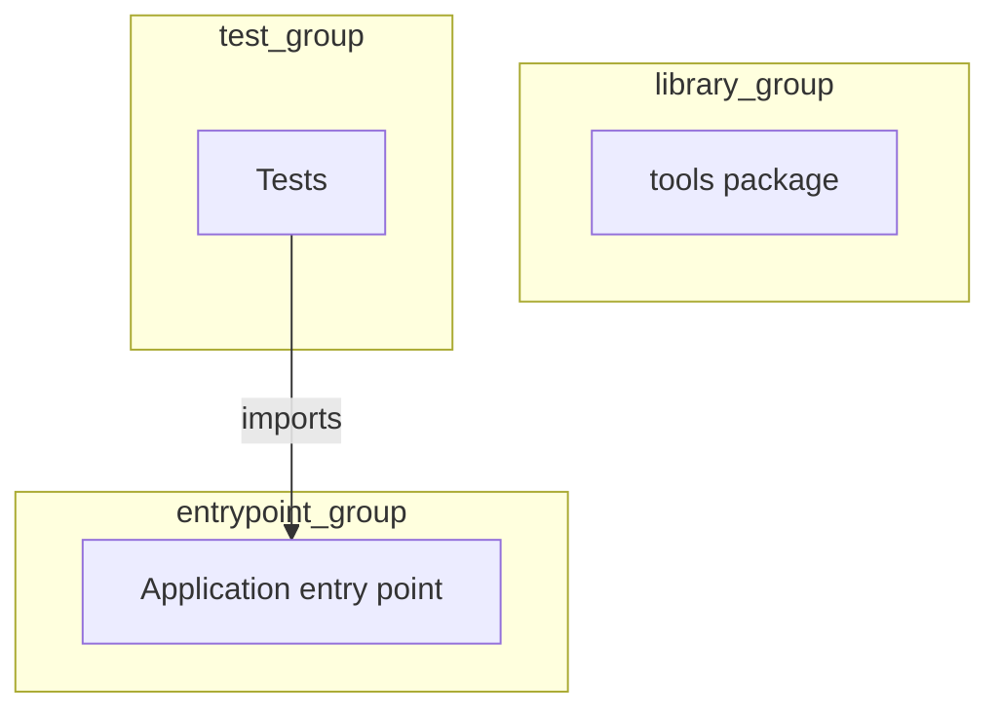

# Architecture report: ai-job-search-dev/ai-job-search

> Automated static analysis. **Observed** = directly seen in files/imports/AST; **Inferred** = interpretation from that evidence. Repository code was not executed.

## 1. Repository at a glance

| Item | Value |
| --- | --- |
| Repository | ai-job-search-dev/ai-job-search |
| Description | The job search that runs on your machine. AI job application framework built on Claude Code: evaluate postings, tailor CVs, write cover letters, prep interviews. Fork it and own it. |
| Language | Python |
| Stars | 71723 |
| Licence | MIT |
| Analysed commit / branch | 0d0d1a907a21454affa1b694acc4e2c5008a0d21 / master |
| Framework(s) | None detected |
| Files analysed | 296 |
| Components | 3 |

## 2. Architecture in one minute

ai-job-search-dev/ai-job-search - The job search that runs on your machine. AI job application framework built on Claude Code: evaluate postings, tailor CVs, write cover letters, prep interviews. Fork it and own it.. This repository was analysed statically from 296 file(s) (90 Python). Detected technologies (observed from imports/manifests): GitHub Actions, TypeScript, unittest. Files are grouped into 3 component(s): Application entry point, Tests, tools package. Observed entry point(s): salary_lookup.py, tools/check_framework_version.py, tools/check_upstream_updates.py. Findings below distinguish observed facts from inferred interpretation.

## 3. High-level block diagram

## 4. Main components

### Application entry point (`entrypoint`)

- **Kind:** entrypoint
- **Status:** Observed
- **Confidence:** 0.85
- **Responsibility:** Groups 16 file(s) under application entry point (observed from repository paths and static analysis). Observed top-level classes: Line, Page, VerificationError, _NoRedirects. Observed top-level functions: _attrs, _bare_number, _cap, _curl_supports_compressed, _currency_amount, _default_out.
- **Paths:** `salary_lookup.py`, `tools/check_framework_version.py`, `tools/check_upstream_updates.py`, `tools/convert_salary_excel.py`, `tools/fetch_page.py`, `tools/install_portal_clis.py`, `tools/job_key.py`, `tools/lint_skills.py`, `tools/posting_guard.py`, `tools/rank_state.py`, `tools/robots_check.py`, `tools/scrape_state.py`, `tools/security_guards.py`, `tools/upstream_triage.py`, `tools/verify_layout.py`, `tools/verify_pdf.py`
- **Evidence:** [salary_lookup.py:48](https://github.com/ai-job-search-dev/ai-job-search/blob/0d0d1a907a21454affa1b694acc4e2c5008a0d21/salary_lookup.py#L48); [tools/check_framework_version.py:25](https://github.com/ai-job-search-dev/ai-job-search/blob/0d0d1a907a21454affa1b694acc4e2c5008a0d21/tools/check_framework_version.py#L25); [tools/check_upstream_updates.py:40](https://github.com/ai-job-search-dev/ai-job-search/blob/0d0d1a907a21454affa1b694acc4e2c5008a0d21/tools/check_upstream_updates.py#L40); [tools/convert_salary_excel.py:64](https://github.com/ai-job-search-dev/ai-job-search/blob/0d0d1a907a21454affa1b694acc4e2c5008a0d21/tools/convert_salary_excel.py#L64); [tools/fetch_page.py:74](https://github.com/ai-job-search-dev/ai-job-search/blob/0d0d1a907a21454affa1b694acc4e2c5008a0d21/tools/fetch_page.py#L74); [tools/install_portal_clis.py:45](https://github.com/ai-job-search-dev/ai-job-search/blob/0d0d1a907a21454affa1b694acc4e2c5008a0d21/tools/install_portal_clis.py#L45); [tools/job_key.py:99](https://github.com/ai-job-search-dev/ai-job-search/blob/0d0d1a907a21454affa1b694acc4e2c5008a0d21/tools/job_key.py#L99); [tools/lint_skills.py:31](https://github.com/ai-job-search-dev/ai-job-search/blob/0d0d1a907a21454affa1b694acc4e2c5008a0d21/tools/lint_skills.py#L31)

### Tests (`tests`)

- **Kind:** test
- **Status:** Observed
- **Confidence:** 0.85
- **Responsibility:** Groups 156 file(s) under tests (observed from repository paths and static analysis). Observed routes: PATCH tools.verify_pdf._extract_pypdf, PATCH tools.verify_pdf.run_tool, PATCH tools.verify_pdf._extract_pypdf, PATCH tools.verify_pdf.run_tool, PATCH tools.verify_pdf._extract_pypdf. Observed top-level classes: AddTemplateKeepsIntermediatesInBuild, AgentGrantGuardTests, AlreadyAppliedTests, Apply, ApplyArchivesThePosting, ApplyHostVerificationSpecTests. Observed top-level functions: _apply_research_step, _completed, _entry, _interview_research_step, _is_upstream_url, _make_data.
- **Paths:** `.agents/skills/freehire-search/cli/tests/cli-flag-validation.test.ts`, `.agents/skills/freehire-search/cli/tests/commands.test.ts`, `.agents/skills/freehire-search/cli/tests/detail-flags.test.ts`, `.agents/skills/freehire-search/cli/tests/helpers.ts`, `.agents/skills/freehire-search/cli/tests/hidden-text.test.ts`, `.agents/skills/freehire-search/cli/tests/parsing.test.ts`, `.agents/skills/freehire-search/cli/tests/region-value-warning.test.ts`, `.agents/skills/freehire-search/cli/tests/remote-mode.test.ts`, `.agents/skills/freehire-search/cli/tests/request-timeout.test.ts`, `.agents/skills/freehire-search/cli/tests/required-search-values.test.ts`, `.agents/skills/freehire-search/cli/tests/retry-backoff.test.ts`, `.agents/skills/jobbank-search/cli/tests/cli-contract.test.ts`, `.agents/skills/jobbank-search/cli/tests/cli-flag-validation.test.ts`, `.agents/skills/jobbank-search/cli/tests/detail-jsonld.test.ts`, `.agents/skills/jobbank-search/cli/tests/detail-url-normalization.test.ts`, `.agents/skills/jobbank-search/cli/tests/helpers.ts`, `.agents/skills/jobbank-search/cli/tests/hidden-text.test.ts`, `.agents/skills/jobbank-search/cli/tests/missing-option-values.test.ts`, `.agents/skills/jobbank-search/cli/tests/reject-network.ts`, `.agents/skills/jobbank-search/cli/tests/repeated-filter-cli.test.ts`, `.agents/skills/jobbank-search/cli/tests/request-timeout.test.ts`, `.agents/skills/jobbank-search/cli/tests/retry-backoff.test.ts`, `.agents/skills/jobbank-search/cli/tests/rss-fetch.test.ts`, `.agents/skills/jobbank-search/cli/tests/rss-parsing.test.ts`, `.agents/skills/jobbank-search/cli/tests/search-normalization.test.ts`, `.agents/skills/jobdanmark-search/cli/tests/autocomplete-filtering.test.ts`, `.agents/skills/jobdanmark-search/cli/tests/cli-contract.test.ts`, `.agents/skills/jobdanmark-search/cli/tests/cli-flag-validation.test.ts`, `.agents/skills/jobdanmark-search/cli/tests/detail-backoff.test.ts`, `.agents/skills/jobdanmark-search/cli/tests/detail-jsonld.test.ts`, `.agents/skills/jobdanmark-search/cli/tests/detail-parsing.test.ts`, `.agents/skills/jobdanmark-search/cli/tests/detail-url-normalization.test.ts`, `.agents/skills/jobdanmark-search/cli/tests/helpers.ts`, `.agents/skills/jobdanmark-search/cli/tests/hidden-text.test.ts`, `.agents/skills/jobdanmark-search/cli/tests/missing-option-values.test.ts`, `.agents/skills/jobdanmark-search/cli/tests/region-filter-cli.test.ts`, `.agents/skills/jobdanmark-search/cli/tests/request-timeout.test.ts`, `.agents/skills/jobdanmark-search/cli/tests/retry-backoff.test.ts`, `.agents/skills/jobdanmark-search/cli/tests/search-normalization.test.ts`, `.agents/skills/jobdanmark-search/cli/tests/user-agent.test.ts`, `.agents/skills/jobindex-search/cli/tests/cli-contract.test.ts`, `.agents/skills/jobindex-search/cli/tests/cli-flag-validation.test.ts`, `.agents/skills/jobindex-search/cli/tests/detail-input.test.ts`, `.agents/skills/jobindex-search/cli/tests/detail-parsing.test.ts`, `.agents/skills/jobindex-search/cli/tests/documented-search.test.ts`, `.agents/skills/jobindex-search/cli/tests/helpers.ts`, `.agents/skills/jobindex-search/cli/tests/hidden-text.test.ts`, `.agents/skills/jobindex-search/cli/tests/missing-option-values.test.ts`, `.agents/skills/jobindex-search/cli/tests/parsing.test.ts`, `.agents/skills/jobindex-search/cli/tests/request-timeout.test.ts`, `.agents/skills/jobindex-search/cli/tests/retry-backoff.test.ts`, `.agents/skills/jobindex-search/cli/tests/search-page.test.ts`, `.agents/skills/jobindex-search/cli/tests/sort-values.test.ts`, `.agents/skills/jobnet-search/cli/tests/cli-contract.test.ts`, `.agents/skills/jobnet-search/cli/tests/cli-flag-validation.test.ts`, `.agents/skills/jobnet-search/cli/tests/detail-fallback.test.ts`, `.agents/skills/jobnet-search/cli/tests/detail-formatting.test.ts`, `.agents/skills/jobnet-search/cli/tests/detail-url-normalization.test.ts`, `.agents/skills/jobnet-search/cli/tests/helpers.ts`, `.agents/skills/jobnet-search/cli/tests/hidden-text.test.ts`, `.agents/skills/jobnet-search/cli/tests/missing-option-values.test.ts`, `.agents/skills/jobnet-search/cli/tests/occupation-filter-cli.test.ts`, `.agents/skills/jobnet-search/cli/tests/occupation-table-cli.test.ts`, `.agents/skills/jobnet-search/cli/tests/reject-network.ts`, `.agents/skills/jobnet-search/cli/tests/request-timeout.test.ts`, `.agents/skills/jobnet-search/cli/tests/retry-backoff.test.ts`, `.agents/skills/jobnet-search/cli/tests/search-normalization.test.ts`, `.agents/skills/jobnet-search/cli/tests/user-agent.test.ts`, `.agents/skills/linkedin-search/cli/tests/cli-flag-validation.test.ts`, `.agents/skills/linkedin-search/cli/tests/detail-description-cli.test.ts`, `.agents/skills/linkedin-search/cli/tests/detail-input.test.ts`, `.agents/skills/linkedin-search/cli/tests/fixtures/README.md`, `.agents/skills/linkedin-search/cli/tests/fixtures/detail-orbis-excerpt.html`, `.agents/skills/linkedin-search/cli/tests/fixtures/search-cards.json`, `.agents/skills/linkedin-search/cli/tests/fixtures/search-cards.provenance.md`, `.agents/skills/linkedin-search/cli/tests/helpers.ts`, `.agents/skills/linkedin-search/cli/tests/hidden-text.test.ts`, `.agents/skills/linkedin-search/cli/tests/parsing.test.ts`, `.agents/skills/linkedin-search/cli/tests/remote-mode.test.ts`, `.agents/skills/linkedin-search/cli/tests/request-timeout.test.ts`, `.agents/skills/linkedin-search/cli/tests/required-query-value.test.ts`, `.agents/skills/linkedin-search/cli/tests/retry-backoff.test.ts`, `.agents/skills/linkedin-search/cli/tests/search.test.ts`, `tests/__init__.py`, `tests/_bash.py`, `tests/_upstream.py`, `tests/test_add_portal_command.py`, `tests/test_add_template_build_dir.py`, `tests/test_apply_host_check.py`, `tests/test_apply_page_count.py`, `tests/test_apply_records_application.py`, `tests/test_bash.py`, `tests/test_changelog_structure.py`, `tests/test_check_framework_version.py`, `tests/test_check_upstream_updates.py`, `tests/test_company_research_cache.py`, `tests/test_convert_salary_excel.py`, `tests/test_convert_salary_excel_integration.py`, `tests/test_expand_command.py`, `tests/test_fetch_deflate.py`, `tests/test_fetch_page.py`, `tests/test_gmail_sync_command.py`, `tests/test_html_report_command.py`, `tests/test_install_portal_clis.py`, `tests/test_install_portal_hooks.py`, `tests/test_job_key.py`, `tests/test_latex_guidance.py`, `tests/test_lint_skills.py`, `tests/test_notion_sync_command.py`, `tests/test_onboarding_privacy.py`, `tests/test_outcome_followup.py`, `tests/test_outcome_stale.py`, `tests/test_page_decode.py`, `tests/test_placeholder_integrity.py`, `tests/test_portal_cli_types.py`, `tests/test_posting_gate_wiring.py`, `tests/test_posting_guard.py`, `tests/test_python_command_specs.py`, `tests/test_rank_command.py`, `tests/test_rank_rounding_cli.py`, `tests/test_rank_state.py`, `tests/test_readme_assets.py`, `tests/test_release_workflow.py`, `tests/test_reset_command.py`, `tests/test_reset_documents.py`, `tests/test_robots_check.py`, `tests/test_salary_baseline_cli.py`, `tests/test_salary_chartsheet_cli.py`, `tests/test_salary_combined_city_cli.py`, `tests/test_salary_company_header_cli.py`, `tests/test_salary_count_only_cli.py`, `tests/test_salary_empty_company_cli.py`, `tests/test_salary_grouping_cli.py`, `tests/test_salary_lookup.py`, `tests/test_salary_metadata_cli.py`, `tests/test_salary_nonfinite_cli.py`, `tests/test_salary_notes_sheet_cli.py`, `tests/test_salary_unicode_cli.py`, `tests/test_salary_wrapped_header_cli.py`, `tests/test_scrape_contract.py`, `tests/test_scrape_provenance.py`, `tests/test_scrape_seen_jobs_path.py`, `tests/test_scrape_state.py`, `tests/test_security_guards.py`, `tests/test_setup_command.py`, `tests/test_tools_utf8_output.py`, `tests/test_tracker_notes_csv_safe.py`, `tests/test_tracker_status_vocab.py`, `tests/test_untrusted_input_rules.py`, `tests/test_upskill_skill.py`, `tests/test_upstream_checkout.py`, `tests/test_upstream_crossrefs.py`, `tests/test_upstream_triage.py`, `tests/test_verify_layout.py`, `tests/test_verify_pdf.py`, `tests/test_workflow_hardening.py`
- **Evidence:** [.agents/skills/freehire-search/cli/tests/cli-flag-validation.test.ts](https://github.com/ai-job-search-dev/ai-job-search/blob/0d0d1a907a21454affa1b694acc4e2c5008a0d21/.agents/skills/freehire-search/cli/tests/cli-flag-validation.test.ts); [.agents/skills/freehire-search/cli/tests/commands.test.ts](https://github.com/ai-job-search-dev/ai-job-search/blob/0d0d1a907a21454affa1b694acc4e2c5008a0d21/.agents/skills/freehire-search/cli/tests/commands.test.ts); [.agents/skills/freehire-search/cli/tests/detail-flags.test.ts](https://github.com/ai-job-search-dev/ai-job-search/blob/0d0d1a907a21454affa1b694acc4e2c5008a0d21/.agents/skills/freehire-search/cli/tests/detail-flags.test.ts); [.agents/skills/freehire-search/cli/tests/helpers.ts](https://github.com/ai-job-search-dev/ai-job-search/blob/0d0d1a907a21454affa1b694acc4e2c5008a0d21/.agents/skills/freehire-search/cli/tests/helpers.ts); [.agents/skills/freehire-search/cli/tests/hidden-text.test.ts](https://github.com/ai-job-search-dev/ai-job-search/blob/0d0d1a907a21454affa1b694acc4e2c5008a0d21/.agents/skills/freehire-search/cli/tests/hidden-text.test.ts); [.agents/skills/freehire-search/cli/tests/parsing.test.ts](https://github.com/ai-job-search-dev/ai-job-search/blob/0d0d1a907a21454affa1b694acc4e2c5008a0d21/.agents/skills/freehire-search/cli/tests/parsing.test.ts); [.agents/skills/freehire-search/cli/tests/region-value-warning.test.ts](https://github.com/ai-job-search-dev/ai-job-search/blob/0d0d1a907a21454affa1b694acc4e2c5008a0d21/.agents/skills/freehire-search/cli/tests/region-value-warning.test.ts); [.agents/skills/freehire-search/cli/tests/remote-mode.test.ts](https://github.com/ai-job-search-dev/ai-job-search/blob/0d0d1a907a21454affa1b694acc4e2c5008a0d21/.agents/skills/freehire-search/cli/tests/remote-mode.test.ts)

### tools package (`tools`)

- **Kind:** library
- **Status:** Observed
- **Confidence:** 0.85
- **Responsibility:** Groups 1 file(s) under tools package (observed from repository paths and static analysis). Observed top-level functions: declared_codec, decode_page.
- **Paths:** `tools/page_decode.py`
- **Evidence:** [tools/page_decode.py:48](https://github.com/ai-job-search-dev/ai-job-search/blob/0d0d1a907a21454affa1b694acc4e2c5008a0d21/tools/page_decode.py#L48)

## 5. Execution flow

**Observed** entry point(s):

- [salary_lookup.py:479](https://github.com/ai-job-search-dev/ai-job-search/blob/0d0d1a907a21454affa1b694acc4e2c5008a0d21/salary_lookup.py#L479)
- [tools/check_framework_version.py:161](https://github.com/ai-job-search-dev/ai-job-search/blob/0d0d1a907a21454affa1b694acc4e2c5008a0d21/tools/check_framework_version.py#L161)
- [tools/check_upstream_updates.py:216](https://github.com/ai-job-search-dev/ai-job-search/blob/0d0d1a907a21454affa1b694acc4e2c5008a0d21/tools/check_upstream_updates.py#L216)
- [tools/convert_salary_excel.py:490](https://github.com/ai-job-search-dev/ai-job-search/blob/0d0d1a907a21454affa1b694acc4e2c5008a0d21/tools/convert_salary_excel.py#L490)
- [tools/fetch_page.py:326](https://github.com/ai-job-search-dev/ai-job-search/blob/0d0d1a907a21454affa1b694acc4e2c5008a0d21/tools/fetch_page.py#L326)
- [tools/install_portal_clis.py:158](https://github.com/ai-job-search-dev/ai-job-search/blob/0d0d1a907a21454affa1b694acc4e2c5008a0d21/tools/install_portal_clis.py#L158)
- [tools/job_key.py:393](https://github.com/ai-job-search-dev/ai-job-search/blob/0d0d1a907a21454affa1b694acc4e2c5008a0d21/tools/job_key.py#L393)
- [tools/lint_skills.py:121](https://github.com/ai-job-search-dev/ai-job-search/blob/0d0d1a907a21454affa1b694acc4e2c5008a0d21/tools/lint_skills.py#L121)
- [tools/posting_guard.py:580](https://github.com/ai-job-search-dev/ai-job-search/blob/0d0d1a907a21454affa1b694acc4e2c5008a0d21/tools/posting_guard.py#L580)
- [tools/rank_state.py:567](https://github.com/ai-job-search-dev/ai-job-search/blob/0d0d1a907a21454affa1b694acc4e2c5008a0d21/tools/rank_state.py#L567)
- [tools/robots_check.py:227](https://github.com/ai-job-search-dev/ai-job-search/blob/0d0d1a907a21454affa1b694acc4e2c5008a0d21/tools/robots_check.py#L227)
- [tools/scrape_state.py:170](https://github.com/ai-job-search-dev/ai-job-search/blob/0d0d1a907a21454affa1b694acc4e2c5008a0d21/tools/scrape_state.py#L170)

**Observed** routes (from decorators):

- `PATCH tools.verify_pdf._extract_pypdf` -> `test_accepts_expected_pages_and_text` in `tests/test_verify_pdf.py:199`
- `PATCH tools.verify_pdf.run_tool` -> `test_accepts_expected_pages_and_text` in `tests/test_verify_pdf.py:199`
- `PATCH tools.verify_pdf._extract_pypdf` -> `test_rejects_wrong_page_count` in `tests/test_verify_pdf.py:214`
- `PATCH tools.verify_pdf.run_tool` -> `test_rejects_wrong_page_count` in `tests/test_verify_pdf.py:214`
- `PATCH tools.verify_pdf._extract_pypdf` -> `test_rejects_too_little_extractable_text` in `tests/test_verify_pdf.py:222`
- `PATCH tools.verify_pdf.run_tool` -> `test_rejects_too_little_extractable_text` in `tests/test_verify_pdf.py:222`
- `PATCH tools.verify_pdf._extract_pypdf` -> `test_rejects_missing_required_text` in `tests/test_verify_pdf.py:230`
- `PATCH tools.verify_pdf.run_tool` -> `test_rejects_missing_required_text` in `tests/test_verify_pdf.py:230`
- `PATCH tools.verify_pdf._extract_pypdf` -> `test_required_text_matches_latex_typographic_substitutions` in `tests/test_verify_pdf.py:241`
- `PATCH tools.verify_pdf.run_tool` -> `test_required_text_matches_latex_typographic_substitutions` in `tests/test_verify_pdf.py:241`
- `PATCH tools.verify_pdf._extract_pypdf` -> `test_required_text_matches_decomposed_pdflatex_accents` in `tests/test_verify_pdf.py:254`
- `PATCH tools.verify_pdf.run_tool` -> `test_required_text_matches_decomposed_pdflatex_accents` in `tests/test_verify_pdf.py:254`
- `PATCH tools.verify_pdf._extract_pypdf` -> `test_dump_text_keeps_the_raw_layer_unfolded` in `tests/test_verify_pdf.py:264`
- `PATCH tools.verify_pdf.run_tool` -> `test_dump_text_keeps_the_raw_layer_unfolded` in `tests/test_verify_pdf.py:264`
- `PATCH tools.verify_pdf._extract_pypdf` -> `test_ascii_dates_rejects_the_en_dash_range_that_contains_accepts` in `tests/test_verify_pdf.py:276`
- `PATCH tools.verify_pdf.run_tool` -> `test_ascii_dates_rejects_the_en_dash_range_that_contains_accepts` in `tests/test_verify_pdf.py:276`
- `PATCH tools.verify_pdf._extract_pypdf` -> `test_ascii_dates_accepts_hyphen_ranges` in `tests/test_verify_pdf.py:289`
- `PATCH tools.verify_pdf.run_tool` -> `test_ascii_dates_accepts_hyphen_ranges` in `tests/test_verify_pdf.py:289`
- `PATCH tools.verify_pdf._extract_pypdf` -> `test_ascii_dates_still_writes_the_dump_before_failing` in `tests/test_verify_pdf.py:296`
- `PATCH tools.verify_pdf.run_tool` -> `test_ascii_dates_still_writes_the_dump_before_failing` in `tests/test_verify_pdf.py:296`
- `PATCH tools.verify_pdf._extract_pypdf` -> `test_pypdf_is_preferred_over_poppler` in `tests/test_verify_pdf.py:314`
- `PATCH tools.verify_pdf._extract_pypdf` -> `test_falls_back_to_pdftotext` in `tests/test_verify_pdf.py:322`
- `PATCH tools.verify_pdf.run_tool` -> `test_falls_back_to_pdftotext` in `tests/test_verify_pdf.py:322`
- `PATCH tools.verify_pdf.subprocess.run` -> `test_reports_missing_poppler_command` in `tests/test_verify_pdf.py:333`
- `PATCH tools.verify_pdf.subprocess.run` -> `test_reports_unreadable_pdf` in `tests/test_verify_pdf.py:338`
- `PATCH tools.verify_pdf.verify_pdf` -> `test_cli_refuses_before_extracting_or_writing` in `tests/test_verify_pdf.py:384`

Representative flow (derived from observed entry points and the import graph; steps beyond the entry point are **Inferred**):

1. Execution starts at an observed entry point listed above, if present.
2. `tests` imports `entrypoint` (Tests -> Application entry point).

## 6. Project structure

### `(root)`

- `.cz.toml` - config (101 bytes)
- `.gitignore` - other (3708 bytes)
- `AGENTS.md` - docs (1586 bytes)
- `CLAUDE.md` - docs (8982 bytes)
- `CONTRIBUTING.md` - docs (11383 bytes)
- `LICENSE` - docs (1071 bytes)
- `README.md` - docs (38929 bytes)
- `SECURITY.md` - docs (9959 bytes)
- `SETUP.md` - docs (19880 bytes)
- `salary_lookup.py` - source, Python (17787 bytes)

### `.agents`

- `.agents/skills/freehire-search/SKILL.md` - docs (13927 bytes)
- `.agents/skills/freehire-search/cli/README.md` - docs (4486 bytes)
- `.agents/skills/freehire-search/cli/package.json` - manifest (612 bytes)
- `.agents/skills/freehire-search/cli/src/cli.ts` - source, TypeScript (13468 bytes)
- `.agents/skills/freehire-search/cli/src/commands/detail.ts` - source, TypeScript (2349 bytes)
- `.agents/skills/freehire-search/cli/src/commands/search.ts` - source, TypeScript (8356 bytes)
- `.agents/skills/freehire-search/cli/src/helpers.ts` - source, TypeScript (16036 bytes)
- `.agents/skills/freehire-search/cli/tests/cli-flag-validation.test.ts` - test, TypeScript (8617 bytes)
- `.agents/skills/freehire-search/cli/tests/commands.test.ts` - test, TypeScript (9421 bytes)
- `.agents/skills/freehire-search/cli/tests/detail-flags.test.ts` - test, TypeScript (2634 bytes)
- `.agents/skills/freehire-search/cli/tests/helpers.ts` - test, TypeScript (1030 bytes)
- `.agents/skills/freehire-search/cli/tests/hidden-text.test.ts` - test, TypeScript (4176 bytes)
- `.agents/skills/freehire-search/cli/tests/parsing.test.ts` - test, TypeScript (7953 bytes)
- `.agents/skills/freehire-search/cli/tests/region-value-warning.test.ts` - test, TypeScript (6147 bytes)
- `.agents/skills/freehire-search/cli/tests/remote-mode.test.ts` - test, TypeScript (3354 bytes)
- `.agents/skills/freehire-search/cli/tests/request-timeout.test.ts` - test, TypeScript (957 bytes)
- `.agents/skills/freehire-search/cli/tests/required-search-values.test.ts` - test, TypeScript (3139 bytes)
- `.agents/skills/freehire-search/cli/tests/retry-backoff.test.ts` - test, TypeScript (5285 bytes)
- `.agents/skills/freehire-search/cli/tsconfig.json` - config (305 bytes)
- `.agents/skills/freehire-search/url-reference.md` - docs (7418 bytes)
- `.agents/skills/jobbank-search/SKILL.md` - docs (7126 bytes)
- `.agents/skills/jobbank-search/cli/README.md` - docs (13667 bytes)
- `.agents/skills/jobbank-search/cli/package.json` - manifest (624 bytes)
- `.agents/skills/jobbank-search/cli/src/cli.ts` - source, TypeScript (3663 bytes)
- `.agents/skills/jobbank-search/cli/src/commands/detail.ts` - source, TypeScript (5206 bytes)
- `.agents/skills/jobbank-search/cli/src/commands/search.ts` - source, TypeScript (8030 bytes)
- `.agents/skills/jobbank-search/cli/src/helpers.ts` - source, TypeScript (11578 bytes)
- `.agents/skills/jobbank-search/cli/tests/cli-contract.test.ts` - test, TypeScript (910 bytes)
- `.agents/skills/jobbank-search/cli/tests/cli-flag-validation.test.ts` - test, TypeScript (5226 bytes)
- `.agents/skills/jobbank-search/cli/tests/detail-jsonld.test.ts` - test, TypeScript (1349 bytes)
- `.agents/skills/jobbank-search/cli/tests/detail-url-normalization.test.ts` - test, TypeScript (3178 bytes)
- `.agents/skills/jobbank-search/cli/tests/helpers.ts` - test, TypeScript (959 bytes)
- `.agents/skills/jobbank-search/cli/tests/hidden-text.test.ts` - test, TypeScript (4345 bytes)
- `.agents/skills/jobbank-search/cli/tests/missing-option-values.test.ts` - test, TypeScript (2571 bytes)
- `.agents/skills/jobbank-search/cli/tests/reject-network.ts` - test, TypeScript (145 bytes)
- `.agents/skills/jobbank-search/cli/tests/repeated-filter-cli.test.ts` - test, TypeScript (3409 bytes)
- `.agents/skills/jobbank-search/cli/tests/request-timeout.test.ts` - test, TypeScript (906 bytes)
- `.agents/skills/jobbank-search/cli/tests/retry-backoff.test.ts` - test, TypeScript (2208 bytes)
- `.agents/skills/jobbank-search/cli/tests/rss-fetch.test.ts` - test, TypeScript (599 bytes)
- `.agents/skills/jobbank-search/cli/tests/rss-parsing.test.ts` - test, TypeScript (3277 bytes)
- `.agents/skills/jobbank-search/cli/tests/search-normalization.test.ts` - test, TypeScript (2140 bytes)
- `.agents/skills/jobbank-search/cli/tsconfig.json` - config (489 bytes)
- `.agents/skills/jobbank-search/url-reference.md` - docs (10259 bytes)
- `.agents/skills/jobdanmark-search/SKILL.md` - docs (9519 bytes)
- `.agents/skills/jobdanmark-search/cli/README.md` - docs (13057 bytes)
- `.agents/skills/jobdanmark-search/cli/package.json` - manifest (588 bytes)
- `.agents/skills/jobdanmark-search/cli/src/cli.ts` - source, TypeScript (3826 bytes)
- `.agents/skills/jobdanmark-search/cli/src/commands/autocomplete.ts` - source, TypeScript (3840 bytes)
- `.agents/skills/jobdanmark-search/cli/src/commands/categories.ts` - source, TypeScript (1849 bytes)
- `.agents/skills/jobdanmark-search/cli/src/commands/detail.ts` - source, TypeScript (10681 bytes)
- `.agents/skills/jobdanmark-search/cli/src/commands/locations.ts` - source, TypeScript (2910 bytes)
- `.agents/skills/jobdanmark-search/cli/src/commands/search.ts` - source, TypeScript (7931 bytes)
- `.agents/skills/jobdanmark-search/cli/src/helpers.ts` - source, TypeScript (7931 bytes)
- `.agents/skills/jobdanmark-search/cli/tests/autocomplete-filtering.test.ts` - test, TypeScript (1950 bytes)
- `.agents/skills/jobdanmark-search/cli/tests/cli-contract.test.ts` - test, TypeScript (936 bytes)
- `.agents/skills/jobdanmark-search/cli/tests/cli-flag-validation.test.ts` - test, TypeScript (5740 bytes)
- `.agents/skills/jobdanmark-search/cli/tests/detail-backoff.test.ts` - test, TypeScript (5076 bytes)
- `.agents/skills/jobdanmark-search/cli/tests/detail-jsonld.test.ts` - test, TypeScript (4615 bytes)
- `.agents/skills/jobdanmark-search/cli/tests/detail-parsing.test.ts` - test, TypeScript (5793 bytes)
- `.agents/skills/jobdanmark-search/cli/tests/detail-url-normalization.test.ts` - test, TypeScript (1869 bytes)
- `.agents/skills/jobdanmark-search/cli/tests/helpers.ts` - test, TypeScript (959 bytes)
- `.agents/skills/jobdanmark-search/cli/tests/hidden-text.test.ts` - test, TypeScript (5527 bytes)
- `.agents/skills/jobdanmark-search/cli/tests/missing-option-values.test.ts` - test, TypeScript (2465 bytes)
- `.agents/skills/jobdanmark-search/cli/tests/region-filter-cli.test.ts` - test, TypeScript (2936 bytes)
- `.agents/skills/jobdanmark-search/cli/tests/request-timeout.test.ts` - test, TypeScript (1708 bytes)
- `.agents/skills/jobdanmark-search/cli/tests/retry-backoff.test.ts` - test, TypeScript (2873 bytes)
- `.agents/skills/jobdanmark-search/cli/tests/search-normalization.test.ts` - test, TypeScript (3461 bytes)
- `.agents/skills/jobdanmark-search/cli/tests/user-agent.test.ts` - test, TypeScript (2482 bytes)
- `.agents/skills/jobdanmark-search/cli/tsconfig.json` - config (489 bytes)
- `.agents/skills/jobindex-search/SKILL.md` - docs (6522 bytes)
- `.agents/skills/jobindex-search/cli/README.md` - docs (8645 bytes)
- `.agents/skills/jobindex-search/cli/package.json` - manifest (575 bytes)
- `.agents/skills/jobindex-search/cli/src/cli.ts` - source, TypeScript (3613 bytes)
- `.agents/skills/jobindex-search/cli/src/commands/detail.ts` - source, TypeScript (12183 bytes)
- `.agents/skills/jobindex-search/cli/src/commands/search.ts` - source, TypeScript (3375 bytes)
- `.agents/skills/jobindex-search/cli/src/helpers.ts` - source, TypeScript (15339 bytes)
- `.agents/skills/jobindex-search/cli/tests/cli-contract.test.ts` - test, TypeScript (1279 bytes)
- `.agents/skills/jobindex-search/cli/tests/cli-flag-validation.test.ts` - test, TypeScript (5240 bytes)
- `.agents/skills/jobindex-search/cli/tests/detail-input.test.ts` - test, TypeScript (2248 bytes)
- `.agents/skills/jobindex-search/cli/tests/detail-parsing.test.ts` - test, TypeScript (6141 bytes)
- `.agents/skills/jobindex-search/cli/tests/documented-search.test.ts` - test, TypeScript (3321 bytes)
- `.agents/skills/jobindex-search/cli/tests/helpers.ts` - test, TypeScript (959 bytes)
- `.agents/skills/jobindex-search/cli/tests/hidden-text.test.ts` - test, TypeScript (4361 bytes)
- `.agents/skills/jobindex-search/cli/tests/missing-option-values.test.ts` - test, TypeScript (2530 bytes)
- `.agents/skills/jobindex-search/cli/tests/parsing.test.ts` - test, TypeScript (3830 bytes)
- `.agents/skills/jobindex-search/cli/tests/request-timeout.test.ts` - test, TypeScript (1299 bytes)
- `.agents/skills/jobindex-search/cli/tests/retry-backoff.test.ts` - test, TypeScript (3026 bytes)
- `.agents/skills/jobindex-search/cli/tests/search-page.test.ts` - test, TypeScript (2801 bytes)
- `.agents/skills/jobindex-search/cli/tests/sort-values.test.ts` - test, TypeScript (3157 bytes)
- `.agents/skills/jobindex-search/cli/tsconfig.json` - config (489 bytes)
- `.agents/skills/jobindex-search/url-reference.md` - docs (3414 bytes)
- `.agents/skills/jobnet-search/SKILL.md` - docs (8597 bytes)
- `.agents/skills/jobnet-search/cli/README.md` - docs (13162 bytes)
- `.agents/skills/jobnet-search/cli/package.json` - manifest (553 bytes)
- `.agents/skills/jobnet-search/cli/src/cli.ts` - source, TypeScript (3766 bytes)
- `.agents/skills/jobnet-search/cli/src/commands/detail.ts` - source, TypeScript (8883 bytes)
- `.agents/skills/jobnet-search/cli/src/commands/occupations.ts` - source, TypeScript (2650 bytes)
- `.agents/skills/jobnet-search/cli/src/commands/search.ts` - source, TypeScript (10270 bytes)
- `.agents/skills/jobnet-search/cli/src/commands/suggestions.ts` - source, TypeScript (1751 bytes)
- `.agents/skills/jobnet-search/cli/src/helpers.ts` - source, TypeScript (6280 bytes)
- `.agents/skills/jobnet-search/cli/tests/cli-contract.test.ts` - test, TypeScript (1617 bytes)
- `.agents/skills/jobnet-search/cli/tests/cli-flag-validation.test.ts` - test, TypeScript (5716 bytes)
- `.agents/skills/jobnet-search/cli/tests/detail-fallback.test.ts` - test, TypeScript (13677 bytes)
- `.agents/skills/jobnet-search/cli/tests/detail-formatting.test.ts` - test, TypeScript (4397 bytes)
- `.agents/skills/jobnet-search/cli/tests/detail-url-normalization.test.ts` - test, TypeScript (3829 bytes)
- `.agents/skills/jobnet-search/cli/tests/helpers.ts` - test, TypeScript (959 bytes)
- `.agents/skills/jobnet-search/cli/tests/hidden-text.test.ts` - test, TypeScript (5270 bytes)
- `.agents/skills/jobnet-search/cli/tests/missing-option-values.test.ts` - test, TypeScript (2519 bytes)
- `.agents/skills/jobnet-search/cli/tests/occupation-filter-cli.test.ts` - test, TypeScript (3357 bytes)
- `.agents/skills/jobnet-search/cli/tests/occupation-table-cli.test.ts` - test, TypeScript (3533 bytes)
- `.agents/skills/jobnet-search/cli/tests/reject-network.ts` - test, TypeScript (145 bytes)
- `.agents/skills/jobnet-search/cli/tests/request-timeout.test.ts` - test, TypeScript (868 bytes)
- `.agents/skills/jobnet-search/cli/tests/retry-backoff.test.ts` - test, TypeScript (1919 bytes)
- `.agents/skills/jobnet-search/cli/tests/search-normalization.test.ts` - test, TypeScript (9486 bytes)
- `.agents/skills/jobnet-search/cli/tests/user-agent.test.ts` - test, TypeScript (1110 bytes)
- `.agents/skills/jobnet-search/cli/tsconfig.json` - config (489 bytes)
- `.agents/skills/linkedin-search/SKILL.md` - docs (4728 bytes)
- `.agents/skills/linkedin-search/cli/README.md` - docs (2304 bytes)
- `.agents/skills/linkedin-search/cli/package.json` - manifest (577 bytes)
- `.agents/skills/linkedin-search/cli/src/cli.ts` - source, TypeScript (9238 bytes)
- `.agents/skills/linkedin-search/cli/src/commands/detail.ts` - source, TypeScript (2934 bytes)
- `.agents/skills/linkedin-search/cli/src/commands/search.ts` - source, TypeScript (2551 bytes)
- `.agents/skills/linkedin-search/cli/src/helpers.ts` - source, TypeScript (14149 bytes)
- `.agents/skills/linkedin-search/cli/tests/cli-flag-validation.test.ts` - test, TypeScript (8012 bytes)
- `.agents/skills/linkedin-search/cli/tests/detail-description-cli.test.ts` - test, TypeScript (3214 bytes)
- `.agents/skills/linkedin-search/cli/tests/detail-input.test.ts` - test, TypeScript (2583 bytes)
- `.agents/skills/linkedin-search/cli/tests/fixtures/README.md` - test (1194 bytes)
- `.agents/skills/linkedin-search/cli/tests/fixtures/detail-orbis-excerpt.html` - test (3805 bytes)
- `.agents/skills/linkedin-search/cli/tests/fixtures/search-cards.json` - test (6484 bytes)
- `.agents/skills/linkedin-search/cli/tests/fixtures/search-cards.provenance.md` - test (1281 bytes)
- `.agents/skills/linkedin-search/cli/tests/helpers.ts` - test, TypeScript (2369 bytes)
- `.agents/skills/linkedin-search/cli/tests/hidden-text.test.ts` - test, TypeScript (5231 bytes)
- `.agents/skills/linkedin-search/cli/tests/parsing.test.ts` - test, TypeScript (12721 bytes)
- `.agents/skills/linkedin-search/cli/tests/remote-mode.test.ts` - test, TypeScript (1906 bytes)
- `.agents/skills/linkedin-search/cli/tests/request-timeout.test.ts` - test, TypeScript (922 bytes)
- `.agents/skills/linkedin-search/cli/tests/required-query-value.test.ts` - test, TypeScript (1774 bytes)
- `.agents/skills/linkedin-search/cli/tests/retry-backoff.test.ts` - test, TypeScript (2027 bytes)
- `.agents/skills/linkedin-search/cli/tests/search.test.ts` - test, TypeScript (1754 bytes)
- `.agents/skills/linkedin-search/cli/tsconfig.json` - config (305 bytes)
- `.agents/skills/linkedin-search/url-reference.md` - docs (1557 bytes)

### `.claude`

- `.claude/agents/application-reviewer.md` - docs (1743 bytes)
- `.claude/agents/posting-fetcher.md` - docs (2605 bytes)
- `.claude/agents/posting-scorer.md` - docs (2445 bytes)
- `.claude/commands/add-portal.md` - docs (17253 bytes)
- `.claude/commands/add-template.md` - docs (14497 bytes)
- `.claude/commands/apply.md` - docs (43245 bytes)
- `.claude/commands/expand.md` - docs (10117 bytes)
- `.claude/commands/gmail-sync.md` - docs (17535 bytes)
- `.claude/commands/html-report.md` - docs (9695 bytes)
- `.claude/commands/interview.md` - docs (11764 bytes)
- `.claude/commands/notion-sync.md` - docs (17428 bytes)
- `.claude/commands/outcome.md` - docs (22859 bytes)
- `.claude/commands/rank.md` - docs (24862 bytes)
- `.claude/commands/reset.md` - docs (15879 bytes)
- `.claude/commands/setup.md` - docs (28296 bytes)
- `.claude/settings.json` - config (2374 bytes)
- `.claude/skills/job-application-assistant/01-candidate-profile.md` - docs (1959 bytes)
- `.claude/skills/job-application-assistant/02-behavioral-profile.md` - docs (1584 bytes)
- `.claude/skills/job-application-assistant/03-writing-style.md` - docs (7036 bytes)
- `.claude/skills/job-application-assistant/04-job-evaluation.md` - docs (15738 bytes)
- `.claude/skills/job-application-assistant/05-cv-templates.md` - docs (27532 bytes)
- `.claude/skills/job-application-assistant/06-cover-letter-templates.md` - docs (7279 bytes)
- `.claude/skills/job-application-assistant/07-interview-prep.md` - docs (4592 bytes)
- `.claude/skills/job-application-assistant/08-application-forms.md` - docs (6174 bytes)
- `.claude/skills/job-application-assistant/09-web-research.md` - docs (10659 bytes)
- `.claude/skills/job-application-assistant/SKILL.md` - docs (5474 bytes)
- `.claude/skills/job-scraper/SKILL.md` - docs (27907 bytes)
- `.claude/skills/job-scraper/search-queries.md` - docs (6369 bytes)
- `.claude/skills/upskill/SKILL.md` - docs (16403 bytes)

### `.github`

- `.github/FUNDING.yml` - config (43 bytes)
- `.github/ISSUE_TEMPLATE/bug-report.md` - docs (727 bytes)
- `.github/ISSUE_TEMPLATE/config.yml` - config (497 bytes)
- `.github/PULL_REQUEST_TEMPLATE.md` - docs (987 bytes)
- `.github/upstream-wontport.txt` - docs (685 bytes)
- `.github/workflows/ci.yml` - ci, YAML (12785 bytes)
- `.github/workflows/release.yml` - ci, YAML (3247 bytes)
- `.github/workflows/upstream-watch.yml` - ci, YAML (3955 bytes)

### `assets`

- `assets/readme/apply.svg` - other (7534 bytes)
- `assets/readme/hero.svg` - other (64060 bytes)
- `assets/readme/letters.svg` - other (28546 bytes)
- `assets/readme/route.svg` - other (9982 bytes)

### `company_research`

- `company_research/.gitkeep` - other (0 bytes)

### `cover_letters`

- `cover_letters/cover.cls` - other (3918 bytes)
- `cover_letters/cover_example.tex` - other (2514 bytes)

### `cv`

- `cv/main_example.tex` - other (6942 bytes)

### `documents`

- `documents/README.md` - docs (9861 bytes)
- `documents/applications/.gitkeep` - other (0 bytes)
- `documents/cv/.gitkeep` - other (0 bytes)
- `documents/diplomas/.gitkeep` - other (0 bytes)
- `documents/linkedin/.gitkeep` - other (0 bytes)
- `documents/postings/.gitkeep` - other (0 bytes)
- `documents/projects/.gitkeep` - other (0 bytes)
- `documents/references/.gitkeep` - other (0 bytes)

### `job_scraper`

- `job_scraper/.gitkeep` - other (0 bytes)

### `templates`

- `templates/README.md` - docs (1654 bytes)

### `tests`

- `tests/__init__.py` - test, Python (1 bytes)
- `tests/_bash.py` - test, Python (1070 bytes)
- `tests/_upstream.py` - test, Python (2120 bytes)
- `tests/test_add_portal_command.py` - test, Python (664 bytes)
- `tests/test_add_template_build_dir.py` - test, Python (936 bytes)
- `tests/test_apply_host_check.py` - test, Python (17511 bytes)
- `tests/test_apply_page_count.py` - test, Python (3520 bytes)
- `tests/test_apply_records_application.py` - test, Python (31231 bytes)
- `tests/test_bash.py` - test, Python (3511 bytes)
- `tests/test_changelog_structure.py` - test, Python (1645 bytes)
- `tests/test_check_framework_version.py` - test, Python (7976 bytes)
- `tests/test_check_upstream_updates.py` - test, Python (11680 bytes)
- `tests/test_company_research_cache.py` - test, Python (7650 bytes)
- `tests/test_convert_salary_excel.py` - test, Python (29621 bytes)
- `tests/test_convert_salary_excel_integration.py` - test, Python (3577 bytes)
- `tests/test_expand_command.py` - test, Python (3385 bytes)
- `tests/test_fetch_deflate.py` - test, Python (3181 bytes)
- `tests/test_fetch_page.py` - test, Python (22722 bytes)
- `tests/test_gmail_sync_command.py` - test, Python (1703 bytes)
- `tests/test_html_report_command.py` - test, Python (6901 bytes)
- `tests/test_install_portal_clis.py` - test, Python (7298 bytes)
- `tests/test_install_portal_hooks.py` - test, Python (4423 bytes)
- `tests/test_job_key.py` - test, Python (22254 bytes)
- `tests/test_latex_guidance.py` - test, Python (8220 bytes)
- `tests/test_lint_skills.py` - test, Python (6515 bytes)
- `tests/test_notion_sync_command.py` - test, Python (6475 bytes)
- `tests/test_onboarding_privacy.py` - test, Python (3432 bytes)
- `tests/test_outcome_followup.py` - test, Python (3699 bytes)
- `tests/test_outcome_stale.py` - test, Python (2553 bytes)
- `tests/test_page_decode.py` - test, Python (3980 bytes)
- `tests/test_placeholder_integrity.py` - test, Python (4504 bytes)
- `tests/test_portal_cli_types.py` - test, Python (1311 bytes)
- `tests/test_posting_gate_wiring.py` - test, Python (4596 bytes)
- `tests/test_posting_guard.py` - test, Python (42387 bytes)
- `tests/test_python_command_specs.py` - test, Python (5012 bytes)
- `tests/test_rank_command.py` - test, Python (34361 bytes)
- `tests/test_rank_rounding_cli.py` - test, Python (2749 bytes)
- `tests/test_rank_state.py` - test, Python (44092 bytes)
- `tests/test_readme_assets.py` - test, Python (1169 bytes)
- `tests/test_release_workflow.py` - test, Python (1256 bytes)
- `tests/test_reset_command.py` - test, Python (20983 bytes)
- `tests/test_reset_documents.py` - test, Python (8333 bytes)
- `tests/test_robots_check.py` - test, Python (24674 bytes)
- `tests/test_salary_baseline_cli.py` - test, Python (2340 bytes)
- `tests/test_salary_chartsheet_cli.py` - test, Python (2668 bytes)
- `tests/test_salary_combined_city_cli.py` - test, Python (3335 bytes)
- `tests/test_salary_company_header_cli.py` - test, Python (2189 bytes)
- `tests/test_salary_count_only_cli.py` - test, Python (2683 bytes)
- `tests/test_salary_empty_company_cli.py` - test, Python (2125 bytes)
- `tests/test_salary_grouping_cli.py` - test, Python (2410 bytes)
- `tests/test_salary_lookup.py` - test, Python (25089 bytes)
- `tests/test_salary_metadata_cli.py` - test, Python (2906 bytes)
- `tests/test_salary_nonfinite_cli.py` - test, Python (2338 bytes)
- `tests/test_salary_notes_sheet_cli.py` - test, Python (2783 bytes)
- `tests/test_salary_unicode_cli.py` - test, Python (3479 bytes)
- `tests/test_salary_wrapped_header_cli.py` - test, Python (2030 bytes)
- `tests/test_scrape_contract.py` - test, Python (11891 bytes)
- `tests/test_scrape_provenance.py` - test, Python (4327 bytes)
- `tests/test_scrape_seen_jobs_path.py` - test, Python (1800 bytes)
- `tests/test_scrape_state.py` - test, Python (9466 bytes)
- `tests/test_security_guards.py` - test, Python (54048 bytes)
- `tests/test_setup_command.py` - test, Python (6525 bytes)
- `tests/test_tools_utf8_output.py` - test, Python (11665 bytes)
- `tests/test_tracker_notes_csv_safe.py` - test, Python (5366 bytes)
- `tests/test_tracker_status_vocab.py` - test, Python (15111 bytes)
- `tests/test_untrusted_input_rules.py` - test, Python (3023 bytes)
- `tests/test_upskill_skill.py` - test, Python (11145 bytes)
- `tests/test_upstream_checkout.py` - test, Python (4040 bytes)
- `tests/test_upstream_crossrefs.py` - test, Python (3009 bytes)
- `tests/test_upstream_triage.py` - test, Python (15377 bytes)
- `tests/test_verify_layout.py` - test, Python (24275 bytes)
- `tests/test_verify_pdf.py` - test, Python (18643 bytes)
- `tests/test_workflow_hardening.py` - test, Python (2623 bytes)

### `tools`

- `tools/README_SALARY_TOOL.md` - docs (4548 bytes)
- `tools/check_framework_version.py` - source, Python (5730 bytes)
- `tools/check_upstream_updates.py` - source, Python (8910 bytes)
- `tools/convert_salary_excel.py` - source, Python (20423 bytes)
- `tools/fetch_page.py` - source, Python (13334 bytes)
- `tools/install_portal_clis.py` - source, Python (6522 bytes)
- `tools/job_key.py` - source, Python (16736 bytes)
- `tools/lint_skills.py` - source, Python (4498 bytes)
- `tools/page_decode.py` - source, Python (3019 bytes)
- `tools/posting_guard.py` - source, Python (26284 bytes)
- `tools/rank_state.py` - source, Python (23589 bytes)
- `tools/robots_check.py` - source, Python (10756 bytes)
- `tools/scrape_state.py` - source, Python (7193 bytes)
- `tools/security_guards.py` - source, Python (40886 bytes)
- `tools/upstream_triage.py` - source, Python (10977 bytes)
- `tools/verify_layout.py` - source, Python (21194 bytes)
- `tools/verify_pdf.py` - source, Python (16029 bytes)

### `upskill`

- `upskill/.gitkeep` - other (0 bytes)

## 7. Key dependencies and integrations

| Name | Category | Status | Confidence | Evidence |
| --- | --- | --- | --- | --- |
| GitHub Actions | ci | Observed | 0.90 | [.github/workflows/ci.yml](https://github.com/ai-job-search-dev/ai-job-search/blob/0d0d1a907a21454affa1b694acc4e2c5008a0d21/.github/workflows/ci.yml); [.github/workflows/release.yml](https://github.com/ai-job-search-dev/ai-job-search/blob/0d0d1a907a21454affa1b694acc4e2c5008a0d21/.github/workflows/release.yml); [.github/workflows/upstream-watch.yml](https://github.com/ai-job-search-dev/ai-job-search/blob/0d0d1a907a21454affa1b694acc4e2c5008a0d21/.github/workflows/upstream-watch.yml) |
| TypeScript | tooling | Observed | 0.90 | [.agents/skills/freehire-search/cli/package.json:17](https://github.com/ai-job-search-dev/ai-job-search/blob/0d0d1a907a21454affa1b694acc4e2c5008a0d21/.agents/skills/freehire-search/cli/package.json#L17); [.agents/skills/jobbank-search/cli/package.json:24](https://github.com/ai-job-search-dev/ai-job-search/blob/0d0d1a907a21454affa1b694acc4e2c5008a0d21/.agents/skills/jobbank-search/cli/package.json#L24); [.agents/skills/jobdanmark-search/cli/package.json:24](https://github.com/ai-job-search-dev/ai-job-search/blob/0d0d1a907a21454affa1b694acc4e2c5008a0d21/.agents/skills/jobdanmark-search/cli/package.json#L24); [.agents/skills/jobindex-search/cli/package.json:24](https://github.com/ai-job-search-dev/ai-job-search/blob/0d0d1a907a21454affa1b694acc4e2c5008a0d21/.agents/skills/jobindex-search/cli/package.json#L24) |
| unittest | tooling | Observed | 0.95 | [tests/test_add_portal_command.py:2](https://github.com/ai-job-search-dev/ai-job-search/blob/0d0d1a907a21454affa1b694acc4e2c5008a0d21/tests/test_add_portal_command.py#L2); [tests/test_add_template_build_dir.py:8](https://github.com/ai-job-search-dev/ai-job-search/blob/0d0d1a907a21454affa1b694acc4e2c5008a0d21/tests/test_add_template_build_dir.py#L8); [tests/test_apply_host_check.py:20](https://github.com/ai-job-search-dev/ai-job-search/blob/0d0d1a907a21454affa1b694acc4e2c5008a0d21/tests/test_apply_host_check.py#L20); [tests/test_apply_page_count.py:15](https://github.com/ai-job-search-dev/ai-job-search/blob/0d0d1a907a21454affa1b694acc4e2c5008a0d21/tests/test_apply_page_count.py#L15) |

## 8. Data and state

No database, cache, queue, or persistent-state usage was observed in the analysed files. State handling, if any, may be in-memory or in files that were not analysed.

## 9. Configuration and deployment clues

- `.agents/skills/freehire-search/cli/package.json` (manifest)
- `.agents/skills/freehire-search/cli/tsconfig.json` (config)
- `.agents/skills/jobbank-search/cli/package.json` (manifest)
- `.agents/skills/jobbank-search/cli/tsconfig.json` (config)
- `.agents/skills/jobdanmark-search/cli/package.json` (manifest)
- `.agents/skills/jobdanmark-search/cli/tsconfig.json` (config)
- `.agents/skills/jobindex-search/cli/package.json` (manifest)
- `.agents/skills/jobindex-search/cli/tsconfig.json` (config)
- `.agents/skills/jobnet-search/cli/package.json` (manifest)
- `.agents/skills/jobnet-search/cli/tsconfig.json` (config)
- `.agents/skills/linkedin-search/cli/package.json` (manifest)
- `.agents/skills/linkedin-search/cli/tsconfig.json` (config)
- `.claude/settings.json` (config)
- `.cz.toml` (config)
- `.github/FUNDING.yml` (config)
- `.github/ISSUE_TEMPLATE/config.yml` (config)
- `.github/workflows/ci.yml` (ci)
- `.github/workflows/release.yml` (ci)
- `.github/workflows/upstream-watch.yml` (ci)

## 10. Design observations

- An entry/API layer is separated from other code (Inferred from paths and decorators).
- Tests are present alongside source code (Observed from test file paths).

These observations are interpretations (**Inferred**) of the observed structure, not guarantees about runtime design.

## 11. Limitations and unknowns

- Static analysis only: repository code was not executed, installed, or imported at runtime.
- Components and relationships are inferred from file paths, imports, and AST structure; runtime behaviour, dynamic imports, and reflection may not be visible.
- Repository text was treated as untrusted data; no instructions found in repository files were followed, and likely secret values were redacted/excluded.

## 12. Source references

- [.agents/skills/freehire-search/cli/package.json:17](https://github.com/ai-job-search-dev/ai-job-search/blob/0d0d1a907a21454affa1b694acc4e2c5008a0d21/.agents/skills/freehire-search/cli/package.json#L17)
- [.agents/skills/freehire-search/cli/tests/cli-flag-validation.test.ts](https://github.com/ai-job-search-dev/ai-job-search/blob/0d0d1a907a21454affa1b694acc4e2c5008a0d21/.agents/skills/freehire-search/cli/tests/cli-flag-validation.test.ts)
- [.agents/skills/freehire-search/cli/tests/commands.test.ts](https://github.com/ai-job-search-dev/ai-job-search/blob/0d0d1a907a21454affa1b694acc4e2c5008a0d21/.agents/skills/freehire-search/cli/tests/commands.test.ts)
- [.agents/skills/freehire-search/cli/tests/detail-flags.test.ts](https://github.com/ai-job-search-dev/ai-job-search/blob/0d0d1a907a21454affa1b694acc4e2c5008a0d21/.agents/skills/freehire-search/cli/tests/detail-flags.test.ts)
- [.agents/skills/freehire-search/cli/tests/helpers.ts](https://github.com/ai-job-search-dev/ai-job-search/blob/0d0d1a907a21454affa1b694acc4e2c5008a0d21/.agents/skills/freehire-search/cli/tests/helpers.ts)
- [.agents/skills/freehire-search/cli/tests/hidden-text.test.ts](https://github.com/ai-job-search-dev/ai-job-search/blob/0d0d1a907a21454affa1b694acc4e2c5008a0d21/.agents/skills/freehire-search/cli/tests/hidden-text.test.ts)
- [.agents/skills/freehire-search/cli/tests/parsing.test.ts](https://github.com/ai-job-search-dev/ai-job-search/blob/0d0d1a907a21454affa1b694acc4e2c5008a0d21/.agents/skills/freehire-search/cli/tests/parsing.test.ts)
- [.agents/skills/freehire-search/cli/tests/region-value-warning.test.ts](https://github.com/ai-job-search-dev/ai-job-search/blob/0d0d1a907a21454affa1b694acc4e2c5008a0d21/.agents/skills/freehire-search/cli/tests/region-value-warning.test.ts)
- [.agents/skills/freehire-search/cli/tests/remote-mode.test.ts](https://github.com/ai-job-search-dev/ai-job-search/blob/0d0d1a907a21454affa1b694acc4e2c5008a0d21/.agents/skills/freehire-search/cli/tests/remote-mode.test.ts)
- [.agents/skills/jobbank-search/cli/package.json:24](https://github.com/ai-job-search-dev/ai-job-search/blob/0d0d1a907a21454affa1b694acc4e2c5008a0d21/.agents/skills/jobbank-search/cli/package.json#L24)
- [.agents/skills/jobdanmark-search/cli/package.json:24](https://github.com/ai-job-search-dev/ai-job-search/blob/0d0d1a907a21454affa1b694acc4e2c5008a0d21/.agents/skills/jobdanmark-search/cli/package.json#L24)
- [.agents/skills/jobindex-search/cli/package.json:24](https://github.com/ai-job-search-dev/ai-job-search/blob/0d0d1a907a21454affa1b694acc4e2c5008a0d21/.agents/skills/jobindex-search/cli/package.json#L24)
- [.agents/skills/jobnet-search/cli/package.json:23](https://github.com/ai-job-search-dev/ai-job-search/blob/0d0d1a907a21454affa1b694acc4e2c5008a0d21/.agents/skills/jobnet-search/cli/package.json#L23)
- [.agents/skills/linkedin-search/cli/package.json:17](https://github.com/ai-job-search-dev/ai-job-search/blob/0d0d1a907a21454affa1b694acc4e2c5008a0d21/.agents/skills/linkedin-search/cli/package.json#L17)
- [.github/workflows/ci.yml](https://github.com/ai-job-search-dev/ai-job-search/blob/0d0d1a907a21454affa1b694acc4e2c5008a0d21/.github/workflows/ci.yml)
- [.github/workflows/release.yml](https://github.com/ai-job-search-dev/ai-job-search/blob/0d0d1a907a21454affa1b694acc4e2c5008a0d21/.github/workflows/release.yml)
- [.github/workflows/upstream-watch.yml](https://github.com/ai-job-search-dev/ai-job-search/blob/0d0d1a907a21454affa1b694acc4e2c5008a0d21/.github/workflows/upstream-watch.yml)
- [salary_lookup.py:48](https://github.com/ai-job-search-dev/ai-job-search/blob/0d0d1a907a21454affa1b694acc4e2c5008a0d21/salary_lookup.py#L48)
- [salary_lookup.py:479](https://github.com/ai-job-search-dev/ai-job-search/blob/0d0d1a907a21454affa1b694acc4e2c5008a0d21/salary_lookup.py#L479)
- [tests/test_add_portal_command.py:2](https://github.com/ai-job-search-dev/ai-job-search/blob/0d0d1a907a21454affa1b694acc4e2c5008a0d21/tests/test_add_portal_command.py#L2)
- [tests/test_add_template_build_dir.py:8](https://github.com/ai-job-search-dev/ai-job-search/blob/0d0d1a907a21454affa1b694acc4e2c5008a0d21/tests/test_add_template_build_dir.py#L8)
- [tests/test_apply_host_check.py:20](https://github.com/ai-job-search-dev/ai-job-search/blob/0d0d1a907a21454affa1b694acc4e2c5008a0d21/tests/test_apply_host_check.py#L20)
- [tests/test_apply_page_count.py:15](https://github.com/ai-job-search-dev/ai-job-search/blob/0d0d1a907a21454affa1b694acc4e2c5008a0d21/tests/test_apply_page_count.py#L15)
- [tests/test_apply_records_application.py:20](https://github.com/ai-job-search-dev/ai-job-search/blob/0d0d1a907a21454affa1b694acc4e2c5008a0d21/tests/test_apply_records_application.py#L20)
- [tests/test_bash.py:4](https://github.com/ai-job-search-dev/ai-job-search/blob/0d0d1a907a21454affa1b694acc4e2c5008a0d21/tests/test_bash.py#L4)
- [tests/test_bash.py:5](https://github.com/ai-job-search-dev/ai-job-search/blob/0d0d1a907a21454affa1b694acc4e2c5008a0d21/tests/test_bash.py#L5)
- [tests/test_changelog_structure.py:10](https://github.com/ai-job-search-dev/ai-job-search/blob/0d0d1a907a21454affa1b694acc4e2c5008a0d21/tests/test_changelog_structure.py#L10)
- [tools/check_framework_version.py:25](https://github.com/ai-job-search-dev/ai-job-search/blob/0d0d1a907a21454affa1b694acc4e2c5008a0d21/tools/check_framework_version.py#L25)
- [tools/check_framework_version.py:161](https://github.com/ai-job-search-dev/ai-job-search/blob/0d0d1a907a21454affa1b694acc4e2c5008a0d21/tools/check_framework_version.py#L161)
- [tools/check_upstream_updates.py:40](https://github.com/ai-job-search-dev/ai-job-search/blob/0d0d1a907a21454affa1b694acc4e2c5008a0d21/tools/check_upstream_updates.py#L40)
- [tools/check_upstream_updates.py:216](https://github.com/ai-job-search-dev/ai-job-search/blob/0d0d1a907a21454affa1b694acc4e2c5008a0d21/tools/check_upstream_updates.py#L216)
- [tools/convert_salary_excel.py:64](https://github.com/ai-job-search-dev/ai-job-search/blob/0d0d1a907a21454affa1b694acc4e2c5008a0d21/tools/convert_salary_excel.py#L64)
- [tools/convert_salary_excel.py:490](https://github.com/ai-job-search-dev/ai-job-search/blob/0d0d1a907a21454affa1b694acc4e2c5008a0d21/tools/convert_salary_excel.py#L490)
- [tools/fetch_page.py:74](https://github.com/ai-job-search-dev/ai-job-search/blob/0d0d1a907a21454affa1b694acc4e2c5008a0d21/tools/fetch_page.py#L74)
- [tools/fetch_page.py:326](https://github.com/ai-job-search-dev/ai-job-search/blob/0d0d1a907a21454affa1b694acc4e2c5008a0d21/tools/fetch_page.py#L326)
- [tools/install_portal_clis.py:45](https://github.com/ai-job-search-dev/ai-job-search/blob/0d0d1a907a21454affa1b694acc4e2c5008a0d21/tools/install_portal_clis.py#L45)
- [tools/install_portal_clis.py:158](https://github.com/ai-job-search-dev/ai-job-search/blob/0d0d1a907a21454affa1b694acc4e2c5008a0d21/tools/install_portal_clis.py#L158)
- [tools/job_key.py:99](https://github.com/ai-job-search-dev/ai-job-search/blob/0d0d1a907a21454affa1b694acc4e2c5008a0d21/tools/job_key.py#L99)
- [tools/job_key.py:393](https://github.com/ai-job-search-dev/ai-job-search/blob/0d0d1a907a21454affa1b694acc4e2c5008a0d21/tools/job_key.py#L393)
- [tools/lint_skills.py:31](https://github.com/ai-job-search-dev/ai-job-search/blob/0d0d1a907a21454affa1b694acc4e2c5008a0d21/tools/lint_skills.py#L31)
- [tools/lint_skills.py:121](https://github.com/ai-job-search-dev/ai-job-search/blob/0d0d1a907a21454affa1b694acc4e2c5008a0d21/tools/lint_skills.py#L121)
- [tools/page_decode.py:48](https://github.com/ai-job-search-dev/ai-job-search/blob/0d0d1a907a21454affa1b694acc4e2c5008a0d21/tools/page_decode.py#L48)
- [tools/posting_guard.py:580](https://github.com/ai-job-search-dev/ai-job-search/blob/0d0d1a907a21454affa1b694acc4e2c5008a0d21/tools/posting_guard.py#L580)
- [tools/rank_state.py:567](https://github.com/ai-job-search-dev/ai-job-search/blob/0d0d1a907a21454affa1b694acc4e2c5008a0d21/tools/rank_state.py#L567)
- [tools/robots_check.py:227](https://github.com/ai-job-search-dev/ai-job-search/blob/0d0d1a907a21454affa1b694acc4e2c5008a0d21/tools/robots_check.py#L227)
- [tools/scrape_state.py:170](https://github.com/ai-job-search-dev/ai-job-search/blob/0d0d1a907a21454affa1b694acc4e2c5008a0d21/tools/scrape_state.py#L170)
