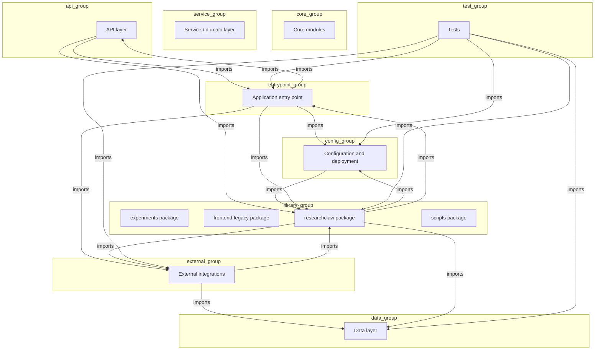

# Architecture report: aiming-lab/AutoResearchClaw

> Automated static analysis. **Observed** = directly seen in files/imports/AST; **Inferred** = interpretation from that evidence. Repository code was not executed.

## 1. Repository at a glance

| Item | Value |
| --- | --- |
| Repository | aiming-lab/AutoResearchClaw |
| Description | Fully autonomous & self-evolving research from idea to paper. Chat an Idea. Get a Paper. 🦞 |
| Language | Python |
| Stars | 14875 |
| Licence | MIT |
| Analysed commit / branch | be4ba4755bf1b52220f25e13b2293b5956590070 / main |
| Framework(s) | FastAPI, Starlette |
| Files analysed | 727 |
| Components | 12 |

## 2. Architecture in one minute

aiming-lab/AutoResearchClaw - Fully autonomous & self-evolving research from idea to paper. Chat an Idea. Get a Paper. 🦞. This repository was analysed statically from 727 file(s) (403 Python). Detected technologies (observed from imports/manifests): FastAPI, Starlette, httpx, NumPy, Pydantic, Uvicorn. Files are grouped into 12 component(s): API layer, Configuration and deployment, Core modules, Data layer, Application entry point, experiments package, External integrations, frontend-legacy package. Observed entry point(s): experiments/arc_bench/baseline/adapters/_aide_runner.py, experiments/arc_bench/scripts/_inject_p_requirements.py, experiments/arc_bench/scripts/_rename_t_to_ml.py. Findings below distinguish observed facts from inferred interpretation.

## 3. High-level block diagram

## 4. Main components

### API layer (`api_layer`)

- **Kind:** api
- **Status:** Observed
- **Confidence:** 0.85
- **Responsibility:** Groups 5 file(s) under api layer (observed from repository paths and static analysis). Observed routes: POST /pipeline/start, POST /pipeline/stop, GET /pipeline/status, GET /pipeline/stages, GET /runs. Observed top-level classes: PipelineStartRequest, PipelineStartResponse. Observed top-level functions: _get_app_state, _validated_run_dir, chat_websocket, get_chat_manager, get_run, get_run_metrics.
- **Paths:** `researchclaw/server/routes/__init__.py`, `researchclaw/server/routes/chat.py`, `researchclaw/server/routes/pipeline.py`, `researchclaw/server/routes/projects.py`, `researchclaw/server/routes/voice.py`
- **Evidence:** [researchclaw/server/routes/__init__.py](https://github.com/aiming-lab/AutoResearchClaw/blob/be4ba4755bf1b52220f25e13b2293b5956590070/researchclaw/server/routes/__init__.py); [researchclaw/server/routes/chat.py:21](https://github.com/aiming-lab/AutoResearchClaw/blob/be4ba4755bf1b52220f25e13b2293b5956590070/researchclaw/server/routes/chat.py#L21); [researchclaw/server/routes/pipeline.py:20](https://github.com/aiming-lab/AutoResearchClaw/blob/be4ba4755bf1b52220f25e13b2293b5956590070/researchclaw/server/routes/pipeline.py#L20); [researchclaw/server/routes/projects.py:15](https://github.com/aiming-lab/AutoResearchClaw/blob/be4ba4755bf1b52220f25e13b2293b5956590070/researchclaw/server/routes/projects.py#L15); [researchclaw/server/routes/voice.py:16](https://github.com/aiming-lab/AutoResearchClaw/blob/be4ba4755bf1b52220f25e13b2293b5956590070/researchclaw/server/routes/voice.py#L16)

### Configuration and deployment (`config`)

- **Kind:** config
- **Status:** Observed
- **Confidence:** 0.85
- **Responsibility:** Groups 191 file(s) under configuration and deployment (observed from repository paths and static analysis). Observed top-level classes: AcpConfig, AgenticConfig, BenchmarkAgentConfig, BiologyAgentConfig, CalendarConfig, CliAgentConfig. Observed top-level functions: _default_policy_for_mode, _get_by_path, _is_blank, _parse, _parse_agentic_config, _parse_benchmark_agent_config.
- **Paths:** `config.researchclaw.example.yaml`, `experiments/arc_bench/baseline/interventions/T01.json`, `experiments/arc_bench/baseline/interventions/T02.json`, `experiments/arc_bench/baseline/interventions/T03.json`, `experiments/arc_bench/baseline/interventions/T04.json`, `experiments/arc_bench/baseline/interventions/T05.json`, `experiments/arc_bench/baseline/interventions/T06.json`, `experiments/arc_bench/baseline/interventions/T07.json`, `experiments/arc_bench/baseline/interventions/T08.json`, `experiments/arc_bench/baseline/interventions/T09.json`, `experiments/arc_bench/baseline/interventions/T10.json`, `experiments/arc_bench/baseline/interventions/T11.json`, `experiments/arc_bench/baseline/interventions/T12.json`, `experiments/arc_bench/baseline/interventions/T13.json`, `experiments/arc_bench/baseline/interventions/T14.json`, `experiments/arc_bench/baseline/interventions/T15.json`, `experiments/arc_bench/baseline/interventions/T16.json`, `experiments/arc_bench/baseline/interventions/T17.json`, `experiments/arc_bench/baseline/interventions/T18.json`, `experiments/arc_bench/baseline/interventions/T19.json`, `experiments/arc_bench/baseline/interventions/T20.json`, `experiments/arc_bench/baseline/interventions/T21.json`, `experiments/arc_bench/baseline/interventions/T22.json`, `experiments/arc_bench/baseline/interventions/T23.json`, `experiments/arc_bench/baseline/interventions/T24.json`, `experiments/arc_bench/baseline/interventions/T25.json`, `experiments/arc_bench/config/_meta_paper_quality.json`, `experiments/arc_bench/config/base_config.yaml`, `experiments/arc_bench/config/biology/manifests/B01.yaml`, `experiments/arc_bench/config/biology/manifests/B02.yaml`, `experiments/arc_bench/config/biology/manifests/B03.yaml`, `experiments/arc_bench/config/biology/manifests/B04.yaml`, `experiments/arc_bench/config/biology/manifests/B05.yaml`, `experiments/arc_bench/config/biology/manifests/B06.yaml`, `experiments/arc_bench/config/biology/manifests/B07.yaml`, `experiments/arc_bench/config/biology/rubrics/B01.json`, `experiments/arc_bench/config/biology/rubrics/B02.json`, `experiments/arc_bench/config/biology/rubrics/B03.json`, `experiments/arc_bench/config/biology/rubrics/B04.json`, `experiments/arc_bench/config/biology/rubrics/B05.json`, `experiments/arc_bench/config/biology/rubrics/B06.json`, `experiments/arc_bench/config/biology/rubrics/B07.json`, `experiments/arc_bench/config/biology/topics.yaml`, `experiments/arc_bench/config/credentials_loader.py`, `experiments/arc_bench/config/ml/manifests/ML01.yaml`, `experiments/arc_bench/config/ml/manifests/ML02.yaml`, `experiments/arc_bench/config/ml/manifests/ML03.yaml`, `experiments/arc_bench/config/ml/manifests/ML04.yaml`, `experiments/arc_bench/config/ml/manifests/ML05.yaml`, `experiments/arc_bench/config/ml/manifests/ML06.yaml`, `experiments/arc_bench/config/ml/manifests/ML07.yaml`, `experiments/arc_bench/config/ml/manifests/ML08.yaml`, `experiments/arc_bench/config/ml/manifests/ML09.yaml`, `experiments/arc_bench/config/ml/manifests/ML10.yaml`, `experiments/arc_bench/config/ml/manifests/ML11.yaml`, `experiments/arc_bench/config/ml/manifests/ML12.yaml`, `experiments/arc_bench/config/ml/manifests/ML13.yaml`, `experiments/arc_bench/config/ml/manifests/ML14.yaml`, `experiments/arc_bench/config/ml/manifests/ML15.yaml`, `experiments/arc_bench/config/ml/manifests/ML16.yaml`, `experiments/arc_bench/config/ml/manifests/ML17.yaml`, `experiments/arc_bench/config/ml/manifests/ML18.yaml`, `experiments/arc_bench/config/ml/manifests/ML19.yaml`, `experiments/arc_bench/config/ml/manifests/ML20.yaml`, `experiments/arc_bench/config/ml/manifests/ML21.yaml`, `experiments/arc_bench/config/ml/manifests/ML22.yaml`, `experiments/arc_bench/config/ml/manifests/ML23.yaml`, `experiments/arc_bench/config/ml/manifests/ML24.yaml`, `experiments/arc_bench/config/ml/manifests/ML25.yaml`, `experiments/arc_bench/config/ml/rubrics/ML01.json`, `experiments/arc_bench/config/ml/rubrics/ML02.json`, `experiments/arc_bench/config/ml/rubrics/ML03.json`, `experiments/arc_bench/config/ml/rubrics/ML04.json`, `experiments/arc_bench/config/ml/rubrics/ML05.json`, `experiments/arc_bench/config/ml/rubrics/ML06.json`, `experiments/arc_bench/config/ml/rubrics/ML07.json`, `experiments/arc_bench/config/ml/rubrics/ML08.json`, `experiments/arc_bench/config/ml/rubrics/ML09.json`, `experiments/arc_bench/config/ml/rubrics/ML10.json`, `experiments/arc_bench/config/ml/rubrics/ML11.json`, `experiments/arc_bench/config/ml/rubrics/ML12.json`, `experiments/arc_bench/config/ml/rubrics/ML13.json`, `experiments/arc_bench/config/ml/rubrics/ML14.json`, `experiments/arc_bench/config/ml/rubrics/ML15.json`, `experiments/arc_bench/config/ml/rubrics/ML16.json`, `experiments/arc_bench/config/ml/rubrics/ML17.json`, `experiments/arc_bench/config/ml/rubrics/ML18.json`, `experiments/arc_bench/config/ml/rubrics/ML19.json`, `experiments/arc_bench/config/ml/rubrics/ML20.json`, `experiments/arc_bench/config/ml/rubrics/ML21.json`, `experiments/arc_bench/config/ml/rubrics/ML22.json`, `experiments/arc_bench/config/ml/rubrics/ML23.json`, `experiments/arc_bench/config/ml/rubrics/ML24.json`, `experiments/arc_bench/config/ml/rubrics/ML25.json`, `experiments/arc_bench/config/ml/topics.yaml`, `experiments/arc_bench/config/physics/manifests/P01.yaml`, `experiments/arc_bench/config/physics/manifests/P02.yaml`, `experiments/arc_bench/config/physics/manifests/P03.yaml`, `experiments/arc_bench/config/physics/manifests/P04.yaml`, `experiments/arc_bench/config/physics/manifests/P05.yaml`, `experiments/arc_bench/config/physics/manifests/P06.yaml`, `experiments/arc_bench/config/physics/manifests/P07.yaml`, `experiments/arc_bench/config/physics/manifests/P08.yaml`, `experiments/arc_bench/config/physics/manifests/P09.yaml`, `experiments/arc_bench/config/physics/manifests/P10.yaml`, `experiments/arc_bench/config/physics/rubrics/P01.json`, `experiments/arc_bench/config/physics/rubrics/P02.json`, `experiments/arc_bench/config/physics/rubrics/P03.json`, `experiments/arc_bench/config/physics/rubrics/P04.json`, `experiments/arc_bench/config/physics/rubrics/P05.json`, `experiments/arc_bench/config/physics/rubrics/P06.json`, `experiments/arc_bench/config/physics/rubrics/P07.json`, `experiments/arc_bench/config/physics/rubrics/P08.json`, `experiments/arc_bench/config/physics/rubrics/P09.json`, `experiments/arc_bench/config/physics/rubrics/P10.json`, `experiments/arc_bench/config/physics/topics.yaml`, `experiments/arc_bench/config/quantum/manifests/Q01.yaml`, `experiments/arc_bench/config/quantum/manifests/Q02.yaml`, `experiments/arc_bench/config/quantum/manifests/Q03.yaml`, `experiments/arc_bench/config/quantum/manifests/Q04.yaml`, `experiments/arc_bench/config/quantum/manifests/Q05.yaml`, `experiments/arc_bench/config/quantum/manifests/Q06.yaml`, `experiments/arc_bench/config/quantum/manifests/Q07.yaml`, `experiments/arc_bench/config/quantum/manifests/Q08.yaml`, `experiments/arc_bench/config/quantum/manifests/Q09.yaml`, `experiments/arc_bench/config/quantum/manifests/Q10.yaml`, `experiments/arc_bench/config/quantum/rubrics/Q01.json`, `experiments/arc_bench/config/quantum/rubrics/Q02.json`, `experiments/arc_bench/config/quantum/rubrics/Q03.json`, `experiments/arc_bench/config/quantum/rubrics/Q04.json`, `experiments/arc_bench/config/quantum/rubrics/Q05.json`, `experiments/arc_bench/config/quantum/rubrics/Q06.json`, `experiments/arc_bench/config/quantum/rubrics/Q07.json`, `experiments/arc_bench/config/quantum/rubrics/Q08.json`, `experiments/arc_bench/config/quantum/rubrics/Q09.json`, `experiments/arc_bench/config/quantum/rubrics/Q10.json`, `experiments/arc_bench/config/quantum/topics.yaml`, `experiments/arc_bench/config/statistics/manifests/S01.yaml`, `experiments/arc_bench/config/statistics/manifests/S02.yaml`, `experiments/arc_bench/config/statistics/manifests/S03.yaml`, `experiments/arc_bench/config/statistics/rubrics/S01.json`, `experiments/arc_bench/config/statistics/rubrics/S02.json`, `experiments/arc_bench/config/statistics/rubrics/S03.json`, `experiments/arc_bench/config/statistics/topics.yaml`, `frontend-legacy/package.json`, `prompts.default.yaml`, `pyproject.toml`, `researchclaw/calendar/data/conferences.yaml`, `researchclaw/config.py`, `researchclaw/data/benchmark_knowledge.yaml`, `researchclaw/data/dataset_registry.yaml`, `researchclaw/data/docker_profiles.yaml`, `researchclaw/data/seminal_papers.yaml`, `researchclaw/docker/Dockerfile`, `researchclaw/docker/Dockerfile.biology`, `researchclaw/docker/Dockerfile.chemistry`, `researchclaw/docker/Dockerfile.economics`, `researchclaw/docker/Dockerfile.generic`, `researchclaw/docker/Dockerfile.math`, `researchclaw/docker/Dockerfile.physics`, `researchclaw/domains/profiles/_generic.yaml`, `researchclaw/domains/profiles/biology_genomics.yaml`, `researchclaw/domains/profiles/biology_metabolic.yaml`, `researchclaw/domains/profiles/biology_protein.yaml`, `researchclaw/domains/profiles/biology_singlecell.yaml`, `researchclaw/domains/profiles/chemistry_molprop.yaml`, `researchclaw/domains/profiles/chemistry_qm.yaml`, `researchclaw/domains/profiles/clinical_sleep.yaml`, `researchclaw/domains/profiles/economics_empirical.yaml`, `researchclaw/domains/profiles/hep_ph.yaml`, `researchclaw/domains/profiles/mathematics_numerical.yaml`, `researchclaw/domains/profiles/mathematics_optimization.yaml`, `researchclaw/domains/profiles/medical_observational.yaml`, `researchclaw/domains/profiles/ml_compression.yaml`, `researchclaw/domains/profiles/ml_generative.yaml`, `researchclaw/domains/profiles/ml_generic.yaml`, `researchclaw/domains/profiles/ml_graph.yaml`, `researchclaw/domains/profiles/ml_nlp.yaml`, `researchclaw/domains/profiles/ml_rl.yaml`, `researchclaw/domains/profiles/ml_tabular.yaml`, `researchclaw/domains/profiles/ml_vision.yaml`, `researchclaw/domains/profiles/neuroscience_computational.yaml`, `researchclaw/domains/profiles/neuroscience_imaging.yaml`, `researchclaw/domains/profiles/physics_pde.yaml`, `researchclaw/domains/profiles/physics_quantum.yaml`, `researchclaw/domains/profiles/physics_simulation.yaml`, `researchclaw/domains/profiles/robotics_control.yaml`, `researchclaw/domains/profiles/security_detection.yaml`, `researchclaw/domains/profiles/statistics_general.yaml`, `researchclaw/hitl/config.py`, `researchclaw/metaclaw_bridge/config.py`
- **Evidence:** [config.researchclaw.example.yaml](https://github.com/aiming-lab/AutoResearchClaw/blob/be4ba4755bf1b52220f25e13b2293b5956590070/config.researchclaw.example.yaml); [experiments/arc_bench/baseline/interventions/T01.json](https://github.com/aiming-lab/AutoResearchClaw/blob/be4ba4755bf1b52220f25e13b2293b5956590070/experiments/arc_bench/baseline/interventions/T01.json); [experiments/arc_bench/baseline/interventions/T02.json](https://github.com/aiming-lab/AutoResearchClaw/blob/be4ba4755bf1b52220f25e13b2293b5956590070/experiments/arc_bench/baseline/interventions/T02.json); [experiments/arc_bench/baseline/interventions/T03.json](https://github.com/aiming-lab/AutoResearchClaw/blob/be4ba4755bf1b52220f25e13b2293b5956590070/experiments/arc_bench/baseline/interventions/T03.json); [experiments/arc_bench/baseline/interventions/T04.json](https://github.com/aiming-lab/AutoResearchClaw/blob/be4ba4755bf1b52220f25e13b2293b5956590070/experiments/arc_bench/baseline/interventions/T04.json); [experiments/arc_bench/baseline/interventions/T05.json](https://github.com/aiming-lab/AutoResearchClaw/blob/be4ba4755bf1b52220f25e13b2293b5956590070/experiments/arc_bench/baseline/interventions/T05.json); [experiments/arc_bench/baseline/interventions/T06.json](https://github.com/aiming-lab/AutoResearchClaw/blob/be4ba4755bf1b52220f25e13b2293b5956590070/experiments/arc_bench/baseline/interventions/T06.json); [experiments/arc_bench/baseline/interventions/T07.json](https://github.com/aiming-lab/AutoResearchClaw/blob/be4ba4755bf1b52220f25e13b2293b5956590070/experiments/arc_bench/baseline/interventions/T07.json)

### Core modules (`core`)

- **Kind:** core
- **Status:** Observed
- **Confidence:** 0.85
- **Responsibility:** Groups 2 file(s) under core modules (observed from repository paths and static analysis).
- **Paths:** `run_hep_pipeline.sh`, `sentinel.sh`
- **Evidence:** [run_hep_pipeline.sh](https://github.com/aiming-lab/AutoResearchClaw/blob/be4ba4755bf1b52220f25e13b2293b5956590070/run_hep_pipeline.sh); [sentinel.sh](https://github.com/aiming-lab/AutoResearchClaw/blob/be4ba4755bf1b52220f25e13b2293b5956590070/sentinel.sh)

### Data layer (`data_layer`)

- **Kind:** data
- **Status:** Observed
- **Confidence:** 0.85
- **Responsibility:** Groups 3 file(s) under data layer (observed from repository paths and static analysis). Observed top-level classes: Author, Idea, Paper, Project. Observed top-level functions: _load_all, detect_frameworks, load_framework_docs, load_seminal_papers.
- **Paths:** `researchclaw/data/__init__.py`, `researchclaw/literature/models.py`, `researchclaw/project/models.py`
- **Evidence:** [researchclaw/data/__init__.py:47](https://github.com/aiming-lab/AutoResearchClaw/blob/be4ba4755bf1b52220f25e13b2293b5956590070/researchclaw/data/__init__.py#L47); [researchclaw/literature/models.py:16](https://github.com/aiming-lab/AutoResearchClaw/blob/be4ba4755bf1b52220f25e13b2293b5956590070/researchclaw/literature/models.py#L16); [researchclaw/project/models.py:11](https://github.com/aiming-lab/AutoResearchClaw/blob/be4ba4755bf1b52220f25e13b2293b5956590070/researchclaw/project/models.py#L11)

### Application entry point (`entrypoint`)

- **Kind:** entrypoint
- **Status:** Observed
- **Confidence:** 0.85
- **Responsibility:** Groups 19 file(s) under application entry point (observed from repository paths and static analysis). Observed application object created via FastAPI. Observed top-level classes: ResearchClawMCPServer. Observed top-level functions: _add_condition, _add_pivoted_conditions, _ais_env, _archive_and_trim, _build_llm_client, _build_paths_section.
- **Paths:** `experiments/arc_bench/baseline/adapters/_aide_runner.py`, `experiments/arc_bench/scripts/_inject_p_requirements.py`, `experiments/arc_bench/scripts/_rename_t_to_ml.py`, `experiments/arc_bench/scripts/evaluate.py`, `experiments/arc_bench/scripts/hitl_suggestor.py`, `experiments/arc_bench/scripts/judge.py`, `experiments/arc_bench/scripts/judge_manual.py`, `experiments/arc_bench/scripts/judge_results_only.py`, `experiments/arc_bench/scripts/make_manifests.py`, `experiments/arc_bench/scripts/prepare_run.py`, `experiments/arc_bench/scripts/run_ais_v2.py`, `experiments/arc_bench/scripts/run_baseline.py`, `experiments/arc_bench/scripts/run_bench.py`, `experiments/arc_bench/scripts/run_e2e_topic.py`, `external/agents/Biology-Agent/skills/gsmm-builder/templates/minimal_model.py`, `researchclaw/__main__.py`, `researchclaw/cli.py`, `researchclaw/mcp/server.py`, `researchclaw/server/app.py`
- **Evidence:** [experiments/arc_bench/baseline/adapters/_aide_runner.py:22](https://github.com/aiming-lab/AutoResearchClaw/blob/be4ba4755bf1b52220f25e13b2293b5956590070/experiments/arc_bench/baseline/adapters/_aide_runner.py#L22); [experiments/arc_bench/scripts/_inject_p_requirements.py:198](https://github.com/aiming-lab/AutoResearchClaw/blob/be4ba4755bf1b52220f25e13b2293b5956590070/experiments/arc_bench/scripts/_inject_p_requirements.py#L198); [experiments/arc_bench/scripts/_rename_t_to_ml.py:39](https://github.com/aiming-lab/AutoResearchClaw/blob/be4ba4755bf1b52220f25e13b2293b5956590070/experiments/arc_bench/scripts/_rename_t_to_ml.py#L39); [experiments/arc_bench/scripts/evaluate.py:33](https://github.com/aiming-lab/AutoResearchClaw/blob/be4ba4755bf1b52220f25e13b2293b5956590070/experiments/arc_bench/scripts/evaluate.py#L33); [experiments/arc_bench/scripts/hitl_suggestor.py:110](https://github.com/aiming-lab/AutoResearchClaw/blob/be4ba4755bf1b52220f25e13b2293b5956590070/experiments/arc_bench/scripts/hitl_suggestor.py#L110); [experiments/arc_bench/scripts/judge.py:51](https://github.com/aiming-lab/AutoResearchClaw/blob/be4ba4755bf1b52220f25e13b2293b5956590070/experiments/arc_bench/scripts/judge.py#L51); [experiments/arc_bench/scripts/judge_manual.py:42](https://github.com/aiming-lab/AutoResearchClaw/blob/be4ba4755bf1b52220f25e13b2293b5956590070/experiments/arc_bench/scripts/judge_manual.py#L42); [experiments/arc_bench/scripts/judge_results_only.py:56](https://github.com/aiming-lab/AutoResearchClaw/blob/be4ba4755bf1b52220f25e13b2293b5956590070/experiments/arc_bench/scripts/judge_results_only.py#L56)

### experiments package (`experiments`)

- **Kind:** library
- **Status:** Observed
- **Confidence:** 0.85
- **Responsibility:** Groups 6 file(s) under experiments package (observed from repository paths and static analysis).
- **Paths:** `experiments/arc_bench/scripts/judge_paper_manual.sh`, `experiments/arc_bench/scripts/run_agent_lab.sh`, `experiments/arc_bench/scripts/run_aide.sh`, `experiments/arc_bench/scripts/run_ais_v2.sh`, `experiments/arc_bench/scripts/run_rc_copilot.sh`, `experiments/arc_bench/scripts/run_rc_full.sh`
- **Evidence:** [experiments/arc_bench/scripts/judge_paper_manual.sh](https://github.com/aiming-lab/AutoResearchClaw/blob/be4ba4755bf1b52220f25e13b2293b5956590070/experiments/arc_bench/scripts/judge_paper_manual.sh); [experiments/arc_bench/scripts/run_agent_lab.sh](https://github.com/aiming-lab/AutoResearchClaw/blob/be4ba4755bf1b52220f25e13b2293b5956590070/experiments/arc_bench/scripts/run_agent_lab.sh); [experiments/arc_bench/scripts/run_aide.sh](https://github.com/aiming-lab/AutoResearchClaw/blob/be4ba4755bf1b52220f25e13b2293b5956590070/experiments/arc_bench/scripts/run_aide.sh); [experiments/arc_bench/scripts/run_ais_v2.sh](https://github.com/aiming-lab/AutoResearchClaw/blob/be4ba4755bf1b52220f25e13b2293b5956590070/experiments/arc_bench/scripts/run_ais_v2.sh); [experiments/arc_bench/scripts/run_rc_copilot.sh](https://github.com/aiming-lab/AutoResearchClaw/blob/be4ba4755bf1b52220f25e13b2293b5956590070/experiments/arc_bench/scripts/run_rc_copilot.sh); [experiments/arc_bench/scripts/run_rc_full.sh](https://github.com/aiming-lab/AutoResearchClaw/blob/be4ba4755bf1b52220f25e13b2293b5956590070/experiments/arc_bench/scripts/run_rc_full.sh)

### External integrations (`external_integrations`)

- **Kind:** external
- **Status:** Observed
- **Confidence:** 0.85
- **Responsibility:** Groups 30 file(s) under external integrations (observed from repository paths and static analysis). Observed top-level classes: ACPClient, ACPConfig, AIScientistV2Adapter, AgentLabAdapter, AideAdapter, BiologyMetabolicPromptAdapter. Observed top-level functions: _c, _cb_on_failure, _cb_on_success, _cb_should_allow, _convert_result, _find_acpx.
- **Paths:** `experiments/arc_bench/baseline/adapters/__init__.py`, `experiments/arc_bench/baseline/adapters/agent_lab_adapter.py`, `experiments/arc_bench/baseline/adapters/ai_scientist_v2_adapter.py`, `experiments/arc_bench/baseline/adapters/aide_adapter.py`, `experiments/arc_bench/baseline/adapters/base.py`, `experiments/arc_bench/baseline/adapters/researchclaw_adapter.py`, `researchclaw/agents/code_searcher/github_client.py`, `researchclaw/domains/adapters/__init__.py`, `researchclaw/domains/adapters/biology.py`, `researchclaw/domains/adapters/chemistry.py`, `researchclaw/domains/adapters/economics.py`, `researchclaw/domains/adapters/generic.py`, `researchclaw/domains/adapters/hep_ph.py`, `researchclaw/domains/adapters/math.py`, `researchclaw/domains/adapters/medical_observational.py`, `researchclaw/domains/adapters/ml.py`, `researchclaw/domains/adapters/neuroscience.py`, `researchclaw/domains/adapters/physics.py`, `researchclaw/domains/adapters/robotics.py`, `researchclaw/domains/adapters/security.py`, `researchclaw/hitl/adapters/__init__.py`, `researchclaw/hitl/adapters/cli_adapter.py`, `researchclaw/hitl/adapters/mcp_adapter.py`, `researchclaw/hitl/adapters/scripted_adapter.py`, `researchclaw/hitl/adapters/ws_adapter.py`, `researchclaw/literature/arxiv_client.py`, `researchclaw/literature/openalex_client.py`, `researchclaw/llm/acp_client.py`, `researchclaw/llm/client.py`, `researchclaw/mcp/client.py`
- **Evidence:** [experiments/arc_bench/baseline/adapters/__init__.py](https://github.com/aiming-lab/AutoResearchClaw/blob/be4ba4755bf1b52220f25e13b2293b5956590070/experiments/arc_bench/baseline/adapters/__init__.py); [experiments/arc_bench/baseline/adapters/agent_lab_adapter.py:43](https://github.com/aiming-lab/AutoResearchClaw/blob/be4ba4755bf1b52220f25e13b2293b5956590070/experiments/arc_bench/baseline/adapters/agent_lab_adapter.py#L43); [experiments/arc_bench/baseline/adapters/ai_scientist_v2_adapter.py:27](https://github.com/aiming-lab/AutoResearchClaw/blob/be4ba4755bf1b52220f25e13b2293b5956590070/experiments/arc_bench/baseline/adapters/ai_scientist_v2_adapter.py#L27); [experiments/arc_bench/baseline/adapters/aide_adapter.py:51](https://github.com/aiming-lab/AutoResearchClaw/blob/be4ba4755bf1b52220f25e13b2293b5956590070/experiments/arc_bench/baseline/adapters/aide_adapter.py#L51); [experiments/arc_bench/baseline/adapters/base.py:31](https://github.com/aiming-lab/AutoResearchClaw/blob/be4ba4755bf1b52220f25e13b2293b5956590070/experiments/arc_bench/baseline/adapters/base.py#L31); [experiments/arc_bench/baseline/adapters/researchclaw_adapter.py:26](https://github.com/aiming-lab/AutoResearchClaw/blob/be4ba4755bf1b52220f25e13b2293b5956590070/experiments/arc_bench/baseline/adapters/researchclaw_adapter.py#L26); [researchclaw/agents/code_searcher/github_client.py:30](https://github.com/aiming-lab/AutoResearchClaw/blob/be4ba4755bf1b52220f25e13b2293b5956590070/researchclaw/agents/code_searcher/github_client.py#L30); [researchclaw/domains/adapters/__init__.py](https://github.com/aiming-lab/AutoResearchClaw/blob/be4ba4755bf1b52220f25e13b2293b5956590070/researchclaw/domains/adapters/__init__.py)

### frontend-legacy package (`frontend_legacy`)

- **Kind:** library
- **Status:** Observed
- **Confidence:** 0.85
- **Responsibility:** Groups 8 file(s) under frontend-legacy package (observed from repository paths and static analysis).
- **Paths:** `frontend-legacy/src/app.js`, `frontend-legacy/src/components/ChatPanel.js`, `frontend-legacy/src/components/Dashboard.js`, `frontend-legacy/src/components/ExperimentMonitor.js`, `frontend-legacy/src/components/PaperPreview.js`, `frontend-legacy/src/components/PipelineView.js`, `frontend-legacy/src/components/ProjectList.js`, `frontend-legacy/src/components/WizardFlow.js`
- **Evidence:** [frontend-legacy/src/app.js](https://github.com/aiming-lab/AutoResearchClaw/blob/be4ba4755bf1b52220f25e13b2293b5956590070/frontend-legacy/src/app.js); [frontend-legacy/src/components/ChatPanel.js](https://github.com/aiming-lab/AutoResearchClaw/blob/be4ba4755bf1b52220f25e13b2293b5956590070/frontend-legacy/src/components/ChatPanel.js); [frontend-legacy/src/components/Dashboard.js](https://github.com/aiming-lab/AutoResearchClaw/blob/be4ba4755bf1b52220f25e13b2293b5956590070/frontend-legacy/src/components/Dashboard.js); [frontend-legacy/src/components/ExperimentMonitor.js](https://github.com/aiming-lab/AutoResearchClaw/blob/be4ba4755bf1b52220f25e13b2293b5956590070/frontend-legacy/src/components/ExperimentMonitor.js); [frontend-legacy/src/components/PaperPreview.js](https://github.com/aiming-lab/AutoResearchClaw/blob/be4ba4755bf1b52220f25e13b2293b5956590070/frontend-legacy/src/components/PaperPreview.js); [frontend-legacy/src/components/PipelineView.js](https://github.com/aiming-lab/AutoResearchClaw/blob/be4ba4755bf1b52220f25e13b2293b5956590070/frontend-legacy/src/components/PipelineView.js); [frontend-legacy/src/components/ProjectList.js](https://github.com/aiming-lab/AutoResearchClaw/blob/be4ba4755bf1b52220f25e13b2293b5956590070/frontend-legacy/src/components/ProjectList.js); [frontend-legacy/src/components/WizardFlow.js](https://github.com/aiming-lab/AutoResearchClaw/blob/be4ba4755bf1b52220f25e13b2293b5956590070/frontend-legacy/src/components/WizardFlow.js)

### researchclaw package (`researchclaw`)

- **Kind:** library
- **Status:** Observed
- **Confidence:** 0.85
- **Responsibility:** Groups 237 file(s) under researchclaw package (observed from repository paths and static analysis). Observed top-level classes: AcquirerAgent, AdapterBundle, AgentOrchestrator, AgentStepResult, AgenticResult, AgenticSandbox. Observed top-level functions: _action_to_intervention_type, _agent_requirements_decision, _anthropic_messages_url, _anthropic_probe, _as_int, _assess_novelty.
- **Paths:** `researchclaw/__init__.py`, `researchclaw/adapters.py`, `researchclaw/agents/__init__.py`, `researchclaw/agents/base.py`, `researchclaw/agents/benchmark_agent/__init__.py`, `researchclaw/agents/benchmark_agent/acquirer.py`, `researchclaw/agents/benchmark_agent/orchestrator.py`, `researchclaw/agents/benchmark_agent/selector.py`, `researchclaw/agents/benchmark_agent/surveyor.py`, `researchclaw/agents/benchmark_agent/validator.py`, `researchclaw/agents/code_searcher/__init__.py`, `researchclaw/agents/code_searcher/agent.py`, `researchclaw/agents/code_searcher/cache.py`, `researchclaw/agents/code_searcher/pattern_extractor.py`, `researchclaw/agents/code_searcher/query_gen.py`, `researchclaw/agents/figure_agent/__init__.py`, `researchclaw/agents/figure_agent/codegen.py`, `researchclaw/agents/figure_agent/critic.py`, `researchclaw/agents/figure_agent/decision.py`, `researchclaw/agents/figure_agent/integrator.py`, `researchclaw/agents/figure_agent/nano_banana.py`, `researchclaw/agents/figure_agent/orchestrator.py`, `researchclaw/agents/figure_agent/planner.py`, `researchclaw/agents/figure_agent/renderer.py`, `researchclaw/agents/figure_agent/style_config.py`, `researchclaw/assessor/__init__.py`, `researchclaw/assessor/comparator.py`, `researchclaw/assessor/rubrics.py`, `researchclaw/assessor/scorer.py`, `researchclaw/assessor/venue_recommender.py`, `researchclaw/calendar/__init__.py`, `researchclaw/calendar/deadlines.py`, `researchclaw/calendar/planner.py`, `researchclaw/calendar/reminder.py`, `researchclaw/collaboration/__init__.py`, `researchclaw/collaboration/dedup.py`, `researchclaw/collaboration/publisher.py`, `researchclaw/collaboration/repository.py`, `researchclaw/collaboration/subscriber.py`, `researchclaw/copilot/__init__.py`, `researchclaw/copilot/branching.py`, `researchclaw/copilot/controller.py`, `researchclaw/copilot/feedback.py`, `researchclaw/copilot/modes.py`, `researchclaw/dashboard/__init__.py`, `researchclaw/dashboard/broadcaster.py`, `researchclaw/dashboard/collector.py`, `researchclaw/dashboard/metrics.py`, `researchclaw/docker/entrypoint.sh`, `researchclaw/domains/__init__.py`, `researchclaw/domains/deploy.py`, `researchclaw/domains/detector.py`, `researchclaw/domains/experiment_schema.py`, `researchclaw/domains/prompt_adapter.py`, `researchclaw/evolution.py`, `researchclaw/evolution_aevolve.py`, `researchclaw/experiment/__init__.py`, `researchclaw/experiment/agentic_sandbox.py`, `researchclaw/experiment/biology_agent_sandbox.py`, `researchclaw/experiment/code_agent.py`, `researchclaw/experiment/colab_sandbox.py`, `researchclaw/experiment/collider_agent_sandbox.py`, `researchclaw/experiment/docker_sandbox.py`, `researchclaw/experiment/evaluators/__init__.py`, `researchclaw/experiment/evaluators/convergence.py`, `researchclaw/experiment/factory.py`, `researchclaw/experiment/git_manager.py`, `researchclaw/experiment/harness_template.py`, `researchclaw/experiment/metrics.py`, `researchclaw/experiment/runner.py`, `researchclaw/experiment/sandbox.py`, `researchclaw/experiment/ssh_sandbox.py`, `researchclaw/experiment/stat_agent_sandbox.py`, `researchclaw/experiment/validator.py`, `researchclaw/experiment/visualize.py`, `researchclaw/hardware.py`, `researchclaw/health.py`, `researchclaw/hitl/__init__.py`, `researchclaw/hitl/branching.py`, `researchclaw/hitl/chat.py`, `researchclaw/hitl/checksums.py`, `researchclaw/hitl/claim_verifier.py`, `researchclaw/hitl/collaboration.py`, `researchclaw/hitl/context_manager.py`, `researchclaw/hitl/cost_guard.py`, `researchclaw/hitl/diff_view.py`, `researchclaw/hitl/editor.py`, `researchclaw/hitl/escalation.py`, `researchclaw/hitl/file_wait.py`, `researchclaw/hitl/hooks.py`, `researchclaw/hitl/intervention.py`, `researchclaw/hitl/learning.py`, `researchclaw/hitl/notify.py`, `researchclaw/hitl/presets.py`, `researchclaw/hitl/quality_predictor.py`, `researchclaw/hitl/session.py`, `researchclaw/hitl/smart_pause.py`, `researchclaw/hitl/store.py`, `researchclaw/hitl/summarizer.py`, `researchclaw/hitl/tui/__init__.py`, `researchclaw/hitl/tui/monitor.py`, `researchclaw/hitl/tui/panel.py`, `researchclaw/hitl/workshops/__init__.py`, `researchclaw/hitl/workshops/baseline.py`, `researchclaw/hitl/workshops/idea.py`, `researchclaw/hitl/workshops/paper.py`, `researchclaw/knowledge/__init__.py`, `researchclaw/knowledge/base.py`, `researchclaw/knowledge/graph/__init__.py`, `researchclaw/knowledge/graph/builder.py`, `researchclaw/knowledge/graph/entities.py`, `researchclaw/knowledge/graph/query.py`, `researchclaw/knowledge/graph/relations.py`, `researchclaw/knowledge/graph/visualizer.py`, `researchclaw/literature/__init__.py`, `researchclaw/literature/cache.py`, `researchclaw/literature/novelty.py`, `researchclaw/literature/search.py`, `researchclaw/literature/semantic_scholar.py`, `researchclaw/literature/trends.py`, `researchclaw/literature/verify.py`, `researchclaw/llm/__init__.py`, `researchclaw/llm/anthropic_adapter.py`, `researchclaw/mcp/__init__.py`, `researchclaw/mcp/registry.py`, `researchclaw/mcp/tools.py`, `researchclaw/mcp/transport.py`, `researchclaw/memory/__init__.py`, `researchclaw/memory/decay.py`, `researchclaw/memory/embeddings.py`, `researchclaw/memory/experiment_memory.py`, `researchclaw/memory/ideation_memory.py`, `researchclaw/memory/retriever.py`, `researchclaw/memory/store.py`, `researchclaw/memory/writing_memory.py`, `researchclaw/metaclaw_bridge/__init__.py`, `researchclaw/metaclaw_bridge/lesson_to_skill.py`, `researchclaw/metaclaw_bridge/prm_gate.py`, `researchclaw/metaclaw_bridge/session.py`, `researchclaw/metaclaw_bridge/skill_feedback.py`, `researchclaw/metaclaw_bridge/stage_skill_map.py`, `researchclaw/overleaf/__init__.py`, `researchclaw/overleaf/conflict.py`, `researchclaw/overleaf/formatter.py`, `researchclaw/overleaf/sync.py`, `researchclaw/overleaf/watcher.py`, `researchclaw/pipeline/__init__.py`, `researchclaw/pipeline/_domain.py`, `researchclaw/pipeline/_helpers.py`, `researchclaw/pipeline/code_agent.py`, `researchclaw/pipeline/contracts.py`, `researchclaw/pipeline/debate.py`, `researchclaw/pipeline/executor.py`, `researchclaw/pipeline/experiment_diagnosis.py`, `researchclaw/pipeline/experiment_repair.py`, `researchclaw/pipeline/opencode_bridge.py`, `researchclaw/pipeline/paper_verifier.py`, `researchclaw/pipeline/requirements_judge.py`, `researchclaw/pipeline/runner.py`, `researchclaw/pipeline/stage_impls/__init__.py`, `researchclaw/pipeline/stage_impls/_analysis.py`, `researchclaw/pipeline/stage_impls/_code_generation.py`, `researchclaw/pipeline/stage_impls/_execution.py`, `researchclaw/pipeline/stage_impls/_experiment_design.py`, `researchclaw/pipeline/stage_impls/_literature.py`, `researchclaw/pipeline/stage_impls/_paper_writing.py`, `researchclaw/pipeline/stage_impls/_review_publish.py`, `researchclaw/pipeline/stage_impls/_synthesis.py`, `researchclaw/pipeline/stage_impls/_topic.py`, `researchclaw/pipeline/stages.py`, `researchclaw/pipeline/tournament.py`, `researchclaw/pipeline/verified_registry.py`, `researchclaw/project/__init__.py`, `researchclaw/project/idea_pool.py`, `researchclaw/project/manager.py`, `researchclaw/project/scheduler.py`, `researchclaw/prompts/__init__.py`, `researchclaw/prompts/biology.py`, `researchclaw/prompts/hep.py`, `researchclaw/prompts/manager.py`, `researchclaw/prompts/ml.py`, `researchclaw/prompts/shared.py`, `researchclaw/quality.py`, `researchclaw/report.py`, `researchclaw/server/__init__.py`, `researchclaw/server/dialog/__init__.py`, `researchclaw/server/dialog/intents.py`, `researchclaw/server/dialog/router.py`, `researchclaw/server/dialog/session.py`, `researchclaw/server/middleware/__init__.py`, `researchclaw/server/middleware/auth.py`, `researchclaw/server/websocket/__init__.py`, `researchclaw/server/websocket/events.py`, `researchclaw/server/websocket/manager.py`, `researchclaw/servers/__init__.py`, `researchclaw/servers/cloud_executor.py`, `researchclaw/servers/dispatcher.py`, `researchclaw/servers/monitor.py`, `researchclaw/servers/registry.py`, `researchclaw/servers/slurm_executor.py`, `researchclaw/servers/ssh_executor.py`, `researchclaw/skills/__init__.py`, `researchclaw/skills/builtin/__init__.py`, `researchclaw/skills/loader.py`, `researchclaw/skills/matcher.py`, `researchclaw/skills/registry.py`, `researchclaw/skills/schema.py`, `researchclaw/templates/__init__.py`, `researchclaw/templates/compiler.py`, `researchclaw/templates/conference.py`, `researchclaw/templates/converter.py`, `researchclaw/templates/results_table_builder.py`, `researchclaw/trends/__init__.py`, `researchclaw/trends/auto_topic.py`, `researchclaw/trends/daily_digest.py`, `researchclaw/trends/feeds.py`, `researchclaw/trends/opportunity_finder.py`, `researchclaw/trends/trend_analyzer.py`, `researchclaw/utils/__init__.py`, `researchclaw/utils/sanitize.py`, `researchclaw/utils/thinking_tags.py`, `researchclaw/voice/__init__.py`, `researchclaw/voice/commands.py`, `researchclaw/voice/synthesizer.py`, `researchclaw/voice/transcriber.py`, `researchclaw/web/__init__.py`, `researchclaw/web/_ssrf.py`, `researchclaw/web/agent.py`, `researchclaw/web/crawler.py`, `researchclaw/web/pdf_extractor.py`, `researchclaw/web/scholar.py`, `researchclaw/web/search.py`, `researchclaw/wizard/__init__.py`, `researchclaw/wizard/quickstart.py`, `researchclaw/wizard/templates.py`, `researchclaw/wizard/validator.py`, `researchclaw/writing_guide.py`
- **Evidence:** [researchclaw/__init__.py](https://github.com/aiming-lab/AutoResearchClaw/blob/be4ba4755bf1b52220f25e13b2293b5956590070/researchclaw/__init__.py); [researchclaw/adapters.py:10](https://github.com/aiming-lab/AutoResearchClaw/blob/be4ba4755bf1b52220f25e13b2293b5956590070/researchclaw/adapters.py#L10); [researchclaw/agents/__init__.py](https://github.com/aiming-lab/AutoResearchClaw/blob/be4ba4755bf1b52220f25e13b2293b5956590070/researchclaw/agents/__init__.py); [researchclaw/agents/base.py:25](https://github.com/aiming-lab/AutoResearchClaw/blob/be4ba4755bf1b52220f25e13b2293b5956590070/researchclaw/agents/base.py#L25); [researchclaw/agents/benchmark_agent/__init__.py](https://github.com/aiming-lab/AutoResearchClaw/blob/be4ba4755bf1b52220f25e13b2293b5956590070/researchclaw/agents/benchmark_agent/__init__.py); [researchclaw/agents/benchmark_agent/acquirer.py:19](https://github.com/aiming-lab/AutoResearchClaw/blob/be4ba4755bf1b52220f25e13b2293b5956590070/researchclaw/agents/benchmark_agent/acquirer.py#L19); [researchclaw/agents/benchmark_agent/orchestrator.py:33](https://github.com/aiming-lab/AutoResearchClaw/blob/be4ba4755bf1b52220f25e13b2293b5956590070/researchclaw/agents/benchmark_agent/orchestrator.py#L33); [researchclaw/agents/benchmark_agent/selector.py:30](https://github.com/aiming-lab/AutoResearchClaw/blob/be4ba4755bf1b52220f25e13b2293b5956590070/researchclaw/agents/benchmark_agent/selector.py#L30)

### scripts package (`scripts`)

- **Kind:** library
- **Status:** Observed
- **Confidence:** 0.85
- **Responsibility:** Groups 2 file(s) under scripts package (observed from repository paths and static analysis).
- **Paths:** `scripts/metaclaw_start.sh`, `scripts/plot_iteration_showcase.py`
- **Evidence:** [scripts/metaclaw_start.sh](https://github.com/aiming-lab/AutoResearchClaw/blob/be4ba4755bf1b52220f25e13b2293b5956590070/scripts/metaclaw_start.sh); [scripts/plot_iteration_showcase.py](https://github.com/aiming-lab/AutoResearchClaw/blob/be4ba4755bf1b52220f25e13b2293b5956590070/scripts/plot_iteration_showcase.py)

### Service / domain layer (`service_layer`)

- **Kind:** service
- **Status:** Observed
- **Confidence:** 0.85
- **Responsibility:** Groups 2 file(s) under service / domain layer (observed from repository paths and static analysis).
- **Paths:** `frontend-legacy/src/services/api.js`, `frontend-legacy/src/services/websocket.js`
- **Evidence:** [frontend-legacy/src/services/api.js](https://github.com/aiming-lab/AutoResearchClaw/blob/be4ba4755bf1b52220f25e13b2293b5956590070/frontend-legacy/src/services/api.js); [frontend-legacy/src/services/websocket.js](https://github.com/aiming-lab/AutoResearchClaw/blob/be4ba4755bf1b52220f25e13b2293b5956590070/frontend-legacy/src/services/websocket.js)

### Tests (`tests`)

- **Kind:** test
- **Status:** Observed
- **Confidence:** 0.85
- **Responsibility:** Groups 105 file(s) under tests (observed from repository paths and static analysis). Observed routes: PATCH researchclaw.templates.compiler.subprocess.run, PATCH researchclaw.templates.compiler.subprocess.run, PATCH researchclaw.templates.compiler.shutil.which, PATCH researchclaw.templates.compiler.subprocess.run, PATCH researchclaw.templates.compiler.shutil.which. Observed top-level classes: FailingLLM, FakeLLM, FakeLLMClient, FakeLLMClientWithConfig, FakeLLMResponse, FakeSandbox. Observed top-level functions: _all_hep_texts, _blocked, _build_draft, _call_source, _capture_raw_call, _cfg.
- **Paths:** `scripts/test_beast_mode_e2e.py`, `scripts/test_code_agent_live.py`, `scripts/test_code_agent_sandbox.py`, `scripts/test_codegen_v2.py`, `tests/__init__.py`, `tests/conftest.py`, `tests/e2e_docker_sandbox.py`, `tests/e2e_real_llm.py`, `tests/test_anthropic.py`, `tests/test_assessor.py`, `tests/test_atlascloud_provider.py`, `tests/test_benchmark_agent.py`, `tests/test_calendar.py`, `tests/test_cli.py`, `tests/test_code_agent.py`, `tests/test_code_searcher.py`, `tests/test_collaboration.py`, `tests/test_compiler.py`, `tests/test_convergence_evaluator.py`, `tests/test_copilot.py`, `tests/test_debate_engine.py`, `tests/test_decision_agent.py`, `tests/test_domain_detector.py`, `tests/test_entry_point_validation.py`, `tests/test_evolution_aevolve.py`, `tests/test_experiment_diagnosis.py`, `tests/test_experiment_repair.py`, `tests/test_experiment_schema.py`, `tests/test_fabrication_guards.py`, `tests/test_figure_agent.py`, `tests/test_hep_incremental.py`, `tests/test_hep_prompt_hygiene.py`, `tests/test_hitl_advanced.py`, `tests/test_hitl_branching.py`, `tests/test_hitl_collaboration.py`, `tests/test_hitl_escalation.py`, `tests/test_hitl_foundation.py`, `tests/test_hitl_integration.py`, `tests/test_hitl_intelligence.py`, `tests/test_hitl_scripted_adapter.py`, `tests/test_hitl_verifier.py`, `tests/test_hitl_ws_adapter.py`, `tests/test_knowledge_graph.py`, `tests/test_mcp.py`, `tests/test_memory_system.py`, `tests/test_metaclaw_bridge/__init__.py`, `tests/test_metaclaw_bridge/test_config.py`, `tests/test_metaclaw_bridge/test_lesson_to_skill.py`, `tests/test_metaclaw_bridge/test_prm_gate.py`, `tests/test_metaclaw_bridge/test_session.py`, `tests/test_metaclaw_bridge/test_skill_feedback.py`, `tests/test_metaclaw_bridge/test_stage_skill_map.py`, `tests/test_metric_parser.py`, `tests/test_minimax_provider.py`, `tests/test_neuroscience_domain.py`, `tests/test_opencode_bridge.py`, `tests/test_overleaf.py`, `tests/test_paper_verifier.py`, `tests/test_project_manager.py`, `tests/test_prompt_adapter.py`, `tests/test_rc_adapters.py`, `tests/test_rc_cache.py`, `tests/test_rc_checkpoint.py`, `tests/test_rc_citation_resolve.py`, `tests/test_rc_citation_verify.py`, `tests/test_rc_cli.py`, `tests/test_rc_config.py`, `tests/test_rc_contracts.py`, `tests/test_rc_docker_sandbox.py`, `tests/test_rc_e2e_regression.py`, `tests/test_rc_evolution.py`, `tests/test_rc_executor.py`, `tests/test_rc_hardware.py`, `tests/test_rc_health.py`, `tests/test_rc_kb.py`, `tests/test_rc_literature.py`, `tests/test_rc_llm.py`, `tests/test_rc_novelty.py`, `tests/test_rc_preflight.py`, `tests/test_rc_prompts.py`, `tests/test_rc_quality.py`, `tests/test_rc_report.py`, `tests/test_rc_runner.py`, `tests/test_rc_sanitization.py`, `tests/test_rc_sentinel.py`, `tests/test_rc_stages.py`, `tests/test_rc_templates.py`, `tests/test_rc_validator.py`, `tests/test_results_table_builder.py`, `tests/test_reviewer_llm.py`, `tests/test_robotics_adapter.py`, `tests/test_servers.py`, `tests/test_skills_library.py`, `tests/test_ssh_and_colab_sandbox.py`, `tests/test_tournament_engine.py`, `tests/test_trends.py`, `tests/test_universal_codegen_integration.py`, `tests/test_v6_improvements.py`, `tests/test_verified_registry.py`, `tests/test_web_crawler.py`, `tests/test_web_integration.py`, `tests/test_web_pdf_extractor.py`, `tests/test_web_platform.py`, `tests/test_web_scholar.py`, `tests/test_web_search.py`
- **Evidence:** [scripts/test_beast_mode_e2e.py:172](https://github.com/aiming-lab/AutoResearchClaw/blob/be4ba4755bf1b52220f25e13b2293b5956590070/scripts/test_beast_mode_e2e.py#L172); [scripts/test_code_agent_live.py:192](https://github.com/aiming-lab/AutoResearchClaw/blob/be4ba4755bf1b52220f25e13b2293b5956590070/scripts/test_code_agent_live.py#L192); [scripts/test_code_agent_sandbox.py:120](https://github.com/aiming-lab/AutoResearchClaw/blob/be4ba4755bf1b52220f25e13b2293b5956590070/scripts/test_code_agent_sandbox.py#L120); [scripts/test_codegen_v2.py:269](https://github.com/aiming-lab/AutoResearchClaw/blob/be4ba4755bf1b52220f25e13b2293b5956590070/scripts/test_codegen_v2.py#L269); [tests/__init__.py](https://github.com/aiming-lab/AutoResearchClaw/blob/be4ba4755bf1b52220f25e13b2293b5956590070/tests/__init__.py); [tests/conftest.py](https://github.com/aiming-lab/AutoResearchClaw/blob/be4ba4755bf1b52220f25e13b2293b5956590070/tests/conftest.py); [tests/e2e_docker_sandbox.py:30](https://github.com/aiming-lab/AutoResearchClaw/blob/be4ba4755bf1b52220f25e13b2293b5956590070/tests/e2e_docker_sandbox.py#L30); [tests/e2e_real_llm.py:28](https://github.com/aiming-lab/AutoResearchClaw/blob/be4ba4755bf1b52220f25e13b2293b5956590070/tests/e2e_real_llm.py#L28)

## 5. Execution flow

**Observed** entry point(s):

- [experiments/arc_bench/baseline/adapters/_aide_runner.py:153](https://github.com/aiming-lab/AutoResearchClaw/blob/be4ba4755bf1b52220f25e13b2293b5956590070/experiments/arc_bench/baseline/adapters/_aide_runner.py#L153)
- [experiments/arc_bench/scripts/_inject_p_requirements.py:229](https://github.com/aiming-lab/AutoResearchClaw/blob/be4ba4755bf1b52220f25e13b2293b5956590070/experiments/arc_bench/scripts/_inject_p_requirements.py#L229)
- [experiments/arc_bench/scripts/_rename_t_to_ml.py:156](https://github.com/aiming-lab/AutoResearchClaw/blob/be4ba4755bf1b52220f25e13b2293b5956590070/experiments/arc_bench/scripts/_rename_t_to_ml.py#L156)
- [experiments/arc_bench/scripts/evaluate.py:191](https://github.com/aiming-lab/AutoResearchClaw/blob/be4ba4755bf1b52220f25e13b2293b5956590070/experiments/arc_bench/scripts/evaluate.py#L191)
- [experiments/arc_bench/scripts/hitl_suggestor.py:251](https://github.com/aiming-lab/AutoResearchClaw/blob/be4ba4755bf1b52220f25e13b2293b5956590070/experiments/arc_bench/scripts/hitl_suggestor.py#L251)
- [experiments/arc_bench/scripts/judge.py:1115](https://github.com/aiming-lab/AutoResearchClaw/blob/be4ba4755bf1b52220f25e13b2293b5956590070/experiments/arc_bench/scripts/judge.py#L1115)
- [experiments/arc_bench/scripts/judge_manual.py:152](https://github.com/aiming-lab/AutoResearchClaw/blob/be4ba4755bf1b52220f25e13b2293b5956590070/experiments/arc_bench/scripts/judge_manual.py#L152)
- [experiments/arc_bench/scripts/judge_results_only.py:234](https://github.com/aiming-lab/AutoResearchClaw/blob/be4ba4755bf1b52220f25e13b2293b5956590070/experiments/arc_bench/scripts/judge_results_only.py#L234)
- [experiments/arc_bench/scripts/make_manifests.py:287](https://github.com/aiming-lab/AutoResearchClaw/blob/be4ba4755bf1b52220f25e13b2293b5956590070/experiments/arc_bench/scripts/make_manifests.py#L287)
- [experiments/arc_bench/scripts/prepare_run.py:222](https://github.com/aiming-lab/AutoResearchClaw/blob/be4ba4755bf1b52220f25e13b2293b5956590070/experiments/arc_bench/scripts/prepare_run.py#L222)
- [experiments/arc_bench/scripts/run_ais_v2.py:747](https://github.com/aiming-lab/AutoResearchClaw/blob/be4ba4755bf1b52220f25e13b2293b5956590070/experiments/arc_bench/scripts/run_ais_v2.py#L747)
- [experiments/arc_bench/scripts/run_baseline.py:291](https://github.com/aiming-lab/AutoResearchClaw/blob/be4ba4755bf1b52220f25e13b2293b5956590070/experiments/arc_bench/scripts/run_baseline.py#L291)

**Observed** routes (from decorators):

- `POST /pipeline/start` -> `start_pipeline` in `researchclaw/server/routes/pipeline.py:62`
- `POST /pipeline/stop` -> `stop_pipeline` in `researchclaw/server/routes/pipeline.py:139`
- `GET /pipeline/status` -> `pipeline_status` in `researchclaw/server/routes/pipeline.py:152`
- `GET /pipeline/stages` -> `pipeline_stages` in `researchclaw/server/routes/pipeline.py:160`
- `GET /runs` -> `list_runs` in `researchclaw/server/routes/pipeline.py:176`
- `GET /runs/{run_id}` -> `get_run` in `researchclaw/server/routes/pipeline.py:197`
- `GET /runs/{run_id}/metrics` -> `get_run_metrics` in `researchclaw/server/routes/pipeline.py:229`
- `GET /projects` -> `list_projects` in `researchclaw/server/routes/projects.py:15`
- `POST /transcribe` -> `transcribe_audio` in `researchclaw/server/routes/voice.py:16`
- `PATCH researchclaw.templates.compiler.subprocess.run` -> `test_broken_utf8_in_stdout_does_not_crash` in `tests/test_compiler.py:222`
- `PATCH researchclaw.templates.compiler.subprocess.run` -> `test_valid_utf8_works` in `tests/test_compiler.py:240`
- `PATCH researchclaw.templates.compiler.shutil.which` -> `test_bibtex_failure_logged` in `tests/test_compiler.py:266`
- `PATCH researchclaw.templates.compiler.subprocess.run` -> `test_bibtex_failure_logged` in `tests/test_compiler.py:266`
- `PATCH researchclaw.templates.compiler.shutil.which` -> `test_bibtex_success_with_bbl` in `tests/test_compiler.py:281`
- `PATCH researchclaw.templates.compiler.subprocess.run` -> `test_bibtex_success_with_bbl` in `tests/test_compiler.py:281`
- `PATCH researchclaw.templates.compiler.shutil.which` -> `test_bibtex_not_found` in `tests/test_compiler.py:298`
- `PATCH researchclaw.templates.compiler.shutil.which` -> `test_bibtex_broken_utf8` in `tests/test_compiler.py:307`
- `PATCH researchclaw.templates.compiler.subprocess.run` -> `test_bibtex_broken_utf8` in `tests/test_compiler.py:307`
- `PATCH researchclaw.metaclaw_bridge.prm_gate._single_judge_call` -> `test_evaluate_stage_majority_pass` in `tests/test_metaclaw_bridge/test_prm_gate.py:57`
- `PATCH researchclaw.metaclaw_bridge.prm_gate._single_judge_call` -> `test_evaluate_stage_majority_fail` in `tests/test_metaclaw_bridge/test_prm_gate.py:70`
- `PATCH researchclaw.metaclaw_bridge.prm_gate._single_judge_call` -> `test_evaluate_stage_all_failed` in `tests/test_metaclaw_bridge/test_prm_gate.py:83`
- `PATCH researchclaw.overleaf.sync.subprocess.run` -> `test_setup_clones` in `tests/test_overleaf.py:256`
- `PATCH researchclaw.experiment.docker_sandbox.DockerSandbox.ensure_image` -> `test_factory_returns_docker_sandbox` in `tests/test_rc_docker_sandbox.py:168`
- `PATCH researchclaw.experiment.docker_sandbox.DockerSandbox.check_docker_available` -> `test_factory_returns_docker_sandbox` in `tests/test_rc_docker_sandbox.py:168`
- `PATCH researchclaw.experiment.docker_sandbox.DockerSandbox.check_docker_available` -> `test_factory_falls_back_when_docker_unavailable` in `tests/test_rc_docker_sandbox.py:175`
- `PATCH researchclaw.experiment.docker_sandbox.DockerSandbox.ensure_image` -> `test_factory_raises_when_image_missing` in `tests/test_rc_docker_sandbox.py:185`
- `PATCH researchclaw.experiment.docker_sandbox.DockerSandbox.check_docker_available` -> `test_factory_raises_when_image_missing` in `tests/test_rc_docker_sandbox.py:185`
- `PATCH subprocess.run` -> `test_docker_run_success` in `tests/test_rc_docker_sandbox.py:195`
- `PATCH subprocess.run` -> `test_docker_run_timeout` in `tests/test_rc_docker_sandbox.py:212`
- `PATCH subprocess.run` -> `test_check_docker_available_true` in `tests/test_rc_docker_sandbox.py:356`
- `PATCH subprocess.run` -> `test_check_docker_available_false` in `tests/test_rc_docker_sandbox.py:362`
- `PATCH subprocess.run` -> `test_check_docker_available_no_binary` in `tests/test_rc_docker_sandbox.py:368`
- `PATCH subprocess.run` -> `test_ensure_image_true` in `tests/test_rc_docker_sandbox.py:373`
- `PATCH subprocess.run` -> `test_ensure_image_false` in `tests/test_rc_docker_sandbox.py:379`
- `PATCH researchclaw.experiment.docker_sandbox.subprocess.run` -> `test_run_project_rejects_path_traversal` in `tests/test_rc_docker_sandbox.py:402`
- `PATCH researchclaw.experiment.docker_sandbox.subprocess.run` -> `test_run_project_rejects_absolute_path` in `tests/test_rc_docker_sandbox.py:423`
- `PATCH subprocess.run` -> `test_cleanup_on_normal_exit` in `tests/test_rc_docker_sandbox.py:443`
- `PATCH subprocess.run` -> `test_cleanup_on_timeout` in `tests/test_rc_docker_sandbox.py:459`
- `PATCH subprocess.run` -> `test_cleanup_on_exception` in `tests/test_rc_docker_sandbox.py:475`
- `PATCH subprocess.run` -> `test_keep_containers_skips_removal` in `tests/test_rc_docker_sandbox.py:490`
- `PATCH researchclaw.literature.search.search_papers_multi_query` -> `test_basic_flow` in `tests/test_rc_novelty.py:220`
- `PATCH researchclaw.literature.search.search_papers_multi_query` -> `test_with_similar_papers` in `tests/test_rc_novelty.py:235`
- `PATCH researchclaw.literature.search.search_papers_multi_query` -> `test_with_pipeline_papers` in `tests/test_rc_novelty.py:260`
- `PATCH researchclaw.literature.search.search_papers_multi_query` -> `test_search_failure_graceful` in `tests/test_rc_novelty.py:284`
- `PATCH researchclaw.literature.search.search_papers_multi_query` -> `test_output_keys_complete` in `tests/test_rc_novelty.py:295`
- `PATCH researchclaw.literature.search.search_papers_multi_query` -> `test_recommendation_values` in `tests/test_rc_novelty.py:319`
- `PATCH researchclaw.literature.search.search_papers_multi_query` -> `test_json_serializable` in `tests/test_rc_novelty.py:329`
- `PATCH researchclaw.literature.search.search_papers_multi_query` -> `test_similar_papers_capped_at_20` in `tests/test_rc_novelty.py:340`
- `PATCH researchclaw.web.crawler.urlopen` -> `test_crawl_urllib_success` in `tests/test_web_crawler.py:88`
- `PATCH researchclaw.web.crawler.urlopen` -> `test_crawl_urllib_truncation` in `tests/test_web_crawler.py:103`
- `PATCH researchclaw.web.crawler.urlopen` -> `test_crawl_sync_falls_back_to_urllib` in `tests/test_web_crawler.py:124`
- `PATCH researchclaw.web.crawler.urlopen` -> `test_crawl_async_urllib_fallback` in `tests/test_web_crawler.py:145`
- `PATCH researchclaw.web.crawler.urlopen` -> `test_crawl_sync_rejects_private_url` in `tests/test_web_crawler.py:262`
- `PATCH researchclaw.web.crawler.urlopen` -> `test_crawl_sync_rejects_file_scheme` in `tests/test_web_crawler.py:270`
- `PATCH researchclaw.web.crawler.urlopen` -> `test_crawl_async_rejects_private_url` in `tests/test_web_crawler.py:278`
- `PATCH researchclaw.web.search.urlopen` -> `test_search_and_extract_minimal` in `tests/test_web_integration.py:153`
- `PATCH researchclaw.web.scholar.scholarly` -> `test_search_and_extract_minimal` in `tests/test_web_integration.py:153`
- `PATCH researchclaw.web.search.urlopen` -> `test_search_and_extract_with_crawling` in `tests/test_web_integration.py:177`
- `PATCH researchclaw.web.scholar.scholarly` -> `test_search_and_extract_with_crawling` in `tests/test_web_integration.py:177`
- `PATCH researchclaw.web.crawler.urlopen` -> `test_search_and_extract_with_crawling` in `tests/test_web_integration.py:177`
- `PATCH researchclaw.web.pdf_extractor.urlopen` -> `test_extract_from_url_failure` in `tests/test_web_pdf_extractor.py:93`
- `PATCH researchclaw.web.scholar.HAS_SCHOLARLY` -> `test_available_always_true` in `tests/test_web_scholar.py:54`
- `PATCH researchclaw.web.scholar.HAS_SCHOLARLY` -> `test_rate_limiting` in `tests/test_web_scholar.py:103`
- `PATCH researchclaw.web.scholar.HAS_SCHOLARLY` -> `test_search_with_mocked_scholarly` in `tests/test_web_scholar.py:113`
- `PATCH researchclaw.web.scholar.scholarly` -> `test_search_with_mocked_scholarly` in `tests/test_web_scholar.py:113`
- `PATCH researchclaw.web.scholar.HAS_SCHOLARLY` -> `test_search_error_graceful` in `tests/test_web_scholar.py:133`
- `PATCH researchclaw.web.scholar.scholarly` -> `test_search_error_graceful` in `tests/test_web_scholar.py:133`
- `PATCH researchclaw.web.search.urlopen` -> `test_search_ddg_fallback_no_api_key` in `tests/test_web_search.py:92`
- `PATCH researchclaw.web.search.urlopen` -> `test_search_ddg_error_graceful` in `tests/test_web_search.py:106`
- `PATCH researchclaw.web.search.urlopen` -> `test_search_multi_deduplication` in `tests/test_web_search.py:142`

Representative flow (derived from observed entry points and the import graph; steps beyond the entry point are **Inferred**):

1. Execution starts at an observed entry point listed above, if present.
2. `api_layer` imports `entrypoint` (API layer -> Application entry point).
3. `api_layer` imports `researchclaw` (API layer -> researchclaw package).
4. `config` imports `researchclaw` (Configuration and deployment -> researchclaw package).
5. `entrypoint` imports `api_layer` (Application entry point -> API layer).
6. `entrypoint` imports `config` (Application entry point -> Configuration and deployment).
7. `entrypoint` imports `external_integrations` (Application entry point -> External integrations).
8. `entrypoint` imports `researchclaw` (Application entry point -> researchclaw package).
9. `external_integrations` imports `data_layer` (External integrations -> Data layer).

## 6. Project structure

### `(root)`

- `.gitignore` - other (3692 bytes)
- `CONTRIBUTING.md` - docs (806 bytes)
- `LICENSE` - docs (1067 bytes)
- `README.md` - docs (46468 bytes)
- `RESEARCHCLAW_AGENTS.md` - docs (3782 bytes)
- `RESEARCHCLAW_CLAUDE.md` - docs (6426 bytes)
- `config.researchclaw.example.yaml` - config (9510 bytes)
- `prompts.default.yaml` - config (23090 bytes)
- `pyproject.toml` - manifest (1045 bytes)
- `run_hep_pipeline.sh` - source, Shell (1667 bytes)
- `sentinel.sh` - source, Shell (4490 bytes)

### `.claude`

- `.claude/skills/a-evolve/SKILL.md` - docs (7263 bytes)
- `.claude/skills/biology-biopython/SKILL.md` - docs (3241 bytes)
- `.claude/skills/chemistry-rdkit/SKILL.md` - docs (2831 bytes)
- `.claude/skills/hypothesis-formulation/SKILL.md` - docs (2516 bytes)
- `.claude/skills/literature-search/SKILL.md` - docs (2835 bytes)
- `.claude/skills/researchclaw/SKILL.md` - docs (4296 bytes)
- `.claude/skills/scientific-visualization/SKILL.md` - docs (2837 bytes)
- `.claude/skills/scientific-writing/SKILL.md` - docs (2819 bytes)
- `.claude/skills/statistical-reporting/SKILL.md` - docs (3023 bytes)

### `docs`

- `docs/CHANGELOG_ANTHROPIC_ADAPTER.md` - docs (11129 bytes)
- `docs/CODE_REVIEW_2026-07-03.md` - docs (16521 bytes)
- `docs/DOMAIN_INTEGRATION_GUIDE.md` - docs (53728 bytes)
- `docs/HITL_GUIDE.md` - docs (21149 bytes)
- `docs/README_AR.md` - docs (54401 bytes)
- `docs/README_CN.md` - docs (41440 bytes)
- `docs/README_DE.md` - docs (45983 bytes)
- `docs/README_ES.md` - docs (46626 bytes)
- `docs/README_FR.md` - docs (47455 bytes)
- `docs/README_JA.md` - docs (49407 bytes)
- `docs/README_KO.md` - docs (42785 bytes)
- `docs/README_PT.md` - docs (46448 bytes)
- `docs/README_RU.md` - docs (64361 bytes)
- `docs/TESTER_GUIDE.md` - docs (18514 bytes)
- `docs/TESTER_GUIDE_CN.md` - docs (18624 bytes)
- `docs/TESTER_GUIDE_JA.md` - docs (22385 bytes)
- `docs/debate_engine.md` - docs (9388 bytes)
- `docs/examples/medical_observational_demo.md` - docs (2001 bytes)
- `docs/integration-guide.md` - docs (36794 bytes)
- `docs/showcase/SHOWCASE.md` - docs (23453 bytes)

### `experiments`

- `experiments/arc_bench/EXPERIMENT_DESIGN.md` - docs (4272 bytes)
- `experiments/arc_bench/README.md` - docs (13962 bytes)
- `experiments/arc_bench/RUN_GUIDE.md` - docs (4468 bytes)
- `experiments/arc_bench/baseline/README.md` - docs (5577 bytes)
- `experiments/arc_bench/baseline/adapters/__init__.py` - source, Python (723 bytes)
- `experiments/arc_bench/baseline/adapters/_aide_runner.py` - source, Python (5430 bytes)
- `experiments/arc_bench/baseline/adapters/agent_lab_adapter.py` - source, Python (20491 bytes)
- `experiments/arc_bench/baseline/adapters/ai_scientist_v2_adapter.py` - source, Python (8074 bytes)
- `experiments/arc_bench/baseline/adapters/aide_adapter.py` - source, Python (16229 bytes)
- `experiments/arc_bench/baseline/adapters/base.py` - source, Python (5626 bytes)
- `experiments/arc_bench/baseline/adapters/researchclaw_adapter.py` - source, Python (7097 bytes)
- `experiments/arc_bench/baseline/interventions/T01.json` - config (5399 bytes)
- `experiments/arc_bench/baseline/interventions/T02.json` - config (5066 bytes)
- `experiments/arc_bench/baseline/interventions/T03.json` - config (5623 bytes)
- `experiments/arc_bench/baseline/interventions/T04.json` - config (5684 bytes)
- `experiments/arc_bench/baseline/interventions/T05.json` - config (5682 bytes)
- `experiments/arc_bench/baseline/interventions/T06.json` - config (6124 bytes)
- `experiments/arc_bench/baseline/interventions/T07.json` - config (5674 bytes)
- `experiments/arc_bench/baseline/interventions/T08.json` - config (5407 bytes)
- `experiments/arc_bench/baseline/interventions/T09.json` - config (5861 bytes)
- `experiments/arc_bench/baseline/interventions/T10.json` - config (5741 bytes)
- `experiments/arc_bench/baseline/interventions/T11.json` - config (5740 bytes)
- `experiments/arc_bench/baseline/interventions/T12.json` - config (6120 bytes)
- `experiments/arc_bench/baseline/interventions/T13.json` - config (5501 bytes)
- `experiments/arc_bench/baseline/interventions/T14.json` - config (5852 bytes)
- `experiments/arc_bench/baseline/interventions/T15.json` - config (5848 bytes)
- `experiments/arc_bench/baseline/interventions/T16.json` - config (5876 bytes)
- `experiments/arc_bench/baseline/interventions/T17.json` - config (5598 bytes)
- `experiments/arc_bench/baseline/interventions/T18.json` - config (5752 bytes)
- `experiments/arc_bench/baseline/interventions/T19.json` - config (5787 bytes)
- `experiments/arc_bench/baseline/interventions/T20.json` - config (5725 bytes)
- `experiments/arc_bench/baseline/interventions/T21.json` - config (5519 bytes)
- `experiments/arc_bench/baseline/interventions/T22.json` - config (6119 bytes)
- `experiments/arc_bench/baseline/interventions/T23.json` - config (5480 bytes)
- `experiments/arc_bench/baseline/interventions/T24.json` - config (5755 bytes)
- `experiments/arc_bench/baseline/interventions/T25.json` - config (3222 bytes)
- `experiments/arc_bench/config/_meta_paper_quality.json` - config (16135 bytes)
- `experiments/arc_bench/config/base_config.yaml` - config (2467 bytes)
- `experiments/arc_bench/config/biology/manifests/B01.yaml` - config (9310 bytes)
- `experiments/arc_bench/config/biology/manifests/B02.yaml` - config (4929 bytes)
- `experiments/arc_bench/config/biology/manifests/B03.yaml` - config (4251 bytes)
- `experiments/arc_bench/config/biology/manifests/B04.yaml` - config (4102 bytes)
- `experiments/arc_bench/config/biology/manifests/B05.yaml` - config (4393 bytes)
- `experiments/arc_bench/config/biology/manifests/B06.yaml` - config (4052 bytes)
- `experiments/arc_bench/config/biology/manifests/B07.yaml` - config (4172 bytes)
- `experiments/arc_bench/config/biology/rubrics/B01.json` - config (10921 bytes)
- `experiments/arc_bench/config/biology/rubrics/B02.json` - config (8464 bytes)
- `experiments/arc_bench/config/biology/rubrics/B03.json` - config (8153 bytes)
- `experiments/arc_bench/config/biology/rubrics/B04.json` - config (8229 bytes)
- `experiments/arc_bench/config/biology/rubrics/B05.json` - config (8367 bytes)
- `experiments/arc_bench/config/biology/rubrics/B06.json` - config (8298 bytes)
- `experiments/arc_bench/config/biology/rubrics/B07.json` - config (8266 bytes)
- `experiments/arc_bench/config/biology/topics.yaml` - config (4315 bytes)
- `experiments/arc_bench/config/credentials.example.env` - other (1717 bytes)
- `experiments/arc_bench/config/credentials_loader.py` - source, Python (1867 bytes)
- `experiments/arc_bench/config/ml/manifests/ML01.yaml` - config (4749 bytes)
- `experiments/arc_bench/config/ml/manifests/ML02.yaml` - config (5563 bytes)
- `experiments/arc_bench/config/ml/manifests/ML03.yaml` - config (5585 bytes)
- `experiments/arc_bench/config/ml/manifests/ML04.yaml` - config (5361 bytes)
- `experiments/arc_bench/config/ml/manifests/ML05.yaml` - config (5651 bytes)
- `experiments/arc_bench/config/ml/manifests/ML06.yaml` - config (6019 bytes)
- `experiments/arc_bench/config/ml/manifests/ML07.yaml` - config (5255 bytes)
- `experiments/arc_bench/config/ml/manifests/ML08.yaml` - config (6006 bytes)
- `experiments/arc_bench/config/ml/manifests/ML09.yaml` - config (5750 bytes)
- `experiments/arc_bench/config/ml/manifests/ML10.yaml` - config (5608 bytes)
- `experiments/arc_bench/config/ml/manifests/ML11.yaml` - config (5534 bytes)
- `experiments/arc_bench/config/ml/manifests/ML12.yaml` - config (5492 bytes)
- `experiments/arc_bench/config/ml/manifests/ML13.yaml` - config (5527 bytes)
- `experiments/arc_bench/config/ml/manifests/ML14.yaml` - config (6022 bytes)
- `experiments/arc_bench/config/ml/manifests/ML15.yaml` - config (5727 bytes)
- `experiments/arc_bench/config/ml/manifests/ML16.yaml` - config (5590 bytes)
- `experiments/arc_bench/config/ml/manifests/ML17.yaml` - config (5850 bytes)
- `experiments/arc_bench/config/ml/manifests/ML18.yaml` - config (5464 bytes)
- `experiments/arc_bench/config/ml/manifests/ML19.yaml` - config (5582 bytes)
- `experiments/arc_bench/config/ml/manifests/ML20.yaml` - config (6093 bytes)
- `experiments/arc_bench/config/ml/manifests/ML21.yaml` - config (5781 bytes)
- `experiments/arc_bench/config/ml/manifests/ML22.yaml` - config (5786 bytes)
- `experiments/arc_bench/config/ml/manifests/ML23.yaml` - config (6063 bytes)
- `experiments/arc_bench/config/ml/manifests/ML24.yaml` - config (5866 bytes)
- `experiments/arc_bench/config/ml/manifests/ML25.yaml` - config (6673 bytes)
- `experiments/arc_bench/config/ml/rubrics/ML01.json` - config (7709 bytes)
- `experiments/arc_bench/config/ml/rubrics/ML02.json` - config (7010 bytes)
- `experiments/arc_bench/config/ml/rubrics/ML03.json` - config (6759 bytes)
- `experiments/arc_bench/config/ml/rubrics/ML04.json` - config (6495 bytes)
- `experiments/arc_bench/config/ml/rubrics/ML05.json` - config (6736 bytes)
- `experiments/arc_bench/config/ml/rubrics/ML06.json` - config (7203 bytes)
- `experiments/arc_bench/config/ml/rubrics/ML07.json` - config (6683 bytes)
- `experiments/arc_bench/config/ml/rubrics/ML08.json` - config (6302 bytes)
- `experiments/arc_bench/config/ml/rubrics/ML09.json` - config (6849 bytes)
- `experiments/arc_bench/config/ml/rubrics/ML10.json` - config (6208 bytes)
- `experiments/arc_bench/config/ml/rubrics/ML11.json` - config (6351 bytes)
- `experiments/arc_bench/config/ml/rubrics/ML12.json` - config (6322 bytes)
- `experiments/arc_bench/config/ml/rubrics/ML13.json` - config (6260 bytes)
- `experiments/arc_bench/config/ml/rubrics/ML14.json` - config (7067 bytes)
- `experiments/arc_bench/config/ml/rubrics/ML15.json` - config (6529 bytes)
- `experiments/arc_bench/config/ml/rubrics/ML16.json` - config (6542 bytes)
- `experiments/arc_bench/config/ml/rubrics/ML17.json` - config (6188 bytes)
- `experiments/arc_bench/config/ml/rubrics/ML18.json` - config (6293 bytes)
- `experiments/arc_bench/config/ml/rubrics/ML19.json` - config (6434 bytes)
- `experiments/arc_bench/config/ml/rubrics/ML20.json` - config (6686 bytes)
- `experiments/arc_bench/config/ml/rubrics/ML21.json` - config (6286 bytes)
- `experiments/arc_bench/config/ml/rubrics/ML22.json` - config (6767 bytes)
- `experiments/arc_bench/config/ml/rubrics/ML23.json` - config (6408 bytes)
- `experiments/arc_bench/config/ml/rubrics/ML24.json` - config (6709 bytes)
- `experiments/arc_bench/config/ml/rubrics/ML25.json` - config (7695 bytes)
- `experiments/arc_bench/config/ml/topics.yaml` - config (8038 bytes)
- `experiments/arc_bench/config/physics/manifests/P01.yaml` - config (8779 bytes)
- `experiments/arc_bench/config/physics/manifests/P02.yaml` - config (8236 bytes)
- `experiments/arc_bench/config/physics/manifests/P03.yaml` - config (8724 bytes)
- `experiments/arc_bench/config/physics/manifests/P04.yaml` - config (8285 bytes)
- `experiments/arc_bench/config/physics/manifests/P05.yaml` - config (8539 bytes)
- `experiments/arc_bench/config/physics/manifests/P06.yaml` - config (9041 bytes)
- `experiments/arc_bench/config/physics/manifests/P07.yaml` - config (8722 bytes)
- `experiments/arc_bench/config/physics/manifests/P08.yaml` - config (8333 bytes)
- `experiments/arc_bench/config/physics/manifests/P09.yaml` - config (8790 bytes)
- `experiments/arc_bench/config/physics/manifests/P10.yaml` - config (9269 bytes)
- `experiments/arc_bench/config/physics/rubrics/P01.json` - config (10962 bytes)
- `experiments/arc_bench/config/physics/rubrics/P02.json` - config (10763 bytes)
- `experiments/arc_bench/config/physics/rubrics/P03.json` - config (10876 bytes)
- `experiments/arc_bench/config/physics/rubrics/P04.json` - config (10630 bytes)
- `experiments/arc_bench/config/physics/rubrics/P05.json` - config (10623 bytes)
- `experiments/arc_bench/config/physics/rubrics/P06.json` - config (10840 bytes)
- `experiments/arc_bench/config/physics/rubrics/P07.json` - config (10877 bytes)
- `experiments/arc_bench/config/physics/rubrics/P08.json` - config (10608 bytes)
- `experiments/arc_bench/config/physics/rubrics/P09.json` - config (10921 bytes)
- `experiments/arc_bench/config/physics/rubrics/P10.json` - config (10937 bytes)
- `experiments/arc_bench/config/physics/topics.yaml` - config (4890 bytes)
- `experiments/arc_bench/config/quantum/README.md` - docs (7452 bytes)
- `experiments/arc_bench/config/quantum/manifests/Q01.yaml` - config (7607 bytes)
- `experiments/arc_bench/config/quantum/manifests/Q02.yaml` - config (8144 bytes)
- `experiments/arc_bench/config/quantum/manifests/Q03.yaml` - config (9951 bytes)
- `experiments/arc_bench/config/quantum/manifests/Q04.yaml` - config (7500 bytes)
- `experiments/arc_bench/config/quantum/manifests/Q05.yaml` - config (8603 bytes)
- `experiments/arc_bench/config/quantum/manifests/Q06.yaml` - config (8808 bytes)
- `experiments/arc_bench/config/quantum/manifests/Q07.yaml` - config (8443 bytes)
- `experiments/arc_bench/config/quantum/manifests/Q08.yaml` - config (7963 bytes)
- `experiments/arc_bench/config/quantum/manifests/Q09.yaml` - config (7521 bytes)
- `experiments/arc_bench/config/quantum/manifests/Q10.yaml` - config (8387 bytes)
- `experiments/arc_bench/config/quantum/rubrics/Q01.json` - config (10304 bytes)
- `experiments/arc_bench/config/quantum/rubrics/Q02.json` - config (8431 bytes)
- `experiments/arc_bench/config/quantum/rubrics/Q03.json` - config (9968 bytes)
- `experiments/arc_bench/config/quantum/rubrics/Q04.json` - config (8537 bytes)
- `experiments/arc_bench/config/quantum/rubrics/Q05.json` - config (8880 bytes)
- `experiments/arc_bench/config/quantum/rubrics/Q06.json` - config (9097 bytes)
- `experiments/arc_bench/config/quantum/rubrics/Q07.json` - config (8636 bytes)
- `experiments/arc_bench/config/quantum/rubrics/Q08.json` - config (8596 bytes)
- `experiments/arc_bench/config/quantum/rubrics/Q09.json` - config (8815 bytes)
- `experiments/arc_bench/config/quantum/rubrics/Q10.json` - config (8995 bytes)
- `experiments/arc_bench/config/quantum/topics.yaml` - config (4554 bytes)
- `experiments/arc_bench/config/statistics/manifests/S01.yaml` - config (7690 bytes)
- `experiments/arc_bench/config/statistics/manifests/S02.yaml` - config (9715 bytes)
- `experiments/arc_bench/config/statistics/manifests/S03.yaml` - config (9656 bytes)
- `experiments/arc_bench/config/statistics/rubrics/S01.json` - config (7502 bytes)
- `experiments/arc_bench/config/statistics/rubrics/S02.json` - config (9458 bytes)
- `experiments/arc_bench/config/statistics/rubrics/S03.json` - config (8537 bytes)
- `experiments/arc_bench/config/statistics/topics.yaml` - config (1692 bytes)
- `experiments/arc_bench/scripts/_inject_p_requirements.py` - source, Python (8790 bytes)
- `experiments/arc_bench/scripts/_rename_t_to_ml.py` - source, Python (5578 bytes)
- `experiments/arc_bench/scripts/evaluate.py` - source, Python (6776 bytes)
- `experiments/arc_bench/scripts/hitl_suggestor.py` - source, Python (8958 bytes)
- `experiments/arc_bench/scripts/judge.py` - source, Python (44775 bytes)
- `experiments/arc_bench/scripts/judge_manual.py` - source, Python (6388 bytes)
- `experiments/arc_bench/scripts/judge_paper_manual.sh` - source, Shell (9757 bytes)
- `experiments/arc_bench/scripts/judge_results_only.py` - source, Python (9598 bytes)
- `experiments/arc_bench/scripts/make_manifests.py` - source, Python (10712 bytes)
- `experiments/arc_bench/scripts/prepare_run.py` - source, Python (8750 bytes)
- `experiments/arc_bench/scripts/prompts/manual_strict_audit_prompt.md` - docs (9622 bytes)
- `experiments/arc_bench/scripts/run_agent_lab.sh` - source, Shell (2937 bytes)
- `experiments/arc_bench/scripts/run_aide.sh` - source, Shell (3573 bytes)
- `experiments/arc_bench/scripts/run_ais_v2.py` - source, Python (30482 bytes)
- `experiments/arc_bench/scripts/run_ais_v2.sh` - source, Shell (2480 bytes)
- `experiments/arc_bench/scripts/run_baseline.py` - source, Python (10736 bytes)
- `experiments/arc_bench/scripts/run_bench.py` - source, Python (12243 bytes)
- `experiments/arc_bench/scripts/run_e2e_topic.py` - source, Python (12099 bytes)
- `experiments/arc_bench/scripts/run_rc_copilot.sh` - source, Shell (2491 bytes)
- `experiments/arc_bench/scripts/run_rc_full.sh` - source, Shell (1958 bytes)

### `external`

- `external/agents/Biology-Agent/agents/fba-runner.md` - docs (2736 bytes)
- `external/agents/Biology-Agent/agents/flux-analyzer.md` - docs (3004 bytes)
- `external/agents/Biology-Agent/agents/metabolic-pheno-analyzer.md` - docs (2879 bytes)
- `external/agents/Biology-Agent/agents/model-builder.md` - docs (2532 bytes)
- `external/agents/Biology-Agent/skills/README.md` - docs (2683 bytes)
- `external/agents/Biology-Agent/skills/fba-simulator/SKILL.md` - docs (8310 bytes)
- `external/agents/Biology-Agent/skills/flux-analyzer/SKILL.md` - docs (9032 bytes)
- `external/agents/Biology-Agent/skills/gsmm-builder/SKILL.md` - docs (5661 bytes)
- `external/agents/Biology-Agent/skills/gsmm-builder/references/cobra_reference.md` - docs (5308 bytes)
- `external/agents/Biology-Agent/skills/gsmm-builder/templates/minimal_model.py` - source, Python (8570 bytes)
- `external/agents/Biology-Agent/skills/gsmm-validator/SKILL.md` - docs (8041 bytes)
- `external/agents/Biology-Agent/skills/metabolic-study-planner/SKILL.md` - docs (7678 bytes)
- `external/agents/Biology-Agent/skills/mfa-pipeline-orchestrator/SKILL.md` - docs (3718 bytes)
- `external/agents/ColliderAgent/README.md` - docs (1144 bytes)
- `external/agents/README.md` - docs (3911 bytes)
- `external/agents/stat_research_agent/DOMAIN_AGENT.md` - docs (2778 bytes)
- `external/agents/stat_research_agent/README.md` - docs (4120 bytes)
- `external/agents/stat_research_agent/agents/stat-comparison-analyst.md` - docs (1883 bytes)
- `external/agents/stat_research_agent/agents/stat-experiment-designer.md` - docs (2009 bytes)
- `external/agents/stat_research_agent/agents/stat-method-proposer.md` - docs (1684 bytes)
- `external/agents/stat_research_agent/agents/stat-problem-formulator.md` - docs (2483 bytes)
- `external/agents/stat_research_agent/agents/stat-quality-auditor.md` - docs (2506 bytes)
- `external/agents/stat_research_agent/agents/stat-result-synthesizer.md` - docs (1584 bytes)
- `external/agents/stat_research_agent/agents/stat-theory-analyzer.md` - docs (1896 bytes)
- `external/agents/stat_research_agent/skills/README.md` - docs (1165 bytes)
- `external/agents/stat_research_agent/skills/stat-research-orchestrator/SKILL.md` - docs (6072 bytes)
- `external/agents/stat_research_agent/skills/stat-result-validator/SKILL.md` - docs (3801 bytes)
- `external/agents/stat_research_agent/skills/statistical-experimental-evaluation/SKILL.md` - docs (2209 bytes)
- `external/agents/stat_research_agent/skills/statistical-method-design/SKILL.md` - docs (1319 bytes)
- `external/agents/stat_research_agent/skills/statistical-problem-formulation/SKILL.md` - docs (2681 bytes)
- `external/agents/stat_research_agent/skills/statistical-theory-analysis/SKILL.md` - docs (1500 bytes)

### `frontend-legacy`

- `frontend-legacy/index.html` - other (2549 bytes)
- `frontend-legacy/package.json` - manifest (154 bytes)
- `frontend-legacy/src/app.js` - source, JavaScript (2687 bytes)
- `frontend-legacy/src/components/ChatPanel.js` - source, JavaScript (3198 bytes)
- `frontend-legacy/src/components/Dashboard.js` - source, JavaScript (3776 bytes)
- `frontend-legacy/src/components/ExperimentMonitor.js` - source, JavaScript (1859 bytes)
- `frontend-legacy/src/components/PaperPreview.js` - source, JavaScript (1275 bytes)
- `frontend-legacy/src/components/PipelineView.js` - source, JavaScript (2088 bytes)
- `frontend-legacy/src/components/ProjectList.js` - source, JavaScript (1457 bytes)
- `frontend-legacy/src/components/WizardFlow.js` - source, JavaScript (5134 bytes)
- `frontend-legacy/src/services/api.js` - source, JavaScript (1136 bytes)
- `frontend-legacy/src/services/websocket.js` - source, JavaScript (1997 bytes)
- `frontend-legacy/src/styles/main.css` - other (7499 bytes)

### `researchclaw`

- `researchclaw/__init__.py` - source, Python (80 bytes)
- `researchclaw/__main__.py` - source, Python (113 bytes)
- `researchclaw/adapters.py` - source, Python (4103 bytes)
- `researchclaw/agents/__init__.py` - source, Python (60 bytes)
- `researchclaw/agents/base.py` - source, Python (6689 bytes)
- `researchclaw/agents/benchmark_agent/__init__.py` - source, Python (957 bytes)
- `researchclaw/agents/benchmark_agent/acquirer.py` - source, Python (11266 bytes)
- `researchclaw/agents/benchmark_agent/orchestrator.py` - source, Python (12623 bytes)
- `researchclaw/agents/benchmark_agent/selector.py` - source, Python (14064 bytes)
- `researchclaw/agents/benchmark_agent/surveyor.py` - source, Python (13369 bytes)
- `researchclaw/agents/benchmark_agent/validator.py` - source, Python (7479 bytes)
- `researchclaw/agents/code_searcher/__init__.py` - source, Python (424 bytes)
- `researchclaw/agents/code_searcher/agent.py` - source, Python (9937 bytes)
- `researchclaw/agents/code_searcher/cache.py` - source, Python (4021 bytes)
- `researchclaw/agents/code_searcher/github_client.py` - source, Python (9473 bytes)
- `researchclaw/agents/code_searcher/pattern_extractor.py` - source, Python (6397 bytes)
- `researchclaw/agents/code_searcher/query_gen.py` - source, Python (5122 bytes)
- `researchclaw/agents/figure_agent/__init__.py` - source, Python (963 bytes)
- `researchclaw/agents/figure_agent/codegen.py` - source, Python (35355 bytes)
- `researchclaw/agents/figure_agent/critic.py` - source, Python (15776 bytes)
- `researchclaw/agents/figure_agent/decision.py` - source, Python (15491 bytes)
- `researchclaw/agents/figure_agent/integrator.py` - source, Python (7823 bytes)
- `researchclaw/agents/figure_agent/nano_banana.py` - source, Python (15526 bytes)
- `researchclaw/agents/figure_agent/orchestrator.py` - source, Python (18386 bytes)
- `researchclaw/agents/figure_agent/planner.py` - source, Python (19431 bytes)
- `researchclaw/agents/figure_agent/renderer.py` - source, Python (13347 bytes)
- `researchclaw/agents/figure_agent/style_config.py` - source, Python (5707 bytes)
- `researchclaw/assessor/__init__.py` - source, Python (413 bytes)
- `researchclaw/assessor/comparator.py` - source, Python (4024 bytes)
- `researchclaw/assessor/rubrics.py` - source, Python (1471 bytes)
- `researchclaw/assessor/scorer.py` - source, Python (4706 bytes)
- `researchclaw/assessor/venue_recommender.py` - source, Python (4384 bytes)
- `researchclaw/calendar/__init__.py` - source, Python (338 bytes)
- `researchclaw/calendar/data/conferences.yaml` - config (4137 bytes)
- `researchclaw/calendar/deadlines.py` - source, Python (5888 bytes)
- `researchclaw/calendar/planner.py` - source, Python (2944 bytes)
- `researchclaw/calendar/reminder.py` - source, Python (3808 bytes)
- `researchclaw/cli.py` - source, Python (87230 bytes)
- `researchclaw/collaboration/__init__.py` - source, Python (647 bytes)
- `researchclaw/collaboration/dedup.py` - source, Python (1366 bytes)
- `researchclaw/collaboration/publisher.py` - source, Python (3459 bytes)
- `researchclaw/collaboration/repository.py` - source, Python (6013 bytes)
- `researchclaw/collaboration/subscriber.py` - source, Python (3299 bytes)
- `researchclaw/config.py` - source, Python (67586 bytes)
- `researchclaw/copilot/__init__.py` - source, Python (403 bytes)
- `researchclaw/copilot/branching.py` - source, Python (5411 bytes)
- `researchclaw/copilot/controller.py` - source, Python (4852 bytes)
- `researchclaw/copilot/feedback.py` - source, Python (4201 bytes)
- `researchclaw/copilot/modes.py` - source, Python (362 bytes)
- `researchclaw/dashboard/__init__.py` - source, Python (47 bytes)
- `researchclaw/dashboard/broadcaster.py` - source, Python (2919 bytes)
- `researchclaw/dashboard/collector.py` - source, Python (4405 bytes)
- `researchclaw/dashboard/metrics.py` - source, Python (1538 bytes)
- `researchclaw/data/__init__.py` - source, Python (4760 bytes)
- `researchclaw/data/benchmark_knowledge.yaml` - config (31689 bytes)
- `researchclaw/data/dataset_registry.yaml` - config (4200 bytes)
- `researchclaw/data/docker_profiles.yaml` - config (2998 bytes)
- `researchclaw/data/framework_docs/axolotl.md` - docs (3019 bytes)
- `researchclaw/data/framework_docs/llamafactory.md` - docs (3142 bytes)
- `researchclaw/data/framework_docs/peft.md` - docs (3005 bytes)
- `researchclaw/data/framework_docs/transformers_training.md` - docs (3467 bytes)
- `researchclaw/data/framework_docs/trl.md` - docs (4999 bytes)
- `researchclaw/data/seminal_papers.yaml` - config (8019 bytes)
- `researchclaw/docker/Dockerfile` - container (3504 bytes)
- `researchclaw/docker/Dockerfile.biology` - container (984 bytes)
- `researchclaw/docker/Dockerfile.chemistry` - container (999 bytes)
- `researchclaw/docker/Dockerfile.economics` - container (899 bytes)
- `researchclaw/docker/Dockerfile.generic` - container (873 bytes)
- `researchclaw/docker/Dockerfile.math` - container (902 bytes)
- `researchclaw/docker/Dockerfile.physics` - container (1107 bytes)
- `researchclaw/docker/entrypoint.sh` - source, Shell (2372 bytes)
- `researchclaw/domains/__init__.py` - source, Python (373 bytes)
- `researchclaw/domains/adapters/__init__.py` - source, Python (1235 bytes)
- `researchclaw/domains/adapters/biology.py` - source, Python (12504 bytes)
- `researchclaw/domains/adapters/chemistry.py` - source, Python (3414 bytes)
- `researchclaw/domains/adapters/economics.py` - source, Python (4441 bytes)
- `researchclaw/domains/adapters/generic.py` - source, Python (287 bytes)
- `researchclaw/domains/adapters/hep_ph.py` - source, Python (1743 bytes)
- `researchclaw/domains/adapters/math.py` - source, Python (3601 bytes)
- `researchclaw/domains/adapters/medical_observational.py` - source, Python (6748 bytes)
- `researchclaw/domains/adapters/ml.py` - source, Python (874 bytes)
- `researchclaw/domains/adapters/neuroscience.py` - source, Python (6500 bytes)
- `researchclaw/domains/adapters/physics.py` - source, Python (5336 bytes)
- `researchclaw/domains/adapters/robotics.py` - source, Python (5727 bytes)
- `researchclaw/domains/adapters/security.py` - source, Python (2127 bytes)
- `researchclaw/domains/deploy.py` - source, Python (36259 bytes)
- `researchclaw/domains/detector.py` - source, Python (26089 bytes)
- `researchclaw/domains/experiment_schema.py` - source, Python (8752 bytes)
- `researchclaw/domains/profiles/_example_custom.yaml.sample` - other (2583 bytes)
- `researchclaw/domains/profiles/_generic.yaml` - config (1420 bytes)
- `researchclaw/domains/profiles/biology_genomics.yaml` - config (916 bytes)
- `researchclaw/domains/profiles/biology_metabolic.yaml` - config (7907 bytes)
- `researchclaw/domains/profiles/biology_protein.yaml` - config (908 bytes)
- `researchclaw/domains/profiles/biology_singlecell.yaml` - config (1664 bytes)
- `researchclaw/domains/profiles/chemistry_molprop.yaml` - config (1580 bytes)
- `researchclaw/domains/profiles/chemistry_qm.yaml` - config (2209 bytes)
- `researchclaw/domains/profiles/clinical_sleep.yaml` - config (4628 bytes)
- `researchclaw/domains/profiles/economics_empirical.yaml` - config (2529 bytes)
- `researchclaw/domains/profiles/hep_ph.yaml` - config (4897 bytes)
- `researchclaw/domains/profiles/mathematics_numerical.yaml` - config (2360 bytes)
- `researchclaw/domains/profiles/mathematics_optimization.yaml` - config (1015 bytes)
- `researchclaw/domains/profiles/medical_observational.yaml` - config (5619 bytes)
- `researchclaw/domains/profiles/ml_compression.yaml` - config (1555 bytes)
- `researchclaw/domains/profiles/ml_generative.yaml` - config (1455 bytes)
- `researchclaw/domains/profiles/ml_generic.yaml` - config (1287 bytes)
- `researchclaw/domains/profiles/ml_graph.yaml` - config (1463 bytes)
- `researchclaw/domains/profiles/ml_nlp.yaml` - config (1523 bytes)
- `researchclaw/domains/profiles/ml_rl.yaml` - config (1251 bytes)
- `researchclaw/domains/profiles/ml_tabular.yaml` - config (1516 bytes)
- `researchclaw/domains/profiles/ml_vision.yaml` - config (1664 bytes)
- `researchclaw/domains/profiles/neuroscience_computational.yaml` - config (3824 bytes)
- `researchclaw/domains/profiles/neuroscience_imaging.yaml` - config (3323 bytes)
- `researchclaw/domains/profiles/physics_pde.yaml` - config (2887 bytes)
- `researchclaw/domains/profiles/physics_quantum.yaml` - config (1110 bytes)
- `researchclaw/domains/profiles/physics_simulation.yaml` - config (3107 bytes)
- `researchclaw/domains/profiles/robotics_control.yaml` - config (1259 bytes)
- `researchclaw/domains/profiles/security_detection.yaml` - config (1542 bytes)
- `researchclaw/domains/profiles/statistics_general.yaml` - config (6033 bytes)
- `researchclaw/domains/prompt_adapter.py` - source, Python (15331 bytes)
- `researchclaw/evolution.py` - source, Python (22481 bytes)
- `researchclaw/evolution_aevolve.py` - source, Python (16593 bytes)
- `researchclaw/experiment/__init__.py` - source, Python (378 bytes)
- `researchclaw/experiment/agentic_sandbox.py` - source, Python (12053 bytes)
- `researchclaw/experiment/biology_agent_sandbox.py` - source, Python (29932 bytes)
- `researchclaw/experiment/code_agent.py` - source, Python (25851 bytes)
- `researchclaw/experiment/colab_sandbox.py` - source, Python (12947 bytes)
- `researchclaw/experiment/collider_agent_sandbox.py` - source, Python (37875 bytes)
- `researchclaw/experiment/docker_sandbox.py` - source, Python (22483 bytes)
- `researchclaw/experiment/evaluators/__init__.py` - source, Python (45 bytes)
- `researchclaw/experiment/evaluators/convergence.py` - source, Python (4927 bytes)
- `researchclaw/experiment/factory.py` - source, Python (4559 bytes)
- `researchclaw/experiment/git_manager.py` - source, Python (6509 bytes)
- `researchclaw/experiment/harness_template.py` - source, Python (4239 bytes)
- `researchclaw/experiment/metrics.py` - source, Python (9943 bytes)
- `researchclaw/experiment/runner.py` - source, Python (12983 bytes)
- `researchclaw/experiment/sandbox.py` - source, Python (20620 bytes)
- `researchclaw/experiment/ssh_sandbox.py` - source, Python (16944 bytes)
- `researchclaw/experiment/stat_agent_sandbox.py` - source, Python (23325 bytes)
- `researchclaw/experiment/validator.py` - source, Python (42671 bytes)
- `researchclaw/experiment/visualize.py` - source, Python (23712 bytes)
- `researchclaw/feedback/FEEDBACK_ANALYSIS_PROMPT.md` - docs (10394 bytes)
- `researchclaw/hardware.py` - source, Python (10049 bytes)
- `researchclaw/health.py` - source, Python (27163 bytes)
- `researchclaw/hitl/__init__.py` - source, Python (816 bytes)
- `researchclaw/hitl/adapters/__init__.py` - source, Python (947 bytes)
- `researchclaw/hitl/adapters/cli_adapter.py` - source, Python (13975 bytes)
- `researchclaw/hitl/adapters/mcp_adapter.py` - source, Python (8697 bytes)
- `researchclaw/hitl/adapters/scripted_adapter.py` - source, Python (6704 bytes)
- `researchclaw/hitl/adapters/ws_adapter.py` - source, Python (17806 bytes)
- `researchclaw/hitl/branching.py` - source, Python (9540 bytes)
- `researchclaw/hitl/chat.py` - source, Python (7785 bytes)
- `researchclaw/hitl/checksums.py` - source, Python (3326 bytes)
- `researchclaw/hitl/claim_verifier.py` - source, Python (12947 bytes)
- `researchclaw/hitl/collaboration.py` - source, Python (7186 bytes)
- `researchclaw/hitl/config.py` - source, Python (7567 bytes)
- `researchclaw/hitl/context_manager.py` - source, Python (9564 bytes)
- `researchclaw/hitl/cost_guard.py` - source, Python (4291 bytes)
- `researchclaw/hitl/diff_view.py` - source, Python (4660 bytes)
- `researchclaw/hitl/editor.py` - source, Python (9795 bytes)
- `researchclaw/hitl/escalation.py` - source, Python (5692 bytes)
- `researchclaw/hitl/file_wait.py` - source, Python (4162 bytes)
- `researchclaw/hitl/hooks.py` - source, Python (7832 bytes)
- `researchclaw/hitl/intervention.py` - source, Python (7113 bytes)
- `researchclaw/hitl/learning.py` - source, Python (9218 bytes)
- `researchclaw/hitl/notify.py` - source, Python (6371 bytes)
- `researchclaw/hitl/presets.py` - source, Python (3911 bytes)
- `researchclaw/hitl/quality_predictor.py` - source, Python (10308 bytes)
- `researchclaw/hitl/session.py` - source, Python (17472 bytes)
- `researchclaw/hitl/smart_pause.py` - source, Python (6010 bytes)
- `researchclaw/hitl/store.py` - source, Python (7076 bytes)
- `researchclaw/hitl/summarizer.py` - source, Python (9288 bytes)
- `researchclaw/hitl/tui/__init__.py` - source, Python (35 bytes)
- `researchclaw/hitl/tui/monitor.py` - source, Python (8615 bytes)
- `researchclaw/hitl/tui/panel.py` - source, Python (7358 bytes)
- `researchclaw/hitl/workshops/__init__.py` - source, Python (58 bytes)
- `researchclaw/hitl/workshops/baseline.py` - source, Python (9738 bytes)
- `researchclaw/hitl/workshops/idea.py` - source, Python (11982 bytes)
- `researchclaw/hitl/workshops/paper.py` - source, Python (8185 bytes)
- `researchclaw/knowledge/__init__.py` - source, Python (47 bytes)
- `researchclaw/knowledge/base.py` - source, Python (8831 bytes)
- `researchclaw/knowledge/graph/__init__.py` - source, Python (664 bytes)
- `researchclaw/knowledge/graph/builder.py` - source, Python (8215 bytes)
- `researchclaw/knowledge/graph/entities.py` - source, Python (1331 bytes)
- `researchclaw/knowledge/graph/query.py` - source, Python (7475 bytes)
- `researchclaw/knowledge/graph/relations.py` - source, Python (1559 bytes)
- `researchclaw/knowledge/graph/visualizer.py` - source, Python (3753 bytes)
- `researchclaw/literature/__init__.py` - source, Python (666 bytes)
- `researchclaw/literature/arxiv_client.py` - source, Python (10389 bytes)
- `researchclaw/literature/cache.py` - source, Python (4121 bytes)
- `researchclaw/literature/models.py` - source, Python (6609 bytes)
- `researchclaw/literature/novelty.py` - source, Python (12394 bytes)
- `researchclaw/literature/openalex_client.py` - source, Python (9747 bytes)
- `researchclaw/literature/search.py` - source, Python (12961 bytes)
- `researchclaw/literature/semantic_scholar.py` - source, Python (13684 bytes)
- `researchclaw/literature/trends.py` - source, Python (2876 bytes)
- `researchclaw/literature/verify.py` - source, Python (32819 bytes)
- `researchclaw/llm/__init__.py` - source, Python (5255 bytes)
- `researchclaw/llm/acp_client.py` - source, Python (21991 bytes)
- `researchclaw/llm/anthropic_adapter.py` - source, Python (7126 bytes)
- `researchclaw/llm/client.py` - source, Python (28833 bytes)
- `researchclaw/mcp/__init__.py` - source, Python (314 bytes)
- `researchclaw/mcp/client.py` - source, Python (3794 bytes)
- `researchclaw/mcp/registry.py` - source, Python (1565 bytes)
- `researchclaw/mcp/server.py` - source, Python (5976 bytes)
- `researchclaw/mcp/tools.py` - source, Python (3300 bytes)
- `researchclaw/mcp/transport.py` - source, Python (3421 bytes)
- `researchclaw/memory/__init__.py` - source, Python (727 bytes)
- `researchclaw/memory/decay.py` - source, Python (1666 bytes)
- `researchclaw/memory/embeddings.py` - source, Python (5604 bytes)
- `researchclaw/memory/experiment_memory.py` - source, Python (5473 bytes)
- `researchclaw/memory/ideation_memory.py` - source, Python (4851 bytes)
- `researchclaw/memory/retriever.py` - source, Python (5487 bytes)
- `researchclaw/memory/store.py` - source, Python (10225 bytes)
- `researchclaw/memory/writing_memory.py` - source, Python (4283 bytes)
- `researchclaw/metaclaw_bridge/__init__.py` - source, Python (286 bytes)
- `researchclaw/metaclaw_bridge/config.py` - source, Python (1148 bytes)
- `researchclaw/metaclaw_bridge/lesson_to_skill.py` - source, Python (6952 bytes)
- `researchclaw/metaclaw_bridge/prm_gate.py` - source, Python (6753 bytes)
- `researchclaw/metaclaw_bridge/session.py` - source, Python (1668 bytes)
- `researchclaw/metaclaw_bridge/skill_feedback.py` - source, Python (3871 bytes)
- `researchclaw/metaclaw_bridge/stage_skill_map.py` - source, Python (4078 bytes)
- `researchclaw/overleaf/__init__.py` - source, Python (363 bytes)
- `researchclaw/overleaf/conflict.py` - source, Python (3879 bytes)
- `researchclaw/overleaf/formatter.py` - source, Python (2184 bytes)
- `researchclaw/overleaf/sync.py` - source, Python (5731 bytes)
- `researchclaw/overleaf/watcher.py` - source, Python (2200 bytes)
- `researchclaw/pipeline/__init__.py` - source, Python (52 bytes)
- `researchclaw/pipeline/_domain.py` - source, Python (6966 bytes)
- `researchclaw/pipeline/_helpers.py` - source, Python (66938 bytes)
- `researchclaw/pipeline/code_agent.py` - source, Python (56619 bytes)
- `researchclaw/pipeline/contracts.py` - source, Python (7717 bytes)
- `researchclaw/pipeline/debate.py` - source, Python (12054 bytes)
- `researchclaw/pipeline/executor.py` - source, Python (30454 bytes)
- `researchclaw/pipeline/experiment_diagnosis.py` - source, Python (28652 bytes)
- `researchclaw/pipeline/experiment_repair.py` - source, Python (31886 bytes)
- `researchclaw/pipeline/opencode_bridge.py` - source, Python (29800 bytes)
- `researchclaw/pipeline/paper_verifier.py` - source, Python (19783 bytes)
- `researchclaw/pipeline/requirements_judge.py` - source, Python (9833 bytes)
- `researchclaw/pipeline/runner.py` - source, Python (76299 bytes)
- `researchclaw/pipeline/stage_impls/__init__.py` - source, Python (71 bytes)
- `researchclaw/pipeline/stage_impls/_analysis.py` - source, Python (60931 bytes)
- `researchclaw/pipeline/stage_impls/_code_generation.py` - source, Python (69270 bytes)
- `researchclaw/pipeline/stage_impls/_execution.py` - source, Python (62797 bytes)
- `researchclaw/pipeline/stage_impls/_experiment_design.py` - source, Python (26344 bytes)
- `researchclaw/pipeline/stage_impls/_literature.py` - source, Python (39366 bytes)
- `researchclaw/pipeline/stage_impls/_paper_writing.py` - source, Python (110409 bytes)
- `researchclaw/pipeline/stage_impls/_review_publish.py` - source, Python (128294 bytes)
- `researchclaw/pipeline/stage_impls/_synthesis.py` - source, Python (10180 bytes)
- `researchclaw/pipeline/stage_impls/_topic.py` - source, Python (8134 bytes)
- `researchclaw/pipeline/stages.py` - source, Python (11884 bytes)
- `researchclaw/pipeline/tournament.py` - source, Python (9363 bytes)
- `researchclaw/pipeline/verified_registry.py` - source, Python (19773 bytes)
- `researchclaw/project/__init__.py` - source, Python (357 bytes)
- `researchclaw/project/idea_pool.py` - source, Python (4303 bytes)
- `researchclaw/project/manager.py` - source, Python (7215 bytes)
- `researchclaw/project/models.py` - source, Python (3515 bytes)
- `researchclaw/project/scheduler.py` - source, Python (3121 bytes)
- `researchclaw/prompts/__init__.py` - source, Python (2552 bytes)
- `researchclaw/prompts/biology.py` - source, Python (33862 bytes)
- `researchclaw/prompts/hep.py` - source, Python (82692 bytes)
- `researchclaw/prompts/manager.py` - source, Python (11898 bytes)
- `researchclaw/prompts/ml.py` - source, Python (76990 bytes)
- `researchclaw/prompts/shared.py` - source, Python (71038 bytes)
- `researchclaw/quality.py` - source, Python (5569 bytes)
- `researchclaw/report.py` - source, Python (7745 bytes)
- `researchclaw/server/__init__.py` - source, Python (39 bytes)
- `researchclaw/server/app.py` - source, Python (4677 bytes)
- `researchclaw/server/dialog/__init__.py` - source, Python (48 bytes)
- `researchclaw/server/dialog/intents.py` - source, Python (2180 bytes)
- `researchclaw/server/dialog/router.py` - source, Python (5778 bytes)
- `researchclaw/server/dialog/session.py` - source, Python (3947 bytes)
- `researchclaw/server/middleware/__init__.py` - source, Python (33 bytes)
- `researchclaw/server/middleware/auth.py` - source, Python (1623 bytes)
- `researchclaw/server/routes/__init__.py` - source, Python (25 bytes)
- `researchclaw/server/routes/chat.py` - source, Python (2062 bytes)
- `researchclaw/server/routes/pipeline.py` - source, Python (7860 bytes)
- `researchclaw/server/routes/projects.py` - source, Python (1287 bytes)
- `researchclaw/server/routes/voice.py` - source, Python (1176 bytes)
- `researchclaw/server/websocket/__init__.py` - source, Python (25 bytes)
- `researchclaw/server/websocket/events.py` - source, Python (1616 bytes)
- `researchclaw/server/websocket/manager.py` - source, Python (2984 bytes)
- `researchclaw/servers/__init__.py` - source, Python (298 bytes)
- `researchclaw/servers/cloud_executor.py` - source, Python (1721 bytes)
- `researchclaw/servers/dispatcher.py` - source, Python (5366 bytes)
- `researchclaw/servers/monitor.py` - source, Python (4048 bytes)
- `researchclaw/servers/registry.py` - source, Python (4763 bytes)
- `researchclaw/servers/slurm_executor.py` - source, Python (3984 bytes)
- `researchclaw/servers/ssh_executor.py` - source, Python (3574 bytes)
- `researchclaw/skills/__init__.py` - source, Python (344 bytes)
- `researchclaw/skills/builtin/__init__.py` - source, Python (0 bytes)
- `researchclaw/skills/builtin/domain/biology-biopython/SKILL.md` - docs (3241 bytes)
- `researchclaw/skills/builtin/domain/chemistry-rdkit/SKILL.md` - docs (2831 bytes)
- `researchclaw/skills/builtin/domain/cv-classification/SKILL.md` - docs (1215 bytes)
- `researchclaw/skills/builtin/domain/cv-detection/SKILL.md` - docs (1025 bytes)
- `researchclaw/skills/builtin/domain/nlp-alignment/SKILL.md` - docs (1202 bytes)
- `researchclaw/skills/builtin/domain/nlp-pretraining/SKILL.md` - docs (1119 bytes)
- `researchclaw/skills/builtin/domain/quantum-qiskit/SKILL.md` - docs (18858 bytes)
- `researchclaw/skills/builtin/domain/rl-policy-optimization/SKILL.md` - docs (1318 bytes)
- `researchclaw/skills/builtin/experiment/experimental-design/SKILL.md` - docs (1143 bytes)
- `researchclaw/skills/builtin/experiment/hypothesis-formulation/SKILL.md` - docs (2516 bytes)
- `researchclaw/skills/builtin/experiment/literature-search/SKILL.md` - docs (2835 bytes)
- `researchclaw/skills/builtin/experiment/meta-analysis/SKILL.md` - docs (918 bytes)
- `researchclaw/skills/builtin/experiment/scientific-visualization/SKILL.md` - docs (2837 bytes)
- `researchclaw/skills/builtin/experiment/scientific-writing/SKILL.md` - docs (2819 bytes)
- `researchclaw/skills/builtin/experiment/statistical-reporting/SKILL.md` - docs (3023 bytes)
- `researchclaw/skills/builtin/experiment/systematic-review/SKILL.md` - docs (981 bytes)
- `researchclaw/skills/builtin/tooling/data-loading/SKILL.md` - docs (839 bytes)
- `researchclaw/skills/builtin/tooling/distributed-training/SKILL.md` - docs (863 bytes)
- `researchclaw/skills/builtin/tooling/mixed-precision/SKILL.md` - docs (1102 bytes)
- `researchclaw/skills/builtin/tooling/pytorch-training/SKILL.md` - docs (1561 bytes)
- `researchclaw/skills/loader.py` - source, Python (5689 bytes)
- `researchclaw/skills/matcher.py` - source, Python (4301 bytes)
- `researchclaw/skills/registry.py` - source, Python (4347 bytes)
- `researchclaw/skills/schema.py` - source, Python (5525 bytes)
- `researchclaw/templates/__init__.py` - source, Python (844 bytes)
- `researchclaw/templates/compiler.py` - source, Python (34234 bytes)
- `researchclaw/templates/conference.py` - source, Python (16395 bytes)
- `researchclaw/templates/converter.py` - source, Python (67784 bytes)
- `researchclaw/templates/results_table_builder.py` - source, Python (9915 bytes)
- `researchclaw/templates/styles/iclr_2025/iclr2025_conference.bst` - other (4050 bytes)
- `researchclaw/templates/styles/iclr_2025/iclr2025_conference.sty` - other (1891 bytes)
- `researchclaw/templates/styles/iclr_2026/iclr2026_conference.bst` - other (4742 bytes)
- `researchclaw/templates/styles/iclr_2026/iclr2026_conference.sty` - other (3784 bytes)
- `researchclaw/templates/styles/icml_2025/icml2025.bst` - other (4012 bytes)
- `researchclaw/templates/styles/icml_2025/icml2025.sty` - other (2426 bytes)
- `researchclaw/templates/styles/icml_2026/icml2026.bst` - other (4037 bytes)
- `researchclaw/templates/styles/icml_2026/icml2026.sty` - other (4313 bytes)
- `researchclaw/templates/styles/neurips_2024/neurips_2024.sty` - other (3855 bytes)
- `researchclaw/templates/styles/neurips_2025/neurips_2025.sty` - other (4166 bytes)
- `researchclaw/trends/__init__.py` - source, Python (487 bytes)
- `researchclaw/trends/auto_topic.py` - source, Python (4575 bytes)
- `researchclaw/trends/daily_digest.py` - source, Python (5911 bytes)
- `researchclaw/trends/feeds.py` - source, Python (5549 bytes)
- `researchclaw/trends/opportunity_finder.py` - source, Python (4310 bytes)
- `researchclaw/trends/trend_analyzer.py` - source, Python (7983 bytes)
- `researchclaw/utils/__init__.py` - source, Python (132 bytes)
- `researchclaw/utils/sanitize.py` - source, Python (948 bytes)
- `researchclaw/utils/thinking_tags.py` - source, Python (4630 bytes)
- `researchclaw/voice/__init__.py` - source, Python (33 bytes)
- `researchclaw/voice/commands.py` - source, Python (1429 bytes)
- `researchclaw/voice/synthesizer.py` - source, Python (1293 bytes)
- `researchclaw/voice/transcriber.py` - source, Python (2120 bytes)
- `researchclaw/web/__init__.py` - source, Python (1032 bytes)
- `researchclaw/web/_ssrf.py` - source, Python (2412 bytes)
- `researchclaw/web/agent.py` - source, Python (12498 bytes)
- `researchclaw/web/crawler.py` - source, Python (10473 bytes)
- `researchclaw/web/pdf_extractor.py` - source, Python (6149 bytes)
- `researchclaw/web/scholar.py` - source, Python (7428 bytes)
- `researchclaw/web/search.py` - source, Python (8112 bytes)
- `researchclaw/wizard/__init__.py` - source, Python (28 bytes)
- `researchclaw/wizard/quickstart.py` - source, Python (7112 bytes)
- `researchclaw/wizard/templates.py` - source, Python (2010 bytes)
- `researchclaw/wizard/validator.py` - source, Python (2962 bytes)
- `researchclaw/writing_guide.py` - source, Python (2930 bytes)

### `scripts`

- `scripts/metaclaw_start.sh` - source, Shell (1253 bytes)
- `scripts/plot_iteration_showcase.py` - source, Python (9302 bytes)
- `scripts/test_beast_mode_e2e.py` - test, Python (12458 bytes)
- `scripts/test_code_agent_live.py` - test, Python (17468 bytes)
- `scripts/test_code_agent_sandbox.py` - test, Python (10497 bytes)
- `scripts/test_codegen_v2.py` - test, Python (29703 bytes)

### `tests`

- `tests/__init__.py` - test, Python (0 bytes)
- `tests/conftest.py` - test, Python (64 bytes)
- `tests/e2e_docker_sandbox.py` - test, Python (9064 bytes)
- `tests/e2e_real_llm.py` - test, Python (5047 bytes)
- `tests/test_anthropic.py` - test, Python (1687 bytes)
- `tests/test_assessor.py` - test, Python (11701 bytes)
- `tests/test_atlascloud_provider.py` - test, Python (5387 bytes)
- `tests/test_benchmark_agent.py` - test, Python (28806 bytes)
- `tests/test_calendar.py` - test, Python (12054 bytes)
- `tests/test_cli.py` - test, Python (1301 bytes)
- `tests/test_code_agent.py` - test, Python (23258 bytes)
- `tests/test_code_searcher.py` - test, Python (13444 bytes)
- `tests/test_collaboration.py` - test, Python (9061 bytes)
- `tests/test_compiler.py` - test, Python (12552 bytes)
- `tests/test_convergence_evaluator.py` - test, Python (4943 bytes)
- `tests/test_copilot.py` - test, Python (18555 bytes)
- `tests/test_debate_engine.py` - test, Python (9647 bytes)
- `tests/test_decision_agent.py` - test, Python (32202 bytes)
- `tests/test_domain_detector.py` - test, Python (18086 bytes)
- `tests/test_entry_point_validation.py` - test, Python (6861 bytes)
- `tests/test_evolution_aevolve.py` - test, Python (13954 bytes)
- `tests/test_experiment_diagnosis.py` - test, Python (13464 bytes)
- `tests/test_experiment_repair.py` - test, Python (26212 bytes)
- `tests/test_experiment_schema.py` - test, Python (7016 bytes)
- `tests/test_fabrication_guards.py` - test, Python (9591 bytes)
- `tests/test_figure_agent.py` - test, Python (35615 bytes)
- `tests/test_hep_incremental.py` - test, Python (26186 bytes)
- `tests/test_hep_prompt_hygiene.py` - test, Python (11089 bytes)
- `tests/test_hitl_advanced.py` - test, Python (14889 bytes)
- `tests/test_hitl_branching.py` - test, Python (9073 bytes)
- `tests/test_hitl_collaboration.py` - test, Python (21716 bytes)
- `tests/test_hitl_escalation.py` - test, Python (6949 bytes)
- `tests/test_hitl_foundation.py` - test, Python (15989 bytes)
- `tests/test_hitl_integration.py` - test, Python (16886 bytes)
- `tests/test_hitl_intelligence.py` - test, Python (13628 bytes)
- `tests/test_hitl_scripted_adapter.py` - test, Python (9015 bytes)
- `tests/test_hitl_verifier.py` - test, Python (8156 bytes)
- `tests/test_hitl_ws_adapter.py` - test, Python (19437 bytes)
- `tests/test_knowledge_graph.py` - test, Python (11754 bytes)
- `tests/test_mcp.py` - test, Python (10196 bytes)
- `tests/test_memory_system.py` - test, Python (19731 bytes)
- `tests/test_metaclaw_bridge/__init__.py` - test, Python (0 bytes)
- `tests/test_metaclaw_bridge/test_config.py` - test, Python (2697 bytes)
- `tests/test_metaclaw_bridge/test_lesson_to_skill.py` - test, Python (2697 bytes)
- `tests/test_metaclaw_bridge/test_prm_gate.py` - test, Python (2710 bytes)
- `tests/test_metaclaw_bridge/test_session.py` - test, Python (963 bytes)
- `tests/test_metaclaw_bridge/test_skill_feedback.py` - test, Python (2467 bytes)
- `tests/test_metaclaw_bridge/test_stage_skill_map.py` - test, Python (2049 bytes)
- `tests/test_metric_parser.py` - test, Python (9831 bytes)
- `tests/test_minimax_provider.py` - test, Python (20570 bytes)
- `tests/test_neuroscience_domain.py` - test, Python (7360 bytes)
- `tests/test_opencode_bridge.py` - test, Python (26547 bytes)
- `tests/test_overleaf.py` - test, Python (10840 bytes)
- `tests/test_paper_verifier.py` - test, Python (8748 bytes)
- `tests/test_project_manager.py` - test, Python (14735 bytes)
- `tests/test_prompt_adapter.py` - test, Python (12236 bytes)
- `tests/test_rc_adapters.py` - test, Python (3254 bytes)
- `tests/test_rc_cache.py` - test, Python (5994 bytes)
- `tests/test_rc_checkpoint.py` - test, Python (6748 bytes)
- `tests/test_rc_citation_resolve.py` - test, Python (19621 bytes)
- `tests/test_rc_citation_verify.py` - test, Python (23154 bytes)
- `tests/test_rc_cli.py` - test, Python (14473 bytes)
- `tests/test_rc_config.py` - test, Python (12418 bytes)
- `tests/test_rc_contracts.py` - test, Python (4907 bytes)
- `tests/test_rc_docker_sandbox.py` - test, Python (18975 bytes)
- `tests/test_rc_e2e_regression.py` - test, Python (11478 bytes)
- `tests/test_rc_evolution.py` - test, Python (12805 bytes)
- `tests/test_rc_executor.py` - test, Python (156911 bytes)
- `tests/test_rc_hardware.py` - test, Python (8930 bytes)
- `tests/test_rc_health.py` - test, Python (22486 bytes)
- `tests/test_rc_kb.py` - test, Python (9142 bytes)
- `tests/test_rc_literature.py` - test, Python (37693 bytes)
- `tests/test_rc_llm.py` - test, Python (25306 bytes)
- `tests/test_rc_novelty.py` - test, Python (18403 bytes)
- `tests/test_rc_preflight.py` - test, Python (3271 bytes)
- `tests/test_rc_prompts.py` - test, Python (12037 bytes)
- `tests/test_rc_quality.py` - test, Python (6225 bytes)
- `tests/test_rc_report.py` - test, Python (4419 bytes)
- `tests/test_rc_runner.py` - test, Python (40364 bytes)
- `tests/test_rc_sanitization.py` - test, Python (21242 bytes)
- `tests/test_rc_sentinel.py` - test, Python (4779 bytes)
- `tests/test_rc_stages.py` - test, Python (10743 bytes)
- `tests/test_rc_templates.py` - test, Python (26896 bytes)
- `tests/test_rc_validator.py` - test, Python (14220 bytes)
- `tests/test_results_table_builder.py` - test, Python (6769 bytes)
- `tests/test_reviewer_llm.py` - test, Python (7444 bytes)
- `tests/test_robotics_adapter.py` - test, Python (4312 bytes)
- `tests/test_servers.py` - test, Python (13160 bytes)
- `tests/test_skills_library.py` - test, Python (20282 bytes)
- `tests/test_ssh_and_colab_sandbox.py` - test, Python (22004 bytes)
- `tests/test_tournament_engine.py` - test, Python (9323 bytes)
- `tests/test_trends.py` - test, Python (18622 bytes)
- `tests/test_universal_codegen_integration.py` - test, Python (15912 bytes)
- `tests/test_v6_improvements.py` - test, Python (27206 bytes)
- `tests/test_verified_registry.py` - test, Python (19074 bytes)
- `tests/test_web_crawler.py` - test, Python (10615 bytes)
- `tests/test_web_integration.py` - test, Python (8157 bytes)
- `tests/test_web_pdf_extractor.py` - test, Python (3129 bytes)
- `tests/test_web_platform.py` - test, Python (24627 bytes)
- `tests/test_web_scholar.py` - test, Python (4786 bytes)
- `tests/test_web_search.py` - test, Python (5771 bytes)

### `website`

- `website/features.html` - other (11149 bytes)
- `website/getting-started.html` - other (7343 bytes)
- `website/index.html` - other (12766 bytes)
- `website/papers.html` - other (8454 bytes)
- `website/pipeline.html` - other (20980 bytes)
- `website/style.css` - other (14431 bytes)

## 7. Key dependencies and integrations

| Name | Category | Status | Confidence | Evidence |
| --- | --- | --- | --- | --- |
| FastAPI | framework | Observed | 0.95 | [researchclaw/server/app.py:10](https://github.com/aiming-lab/AutoResearchClaw/blob/be4ba4755bf1b52220f25e13b2293b5956590070/researchclaw/server/app.py#L10); [researchclaw/server/app.py:11](https://github.com/aiming-lab/AutoResearchClaw/blob/be4ba4755bf1b52220f25e13b2293b5956590070/researchclaw/server/app.py#L11); [researchclaw/server/app.py:12](https://github.com/aiming-lab/AutoResearchClaw/blob/be4ba4755bf1b52220f25e13b2293b5956590070/researchclaw/server/app.py#L12); [researchclaw/server/app.py:105](https://github.com/aiming-lab/AutoResearchClaw/blob/be4ba4755bf1b52220f25e13b2293b5956590070/researchclaw/server/app.py#L105) |
| Starlette | framework | Observed | 0.95 | [researchclaw/server/middleware/auth.py:7](https://github.com/aiming-lab/AutoResearchClaw/blob/be4ba4755bf1b52220f25e13b2293b5956590070/researchclaw/server/middleware/auth.py#L7); [researchclaw/server/middleware/auth.py:8](https://github.com/aiming-lab/AutoResearchClaw/blob/be4ba4755bf1b52220f25e13b2293b5956590070/researchclaw/server/middleware/auth.py#L8); [researchclaw/server/middleware/auth.py:9](https://github.com/aiming-lab/AutoResearchClaw/blob/be4ba4755bf1b52220f25e13b2293b5956590070/researchclaw/server/middleware/auth.py#L9) |
| httpx | library | Observed | 0.95 | [pyproject.toml:16](https://github.com/aiming-lab/AutoResearchClaw/blob/be4ba4755bf1b52220f25e13b2293b5956590070/pyproject.toml#L16); [researchclaw/llm/anthropic_adapter.py:9](https://github.com/aiming-lab/AutoResearchClaw/blob/be4ba4755bf1b52220f25e13b2293b5956590070/researchclaw/llm/anthropic_adapter.py#L9); [researchclaw/voice/synthesizer.py:25](https://github.com/aiming-lab/AutoResearchClaw/blob/be4ba4755bf1b52220f25e13b2293b5956590070/researchclaw/voice/synthesizer.py#L25); [researchclaw/voice/transcriber.py:28](https://github.com/aiming-lab/AutoResearchClaw/blob/be4ba4755bf1b52220f25e13b2293b5956590070/researchclaw/voice/transcriber.py#L28) |
| NumPy | library | Observed | 0.95 | [pyproject.toml:10](https://github.com/aiming-lab/AutoResearchClaw/blob/be4ba4755bf1b52220f25e13b2293b5956590070/pyproject.toml#L10); [researchclaw/agents/figure_agent/critic.py:380](https://github.com/aiming-lab/AutoResearchClaw/blob/be4ba4755bf1b52220f25e13b2293b5956590070/researchclaw/agents/figure_agent/critic.py#L380); [researchclaw/experiment/evaluators/convergence.py:14](https://github.com/aiming-lab/AutoResearchClaw/blob/be4ba4755bf1b52220f25e13b2293b5956590070/researchclaw/experiment/evaluators/convergence.py#L14); [researchclaw/experiment/visualize.py:31](https://github.com/aiming-lab/AutoResearchClaw/blob/be4ba4755bf1b52220f25e13b2293b5956590070/researchclaw/experiment/visualize.py#L31) |
| Pydantic | library | Observed | 0.90 | [researchclaw/server/routes/pipeline.py:12](https://github.com/aiming-lab/AutoResearchClaw/blob/be4ba4755bf1b52220f25e13b2293b5956590070/researchclaw/server/routes/pipeline.py#L12) |
| Uvicorn | library | Observed | 0.95 | [researchclaw/cli.py:715](https://github.com/aiming-lab/AutoResearchClaw/blob/be4ba4755bf1b52220f25e13b2293b5956590070/researchclaw/cli.py#L715); [researchclaw/cli.py:741](https://github.com/aiming-lab/AutoResearchClaw/blob/be4ba4755bf1b52220f25e13b2293b5956590070/researchclaw/cli.py#L741) |
| Poetry | packaging | Observed | 0.85 | [pyproject.toml](https://github.com/aiming-lab/AutoResearchClaw/blob/be4ba4755bf1b52220f25e13b2293b5956590070/pyproject.toml) |
| Docker | tooling | Observed | 0.90 | [researchclaw/docker/Dockerfile](https://github.com/aiming-lab/AutoResearchClaw/blob/be4ba4755bf1b52220f25e13b2293b5956590070/researchclaw/docker/Dockerfile); [researchclaw/docker/Dockerfile.biology](https://github.com/aiming-lab/AutoResearchClaw/blob/be4ba4755bf1b52220f25e13b2293b5956590070/researchclaw/docker/Dockerfile.biology); [researchclaw/docker/Dockerfile.chemistry](https://github.com/aiming-lab/AutoResearchClaw/blob/be4ba4755bf1b52220f25e13b2293b5956590070/researchclaw/docker/Dockerfile.chemistry); [researchclaw/docker/Dockerfile.economics](https://github.com/aiming-lab/AutoResearchClaw/blob/be4ba4755bf1b52220f25e13b2293b5956590070/researchclaw/docker/Dockerfile.economics) |
| pytest | tooling | Observed | 0.95 | [pyproject.toml:29](https://github.com/aiming-lab/AutoResearchClaw/blob/be4ba4755bf1b52220f25e13b2293b5956590070/pyproject.toml#L29); [tests/test_anthropic.py:9](https://github.com/aiming-lab/AutoResearchClaw/blob/be4ba4755bf1b52220f25e13b2293b5956590070/tests/test_anthropic.py#L9); [tests/test_assessor.py:14](https://github.com/aiming-lab/AutoResearchClaw/blob/be4ba4755bf1b52220f25e13b2293b5956590070/tests/test_assessor.py#L14); [tests/test_atlascloud_provider.py:13](https://github.com/aiming-lab/AutoResearchClaw/blob/be4ba4755bf1b52220f25e13b2293b5956590070/tests/test_atlascloud_provider.py#L13) |
| unittest | tooling | Observed | 0.95 | [tests/test_assessor.py:12](https://github.com/aiming-lab/AutoResearchClaw/blob/be4ba4755bf1b52220f25e13b2293b5956590070/tests/test_assessor.py#L12); [tests/test_cli.py:5](https://github.com/aiming-lab/AutoResearchClaw/blob/be4ba4755bf1b52220f25e13b2293b5956590070/tests/test_cli.py#L5); [tests/test_code_searcher.py:9](https://github.com/aiming-lab/AutoResearchClaw/blob/be4ba4755bf1b52220f25e13b2293b5956590070/tests/test_code_searcher.py#L9); [tests/test_compiler.py:12](https://github.com/aiming-lab/AutoResearchClaw/blob/be4ba4755bf1b52220f25e13b2293b5956590070/tests/test_compiler.py#L12) |

## 8. Data and state

- Data component `data_layer` (Observed): Groups 3 file(s) under data layer (observed from repository paths and static analysis). Observed top-level classes: Author, Idea, Paper, Project. Observed top-level functions: _load_all, detect_frameworks, load_framework_docs, load_seminal_papers.

## 9. Configuration and deployment clues

- `config.researchclaw.example.yaml` (config)
- `experiments/arc_bench/baseline/interventions/T01.json` (config)
- `experiments/arc_bench/baseline/interventions/T02.json` (config)
- `experiments/arc_bench/baseline/interventions/T03.json` (config)
- `experiments/arc_bench/baseline/interventions/T04.json` (config)
- `experiments/arc_bench/baseline/interventions/T05.json` (config)
- `experiments/arc_bench/baseline/interventions/T06.json` (config)
- `experiments/arc_bench/baseline/interventions/T07.json` (config)
- `experiments/arc_bench/baseline/interventions/T08.json` (config)
- `experiments/arc_bench/baseline/interventions/T09.json` (config)
- `experiments/arc_bench/baseline/interventions/T10.json` (config)
- `experiments/arc_bench/baseline/interventions/T11.json` (config)
- `experiments/arc_bench/baseline/interventions/T12.json` (config)
- `experiments/arc_bench/baseline/interventions/T13.json` (config)
- `experiments/arc_bench/baseline/interventions/T14.json` (config)
- `experiments/arc_bench/baseline/interventions/T15.json` (config)
- `experiments/arc_bench/baseline/interventions/T16.json` (config)
- `experiments/arc_bench/baseline/interventions/T17.json` (config)
- `experiments/arc_bench/baseline/interventions/T18.json` (config)
- `experiments/arc_bench/baseline/interventions/T19.json` (config)
- `experiments/arc_bench/baseline/interventions/T20.json` (config)
- `experiments/arc_bench/baseline/interventions/T21.json` (config)
- `experiments/arc_bench/baseline/interventions/T22.json` (config)
- `experiments/arc_bench/baseline/interventions/T23.json` (config)
- `experiments/arc_bench/baseline/interventions/T24.json` (config)
- `experiments/arc_bench/baseline/interventions/T25.json` (config)
- `experiments/arc_bench/config/_meta_paper_quality.json` (config)
- `experiments/arc_bench/config/base_config.yaml` (config)
- `experiments/arc_bench/config/biology/manifests/B01.yaml` (config)
- `experiments/arc_bench/config/biology/manifests/B02.yaml` (config)
- `experiments/arc_bench/config/biology/manifests/B03.yaml` (config)
- `experiments/arc_bench/config/biology/manifests/B04.yaml` (config)
- `experiments/arc_bench/config/biology/manifests/B05.yaml` (config)
- `experiments/arc_bench/config/biology/manifests/B06.yaml` (config)
- `experiments/arc_bench/config/biology/manifests/B07.yaml` (config)
- `experiments/arc_bench/config/biology/rubrics/B01.json` (config)
- `experiments/arc_bench/config/biology/rubrics/B02.json` (config)
- `experiments/arc_bench/config/biology/rubrics/B03.json` (config)
- `experiments/arc_bench/config/biology/rubrics/B04.json` (config)
- `experiments/arc_bench/config/biology/rubrics/B05.json` (config)
- `experiments/arc_bench/config/biology/rubrics/B06.json` (config)
- `experiments/arc_bench/config/biology/rubrics/B07.json` (config)
- `experiments/arc_bench/config/biology/topics.yaml` (config)
- `experiments/arc_bench/config/ml/manifests/ML01.yaml` (config)
- `experiments/arc_bench/config/ml/manifests/ML02.yaml` (config)
- `experiments/arc_bench/config/ml/manifests/ML03.yaml` (config)
- `experiments/arc_bench/config/ml/manifests/ML04.yaml` (config)
- `experiments/arc_bench/config/ml/manifests/ML05.yaml` (config)
- `experiments/arc_bench/config/ml/manifests/ML06.yaml` (config)
- `experiments/arc_bench/config/ml/manifests/ML07.yaml` (config)
- `experiments/arc_bench/config/ml/manifests/ML08.yaml` (config)
- `experiments/arc_bench/config/ml/manifests/ML09.yaml` (config)
- `experiments/arc_bench/config/ml/manifests/ML10.yaml` (config)
- `experiments/arc_bench/config/ml/manifests/ML11.yaml` (config)
- `experiments/arc_bench/config/ml/manifests/ML12.yaml` (config)
- `experiments/arc_bench/config/ml/manifests/ML13.yaml` (config)
- `experiments/arc_bench/config/ml/manifests/ML14.yaml` (config)
- `experiments/arc_bench/config/ml/manifests/ML15.yaml` (config)
- `experiments/arc_bench/config/ml/manifests/ML16.yaml` (config)
- `experiments/arc_bench/config/ml/manifests/ML17.yaml` (config)
- `experiments/arc_bench/config/ml/manifests/ML18.yaml` (config)
- `experiments/arc_bench/config/ml/manifests/ML19.yaml` (config)
- `experiments/arc_bench/config/ml/manifests/ML20.yaml` (config)
- `experiments/arc_bench/config/ml/manifests/ML21.yaml` (config)
- `experiments/arc_bench/config/ml/manifests/ML22.yaml` (config)
- `experiments/arc_bench/config/ml/manifests/ML23.yaml` (config)
- `experiments/arc_bench/config/ml/manifests/ML24.yaml` (config)
- `experiments/arc_bench/config/ml/manifests/ML25.yaml` (config)
- `experiments/arc_bench/config/ml/rubrics/ML01.json` (config)
- `experiments/arc_bench/config/ml/rubrics/ML02.json` (config)
- `experiments/arc_bench/config/ml/rubrics/ML03.json` (config)
- `experiments/arc_bench/config/ml/rubrics/ML04.json` (config)
- `experiments/arc_bench/config/ml/rubrics/ML05.json` (config)
- `experiments/arc_bench/config/ml/rubrics/ML06.json` (config)
- `experiments/arc_bench/config/ml/rubrics/ML07.json` (config)
- `experiments/arc_bench/config/ml/rubrics/ML08.json` (config)
- `experiments/arc_bench/config/ml/rubrics/ML09.json` (config)
- `experiments/arc_bench/config/ml/rubrics/ML10.json` (config)
- `experiments/arc_bench/config/ml/rubrics/ML11.json` (config)
- `experiments/arc_bench/config/ml/rubrics/ML12.json` (config)
- `experiments/arc_bench/config/ml/rubrics/ML13.json` (config)
- `experiments/arc_bench/config/ml/rubrics/ML14.json` (config)
- `experiments/arc_bench/config/ml/rubrics/ML15.json` (config)
- `experiments/arc_bench/config/ml/rubrics/ML16.json` (config)
- `experiments/arc_bench/config/ml/rubrics/ML17.json` (config)
- `experiments/arc_bench/config/ml/rubrics/ML18.json` (config)
- `experiments/arc_bench/config/ml/rubrics/ML19.json` (config)
- `experiments/arc_bench/config/ml/rubrics/ML20.json` (config)
- `experiments/arc_bench/config/ml/rubrics/ML21.json` (config)
- `experiments/arc_bench/config/ml/rubrics/ML22.json` (config)
- `experiments/arc_bench/config/ml/rubrics/ML23.json` (config)
- `experiments/arc_bench/config/ml/rubrics/ML24.json` (config)
- `experiments/arc_bench/config/ml/rubrics/ML25.json` (config)
- `experiments/arc_bench/config/ml/topics.yaml` (config)
- `experiments/arc_bench/config/physics/manifests/P01.yaml` (config)
- `experiments/arc_bench/config/physics/manifests/P02.yaml` (config)
- `experiments/arc_bench/config/physics/manifests/P03.yaml` (config)
- `experiments/arc_bench/config/physics/manifests/P04.yaml` (config)
- `experiments/arc_bench/config/physics/manifests/P05.yaml` (config)
- `experiments/arc_bench/config/physics/manifests/P06.yaml` (config)
- `experiments/arc_bench/config/physics/manifests/P07.yaml` (config)
- `experiments/arc_bench/config/physics/manifests/P08.yaml` (config)
- `experiments/arc_bench/config/physics/manifests/P09.yaml` (config)
- `experiments/arc_bench/config/physics/manifests/P10.yaml` (config)
- `experiments/arc_bench/config/physics/rubrics/P01.json` (config)
- `experiments/arc_bench/config/physics/rubrics/P02.json` (config)
- `experiments/arc_bench/config/physics/rubrics/P03.json` (config)
- `experiments/arc_bench/config/physics/rubrics/P04.json` (config)
- `experiments/arc_bench/config/physics/rubrics/P05.json` (config)
- `experiments/arc_bench/config/physics/rubrics/P06.json` (config)
- `experiments/arc_bench/config/physics/rubrics/P07.json` (config)
- `experiments/arc_bench/config/physics/rubrics/P08.json` (config)
- `experiments/arc_bench/config/physics/rubrics/P09.json` (config)
- `experiments/arc_bench/config/physics/rubrics/P10.json` (config)
- `experiments/arc_bench/config/physics/topics.yaml` (config)
- `experiments/arc_bench/config/quantum/manifests/Q01.yaml` (config)
- `experiments/arc_bench/config/quantum/manifests/Q02.yaml` (config)
- `experiments/arc_bench/config/quantum/manifests/Q03.yaml` (config)
- `experiments/arc_bench/config/quantum/manifests/Q04.yaml` (config)
- `experiments/arc_bench/config/quantum/manifests/Q05.yaml` (config)
- `experiments/arc_bench/config/quantum/manifests/Q06.yaml` (config)
- `experiments/arc_bench/config/quantum/manifests/Q07.yaml` (config)
- `experiments/arc_bench/config/quantum/manifests/Q08.yaml` (config)
- `experiments/arc_bench/config/quantum/manifests/Q09.yaml` (config)
- `experiments/arc_bench/config/quantum/manifests/Q10.yaml` (config)
- `experiments/arc_bench/config/quantum/rubrics/Q01.json` (config)
- `experiments/arc_bench/config/quantum/rubrics/Q02.json` (config)
- `experiments/arc_bench/config/quantum/rubrics/Q03.json` (config)
- `experiments/arc_bench/config/quantum/rubrics/Q04.json` (config)
- `experiments/arc_bench/config/quantum/rubrics/Q05.json` (config)
- `experiments/arc_bench/config/quantum/rubrics/Q06.json` (config)
- `experiments/arc_bench/config/quantum/rubrics/Q07.json` (config)
- `experiments/arc_bench/config/quantum/rubrics/Q08.json` (config)
- `experiments/arc_bench/config/quantum/rubrics/Q09.json` (config)
- `experiments/arc_bench/config/quantum/rubrics/Q10.json` (config)
- `experiments/arc_bench/config/quantum/topics.yaml` (config)
- `experiments/arc_bench/config/statistics/manifests/S01.yaml` (config)
- `experiments/arc_bench/config/statistics/manifests/S02.yaml` (config)
- `experiments/arc_bench/config/statistics/manifests/S03.yaml` (config)
- `experiments/arc_bench/config/statistics/rubrics/S01.json` (config)
- `experiments/arc_bench/config/statistics/rubrics/S02.json` (config)
- `experiments/arc_bench/config/statistics/rubrics/S03.json` (config)
- `experiments/arc_bench/config/statistics/topics.yaml` (config)
- `frontend-legacy/package.json` (manifest)
- `prompts.default.yaml` (config)
- `pyproject.toml` (manifest)
- `researchclaw/calendar/data/conferences.yaml` (config)
- `researchclaw/data/benchmark_knowledge.yaml` (config)
- `researchclaw/data/dataset_registry.yaml` (config)
- `researchclaw/data/docker_profiles.yaml` (config)
- `researchclaw/data/seminal_papers.yaml` (config)
- `researchclaw/docker/Dockerfile` (container)
- `researchclaw/docker/Dockerfile.biology` (container)
- `researchclaw/docker/Dockerfile.chemistry` (container)
- `researchclaw/docker/Dockerfile.economics` (container)
- `researchclaw/docker/Dockerfile.generic` (container)
- `researchclaw/docker/Dockerfile.math` (container)
- `researchclaw/docker/Dockerfile.physics` (container)
- `researchclaw/domains/profiles/_generic.yaml` (config)
- `researchclaw/domains/profiles/biology_genomics.yaml` (config)
- `researchclaw/domains/profiles/biology_metabolic.yaml` (config)
- `researchclaw/domains/profiles/biology_protein.yaml` (config)
- `researchclaw/domains/profiles/biology_singlecell.yaml` (config)
- `researchclaw/domains/profiles/chemistry_molprop.yaml` (config)
- `researchclaw/domains/profiles/chemistry_qm.yaml` (config)
- `researchclaw/domains/profiles/clinical_sleep.yaml` (config)
- `researchclaw/domains/profiles/economics_empirical.yaml` (config)
- `researchclaw/domains/profiles/hep_ph.yaml` (config)
- `researchclaw/domains/profiles/mathematics_numerical.yaml` (config)
- `researchclaw/domains/profiles/mathematics_optimization.yaml` (config)
- `researchclaw/domains/profiles/medical_observational.yaml` (config)
- `researchclaw/domains/profiles/ml_compression.yaml` (config)
- `researchclaw/domains/profiles/ml_generative.yaml` (config)
- `researchclaw/domains/profiles/ml_generic.yaml` (config)
- `researchclaw/domains/profiles/ml_graph.yaml` (config)
- `researchclaw/domains/profiles/ml_nlp.yaml` (config)
- `researchclaw/domains/profiles/ml_rl.yaml` (config)
- `researchclaw/domains/profiles/ml_tabular.yaml` (config)
- `researchclaw/domains/profiles/ml_vision.yaml` (config)
- `researchclaw/domains/profiles/neuroscience_computational.yaml` (config)
- `researchclaw/domains/profiles/neuroscience_imaging.yaml` (config)
- `researchclaw/domains/profiles/physics_pde.yaml` (config)
- `researchclaw/domains/profiles/physics_quantum.yaml` (config)
- `researchclaw/domains/profiles/physics_simulation.yaml` (config)
- `researchclaw/domains/profiles/robotics_control.yaml` (config)
- `researchclaw/domains/profiles/security_detection.yaml` (config)
- `researchclaw/domains/profiles/statistics_general.yaml` (config)

Console scripts declared in packaging metadata (**Observed**):

- `researchclaw` -> `researchclaw.cli:main`

## 10. Design observations

- An entry/API layer is separated from other code (Inferred from paths and decorators).
- Data-related code is grouped separately, suggesting a data-layer boundary (Inferred).
- Service/domain code is distinct from entry and data code, suggesting layered separation (Inferred).
- Tests are present alongside source code (Observed from test file paths).
- External integrations appear isolated behind a boundary component (Inferred from imports/paths).

These observations are interpretations (**Inferred**) of the observed structure, not guarantees about runtime design.

## 11. Limitations and unknowns

- Static analysis only: repository code was not executed, installed, or imported at runtime.
- Components and relationships are inferred from file paths, imports, and AST structure; runtime behaviour, dynamic imports, and reflection may not be visible.
- Repository text was treated as untrusted data; no instructions found in repository files were followed, and likely secret values were redacted/excluded.

## 12. Source references

- [config.researchclaw.example.yaml](https://github.com/aiming-lab/AutoResearchClaw/blob/be4ba4755bf1b52220f25e13b2293b5956590070/config.researchclaw.example.yaml)
- [experiments/arc_bench/baseline/adapters/__init__.py](https://github.com/aiming-lab/AutoResearchClaw/blob/be4ba4755bf1b52220f25e13b2293b5956590070/experiments/arc_bench/baseline/adapters/__init__.py)
- [experiments/arc_bench/baseline/adapters/_aide_runner.py:22](https://github.com/aiming-lab/AutoResearchClaw/blob/be4ba4755bf1b52220f25e13b2293b5956590070/experiments/arc_bench/baseline/adapters/_aide_runner.py#L22)
- [experiments/arc_bench/baseline/adapters/_aide_runner.py:153](https://github.com/aiming-lab/AutoResearchClaw/blob/be4ba4755bf1b52220f25e13b2293b5956590070/experiments/arc_bench/baseline/adapters/_aide_runner.py#L153)
- [experiments/arc_bench/baseline/adapters/agent_lab_adapter.py:43](https://github.com/aiming-lab/AutoResearchClaw/blob/be4ba4755bf1b52220f25e13b2293b5956590070/experiments/arc_bench/baseline/adapters/agent_lab_adapter.py#L43)
- [experiments/arc_bench/baseline/adapters/ai_scientist_v2_adapter.py:27](https://github.com/aiming-lab/AutoResearchClaw/blob/be4ba4755bf1b52220f25e13b2293b5956590070/experiments/arc_bench/baseline/adapters/ai_scientist_v2_adapter.py#L27)
- [experiments/arc_bench/baseline/adapters/aide_adapter.py:51](https://github.com/aiming-lab/AutoResearchClaw/blob/be4ba4755bf1b52220f25e13b2293b5956590070/experiments/arc_bench/baseline/adapters/aide_adapter.py#L51)
- [experiments/arc_bench/baseline/adapters/base.py:31](https://github.com/aiming-lab/AutoResearchClaw/blob/be4ba4755bf1b52220f25e13b2293b5956590070/experiments/arc_bench/baseline/adapters/base.py#L31)
- [experiments/arc_bench/baseline/adapters/researchclaw_adapter.py:26](https://github.com/aiming-lab/AutoResearchClaw/blob/be4ba4755bf1b52220f25e13b2293b5956590070/experiments/arc_bench/baseline/adapters/researchclaw_adapter.py#L26)
- [experiments/arc_bench/baseline/interventions/T01.json](https://github.com/aiming-lab/AutoResearchClaw/blob/be4ba4755bf1b52220f25e13b2293b5956590070/experiments/arc_bench/baseline/interventions/T01.json)
- [experiments/arc_bench/baseline/interventions/T02.json](https://github.com/aiming-lab/AutoResearchClaw/blob/be4ba4755bf1b52220f25e13b2293b5956590070/experiments/arc_bench/baseline/interventions/T02.json)
- [experiments/arc_bench/baseline/interventions/T03.json](https://github.com/aiming-lab/AutoResearchClaw/blob/be4ba4755bf1b52220f25e13b2293b5956590070/experiments/arc_bench/baseline/interventions/T03.json)
- [experiments/arc_bench/baseline/interventions/T04.json](https://github.com/aiming-lab/AutoResearchClaw/blob/be4ba4755bf1b52220f25e13b2293b5956590070/experiments/arc_bench/baseline/interventions/T04.json)
- [experiments/arc_bench/baseline/interventions/T05.json](https://github.com/aiming-lab/AutoResearchClaw/blob/be4ba4755bf1b52220f25e13b2293b5956590070/experiments/arc_bench/baseline/interventions/T05.json)
- [experiments/arc_bench/baseline/interventions/T06.json](https://github.com/aiming-lab/AutoResearchClaw/blob/be4ba4755bf1b52220f25e13b2293b5956590070/experiments/arc_bench/baseline/interventions/T06.json)
- [experiments/arc_bench/baseline/interventions/T07.json](https://github.com/aiming-lab/AutoResearchClaw/blob/be4ba4755bf1b52220f25e13b2293b5956590070/experiments/arc_bench/baseline/interventions/T07.json)
- [experiments/arc_bench/scripts/_inject_p_requirements.py:198](https://github.com/aiming-lab/AutoResearchClaw/blob/be4ba4755bf1b52220f25e13b2293b5956590070/experiments/arc_bench/scripts/_inject_p_requirements.py#L198)
- [experiments/arc_bench/scripts/_inject_p_requirements.py:229](https://github.com/aiming-lab/AutoResearchClaw/blob/be4ba4755bf1b52220f25e13b2293b5956590070/experiments/arc_bench/scripts/_inject_p_requirements.py#L229)
- [experiments/arc_bench/scripts/_rename_t_to_ml.py:39](https://github.com/aiming-lab/AutoResearchClaw/blob/be4ba4755bf1b52220f25e13b2293b5956590070/experiments/arc_bench/scripts/_rename_t_to_ml.py#L39)
- [experiments/arc_bench/scripts/_rename_t_to_ml.py:156](https://github.com/aiming-lab/AutoResearchClaw/blob/be4ba4755bf1b52220f25e13b2293b5956590070/experiments/arc_bench/scripts/_rename_t_to_ml.py#L156)
- [experiments/arc_bench/scripts/evaluate.py:33](https://github.com/aiming-lab/AutoResearchClaw/blob/be4ba4755bf1b52220f25e13b2293b5956590070/experiments/arc_bench/scripts/evaluate.py#L33)
- [experiments/arc_bench/scripts/evaluate.py:191](https://github.com/aiming-lab/AutoResearchClaw/blob/be4ba4755bf1b52220f25e13b2293b5956590070/experiments/arc_bench/scripts/evaluate.py#L191)
- [experiments/arc_bench/scripts/hitl_suggestor.py:110](https://github.com/aiming-lab/AutoResearchClaw/blob/be4ba4755bf1b52220f25e13b2293b5956590070/experiments/arc_bench/scripts/hitl_suggestor.py#L110)
- [experiments/arc_bench/scripts/hitl_suggestor.py:251](https://github.com/aiming-lab/AutoResearchClaw/blob/be4ba4755bf1b52220f25e13b2293b5956590070/experiments/arc_bench/scripts/hitl_suggestor.py#L251)
- [experiments/arc_bench/scripts/judge.py:51](https://github.com/aiming-lab/AutoResearchClaw/blob/be4ba4755bf1b52220f25e13b2293b5956590070/experiments/arc_bench/scripts/judge.py#L51)
- [experiments/arc_bench/scripts/judge.py:1115](https://github.com/aiming-lab/AutoResearchClaw/blob/be4ba4755bf1b52220f25e13b2293b5956590070/experiments/arc_bench/scripts/judge.py#L1115)
- [experiments/arc_bench/scripts/judge_manual.py:42](https://github.com/aiming-lab/AutoResearchClaw/blob/be4ba4755bf1b52220f25e13b2293b5956590070/experiments/arc_bench/scripts/judge_manual.py#L42)
- [experiments/arc_bench/scripts/judge_manual.py:152](https://github.com/aiming-lab/AutoResearchClaw/blob/be4ba4755bf1b52220f25e13b2293b5956590070/experiments/arc_bench/scripts/judge_manual.py#L152)
- [experiments/arc_bench/scripts/judge_paper_manual.sh](https://github.com/aiming-lab/AutoResearchClaw/blob/be4ba4755bf1b52220f25e13b2293b5956590070/experiments/arc_bench/scripts/judge_paper_manual.sh)
- [experiments/arc_bench/scripts/judge_results_only.py:56](https://github.com/aiming-lab/AutoResearchClaw/blob/be4ba4755bf1b52220f25e13b2293b5956590070/experiments/arc_bench/scripts/judge_results_only.py#L56)
- [experiments/arc_bench/scripts/judge_results_only.py:234](https://github.com/aiming-lab/AutoResearchClaw/blob/be4ba4755bf1b52220f25e13b2293b5956590070/experiments/arc_bench/scripts/judge_results_only.py#L234)
- [experiments/arc_bench/scripts/make_manifests.py:287](https://github.com/aiming-lab/AutoResearchClaw/blob/be4ba4755bf1b52220f25e13b2293b5956590070/experiments/arc_bench/scripts/make_manifests.py#L287)
- [experiments/arc_bench/scripts/prepare_run.py:222](https://github.com/aiming-lab/AutoResearchClaw/blob/be4ba4755bf1b52220f25e13b2293b5956590070/experiments/arc_bench/scripts/prepare_run.py#L222)
- [experiments/arc_bench/scripts/run_agent_lab.sh](https://github.com/aiming-lab/AutoResearchClaw/blob/be4ba4755bf1b52220f25e13b2293b5956590070/experiments/arc_bench/scripts/run_agent_lab.sh)
- [experiments/arc_bench/scripts/run_aide.sh](https://github.com/aiming-lab/AutoResearchClaw/blob/be4ba4755bf1b52220f25e13b2293b5956590070/experiments/arc_bench/scripts/run_aide.sh)
- [experiments/arc_bench/scripts/run_ais_v2.py:747](https://github.com/aiming-lab/AutoResearchClaw/blob/be4ba4755bf1b52220f25e13b2293b5956590070/experiments/arc_bench/scripts/run_ais_v2.py#L747)
- [experiments/arc_bench/scripts/run_ais_v2.sh](https://github.com/aiming-lab/AutoResearchClaw/blob/be4ba4755bf1b52220f25e13b2293b5956590070/experiments/arc_bench/scripts/run_ais_v2.sh)
- [experiments/arc_bench/scripts/run_baseline.py:291](https://github.com/aiming-lab/AutoResearchClaw/blob/be4ba4755bf1b52220f25e13b2293b5956590070/experiments/arc_bench/scripts/run_baseline.py#L291)
- [experiments/arc_bench/scripts/run_rc_copilot.sh](https://github.com/aiming-lab/AutoResearchClaw/blob/be4ba4755bf1b52220f25e13b2293b5956590070/experiments/arc_bench/scripts/run_rc_copilot.sh)
- [experiments/arc_bench/scripts/run_rc_full.sh](https://github.com/aiming-lab/AutoResearchClaw/blob/be4ba4755bf1b52220f25e13b2293b5956590070/experiments/arc_bench/scripts/run_rc_full.sh)
- [frontend-legacy/src/app.js](https://github.com/aiming-lab/AutoResearchClaw/blob/be4ba4755bf1b52220f25e13b2293b5956590070/frontend-legacy/src/app.js)
- [frontend-legacy/src/components/ChatPanel.js](https://github.com/aiming-lab/AutoResearchClaw/blob/be4ba4755bf1b52220f25e13b2293b5956590070/frontend-legacy/src/components/ChatPanel.js)
- [frontend-legacy/src/components/Dashboard.js](https://github.com/aiming-lab/AutoResearchClaw/blob/be4ba4755bf1b52220f25e13b2293b5956590070/frontend-legacy/src/components/Dashboard.js)
- [frontend-legacy/src/components/ExperimentMonitor.js](https://github.com/aiming-lab/AutoResearchClaw/blob/be4ba4755bf1b52220f25e13b2293b5956590070/frontend-legacy/src/components/ExperimentMonitor.js)
- [frontend-legacy/src/components/PaperPreview.js](https://github.com/aiming-lab/AutoResearchClaw/blob/be4ba4755bf1b52220f25e13b2293b5956590070/frontend-legacy/src/components/PaperPreview.js)
- [frontend-legacy/src/components/PipelineView.js](https://github.com/aiming-lab/AutoResearchClaw/blob/be4ba4755bf1b52220f25e13b2293b5956590070/frontend-legacy/src/components/PipelineView.js)
- [frontend-legacy/src/components/ProjectList.js](https://github.com/aiming-lab/AutoResearchClaw/blob/be4ba4755bf1b52220f25e13b2293b5956590070/frontend-legacy/src/components/ProjectList.js)
- [frontend-legacy/src/components/WizardFlow.js](https://github.com/aiming-lab/AutoResearchClaw/blob/be4ba4755bf1b52220f25e13b2293b5956590070/frontend-legacy/src/components/WizardFlow.js)
- [frontend-legacy/src/services/api.js](https://github.com/aiming-lab/AutoResearchClaw/blob/be4ba4755bf1b52220f25e13b2293b5956590070/frontend-legacy/src/services/api.js)
- [frontend-legacy/src/services/websocket.js](https://github.com/aiming-lab/AutoResearchClaw/blob/be4ba4755bf1b52220f25e13b2293b5956590070/frontend-legacy/src/services/websocket.js)
- [pyproject.toml](https://github.com/aiming-lab/AutoResearchClaw/blob/be4ba4755bf1b52220f25e13b2293b5956590070/pyproject.toml)
- [pyproject.toml:10](https://github.com/aiming-lab/AutoResearchClaw/blob/be4ba4755bf1b52220f25e13b2293b5956590070/pyproject.toml#L10)
- [pyproject.toml:16](https://github.com/aiming-lab/AutoResearchClaw/blob/be4ba4755bf1b52220f25e13b2293b5956590070/pyproject.toml#L16)
- [pyproject.toml:29](https://github.com/aiming-lab/AutoResearchClaw/blob/be4ba4755bf1b52220f25e13b2293b5956590070/pyproject.toml#L29)
- [researchclaw/__init__.py](https://github.com/aiming-lab/AutoResearchClaw/blob/be4ba4755bf1b52220f25e13b2293b5956590070/researchclaw/__init__.py)
- [researchclaw/adapters.py:10](https://github.com/aiming-lab/AutoResearchClaw/blob/be4ba4755bf1b52220f25e13b2293b5956590070/researchclaw/adapters.py#L10)
- [researchclaw/agents/__init__.py](https://github.com/aiming-lab/AutoResearchClaw/blob/be4ba4755bf1b52220f25e13b2293b5956590070/researchclaw/agents/__init__.py)
- [researchclaw/agents/base.py:25](https://github.com/aiming-lab/AutoResearchClaw/blob/be4ba4755bf1b52220f25e13b2293b5956590070/researchclaw/agents/base.py#L25)
- [researchclaw/agents/benchmark_agent/__init__.py](https://github.com/aiming-lab/AutoResearchClaw/blob/be4ba4755bf1b52220f25e13b2293b5956590070/researchclaw/agents/benchmark_agent/__init__.py)
- [researchclaw/agents/benchmark_agent/acquirer.py:19](https://github.com/aiming-lab/AutoResearchClaw/blob/be4ba4755bf1b52220f25e13b2293b5956590070/researchclaw/agents/benchmark_agent/acquirer.py#L19)
- [researchclaw/agents/benchmark_agent/orchestrator.py:33](https://github.com/aiming-lab/AutoResearchClaw/blob/be4ba4755bf1b52220f25e13b2293b5956590070/researchclaw/agents/benchmark_agent/orchestrator.py#L33)
- [researchclaw/agents/benchmark_agent/selector.py:30](https://github.com/aiming-lab/AutoResearchClaw/blob/be4ba4755bf1b52220f25e13b2293b5956590070/researchclaw/agents/benchmark_agent/selector.py#L30)
- [researchclaw/agents/code_searcher/github_client.py:30](https://github.com/aiming-lab/AutoResearchClaw/blob/be4ba4755bf1b52220f25e13b2293b5956590070/researchclaw/agents/code_searcher/github_client.py#L30)
- [researchclaw/agents/figure_agent/critic.py:380](https://github.com/aiming-lab/AutoResearchClaw/blob/be4ba4755bf1b52220f25e13b2293b5956590070/researchclaw/agents/figure_agent/critic.py#L380)
- [researchclaw/cli.py:715](https://github.com/aiming-lab/AutoResearchClaw/blob/be4ba4755bf1b52220f25e13b2293b5956590070/researchclaw/cli.py#L715)
- [researchclaw/cli.py:741](https://github.com/aiming-lab/AutoResearchClaw/blob/be4ba4755bf1b52220f25e13b2293b5956590070/researchclaw/cli.py#L741)
- [researchclaw/data/__init__.py:47](https://github.com/aiming-lab/AutoResearchClaw/blob/be4ba4755bf1b52220f25e13b2293b5956590070/researchclaw/data/__init__.py#L47)
- [researchclaw/docker/Dockerfile](https://github.com/aiming-lab/AutoResearchClaw/blob/be4ba4755bf1b52220f25e13b2293b5956590070/researchclaw/docker/Dockerfile)
- [researchclaw/docker/Dockerfile.biology](https://github.com/aiming-lab/AutoResearchClaw/blob/be4ba4755bf1b52220f25e13b2293b5956590070/researchclaw/docker/Dockerfile.biology)
- [researchclaw/docker/Dockerfile.chemistry](https://github.com/aiming-lab/AutoResearchClaw/blob/be4ba4755bf1b52220f25e13b2293b5956590070/researchclaw/docker/Dockerfile.chemistry)
- [researchclaw/docker/Dockerfile.economics](https://github.com/aiming-lab/AutoResearchClaw/blob/be4ba4755bf1b52220f25e13b2293b5956590070/researchclaw/docker/Dockerfile.economics)
- [researchclaw/docker/Dockerfile.generic](https://github.com/aiming-lab/AutoResearchClaw/blob/be4ba4755bf1b52220f25e13b2293b5956590070/researchclaw/docker/Dockerfile.generic)
- [researchclaw/docker/Dockerfile.math](https://github.com/aiming-lab/AutoResearchClaw/blob/be4ba4755bf1b52220f25e13b2293b5956590070/researchclaw/docker/Dockerfile.math)
- [researchclaw/docker/Dockerfile.physics](https://github.com/aiming-lab/AutoResearchClaw/blob/be4ba4755bf1b52220f25e13b2293b5956590070/researchclaw/docker/Dockerfile.physics)
- [researchclaw/domains/adapters/__init__.py](https://github.com/aiming-lab/AutoResearchClaw/blob/be4ba4755bf1b52220f25e13b2293b5956590070/researchclaw/domains/adapters/__init__.py)
- [researchclaw/experiment/evaluators/convergence.py:14](https://github.com/aiming-lab/AutoResearchClaw/blob/be4ba4755bf1b52220f25e13b2293b5956590070/researchclaw/experiment/evaluators/convergence.py#L14)
- [researchclaw/experiment/visualize.py:31](https://github.com/aiming-lab/AutoResearchClaw/blob/be4ba4755bf1b52220f25e13b2293b5956590070/researchclaw/experiment/visualize.py#L31)
- [researchclaw/literature/models.py:16](https://github.com/aiming-lab/AutoResearchClaw/blob/be4ba4755bf1b52220f25e13b2293b5956590070/researchclaw/literature/models.py#L16)
- [researchclaw/llm/anthropic_adapter.py:9](https://github.com/aiming-lab/AutoResearchClaw/blob/be4ba4755bf1b52220f25e13b2293b5956590070/researchclaw/llm/anthropic_adapter.py#L9)
- [researchclaw/project/models.py:11](https://github.com/aiming-lab/AutoResearchClaw/blob/be4ba4755bf1b52220f25e13b2293b5956590070/researchclaw/project/models.py#L11)
- [researchclaw/server/app.py:10](https://github.com/aiming-lab/AutoResearchClaw/blob/be4ba4755bf1b52220f25e13b2293b5956590070/researchclaw/server/app.py#L10)
- [researchclaw/server/app.py:11](https://github.com/aiming-lab/AutoResearchClaw/blob/be4ba4755bf1b52220f25e13b2293b5956590070/researchclaw/server/app.py#L11)
- [researchclaw/server/app.py:12](https://github.com/aiming-lab/AutoResearchClaw/blob/be4ba4755bf1b52220f25e13b2293b5956590070/researchclaw/server/app.py#L12)
- [researchclaw/server/app.py:105](https://github.com/aiming-lab/AutoResearchClaw/blob/be4ba4755bf1b52220f25e13b2293b5956590070/researchclaw/server/app.py#L105)
- [researchclaw/server/app.py:126](https://github.com/aiming-lab/AutoResearchClaw/blob/be4ba4755bf1b52220f25e13b2293b5956590070/researchclaw/server/app.py#L126)
- [researchclaw/server/middleware/auth.py:7](https://github.com/aiming-lab/AutoResearchClaw/blob/be4ba4755bf1b52220f25e13b2293b5956590070/researchclaw/server/middleware/auth.py#L7)
- [researchclaw/server/middleware/auth.py:8](https://github.com/aiming-lab/AutoResearchClaw/blob/be4ba4755bf1b52220f25e13b2293b5956590070/researchclaw/server/middleware/auth.py#L8)
- [researchclaw/server/middleware/auth.py:9](https://github.com/aiming-lab/AutoResearchClaw/blob/be4ba4755bf1b52220f25e13b2293b5956590070/researchclaw/server/middleware/auth.py#L9)
- [researchclaw/server/routes/__init__.py](https://github.com/aiming-lab/AutoResearchClaw/blob/be4ba4755bf1b52220f25e13b2293b5956590070/researchclaw/server/routes/__init__.py)
- [researchclaw/server/routes/chat.py:8](https://github.com/aiming-lab/AutoResearchClaw/blob/be4ba4755bf1b52220f25e13b2293b5956590070/researchclaw/server/routes/chat.py#L8)
- [researchclaw/server/routes/chat.py:21](https://github.com/aiming-lab/AutoResearchClaw/blob/be4ba4755bf1b52220f25e13b2293b5956590070/researchclaw/server/routes/chat.py#L21)
- [researchclaw/server/routes/pipeline.py:11](https://github.com/aiming-lab/AutoResearchClaw/blob/be4ba4755bf1b52220f25e13b2293b5956590070/researchclaw/server/routes/pipeline.py#L11)
- [researchclaw/server/routes/pipeline.py:12](https://github.com/aiming-lab/AutoResearchClaw/blob/be4ba4755bf1b52220f25e13b2293b5956590070/researchclaw/server/routes/pipeline.py#L12)
- [researchclaw/server/routes/pipeline.py:20](https://github.com/aiming-lab/AutoResearchClaw/blob/be4ba4755bf1b52220f25e13b2293b5956590070/researchclaw/server/routes/pipeline.py#L20)
- [researchclaw/server/routes/projects.py:9](https://github.com/aiming-lab/AutoResearchClaw/blob/be4ba4755bf1b52220f25e13b2293b5956590070/researchclaw/server/routes/projects.py#L9)
- [researchclaw/server/routes/projects.py:15](https://github.com/aiming-lab/AutoResearchClaw/blob/be4ba4755bf1b52220f25e13b2293b5956590070/researchclaw/server/routes/projects.py#L15)
- [researchclaw/server/routes/voice.py:16](https://github.com/aiming-lab/AutoResearchClaw/blob/be4ba4755bf1b52220f25e13b2293b5956590070/researchclaw/server/routes/voice.py#L16)
- [researchclaw/voice/synthesizer.py:25](https://github.com/aiming-lab/AutoResearchClaw/blob/be4ba4755bf1b52220f25e13b2293b5956590070/researchclaw/voice/synthesizer.py#L25)
- [researchclaw/voice/transcriber.py:28](https://github.com/aiming-lab/AutoResearchClaw/blob/be4ba4755bf1b52220f25e13b2293b5956590070/researchclaw/voice/transcriber.py#L28)
- [run_hep_pipeline.sh](https://github.com/aiming-lab/AutoResearchClaw/blob/be4ba4755bf1b52220f25e13b2293b5956590070/run_hep_pipeline.sh)
- [scripts/metaclaw_start.sh](https://github.com/aiming-lab/AutoResearchClaw/blob/be4ba4755bf1b52220f25e13b2293b5956590070/scripts/metaclaw_start.sh)
- [scripts/plot_iteration_showcase.py](https://github.com/aiming-lab/AutoResearchClaw/blob/be4ba4755bf1b52220f25e13b2293b5956590070/scripts/plot_iteration_showcase.py)
- [scripts/plot_iteration_showcase.py:11](https://github.com/aiming-lab/AutoResearchClaw/blob/be4ba4755bf1b52220f25e13b2293b5956590070/scripts/plot_iteration_showcase.py#L11)
- [scripts/test_beast_mode_e2e.py:172](https://github.com/aiming-lab/AutoResearchClaw/blob/be4ba4755bf1b52220f25e13b2293b5956590070/scripts/test_beast_mode_e2e.py#L172)
- [scripts/test_code_agent_live.py:192](https://github.com/aiming-lab/AutoResearchClaw/blob/be4ba4755bf1b52220f25e13b2293b5956590070/scripts/test_code_agent_live.py#L192)
- [scripts/test_code_agent_sandbox.py:120](https://github.com/aiming-lab/AutoResearchClaw/blob/be4ba4755bf1b52220f25e13b2293b5956590070/scripts/test_code_agent_sandbox.py#L120)
- [scripts/test_codegen_v2.py:269](https://github.com/aiming-lab/AutoResearchClaw/blob/be4ba4755bf1b52220f25e13b2293b5956590070/scripts/test_codegen_v2.py#L269)
- [sentinel.sh](https://github.com/aiming-lab/AutoResearchClaw/blob/be4ba4755bf1b52220f25e13b2293b5956590070/sentinel.sh)
- [tests/__init__.py](https://github.com/aiming-lab/AutoResearchClaw/blob/be4ba4755bf1b52220f25e13b2293b5956590070/tests/__init__.py)
- [tests/conftest.py](https://github.com/aiming-lab/AutoResearchClaw/blob/be4ba4755bf1b52220f25e13b2293b5956590070/tests/conftest.py)
- [tests/e2e_docker_sandbox.py:30](https://github.com/aiming-lab/AutoResearchClaw/blob/be4ba4755bf1b52220f25e13b2293b5956590070/tests/e2e_docker_sandbox.py#L30)
- [tests/e2e_real_llm.py:28](https://github.com/aiming-lab/AutoResearchClaw/blob/be4ba4755bf1b52220f25e13b2293b5956590070/tests/e2e_real_llm.py#L28)
- [tests/test_anthropic.py:8](https://github.com/aiming-lab/AutoResearchClaw/blob/be4ba4755bf1b52220f25e13b2293b5956590070/tests/test_anthropic.py#L8)
- [tests/test_anthropic.py:9](https://github.com/aiming-lab/AutoResearchClaw/blob/be4ba4755bf1b52220f25e13b2293b5956590070/tests/test_anthropic.py#L9)
- [tests/test_assessor.py:12](https://github.com/aiming-lab/AutoResearchClaw/blob/be4ba4755bf1b52220f25e13b2293b5956590070/tests/test_assessor.py#L12)
- [tests/test_assessor.py:14](https://github.com/aiming-lab/AutoResearchClaw/blob/be4ba4755bf1b52220f25e13b2293b5956590070/tests/test_assessor.py#L14)
- [tests/test_atlascloud_provider.py:13](https://github.com/aiming-lab/AutoResearchClaw/blob/be4ba4755bf1b52220f25e13b2293b5956590070/tests/test_atlascloud_provider.py#L13)
- [tests/test_benchmark_agent.py:10](https://github.com/aiming-lab/AutoResearchClaw/blob/be4ba4755bf1b52220f25e13b2293b5956590070/tests/test_benchmark_agent.py#L10)
- [tests/test_calendar.py:11](https://github.com/aiming-lab/AutoResearchClaw/blob/be4ba4755bf1b52220f25e13b2293b5956590070/tests/test_calendar.py#L11)
- [tests/test_cli.py:5](https://github.com/aiming-lab/AutoResearchClaw/blob/be4ba4755bf1b52220f25e13b2293b5956590070/tests/test_cli.py#L5)
- [tests/test_code_agent.py:10](https://github.com/aiming-lab/AutoResearchClaw/blob/be4ba4755bf1b52220f25e13b2293b5956590070/tests/test_code_agent.py#L10)
- [tests/test_code_searcher.py:7](https://github.com/aiming-lab/AutoResearchClaw/blob/be4ba4755bf1b52220f25e13b2293b5956590070/tests/test_code_searcher.py#L7)
- [tests/test_code_searcher.py:9](https://github.com/aiming-lab/AutoResearchClaw/blob/be4ba4755bf1b52220f25e13b2293b5956590070/tests/test_code_searcher.py#L9)
- [tests/test_compiler.py:12](https://github.com/aiming-lab/AutoResearchClaw/blob/be4ba4755bf1b52220f25e13b2293b5956590070/tests/test_compiler.py#L12)
- [tests/test_copilot.py:14](https://github.com/aiming-lab/AutoResearchClaw/blob/be4ba4755bf1b52220f25e13b2293b5956590070/tests/test_copilot.py#L14)
- [tests/test_decision_agent.py:23](https://github.com/aiming-lab/AutoResearchClaw/blob/be4ba4755bf1b52220f25e13b2293b5956590070/tests/test_decision_agent.py#L23)
- [tests/test_decision_agent.py:792](https://github.com/aiming-lab/AutoResearchClaw/blob/be4ba4755bf1b52220f25e13b2293b5956590070/tests/test_decision_agent.py#L792)
- [tests/test_decision_agent.py:808](https://github.com/aiming-lab/AutoResearchClaw/blob/be4ba4755bf1b52220f25e13b2293b5956590070/tests/test_decision_agent.py#L808)
- [tests/test_web_platform.py:585](https://github.com/aiming-lab/AutoResearchClaw/blob/be4ba4755bf1b52220f25e13b2293b5956590070/tests/test_web_platform.py#L585)
- [tests/test_web_platform.py:611](https://github.com/aiming-lab/AutoResearchClaw/blob/be4ba4755bf1b52220f25e13b2293b5956590070/tests/test_web_platform.py#L611)
- [tests/test_web_platform.py:622](https://github.com/aiming-lab/AutoResearchClaw/blob/be4ba4755bf1b52220f25e13b2293b5956590070/tests/test_web_platform.py#L622)
