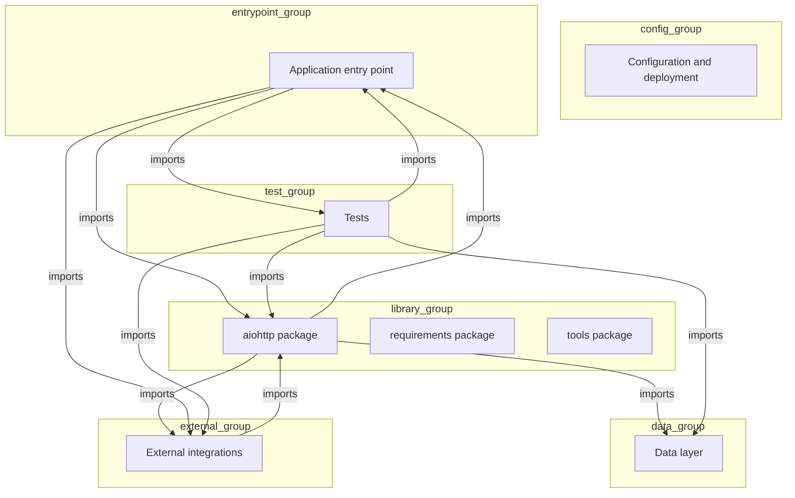

# Architecture report: aio-libs/aiohttp

> Automated static analysis. **Observed** = directly seen in files/imports/AST; **Inferred** = interpretation from that evidence. Repository code was not executed.

## 1. Repository at a glance

| Item | Value |
| --- | --- |
| Repository | aio-libs/aiohttp |
| Description | Asynchronous HTTP client/server framework for asyncio and Python |
| Language | Python |
| Stars | 16607 |
| Licence | Apache-2.0 |
| Analysed commit / branch | fe099491d275ef2c21bf683e024e34d51ac05d43 / master |
| Framework(s) | None detected |
| Files analysed | 502 |
| Components | 8 |

## 2. Architecture in one minute

aio-libs/aiohttp - Asynchronous HTTP client/server framework for asyncio and Python. This repository was analysed statically from 502 file(s) (172 Python). Detected technologies (observed from imports/manifests): GitHub Actions, aiohttp, Gunicorn, Poetry, setuptools, Docker. Files are grouped into 8 component(s): aiohttp package, Configuration and deployment, Data layer, Application entry point, External integrations, requirements package, Tests, tools package. Observed entry point(s): aiohttp/web.py, fuzzers/http_parser.py, fuzzers/http_payload_parser.py. Findings below distinguish observed facts from inferred interpretation.

## 3. High-level block diagram

## 4. Main components

### aiohttp package (`aiohttp`)

- **Kind:** library
- **Status:** Observed
- **Confidence:** 0.85
- **Responsibility:** Groups 49 file(s) under aiohttp package (observed from repository paths and static analysis). Observed top-level classes: AbstractAccessLogger, AbstractAsyncAccessLogger, AbstractCookieJar, AbstractMatchInfo, AbstractResolver, AbstractResource. Observed top-level functions: __dir__, __getattr__, _apply_cookie_attributes, _auth_header_from_netrc, _build_middlewares, _check_request_resolves.
- **Paths:** `aiohttp/__init__.py`, `aiohttp/_cookie_helpers.py`, `aiohttp/_find_header.h`, `aiohttp/_websocket/__init__.py`, `aiohttp/_websocket/helpers.py`, `aiohttp/_websocket/reader.py`, `aiohttp/_websocket/reader_py.py`, `aiohttp/_websocket/writer.py`, `aiohttp/abc.py`, `aiohttp/base_protocol.py`, `aiohttp/client_exceptions.py`, `aiohttp/client_middleware_digest_auth.py`, `aiohttp/client_middlewares.py`, `aiohttp/client_proto.py`, `aiohttp/client_reqrep.py`, `aiohttp/client_ws.py`, `aiohttp/compression_utils.py`, `aiohttp/connector.py`, `aiohttp/cookiejar.py`, `aiohttp/formdata.py`, `aiohttp/hdrs.py`, `aiohttp/helpers.py`, `aiohttp/http.py`, `aiohttp/http_exceptions.py`, `aiohttp/http_parser.py`, `aiohttp/http_websocket.py`, `aiohttp/http_writer.py`, `aiohttp/log.py`, `aiohttp/multipart.py`, `aiohttp/payload.py`, `aiohttp/resolver.py`, `aiohttp/streams.py`, `aiohttp/tcp_helpers.py`, `aiohttp/tracing.py`, `aiohttp/typedefs.py`, `aiohttp/web_app.py`, `aiohttp/web_exceptions.py`, `aiohttp/web_fileresponse.py`, `aiohttp/web_log.py`, `aiohttp/web_middlewares.py`, `aiohttp/web_protocol.py`, `aiohttp/web_request.py`, `aiohttp/web_response.py`, `aiohttp/web_routedef.py`, `aiohttp/web_runner.py`, `aiohttp/web_server.py`, `aiohttp/web_urldispatcher.py`, `aiohttp/web_ws.py`, `aiohttp/worker.py`
- **Evidence:** [aiohttp/__init__.py:244](https://github.com/aio-libs/aiohttp/blob/fe099491d275ef2c21bf683e024e34d51ac05d43/aiohttp/__init__.py#L244); [aiohttp/_cookie_helpers.py:96](https://github.com/aio-libs/aiohttp/blob/fe099491d275ef2c21bf683e024e34d51ac05d43/aiohttp/_cookie_helpers.py#L96); [aiohttp/_find_header.h](https://github.com/aio-libs/aiohttp/blob/fe099491d275ef2c21bf683e024e34d51ac05d43/aiohttp/_find_header.h); [aiohttp/_websocket/__init__.py](https://github.com/aio-libs/aiohttp/blob/fe099491d275ef2c21bf683e024e34d51ac05d43/aiohttp/_websocket/__init__.py); [aiohttp/_websocket/helpers.py:27](https://github.com/aio-libs/aiohttp/blob/fe099491d275ef2c21bf683e024e34d51ac05d43/aiohttp/_websocket/helpers.py#L27); [aiohttp/_websocket/reader.py](https://github.com/aio-libs/aiohttp/blob/fe099491d275ef2c21bf683e024e34d51ac05d43/aiohttp/_websocket/reader.py); [aiohttp/_websocket/reader_py.py:81](https://github.com/aio-libs/aiohttp/blob/fe099491d275ef2c21bf683e024e34d51ac05d43/aiohttp/_websocket/reader_py.py#L81); [aiohttp/_websocket/writer.py:40](https://github.com/aio-libs/aiohttp/blob/fe099491d275ef2c21bf683e024e34d51ac05d43/aiohttp/_websocket/writer.py#L40)

### Configuration and deployment (`config`)

- **Kind:** config
- **Status:** Observed
- **Confidence:** 0.85
- **Responsibility:** Groups 9 file(s) under configuration and deployment (observed from repository paths and static analysis). Observed top-level classes: ParallelBuildExt.
- **Paths:** `MANIFEST.in`, `pyproject.toml`, `pytest.ini`, `setup.cfg`, `setup.py`, `tests/autobahn/Dockerfile.aiohttp`, `tests/autobahn/Dockerfile.autobahn`, `tools/testing/Dockerfile`, `tools/testing/Dockerfile.dockerignore`
- **Evidence:** [MANIFEST.in](https://github.com/aio-libs/aiohttp/blob/fe099491d275ef2c21bf683e024e34d51ac05d43/MANIFEST.in); [pyproject.toml](https://github.com/aio-libs/aiohttp/blob/fe099491d275ef2c21bf683e024e34d51ac05d43/pyproject.toml); [pytest.ini](https://github.com/aio-libs/aiohttp/blob/fe099491d275ef2c21bf683e024e34d51ac05d43/pytest.ini); [setup.cfg](https://github.com/aio-libs/aiohttp/blob/fe099491d275ef2c21bf683e024e34d51ac05d43/setup.cfg); [setup.py:87](https://github.com/aio-libs/aiohttp/blob/fe099491d275ef2c21bf683e024e34d51ac05d43/setup.py#L87); [tests/autobahn/Dockerfile.aiohttp](https://github.com/aio-libs/aiohttp/blob/fe099491d275ef2c21bf683e024e34d51ac05d43/tests/autobahn/Dockerfile.aiohttp); [tests/autobahn/Dockerfile.autobahn](https://github.com/aio-libs/aiohttp/blob/fe099491d275ef2c21bf683e024e34d51ac05d43/tests/autobahn/Dockerfile.autobahn); [tools/testing/Dockerfile](https://github.com/aio-libs/aiohttp/blob/fe099491d275ef2c21bf683e024e34d51ac05d43/tools/testing/Dockerfile)

### Data layer (`data_layer`)

- **Kind:** data
- **Status:** Observed
- **Confidence:** 0.85
- **Responsibility:** Groups 1 file(s) under data layer (observed from repository paths and static analysis). Observed top-level classes: WSCloseCode, WSHandshakeError, WSMessageBinary, WSMessageClose, WSMessageClosed, WSMessageClosing.
- **Paths:** `aiohttp/_websocket/models.py`
- **Evidence:** [aiohttp/_websocket/models.py:11](https://github.com/aio-libs/aiohttp/blob/fe099491d275ef2c21bf683e024e34d51ac05d43/aiohttp/_websocket/models.py#L11)

### Application entry point (`entrypoint`)

- **Kind:** entrypoint
- **Status:** Observed
- **Confidence:** 0.85
- **Responsibility:** Groups 10 file(s) under application entry point (observed from repository paths and static analysis). Observed top-level classes: FuzzStream. Observed top-level functions: TestOneInput, _cancel_tasks, _run_app, fuzz_bodypart_reader, fuzz_run_one_async, get_root.
- **Paths:** `aiohttp/web.py`, `fuzzers/http_parser.py`, `fuzzers/http_payload_parser.py`, `fuzzers/multipart.py`, `fuzzers/payload_url.py`, `fuzzers/set_cookie.py`, `fuzzers/web_request.py`, `tools/check_changes.py`, `tools/check_sum.py`, `tools/cleanup_changes.py`
- **Evidence:** [aiohttp/web.py:280](https://github.com/aio-libs/aiohttp/blob/fe099491d275ef2c21bf683e024e34d51ac05d43/aiohttp/web.py#L280); [fuzzers/http_parser.py:34](https://github.com/aio-libs/aiohttp/blob/fe099491d275ef2c21bf683e024e34d51ac05d43/fuzzers/http_parser.py#L34); [fuzzers/http_payload_parser.py:35](https://github.com/aio-libs/aiohttp/blob/fe099491d275ef2c21bf683e024e34d51ac05d43/fuzzers/http_payload_parser.py#L35); [fuzzers/multipart.py:32](https://github.com/aio-libs/aiohttp/blob/fe099491d275ef2c21bf683e024e34d51ac05d43/fuzzers/multipart.py#L32); [fuzzers/payload_url.py:29](https://github.com/aio-libs/aiohttp/blob/fe099491d275ef2c21bf683e024e34d51ac05d43/fuzzers/payload_url.py#L29); [fuzzers/set_cookie.py:33](https://github.com/aio-libs/aiohttp/blob/fe099491d275ef2c21bf683e024e34d51ac05d43/fuzzers/set_cookie.py#L33); [fuzzers/web_request.py:30](https://github.com/aio-libs/aiohttp/blob/fe099491d275ef2c21bf683e024e34d51ac05d43/fuzzers/web_request.py#L30); [tools/check_changes.py:24](https://github.com/aio-libs/aiohttp/blob/fe099491d275ef2c21bf683e024e34d51ac05d43/tools/check_changes.py#L24)

### External integrations (`external_integrations`)

- **Kind:** external
- **Status:** Observed
- **Confidence:** 0.85
- **Responsibility:** Groups 1 file(s) under external integrations (observed from repository paths and static analysis). Observed top-level classes: ClientSession, _BaseRequestContextManager, _RequestOptions, _SessionOptions, _SessionRequestContextManager, _WSConnectOptions. Observed top-level functions: _connect_and_send_request, _has_no_authority.
- **Paths:** `aiohttp/client.py`
- **Evidence:** [aiohttp/client.py:178](https://github.com/aio-libs/aiohttp/blob/fe099491d275ef2c21bf683e024e34d51ac05d43/aiohttp/client.py#L178)

### requirements package (`requirements`)

- **Kind:** library
- **Status:** Observed
- **Confidence:** 0.85
- **Responsibility:** Groups 1 file(s) under requirements package (observed from repository paths and static analysis).
- **Paths:** `requirements/sync-direct-runtime-deps.py`
- **Evidence:** [requirements/sync-direct-runtime-deps.py](https://github.com/aio-libs/aiohttp/blob/fe099491d275ef2c21bf683e024e34d51ac05d43/requirements/sync-direct-runtime-deps.py)

### Tests (`tests`)

- **Kind:** test
- **Status:** Observed
- **Confidence:** 0.85
- **Responsibility:** Groups 89 file(s) under tests (observed from repository paths and static analysis). Observed routes: PATCH aiohttp.connector.ClientRequestBase, PATCH aiohttp.connector.aiohappyeyeballs.start_connection, PATCH aiohttp.connector.ClientRequestBase, PATCH aiohttp.connector.aiohappyeyeballs.start_connection, PATCH aiohttp.connector.aiohappyeyeballs.start_connection. Observed top-level classes: AioHTTPTestCase, AsyncioWorker, BaseTestServer, BaseTestWorker, BenchmarkFile, BlockedByMiddleware. Observed top-level functions: _accept_ws, _acquired_connection, _assert_consistent, _build_request_parser,…
- **Paths:** `aiohttp/test_utils.py`, `tests/autobahn/client/client.py`, `tests/autobahn/client/fuzzingserver.json`, `tests/autobahn/server/fuzzingclient.json`, `tests/autobahn/server/server.py`, `tests/autobahn/test_autobahn.py`, `tests/conftest.py`, `tests/data.unknown_mime_type`, `tests/data.zero_bytes`, `tests/github-urls.json`, `tests/isolated/check_for_client_response_leak.py`, `tests/isolated/check_for_request_leak.py`, `tests/sample.txt`, `tests/test_base_protocol.py`, `tests/test_benchmarks_client.py`, `tests/test_benchmarks_client_request.py`, `tests/test_benchmarks_client_response.py`, `tests/test_benchmarks_client_ws.py`, `tests/test_benchmarks_cookie_helpers.py`, `tests/test_benchmarks_cookiejar.py`, `tests/test_benchmarks_helpers.py`, `tests/test_benchmarks_http_websocket.py`, `tests/test_benchmarks_http_writer.py`, `tests/test_benchmarks_multipart.py`, `tests/test_benchmarks_web_fileresponse.py`, `tests/test_benchmarks_web_middleware.py`, `tests/test_benchmarks_web_request.py`, `tests/test_benchmarks_web_response.py`, `tests/test_benchmarks_web_urldispatcher.py`, `tests/test_circular_imports.py`, `tests/test_classbasedview.py`, `tests/test_client_connection.py`, `tests/test_client_exceptions.py`, `tests/test_client_fingerprint.py`, `tests/test_client_middleware.py`, `tests/test_client_middleware_digest_auth.py`, `tests/test_client_proto.py`, `tests/test_client_request.py`, `tests/test_client_response.py`, `tests/test_client_session.py`, `tests/test_client_ws.py`, `tests/test_client_ws_functional.py`, `tests/test_compression_utils.py`, `tests/test_connector.py`, `tests/test_cookie_helpers.py`, `tests/test_cookiejar.py`, `tests/test_flowcontrol_streams.py`, `tests/test_formdata.py`, `tests/test_helpers.py`, `tests/test_http_exceptions.py`, `tests/test_http_parser.py`, `tests/test_http_writer.py`, `tests/test_imports.py`, `tests/test_leaks.py`, `tests/test_multipart.py`, `tests/test_multipart_helpers.py`, `tests/test_payload.py`, `tests/test_proxy.py`, `tests/test_proxy_functional.py`, `tests/test_resolver.py`, `tests/test_route_def.py`, `tests/test_run_app.py`, `tests/test_streams.py`, `tests/test_tcp_helpers.py`, `tests/test_test_utils.py`, `tests/test_tracing.py`, `tests/test_urldispatch.py`, `tests/test_web_app.py`, `tests/test_web_cli.py`, `tests/test_web_exceptions.py`, `tests/test_web_functional.py`, `tests/test_web_log.py`, `tests/test_web_middleware.py`, `tests/test_web_protocol.py`, `tests/test_web_request.py`, `tests/test_web_request_handler.py`, `tests/test_web_response.py`, `tests/test_web_runner.py`, `tests/test_web_sendfile.py`, `tests/test_web_sendfile_functional.py`, `tests/test_web_server.py`, `tests/test_web_urldispatcher.py`, `tests/test_web_websocket.py`, `tests/test_web_websocket_functional.py`, `tests/test_websocket_data_queue.py`, `tests/test_websocket_handshake.py`, `tests/test_websocket_parser.py`, `tests/test_websocket_writer.py`, `tests/test_worker.py`
- **Evidence:** [aiohttp/test_utils.py:63](https://github.com/aio-libs/aiohttp/blob/fe099491d275ef2c21bf683e024e34d51ac05d43/aiohttp/test_utils.py#L63); [tests/autobahn/client/client.py:8](https://github.com/aio-libs/aiohttp/blob/fe099491d275ef2c21bf683e024e34d51ac05d43/tests/autobahn/client/client.py#L8); [tests/autobahn/client/fuzzingserver.json](https://github.com/aio-libs/aiohttp/blob/fe099491d275ef2c21bf683e024e34d51ac05d43/tests/autobahn/client/fuzzingserver.json); [tests/autobahn/server/fuzzingclient.json](https://github.com/aio-libs/aiohttp/blob/fe099491d275ef2c21bf683e024e34d51ac05d43/tests/autobahn/server/fuzzingclient.json); [tests/autobahn/server/server.py:10](https://github.com/aio-libs/aiohttp/blob/fe099491d275ef2c21bf683e024e34d51ac05d43/tests/autobahn/server/server.py#L10); [tests/autobahn/test_autobahn.py:25](https://github.com/aio-libs/aiohttp/blob/fe099491d275ef2c21bf683e024e34d51ac05d43/tests/autobahn/test_autobahn.py#L25); [tests/conftest.py:44](https://github.com/aio-libs/aiohttp/blob/fe099491d275ef2c21bf683e024e34d51ac05d43/tests/conftest.py#L44); [tests/data.unknown_mime_type](https://github.com/aio-libs/aiohttp/blob/fe099491d275ef2c21bf683e024e34d51ac05d43/tests/data.unknown_mime_type)

### tools package (`tools`)

- **Kind:** library
- **Status:** Observed
- **Confidence:** 0.85
- **Responsibility:** Groups 4 file(s) under tools package (observed from repository paths and static analysis). Observed top-level functions: _job, build, calc_headers, factory, fm_size, fm_time.
- **Paths:** `tools/bench-asyncio-write.py`, `tools/drop_merged_branches.sh`, `tools/gen.py`, `tools/testing/entrypoint.sh`
- **Evidence:** [tools/bench-asyncio-write.py:19](https://github.com/aio-libs/aiohttp/blob/fe099491d275ef2c21bf683e024e34d51ac05d43/tools/bench-asyncio-write.py#L19); [tools/drop_merged_branches.sh](https://github.com/aio-libs/aiohttp/blob/fe099491d275ef2c21bf683e024e34d51ac05d43/tools/drop_merged_branches.sh); [tools/gen.py:14](https://github.com/aio-libs/aiohttp/blob/fe099491d275ef2c21bf683e024e34d51ac05d43/tools/gen.py#L14); [tools/testing/entrypoint.sh](https://github.com/aio-libs/aiohttp/blob/fe099491d275ef2c21bf683e024e34d51ac05d43/tools/testing/entrypoint.sh)

## 5. Execution flow

**Observed** entry point(s):

- [aiohttp/web.py:578](https://github.com/aio-libs/aiohttp/blob/fe099491d275ef2c21bf683e024e34d51ac05d43/aiohttp/web.py#L578)
- [fuzzers/http_parser.py:41](https://github.com/aio-libs/aiohttp/blob/fe099491d275ef2c21bf683e024e34d51ac05d43/fuzzers/http_parser.py#L41)
- [fuzzers/http_payload_parser.py:42](https://github.com/aio-libs/aiohttp/blob/fe099491d275ef2c21bf683e024e34d51ac05d43/fuzzers/http_payload_parser.py#L42)
- [fuzzers/multipart.py:67](https://github.com/aio-libs/aiohttp/blob/fe099491d275ef2c21bf683e024e34d51ac05d43/fuzzers/multipart.py#L67)
- [fuzzers/payload_url.py:39](https://github.com/aio-libs/aiohttp/blob/fe099491d275ef2c21bf683e024e34d51ac05d43/fuzzers/payload_url.py#L39)
- [fuzzers/set_cookie.py:49](https://github.com/aio-libs/aiohttp/blob/fe099491d275ef2c21bf683e024e34d51ac05d43/fuzzers/set_cookie.py#L49)
- [fuzzers/web_request.py:54](https://github.com/aio-libs/aiohttp/blob/fe099491d275ef2c21bf683e024e34d51ac05d43/fuzzers/web_request.py#L54)
- [tools/check_changes.py:58](https://github.com/aio-libs/aiohttp/blob/fe099491d275ef2c21bf683e024e34d51ac05d43/tools/check_changes.py#L58)
- [tools/check_sum.py:49](https://github.com/aio-libs/aiohttp/blob/fe099491d275ef2c21bf683e024e34d51ac05d43/tools/check_sum.py#L49)
- [tools/cleanup_changes.py:44](https://github.com/aio-libs/aiohttp/blob/fe099491d275ef2c21bf683e024e34d51ac05d43/tools/cleanup_changes.py#L44)

**Observed** routes (from decorators):

- `GET /` -> `intro` in `examples/web_srv_route_deco.py:12`
- `GET /simple` -> `simple` in `examples/web_srv_route_deco.py:27`
- `GET /change_body` -> `change_body` in `examples/web_srv_route_deco.py:32`
- `GET /hello` -> `hello` in `examples/web_srv_route_deco.py:40`
- `PATCH aiohttp.connector.ClientRequestBase` -> `test_connect` in `tests/test_proxy.py:37`
- `PATCH aiohttp.connector.aiohappyeyeballs.start_connection` -> `test_connect` in `tests/test_proxy.py:37`
- `PATCH aiohttp.connector.ClientRequestBase` -> `test_proxy_headers` in `tests/test_proxy.py:97`
- `PATCH aiohttp.connector.aiohappyeyeballs.start_connection` -> `test_proxy_headers` in `tests/test_proxy.py:97`
- `PATCH aiohttp.connector.aiohappyeyeballs.start_connection` -> `test_proxy_dns_error` in `tests/test_proxy.py:157`
- `PATCH aiohttp.connector.aiohappyeyeballs.start_connection` -> `test_proxy_connection_error` in `tests/test_proxy.py:188`
- `PATCH aiohttp.connector.ClientRequestBase` -> `test_proxy_server_hostname_default` in `tests/test_proxy.py:224`
- `PATCH aiohttp.connector.aiohappyeyeballs.start_connection` -> `test_proxy_server_hostname_default` in `tests/test_proxy.py:224`
- `PATCH aiohttp.connector.ClientRequestBase` -> `test_proxy_server_hostname_override` in `tests/test_proxy.py:310`
- `PATCH aiohttp.connector.aiohappyeyeballs.start_connection` -> `test_proxy_server_hostname_override` in `tests/test_proxy.py:310`
- `PATCH aiohttp.connector.ClientRequestBase` -> `test_https_connect_fingerprint_mismatch` in `tests/test_proxy.py:403`
- `PATCH aiohttp.connector.aiohappyeyeballs.start_connection` -> `test_https_connect_fingerprint_mismatch` in `tests/test_proxy.py:403`
- `PATCH aiohttp.connector.ClientRequestBase` -> `test_https_connect` in `tests/test_proxy.py:527`
- `PATCH aiohttp.connector.aiohappyeyeballs.start_connection` -> `test_https_connect` in `tests/test_proxy.py:527`
- `PATCH aiohttp.connector.ClientRequestBase` -> `test_https_connect_certificate_error` in `tests/test_proxy.py:612`
- `PATCH aiohttp.connector.aiohappyeyeballs.start_connection` -> `test_https_connect_certificate_error` in `tests/test_proxy.py:612`
- `PATCH aiohttp.connector.ClientRequestBase` -> `test_https_connect_ssl_error` in `tests/test_proxy.py:693`
- `PATCH aiohttp.connector.aiohappyeyeballs.start_connection` -> `test_https_connect_ssl_error` in `tests/test_proxy.py:693`
- `PATCH aiohttp.connector.ClientRequestBase` -> `test_https_connect_http_proxy_error` in `tests/test_proxy.py:774`
- `PATCH aiohttp.connector.aiohappyeyeballs.start_connection` -> `test_https_connect_http_proxy_error` in `tests/test_proxy.py:774`
- `PATCH aiohttp.connector.ClientRequestBase` -> `test_https_connect_resp_start_error` in `tests/test_proxy.py:855`
- `PATCH aiohttp.connector.aiohappyeyeballs.start_connection` -> `test_https_connect_resp_start_error` in `tests/test_proxy.py:855`
- `PATCH aiohttp.connector.ClientRequestBase` -> `test_https_connect_send_error` in `tests/test_proxy.py:930`
- `PATCH aiohttp.connector.aiohappyeyeballs.start_connection` -> `test_https_connect_send_error` in `tests/test_proxy.py:930`
- `PATCH aiohttp.connector.ClientRequest` -> `test_request_port` in `tests/test_proxy.py:999`
- `PATCH aiohttp.connector.aiohappyeyeballs.start_connection` -> `test_request_port` in `tests/test_proxy.py:999`
- `PATCH aiohttp.connector.ClientRequestBase` -> `test_https_connect_pass_ssl_context` in `tests/test_proxy.py:1046`
- `PATCH aiohttp.connector.aiohappyeyeballs.start_connection` -> `test_https_connect_pass_ssl_context` in `tests/test_proxy.py:1046`
- `PATCH aiohttp.connector.ClientRequestBase` -> `test_https_auth` in `tests/test_proxy.py:1141`
- `PATCH aiohttp.connector.aiohappyeyeballs.start_connection` -> `test_https_auth` in `tests/test_proxy.py:1141`

Representative flow (derived from observed entry points and the import graph; steps beyond the entry point are **Inferred**):

1. Execution starts at an observed entry point listed above, if present.
2. `aiohttp` imports `data_layer` (aiohttp package -> Data layer).
3. `aiohttp` imports `entrypoint` (aiohttp package -> Application entry point).
4. `aiohttp` imports `external_integrations` (aiohttp package -> External integrations).
5. `entrypoint` imports `aiohttp` (Application entry point -> aiohttp package).
6. `entrypoint` imports `external_integrations` (Application entry point -> External integrations).
7. `entrypoint` imports `tests` (Application entry point -> Tests).
8. `external_integrations` imports `aiohttp` (External integrations -> aiohttp package).
9. `tests` imports `aiohttp` (Tests -> aiohttp package).

## 6. Project structure

### `(root)`

- `.cherry_picker.toml` - config (113 bytes)
- `.codecov.yml` - config (678 bytes)
- `.coveragerc-cython.toml` - config (2445 bytes)
- `.coveragerc.toml` - config (2447 bytes)
- `.editorconfig` - config (376 bytes)
- `.git-blame-ignore-revs` - other (1337 bytes)
- `.gitattributes` - other (58 bytes)
- `.gitignore` - other (814 bytes)
- `.gitmodules` - other (118 bytes)
- `.lgtm.yml` - config (44 bytes)
- `.mypy.ini` - config (1083 bytes)
- `.pip-tools.toml` - config (106 bytes)
- `.pre-commit-config.yaml` - config (3079 bytes)
- `.readthedocs.yml` - config (522 bytes)
- `AGENTS.md` - docs (3659 bytes)
- `CLAUDE.md` - docs (98 bytes)
- `CODE_OF_CONDUCT.md` - docs (3221 bytes)
- `CONTRIBUTING.rst` - docs (1060 bytes)
- `CONTRIBUTORS.txt` - docs (6908 bytes)
- `LICENSE.txt` - docs (11313 bytes)
- `MANIFEST.in` - manifest (512 bytes)
- `Makefile` - other (5971 bytes)
- `README.rst` - docs (5582 bytes)
- `SECURITY_EXTRA.md` - docs (554 bytes)
- `THREAT_MODEL.md` - docs (65207 bytes)
- `pyproject.toml` - manifest (6150 bytes)
- `pytest.ini` - config (3205 bytes)
- `setup.cfg` - manifest (882 bytes)
- `setup.py` - manifest, Python (2799 bytes)

### `.claude`

- `.claude/skills/backport-failed/SKILL.md` - docs (8009 bytes)

### `.github`

- `.github/CODEOWNERS` - other (590 bytes)
- `.github/FUNDING.yml` - config (161 bytes)
- `.github/ISSUE_TEMPLATE/bug-report.yml` - config (4934 bytes)
- `.github/ISSUE_TEMPLATE/config.yml` - config (1228 bytes)
- `.github/ISSUE_TEMPLATE/feature-request.yml` - config (3427 bytes)
- `.github/PULL_REQUEST_TEMPLATE.md` - docs (2988 bytes)
- `.github/codeql.yml` - config (107 bytes)
- `.github/config.yml` - config (121 bytes)
- `.github/dependabot.yml` - config (1868 bytes)
- `.github/egress-firewall.yaml` - config (133 bytes)
- `.github/lock.yml` - config (1054 bytes)
- `.github/workflows/actions.lock` - ci, YAML (3331 bytes)
- `.github/workflows/agent-scan.yml` - ci, YAML (341 bytes)
- `.github/workflows/auto-merge.yml` - ci, YAML (608 bytes)
- `.github/workflows/ci-cd.yml` - ci, YAML (28175 bytes)
- `.github/workflows/codeql.yml` - ci, YAML (1062 bytes)
- `.github/workflows/dependency-submission.yml` - ci, YAML (2488 bytes)
- `.github/workflows/label-remove.yml` - ci, YAML (697 bytes)
- `.github/workflows/labels.yml` - ci, YAML (721 bytes)
- `.github/workflows/reusable-cibuildwheel.yml` - ci, YAML (4290 bytes)
- `.github/workflows/stale.yml` - ci, YAML (270 bytes)

### `CHANGES`

- `CHANGES/.TEMPLATE.rst` - docs (2391 bytes)
- `CHANGES/.gitignore` - other (382 bytes)
- `CHANGES/10468.doc.rst` - docs (214 bytes)
- `CHANGES/10549.misc.rst` - docs (151 bytes)
- `CHANGES/10611.bugfix.rst` - docs (203 bytes)
- `CHANGES/10762.breaking.rst` - docs (108 bytes)
- `CHANGES/10890.misc.rst` - docs (134 bytes)
- `CHANGES/11012.breaking.rst` - docs (475 bytes)
- `CHANGES/11268.feature.rst` - docs (132 bytes)
- `CHANGES/11776.misc.rst` - docs (190 bytes)
- `CHANGES/11876.misc.rst` - docs (99 bytes)
- `CHANGES/12088.bugfix.rst` - docs (73 bytes)
- `CHANGES/12111.breaking.rst` - docs (166 bytes)
- `CHANGES/12296.bugfix.rst` - docs (259 bytes)
- `CHANGES/12425.misc.rst` - docs (104 bytes)
- `CHANGES/12501.breaking.rst` - docs (145 bytes)
- `CHANGES/12540.bugfix.rst` - docs (103 bytes)
- `CHANGES/12561.misc.rst` - docs (131 bytes)
- `CHANGES/12573.contrib.rst` - docs (427 bytes)
- `CHANGES/12580.contrib.rst` - docs (434 bytes)
- `CHANGES/12584.contrib.rst` - docs (281 bytes)
- `CHANGES/12588.contrib.rst` - docs (220 bytes)
- `CHANGES/12596.contrib.rst` - docs (218 bytes)
- `CHANGES/12600.contrib.rst` - docs (254 bytes)
- `CHANGES/12617.contrib.rst` - docs (490 bytes)
- `CHANGES/12643.contrib.rst` - docs (293 bytes)
- `CHANGES/12647.contrib.rst` - docs (248 bytes)
- `CHANGES/12670.breaking.rst` - docs (128 bytes)
- `CHANGES/12703.bugfix.rst` - docs (118 bytes)
- `CHANGES/12706.bugfix.rst` - docs (92 bytes)
- `CHANGES/12722.bugfix.rst` - docs (127 bytes)
- `CHANGES/12822.breaking.rst` - docs (517 bytes)
- `CHANGES/12823.misc.rst` - docs (151 bytes)
- `CHANGES/12829.bugfix.rst` - docs (331 bytes)
- `CHANGES/12889.bugfix.rst` - docs (421 bytes)
- `CHANGES/12895.bugfix.rst` - docs (240 bytes)
- `CHANGES/12913.misc.rst` - docs (214 bytes)
- `CHANGES/12917.feature.rst` - docs (149 bytes)
- `CHANGES/12920.feature.rst` - docs (85 bytes)
- `CHANGES/12993.packaging.rst` - docs (141 bytes)
- `CHANGES/13006.feature.rst` - docs (234 bytes)
- `CHANGES/13099.bugfix.rst` - docs (189 bytes)
- `CHANGES/13175.bugfix.rst` - docs (255 bytes)
- `CHANGES/13176.feature.rst` - docs (186 bytes)
- `CHANGES/13206.bugfix.rst` - docs (124 bytes)
- `CHANGES/13229.bugfix.rst` - docs (227 bytes)
- `CHANGES/13278.bugfix.rst` - docs (83 bytes)
- `CHANGES/13286.contrib.rst` - docs (220 bytes)
- `CHANGES/13294.doc.rst` - docs (229 bytes)
- `CHANGES/13400.bugfix.1.rst` - docs (100 bytes)
- `CHANGES/13400.bugfix.2.rst` - docs (136 bytes)
- `CHANGES/13400.bugfix.rst` - docs (90 bytes)
- `CHANGES/13462.bugfix.rst` - docs (79 bytes)
- `CHANGES/13480.bugfix.rst` - docs (327 bytes)
- `CHANGES/13499.bugfix.rst` - docs (385 bytes)
- `CHANGES/13504.bugfix.rst` - docs (85 bytes)
- `CHANGES/13536.bugfix.rst` - docs (123 bytes)
- `CHANGES/13604.misc.rst` - docs (72 bytes)
- `CHANGES/13609.bugfix.rst` - docs (85 bytes)
- `CHANGES/13727.contrib.rst` - docs (153 bytes)
- `CHANGES/13750.feature.rst` - docs (59 bytes)
- `CHANGES/13829.deprecation.rst` - docs (287 bytes)
- `CHANGES/13983.bugfix.rst` - docs (85 bytes)
- `CHANGES/14006.contrib.rst` - docs (162 bytes)
- `CHANGES/14006.misc.rst` - docs (84 bytes)
- `CHANGES/14016.breaking.rst` - docs (128 bytes)
- `CHANGES/14159.contrib.rst` - docs (322 bytes)
- `CHANGES/14164.contrib.rst` - docs (204 bytes)
- `CHANGES/14171.breaking.rst` - docs (179 bytes)
- `CHANGES/14176.feature.rst` - docs (343 bytes)
- `CHANGES/14177.bugfix.rst` - docs (177 bytes)
- `CHANGES/14177.misc.rst` - docs (195 bytes)
- `CHANGES/14263.doc.rst` - docs (153 bytes)
- `CHANGES/14375.packaging.rst` - docs (54 bytes)
- `CHANGES/2174.bugfix` - other (96 bytes)
- `CHANGES/2835.breaking.rst` - docs (115 bytes)
- `CHANGES/2977.breaking.rst` - docs (25 bytes)
- `CHANGES/3287.breaking.rst` - docs (402 bytes)
- `CHANGES/3287.feature.rst` - docs (202 bytes)
- `CHANGES/3310.bugfix` - other (73 bytes)
- `CHANGES/3462.feature` - other (91 bytes)
- `CHANGES/3463.breaking.rst` - docs (123 bytes)
- `CHANGES/3482.bugfix` - other (119 bytes)
- `CHANGES/3538.breaking.rst` - docs (68 bytes)
- `CHANGES/3539.breaking.rst` - docs (105 bytes)
- `CHANGES/3540.feature` - other (71 bytes)
- `CHANGES/3542.breaking.rst` - docs (63 bytes)
- `CHANGES/3545.feature` - other (27 bytes)
- `CHANGES/3547.breaking.rst` - docs (31 bytes)
- `CHANGES/3548.breaking.rst` - docs (37 bytes)
- `CHANGES/3559.doc` - other (68 bytes)
- `CHANGES/3562.bugfix` - other (95 bytes)
- `CHANGES/3569.feature` - other (116 bytes)
- `CHANGES/3580.breaking.rst` - docs (407 bytes)
- `CHANGES/3612.bugfix` - other (43 bytes)
- `CHANGES/3613.bugfix` - other (50 bytes)
- `CHANGES/3642.doc` - other (128 bytes)
- `CHANGES/3685.doc` - other (72 bytes)
- `CHANGES/3721.bugfix` - other (46 bytes)
- `CHANGES/3767.feature` - other (61 bytes)
- `CHANGES/3787.feature` - other (43 bytes)
- `CHANGES/3796.feature` - other (73 bytes)
- `CHANGES/3890.breaking.rst` - docs (121 bytes)
- `CHANGES/3901.breaking.rst` - docs (62 bytes)
- `CHANGES/3929.breaking.rst` - docs (65 bytes)
- `CHANGES/3931.breaking.rst` - docs (88 bytes)
- `CHANGES/3932.breaking.rst` - docs (107 bytes)
- `CHANGES/3933.breaking.rst` - docs (62 bytes)
- `CHANGES/3934.breaking.rst` - docs (55 bytes)
- `CHANGES/3935.breaking.rst` - docs (120 bytes)
- `CHANGES/3939.breaking.rst` - docs (47 bytes)
- `CHANGES/3940.breaking.rst` - docs (89 bytes)
- `CHANGES/3942.breaking.rst` - docs (152 bytes)
- `CHANGES/3948.breaking.rst` - docs (39 bytes)
- `CHANGES/3994.misc` - other (75 bytes)
- `CHANGES/4099.breaking.rst` - docs (208 bytes)
- `CHANGES/4161.doc` - other (84 bytes)
- `CHANGES/4277.feature` - other (69 bytes)
- `CHANGES/4283.bugfix` - other (30 bytes)
- `CHANGES/4299.bugfix` - other (65 bytes)
- `CHANGES/4302.bugfix` - other (76 bytes)
- `CHANGES/4368.bugfix` - other (130 bytes)
- `CHANGES/4452.doc` - other (47 bytes)
- `CHANGES/4504.doc` - other (79 bytes)
- `CHANGES/4526.bugfix` - other (47 bytes)
- `CHANGES/4558.bugfix` - other (63 bytes)
- `CHANGES/4559.feature.rst` - docs (117 bytes)
- `CHANGES/4656.bugfix` - other (71 bytes)
- `CHANGES/4695.doc` - other (83 bytes)
- `CHANGES/4706.feature` - other (125 bytes)
- `CHANGES/5075.feature` - other (31 bytes)
- `CHANGES/5191.doc` - other (60 bytes)
- `CHANGES/5258.bugfix` - other (213 bytes)
- `CHANGES/5278.breaking.rst` - docs (24 bytes)
- `CHANGES/5283.bugfix.rst` - docs (171 bytes)
- `CHANGES/5284.breaking.rst` - docs (122 bytes)
- `CHANGES/5284.feature` - other (115 bytes)
- `CHANGES/5287.feature` - other (178 bytes)
- `CHANGES/5304.deprecation.rst` - docs (321 bytes)
- `CHANGES/5516.misc` - other (63 bytes)
- `CHANGES/5533.misc` - other (36 bytes)
- `CHANGES/5558.bugfix` - other (72 bytes)
- `CHANGES/5634.feature` - other (112 bytes)
- `CHANGES/5806.misc` - other (39 bytes)
- `CHANGES/5829.misc` - other (41 bytes)
- `CHANGES/5870.misc` - other (31 bytes)
- `CHANGES/5894.bugfix` - other (76 bytes)
- `CHANGES/6180.bugfix` - other (133 bytes)
- `CHANGES/6181.bugfix` - other (61 bytes)
- `CHANGES/6193.feature` - other (28 bytes)
- `CHANGES/6721.misc` - other (55 bytes)
- `CHANGES/6979.doc` - other (142 bytes)
- `CHANGES/6998.doc` - other (86 bytes)
- `CHANGES/7107.breaking.rst` - docs (115 bytes)
- `CHANGES/7265.breaking.rst` - docs (84 bytes)
- `CHANGES/7274.feature` - other (278 bytes)
- `CHANGES/7319.feature.rst` - docs (430 bytes)
- `CHANGES/7677.bugfix` - other (123 bytes)
- `CHANGES/7772.bugfix` - other (57 bytes)
- `CHANGES/7815.bugfix` - other (92 bytes)
- `CHANGES/8048.breaking.rst` - docs (70 bytes)
- `CHANGES/8139.contrib.rst` - docs (193 bytes)
- `CHANGES/8197.doc` - other (106 bytes)
- `CHANGES/8303.breaking.rst` - docs (232 bytes)
- `CHANGES/8596.breaking.rst` - docs (95 bytes)
- `CHANGES/8698.breaking.rst` - docs (155 bytes)
- `CHANGES/8957.breaking.rst` - docs (122 bytes)
- `CHANGES/9109.breaking.rst` - docs (136 bytes)
- `CHANGES/9212.packaging.rst` - docs (81 bytes)
- `CHANGES/9254.breaking.rst` - docs (203 bytes)
- `CHANGES/9292.breaking.rst` - docs (108 bytes)
- `CHANGES/9413.misc.rst` - docs (104 bytes)
- `CHANGES/9891.contrib.rst` - docs (120 bytes)
- `CHANGES/README.rst` - docs (4938 bytes)

### `aiohttp`

- `aiohttp/__init__.py` - source, Python (6875 bytes)
- `aiohttp/_cookie_helpers.py` - source, Python (16216 bytes)
- `aiohttp/_cparser.pxd` - other (2729 bytes)
- `aiohttp/_find_header.h` - source, C/C++ (170 bytes)
- `aiohttp/_find_header.pxd` - other (68 bytes)
- `aiohttp/_http_parser.pyx` - other (39141 bytes)
- `aiohttp/_http_writer.pyx` - other (4823 bytes)
- `aiohttp/_websocket/__init__.py` - source, Python (44 bytes)
- `aiohttp/_websocket/helpers.py` - source, Python (5006 bytes)
- `aiohttp/_websocket/mask.pxd` - other (112 bytes)
- `aiohttp/_websocket/mask.pyx` - other (1397 bytes)
- `aiohttp/_websocket/models.py` - source, Python (3991 bytes)
- `aiohttp/_websocket/reader.py` - source, Python (1010 bytes)
- `aiohttp/_websocket/reader_c.pxd` - other (3274 bytes)
- `aiohttp/_websocket/reader_py.py` - source, Python (27744 bytes)
- `aiohttp/_websocket/writer.py` - source, Python (11619 bytes)
- `aiohttp/abc.py` - source, Python (8645 bytes)
- `aiohttp/base_protocol.py` - source, Python (5348 bytes)
- `aiohttp/client.py` - source, Python (60222 bytes)
- `aiohttp/client_exceptions.py` - source, Python (10904 bytes)
- `aiohttp/client_middleware_digest_auth.py` - source, Python (19560 bytes)
- `aiohttp/client_middlewares.py` - source, Python (1954 bytes)
- `aiohttp/client_proto.py` - source, Python (14578 bytes)
- `aiohttp/client_reqrep.py` - source, Python (63313 bytes)
- `aiohttp/client_ws.py` - source, Python (20375 bytes)
- `aiohttp/compression_utils.py` - source, Python (19939 bytes)
- `aiohttp/connector.py` - source, Python (65509 bytes)
- `aiohttp/cookiejar.py` - source, Python (36778 bytes)
- `aiohttp/formdata.py` - source, Python (5741 bytes)
- `aiohttp/hdrs.py` - source, Python (8179 bytes)
- `aiohttp/helpers.py` - source, Python (35758 bytes)
- `aiohttp/http.py` - source, Python (1348 bytes)
- `aiohttp/http_exceptions.py` - source, Python (2953 bytes)
- `aiohttp/http_parser.py` - source, Python (52908 bytes)
- `aiohttp/http_websocket.py` - source, Python (1377 bytes)
- `aiohttp/http_writer.py` - source, Python (13060 bytes)
- `aiohttp/log.py` - source, Python (325 bytes)
- `aiohttp/multipart.py` - source, Python (47198 bytes)
- `aiohttp/payload.py` - source, Python (41336 bytes)
- `aiohttp/py.typed` - other (7 bytes)
- `aiohttp/resolver.py` - source, Python (9644 bytes)
- `aiohttp/streams.py` - source, Python (24690 bytes)
- `aiohttp/tcp_helpers.py` - source, Python (941 bytes)
- `aiohttp/test_utils.py` - test, Python (21141 bytes)
- `aiohttp/tracing.py` - source, Python (14644 bytes)
- `aiohttp/typedefs.py` - source, Python (1243 bytes)
- `aiohttp/web.py` - source, Python (16245 bytes)
- `aiohttp/web_app.py` - source, Python (14088 bytes)
- `aiohttp/web_exceptions.py` - source, Python (12165 bytes)
- `aiohttp/web_fileresponse.py` - source, Python (17745 bytes)
- `aiohttp/web_log.py` - source, Python (8322 bytes)
- `aiohttp/web_middlewares.py` - source, Python (4387 bytes)
- `aiohttp/web_protocol.py` - source, Python (34578 bytes)
- `aiohttp/web_request.py` - source, Python (34426 bytes)
- `aiohttp/web_response.py` - source, Python (27692 bytes)
- `aiohttp/web_routedef.py` - source, Python (6150 bytes)
- `aiohttp/web_runner.py` - source, Python (15194 bytes)
- `aiohttp/web_server.py` - source, Python (4963 bytes)
- `aiohttp/web_urldispatcher.py` - source, Python (43829 bytes)
- `aiohttp/web_ws.py` - source, Python (28459 bytes)
- `aiohttp/worker.py` - source, Python (8616 bytes)

### `docs`

- `docs/Makefile` - docs (6894 bytes)
- `docs/_static/css/logo-adjustments.css` - docs (110 bytes)
- `docs/_static/img/contributing-cov-comment.svg` - docs (6687 bytes)
- `docs/_static/img/contributing-cov-header.svg` - docs (2305 bytes)
- `docs/_static/img/contributing-cov-miss.svg` - docs (112029 bytes)
- `docs/_static/img/contributing-cov-partial.svg` - docs (42324 bytes)
- `docs/abc.rst` - docs (7046 bytes)
- `docs/aiohttp-icon.svg` - docs (2399 bytes)
- `docs/aiohttp-plain.svg` - docs (2397 bytes)
- `docs/built_with.rst` - docs (1801 bytes)
- `docs/changes.rst` - docs (357 bytes)
- `docs/client.rst` - docs (433 bytes)
- `docs/client_advanced.rst` - docs (32941 bytes)
- `docs/client_middleware_cookbook.rst` - docs (5627 bytes)
- `docs/client_quickstart.rst` - docs (16521 bytes)
- `docs/client_reference.rst` - docs (111841 bytes)
- `docs/code/client_middleware_cookbook.py` - docs (5072 bytes)
- `docs/conf.py` - docs (17091 bytes)
- `docs/contributing-admins.rst` - docs (17062 bytes)
- `docs/contributing.rst` - docs (10796 bytes)
- `docs/deployment.rst` - docs (12459 bytes)
- `docs/essays.rst` - docs (98 bytes)
- `docs/external.rst` - docs (392 bytes)
- `docs/faq.rst` - docs (16009 bytes)
- `docs/glossary.rst` - docs (4843 bytes)
- `docs/http_request_lifecycle.rst` - docs (5542 bytes)
- `docs/index.rst` - docs (5633 bytes)
- `docs/logging.rst` - docs (7163 bytes)
- `docs/make.bat` - docs (6703 bytes)
- `docs/migration_to_2xx.rst` - docs (7176 bytes)
- `docs/misc.rst` - docs (249 bytes)
- `docs/multipart.rst` - docs (11989 bytes)
- `docs/multipart_reference.rst` - docs (6321 bytes)
- `docs/new_router.rst` - docs (2876 bytes)
- `docs/old-logo.svg` - docs (35894 bytes)
- `docs/powered_by.rst` - docs (1797 bytes)
- `docs/spelling_wordlist.txt` - docs (3655 bytes)
- `docs/streams.rst` - docs (6127 bytes)
- `docs/structures.rst` - docs (1231 bytes)
- `docs/testing.rst` - docs (22621 bytes)
- `docs/third_party.rst` - docs (11898 bytes)
- `docs/threat_model.md` - docs (36 bytes)
- `docs/tracing_reference.rst` - docs (14215 bytes)
- `docs/utilities.rst` - docs (267 bytes)
- `docs/web.rst` - docs (432 bytes)
- `docs/web_advanced.rst` - docs (46964 bytes)
- `docs/web_exceptions.rst` - docs (21007 bytes)
- `docs/web_lowlevel.rst` - docs (2581 bytes)
- `docs/web_quickstart.rst` - docs (20114 bytes)
- `docs/web_reference.rst` - docs (113753 bytes)
- `docs/websocket_utilities.rst` - docs (5341 bytes)
- `docs/whats_new_1_1.rst` - docs (4406 bytes)
- `docs/whats_new_3_0.rst` - docs (2444 bytes)

### `examples`

- `examples/background_tasks.py` - source, Python (2048 bytes)
- `examples/basic_auth_middleware.py` - source, Python (6441 bytes)
- `examples/cli_app.py` - source, Python (1573 bytes)
- `examples/client_auth.py` - source, Python (609 bytes)
- `examples/client_json.py` - source, Python (480 bytes)
- `examples/client_ws.py` - source, Python (2161 bytes)
- `examples/combined_middleware.py` - source, Python (10619 bytes)
- `examples/curl.py` - source, Python (1069 bytes)
- `examples/digest_auth_qop_auth.py` - source, Python (2273 bytes)
- `examples/fake_server.py` - source, Python (3890 bytes)
- `examples/logging_middleware.py` - source, Python (5728 bytes)
- `examples/lowlevel_srv.py` - source, Python (645 bytes)
- `examples/retry_middleware.py` - source, Python (8855 bytes)
- `examples/server.crt` - other (1103 bytes)
- `examples/server.csr` - other (952 bytes)
- `examples/server_simple.py` - source, Python (788 bytes)
- `examples/static_files.py` - source, Python (181 bytes)
- `examples/token_refresh_middleware.py` - source, Python (12264 bytes)
- `examples/web_classview.py` - source, Python (1587 bytes)
- `examples/web_cookies.py` - source, Python (990 bytes)
- `examples/web_rewrite_headers_middleware.py` - source, Python (725 bytes)
- `examples/web_srv.py` - source, Python (1529 bytes)
- `examples/web_srv_route_deco.py` - source, Python (1504 bytes)
- `examples/web_srv_route_table.py` - source, Python (1605 bytes)
- `examples/web_ws.py` - source, Python (1841 bytes)
- `examples/websocket.html` - other (3034 bytes)

### `fuzzers`

- `fuzzers/http_parser.py` - source, Python (1528 bytes)
- `fuzzers/http_payload_parser.py` - source, Python (1619 bytes)
- `fuzzers/multipart.py` - source, Python (2341 bytes)
- `fuzzers/no_extensions.txt` - docs (103 bytes)
- `fuzzers/payload_url.py` - source, Python (1381 bytes)
- `fuzzers/set_cookie.py` - source, Python (1883 bytes)
- `fuzzers/web_request.py` - source, Python (1948 bytes)

### `requirements`

- `requirements/base-ft.in` - other (29 bytes)
- `requirements/base-ft.txt` - docs (1548 bytes)
- `requirements/base.in` - other (202 bytes)
- `requirements/base.txt` - docs (1656 bytes)
- `requirements/constraints.in` - other (53 bytes)
- `requirements/constraints.txt` - docs (7803 bytes)
- `requirements/cython.in` - other (24 bytes)
- `requirements/cython.txt` - docs (309 bytes)
- `requirements/dev.in` - other (43 bytes)
- `requirements/dev.txt` - docs (7581 bytes)
- `requirements/doc-spelling.in` - other (104 bytes)
- `requirements/doc-spelling.txt` - docs (2119 bytes)
- `requirements/doc.in` - other (103 bytes)
- `requirements/doc.txt` - docs (1878 bytes)
- `requirements/lint.in` - other (337 bytes)
- `requirements/lint.txt` - docs (3431 bytes)
- `requirements/multidict.in` - other (10 bytes)
- `requirements/multidict.txt` - docs (265 bytes)
- `requirements/runtime-deps.in` - other (765 bytes)
- `requirements/runtime-deps.txt` - docs (1504 bytes)
- `requirements/sync-direct-runtime-deps.py` - source, Python (570 bytes)
- `requirements/test-common-base.in` - other (116 bytes)
- `requirements/test-common-base.txt` - docs (1785 bytes)
- `requirements/test-common.in` - other (443 bytes)
- `requirements/test-common.txt` - docs (3291 bytes)
- `requirements/test-ft.in` - other (32 bytes)
- `requirements/test-ft.txt` - docs (4347 bytes)
- `requirements/test-mobile.in` - other (550 bytes)
- `requirements/test-mobile.txt` - docs (3198 bytes)
- `requirements/test.in` - other (29 bytes)
- `requirements/test.txt` - docs (4455 bytes)

### `tests`

- `tests/autobahn/Dockerfile.aiohttp` - container (64 bytes)
- `tests/autobahn/Dockerfile.autobahn` - container (43 bytes)
- `tests/autobahn/client/client.py` - test, Python (1061 bytes)
- `tests/autobahn/client/fuzzingserver.json` - test (201 bytes)
- `tests/autobahn/server/fuzzingclient.json` - test (255 bytes)
- `tests/autobahn/server/server.py` - test, Python (1075 bytes)
- `tests/autobahn/test_autobahn.py` - test, Python (7756 bytes)
- `tests/conftest.py` - test, Python (17215 bytes)
- `tests/data.unknown_mime_type` - test (13 bytes)
- `tests/data.zero_bytes` - test (0 bytes)
- `tests/github-urls.json` - test (31068 bytes)
- `tests/isolated/check_for_client_response_leak.py` - test, Python (1423 bytes)
- `tests/isolated/check_for_request_leak.py` - test, Python (1145 bytes)
- `tests/sample.txt` - test (11358 bytes)
- `tests/test_base_protocol.py` - test, Python (6871 bytes)
- `tests/test_benchmarks_client.py` - test, Python (19750 bytes)
- `tests/test_benchmarks_client_request.py` - test, Python (6044 bytes)
- `tests/test_benchmarks_client_response.py` - test, Python (1122 bytes)
- `tests/test_benchmarks_client_ws.py` - test, Python (7437 bytes)
- `tests/test_benchmarks_cookie_helpers.py` - test, Python (1407 bytes)
- `tests/test_benchmarks_cookiejar.py` - test, Python (2856 bytes)
- `tests/test_benchmarks_helpers.py` - test, Python (870 bytes)
- `tests/test_benchmarks_http_websocket.py` - test, Python (7798 bytes)
- `tests/test_benchmarks_http_writer.py` - test, Python (1245 bytes)
- `tests/test_benchmarks_multipart.py` - test, Python (3078 bytes)
- `tests/test_benchmarks_web_fileresponse.py` - test, Python (6373 bytes)
- `tests/test_benchmarks_web_middleware.py` - test, Python (1362 bytes)
- `tests/test_benchmarks_web_request.py` - test, Python (1388 bytes)
- `tests/test_benchmarks_web_response.py` - test, Python (2930 bytes)
- `tests/test_benchmarks_web_urldispatcher.py` - test, Python (18624 bytes)
- `tests/test_circular_imports.py` - test, Python (3377 bytes)
- `tests/test_classbasedview.py` - test, Python (1341 bytes)
- `tests/test_client_connection.py` - test, Python (4818 bytes)
- `tests/test_client_exceptions.py` - test, Python (12875 bytes)
- `tests/test_client_fingerprint.py` - test, Python (831 bytes)
- `tests/test_client_middleware.py` - test, Python (47947 bytes)
- `tests/test_client_middleware_digest_auth.py` - test, Python (60248 bytes)
- `tests/test_client_proto.py` - test, Python (23869 bytes)
- `tests/test_client_request.py` - test, Python (90350 bytes)
- `tests/test_client_response.py` - test, Python (55242 bytes)
- `tests/test_client_session.py` - test, Python (59197 bytes)
- `tests/test_client_ws.py` - test, Python (36097 bytes)
- `tests/test_client_ws_functional.py` - test, Python (64961 bytes)
- `tests/test_compression_utils.py` - test, Python (11815 bytes)
- `tests/test_connector.py` - test, Python (155391 bytes)
- `tests/test_cookie_helpers.py` - test, Python (70117 bytes)
- `tests/test_cookiejar.py` - test, Python (100474 bytes)
- `tests/test_flowcontrol_streams.py` - test, Python (5147 bytes)
- `tests/test_formdata.py` - test, Python (8824 bytes)
- `tests/test_helpers.py` - test, Python (37358 bytes)
- `tests/test_http_exceptions.py` - test, Python (5934 bytes)
- `tests/test_http_parser.py` - test, Python (145137 bytes)
- `tests/test_http_writer.py` - test, Python (60682 bytes)
- `tests/test_imports.py` - test, Python (2430 bytes)
- `tests/test_leaks.py` - test, Python (1215 bytes)
- `tests/test_multipart.py` - test, Python (75775 bytes)
- `tests/test_multipart_helpers.py` - test, Python (35790 bytes)
- `tests/test_payload.py` - test, Python (50127 bytes)
- `tests/test_proxy.py` - test, Python (41279 bytes)
- `tests/test_proxy_functional.py` - test, Python (31187 bytes)
- `tests/test_resolver.py` - test, Python (26379 bytes)
- `tests/test_route_def.py` - test, Python (8167 bytes)
- `tests/test_run_app.py` - test, Python (47573 bytes)
- `tests/test_streams.py` - test, Python (63061 bytes)
- `tests/test_tcp_helpers.py` - test, Python (2458 bytes)
- `tests/test_test_utils.py` - test, Python (14364 bytes)
- `tests/test_tracing.py` - test, Python (5690 bytes)
- `tests/test_urldispatch.py` - test, Python (52289 bytes)
- `tests/test_web_app.py` - test, Python (22610 bytes)
- `tests/test_web_cli.py` - test, Python (5259 bytes)
- `tests/test_web_exceptions.py` - test, Python (14430 bytes)
- `tests/test_web_functional.py` - test, Python (108624 bytes)
- `tests/test_web_log.py` - test, Python (16775 bytes)
- `tests/test_web_middleware.py` - test, Python (21674 bytes)
- `tests/test_web_protocol.py` - test, Python (7867 bytes)
- `tests/test_web_request.py` - test, Python (56811 bytes)
- `tests/test_web_request_handler.py` - test, Python (1701 bytes)
- `tests/test_web_response.py` - test, Python (52532 bytes)
- `tests/test_web_runner.py` - test, Python (9707 bytes)
- `tests/test_web_sendfile.py` - test, Python (7309 bytes)
- `tests/test_web_sendfile_functional.py` - test, Python (43891 bytes)
- `tests/test_web_server.py` - test, Python (18912 bytes)
- `tests/test_web_urldispatcher.py` - test, Python (33105 bytes)
- `tests/test_web_websocket.py` - test, Python (23629 bytes)
- `tests/test_web_websocket_functional.py` - test, Python (69766 bytes)
- `tests/test_websocket_data_queue.py` - test, Python (1196 bytes)
- `tests/test_websocket_handshake.py` - test, Python (8385 bytes)
- `tests/test_websocket_parser.py` - test, Python (60049 bytes)
- `tests/test_websocket_writer.py` - test, Python (13409 bytes)
- `tests/test_worker.py` - test, Python (10142 bytes)

### `tools`

- `tools/bench-asyncio-write.py` - source, Python (3060 bytes)
- `tools/check_changes.py` - source, Python (1384 bytes)
- `tools/check_sum.py` - source, Python (1346 bytes)
- `tools/cleanup_changes.py` - source, Python (1170 bytes)
- `tools/drop_merged_branches.sh` - source, Shell (45 bytes)
- `tools/gen.py` - source, Python (3739 bytes)
- `tools/testing/Dockerfile` - container (298 bytes)
- `tools/testing/Dockerfile.dockerignore` - container (58 bytes)
- `tools/testing/entrypoint.sh` - source, Shell (120 bytes)

## 7. Key dependencies and integrations

| Name | Category | Status | Confidence | Evidence |
| --- | --- | --- | --- | --- |
| GitHub Actions | ci | Observed | 0.90 | [.github/workflows/actions.lock](https://github.com/aio-libs/aiohttp/blob/fe099491d275ef2c21bf683e024e34d51ac05d43/.github/workflows/actions.lock); [.github/workflows/agent-scan.yml](https://github.com/aio-libs/aiohttp/blob/fe099491d275ef2c21bf683e024e34d51ac05d43/.github/workflows/agent-scan.yml); [.github/workflows/auto-merge.yml](https://github.com/aio-libs/aiohttp/blob/fe099491d275ef2c21bf683e024e34d51ac05d43/.github/workflows/auto-merge.yml); [.github/workflows/ci-cd.yml](https://github.com/aio-libs/aiohttp/blob/fe099491d275ef2c21bf683e024e34d51ac05d43/.github/workflows/ci-cd.yml) |
| aiohttp | library | Observed | 0.95 | [aiohttp/http_writer.py:378](https://github.com/aio-libs/aiohttp/blob/fe099491d275ef2c21bf683e024e34d51ac05d43/aiohttp/http_writer.py#L378); [aiohttp/test_utils.py:18](https://github.com/aio-libs/aiohttp/blob/fe099491d275ef2c21bf683e024e34d51ac05d43/aiohttp/test_utils.py#L18); [aiohttp/test_utils.py:19](https://github.com/aio-libs/aiohttp/blob/fe099491d275ef2c21bf683e024e34d51ac05d43/aiohttp/test_utils.py#L19); [aiohttp/worker.py:15](https://github.com/aio-libs/aiohttp/blob/fe099491d275ef2c21bf683e024e34d51ac05d43/aiohttp/worker.py#L15) |
| Gunicorn | library | Observed | 0.95 | [aiohttp/worker.py:12](https://github.com/aio-libs/aiohttp/blob/fe099491d275ef2c21bf683e024e34d51ac05d43/aiohttp/worker.py#L12); [aiohttp/worker.py:13](https://github.com/aio-libs/aiohttp/blob/fe099491d275ef2c21bf683e024e34d51ac05d43/aiohttp/worker.py#L13) |
| Poetry | packaging | Observed | 0.85 | [pyproject.toml](https://github.com/aio-libs/aiohttp/blob/fe099491d275ef2c21bf683e024e34d51ac05d43/pyproject.toml) |
| setuptools | packaging | Observed | 0.95 | [pyproject.toml:4](https://github.com/aio-libs/aiohttp/blob/fe099491d275ef2c21bf683e024e34d51ac05d43/pyproject.toml#L4); [setup.py:5](https://github.com/aio-libs/aiohttp/blob/fe099491d275ef2c21bf683e024e34d51ac05d43/setup.py#L5); [setup.py:6](https://github.com/aio-libs/aiohttp/blob/fe099491d275ef2c21bf683e024e34d51ac05d43/setup.py#L6) |
| Docker | tooling | Observed | 0.90 | [.github/workflows/actions.lock:23](https://github.com/aio-libs/aiohttp/blob/fe099491d275ef2c21bf683e024e34d51ac05d43/.github/workflows/actions.lock#L23); [.github/workflows/ci-cd.yml:413](https://github.com/aio-libs/aiohttp/blob/fe099491d275ef2c21bf683e024e34d51ac05d43/.github/workflows/ci-cd.yml#L413); [.github/workflows/reusable-cibuildwheel.yml:110](https://github.com/aio-libs/aiohttp/blob/fe099491d275ef2c21bf683e024e34d51ac05d43/.github/workflows/reusable-cibuildwheel.yml#L110); [tests/autobahn/Dockerfile.aiohttp](https://github.com/aio-libs/aiohttp/blob/fe099491d275ef2c21bf683e024e34d51ac05d43/tests/autobahn/Dockerfile.aiohttp) |
| pytest | tooling | Observed | 0.95 | [.github/workflows/ci-cd.yml:321](https://github.com/aio-libs/aiohttp/blob/fe099491d275ef2c21bf683e024e34d51ac05d43/.github/workflows/ci-cd.yml#L321); [tests/autobahn/test_autobahn.py:12](https://github.com/aio-libs/aiohttp/blob/fe099491d275ef2c21bf683e024e34d51ac05d43/tests/autobahn/test_autobahn.py#L12); [tests/autobahn/test_autobahn.py:13](https://github.com/aio-libs/aiohttp/blob/fe099491d275ef2c21bf683e024e34d51ac05d43/tests/autobahn/test_autobahn.py#L13); [tests/conftest.py:24](https://github.com/aio-libs/aiohttp/blob/fe099491d275ef2c21bf683e024e34d51ac05d43/tests/conftest.py#L24) |
| unittest | tooling | Observed | 0.95 | [aiohttp/test_utils.py:12](https://github.com/aio-libs/aiohttp/blob/fe099491d275ef2c21bf683e024e34d51ac05d43/aiohttp/test_utils.py#L12); [fuzzers/http_parser.py:20](https://github.com/aio-libs/aiohttp/blob/fe099491d275ef2c21bf683e024e34d51ac05d43/fuzzers/http_parser.py#L20); [fuzzers/http_payload_parser.py:20](https://github.com/aio-libs/aiohttp/blob/fe099491d275ef2c21bf683e024e34d51ac05d43/fuzzers/http_payload_parser.py#L20); [tests/conftest.py:18](https://github.com/aio-libs/aiohttp/blob/fe099491d275ef2c21bf683e024e34d51ac05d43/tests/conftest.py#L18) |

## 8. Data and state

- Data component `data_layer` (Observed): Groups 1 file(s) under data layer (observed from repository paths and static analysis). Observed top-level classes: WSCloseCode, WSHandshakeError, WSMessageBinary, WSMessageClose, WSMessageClosed, WSMessageClosing.

## 9. Configuration and deployment clues

- `.cherry_picker.toml` (config)
- `.codecov.yml` (config)
- `.coveragerc-cython.toml` (config)
- `.coveragerc.toml` (config)
- `.editorconfig` (config)
- `.github/FUNDING.yml` (config)
- `.github/ISSUE_TEMPLATE/bug-report.yml` (config)
- `.github/ISSUE_TEMPLATE/config.yml` (config)
- `.github/ISSUE_TEMPLATE/feature-request.yml` (config)
- `.github/codeql.yml` (config)
- `.github/config.yml` (config)
- `.github/dependabot.yml` (config)
- `.github/egress-firewall.yaml` (config)
- `.github/lock.yml` (config)
- `.github/workflows/actions.lock` (ci)
- `.github/workflows/agent-scan.yml` (ci)
- `.github/workflows/auto-merge.yml` (ci)
- `.github/workflows/ci-cd.yml` (ci)
- `.github/workflows/codeql.yml` (ci)
- `.github/workflows/dependency-submission.yml` (ci)
- `.github/workflows/label-remove.yml` (ci)
- `.github/workflows/labels.yml` (ci)
- `.github/workflows/reusable-cibuildwheel.yml` (ci)
- `.github/workflows/stale.yml` (ci)
- `.lgtm.yml` (config)
- `.mypy.ini` (config)
- `.pip-tools.toml` (config)
- `.pre-commit-config.yaml` (config)
- `.readthedocs.yml` (config)
- `MANIFEST.in` (manifest)
- `pyproject.toml` (manifest)
- `pytest.ini` (config)
- `setup.cfg` (manifest)
- `setup.py` (manifest)
- `tests/autobahn/Dockerfile.aiohttp` (container)
- `tests/autobahn/Dockerfile.autobahn` (container)
- `tools/testing/Dockerfile` (container)
- `tools/testing/Dockerfile.dockerignore` (container)

## 10. Design observations

- An entry/API layer is separated from other code (Inferred from paths and decorators).
- Data-related code is grouped separately, suggesting a data-layer boundary (Inferred).
- Tests are present alongside source code (Observed from test file paths).
- External integrations appear isolated behind a boundary component (Inferred from imports/paths).

These observations are interpretations (**Inferred**) of the observed structure, not guarantees about runtime design.

## 11. Limitations and unknowns

- Static analysis only: repository code was not executed, installed, or imported at runtime.
- Components and relationships are inferred from file paths, imports, and AST structure; runtime behaviour, dynamic imports, and reflection may not be visible.
- 2 file(s) were skipped during inventory (1 x likely secret file excluded; 1 x vendored/generated directory excluded).
- Repository text was treated as untrusted data; no instructions found in repository files were followed, and likely secret values were redacted/excluded.

## 12. Source references

- [.github/workflows/actions.lock](https://github.com/aio-libs/aiohttp/blob/fe099491d275ef2c21bf683e024e34d51ac05d43/.github/workflows/actions.lock)
- [.github/workflows/actions.lock:23](https://github.com/aio-libs/aiohttp/blob/fe099491d275ef2c21bf683e024e34d51ac05d43/.github/workflows/actions.lock#L23)
- [.github/workflows/agent-scan.yml](https://github.com/aio-libs/aiohttp/blob/fe099491d275ef2c21bf683e024e34d51ac05d43/.github/workflows/agent-scan.yml)
- [.github/workflows/auto-merge.yml](https://github.com/aio-libs/aiohttp/blob/fe099491d275ef2c21bf683e024e34d51ac05d43/.github/workflows/auto-merge.yml)
- [.github/workflows/ci-cd.yml](https://github.com/aio-libs/aiohttp/blob/fe099491d275ef2c21bf683e024e34d51ac05d43/.github/workflows/ci-cd.yml)
- [.github/workflows/ci-cd.yml:321](https://github.com/aio-libs/aiohttp/blob/fe099491d275ef2c21bf683e024e34d51ac05d43/.github/workflows/ci-cd.yml#L321)
- [.github/workflows/ci-cd.yml:413](https://github.com/aio-libs/aiohttp/blob/fe099491d275ef2c21bf683e024e34d51ac05d43/.github/workflows/ci-cd.yml#L413)
- [.github/workflows/codeql.yml](https://github.com/aio-libs/aiohttp/blob/fe099491d275ef2c21bf683e024e34d51ac05d43/.github/workflows/codeql.yml)
- [.github/workflows/dependency-submission.yml](https://github.com/aio-libs/aiohttp/blob/fe099491d275ef2c21bf683e024e34d51ac05d43/.github/workflows/dependency-submission.yml)
- [.github/workflows/label-remove.yml](https://github.com/aio-libs/aiohttp/blob/fe099491d275ef2c21bf683e024e34d51ac05d43/.github/workflows/label-remove.yml)
- [.github/workflows/labels.yml](https://github.com/aio-libs/aiohttp/blob/fe099491d275ef2c21bf683e024e34d51ac05d43/.github/workflows/labels.yml)
- [.github/workflows/reusable-cibuildwheel.yml:110](https://github.com/aio-libs/aiohttp/blob/fe099491d275ef2c21bf683e024e34d51ac05d43/.github/workflows/reusable-cibuildwheel.yml#L110)
- [MANIFEST.in](https://github.com/aio-libs/aiohttp/blob/fe099491d275ef2c21bf683e024e34d51ac05d43/MANIFEST.in)
- [aiohttp/__init__.py:244](https://github.com/aio-libs/aiohttp/blob/fe099491d275ef2c21bf683e024e34d51ac05d43/aiohttp/__init__.py#L244)
- [aiohttp/_cookie_helpers.py:96](https://github.com/aio-libs/aiohttp/blob/fe099491d275ef2c21bf683e024e34d51ac05d43/aiohttp/_cookie_helpers.py#L96)
- [aiohttp/_find_header.h](https://github.com/aio-libs/aiohttp/blob/fe099491d275ef2c21bf683e024e34d51ac05d43/aiohttp/_find_header.h)
- [aiohttp/_websocket/__init__.py](https://github.com/aio-libs/aiohttp/blob/fe099491d275ef2c21bf683e024e34d51ac05d43/aiohttp/_websocket/__init__.py)
- [aiohttp/_websocket/helpers.py:27](https://github.com/aio-libs/aiohttp/blob/fe099491d275ef2c21bf683e024e34d51ac05d43/aiohttp/_websocket/helpers.py#L27)
- [aiohttp/_websocket/models.py:11](https://github.com/aio-libs/aiohttp/blob/fe099491d275ef2c21bf683e024e34d51ac05d43/aiohttp/_websocket/models.py#L11)
- [aiohttp/_websocket/reader.py](https://github.com/aio-libs/aiohttp/blob/fe099491d275ef2c21bf683e024e34d51ac05d43/aiohttp/_websocket/reader.py)
- [aiohttp/_websocket/reader_py.py:81](https://github.com/aio-libs/aiohttp/blob/fe099491d275ef2c21bf683e024e34d51ac05d43/aiohttp/_websocket/reader_py.py#L81)
- [aiohttp/_websocket/writer.py:40](https://github.com/aio-libs/aiohttp/blob/fe099491d275ef2c21bf683e024e34d51ac05d43/aiohttp/_websocket/writer.py#L40)
- [aiohttp/client.py:178](https://github.com/aio-libs/aiohttp/blob/fe099491d275ef2c21bf683e024e34d51ac05d43/aiohttp/client.py#L178)
- [aiohttp/http_writer.py:378](https://github.com/aio-libs/aiohttp/blob/fe099491d275ef2c21bf683e024e34d51ac05d43/aiohttp/http_writer.py#L378)
- [aiohttp/test_utils.py:12](https://github.com/aio-libs/aiohttp/blob/fe099491d275ef2c21bf683e024e34d51ac05d43/aiohttp/test_utils.py#L12)
- [aiohttp/test_utils.py:18](https://github.com/aio-libs/aiohttp/blob/fe099491d275ef2c21bf683e024e34d51ac05d43/aiohttp/test_utils.py#L18)
- [aiohttp/test_utils.py:19](https://github.com/aio-libs/aiohttp/blob/fe099491d275ef2c21bf683e024e34d51ac05d43/aiohttp/test_utils.py#L19)
- [aiohttp/test_utils.py:63](https://github.com/aio-libs/aiohttp/blob/fe099491d275ef2c21bf683e024e34d51ac05d43/aiohttp/test_utils.py#L63)
- [aiohttp/web.py:280](https://github.com/aio-libs/aiohttp/blob/fe099491d275ef2c21bf683e024e34d51ac05d43/aiohttp/web.py#L280)
- [aiohttp/web.py:578](https://github.com/aio-libs/aiohttp/blob/fe099491d275ef2c21bf683e024e34d51ac05d43/aiohttp/web.py#L578)
- [aiohttp/worker.py:12](https://github.com/aio-libs/aiohttp/blob/fe099491d275ef2c21bf683e024e34d51ac05d43/aiohttp/worker.py#L12)
- [aiohttp/worker.py:13](https://github.com/aio-libs/aiohttp/blob/fe099491d275ef2c21bf683e024e34d51ac05d43/aiohttp/worker.py#L13)
- [aiohttp/worker.py:15](https://github.com/aio-libs/aiohttp/blob/fe099491d275ef2c21bf683e024e34d51ac05d43/aiohttp/worker.py#L15)
- [docs/code/client_middleware_cookbook.py:9](https://github.com/aio-libs/aiohttp/blob/fe099491d275ef2c21bf683e024e34d51ac05d43/docs/code/client_middleware_cookbook.py#L9)
- [docs/code/client_middleware_cookbook.py:17](https://github.com/aio-libs/aiohttp/blob/fe099491d275ef2c21bf683e024e34d51ac05d43/docs/code/client_middleware_cookbook.py#L17)
- [docs/code/client_middleware_cookbook.py:18](https://github.com/aio-libs/aiohttp/blob/fe099491d275ef2c21bf683e024e34d51ac05d43/docs/code/client_middleware_cookbook.py#L18)
- [examples/background_tasks.py:10](https://github.com/aio-libs/aiohttp/blob/fe099491d275ef2c21bf683e024e34d51ac05d43/examples/background_tasks.py#L10)
- [fuzzers/http_parser.py:20](https://github.com/aio-libs/aiohttp/blob/fe099491d275ef2c21bf683e024e34d51ac05d43/fuzzers/http_parser.py#L20)
- [fuzzers/http_parser.py:34](https://github.com/aio-libs/aiohttp/blob/fe099491d275ef2c21bf683e024e34d51ac05d43/fuzzers/http_parser.py#L34)
- [fuzzers/http_parser.py:41](https://github.com/aio-libs/aiohttp/blob/fe099491d275ef2c21bf683e024e34d51ac05d43/fuzzers/http_parser.py#L41)
- [fuzzers/http_payload_parser.py:20](https://github.com/aio-libs/aiohttp/blob/fe099491d275ef2c21bf683e024e34d51ac05d43/fuzzers/http_payload_parser.py#L20)
- [fuzzers/http_payload_parser.py:35](https://github.com/aio-libs/aiohttp/blob/fe099491d275ef2c21bf683e024e34d51ac05d43/fuzzers/http_payload_parser.py#L35)
- [fuzzers/http_payload_parser.py:42](https://github.com/aio-libs/aiohttp/blob/fe099491d275ef2c21bf683e024e34d51ac05d43/fuzzers/http_payload_parser.py#L42)
- [fuzzers/multipart.py:32](https://github.com/aio-libs/aiohttp/blob/fe099491d275ef2c21bf683e024e34d51ac05d43/fuzzers/multipart.py#L32)
- [fuzzers/multipart.py:67](https://github.com/aio-libs/aiohttp/blob/fe099491d275ef2c21bf683e024e34d51ac05d43/fuzzers/multipart.py#L67)
- [fuzzers/payload_url.py:29](https://github.com/aio-libs/aiohttp/blob/fe099491d275ef2c21bf683e024e34d51ac05d43/fuzzers/payload_url.py#L29)
- [fuzzers/payload_url.py:39](https://github.com/aio-libs/aiohttp/blob/fe099491d275ef2c21bf683e024e34d51ac05d43/fuzzers/payload_url.py#L39)
- [fuzzers/set_cookie.py:33](https://github.com/aio-libs/aiohttp/blob/fe099491d275ef2c21bf683e024e34d51ac05d43/fuzzers/set_cookie.py#L33)
- [fuzzers/set_cookie.py:49](https://github.com/aio-libs/aiohttp/blob/fe099491d275ef2c21bf683e024e34d51ac05d43/fuzzers/set_cookie.py#L49)
- [fuzzers/web_request.py:30](https://github.com/aio-libs/aiohttp/blob/fe099491d275ef2c21bf683e024e34d51ac05d43/fuzzers/web_request.py#L30)
- [fuzzers/web_request.py:54](https://github.com/aio-libs/aiohttp/blob/fe099491d275ef2c21bf683e024e34d51ac05d43/fuzzers/web_request.py#L54)
- [pyproject.toml](https://github.com/aio-libs/aiohttp/blob/fe099491d275ef2c21bf683e024e34d51ac05d43/pyproject.toml)
- [pyproject.toml:4](https://github.com/aio-libs/aiohttp/blob/fe099491d275ef2c21bf683e024e34d51ac05d43/pyproject.toml#L4)
- [pytest.ini](https://github.com/aio-libs/aiohttp/blob/fe099491d275ef2c21bf683e024e34d51ac05d43/pytest.ini)
- [requirements/sync-direct-runtime-deps.py](https://github.com/aio-libs/aiohttp/blob/fe099491d275ef2c21bf683e024e34d51ac05d43/requirements/sync-direct-runtime-deps.py)
- [setup.cfg](https://github.com/aio-libs/aiohttp/blob/fe099491d275ef2c21bf683e024e34d51ac05d43/setup.cfg)
- [setup.py:5](https://github.com/aio-libs/aiohttp/blob/fe099491d275ef2c21bf683e024e34d51ac05d43/setup.py#L5)
- [setup.py:6](https://github.com/aio-libs/aiohttp/blob/fe099491d275ef2c21bf683e024e34d51ac05d43/setup.py#L6)
- [setup.py:87](https://github.com/aio-libs/aiohttp/blob/fe099491d275ef2c21bf683e024e34d51ac05d43/setup.py#L87)
- [tests/autobahn/Dockerfile.aiohttp](https://github.com/aio-libs/aiohttp/blob/fe099491d275ef2c21bf683e024e34d51ac05d43/tests/autobahn/Dockerfile.aiohttp)
- [tests/autobahn/Dockerfile.autobahn](https://github.com/aio-libs/aiohttp/blob/fe099491d275ef2c21bf683e024e34d51ac05d43/tests/autobahn/Dockerfile.autobahn)
- [tests/autobahn/client/client.py:8](https://github.com/aio-libs/aiohttp/blob/fe099491d275ef2c21bf683e024e34d51ac05d43/tests/autobahn/client/client.py#L8)
- [tests/autobahn/client/fuzzingserver.json](https://github.com/aio-libs/aiohttp/blob/fe099491d275ef2c21bf683e024e34d51ac05d43/tests/autobahn/client/fuzzingserver.json)
- [tests/autobahn/server/fuzzingclient.json](https://github.com/aio-libs/aiohttp/blob/fe099491d275ef2c21bf683e024e34d51ac05d43/tests/autobahn/server/fuzzingclient.json)
- [tests/autobahn/server/server.py:10](https://github.com/aio-libs/aiohttp/blob/fe099491d275ef2c21bf683e024e34d51ac05d43/tests/autobahn/server/server.py#L10)
- [tests/autobahn/test_autobahn.py:12](https://github.com/aio-libs/aiohttp/blob/fe099491d275ef2c21bf683e024e34d51ac05d43/tests/autobahn/test_autobahn.py#L12)
- [tests/autobahn/test_autobahn.py:13](https://github.com/aio-libs/aiohttp/blob/fe099491d275ef2c21bf683e024e34d51ac05d43/tests/autobahn/test_autobahn.py#L13)
- [tests/autobahn/test_autobahn.py:25](https://github.com/aio-libs/aiohttp/blob/fe099491d275ef2c21bf683e024e34d51ac05d43/tests/autobahn/test_autobahn.py#L25)
- [tests/conftest.py:18](https://github.com/aio-libs/aiohttp/blob/fe099491d275ef2c21bf683e024e34d51ac05d43/tests/conftest.py#L18)
- [tests/conftest.py:24](https://github.com/aio-libs/aiohttp/blob/fe099491d275ef2c21bf683e024e34d51ac05d43/tests/conftest.py#L24)
- [tests/conftest.py:44](https://github.com/aio-libs/aiohttp/blob/fe099491d275ef2c21bf683e024e34d51ac05d43/tests/conftest.py#L44)
- [tests/data.unknown_mime_type](https://github.com/aio-libs/aiohttp/blob/fe099491d275ef2c21bf683e024e34d51ac05d43/tests/data.unknown_mime_type)
- [tests/test_base_protocol.py:3](https://github.com/aio-libs/aiohttp/blob/fe099491d275ef2c21bf683e024e34d51ac05d43/tests/test_base_protocol.py#L3)
- [tests/test_base_protocol.py:5](https://github.com/aio-libs/aiohttp/blob/fe099491d275ef2c21bf683e024e34d51ac05d43/tests/test_base_protocol.py#L5)
- [tests/test_benchmarks_client.py:9](https://github.com/aio-libs/aiohttp/blob/fe099491d275ef2c21bf683e024e34d51ac05d43/tests/test_benchmarks_client.py#L9)
- [tests/test_benchmarks_client_request.py:7](https://github.com/aio-libs/aiohttp/blob/fe099491d275ef2c21bf683e024e34d51ac05d43/tests/test_benchmarks_client_request.py#L7)
- [tests/test_benchmarks_client_response.py:5](https://github.com/aio-libs/aiohttp/blob/fe099491d275ef2c21bf683e024e34d51ac05d43/tests/test_benchmarks_client_response.py#L5)
- [tests/test_benchmarks_web_urldispatcher.py:10](https://github.com/aio-libs/aiohttp/blob/fe099491d275ef2c21bf683e024e34d51ac05d43/tests/test_benchmarks_web_urldispatcher.py#L10)
- [tests/test_classbasedview.py:1](https://github.com/aio-libs/aiohttp/blob/fe099491d275ef2c21bf683e024e34d51ac05d43/tests/test_classbasedview.py#L1)
- [tests/test_client_connection.py:4](https://github.com/aio-libs/aiohttp/blob/fe099491d275ef2c21bf683e024e34d51ac05d43/tests/test_client_connection.py#L4)
- [tools/bench-asyncio-write.py:19](https://github.com/aio-libs/aiohttp/blob/fe099491d275ef2c21bf683e024e34d51ac05d43/tools/bench-asyncio-write.py#L19)
- [tools/check_changes.py:24](https://github.com/aio-libs/aiohttp/blob/fe099491d275ef2c21bf683e024e34d51ac05d43/tools/check_changes.py#L24)
- [tools/check_changes.py:58](https://github.com/aio-libs/aiohttp/blob/fe099491d275ef2c21bf683e024e34d51ac05d43/tools/check_changes.py#L58)
- [tools/check_sum.py:49](https://github.com/aio-libs/aiohttp/blob/fe099491d275ef2c21bf683e024e34d51ac05d43/tools/check_sum.py#L49)
- [tools/cleanup_changes.py:44](https://github.com/aio-libs/aiohttp/blob/fe099491d275ef2c21bf683e024e34d51ac05d43/tools/cleanup_changes.py#L44)
- [tools/drop_merged_branches.sh](https://github.com/aio-libs/aiohttp/blob/fe099491d275ef2c21bf683e024e34d51ac05d43/tools/drop_merged_branches.sh)
- [tools/gen.py:14](https://github.com/aio-libs/aiohttp/blob/fe099491d275ef2c21bf683e024e34d51ac05d43/tools/gen.py#L14)
- [tools/testing/Dockerfile](https://github.com/aio-libs/aiohttp/blob/fe099491d275ef2c21bf683e024e34d51ac05d43/tools/testing/Dockerfile)
- [tools/testing/Dockerfile.dockerignore](https://github.com/aio-libs/aiohttp/blob/fe099491d275ef2c21bf683e024e34d51ac05d43/tools/testing/Dockerfile.dockerignore)
- [tools/testing/entrypoint.sh](https://github.com/aio-libs/aiohttp/blob/fe099491d275ef2c21bf683e024e34d51ac05d43/tools/testing/entrypoint.sh)
