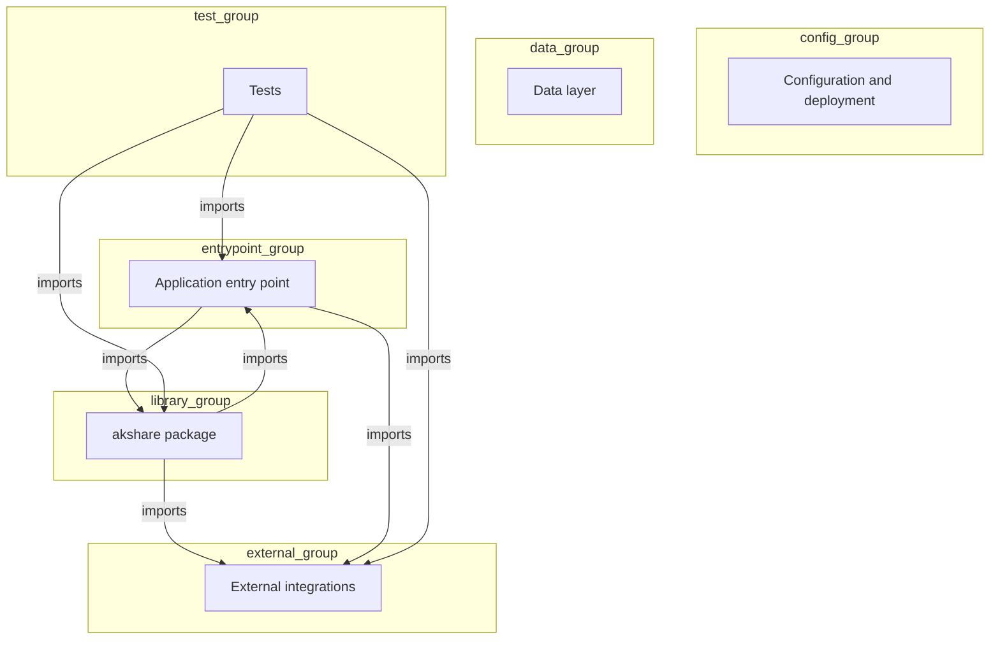

# Architecture report: akfamily/akshare

> Automated static analysis. **Observed** = directly seen in files/imports/AST; **Inferred** = interpretation from that evidence. Repository code was not executed.

## 1. Repository at a glance

| Item | Value |
| --- | --- |
| Repository | akfamily/akshare |
| Description | AKShare is an elegant and simple financial data interface library for Python, built for human beings! 开源财经数据接口库 |
| Language | Python |
| Stars | 23340 |
| Licence | MIT |
| Analysed commit / branch | f43ea5f1175021eea742638354bcaa7de9ecaf99 / main |
| Framework(s) | None detected |
| Files analysed | 493 |
| Components | 6 |

## 2. Architecture in one minute

akfamily/akshare - AKShare is an elegant and simple financial data interface library for Python, built for human beings! 开源财经数据接口库. This repository was analysed statically from 493 file(s) (415 Python). Detected technologies (observed from imports/manifests): GitHub Actions, NumPy, pandas, requests, Poetry, setuptools. Files are grouped into 6 component(s): akshare package, Configuration and deployment, Data layer, Application entry point, External integrations, Tests. Observed entry point(s): akshare/alternative/alternative_air_hebei.py, akshare/alternative/alternative_air_zhenqi.py, akshare/alternative/alternative_bank_nfra.py. Findings below distinguish observed facts from inferred interpretation.

## 3. High-level block diagram

## 4. Main components

### akshare package (`akshare`)

- **Kind:** library
- **Status:** Observed
- **Confidence:** 0.85
- **Responsibility:** Groups 51 file(s) under akshare package (observed from repository paths and static analysis). Observed top-level classes: APIError, AkshareConfig, AkshareException, CurlSession, DataParsingError, DceBlockedError. Observed top-level functions: __getattr__, _apply_defaults, _baidu_finance_calendar, _bigrams, _bse_headers, _bse_normalize_date.
- **Paths:** `akshare/__init__.py`, `akshare/_version.py`, `akshare/alternative/__init__.py`, `akshare/alternative/alternative_bank_cons.py`, `akshare/alternative/alternative_migration_cons.py`, `akshare/bond/__init__.py`, `akshare/bond/cons.py`, `akshare/calendar/__init__.py`, `akshare/crypto/__init__.py`, `akshare/energy/__init__.py`, `akshare/exceptions.py`, `akshare/fund/__init__.py`, `akshare/futures/__init__.py`, `akshare/futures/requests_fun.py`, `akshare/fx/__init__.py`, `akshare/fx/cons.py`, `akshare/fx/cons_forex.py`, `akshare/index/__init__.py`, `akshare/index/cons.py`, `akshare/interest_rate/__init__.py`, `akshare/macro/__init__.py`, `akshare/macro/cons.py`, `akshare/option/__init__.py`, `akshare/registry.py`, `akshare/request.py`, `akshare/research/__init__.py`, `akshare/research/cons.py`, `akshare/spot/__init__.py`, `akshare/stock/__init__.py`, `akshare/stock/board/__init__.py`, `akshare/stock/cons.py`, `akshare/stock/finance/__init__.py`, `akshare/stock/flow/__init__.py`, `akshare/stock/flow/stock_margin_bse.py`, `akshare/stock/holder/__init__.py`, `akshare/stock/issue/__init__.py`, `akshare/stock/other/__init__.py`, `akshare/stock/quote/__init__.py`, `akshare/stock/research/__init__.py`, `akshare/stock/valuation/__init__.py`, `akshare/utils/__init__.py`, `akshare/utils/baidu_finance.py`, `akshare/utils/cons.py`, `akshare/utils/context.py`, `akshare/utils/func.py`, `akshare/utils/http.py`, `akshare/utils/jsonish.py`, `akshare/utils/multi_decrypt.py`, `akshare/utils/params.py`, `akshare/utils/request.py`, `akshare/utils/tqdm.py`
- **Evidence:** [akshare/__init__.py:1318](https://github.com/akfamily/akshare/blob/f43ea5f1175021eea742638354bcaa7de9ecaf99/akshare/__init__.py#L1318); [akshare/_version.py](https://github.com/akfamily/akshare/blob/f43ea5f1175021eea742638354bcaa7de9ecaf99/akshare/_version.py); [akshare/alternative/__init__.py](https://github.com/akfamily/akshare/blob/f43ea5f1175021eea742638354bcaa7de9ecaf99/akshare/alternative/__init__.py); [akshare/alternative/alternative_bank_cons.py](https://github.com/akfamily/akshare/blob/f43ea5f1175021eea742638354bcaa7de9ecaf99/akshare/alternative/alternative_bank_cons.py); [akshare/alternative/alternative_migration_cons.py](https://github.com/akfamily/akshare/blob/f43ea5f1175021eea742638354bcaa7de9ecaf99/akshare/alternative/alternative_migration_cons.py); [akshare/bond/__init__.py](https://github.com/akfamily/akshare/blob/f43ea5f1175021eea742638354bcaa7de9ecaf99/akshare/bond/__init__.py); [akshare/bond/cons.py](https://github.com/akfamily/akshare/blob/f43ea5f1175021eea742638354bcaa7de9ecaf99/akshare/bond/cons.py); [akshare/calendar/__init__.py](https://github.com/akfamily/akshare/blob/f43ea5f1175021eea742638354bcaa7de9ecaf99/akshare/calendar/__init__.py)

### Configuration and deployment (`config`)

- **Kind:** config
- **Status:** Observed
- **Confidence:** 0.85
- **Responsibility:** Groups 6 file(s) under configuration and deployment (observed from repository paths and static analysis).
- **Paths:** `akshare/data/calendar.json`, `akshare/data/renames.json`, `pyproject.toml`, `scripts/registry_alternatives.json`, `scripts/registry_baseline.json`, `scripts/registry_removed.json`
- **Evidence:** [akshare/data/calendar.json](https://github.com/akfamily/akshare/blob/f43ea5f1175021eea742638354bcaa7de9ecaf99/akshare/data/calendar.json); [akshare/data/renames.json](https://github.com/akfamily/akshare/blob/f43ea5f1175021eea742638354bcaa7de9ecaf99/akshare/data/renames.json); [pyproject.toml](https://github.com/akfamily/akshare/blob/f43ea5f1175021eea742638354bcaa7de9ecaf99/pyproject.toml); [scripts/registry_alternatives.json](https://github.com/akfamily/akshare/blob/f43ea5f1175021eea742638354bcaa7de9ecaf99/scripts/registry_alternatives.json); [scripts/registry_baseline.json](https://github.com/akfamily/akshare/blob/f43ea5f1175021eea742638354bcaa7de9ecaf99/scripts/registry_baseline.json); [scripts/registry_removed.json](https://github.com/akfamily/akshare/blob/f43ea5f1175021eea742638354bcaa7de9ecaf99/scripts/registry_removed.json)

### Data layer (`data_layer`)

- **Kind:** data
- **Status:** Observed
- **Confidence:** 0.85
- **Responsibility:** Groups 5 file(s) under data layer (observed from repository paths and static analysis).
- **Paths:** `akshare/data/__init__.py`, `akshare/data/crypto.js`, `akshare/data/jm.js`, `akshare/data/outcrypto.js`, `akshare/data/ths.js`
- **Evidence:** [akshare/data/__init__.py](https://github.com/akfamily/akshare/blob/f43ea5f1175021eea742638354bcaa7de9ecaf99/akshare/data/__init__.py); [akshare/data/crypto.js](https://github.com/akfamily/akshare/blob/f43ea5f1175021eea742638354bcaa7de9ecaf99/akshare/data/crypto.js); [akshare/data/jm.js](https://github.com/akfamily/akshare/blob/f43ea5f1175021eea742638354bcaa7de9ecaf99/akshare/data/jm.js); [akshare/data/outcrypto.js](https://github.com/akfamily/akshare/blob/f43ea5f1175021eea742638354bcaa7de9ecaf99/akshare/data/outcrypto.js); [akshare/data/ths.js](https://github.com/akfamily/akshare/blob/f43ea5f1175021eea742638354bcaa7de9ecaf99/akshare/data/ths.js)

### Application entry point (`entrypoint`)

- **Kind:** entrypoint
- **Status:** Observed
- **Confidence:** 0.85
- **Responsibility:** Groups 331 file(s) under application entry point (observed from repository paths and static analysis). Observed top-level classes: ModuleIndex, TLSAdapter, _LegacySSLAdapter. Observed top-level functions: __bond_register_service, __convert_date_format, __event_stream, __fetch_exchange_symbol_raw_em, __fetch_ftse_index_futu, __format_announcement_df.
- **Paths:** `akshare/alternative/alternative_air_hebei.py`, `akshare/alternative/alternative_air_zhenqi.py`, `akshare/alternative/alternative_bank_nfra.py`, `akshare/alternative/alternative_car_cpca.py`, `akshare/alternative/alternative_fortune_500.py`, `akshare/alternative/alternative_fortune_bloomberg.py`, `akshare/alternative/alternative_fortune_forbes_500.py`, `akshare/alternative/alternative_fortune_hurun.py`, `akshare/alternative/alternative_migration_baidu.py`, `akshare/alternative/alternative_movie_yien.py`, `akshare/alternative/alternative_news_cctv.py`, `akshare/alternative/alternative_nlp.py`, `akshare/alternative/alternative_sunrise_tad.py`, `akshare/alternative/alternative_taptap.py`, `akshare/alternative/alternative_weibo_nlp.py`, `akshare/bond/bond_buy_back_em.py`, `akshare/bond/bond_cb_sina.py`, `akshare/bond/bond_cb_ths.py`, `akshare/bond/bond_cbond.py`, `akshare/bond/bond_china.py`, `akshare/bond/bond_china_money.py`, `akshare/bond/bond_convert.py`, `akshare/bond/bond_em.py`, `akshare/bond/bond_gb_sina.py`, `akshare/bond/bond_info_cm.py`, `akshare/bond/bond_issue_cninfo.py`, `akshare/bond/bond_nafmii.py`, `akshare/bond/bond_summary.py`, `akshare/bond/bond_zh_cov.py`, `akshare/bond/bond_zh_sina.py`, `akshare/calendar/calendar_trade_date_hist.py`, `akshare/crypto/crypto_bitcoin_cme.py`, `akshare/crypto/crypto_hold.py`, `akshare/crypto/crypto_js_spot.py`, `akshare/datasets.py`, `akshare/energy/energy_carbon.py`, `akshare/energy/energy_oil_em.py`, `akshare/fund/fund_amac.py`, `akshare/fund/fund_announcement_em.py`, `akshare/fund/fund_aum_em.py`, `akshare/fund/fund_em.py`, `akshare/fund/fund_etf_em.py`, `akshare/fund/fund_etf_holding_js.py`, `akshare/fund/fund_etf_pcf.py`, `akshare/fund/fund_etf_sina.py`, `akshare/fund/fund_etf_sse.py`, `akshare/fund/fund_etf_szse.py`, `akshare/fund/fund_etf_ths.py`, `akshare/fund/fund_fee_em.py`, `akshare/fund/fund_fhsp_em.py`, `akshare/fund/fund_info_ths.py`, `akshare/fund/fund_init_em.py`, `akshare/fund/fund_init_ths.py`, `akshare/fund/fund_lof_em.py`, `akshare/fund/fund_manager.py`, `akshare/fund/fund_overview_em.py`, `akshare/fund/fund_portfolio_em.py`, `akshare/fund/fund_position_lg.py`, `akshare/fund/fund_qdii_jsl.py`, `akshare/fund/fund_rank_em.py`, `akshare/fund/fund_rating.py`, `akshare/fund/fund_reits.py`, `akshare/fund/fund_report_cninfo.py`, `akshare/fund/fund_scale_em.py`, `akshare/fund/fund_scale_sina.py`, `akshare/fund/fund_scale_szse.py`, `akshare/fund/fund_xq.py`, `akshare/futures/cons.py`, `akshare/futures/futures_basis.py`, `akshare/futures/futures_cftc_js.py`, `akshare/futures/futures_comex_em.py`, `akshare/futures/futures_comm_ctp.py`, `akshare/futures/futures_comm_js.py`, `akshare/futures/futures_comm_qihuo.py`, `akshare/futures/futures_contract_detail.py`, `akshare/futures/futures_contract_info_cffex.py`, `akshare/futures/futures_contract_info_czce.py`, `akshare/futures/futures_contract_info_dce.py`, `akshare/futures/futures_contract_info_gfex.py`, `akshare/futures/futures_contract_info_ine.py`, `akshare/futures/futures_contract_info_shfe.py`, `akshare/futures/futures_cot.py`, `akshare/futures/futures_cot_sina.py`, `akshare/futures/futures_daily_bar.py`, `akshare/futures/futures_foreign.py`, `akshare/futures/futures_hf_em.py`, `akshare/futures/futures_hist_em.py`, `akshare/futures/futures_hog.py`, `akshare/futures/futures_hog_index.py`, `akshare/futures/futures_hq_sina.py`, `akshare/futures/futures_index_ccidx.py`, `akshare/futures/futures_index_sina.py`, `akshare/futures/futures_inventory_99.py`, `akshare/futures/futures_inventory_em.py`, `akshare/futures/futures_news_shmet.py`, `akshare/futures/futures_receipt.py`, `akshare/futures/futures_roll_yield.py`, `akshare/futures/futures_rule.py`, `akshare/futures/futures_settle.py`, `akshare/futures/futures_settlement_price_sgx.py`, `akshare/futures/futures_spot_stock_em.py`, `akshare/futures/futures_spot_sys.py`, `akshare/futures/futures_to_spot.py`, `akshare/futures/futures_warehouse_receipt.py`, `akshare/futures/futures_zh_sina.py`, `akshare/futures/symbol_var.py`, `akshare/fx/fx_c_swap_cm.py`, `akshare/fx/fx_china_bank_sina.py`, `akshare/fx/fx_currency_investing.py`, `akshare/fx/fx_forex_em.py`, `akshare/fx/fx_quote.py`, `akshare/fx/fx_quote_baidu.py`, `akshare/fx/fx_safe.py`, `akshare/fx/fx_sentiment_jin10.py`, `akshare/index/index_cflp.py`, `akshare/index/index_cni.py`, `akshare/index/index_cons.py`, `akshare/index/index_csindex.py`, `akshare/index/index_drewry.py`, `akshare/index/index_global_em.py`, `akshare/index/index_global_sina.py`, `akshare/index/index_kq_ss.py`, `akshare/index/index_option_qvix.py`, `akshare/index/index_research_fund_sw.py`, `akshare/index/index_research_sw.py`, `akshare/index/index_sox_em.py`, `akshare/index/index_sp500_min.py`, `akshare/index/index_spot.py`, `akshare/index/index_stock_hk.py`, `akshare/index/index_stock_us_sina.py`, `akshare/index/index_stock_zh.py`, `akshare/index/index_stock_zh_csindex.py`, `akshare/index/index_sugar.py`, `akshare/index/index_sw.py`, `akshare/index/index_zh_em.py`, `akshare/interest_rate/interest_rate_ibor_js.py`, `akshare/interest_rate/interest_rate_interbank_em.py`, `akshare/interest_rate/interest_rate_lpr_em.py`, `akshare/interest_rate/interest_rate_repo.py`, `akshare/interest_rate/interest_rate_swap_cm.py`, `akshare/macro/macro_australia.py`, `akshare/macro/macro_canada.py`, `akshare/macro/macro_china.py`, `akshare/macro/macro_china_cx.py`, `akshare/macro/macro_china_hk.py`, `akshare/macro/macro_china_nbs.py`, `akshare/macro/macro_cnbs.py`, `akshare/macro/macro_finance_ths.py`, `akshare/macro/macro_germany.py`, `akshare/macro/macro_info_ws.py`, `akshare/macro/macro_japan.py`, `akshare/macro/macro_news_baidu.py`, `akshare/macro/macro_swiss.py`, `akshare/macro/macro_uk.py`, `akshare/macro/macro_usa.py`, `akshare/option/cons.py`, `akshare/option/option_comm_qihuo.py`, `akshare/option/option_commodity.py`, `akshare/option/option_commodity_sina.py`, `akshare/option/option_contract_info_ctp.py`, `akshare/option/option_current_sse.py`, `akshare/option/option_current_szse.py`, `akshare/option/option_czce.py`, `akshare/option/option_daily_stats_sse_szse.py`, `akshare/option/option_em.py`, `akshare/option/option_finance.py`, `akshare/option/option_finance_sina.py`, `akshare/option/option_lhb_em.py`, `akshare/option/option_margin.py`, `akshare/option/option_premium_analysis_em.py`, `akshare/option/option_risk_analysis_em.py`, `akshare/option/option_risk_indicator_sse.py`, `akshare/option/option_value_analysis_em.py`, `akshare/research/research_epu_index.py`, `akshare/research/research_ff_factor.py`, `akshare/research/research_fred_md.py`, `akshare/research/research_risk_rv.py`, `akshare/research/research_rv.py`, `akshare/spot/spot_hog_soozhu.py`, `akshare/spot/spot_price_qh.py`, `akshare/spot/spot_sge.py`, `akshare/spot/spot_sge_js.py`, `akshare/stock/board/stock_board_concept_em.py`, `akshare/stock/board/stock_board_concept_ths.py`, `akshare/stock/board/stock_board_industry_em.py`, `akshare/stock/board/stock_board_industry_ths.py`, `akshare/stock/board/stock_classify_sina.py`, `akshare/stock/board/stock_comment_em.py`, `akshare/stock/board/stock_hk_hot_rank_em.py`, `akshare/stock/board/stock_hot_rank_em.py`, `akshare/stock/board/stock_hot_search_baidu.py`, `akshare/stock/board/stock_hot_up_em.py`, `akshare/stock/board/stock_hot_xq.py`, `akshare/stock/board/stock_industry.py`, `akshare/stock/board/stock_inner_trade_xq.py`, `akshare/stock/board/stock_irm_cninfo.py`, `akshare/stock/board/stock_pankou_em.py`, `akshare/stock/board/stock_sns_sseinfo.py`, `akshare/stock/finance/stock_allotment_cninfo.py`, `akshare/stock/finance/stock_disclosure_cninfo.py`, `akshare/stock/finance/stock_finance_hk_em.py`, `akshare/stock/finance/stock_finance_ths.py`, `akshare/stock/finance/stock_finance_us_em.py`, `akshare/stock/finance/stock_gbjg_em.py`, `akshare/stock/finance/stock_industry_cninfo.py`, `akshare/stock/finance/stock_ipo_summary_cninfo.py`, `akshare/stock/finance/stock_profile_cninfo.py`, `akshare/stock/finance/stock_report_em.py`, `akshare/stock/finance/stock_share_changes_cninfo.py`, `akshare/stock/finance/stock_sy_em.py`, `akshare/stock/finance/stock_three_report_em.py`, `akshare/stock/finance/stock_yjbb_em.py`, `akshare/stock/finance/stock_yjyg_cninfo.py`, `akshare/stock/finance/stock_yjyg_em.py`, `akshare/stock/finance/stock_zygc.py`, `akshare/stock/finance/stock_zyjs_ths.py`, `akshare/stock/flow/stock_account_em.py`, `akshare/stock/flow/stock_cyq_em.py`, `akshare/stock/flow/stock_dzjy_em.py`, `akshare/stock/flow/stock_fund_em.py`, `akshare/stock/flow/stock_fund_flow.py`, `akshare/stock/flow/stock_hsgt_em.py`, `akshare/stock/flow/stock_hsgt_exchange_rate.py`, `akshare/stock/flow/stock_hsgt_min_em.py`, `akshare/stock/flow/stock_lh_yybpm.py`, `akshare/stock/flow/stock_lhb_em.py`, `akshare/stock/flow/stock_lhb_sina.py`, `akshare/stock/flow/stock_margin_em.py`, `akshare/stock/flow/stock_margin_js.py`, `akshare/stock/flow/stock_margin_sse.py`, `akshare/stock/flow/stock_margin_szse.py`, `akshare/stock/holder/stock_fund_hold.py`, `akshare/stock/holder/stock_gddh_em.py`, `akshare/stock/holder/stock_gdfx_em.py`, `akshare/stock/holder/stock_gdhs.py`, `akshare/stock/holder/stock_gdzjc_em.py`, `akshare/stock/holder/stock_gpzy_em.py`, `akshare/stock/holder/stock_hold.py`, `akshare/stock/holder/stock_jgdy_em.py`, `akshare/stock/holder/stock_yzxdr_em.py`, `akshare/stock/issue/stock_dividend_cninfo.py`, `akshare/stock/issue/stock_dxsyl_em.py`, `akshare/stock/issue/stock_fhps_em.py`, `akshare/stock/issue/stock_fhps_ths.py`, `akshare/stock/issue/stock_finance_sina.py`, `akshare/stock/issue/stock_gsrl_em.py`, `akshare/stock/issue/stock_hk_fhpx_ths.py`, `akshare/stock/issue/stock_info.py`, `akshare/stock/issue/stock_ipo_declare.py`, `akshare/stock/issue/stock_ipo_review.py`, `akshare/stock/issue/stock_ipo_ths.py`, `akshare/stock/issue/stock_ipo_tutor.py`, `akshare/stock/issue/stock_news_baidu.py`, `akshare/stock/issue/stock_register_em.py`, `akshare/stock/issue/stock_repurchase_em.py`, `akshare/stock/issue/stock_restricted_em.py`, `akshare/stock/issue/stock_tfp_em.py`, `akshare/stock/issue/stock_zf_pg.py`, `akshare/stock/other/stock_code_symbol.py`, `akshare/stock/other/stock_esg_sina.py`, `akshare/stock/other/stock_technology_ths.py`, `akshare/stock/quote/stock_ask_bid_em.py`, `akshare/stock/quote/stock_basic_info_xq.py`, `akshare/stock/quote/stock_hist_em.py`, `akshare/stock/quote/stock_hist_tx.py`, `akshare/stock/quote/stock_hk_comparison_em.py`, `akshare/stock/quote/stock_hk_famous.py`, `akshare/stock/quote/stock_hk_sina.py`, `akshare/stock/quote/stock_hsgt_spot_em.py`, `akshare/stock/quote/stock_info_em.py`, `akshare/stock/quote/stock_intraday_em.py`, `akshare/stock/quote/stock_intraday_sina.py`, `akshare/stock/quote/stock_profile_em.py`, `akshare/stock/quote/stock_summary.py`, `akshare/stock/quote/stock_us_famous.py`, `akshare/stock/quote/stock_us_pink.py`, `akshare/stock/quote/stock_us_sina.py`, `akshare/stock/quote/stock_xq.py`, `akshare/stock/quote/stock_zh_a_sina.py`, `akshare/stock/quote/stock_zh_a_special.py`, `akshare/stock/quote/stock_zh_a_tick_tx.py`, `akshare/stock/quote/stock_zh_a_tx.py`, `akshare/stock/quote/stock_zh_ah_tx.py`, `akshare/stock/quote/stock_zh_b_sina.py`, `akshare/stock/quote/stock_zh_comparison_em.py`, `akshare/stock/quote/stock_zh_kcb_report.py`, `akshare/stock/quote/stock_zh_kcb_sina.py`, `akshare/stock/quote/stock_ztb_em.py`, `akshare/stock/research/stock_analyst_em.py`, `akshare/stock/research/stock_cg_equity_mortgage.py`, `akshare/stock/research/stock_cg_guarantee.py`, `akshare/stock/research/stock_cg_lawsuit.py`, `akshare/stock/research/stock_hold_control_cninfo.py`, `akshare/stock/research/stock_hold_control_em.py`, `akshare/stock/research/stock_hold_num_cninfo.py`, `akshare/stock/research/stock_industry_pe_cninfo.py`, `akshare/stock/research/stock_industry_sw.py`, `akshare/stock/research/stock_info.py`, `akshare/stock/research/stock_new_cninfo.py`, `akshare/stock/research/stock_news_cx.py`, `akshare/stock/research/stock_news_stock.py`, `akshare/stock/research/stock_notice.py`, `akshare/stock/research/stock_profit_forecast_em.py`, `akshare/stock/research/stock_profit_forecast_hk_etnet.py`, `akshare/stock/research/stock_profit_forecast_ths.py`, `akshare/stock/research/stock_qsjy_em.py`, `akshare/stock/research/stock_rank_forecast.py`, `akshare/stock/research/stock_recommend.py`, `akshare/stock/research/stock_research_report_em.py`, `akshare/stock/research/stock_share_hold.py`, `akshare/stock/research/stock_us_js.py`, `akshare/stock/research/stock_zdhtmx_em.py`, `akshare/stock/valuation/stock_a_below_net_asset_statistics.py`, `akshare/stock/valuation/stock_a_high_low.py`, `akshare/stock/valuation/stock_a_indicator.py`, `akshare/stock/valuation/stock_a_pe_and_pb.py`, `akshare/stock/valuation/stock_all_pb.py`, `akshare/stock/valuation/stock_buffett_index_lg.py`, `akshare/stock/valuation/stock_congestion_lg.py`, `akshare/stock/valuation/stock_ebs_lg.py`, `akshare/stock/valuation/stock_gxl_lg.py`, `akshare/stock/valuation/stock_hk_valuation_baidu.py`, `akshare/stock/valuation/stock_market_legu.py`, `akshare/stock/valuation/stock_ttm_lyr.py`, `akshare/stock/valuation/stock_us_valuation_baidu.py`, `akshare/stock/valuation/stock_value_em.py`, `akshare/stock/valuation/stock_zh_valuation_baidu.py`, `akshare/stock/valuation/stock_zh_vote_baidu.py`, `scripts/build_registry.py`, `scripts/check_punctuation.py`, `scripts/check_release.py`
- **Evidence:** [akshare/alternative/alternative_air_hebei.py:24](https://github.com/akfamily/akshare/blob/f43ea5f1175021eea742638354bcaa7de9ecaf99/akshare/alternative/alternative_air_hebei.py#L24); [akshare/alternative/alternative_air_zhenqi.py:24](https://github.com/akfamily/akshare/blob/f43ea5f1175021eea742638354bcaa7de9ecaf99/akshare/alternative/alternative_air_zhenqi.py#L24); [akshare/alternative/alternative_bank_nfra.py:23](https://github.com/akfamily/akshare/blob/f43ea5f1175021eea742638354bcaa7de9ecaf99/akshare/alternative/alternative_bank_nfra.py#L23); [akshare/alternative/alternative_car_cpca.py:19](https://github.com/akfamily/akshare/blob/f43ea5f1175021eea742638354bcaa7de9ecaf99/akshare/alternative/alternative_car_cpca.py#L19); [akshare/alternative/alternative_fortune_500.py:35](https://github.com/akfamily/akshare/blob/f43ea5f1175021eea742638354bcaa7de9ecaf99/akshare/alternative/alternative_fortune_500.py#L35); [akshare/alternative/alternative_fortune_bloomberg.py:15](https://github.com/akfamily/akshare/blob/f43ea5f1175021eea742638354bcaa7de9ecaf99/akshare/alternative/alternative_fortune_bloomberg.py#L15); [akshare/alternative/alternative_fortune_forbes_500.py:17](https://github.com/akfamily/akshare/blob/f43ea5f1175021eea742638354bcaa7de9ecaf99/akshare/alternative/alternative_fortune_forbes_500.py#L17); [akshare/alternative/alternative_fortune_hurun.py:18](https://github.com/akfamily/akshare/blob/f43ea5f1175021eea742638354bcaa7de9ecaf99/akshare/alternative/alternative_fortune_hurun.py#L18)

### External integrations (`external_integrations`)

- **Kind:** external
- **Status:** Inferred
- **Confidence:** 0.70
- **Responsibility:** Groups 0 file(s) under external integrations (observed from repository paths and static analysis).
- **Evidence:** [akshare/alternative/alternative_fortune_hurun.py:12](https://github.com/akfamily/akshare/blob/f43ea5f1175021eea742638354bcaa7de9ecaf99/akshare/alternative/alternative_fortune_hurun.py#L12); [akshare/fund/fund_amac.py:12](https://github.com/akfamily/akshare/blob/f43ea5f1175021eea742638354bcaa7de9ecaf99/akshare/fund/fund_amac.py#L12); [akshare/fund/fund_portfolio_em.py:15](https://github.com/akfamily/akshare/blob/f43ea5f1175021eea742638354bcaa7de9ecaf99/akshare/fund/fund_portfolio_em.py#L15); [akshare/fund/fund_portfolio_em.py:16](https://github.com/akfamily/akshare/blob/f43ea5f1175021eea742638354bcaa7de9ecaf99/akshare/fund/fund_portfolio_em.py#L16); [akshare/futures/futures_daily_bar.py:17](https://github.com/akfamily/akshare/blob/f43ea5f1175021eea742638354bcaa7de9ecaf99/akshare/futures/futures_daily_bar.py#L17); [akshare/macro/macro_china.py:12](https://github.com/akfamily/akshare/blob/f43ea5f1175021eea742638354bcaa7de9ecaf99/akshare/macro/macro_china.py#L12)

### Tests (`tests`)

- **Kind:** test
- **Status:** Observed
- **Confidence:** 0.85
- **Responsibility:** Groups 33 file(s) under tests (observed from repository paths and static analysis). Observed top-level classes: FakeResponse, _Racer, _Resp, _Response. Observed top-level functions: _count, _daily_row, _dates, _fail_on_akshare_deprecations, _fake_response, _force_real_registry.
- **Paths:** `tests/__init__.py`, `tests/conftest.py`, `tests/naming_baseline.json`, `tests/positional_columns_baseline.json`, `tests/test_bond_info_cm.py`, `tests/test_build_registry.py`, `tests/test_check_release.py`, `tests/test_ffill_to_index.py`, `tests/test_fred_md.py`, `tests/test_func.py`, `tests/test_fund_etf_pcf.py`, `tests/test_futures_comm_qihuo.py`, `tests/test_futures_main_contract.py`, `tests/test_http.py`, `tests/test_http_retry.py`, `tests/test_index_stock_zh.py`, `tests/test_index_sugar.py`, `tests/test_iteration_order.py`, `tests/test_js_engine.py`, `tests/test_jsonish.py`, `tests/test_legu_csrf.py`, `tests/test_naming.py`, `tests/test_news_cctv.py`, `tests/test_params.py`, `tests/test_positional_columns.py`, `tests/test_registry.py`, `tests/test_registry_integration.py`, `tests/test_renames.py`, `tests/test_stock_hist_tx.py`, `tests/test_stock_us_sina.py`, `tests/test_stock_zh_a_daily.py`, `tests/test_symbol_var.py`, `tests/test_tls_verify.py`
- **Evidence:** [tests/__init__.py](https://github.com/akfamily/akshare/blob/f43ea5f1175021eea742638354bcaa7de9ecaf99/tests/__init__.py); [tests/conftest.py:14](https://github.com/akfamily/akshare/blob/f43ea5f1175021eea742638354bcaa7de9ecaf99/tests/conftest.py#L14); [tests/naming_baseline.json](https://github.com/akfamily/akshare/blob/f43ea5f1175021eea742638354bcaa7de9ecaf99/tests/naming_baseline.json); [tests/positional_columns_baseline.json](https://github.com/akfamily/akshare/blob/f43ea5f1175021eea742638354bcaa7de9ecaf99/tests/positional_columns_baseline.json); [tests/test_bond_info_cm.py:35](https://github.com/akfamily/akshare/blob/f43ea5f1175021eea742638354bcaa7de9ecaf99/tests/test_bond_info_cm.py#L35); [tests/test_build_registry.py:68](https://github.com/akfamily/akshare/blob/f43ea5f1175021eea742638354bcaa7de9ecaf99/tests/test_build_registry.py#L68); [tests/test_check_release.py:11](https://github.com/akfamily/akshare/blob/f43ea5f1175021eea742638354bcaa7de9ecaf99/tests/test_check_release.py#L11); [tests/test_ffill_to_index.py:12](https://github.com/akfamily/akshare/blob/f43ea5f1175021eea742638354bcaa7de9ecaf99/tests/test_ffill_to_index.py#L12)

## 5. Execution flow

**Observed** entry point(s):

- [akshare/alternative/alternative_air_hebei.py:106](https://github.com/akfamily/akshare/blob/f43ea5f1175021eea742638354bcaa7de9ecaf99/akshare/alternative/alternative_air_hebei.py#L106)
- [akshare/alternative/alternative_air_zhenqi.py:299](https://github.com/akfamily/akshare/blob/f43ea5f1175021eea742638354bcaa7de9ecaf99/akshare/alternative/alternative_air_zhenqi.py#L299)
- [akshare/alternative/alternative_bank_nfra.py:190](https://github.com/akfamily/akshare/blob/f43ea5f1175021eea742638354bcaa7de9ecaf99/akshare/alternative/alternative_bank_nfra.py#L190)
- [akshare/alternative/alternative_car_cpca.py:264](https://github.com/akfamily/akshare/blob/f43ea5f1175021eea742638354bcaa7de9ecaf99/akshare/alternative/alternative_car_cpca.py#L264)
- [akshare/alternative/alternative_fortune_500.py:155](https://github.com/akfamily/akshare/blob/f43ea5f1175021eea742638354bcaa7de9ecaf99/akshare/alternative/alternative_fortune_500.py#L155)
- [akshare/alternative/alternative_fortune_bloomberg.py:71](https://github.com/akfamily/akshare/blob/f43ea5f1175021eea742638354bcaa7de9ecaf99/akshare/alternative/alternative_fortune_bloomberg.py#L71)
- [akshare/alternative/alternative_fortune_forbes_500.py:47](https://github.com/akfamily/akshare/blob/f43ea5f1175021eea742638354bcaa7de9ecaf99/akshare/alternative/alternative_fortune_forbes_500.py#L47)
- [akshare/alternative/alternative_fortune_hurun.py:308](https://github.com/akfamily/akshare/blob/f43ea5f1175021eea742638354bcaa7de9ecaf99/akshare/alternative/alternative_fortune_hurun.py#L308)
- [akshare/alternative/alternative_migration_baidu.py:110](https://github.com/akfamily/akshare/blob/f43ea5f1175021eea742638354bcaa7de9ecaf99/akshare/alternative/alternative_migration_baidu.py#L110)
- [akshare/alternative/alternative_movie_yien.py:676](https://github.com/akfamily/akshare/blob/f43ea5f1175021eea742638354bcaa7de9ecaf99/akshare/alternative/alternative_movie_yien.py#L676)
- [akshare/alternative/alternative_news_cctv.py:187](https://github.com/akfamily/akshare/blob/f43ea5f1175021eea742638354bcaa7de9ecaf99/akshare/alternative/alternative_news_cctv.py#L187)
- [akshare/alternative/alternative_nlp.py:29](https://github.com/akfamily/akshare/blob/f43ea5f1175021eea742638354bcaa7de9ecaf99/akshare/alternative/alternative_nlp.py#L29)

Representative flow (derived from observed entry points and the import graph; steps beyond the entry point are **Inferred**):

1. Execution starts at an observed entry point listed above, if present.
2. `akshare` imports `entrypoint` (akshare package -> Application entry point).
3. `akshare` imports `external_integrations` (akshare package -> External integrations).
4. `entrypoint` imports `akshare` (Application entry point -> akshare package).
5. `entrypoint` imports `external_integrations` (Application entry point -> External integrations).
6. `tests` imports `akshare` (Tests -> akshare package).
7. `tests` imports `entrypoint` (Tests -> Application entry point).
8. `tests` imports `external_integrations` (Tests -> External integrations).

## 6. Project structure

### `(root)`

- `.gitignore` - other (922 bytes)
- `.pre-commit-config.yaml` - config (3537 bytes)
- `.python-version` - other (5 bytes)
- `.readthedocs.yaml` - config (289 bytes)
- `CODE_OF_CONDUCT.md` - docs (5478 bytes)
- `CONTRIBUTING.md` - docs (9670 bytes)
- `LICENSE` - docs (1070 bytes)
- `README.md` - docs (16345 bytes)
- `llms.txt` - docs (12537 bytes)
- `pyproject.toml` - manifest (8369 bytes)

### `.github`

- `.github/ISSUE_TEMPLATE/akshare_enhancement.yml` - config (1448 bytes)
- `.github/ISSUE_TEMPLATE/akshare_report.yml` - config (2728 bytes)
- `.github/ISSUE_TEMPLATE/config.yml` - config (328 bytes)
- `.github/dependabot.yml` - config (2316 bytes)
- `.github/workflows/main_dev_check.yml` - ci, YAML (4998 bytes)
- `.github/workflows/release_and_deploy.yml` - ci, YAML (2489 bytes)

### `akshare`

- `akshare/__init__.py` - source, Python (75384 bytes)
- `akshare/_version.py` - source, Python (24 bytes)
- `akshare/alternative/__init__.py` - source, Python (89 bytes)
- `akshare/alternative/alternative_air_hebei.py` - source, Python (5479 bytes)
- `akshare/alternative/alternative_air_zhenqi.py` - source, Python (11470 bytes)
- `akshare/alternative/alternative_bank_cons.py` - source, Python (1457 bytes)
- `akshare/alternative/alternative_bank_nfra.py` - source, Python (7599 bytes)
- `akshare/alternative/alternative_car_cpca.py` - source, Python (14334 bytes)
- `akshare/alternative/alternative_fortune_500.py` - source, Python (5474 bytes)
- `akshare/alternative/alternative_fortune_bloomberg.py` - source, Python (2233 bytes)
- `akshare/alternative/alternative_fortune_forbes_500.py` - source, Python (1461 bytes)
- `akshare/alternative/alternative_fortune_hurun.py` - source, Python (11766 bytes)
- `akshare/alternative/alternative_migration_baidu.py` - source, Python (4575 bytes)
- `akshare/alternative/alternative_migration_cons.py` - source, Python (12391 bytes)
- `akshare/alternative/alternative_movie_yien.py` - source, Python (22859 bytes)
- `akshare/alternative/alternative_news_cctv.py` - source, Python (7373 bytes)
- `akshare/alternative/alternative_nlp.py` - source, Python (744 bytes)
- `akshare/alternative/alternative_sunrise_tad.py` - source, Python (4181 bytes)
- `akshare/alternative/alternative_taptap.py` - source, Python (5978 bytes)
- `akshare/alternative/alternative_weibo_nlp.py` - source, Python (3369 bytes)
- `akshare/bond/__init__.py` - source, Python (81 bytes)
- `akshare/bond/bond_buy_back_em.py` - source, Python (7284 bytes)
- `akshare/bond/bond_cb_sina.py` - source, Python (1820 bytes)
- `akshare/bond/bond_cb_ths.py` - source, Python (3063 bytes)
- `akshare/bond/bond_cbond.py` - source, Python (12371 bytes)
- `akshare/bond/bond_china.py` - source, Python (6531 bytes)
- `akshare/bond/bond_china_money.py` - source, Python (8139 bytes)
- `akshare/bond/bond_convert.py` - source, Python (12665 bytes)
- `akshare/bond/bond_em.py` - source, Python (5428 bytes)
- `akshare/bond/bond_gb_sina.py` - source, Python (4147 bytes)
- `akshare/bond/bond_info_cm.py` - source, Python (10634 bytes)
- `akshare/bond/bond_issue_cninfo.py` - source, Python (21595 bytes)
- `akshare/bond/bond_nafmii.py` - source, Python (2577 bytes)
- `akshare/bond/bond_summary.py` - source, Python (3592 bytes)
- `akshare/bond/bond_zh_cov.py` - source, Python (23392 bytes)
- `akshare/bond/bond_zh_sina.py` - source, Python (5228 bytes)
- `akshare/bond/cons.py` - source, Python (28206 bytes)
- `akshare/calendar/__init__.py` - source, Python (89 bytes)
- `akshare/calendar/calendar_trade_date_hist.py` - source, Python (1450 bytes)
- `akshare/crypto/__init__.py` - source, Python (82 bytes)
- `akshare/crypto/crypto_bitcoin_cme.py` - source, Python (2488 bytes)
- `akshare/crypto/crypto_hold.py` - source, Python (2431 bytes)
- `akshare/crypto/crypto_js_spot.py` - source, Python (1959 bytes)
- `akshare/data/__init__.py` - source, Python (81 bytes)
- `akshare/data/calendar.json` - config (123161 bytes)
- `akshare/data/crypto.js` - source, JavaScript (8444 bytes)
- `akshare/data/jm.js` - source, JavaScript (117171 bytes)
- `akshare/data/outcrypto.js` - source, JavaScript (48498 bytes)
- `akshare/data/renames.json` - config (31780 bytes)
- `akshare/data/ths.js` - source, JavaScript (39664 bytes)
- `akshare/datasets.py` - source, Python (1842 bytes)
- `akshare/energy/__init__.py` - source, Python (82 bytes)
- `akshare/energy/energy_carbon.py` - source, Python (4546 bytes)
- `akshare/energy/energy_oil_em.py` - source, Python (4602 bytes)
- `akshare/exceptions.py` - source, Python (878 bytes)
- `akshare/fund/__init__.py` - source, Python (81 bytes)
- `akshare/fund/fund_amac.py` - source, Python (40910 bytes)
- `akshare/fund/fund_announcement_em.py` - source, Python (5035 bytes)
- `akshare/fund/fund_aum_em.py` - source, Python (3663 bytes)
- `akshare/fund/fund_em.py` - source, Python (47229 bytes)
- `akshare/fund/fund_etf_em.py` - source, Python (17506 bytes)
- `akshare/fund/fund_etf_holding_js.py` - source, Python (4796 bytes)
- `akshare/fund/fund_etf_pcf.py` - source, Python (10101 bytes)
- `akshare/fund/fund_etf_sina.py` - source, Python (7021 bytes)
- `akshare/fund/fund_etf_sse.py` - source, Python (2311 bytes)
- `akshare/fund/fund_etf_szse.py` - source, Python (2186 bytes)
- `akshare/fund/fund_etf_ths.py` - source, Python (5468 bytes)
- `akshare/fund/fund_fee_em.py` - source, Python (7682 bytes)
- `akshare/fund/fund_fhsp_em.py` - source, Python (9565 bytes)
- `akshare/fund/fund_info_ths.py` - source, Python (1582 bytes)
- `akshare/fund/fund_init_em.py` - source, Python (2235 bytes)
- `akshare/fund/fund_init_ths.py` - source, Python (4416 bytes)
- `akshare/fund/fund_lof_em.py` - source, Python (12205 bytes)
- `akshare/fund/fund_manager.py` - source, Python (3098 bytes)
- `akshare/fund/fund_overview_em.py` - source, Python (1143 bytes)
- `akshare/fund/fund_portfolio_em.py` - source, Python (12671 bytes)
- `akshare/fund/fund_position_lg.py` - source, Python (3944 bytes)
- `akshare/fund/fund_qdii_jsl.py` - source, Python (8540 bytes)
- `akshare/fund/fund_rank_em.py` - source, Python (15871 bytes)
- `akshare/fund/fund_rating.py` - source, Python (11939 bytes)
- `akshare/fund/fund_reits.py` - source, Python (7357 bytes)
- `akshare/fund/fund_report_cninfo.py` - source, Python (8755 bytes)
- `akshare/fund/fund_scale_em.py` - source, Python (4301 bytes)
- `akshare/fund/fund_scale_sina.py` - source, Python (8125 bytes)
- `akshare/fund/fund_scale_szse.py` - source, Python (4389 bytes)
- `akshare/fund/fund_xq.py` - source, Python (11573 bytes)
- `akshare/futures/__init__.py` - source, Python (81 bytes)
- `akshare/futures/cons.py` - source, Python (17693 bytes)
- `akshare/futures/futures_basis.py` - source, Python (16517 bytes)
- `akshare/futures/futures_cftc_js.py` - source, Python (7051 bytes)
- `akshare/futures/futures_comex_em.py` - source, Python (3158 bytes)
- `akshare/futures/futures_comm_ctp.py` - source, Python (1007 bytes)
- `akshare/futures/futures_comm_js.py` - source, Python (3094 bytes)
- `akshare/futures/futures_comm_qihuo.py` - source, Python (13769 bytes)
- `akshare/futures/futures_contract_detail.py` - source, Python (2872 bytes)
- `akshare/futures/futures_contract_info_cffex.py` - source, Python (3493 bytes)
- `akshare/futures/futures_contract_info_czce.py` - source, Python (4329 bytes)
- `akshare/futures/futures_contract_info_dce.py` - source, Python (2254 bytes)
- `akshare/futures/futures_contract_info_gfex.py` - source, Python (2313 bytes)
- `akshare/futures/futures_contract_info_ine.py` - source, Python (2442 bytes)
- `akshare/futures/futures_contract_info_shfe.py` - source, Python (2471 bytes)
- `akshare/futures/futures_cot.py` - source, Python (62377 bytes)
- `akshare/futures/futures_cot_sina.py` - source, Python (2827 bytes)
- `akshare/futures/futures_daily_bar.py` - source, Python (27166 bytes)
- `akshare/futures/futures_foreign.py` - source, Python (2340 bytes)
- `akshare/futures/futures_hf_em.py` - source, Python (8203 bytes)
- `akshare/futures/futures_hist_em.py` - source, Python (6501 bytes)
- `akshare/futures/futures_hog.py` - source, Python (11771 bytes)
- `akshare/futures/futures_hog_index.py` - source, Python (1677 bytes)
- `akshare/futures/futures_hq_sina.py` - source, Python (9477 bytes)
- `akshare/futures/futures_index_ccidx.py` - source, Python (1940 bytes)
- `akshare/futures/futures_index_sina.py` - source, Python (5875 bytes)
- `akshare/futures/futures_inventory_99.py` - source, Python (4341 bytes)
- `akshare/futures/futures_inventory_em.py` - source, Python (2663 bytes)
- `akshare/futures/futures_news_shmet.py` - source, Python (2469 bytes)
- `akshare/futures/futures_receipt.py` - source, Python (26587 bytes)
- `akshare/futures/futures_roll_yield.py` - source, Python (6813 bytes)
- `akshare/futures/futures_rule.py` - source, Python (1588 bytes)
- `akshare/futures/futures_settle.py` - source, Python (21554 bytes)
- `akshare/futures/futures_settlement_price_sgx.py` - source, Python (2533 bytes)
- `akshare/futures/futures_spot_stock_em.py` - source, Python (3533 bytes)
- `akshare/futures/futures_spot_sys.py` - source, Python (3548 bytes)
- `akshare/futures/futures_to_spot.py` - source, Python (13073 bytes)
- `akshare/futures/futures_warehouse_receipt.py` - source, Python (16234 bytes)
- `akshare/futures/futures_zh_sina.py` - source, Python (28251 bytes)
- `akshare/futures/requests_fun.py` - source, Python (2401 bytes)
- `akshare/futures/symbol_var.py` - source, Python (6899 bytes)
- `akshare/fx/__init__.py` - source, Python (82 bytes)
- `akshare/fx/cons.py` - source, Python (604 bytes)
- `akshare/fx/cons_forex.py` - source, Python (3659 bytes)
- `akshare/fx/fx_c_swap_cm.py` - source, Python (1796 bytes)
- `akshare/fx/fx_china_bank_sina.py` - source, Python (4670 bytes)
- `akshare/fx/fx_currency_investing.py` - source, Python (2931 bytes)
- `akshare/fx/fx_forex_em.py` - source, Python (4529 bytes)
- `akshare/fx/fx_quote.py` - source, Python (3670 bytes)
- `akshare/fx/fx_quote_baidu.py` - source, Python (3596 bytes)
- `akshare/fx/fx_safe.py` - source, Python (1986 bytes)
- `akshare/fx/fx_sentiment_jin10.py` - source, Python (3876 bytes)
- `akshare/index/__init__.py` - source, Python (81 bytes)
- `akshare/index/cons.py` - source, Python (7789 bytes)
- `akshare/index/index_cflp.py` - source, Python (4430 bytes)
- `akshare/index/index_cni.py` - source, Python (6728 bytes)
- `akshare/index/index_cons.py` - source, Python (7264 bytes)
- `akshare/index/index_csindex.py` - source, Python (1878 bytes)
- `akshare/index/index_drewry.py` - source, Python (2947 bytes)
- `akshare/index/index_global_em.py` - source, Python (5905 bytes)
- `akshare/index/index_global_sina.py` - source, Python (2491 bytes)
- `akshare/index/index_kq_ss.py` - source, Python (3326 bytes)
- `akshare/index/index_option_qvix.py` - source, Python (14252 bytes)
- `akshare/index/index_research_fund_sw.py` - source, Python (4577 bytes)
- `akshare/index/index_research_sw.py` - source, Python (23353 bytes)
- `akshare/index/index_sox_em.py` - source, Python (2967 bytes)
- `akshare/index/index_sp500_min.py` - source, Python (1292 bytes)
- `akshare/index/index_spot.py` - source, Python (1853 bytes)
- `akshare/index/index_stock_hk.py` - source, Python (9526 bytes)
- `akshare/index/index_stock_us_sina.py` - source, Python (1562 bytes)
- `akshare/index/index_stock_zh.py` - source, Python (21828 bytes)
- `akshare/index/index_stock_zh_csindex.py` - source, Python (4601 bytes)
- `akshare/index/index_sugar.py` - source, Python (3611 bytes)
- `akshare/index/index_sw.py` - source, Python (9814 bytes)
- `akshare/index/index_zh_em.py` - source, Python (14037 bytes)
- `akshare/interest_rate/__init__.py` - source, Python (81 bytes)
- `akshare/interest_rate/interest_rate_ibor_js.py` - source, Python (4569 bytes)
- `akshare/interest_rate/interest_rate_interbank_em.py` - source, Python (4541 bytes)
- `akshare/interest_rate/interest_rate_lpr_em.py` - source, Python (2304 bytes)
- `akshare/interest_rate/interest_rate_repo.py` - source, Python (4433 bytes)
- `akshare/interest_rate/interest_rate_swap_cm.py` - source, Python (3725 bytes)
- `akshare/macro/__init__.py` - source, Python (89 bytes)
- `akshare/macro/cons.py` - source, Python (16619 bytes)
- `akshare/macro/macro_australia.py` - source, Python (11704 bytes)
- `akshare/macro/macro_canada.py` - source, Python (15530 bytes)
- `akshare/macro/macro_china.py` - source, Python (127723 bytes)
- `akshare/macro/macro_china_cx.py` - source, Python (8851 bytes)
- `akshare/macro/macro_china_hk.py` - source, Python (5932 bytes)
- `akshare/macro/macro_china_nbs.py` - source, Python (23210 bytes)
- `akshare/macro/macro_cnbs.py` - source, Python (2574 bytes)
- `akshare/macro/macro_finance_ths.py` - source, Python (4960 bytes)
- `akshare/macro/macro_germany.py` - source, Python (5843 bytes)
- `akshare/macro/macro_info_ws.py` - source, Python (3110 bytes)
- `akshare/macro/macro_japan.py` - source, Python (4250 bytes)
- `akshare/macro/macro_news_baidu.py` - source, Python (2211 bytes)
- `akshare/macro/macro_swiss.py` - source, Python (4272 bytes)
- `akshare/macro/macro_uk.py` - source, Python (8308 bytes)
- `akshare/macro/macro_usa.py` - source, Python (9022 bytes)
- `akshare/option/__init__.py` - source, Python (81 bytes)
- `akshare/option/cons.py` - source, Python (4780 bytes)
- `akshare/option/option_comm_qihuo.py` - source, Python (4275 bytes)
- `akshare/option/option_commodity.py` - source, Python (26034 bytes)
- `akshare/option/option_commodity_sina.py` - source, Python (7725 bytes)
- `akshare/option/option_contract_info_ctp.py` - source, Python (2123 bytes)
- `akshare/option/option_current_sse.py` - source, Python (2031 bytes)
- `akshare/option/option_current_szse.py` - source, Python (3783 bytes)
- `akshare/option/option_czce.py` - source, Python (2551 bytes)
- `akshare/option/option_daily_stats_sse_szse.py` - source, Python (4916 bytes)
- `akshare/option/option_em.py` - source, Python (5831 bytes)
- `akshare/option/option_finance.py` - source, Python (13908 bytes)
- `akshare/option/option_finance_sina.py` - source, Python (37927 bytes)
- `akshare/option/option_lhb_em.py` - source, Python (8932 bytes)
- `akshare/option/option_margin.py` - source, Python (2586 bytes)
- `akshare/option/option_premium_analysis_em.py` - source, Python (2543 bytes)
- `akshare/option/option_risk_analysis_em.py` - source, Python (2587 bytes)
- `akshare/option/option_risk_indicator_sse.py` - source, Python (2934 bytes)
- `akshare/option/option_value_analysis_em.py` - source, Python (2658 bytes)
- `akshare/registry.py` - source, Python (20233 bytes)
- `akshare/request.py` - source, Python (3189 bytes)
- `akshare/research/__init__.py` - source, Python (95 bytes)
- `akshare/research/cons.py` - source, Python (277 bytes)
- `akshare/research/research_epu_index.py` - source, Python (2112 bytes)
- `akshare/research/research_ff_factor.py` - source, Python (4587 bytes)
- `akshare/research/research_fred_md.py` - source, Python (6496 bytes)
- `akshare/research/research_risk_rv.py` - source, Python (4053 bytes)
- `akshare/research/research_rv.py` - source, Python (6532 bytes)
- `akshare/spot/__init__.py` - source, Python (82 bytes)
- `akshare/spot/spot_hog_soozhu.py` - source, Python (9353 bytes)
- `akshare/spot/spot_price_qh.py` - source, Python (3740 bytes)
- `akshare/spot/spot_sge.py` - source, Python (8683 bytes)
- `akshare/spot/spot_sge_js.py` - source, Python (2058 bytes)
- `akshare/stock/__init__.py` - source, Python (82 bytes)
- `akshare/stock/board/__init__.py` - source, Python (105 bytes)
- `akshare/stock/board/stock_board_concept_em.py` - source, Python (18025 bytes)
- `akshare/stock/board/stock_board_concept_ths.py` - source, Python (11235 bytes)
- `akshare/stock/board/stock_board_industry_em.py` - source, Python (18111 bytes)
- `akshare/stock/board/stock_board_industry_ths.py` - source, Python (16015 bytes)
- `akshare/stock/board/stock_classify_sina.py` - source, Python (3179 bytes)
- `akshare/stock/board/stock_comment_em.py` - source, Python (10415 bytes)
- `akshare/stock/board/stock_hk_hot_rank_em.py` - source, Python (4715 bytes)
- `akshare/stock/board/stock_hot_rank_em.py` - source, Python (7316 bytes)
- `akshare/stock/board/stock_hot_search_baidu.py` - source, Python (2018 bytes)
- `akshare/stock/board/stock_hot_up_em.py` - source, Python (2446 bytes)
- `akshare/stock/board/stock_hot_xq.py` - source, Python (8687 bytes)
- `akshare/stock/board/stock_industry.py` - source, Python (5755 bytes)
- `akshare/stock/board/stock_inner_trade_xq.py` - source, Python (3367 bytes)
- `akshare/stock/board/stock_irm_cninfo.py` - source, Python (6087 bytes)
- `akshare/stock/board/stock_pankou_em.py` - source, Python (5547 bytes)
- `akshare/stock/board/stock_sns_sseinfo.py` - source, Python (4559 bytes)
- `akshare/stock/cons.py` - source, Python (41265 bytes)
- `akshare/stock/finance/__init__.py` - source, Python (105 bytes)
- `akshare/stock/finance/stock_allotment_cninfo.py` - source, Python (6077 bytes)
- `akshare/stock/finance/stock_disclosure_cninfo.py` - source, Python (10045 bytes)
- `akshare/stock/finance/stock_finance_hk_em.py` - source, Python (11306 bytes)
- `akshare/stock/finance/stock_finance_ths.py` - source, Python (21146 bytes)
- `akshare/stock/finance/stock_finance_us_em.py` - source, Python (11292 bytes)
- `akshare/stock/finance/stock_gbjg_em.py` - source, Python (5756 bytes)
- `akshare/stock/finance/stock_industry_cninfo.py` - source, Python (6568 bytes)
- `akshare/stock/finance/stock_ipo_summary_cninfo.py` - source, Python (3858 bytes)
- `akshare/stock/finance/stock_profile_cninfo.py` - source, Python (3181 bytes)
- `akshare/stock/finance/stock_report_em.py` - source, Python (17423 bytes)
- `akshare/stock/finance/stock_share_changes_cninfo.py` - source, Python (4926 bytes)
- `akshare/stock/finance/stock_sy_em.py` - source, Python (18378 bytes)
- `akshare/stock/finance/stock_three_report_em.py` - source, Python (24093 bytes)
- `akshare/stock/finance/stock_yjbb_em.py` - source, Python (4694 bytes)
- `akshare/stock/finance/stock_yjyg_cninfo.py` - source, Python (2901 bytes)
- `akshare/stock/finance/stock_yjyg_em.py` - source, Python (12202 bytes)
- `akshare/stock/finance/stock_zygc.py` - source, Python (2751 bytes)
- `akshare/stock/finance/stock_zyjs_ths.py` - source, Python (1550 bytes)
- `akshare/stock/flow/__init__.py` - source, Python (105 bytes)
- `akshare/stock/flow/stock_account_em.py` - source, Python (3321 bytes)
- `akshare/stock/flow/stock_cyq_em.py` - source, Python (10813 bytes)
- `akshare/stock/flow/stock_dzjy_em.py` - source, Python (24881 bytes)
- `akshare/stock/flow/stock_fund_em.py` - source, Python (51301 bytes)
- `akshare/stock/flow/stock_fund_flow.py` - source, Python (22137 bytes)
- `akshare/stock/flow/stock_hsgt_em.py` - source, Python (51323 bytes)
- `akshare/stock/flow/stock_hsgt_exchange_rate.py` - source, Python (7155 bytes)
- `akshare/stock/flow/stock_hsgt_min_em.py` - source, Python (2854 bytes)
- `akshare/stock/flow/stock_lh_yybpm.py` - source, Python (3590 bytes)
- `akshare/stock/flow/stock_lhb_em.py` - source, Python (38901 bytes)
- `akshare/stock/flow/stock_lhb_sina.py` - source, Python (9209 bytes)
- `akshare/stock/flow/stock_margin_bse.py` - source, Python (6805 bytes)
- `akshare/stock/flow/stock_margin_em.py` - source, Python (3316 bytes)
- `akshare/stock/flow/stock_margin_js.py` - source, Python (2759 bytes)
- `akshare/stock/flow/stock_margin_sse.py` - source, Python (7038 bytes)
- `akshare/stock/flow/stock_margin_szse.py` - source, Python (6500 bytes)
- `akshare/stock/holder/__init__.py` - source, Python (105 bytes)
- `akshare/stock/holder/stock_fund_hold.py` - source, Python (6503 bytes)
- `akshare/stock/holder/stock_gddh_em.py` - source, Python (3557 bytes)
- `akshare/stock/holder/stock_gdfx_em.py` - source, Python (40539 bytes)
- `akshare/stock/holder/stock_gdhs.py` - source, Python (9123 bytes)
- `akshare/stock/holder/stock_gdzjc_em.py` - source, Python (4554 bytes)
- `akshare/stock/holder/stock_gpzy_em.py` - source, Python (20376 bytes)
- `akshare/stock/holder/stock_hold.py` - source, Python (5494 bytes)
- `akshare/stock/holder/stock_jgdy_em.py` - source, Python (6706 bytes)
- `akshare/stock/holder/stock_yzxdr_em.py` - source, Python (3221 bytes)
- `akshare/stock/issue/__init__.py` - source, Python (114 bytes)
- `akshare/stock/issue/stock_dividend_cninfo.py` - source, Python (3765 bytes)
- `akshare/stock/issue/stock_dxsyl_em.py` - source, Python (19226 bytes)
- `akshare/stock/issue/stock_fhps_em.py` - source, Python (9460 bytes)
- `akshare/stock/issue/stock_fhps_ths.py` - source, Python (2204 bytes)
- `akshare/stock/issue/stock_finance_sina.py` - source, Python (33830 bytes)
- `akshare/stock/issue/stock_gsrl_em.py` - source, Python (1950 bytes)
- `akshare/stock/issue/stock_hk_fhpx_ths.py` - source, Python (2196 bytes)
- `akshare/stock/issue/stock_info.py` - source, Python (16113 bytes)
- `akshare/stock/issue/stock_ipo_declare.py` - source, Python (3175 bytes)
- `akshare/stock/issue/stock_ipo_review.py` - source, Python (3946 bytes)
- `akshare/stock/issue/stock_ipo_ths.py` - source, Python (4028 bytes)
- `akshare/stock/issue/stock_ipo_tutor.py` - source, Python (3313 bytes)
- `akshare/stock/issue/stock_news_baidu.py` - source, Python (6558 bytes)
- `akshare/stock/issue/stock_register_em.py` - source, Python (18186 bytes)
- `akshare/stock/issue/stock_repurchase_em.py` - source, Python (5008 bytes)
- `akshare/stock/issue/stock_restricted_em.py` - source, Python (14514 bytes)
- `akshare/stock/issue/stock_tfp_em.py` - source, Python (2486 bytes)
- `akshare/stock/issue/stock_zf_pg.py` - source, Python (6329 bytes)
- `akshare/stock/other/__init__.py` - source, Python (96 bytes)
- `akshare/stock/other/stock_code_symbol.py` - source, Python (622 bytes)
- `akshare/stock/other/stock_esg_sina.py` - source, Python (9567 bytes)
- `akshare/stock/other/stock_technology_ths.py` - source, Python (41128 bytes)
- `akshare/stock/quote/__init__.py` - source, Python (102 bytes)
- `akshare/stock/quote/stock_ask_bid_em.py` - source, Python (3378 bytes)
- `akshare/stock/quote/stock_basic_info_xq.py` - source, Python (4997 bytes)
- `akshare/stock/quote/stock_hist_em.py` - source, Python (65208 bytes)
- `akshare/stock/quote/stock_hist_tx.py` - source, Python (5737 bytes)
- `akshare/stock/quote/stock_hk_comparison_em.py` - source, Python (7076 bytes)
- `akshare/stock/quote/stock_hk_famous.py` - source, Python (2994 bytes)
- `akshare/stock/quote/stock_hk_sina.py` - source, Python (9925 bytes)
- `akshare/stock/quote/stock_hsgt_spot_em.py` - source, Python (5026 bytes)
- `akshare/stock/quote/stock_info_em.py` - source, Python (2491 bytes)
- `akshare/stock/quote/stock_intraday_em.py` - source, Python (2403 bytes)
- `akshare/stock/quote/stock_intraday_sina.py` - source, Python (2361 bytes)
- `akshare/stock/quote/stock_profile_em.py` - source, Python (11187 bytes)
- `akshare/stock/quote/stock_summary.py` - source, Python (13459 bytes)
- `akshare/stock/quote/stock_us_famous.py` - source, Python (3640 bytes)
- `akshare/stock/quote/stock_us_pink.py` - source, Python (3436 bytes)
- `akshare/stock/quote/stock_us_sina.py` - source, Python (8071 bytes)
- `akshare/stock/quote/stock_xq.py` - source, Python (6233 bytes)
- `akshare/stock/quote/stock_zh_a_sina.py` - source, Python (18628 bytes)
- `akshare/stock/quote/stock_zh_a_special.py` - source, Python (10086 bytes)
- `akshare/stock/quote/stock_zh_a_tick_tx.py` - source, Python (2282 bytes)
- `akshare/stock/quote/stock_zh_a_tx.py` - source, Python (1657 bytes)
- `akshare/stock/quote/stock_zh_ah_tx.py` - source, Python (9251 bytes)
- `akshare/stock/quote/stock_zh_b_sina.py` - source, Python (15031 bytes)
- `akshare/stock/quote/stock_zh_comparison_em.py` - source, Python (9983 bytes)
- `akshare/stock/quote/stock_zh_kcb_report.py` - source, Python (2861 bytes)
- `akshare/stock/quote/stock_zh_kcb_sina.py` - source, Python (9194 bytes)
- `akshare/stock/quote/stock_ztb_em.py` - source, Python (17949 bytes)
- `akshare/stock/research/__init__.py` - source, Python (114 bytes)
- `akshare/stock/research/stock_analyst_em.py` - source, Python (9773 bytes)
- `akshare/stock/research/stock_cg_equity_mortgage.py` - source, Python (3437 bytes)
- `akshare/stock/research/stock_cg_guarantee.py` - source, Python (3855 bytes)
- `akshare/stock/research/stock_cg_lawsuit.py` - source, Python (3673 bytes)
- `akshare/stock/research/stock_hold_control_cninfo.py` - source, Python (10062 bytes)
- `akshare/stock/research/stock_hold_control_em.py` - source, Python (7268 bytes)
- `akshare/stock/research/stock_hold_num_cninfo.py` - source, Python (3718 bytes)
- `akshare/stock/research/stock_industry_pe_cninfo.py` - source, Python (4298 bytes)
- `akshare/stock/research/stock_industry_sw.py` - source, Python (1474 bytes)
- `akshare/stock/research/stock_info.py` - source, Python (7616 bytes)
- `akshare/stock/research/stock_new_cninfo.py` - source, Python (5897 bytes)
- `akshare/stock/research/stock_news_cx.py` - source, Python (1172 bytes)
- `akshare/stock/research/stock_news_stock.py` - source, Python (3899 bytes)
- `akshare/stock/research/stock_notice.py` - source, Python (6799 bytes)
- `akshare/stock/research/stock_profit_forecast_em.py` - source, Python (5705 bytes)
- `akshare/stock/research/stock_profit_forecast_hk_etnet.py` - source, Python (5443 bytes)
- `akshare/stock/research/stock_profit_forecast_ths.py` - source, Python (4693 bytes)
- `akshare/stock/research/stock_qsjy_em.py` - source, Python (3985 bytes)
- `akshare/stock/research/stock_rank_forecast.py` - source, Python (3218 bytes)
- `akshare/stock/research/stock_recommend.py` - source, Python (5330 bytes)
- `akshare/stock/research/stock_research_report_em.py` - source, Python (6150 bytes)
- `akshare/stock/research/stock_share_hold.py` - source, Python (10951 bytes)
- `akshare/stock/research/stock_us_js.py` - source, Python (2373 bytes)
- `akshare/stock/research/stock_zdhtmx_em.py` - source, Python (4465 bytes)
- `akshare/stock/valuation/__init__.py` - source, Python (111 bytes)
- `akshare/stock/valuation/stock_a_below_net_asset_statistics.py` - source, Python (2833 bytes)
- `akshare/stock/valuation/stock_a_high_low.py` - source, Python (2057 bytes)
- `akshare/stock/valuation/stock_a_indicator.py` - source, Python (4309 bytes)
- `akshare/stock/valuation/stock_a_pe_and_pb.py` - source, Python (19621 bytes)
- `akshare/stock/valuation/stock_all_pb.py` - source, Python (1180 bytes)
- `akshare/stock/valuation/stock_buffett_index_lg.py` - source, Python (2088 bytes)
- `akshare/stock/valuation/stock_congestion_lg.py` - source, Python (1314 bytes)
- `akshare/stock/valuation/stock_ebs_lg.py` - source, Python (1788 bytes)
- `akshare/stock/valuation/stock_gxl_lg.py` - source, Python (2653 bytes)
- `akshare/stock/valuation/stock_hk_valuation_baidu.py` - source, Python (1860 bytes)
- `akshare/stock/valuation/stock_market_legu.py` - source, Python (1931 bytes)
- `akshare/stock/valuation/stock_ttm_lyr.py` - source, Python (1552 bytes)
- `akshare/stock/valuation/stock_us_valuation_baidu.py` - source, Python (1922 bytes)
- `akshare/stock/valuation/stock_value_em.py` - source, Python (2560 bytes)
- `akshare/stock/valuation/stock_zh_valuation_baidu.py` - source, Python (1916 bytes)
- `akshare/stock/valuation/stock_zh_vote_baidu.py` - source, Python (1780 bytes)
- `akshare/utils/__init__.py` - source, Python (81 bytes)
- `akshare/utils/baidu_finance.py` - source, Python (6110 bytes)
- `akshare/utils/cons.py` - source, Python (225 bytes)
- `akshare/utils/context.py` - source, Python (2633 bytes)
- `akshare/utils/func.py` - source, Python (3568 bytes)
- `akshare/utils/http.py` - source, Python (11546 bytes)
- `akshare/utils/jsonish.py` - source, Python (3658 bytes)
- `akshare/utils/multi_decrypt.py` - source, Python (1661 bytes)
- `akshare/utils/params.py` - source, Python (2820 bytes)
- `akshare/utils/request.py` - source, Python (1330 bytes)
- `akshare/utils/tqdm.py` - source, Python (847 bytes)

### `docs`

- `docs/README.rst` - docs (766 bytes)
- `docs/_static/custom.css` - docs (2857 bytes)
- `docs/_templates/ak-navbar.html` - docs (2834 bytes)
- `docs/_templates/wechat.html` - docs (351 bytes)
- `docs/acknowledgements.md` - docs (3682 bytes)
- `docs/aktools.md` - docs (1505 bytes)
- `docs/articles.md` - docs (4498 bytes)
- `docs/backtest.md` - docs (21286 bytes)
- `docs/changelog.md` - docs (174978 bytes)
- `docs/changelog_archive.md` - docs (194094 bytes)
- `docs/conf.py` - docs (10075 bytes)
- `docs/contributing.md` - docs (12809 bytes)
- `docs/data/alternative/alternative.md` - docs (87551 bytes)
- `docs/data/bond/bond.md` - docs (110619 bytes)
- `docs/data/calendar/calendar.md` - docs (1142 bytes)
- `docs/data/crypto/crypto.md` - docs (8968 bytes)
- `docs/data/energy/energy.md` - docs (8592 bytes)
- `docs/data/fund/fund_private.md` - docs (34037 bytes)
- `docs/data/fx/fx.md` - docs (23380 bytes)
- `docs/data/index.rst` - docs (432 bytes)
- `docs/data/index/index.md` - docs (185582 bytes)
- `docs/data/interest_rate/interest_rate.md` - docs (23822 bytes)
- `docs/data/macro/macro.md` - docs (292 bytes)
- `docs/data/macro/macro_china.md` - docs (147374 bytes)
- `docs/data/macro/macro_global.md` - docs (4558 bytes)
- `docs/data/macro/macro_other.md` - docs (86839 bytes)
- `docs/data/macro/macro_usa.md` - docs (5291 bytes)
- `docs/data/option/option.md` - docs (142796 bytes)
- `docs/data/research/research.md` - docs (15921 bytes)
- `docs/data/spot/spot.md` - docs (18960 bytes)
- `docs/data/stock/stock.md` - docs (353 bytes)
- `docs/data/stock/stock_board.md` - docs (92360 bytes)
- `docs/data/stock/stock_finance.md` - docs (133078 bytes)
- `docs/data/stock/stock_flow.md` - docs (171091 bytes)
- `docs/data/stock/stock_holder.md` - docs (93721 bytes)
- `docs/data/stock/stock_issue.md` - docs (122857 bytes)
- `docs/data/stock/stock_other.md` - docs (35323 bytes)
- `docs/data/stock/stock_research.md` - docs (118663 bytes)
- `docs/data/stock/stock_valuation.md` - docs (36498 bytes)
- `docs/faq.md` - docs (11651 bytes)
- `docs/index.rst` - docs (3234 bytes)
- `docs/indicator.md` - docs (1861 bytes)
- `docs/installation.md` - docs (15494 bytes)
- `docs/introduction.md` - docs (3526 bytes)
- `docs/mcp.md` - docs (11471 bytes)
- `docs/migration.md` - docs (20424 bytes)
- `docs/quant_platforms.md` - docs (506 bytes)
- `docs/requirements.txt` - manifest (1258 bytes)
- `docs/search.md` - docs (12884 bytes)
- `docs/trade.md` - docs (4336 bytes)
- `docs/tutorial.md` - docs (4509 bytes)
- `docs/uv.md` - docs (4097 bytes)

### `scripts`

- `scripts/build_registry.py` - source, Python (33217 bytes)
- `scripts/check_punctuation.py` - source, Python (29652 bytes)
- `scripts/check_release.py` - source, Python (3943 bytes)
- `scripts/registry_alternatives.json` - config (2414 bytes)
- `scripts/registry_baseline.json` - config (43 bytes)
- `scripts/registry_removed.json` - config (5326 bytes)

### `tests`

- `tests/__init__.py` - test, Python (82 bytes)
- `tests/conftest.py` - test, Python (1376 bytes)
- `tests/naming_baseline.json` - test (3 bytes)
- `tests/positional_columns_baseline.json` - test (7504 bytes)
- `tests/test_bond_info_cm.py` - test, Python (2408 bytes)
- `tests/test_build_registry.py` - test, Python (24871 bytes)
- `tests/test_check_release.py` - test, Python (3403 bytes)
- `tests/test_ffill_to_index.py` - test, Python (2933 bytes)
- `tests/test_fred_md.py` - test, Python (1287 bytes)
- `tests/test_func.py` - test, Python (688 bytes)
- `tests/test_fund_etf_pcf.py` - test, Python (8938 bytes)
- `tests/test_futures_comm_qihuo.py` - test, Python (2517 bytes)
- `tests/test_futures_main_contract.py` - test, Python (1631 bytes)
- `tests/test_http.py` - test, Python (5832 bytes)
- `tests/test_http_retry.py` - test, Python (12319 bytes)
- `tests/test_index_stock_zh.py` - test, Python (7451 bytes)
- `tests/test_index_sugar.py` - test, Python (2097 bytes)
- `tests/test_iteration_order.py` - test, Python (1863 bytes)
- `tests/test_js_engine.py` - test, Python (1891 bytes)
- `tests/test_jsonish.py` - test, Python (5040 bytes)
- `tests/test_legu_csrf.py` - test, Python (5218 bytes)
- `tests/test_naming.py` - test, Python (5015 bytes)
- `tests/test_news_cctv.py` - test, Python (1449 bytes)
- `tests/test_params.py` - test, Python (6267 bytes)
- `tests/test_positional_columns.py` - test, Python (2965 bytes)
- `tests/test_registry.py` - test, Python (14353 bytes)
- `tests/test_registry_integration.py` - test, Python (4772 bytes)
- `tests/test_renames.py` - test, Python (4933 bytes)
- `tests/test_stock_hist_tx.py` - test, Python (5431 bytes)
- `tests/test_stock_us_sina.py` - test, Python (2565 bytes)
- `tests/test_stock_zh_a_daily.py` - test, Python (3651 bytes)
- `tests/test_symbol_var.py` - test, Python (3790 bytes)
- `tests/test_tls_verify.py` - test, Python (1173 bytes)

## 7. Key dependencies and integrations

| Name | Category | Status | Confidence | Evidence |
| --- | --- | --- | --- | --- |
| GitHub Actions | ci | Observed | 0.90 | [.github/workflows/main_dev_check.yml](https://github.com/akfamily/akshare/blob/f43ea5f1175021eea742638354bcaa7de9ecaf99/.github/workflows/main_dev_check.yml); [.github/workflows/release_and_deploy.yml](https://github.com/akfamily/akshare/blob/f43ea5f1175021eea742638354bcaa7de9ecaf99/.github/workflows/release_and_deploy.yml) |
| NumPy | library | Observed | 0.95 | [akshare/futures/futures_daily_bar.py:15](https://github.com/akfamily/akshare/blob/f43ea5f1175021eea742638354bcaa7de9ecaf99/akshare/futures/futures_daily_bar.py#L15); [akshare/interest_rate/interest_rate_ibor_js.py:22](https://github.com/akfamily/akshare/blob/f43ea5f1175021eea742638354bcaa7de9ecaf99/akshare/interest_rate/interest_rate_ibor_js.py#L22); [akshare/interest_rate/interest_rate_ibor_js.py:67](https://github.com/akfamily/akshare/blob/f43ea5f1175021eea742638354bcaa7de9ecaf99/akshare/interest_rate/interest_rate_ibor_js.py#L67); [akshare/macro/macro_info_ws.py:11](https://github.com/akfamily/akshare/blob/f43ea5f1175021eea742638354bcaa7de9ecaf99/akshare/macro/macro_info_ws.py#L11) |
| pandas | library | Observed | 0.95 | [akshare/alternative/alternative_air_hebei.py:18](https://github.com/akfamily/akshare/blob/f43ea5f1175021eea742638354bcaa7de9ecaf99/akshare/alternative/alternative_air_hebei.py#L18); [akshare/alternative/alternative_air_zhenqi.py:16](https://github.com/akfamily/akshare/blob/f43ea5f1175021eea742638354bcaa7de9ecaf99/akshare/alternative/alternative_air_zhenqi.py#L16); [akshare/alternative/alternative_bank_nfra.py:15](https://github.com/akfamily/akshare/blob/f43ea5f1175021eea742638354bcaa7de9ecaf99/akshare/alternative/alternative_bank_nfra.py#L15); [akshare/alternative/alternative_car_cpca.py:11](https://github.com/akfamily/akshare/blob/f43ea5f1175021eea742638354bcaa7de9ecaf99/akshare/alternative/alternative_car_cpca.py#L11) |
| requests | library | Observed | 0.95 | [akshare/alternative/alternative_fortune_hurun.py:12](https://github.com/akfamily/akshare/blob/f43ea5f1175021eea742638354bcaa7de9ecaf99/akshare/alternative/alternative_fortune_hurun.py#L12); [akshare/fund/fund_amac.py:12](https://github.com/akfamily/akshare/blob/f43ea5f1175021eea742638354bcaa7de9ecaf99/akshare/fund/fund_amac.py#L12); [akshare/fund/fund_portfolio_em.py:15](https://github.com/akfamily/akshare/blob/f43ea5f1175021eea742638354bcaa7de9ecaf99/akshare/fund/fund_portfolio_em.py#L15); [akshare/fund/fund_portfolio_em.py:16](https://github.com/akfamily/akshare/blob/f43ea5f1175021eea742638354bcaa7de9ecaf99/akshare/fund/fund_portfolio_em.py#L16) |
| Poetry | packaging | Observed | 0.85 | [pyproject.toml](https://github.com/akfamily/akshare/blob/f43ea5f1175021eea742638354bcaa7de9ecaf99/pyproject.toml) |
| setuptools | packaging | Observed | 0.85 | [pyproject.toml:2](https://github.com/akfamily/akshare/blob/f43ea5f1175021eea742638354bcaa7de9ecaf99/pyproject.toml#L2) |
| pytest | tooling | Observed | 0.95 | [.github/workflows/main_dev_check.yml:51](https://github.com/akfamily/akshare/blob/f43ea5f1175021eea742638354bcaa7de9ecaf99/.github/workflows/main_dev_check.yml#L51); [tests/conftest.py:5](https://github.com/akfamily/akshare/blob/f43ea5f1175021eea742638354bcaa7de9ecaf99/tests/conftest.py#L5); [tests/test_bond_info_cm.py:15](https://github.com/akfamily/akshare/blob/f43ea5f1175021eea742638354bcaa7de9ecaf99/tests/test_bond_info_cm.py#L15); [tests/test_build_registry.py:2](https://github.com/akfamily/akshare/blob/f43ea5f1175021eea742638354bcaa7de9ecaf99/tests/test_build_registry.py#L2) |

## 8. Data and state

- Data component `data_layer` (Observed): Groups 5 file(s) under data layer (observed from repository paths and static analysis).

## 9. Configuration and deployment clues

- `.github/ISSUE_TEMPLATE/akshare_enhancement.yml` (config)
- `.github/ISSUE_TEMPLATE/akshare_report.yml` (config)
- `.github/ISSUE_TEMPLATE/config.yml` (config)
- `.github/dependabot.yml` (config)
- `.github/workflows/main_dev_check.yml` (ci)
- `.github/workflows/release_and_deploy.yml` (ci)
- `.pre-commit-config.yaml` (config)
- `.readthedocs.yaml` (config)
- `akshare/data/calendar.json` (config)
- `akshare/data/renames.json` (config)
- `docs/requirements.txt` (manifest)
- `pyproject.toml` (manifest)
- `scripts/registry_alternatives.json` (config)
- `scripts/registry_baseline.json` (config)
- `scripts/registry_removed.json` (config)

## 10. Design observations

- An entry/API layer is separated from other code (Inferred from paths and decorators).
- Data-related code is grouped separately, suggesting a data-layer boundary (Inferred).
- Tests are present alongside source code (Observed from test file paths).
- External integrations appear isolated behind a boundary component (Inferred from imports/paths).

These observations are interpretations (**Inferred**) of the observed structure, not guarantees about runtime design.

## 11. Limitations and unknowns

- Static analysis only: repository code was not executed, installed, or imported at runtime.
- Components and relationships are inferred from file paths, imports, and AST structure; runtime behaviour, dynamic imports, and reflection may not be visible.
- Repository text was treated as untrusted data; no instructions found in repository files were followed, and likely secret values were redacted/excluded.

## 12. Source references

- [.github/workflows/main_dev_check.yml](https://github.com/akfamily/akshare/blob/f43ea5f1175021eea742638354bcaa7de9ecaf99/.github/workflows/main_dev_check.yml)
- [.github/workflows/main_dev_check.yml:51](https://github.com/akfamily/akshare/blob/f43ea5f1175021eea742638354bcaa7de9ecaf99/.github/workflows/main_dev_check.yml#L51)
- [.github/workflows/release_and_deploy.yml](https://github.com/akfamily/akshare/blob/f43ea5f1175021eea742638354bcaa7de9ecaf99/.github/workflows/release_and_deploy.yml)
- [akshare/__init__.py:1318](https://github.com/akfamily/akshare/blob/f43ea5f1175021eea742638354bcaa7de9ecaf99/akshare/__init__.py#L1318)
- [akshare/_version.py](https://github.com/akfamily/akshare/blob/f43ea5f1175021eea742638354bcaa7de9ecaf99/akshare/_version.py)
- [akshare/alternative/__init__.py](https://github.com/akfamily/akshare/blob/f43ea5f1175021eea742638354bcaa7de9ecaf99/akshare/alternative/__init__.py)
- [akshare/alternative/alternative_air_hebei.py:18](https://github.com/akfamily/akshare/blob/f43ea5f1175021eea742638354bcaa7de9ecaf99/akshare/alternative/alternative_air_hebei.py#L18)
- [akshare/alternative/alternative_air_hebei.py:24](https://github.com/akfamily/akshare/blob/f43ea5f1175021eea742638354bcaa7de9ecaf99/akshare/alternative/alternative_air_hebei.py#L24)
- [akshare/alternative/alternative_air_hebei.py:106](https://github.com/akfamily/akshare/blob/f43ea5f1175021eea742638354bcaa7de9ecaf99/akshare/alternative/alternative_air_hebei.py#L106)
- [akshare/alternative/alternative_air_zhenqi.py:16](https://github.com/akfamily/akshare/blob/f43ea5f1175021eea742638354bcaa7de9ecaf99/akshare/alternative/alternative_air_zhenqi.py#L16)
- [akshare/alternative/alternative_air_zhenqi.py:24](https://github.com/akfamily/akshare/blob/f43ea5f1175021eea742638354bcaa7de9ecaf99/akshare/alternative/alternative_air_zhenqi.py#L24)
- [akshare/alternative/alternative_air_zhenqi.py:299](https://github.com/akfamily/akshare/blob/f43ea5f1175021eea742638354bcaa7de9ecaf99/akshare/alternative/alternative_air_zhenqi.py#L299)
- [akshare/alternative/alternative_bank_cons.py](https://github.com/akfamily/akshare/blob/f43ea5f1175021eea742638354bcaa7de9ecaf99/akshare/alternative/alternative_bank_cons.py)
- [akshare/alternative/alternative_bank_nfra.py:15](https://github.com/akfamily/akshare/blob/f43ea5f1175021eea742638354bcaa7de9ecaf99/akshare/alternative/alternative_bank_nfra.py#L15)
- [akshare/alternative/alternative_bank_nfra.py:23](https://github.com/akfamily/akshare/blob/f43ea5f1175021eea742638354bcaa7de9ecaf99/akshare/alternative/alternative_bank_nfra.py#L23)
- [akshare/alternative/alternative_bank_nfra.py:190](https://github.com/akfamily/akshare/blob/f43ea5f1175021eea742638354bcaa7de9ecaf99/akshare/alternative/alternative_bank_nfra.py#L190)
- [akshare/alternative/alternative_car_cpca.py:11](https://github.com/akfamily/akshare/blob/f43ea5f1175021eea742638354bcaa7de9ecaf99/akshare/alternative/alternative_car_cpca.py#L11)
- [akshare/alternative/alternative_car_cpca.py:19](https://github.com/akfamily/akshare/blob/f43ea5f1175021eea742638354bcaa7de9ecaf99/akshare/alternative/alternative_car_cpca.py#L19)
- [akshare/alternative/alternative_car_cpca.py:264](https://github.com/akfamily/akshare/blob/f43ea5f1175021eea742638354bcaa7de9ecaf99/akshare/alternative/alternative_car_cpca.py#L264)
- [akshare/alternative/alternative_fortune_500.py:14](https://github.com/akfamily/akshare/blob/f43ea5f1175021eea742638354bcaa7de9ecaf99/akshare/alternative/alternative_fortune_500.py#L14)
- [akshare/alternative/alternative_fortune_500.py:35](https://github.com/akfamily/akshare/blob/f43ea5f1175021eea742638354bcaa7de9ecaf99/akshare/alternative/alternative_fortune_500.py#L35)
- [akshare/alternative/alternative_fortune_500.py:155](https://github.com/akfamily/akshare/blob/f43ea5f1175021eea742638354bcaa7de9ecaf99/akshare/alternative/alternative_fortune_500.py#L155)
- [akshare/alternative/alternative_fortune_bloomberg.py:9](https://github.com/akfamily/akshare/blob/f43ea5f1175021eea742638354bcaa7de9ecaf99/akshare/alternative/alternative_fortune_bloomberg.py#L9)
- [akshare/alternative/alternative_fortune_bloomberg.py:15](https://github.com/akfamily/akshare/blob/f43ea5f1175021eea742638354bcaa7de9ecaf99/akshare/alternative/alternative_fortune_bloomberg.py#L15)
- [akshare/alternative/alternative_fortune_bloomberg.py:71](https://github.com/akfamily/akshare/blob/f43ea5f1175021eea742638354bcaa7de9ecaf99/akshare/alternative/alternative_fortune_bloomberg.py#L71)
- [akshare/alternative/alternative_fortune_forbes_500.py:11](https://github.com/akfamily/akshare/blob/f43ea5f1175021eea742638354bcaa7de9ecaf99/akshare/alternative/alternative_fortune_forbes_500.py#L11)
- [akshare/alternative/alternative_fortune_forbes_500.py:17](https://github.com/akfamily/akshare/blob/f43ea5f1175021eea742638354bcaa7de9ecaf99/akshare/alternative/alternative_fortune_forbes_500.py#L17)
- [akshare/alternative/alternative_fortune_forbes_500.py:47](https://github.com/akfamily/akshare/blob/f43ea5f1175021eea742638354bcaa7de9ecaf99/akshare/alternative/alternative_fortune_forbes_500.py#L47)
- [akshare/alternative/alternative_fortune_hurun.py:11](https://github.com/akfamily/akshare/blob/f43ea5f1175021eea742638354bcaa7de9ecaf99/akshare/alternative/alternative_fortune_hurun.py#L11)
- [akshare/alternative/alternative_fortune_hurun.py:12](https://github.com/akfamily/akshare/blob/f43ea5f1175021eea742638354bcaa7de9ecaf99/akshare/alternative/alternative_fortune_hurun.py#L12)
- [akshare/alternative/alternative_fortune_hurun.py:18](https://github.com/akfamily/akshare/blob/f43ea5f1175021eea742638354bcaa7de9ecaf99/akshare/alternative/alternative_fortune_hurun.py#L18)
- [akshare/alternative/alternative_fortune_hurun.py:308](https://github.com/akfamily/akshare/blob/f43ea5f1175021eea742638354bcaa7de9ecaf99/akshare/alternative/alternative_fortune_hurun.py#L308)
- [akshare/alternative/alternative_migration_baidu.py:110](https://github.com/akfamily/akshare/blob/f43ea5f1175021eea742638354bcaa7de9ecaf99/akshare/alternative/alternative_migration_baidu.py#L110)
- [akshare/alternative/alternative_migration_cons.py](https://github.com/akfamily/akshare/blob/f43ea5f1175021eea742638354bcaa7de9ecaf99/akshare/alternative/alternative_migration_cons.py)
- [akshare/alternative/alternative_movie_yien.py:676](https://github.com/akfamily/akshare/blob/f43ea5f1175021eea742638354bcaa7de9ecaf99/akshare/alternative/alternative_movie_yien.py#L676)
- [akshare/alternative/alternative_news_cctv.py:187](https://github.com/akfamily/akshare/blob/f43ea5f1175021eea742638354bcaa7de9ecaf99/akshare/alternative/alternative_news_cctv.py#L187)
- [akshare/alternative/alternative_nlp.py:29](https://github.com/akfamily/akshare/blob/f43ea5f1175021eea742638354bcaa7de9ecaf99/akshare/alternative/alternative_nlp.py#L29)
- [akshare/bond/__init__.py](https://github.com/akfamily/akshare/blob/f43ea5f1175021eea742638354bcaa7de9ecaf99/akshare/bond/__init__.py)
- [akshare/bond/cons.py](https://github.com/akfamily/akshare/blob/f43ea5f1175021eea742638354bcaa7de9ecaf99/akshare/bond/cons.py)
- [akshare/calendar/__init__.py](https://github.com/akfamily/akshare/blob/f43ea5f1175021eea742638354bcaa7de9ecaf99/akshare/calendar/__init__.py)
- [akshare/data/__init__.py](https://github.com/akfamily/akshare/blob/f43ea5f1175021eea742638354bcaa7de9ecaf99/akshare/data/__init__.py)
- [akshare/data/calendar.json](https://github.com/akfamily/akshare/blob/f43ea5f1175021eea742638354bcaa7de9ecaf99/akshare/data/calendar.json)
- [akshare/data/crypto.js](https://github.com/akfamily/akshare/blob/f43ea5f1175021eea742638354bcaa7de9ecaf99/akshare/data/crypto.js)
- [akshare/data/jm.js](https://github.com/akfamily/akshare/blob/f43ea5f1175021eea742638354bcaa7de9ecaf99/akshare/data/jm.js)
- [akshare/data/outcrypto.js](https://github.com/akfamily/akshare/blob/f43ea5f1175021eea742638354bcaa7de9ecaf99/akshare/data/outcrypto.js)
- [akshare/data/renames.json](https://github.com/akfamily/akshare/blob/f43ea5f1175021eea742638354bcaa7de9ecaf99/akshare/data/renames.json)
- [akshare/data/ths.js](https://github.com/akfamily/akshare/blob/f43ea5f1175021eea742638354bcaa7de9ecaf99/akshare/data/ths.js)
- [akshare/fund/fund_amac.py:12](https://github.com/akfamily/akshare/blob/f43ea5f1175021eea742638354bcaa7de9ecaf99/akshare/fund/fund_amac.py#L12)
- [akshare/fund/fund_portfolio_em.py:15](https://github.com/akfamily/akshare/blob/f43ea5f1175021eea742638354bcaa7de9ecaf99/akshare/fund/fund_portfolio_em.py#L15)
- [akshare/fund/fund_portfolio_em.py:16](https://github.com/akfamily/akshare/blob/f43ea5f1175021eea742638354bcaa7de9ecaf99/akshare/fund/fund_portfolio_em.py#L16)
- [akshare/futures/futures_daily_bar.py:15](https://github.com/akfamily/akshare/blob/f43ea5f1175021eea742638354bcaa7de9ecaf99/akshare/futures/futures_daily_bar.py#L15)
- [akshare/futures/futures_daily_bar.py:17](https://github.com/akfamily/akshare/blob/f43ea5f1175021eea742638354bcaa7de9ecaf99/akshare/futures/futures_daily_bar.py#L17)
- [akshare/interest_rate/interest_rate_ibor_js.py:22](https://github.com/akfamily/akshare/blob/f43ea5f1175021eea742638354bcaa7de9ecaf99/akshare/interest_rate/interest_rate_ibor_js.py#L22)
- [akshare/interest_rate/interest_rate_ibor_js.py:67](https://github.com/akfamily/akshare/blob/f43ea5f1175021eea742638354bcaa7de9ecaf99/akshare/interest_rate/interest_rate_ibor_js.py#L67)
- [akshare/macro/macro_china.py:12](https://github.com/akfamily/akshare/blob/f43ea5f1175021eea742638354bcaa7de9ecaf99/akshare/macro/macro_china.py#L12)
- [akshare/macro/macro_info_ws.py:11](https://github.com/akfamily/akshare/blob/f43ea5f1175021eea742638354bcaa7de9ecaf99/akshare/macro/macro_info_ws.py#L11)
- [akshare/request.py:5](https://github.com/akfamily/akshare/blob/f43ea5f1175021eea742638354bcaa7de9ecaf99/akshare/request.py#L5)
- [akshare/research/research_rv.py:9](https://github.com/akfamily/akshare/blob/f43ea5f1175021eea742638354bcaa7de9ecaf99/akshare/research/research_rv.py#L9)
- [akshare/stock/board/stock_board_concept_em.py:13](https://github.com/akfamily/akshare/blob/f43ea5f1175021eea742638354bcaa7de9ecaf99/akshare/stock/board/stock_board_concept_em.py#L13)
- [akshare/stock/finance/stock_industry_cninfo.py:10](https://github.com/akfamily/akshare/blob/f43ea5f1175021eea742638354bcaa7de9ecaf99/akshare/stock/finance/stock_industry_cninfo.py#L10)
- [akshare/stock/finance/stock_share_changes_cninfo.py:9](https://github.com/akfamily/akshare/blob/f43ea5f1175021eea742638354bcaa7de9ecaf99/akshare/stock/finance/stock_share_changes_cninfo.py#L9)
- [pyproject.toml](https://github.com/akfamily/akshare/blob/f43ea5f1175021eea742638354bcaa7de9ecaf99/pyproject.toml)
- [pyproject.toml:2](https://github.com/akfamily/akshare/blob/f43ea5f1175021eea742638354bcaa7de9ecaf99/pyproject.toml#L2)
- [scripts/registry_alternatives.json](https://github.com/akfamily/akshare/blob/f43ea5f1175021eea742638354bcaa7de9ecaf99/scripts/registry_alternatives.json)
- [scripts/registry_baseline.json](https://github.com/akfamily/akshare/blob/f43ea5f1175021eea742638354bcaa7de9ecaf99/scripts/registry_baseline.json)
- [scripts/registry_removed.json](https://github.com/akfamily/akshare/blob/f43ea5f1175021eea742638354bcaa7de9ecaf99/scripts/registry_removed.json)
- [tests/__init__.py](https://github.com/akfamily/akshare/blob/f43ea5f1175021eea742638354bcaa7de9ecaf99/tests/__init__.py)
- [tests/conftest.py:5](https://github.com/akfamily/akshare/blob/f43ea5f1175021eea742638354bcaa7de9ecaf99/tests/conftest.py#L5)
- [tests/conftest.py:14](https://github.com/akfamily/akshare/blob/f43ea5f1175021eea742638354bcaa7de9ecaf99/tests/conftest.py#L14)
- [tests/naming_baseline.json](https://github.com/akfamily/akshare/blob/f43ea5f1175021eea742638354bcaa7de9ecaf99/tests/naming_baseline.json)
- [tests/positional_columns_baseline.json](https://github.com/akfamily/akshare/blob/f43ea5f1175021eea742638354bcaa7de9ecaf99/tests/positional_columns_baseline.json)
- [tests/test_bond_info_cm.py:15](https://github.com/akfamily/akshare/blob/f43ea5f1175021eea742638354bcaa7de9ecaf99/tests/test_bond_info_cm.py#L15)
- [tests/test_bond_info_cm.py:35](https://github.com/akfamily/akshare/blob/f43ea5f1175021eea742638354bcaa7de9ecaf99/tests/test_bond_info_cm.py#L35)
- [tests/test_build_registry.py:2](https://github.com/akfamily/akshare/blob/f43ea5f1175021eea742638354bcaa7de9ecaf99/tests/test_build_registry.py#L2)
- [tests/test_build_registry.py:68](https://github.com/akfamily/akshare/blob/f43ea5f1175021eea742638354bcaa7de9ecaf99/tests/test_build_registry.py#L68)
- [tests/test_check_release.py:1](https://github.com/akfamily/akshare/blob/f43ea5f1175021eea742638354bcaa7de9ecaf99/tests/test_check_release.py#L1)
- [tests/test_check_release.py:11](https://github.com/akfamily/akshare/blob/f43ea5f1175021eea742638354bcaa7de9ecaf99/tests/test_check_release.py#L11)
- [tests/test_ffill_to_index.py:12](https://github.com/akfamily/akshare/blob/f43ea5f1175021eea742638354bcaa7de9ecaf99/tests/test_ffill_to_index.py#L12)
- [tests/test_fred_md.py:11](https://github.com/akfamily/akshare/blob/f43ea5f1175021eea742638354bcaa7de9ecaf99/tests/test_fred_md.py#L11)
- [tests/test_fund_etf_pcf.py:7](https://github.com/akfamily/akshare/blob/f43ea5f1175021eea742638354bcaa7de9ecaf99/tests/test_fund_etf_pcf.py#L7)
- [tests/test_futures_comm_qihuo.py:16](https://github.com/akfamily/akshare/blob/f43ea5f1175021eea742638354bcaa7de9ecaf99/tests/test_futures_comm_qihuo.py#L16)
