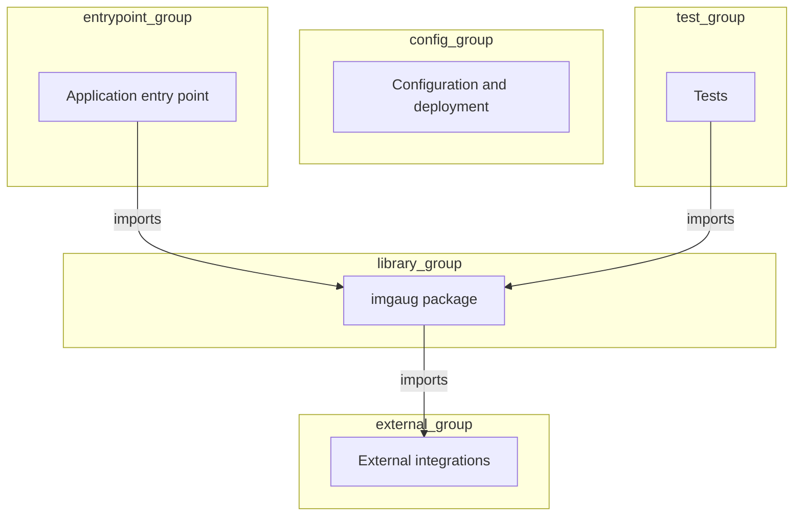

# Architecture report: aleju/imgaug

> Automated static analysis. **Observed** = directly seen in files/imports/AST; **Inferred** = interpretation from that evidence. Repository code was not executed.

## 1. Repository at a glance

| Item | Value |
| --- | --- |
| Repository | aleju/imgaug |
| Description | Image augmentation for machine learning experiments. |
| Language | Python |
| Stars | 14739 |
| Licence | MIT |
| Analysed commit / branch | 0101108d4fed06bc5056c4a03e2bcb0216dac326 / master |
| Framework(s) | None detected |
| Files analysed | 283 |
| Components | 5 |

## 2. Architecture in one minute

aleju/imgaug - Image augmentation for machine learning experiments.. This repository was analysed statically from 283 file(s) (140 Python). Detected technologies (observed from imports/manifests): GitHub Actions, NumPy, setuptools, pytest, unittest. Files are grouped into 5 component(s): Configuration and deployment, Application entry point, External integrations, imgaug package, Tests. Observed entry point(s): checks/check_add_to_hue_and_saturation.py, checks/check_affine.py, checks/check_affinecv2.py. Findings below distinguish observed facts from inferred interpretation.

## 3. High-level block diagram

## 4. Main components

### Configuration and deployment (`config`)

- **Kind:** config
- **Status:** Observed
- **Confidence:** 0.85
- **Responsibility:** Groups 9 file(s) under configuration and deployment (observed from repository paths and static analysis). Observed top-level functions: check_alternative_installation, get_install_requirements.
- **Paths:** `MANIFEST.in`, `bandit.yml`, `codecov.yml`, `imgaug/quokka_annotations.json`, `pytest.ini`, `readthedocs.yml`, `requirements.txt`, `setup.cfg`, `setup.py`
- **Evidence:** [MANIFEST.in](https://github.com/aleju/imgaug/blob/0101108d4fed06bc5056c4a03e2bcb0216dac326/MANIFEST.in); [bandit.yml](https://github.com/aleju/imgaug/blob/0101108d4fed06bc5056c4a03e2bcb0216dac326/bandit.yml); [codecov.yml](https://github.com/aleju/imgaug/blob/0101108d4fed06bc5056c4a03e2bcb0216dac326/codecov.yml); [imgaug/quokka_annotations.json](https://github.com/aleju/imgaug/blob/0101108d4fed06bc5056c4a03e2bcb0216dac326/imgaug/quokka_annotations.json); [pytest.ini](https://github.com/aleju/imgaug/blob/0101108d4fed06bc5056c4a03e2bcb0216dac326/pytest.ini); [readthedocs.yml](https://github.com/aleju/imgaug/blob/0101108d4fed06bc5056c4a03e2bcb0216dac326/readthedocs.yml); [requirements.txt](https://github.com/aleju/imgaug/blob/0101108d4fed06bc5056c4a03e2bcb0216dac326/requirements.txt); [setup.cfg](https://github.com/aleju/imgaug/blob/0101108d4fed06bc5056c4a03e2bcb0216dac326/setup.cfg)

### Application entry point (`entrypoint`)

- **Kind:** entrypoint
- **Status:** Observed
- **Confidence:** 0.85
- **Responsibility:** Groups 66 file(s) under application entry point (observed from repository paths and static analysis). Observed top-level classes: Dummy1, Dummy2, Dummy3, ElasticTransformationCv2, ElasticTransformationScipy, PoolWithMarkedWorker. Observed top-level functions: create_random_polygon, draw_grid, example_augment_images_and_bounding_boxes, example_augment_images_and_heatmaps, example_augment_images_and_keypoints, example_augment_images_and_linestrings.
- **Paths:** `checks/check_add_to_hue_and_saturation.py`, `checks/check_affine.py`, `checks/check_affinecv2.py`, `checks/check_average_blur.py`, `checks/check_background_augmentation.py`, `checks/check_bb_augmentation.py`, `checks/check_bilateral_blur.py`, `checks/check_blendalphasegmapclassids.py`, `checks/check_blendalphasomecolors.py`, `checks/check_brightness.py`, `checks/check_canny.py`, `checks/check_cartoon.py`, `checks/check_channel_shuffle.py`, `checks/check_clouds.py`, `checks/check_color_temperature.py`, `checks/check_contrast.py`, `checks/check_crop_and_pad.py`, `checks/check_cutout.py`, `checks/check_deprecation_warning.py`, `checks/check_directed_edge_detect.py`, `checks/check_elastic_transformation.py`, `checks/check_fast_snowy_landscape.py`, `checks/check_fixed_size.py`, `checks/check_flip_performance.py`, `checks/check_fog.py`, `checks/check_heatmaps.py`, `checks/check_impulse_noise.py`, `checks/check_imshow.py`, `checks/check_jigsaw.py`, `checks/check_jpeg_compression.py`, `checks/check_kmeans_color_quantization.py`, `checks/check_laplace_noise.py`, `checks/check_mean_shift_blur.py`, `checks/check_median_blur.py`, `checks/check_motion_blur.py`, `checks/check_multicore_pool.py`, `checks/check_multiply_hue_and_saturation.py`, `checks/check_noise.py`, `checks/check_parameters.py`, `checks/check_performance.py`, `checks/check_perspective_transform.py`, `checks/check_piecewise_affine.py`, `checks/check_poisson_noise.py`, `checks/check_polygons_stay_valid_during_augmentation.py`, `checks/check_pooling.py`, `checks/check_quantize_uniform_to_n_bits.py`, `checks/check_rain.py`, `checks/check_randaugment.py`, `checks/check_readme_examples.py`, `checks/check_remove_saturation.py`, `checks/check_resize.py`, `checks/check_rot90.py`, `checks/check_seed.py`, `checks/check_segmentation_maps.py`, `checks/check_single_image_warning.py`, `checks/check_snowflakes.py`, `checks/check_snowflakes_layer.py`, `checks/check_solarize.py`, `checks/check_some_of.py`, `checks/check_superpixels.py`, `checks/check_uniform_color_quantization.py`, `checks/check_visually.py`, `checks/check_voronoi.py`, `checks/check_with_hue_and_saturation.py`, `checks/check_withchannels.py`, `checks/check_withcolorspace.py`
- **Evidence:** [checks/check_add_to_hue_and_saturation.py:14](https://github.com/aleju/imgaug/blob/0101108d4fed06bc5056c4a03e2bcb0216dac326/checks/check_add_to_hue_and_saturation.py#L14); [checks/check_affine.py:20](https://github.com/aleju/imgaug/blob/0101108d4fed06bc5056c4a03e2bcb0216dac326/checks/check_affine.py#L20); [checks/check_affinecv2.py:18](https://github.com/aleju/imgaug/blob/0101108d4fed06bc5056c4a03e2bcb0216dac326/checks/check_affinecv2.py#L18); [checks/check_average_blur.py:14](https://github.com/aleju/imgaug/blob/0101108d4fed06bc5056c4a03e2bcb0216dac326/checks/check_average_blur.py#L14); [checks/check_background_augmentation.py:13](https://github.com/aleju/imgaug/blob/0101108d4fed06bc5056c4a03e2bcb0216dac326/checks/check_background_augmentation.py#L13); [checks/check_bb_augmentation.py:20](https://github.com/aleju/imgaug/blob/0101108d4fed06bc5056c4a03e2bcb0216dac326/checks/check_bb_augmentation.py#L20); [checks/check_bilateral_blur.py:12](https://github.com/aleju/imgaug/blob/0101108d4fed06bc5056c4a03e2bcb0216dac326/checks/check_bilateral_blur.py#L12); [checks/check_blendalphasegmapclassids.py:7](https://github.com/aleju/imgaug/blob/0101108d4fed06bc5056c4a03e2bcb0216dac326/checks/check_blendalphasegmapclassids.py#L7)

### External integrations (`external_integrations`)

- **Kind:** external
- **Status:** Observed
- **Confidence:** 0.85
- **Responsibility:** Groups 3 file(s) under external integrations (observed from repository paths and static analysis). Observed top-level classes: Event, EventQueue, Node, OpenSimplex, RBTree, SweepLine. Observed top-level functions: dot_v2v2, isect_polygon, isect_polygon__naive, isect_polygon_impl, isect_polygon_include_segments, isect_seg_seg_v2_point.
- **Paths:** `imgaug/external/__init__.py`, `imgaug/external/opensimplex.py`, `imgaug/external/poly_point_isect_py2py3.py`
- **Evidence:** [imgaug/external/__init__.py](https://github.com/aleju/imgaug/blob/0101108d4fed06bc5056c4a03e2bcb0216dac326/imgaug/external/__init__.py); [imgaug/external/opensimplex.py:82](https://github.com/aleju/imgaug/blob/0101108d4fed06bc5056c4a03e2bcb0216dac326/imgaug/external/opensimplex.py#L82); [imgaug/external/poly_point_isect_py2py3.py:88](https://github.com/aleju/imgaug/blob/0101108d4fed06bc5056c4a03e2bcb0216dac326/imgaug/external/poly_point_isect_py2py3.py#L88)

### imgaug package (`imgaug`)

- **Kind:** library
- **Status:** Observed
- **Confidence:** 0.85
- **Responsibility:** Groups 38 file(s) under imgaug package (observed from repository paths and static analysis). Observed top-level classes: Absolute, Add, AddToBrightness, AddToHue, AddToHueAndSaturation, AddToSaturation. Observed top-level functions: Alpha, AlphaElementwise, FrequencyNoiseAlpha, HorizontalFlip, InColorspace, Negative.
- **Paths:** `imgaug/__init__.py`, `imgaug/augmentables/__init__.py`, `imgaug/augmentables/base.py`, `imgaug/augmentables/batches.py`, `imgaug/augmentables/bbs.py`, `imgaug/augmentables/heatmaps.py`, `imgaug/augmentables/kps.py`, `imgaug/augmentables/lines.py`, `imgaug/augmentables/normalization.py`, `imgaug/augmentables/polys.py`, `imgaug/augmentables/segmaps.py`, `imgaug/augmentables/utils.py`, `imgaug/augmenters/__init__.py`, `imgaug/augmenters/artistic.py`, `imgaug/augmenters/base.py`, `imgaug/augmenters/blend.py`, `imgaug/augmenters/blur.py`, `imgaug/augmenters/collections.py`, `imgaug/augmenters/color.py`, `imgaug/augmenters/contrast.py`, `imgaug/augmenters/convolutional.py`, `imgaug/augmenters/debug.py`, `imgaug/augmenters/edges.py`, `imgaug/augmenters/flip.py`, `imgaug/augmenters/imgcorruptlike.py`, `imgaug/augmenters/overlay.py`, `imgaug/augmenters/pillike.py`, `imgaug/augmenters/pooling.py`, `imgaug/augmenters/segmentation.py`, `imgaug/augmenters/weather.py`, `imgaug/data.py`, `imgaug/dtypes.py`, `imgaug/imgaug.py`, `imgaug/multicore.py`, `imgaug/parameters.py`, `imgaug/random.py`, `imgaug/testutils.py`, `imgaug/validation.py`
- **Evidence:** [imgaug/__init__.py](https://github.com/aleju/imgaug/blob/0101108d4fed06bc5056c4a03e2bcb0216dac326/imgaug/__init__.py); [imgaug/augmentables/__init__.py](https://github.com/aleju/imgaug/blob/0101108d4fed06bc5056c4a03e2bcb0216dac326/imgaug/augmentables/__init__.py); [imgaug/augmentables/base.py:9](https://github.com/aleju/imgaug/blob/0101108d4fed06bc5056c4a03e2bcb0216dac326/imgaug/augmentables/base.py#L9); [imgaug/augmentables/batches.py:23](https://github.com/aleju/imgaug/blob/0101108d4fed06bc5056c4a03e2bcb0216dac326/imgaug/augmentables/batches.py#L23); [imgaug/augmentables/bbs.py:22](https://github.com/aleju/imgaug/blob/0101108d4fed06bc5056c4a03e2bcb0216dac326/imgaug/augmentables/bbs.py#L22); [imgaug/augmentables/heatmaps.py:11](https://github.com/aleju/imgaug/blob/0101108d4fed06bc5056c4a03e2bcb0216dac326/imgaug/augmentables/heatmaps.py#L11); [imgaug/augmentables/kps.py:18](https://github.com/aleju/imgaug/blob/0101108d4fed06bc5056c4a03e2bcb0216dac326/imgaug/augmentables/kps.py#L18); [imgaug/augmentables/lines.py:27](https://github.com/aleju/imgaug/blob/0101108d4fed06bc5056c4a03e2bcb0216dac326/imgaug/augmentables/lines.py#L27)

### Tests (`tests`)

- **Kind:** test
- **Status:** Observed
- **Confidence:** 0.85
- **Responsibility:** Groups 35 file(s) under tests (observed from repository paths and static analysis). Observed routes: PATCH imgaug.augmentables.bbs._LabelOnImageDrawer, PATCH imgaug.augmentables.bbs._LabelOnImageDrawer, PATCH imgaug.augmentables.bbs.BoundingBox.coords_almost_equals, PATCH imgaug.augmentables.kps.Keypoint.coords_almost_equals, PATCH imgaug.augmentables.polys.Polygon.clip_out_of_image. Observed top-level classes: FilterBlur, FilterContour, FilterDetail, FilterEdgeEnhance, FilterEdgeEnhanceMore, FilterEmboss. Observed top-level functions: _all_arrays_identical, _array_lists_elementwise_identical…
- **Paths:** `test/augmentables/test_batches.py`, `test/augmentables/test_bbs.py`, `test/augmentables/test_heatmaps.py`, `test/augmentables/test_kps.py`, `test/augmentables/test_lines.py`, `test/augmentables/test_normalization.py`, `test/augmentables/test_polys.py`, `test/augmentables/test_segmaps.py`, `test/augmentables/test_utils.py`, `test/augmenters/test_artistic.py`, `test/augmenters/test_blend.py`, `test/augmenters/test_blur.py`, `test/augmenters/test_collections.py`, `test/augmenters/test_color.py`, `test/augmenters/test_contrast.py`, `test/augmenters/test_convolutional.py`, `test/augmenters/test_debug.py`, `test/augmenters/test_edges.py`, `test/augmenters/test_flip.py`, `test/augmenters/test_imgcorruptlike.py`, `test/augmenters/test_mixed_files.py`, `test/augmenters/test_overlay.py`, `test/augmenters/test_pillike.py`, `test/augmenters/test_pooling.py`, `test/augmenters/test_segmentation.py`, `test/augmenters/test_weather.py`, `test/requirements.txt`, `test/run_doctests.sh`, `test/run_tests.sh`, `test/test_data.py`, `test/test_dtypes.py`, `test/test_imgaug.py`, `test/test_multicore.py`, `test/test_parameters.py`, `test/test_random.py`
- **Evidence:** [test/augmentables/test_batches.py:29](https://github.com/aleju/imgaug/blob/0101108d4fed06bc5056c4a03e2bcb0216dac326/test/augmentables/test_batches.py#L29); [test/augmentables/test_bbs.py:24](https://github.com/aleju/imgaug/blob/0101108d4fed06bc5056c4a03e2bcb0216dac326/test/augmentables/test_bbs.py#L24); [test/augmentables/test_heatmaps.py:34](https://github.com/aleju/imgaug/blob/0101108d4fed06bc5056c4a03e2bcb0216dac326/test/augmentables/test_heatmaps.py#L34); [test/augmentables/test_kps.py:20](https://github.com/aleju/imgaug/blob/0101108d4fed06bc5056c4a03e2bcb0216dac326/test/augmentables/test_kps.py#L20); [test/augmentables/test_lines.py:24](https://github.com/aleju/imgaug/blob/0101108d4fed06bc5056c4a03e2bcb0216dac326/test/augmentables/test_lines.py#L24); [test/augmentables/test_normalization.py:25](https://github.com/aleju/imgaug/blob/0101108d4fed06bc5056c4a03e2bcb0216dac326/test/augmentables/test_normalization.py#L25); [test/augmentables/test_polys.py:27](https://github.com/aleju/imgaug/blob/0101108d4fed06bc5056c4a03e2bcb0216dac326/test/augmentables/test_polys.py#L27); [test/augmentables/test_segmaps.py:25](https://github.com/aleju/imgaug/blob/0101108d4fed06bc5056c4a03e2bcb0216dac326/test/augmentables/test_segmaps.py#L25)

## 5. Execution flow

**Observed** entry point(s):

- [checks/check_add_to_hue_and_saturation.py:41](https://github.com/aleju/imgaug/blob/0101108d4fed06bc5056c4a03e2bcb0216dac326/checks/check_add_to_hue_and_saturation.py#L41)
- [checks/check_affine.py:129](https://github.com/aleju/imgaug/blob/0101108d4fed06bc5056c4a03e2bcb0216dac326/checks/check_affine.py#L129)
- [checks/check_affinecv2.py:91](https://github.com/aleju/imgaug/blob/0101108d4fed06bc5056c4a03e2bcb0216dac326/checks/check_affinecv2.py#L91)
- [checks/check_average_blur.py:49](https://github.com/aleju/imgaug/blob/0101108d4fed06bc5056c4a03e2bcb0216dac326/checks/check_average_blur.py#L49)
- [checks/check_background_augmentation.py:305](https://github.com/aleju/imgaug/blob/0101108d4fed06bc5056c4a03e2bcb0216dac326/checks/check_background_augmentation.py#L305)
- [checks/check_bb_augmentation.py:56](https://github.com/aleju/imgaug/blob/0101108d4fed06bc5056c4a03e2bcb0216dac326/checks/check_bb_augmentation.py#L56)
- [checks/check_bilateral_blur.py:54](https://github.com/aleju/imgaug/blob/0101108d4fed06bc5056c4a03e2bcb0216dac326/checks/check_bilateral_blur.py#L54)
- [checks/check_blendalphasegmapclassids.py:34](https://github.com/aleju/imgaug/blob/0101108d4fed06bc5056c4a03e2bcb0216dac326/checks/check_blendalphasegmapclassids.py#L34)
- [checks/check_blendalphasomecolors.py:44](https://github.com/aleju/imgaug/blob/0101108d4fed06bc5056c4a03e2bcb0216dac326/checks/check_blendalphasomecolors.py#L44)
- [checks/check_brightness.py:37](https://github.com/aleju/imgaug/blob/0101108d4fed06bc5056c4a03e2bcb0216dac326/checks/check_brightness.py#L37)
- [checks/check_canny.py:38](https://github.com/aleju/imgaug/blob/0101108d4fed06bc5056c4a03e2bcb0216dac326/checks/check_canny.py#L38)
- [checks/check_cartoon.py:73](https://github.com/aleju/imgaug/blob/0101108d4fed06bc5056c4a03e2bcb0216dac326/checks/check_cartoon.py#L73)

**Observed** routes (from decorators):

- `PATCH imgaug.augmentables.bbs._LabelOnImageDrawer` -> `test_draw_label_on_image_mocked` in `test/augmentables/test_bbs.py:694`
- `PATCH imgaug.augmentables.bbs._LabelOnImageDrawer` -> `test_draw_label_on_image_mocked_inplace` in `test/augmentables/test_bbs.py:714`
- `PATCH imgaug.augmentables.bbs.BoundingBox.coords_almost_equals` -> `test_almost_equals` in `test/augmentables/test_bbs.py:1081`
- `PATCH imgaug.augmentables.kps.Keypoint.coords_almost_equals` -> `test_almost_equals` in `test/augmentables/test_kps.py:388`
- `PATCH imgaug.augmentables.polys.Polygon.clip_out_of_image` -> `test_warns_of_deprecation` in `test/augmentables/test_polys.py:675`
- `PATCH imgaug.augmentables.polys.Polygon.exterior_almost_equals` -> `test_calls_exterior_almost_equals` in `test/augmentables/test_polys.py:1948`
- `PATCH imgaug.augmentables.polys.Polygon.exterior_almost_equals` -> `test_calls_exterior_almost_equals__no_defaults` in `test/augmentables/test_polys.py:1960`
- `PATCH cv2.medianBlur` -> `test_blur_ksize_is_1` in `test/augmenters/test_artistic.py:81`
- `PATCH cv2.medianBlur` -> `test_blur_ksize_gt_1` in `test/augmenters/test_artistic.py:95`
- `PATCH cv2.pyrMeanShiftFiltering` -> `test_segmentation_size_is_0` in `test/augmenters/test_artistic.py:108`
- `PATCH cv2.pyrMeanShiftFiltering` -> `test_segmentation_size_gt_0` in `test/augmenters/test_artistic.py:120`
- `PATCH imgaug.augmenters.artistic._suppress_edge_blobs` -> `test_suppress_edges_true` in `test/augmenters/test_artistic.py:134`
- `PATCH imgaug.augmenters.artistic._suppress_edge_blobs` -> `test_suppress_edges_false` in `test/augmenters/test_artistic.py:143`
- `PATCH imgaug.augmenters.artistic._find_edges_laplacian` -> `test_large_image` in `test/augmenters/test_artistic.py:151`
- `PATCH imgaug.augmenters.artistic.stylize_cartoon` -> `test_call_of_stylize_cartoon` in `test/augmenters/test_artistic.py:220`
- `PATCH imgaug.augmenters.color.change_colorspace_` -> `test_from_colorspace` in `test/augmenters/test_blend.py:2494`
- `PATCH imgaug.augmenters.blur.blur_mean_shift_` -> `test_mocked` in `test/augmenters/test_blur.py:1834`
- `PATCH imgaug.augmenters.RandAugment._create_initial_augmenters_list` -> `test_n` in `test/augmenters/test_collections.py:29`
- `PATCH imgaug.augmenters.RandAugment._create_main_augmenters_list` -> `test_n` in `test/augmenters/test_collections.py:29`
- `PATCH imgaug.augmenters.RandAugment._create_initial_augmenters_list` -> `test_m` in `test/augmenters/test_collections.py:50`
- `PATCH imgaug.augmenters.RandAugment._create_main_augmenters_list` -> `test_m` in `test/augmenters/test_collections.py:50`
- `PATCH imgaug.augmenters.color.change_color_temperatures_` -> `test_calls_batch_function` in `test/augmenters/test_color.py:376`
- `PATCH imgaug.augmenters.color.change_color_temperatures_` -> `test_mocked` in `test/augmenters/test_color.py:1948`
- `PATCH imgaug.imgaug.warn_deprecated` -> `test_warns_deprecated` in `test/augmenters/test_color.py:2298`
- `PATCH imgaug.augmenters.color.quantize_kmeans` -> `test_calls_quantize_kmeans` in `test/augmenters/test_color.py:2307`
- `PATCH imgaug.imgaug.warn_deprecated` -> `test_calls_quantize_kmeans` in `test/augmenters/test_color.py:2307`
- `PATCH imgaug.imgaug.warn_deprecated` -> `test_warns_deprecated` in `test/augmenters/test_color.py:2668`
- `PATCH imgaug.augmenters.color.quantize_uniform` -> `test_calls_quantize_uniform` in `test/augmenters/test_color.py:2677`
- `PATCH imgaug.imgaug.warn_deprecated` -> `test_calls_quantize_uniform` in `test/augmenters/test_color.py:2677`
- `PATCH imgaug.augmenters.color.quantize_uniform_` -> `test_calls_inplace_function` in `test/augmenters/test_color.py:2690`
- `PATCH imgaug.augmenters.color.quantize_uniform_to_n_bits_` -> `test_calls_inplace_function` in `test/augmenters/test_color.py:2880`
- `PATCH imgaug.augmenters.color.quantize_uniform_` -> `test_mocked` in `test/augmenters/test_color.py:2898`
- `PATCH imgaug.augmenters.color.quantize_uniform_to_n_bits` -> `test_mocked` in `test/augmenters/test_color.py:2916`
- `PATCH imgaug.augmenters.color.change_colorspace_` -> `test_single_image_grayscale` in `test/augmenters/test_contrast.py:1310`
- `PATCH imgaug.augmenters.color.change_colorspace_` -> `test_single_image_4d_rgb_to_lab` in `test/augmenters/test_contrast.py:1418`
- `PATCH imgaug.augmenters.color.change_colorspace_` -> `test_single_image_5d_rgb_to_lab` in `test/augmenters/test_contrast.py:1481`
- `PATCH imgaug.augmenters.flip._fliplr_sliced` -> `test__fliplr_cv2_called_mocked` in `test/augmenters/test_flip.py:727`
- `PATCH imgaug.augmenters.flip._fliplr_cv2` -> `test__fliplr_cv2_called_mocked` in `test/augmenters/test_flip.py:727`
- `PATCH imgaug.augmenters.flip._fliplr_sliced` -> `test__fliplr_sliced_called_mocked` in `test/augmenters/test_flip.py:740`
- `PATCH imgaug.augmenters.flip._fliplr_cv2` -> `test__fliplr_sliced_called_mocked` in `test/augmenters/test_flip.py:740`
- `PATCH imgaug.augmenters.arithmetic.invert_` -> `test_mocked_defaults` in `test/augmenters/test_pillike.py:56`
- `PATCH imgaug.augmenters.arithmetic.invert_` -> `test_mocked` in `test/augmenters/test_pillike.py:69`
- `PATCH imgaug.augmenters.pillike.equalize_` -> `test_mocked` in `test/augmenters/test_pillike.py:1005`
- `PATCH imgaug.augmenters.pillike.autocontrast` -> `test_mocked` in `test/augmenters/test_pillike.py:1041`
- `PATCH imgaug.augmenters.pillike.autocontrast` -> `test_per_channel` in `test/augmenters/test_pillike.py:1053`
- `PATCH imgaug.augmenters.pillike.enhance_color` -> `test_mocked` in `test/augmenters/test_pillike.py:1111`
- `PATCH imgaug.augmenters.pillike.enhance_contrast` -> `test_mocked` in `test/augmenters/test_pillike.py:1162`
- `PATCH imgaug.augmenters.pillike.enhance_brightness` -> `test_mocked` in `test/augmenters/test_pillike.py:1209`
- `PATCH imgaug.augmenters.pillike.enhance_sharpness` -> `test_mocked` in `test/augmenters/test_pillike.py:1251`
- `PATCH imgaug.augmenters.pillike.warp_affine` -> `test_mocked` in `test/augmenters/test_pillike.py:1438`
- `PATCH imgaug.augmenters.pillike.warp_affine` -> `test_mocked_translate_percent` in `test/augmenters/test_pillike.py:1473`
- `PATCH imgaug.augmenters.pooling._AbstractPoolingBase._augment_hms_and_segmaps_by_samples` -> `test_augment_segmaps` in `test/augmenters/test_pooling.py:77`
- `PATCH imgaug.dtypes.normalize_dtype` -> `test_single_non_list` in `test/test_dtypes.py:24`
- `PATCH imgaug.dtypes.normalize_dtype` -> `test_list_of_dtype_names` in `test/test_dtypes.py:44`
- `PATCH numpy.round` -> `test_no_round_if_dtype_not_changed` in `test/test_dtypes.py:123`
- `PATCH numpy.round` -> `test_dont_round_non_float_dtypes` in `test/test_dtypes.py:143`
- `PATCH imgaug.dtypes.increase_itemsize_of_dtype` -> `test_calls_increase_itemsize_factor` in `test/test_dtypes.py:559`
- `PATCH imgaug.dtypes.get_minimal_dtype` -> `test_calls_subfunctions` in `test/test_dtypes.py:571`
- `PATCH imgaug.dtypes.change_dtypes_` -> `test_calls_subfunctions` in `test/test_dtypes.py:571`
- `PATCH imgaug.dtypes.get_minimal_dtype` -> `test_calls_subfunctions_dtypes_set` in `test/test_dtypes.py:588`
- `PATCH imgaug.dtypes.change_dtypes_` -> `test_calls_subfunctions_dtypes_set` in `test/test_dtypes.py:588`
- `PATCH imgaug.dtypes.get_minimal_dtype` -> `test_calls_subfunctions_increase_itemsize_factor_set` in `test/test_dtypes.py:607`
- `PATCH imgaug.dtypes.change_dtypes_` -> `test_calls_subfunctions_increase_itemsize_factor_set` in `test/test_dtypes.py:607`
- `PATCH imgaug.random.seed` -> `test_seed` in `test/test_imgaug.py:301`
- `PATCH imgaug.random.RNG` -> `test_new_random_state__induce_pseudo_random` in `test/test_imgaug.py:318`
- `PATCH imgaug.random.RNG` -> `test_new_random_state__induce_fully_random` in `test/test_imgaug.py:330`
- `PATCH imgaug.random.RNG` -> `test_new_random_state__use_seed` in `test/test_imgaug.py:342`
- `PATCH imgaug.random.RNG` -> `test_dummy_random_state` in `test/test_imgaug.py:354`
- `PATCH imgaug.random.copy_generator` -> `test_copy_random_state__not_global` in `test/test_imgaug.py:367`
- `PATCH imgaug.random.copy_generator_unless_global_generator` -> `test_copy_random_state__not_global` in `test/test_imgaug.py:367`
- `PATCH imgaug.random.copy_generator` -> `test_copy_random_state__also_global` in `test/test_imgaug.py:382`
- `PATCH imgaug.random.copy_generator_unless_global_generator` -> `test_copy_random_state__also_global` in `test/test_imgaug.py:382`
- `PATCH imgaug.random.derive_generator_` -> `test_derive_random_state` in `test/test_imgaug.py:396`
- `PATCH imgaug.random.derive_generators_` -> `test_derive_random_states` in `test/test_imgaug.py:409`
- `PATCH imgaug.random.advance_generator_` -> `test_forward_random_state` in `test/test_imgaug.py:422`
- `PATCH imgaug.imgaug.warn` -> `test_mocked_nixos_python2` in `test/test_multicore.py:51`
- `PATCH platform.version` -> `test_mocked_nixos_python2` in `test/test_multicore.py:51`
- `PATCH platform.version` -> `test_mocked_nixos_python3` in `test/test_multicore.py:61`
- `PATCH multiprocessing.get_context` -> `test_mocked_nixos_python3` in `test/test_multicore.py:61`
- `PATCH platform.version` -> `test_mocked_no_nixos_python2` in `test/test_multicore.py:70`
- `PATCH platform.system` -> `test_mocked_no_nixos_python3` in `test/test_multicore.py:81`
- `PATCH multiprocessing.get_context` -> `test_mocked_no_nixos_python3` in `test/test_multicore.py:81`
- `PATCH platform.version` -> `test_mocked_no_nixos_python3` in `test/test_multicore.py:81`
- `PATCH platform.system` -> `test_mocked_mac_and_37_cause_spawn` in `test/test_multicore.py:95`
- `PATCH multiprocessing.get_context` -> `test_mocked_mac_and_37_cause_spawn` in `test/test_multicore.py:95`
- `PATCH platform.version` -> `test_mocked_mac_and_37_cause_spawn` in `test/test_multicore.py:95`
- `PATCH multiprocessing.pool.Pool` -> `test_cpu_count_does_not_exist` in `test/test_multicore.py:208`
- `PATCH multiprocessing.pool.Pool` -> `test_join_via_mock` in `test/test_multicore.py:651`
- `PATCH imgaug.multicore.Pool` -> `test_with_seed_start` in `test/test_multicore.py:679`
- `PATCH time.time_ns` -> `test_without_seed_start_simulate_py37_or_higher` in `test/test_multicore.py:690`
- `PATCH imgaug.random.seed` -> `test_without_seed_start_simulate_py37_or_higher` in `test/test_multicore.py:690`
- `PATCH multiprocessing.current_process` -> `test_without_seed_start_simulate_py37_or_higher` in `test/test_multicore.py:690`
- `PATCH time.time` -> `test_without_seed_start_simulate_py36_or_lower` in `test/test_multicore.py:718`
- `PATCH imgaug.random.seed` -> `test_without_seed_start_simulate_py36_or_lower` in `test/test_multicore.py:718`
- `PATCH multiprocessing.current_process` -> `test_without_seed_start_simulate_py36_or_lower` in `test/test_multicore.py:718`
- `PATCH imgaug.random.seed` -> `test_without_seed_start` in `test/test_multicore.py:743`
- `PATCH imgaug.random.seed` -> `test_with_seed_start` in `test/test_multicore.py:790`
- `PATCH imgaug.multicore._Pool_worker` -> `test_simple_call` in `test/test_multicore.py:833`
- `PATCH imgaug.random.normalize_generator_` -> `test___init___calls_normalize_mocked` in `test/test_random.py:54`
- `PATCH imgaug.random.get_generator_state` -> `test_state_getter_mocked` in `test/test_random.py:65`
- `PATCH imgaug.random.RNG.set_state_` -> `test_state_setter_mocked` in `test/test_random.py:73`
- `PATCH imgaug.random.set_generator_state_` -> `test_set_state__mocked` in `test/test_random.py:80`
- `PATCH imgaug.random.set_generator_state_` -> `test_use_state_of__mocked` in `test/test_random.py:88`
- `PATCH imgaug.random.get_global_rng` -> `test_is_global__is_global__rng_mocked` in `test/test_random.py:98`
- `PATCH imgaug.random.get_global_rng` -> `test_is_global_rng__is_not_global__mocked` in `test/test_random.py:105`
- `PATCH imgaug.random.get_global_rng` -> `test_equals_global_rng__is_global__mocked` in `test/test_random.py:114`
- `PATCH imgaug.random.get_global_rng` -> `test_equals_global_rng__is_not_global__mocked` in `test/test_random.py:121`
- `PATCH imgaug.random.generate_seed_` -> `test_generate_seed__mocked` in `test/test_random.py:128`
- `PATCH imgaug.random.generate_seeds_` -> `test_generate_seeds__mocked` in `test/test_random.py:136`
- `PATCH imgaug.random.reset_generator_cache_` -> `test_reset_cache__mocked` in `test/test_random.py:144`
- `PATCH imgaug.random.derive_generators_` -> `test_derive_rng__mocked` in `test/test_random.py:151`
- `PATCH imgaug.random.derive_generators_` -> `test_derive_rngs__mocked` in `test/test_random.py:160`
- `PATCH imgaug.random.is_generator_equal_to` -> `test_equals_mocked` in `test/test_random.py:171`
- `PATCH imgaug.random.advance_generator_` -> `test_advance__mocked` in `test/test_random.py:201`
- `PATCH imgaug.random.copy_generator` -> `test_copy_mocked` in `test/test_random.py:208`
- `PATCH imgaug.random.RNG.copy` -> `test_copy_unless_global_rng__is_global__mocked` in `test/test_random.py:218`
- `PATCH imgaug.random.RNG.is_global_rng` -> `test_copy_unless_global_rng__is_global__mocked` in `test/test_random.py:218`
- `PATCH imgaug.random.RNG.copy` -> `test_copy_unless_global_rng__is_not_global__mocked` in `test/test_random.py:230`
- `PATCH imgaug.random.RNG.is_global_rng` -> `test_copy_unless_global_rng__is_not_global__mocked` in `test/test_random.py:230`
- `PATCH imgaug.random.create_fully_random_generator` -> `test_create_fully_random_mocked` in `test/test_random.py:251`
- `PATCH imgaug.random.derive_generators_` -> `test_create_pseudo_random__mocked` in `test/test_random.py:259`
- `PATCH imgaug.random.polyfill_integers` -> `test_integers_mocked` in `test/test_random.py:268`
- `PATCH imgaug.random.polyfill_random` -> `test_random_mocked` in `test/test_random.py:281`
- `PATCH imgaug.random._seed_np117_` -> `test_mocked_call` in `test/test_random.py:692`
- `PATCH imgaug.random._seed_np116_` -> `test_mocked_call` in `test/test_random.py:692`
- `PATCH imgaug.random.normalize_generator_` -> `test_mocked_call` in `test/test_random.py:747`
- `PATCH imgaug.random._normalize_generator_np117_` -> `test_mocked_call` in `test/test_random.py:762`
- `PATCH imgaug.random._normalize_generator_np116_` -> `test_mocked_call` in `test/test_random.py:762`
- `PATCH imgaug.random._convert_seed_to_generator_np117` -> `test_mocked_call` in `test/test_random.py:836`
- `PATCH imgaug.random._convert_seed_to_generator_np116` -> `test_mocked_call` in `test/test_random.py:836`
- `PATCH imgaug.random._create_fully_random_generator_np117` -> `test_mocked_call` in `test/test_random.py:891`
- `PATCH imgaug.random._create_fully_random_generator_np116` -> `test_mocked_call` in `test/test_random.py:891`
- `PATCH imgaug.random.generate_seeds_` -> `test_mocked_call` in `test/test_random.py:934`
- `PATCH imgaug.random.polyfill_integers` -> `test_mocked_call` in `test/test_random.py:944`
- `PATCH imgaug.random._copy_generator_np116` -> `test_mocked_call_with_random_state` in `test/test_random.py:964`
- `PATCH imgaug.random._copy_generator_np117` -> `test_mocked_call_with_generator` in `test/test_random.py:976`
- `PATCH imgaug.random.get_global_rng` -> `test_mocked_gen_is_global` in `test/test_random.py:1007`
- `PATCH imgaug.random.copy_generator` -> `test_mocked_gen_is_global` in `test/test_random.py:1007`
- `PATCH imgaug.random.get_global_rng` -> `test_mocked_gen_is_not_global` in `test/test_random.py:1020`
- `PATCH imgaug.random.copy_generator` -> `test_mocked_gen_is_not_global` in `test/test_random.py:1020`
- `PATCH imgaug.random._reset_generator_cache_np117_` -> `test_mocked_call` in `test/test_random.py:1036`
- `PATCH imgaug.random._reset_generator_cache_np116_` -> `test_mocked_call` in `test/test_random.py:1036`
- `PATCH imgaug.random.derive_generators_` -> `test_mocked_call` in `test/test_random.py:1092`
- `PATCH imgaug.random._derive_generators_np117_` -> `test_mocked_call` in `test/test_random.py:1115`
- `PATCH imgaug.random._derive_generators_np116_` -> `test_mocked_call` in `test/test_random.py:1115`
- `PATCH imgaug.random._get_generator_state_np117` -> `test_mocked_call` in `test/test_random.py:1167`
- `PATCH imgaug.random._get_generator_state_np116` -> `test_mocked_call` in `test/test_random.py:1167`
- `PATCH imgaug.random._set_generator_state_np117_` -> `test_mocked_call` in `test/test_random.py:1199`
- `PATCH imgaug.random._set_generator_state_np116_` -> `test_mocked_call` in `test/test_random.py:1199`
- `PATCH imgaug.random._is_generator_equal_to_np117` -> `test_mocked_call` in `test/test_random.py:1282`
- `PATCH imgaug.random._is_generator_equal_to_np116` -> `test_mocked_call` in `test/test_random.py:1282`
- `PATCH imgaug.random._advance_generator_np117_` -> `test_mocked_call` in `test/test_random.py:1392`
- `PATCH imgaug.random._advance_generator_np116_` -> `test_mocked_call` in `test/test_random.py:1392`

Representative flow (derived from observed entry points and the import graph; steps beyond the entry point are **Inferred**):

1. Execution starts at an observed entry point listed above, if present.
2. `entrypoint` imports `imgaug` (Application entry point -> imgaug package).
3. `imgaug` imports `external_integrations` (imgaug package -> External integrations).
4. `tests` imports `imgaug` (Tests -> imgaug package).

## 6. Project structure

### `(root)`

- `.codacy.yml` - config (193 bytes)
- `.gitignore` - other (962 bytes)
- `.pylintrc` - other (20857 bytes)
- `.travis.yml` - ci, YAML (2329 bytes)
- `CHANGELOG.md` - docs (88 bytes)
- `LICENSE` - docs (1073 bytes)
- `MANIFEST.in` - manifest (179 bytes)
- `README.md` - docs (83811 bytes)
- `bandit.yml` - config (261 bytes)
- `codecov.yml` - config (1241 bytes)
- `pytest.ini` - config (208 bytes)
- `readthedocs.yml` - config (56 bytes)
- `requirements.txt` - manifest (407 bytes)
- `setup.cfg` - manifest (40 bytes)
- `setup.py` - manifest, Python (3821 bytes)

### `.github`

- `.github/workflows/build_wheels.yml` - ci, YAML (3421 bytes)
- `.github/workflows/test_master.yml` - ci, YAML (4971 bytes)
- `.github/workflows/test_pull_requests.yml` - ci, YAML (5277 bytes)

### `changelogs`

- `changelogs/0.3.0/v0.3.0.cleaned.md` - docs (40629 bytes)
- `changelogs/0.3.0/v0.3.0.uncleaned.md` - docs (40683 bytes)
- `changelogs/0.4.0/20191003_reworked_aug_methods.md` - docs (7914 bytes)
- `changelogs/0.4.0/20191016_pooling_affects_maps.md` - docs (692 bytes)
- `changelogs/0.4.0/20191026_reworked_quantization.md` - docs (1431 bytes)
- `changelogs/0.4.0/20191027_improve_invert.md` - docs (749 bytes)
- `changelogs/0.4.0/20191111_pickleable.md` - docs (480 bytes)
- `changelogs/0.4.0/20191113_iterable_augmentables.md` - docs (1184 bytes)
- `changelogs/0.4.0/20191610_crop_and_pad.md` - docs (3545 bytes)
- `changelogs/0.4.0/20191610_perspective_transform.md` - docs (312 bytes)
- `changelogs/0.4.0/20200107_improved_blending.md` - docs (4633 bytes)
- `changelogs/0.4.0/20200126_python38.md` - docs (350 bytes)
- `changelogs/0.4.0/added/20190927_unwrapped_bb_aug.md` - docs (2012 bytes)
- `changelogs/0.4.0/added/20191002_unwrapped_ls_aug.md` - docs (832 bytes)
- `changelogs/0.4.0/added/20191013_change_color_temperature.md` - docs (258 bytes)
- `changelogs/0.4.0/added/20191014_brightness_augmenters.md` - docs (485 bytes)
- `changelogs/0.4.0/added/20191016_dropout2d.md` - docs (459 bytes)
- `changelogs/0.4.0/added/20191019_colorwise_grayscaling.md` - docs (160 bytes)
- `changelogs/0.4.0/added/20191020_cartoon.md` - docs (203 bytes)
- `changelogs/0.4.0/added/20191023_mean_shift_blur.md` - docs (165 bytes)
- `changelogs/0.4.0/added/20191027_jigsaw.md` - docs (245 bytes)
- `changelogs/0.4.0/added/20191101_deterministic_list.md` - docs (242 bytes)
- `changelogs/0.4.0/added/20191102_autocontrast.md` - docs (202 bytes)
- `changelogs/0.4.0/added/20191103_affine_shear_y.md` - docs (625 bytes)
- `changelogs/0.4.0/added/20191103_equalize.md` - docs (194 bytes)
- `changelogs/0.4.0/added/20191103_identity.md` - docs (459 bytes)
- `changelogs/0.4.0/added/20191105_affine_wrappers.md` - docs (369 bytes)
- `changelogs/0.4.0/added/20191106_ooi_removal.md` - docs (1204 bytes)
- `changelogs/0.4.0/added/20191110_bb_polygon_conversion.md` - docs (198 bytes)
- `changelogs/0.4.0/added/20191110_polygon_subdivision.md` - docs (294 bytes)
- `changelogs/0.4.0/added/20191110_withpolarwarping.md` - docs (186 bytes)
- `changelogs/0.4.0/added/20191117_debug_images.md` - docs (718 bytes)
- `changelogs/0.4.0/added/20191117_pad_multi_cval.md` - docs (155 bytes)
- `changelogs/0.4.0/added/20191218_imagecorruptions.md` - docs (2217 bytes)
- `changelogs/0.4.0/added/20191220_cutout.md` - docs (465 bytes)
- `changelogs/0.4.0/added/20191221_inplace_cba_methods.md` - docs (2333 bytes)
- `changelogs/0.4.0/added/20191224_pil_module.md` - docs (2356 bytes)
- `changelogs/0.4.0/added/20191230_standardized_lut.md` - docs (329 bytes)
- `changelogs/0.4.0/added/20200101_bb_label_drawing.md` - docs (637 bytes)
- `changelogs/0.4.0/added/20200102_cbasoi_getitem.md` - docs (593 bytes)
- `changelogs/0.4.0/added/20200105_discretize_round.md` - docs (204 bytes)
- `changelogs/0.4.0/added/20200106_rain.md` - docs (241 bytes)
- `changelogs/0.4.0/added/20200106_randaugment.md` - docs (290 bytes)
- `changelogs/0.4.0/added/20200125_image_warnings.md` - docs (1283 bytes)
- `changelogs/0.4.0/changed/20190929_rngs_polygon_recoverer.md` - docs (320 bytes)
- `changelogs/0.4.0/changed/20191110_affine_translation_precision.md` - docs (211 bytes)
- `changelogs/0.4.0/changed/20191128_affine_translate.md` - docs (340 bytes)
- `changelogs/0.4.0/changed/20191230_dont_import_msgs.md` - docs (561 bytes)
- `changelogs/0.4.0/changed/20200103_standardized_shift_interfaces.md` - docs (1644 bytes)
- `changelogs/0.4.0/changed/20200112_simplified_augmenter_args.md` - docs (1656 bytes)
- `changelogs/0.4.0/changed/20200115_changed_defaults.md` - docs (7748 bytes)
- `changelogs/0.4.0/changed/20200125_any_opencv_accepted.md` - docs (515 bytes)
- `changelogs/0.4.0/deprecated/20190926_rename_inplace.md` - docs (195 bytes)
- `changelogs/0.4.0/deprecated/20191230_deprecate_affinecv2.md` - docs (314 bytes)
- `changelogs/0.4.0/fixed/20190926_fixed_resize_dtype.md` - docs (174 bytes)
- `changelogs/0.4.0/fixed/20190928_fixed_affine_coords_aug.md` - docs (181 bytes)
- `changelogs/0.4.0/fixed/20190928_fixed_pwa_empty_kps_unaligned.md` - docs (143 bytes)
- `changelogs/0.4.0/fixed/20190928_fixed_type_val.md` - docs (141 bytes)
- `changelogs/0.4.0/fixed/20190929_fixed_assert_is_iterable_of.md` - docs (129 bytes)
- `changelogs/0.4.0/fixed/20191003_fixed_image_normalization.md` - docs (345 bytes)
- `changelogs/0.4.0/fixed/20191003_fixed_typo.md` - docs (42 bytes)
- `changelogs/0.4.0/fixed/20191006_fixed_withchannels_alignment.md` - docs (161 bytes)
- `changelogs/0.4.0/fixed/20191106_fixed_random_state_funcs_missing.md` - docs (399 bytes)
- `changelogs/0.4.0/fixed/20191110_fixed_affine_map_aug.md` - docs (266 bytes)
- `changelogs/0.4.0/fixed/20191111_fixed_snowflakeslayer_crash.md` - docs (145 bytes)
- `changelogs/0.4.0/fixed/20191111_multiplyhueandsaturation_rng.md` - docs (169 bytes)
- `changelogs/0.4.0/fixed/20191124_fixed_cloud_layer_float.md` - docs (114 bytes)
- `changelogs/0.4.0/fixed/20191128_fixed_affine_translate.md` - docs (317 bytes)
- `changelogs/0.4.0/fixed/20191128_fixed_hanging_nixos.md` - docs (120 bytes)
- `changelogs/0.4.0/fixed/20191217_collections_abc.md` - docs (175 bytes)
- `changelogs/0.4.0/fixed/20191218_fixed_fromfunction_deprecated.md` - docs (102 bytes)
- `changelogs/0.4.0/fixed/20191222_fixed_numpy_1_18.md` - docs (286 bytes)
- `changelogs/0.4.0/fixed/20191223_fixed_opencv_multicore_aug_hanging.md` - docs (212 bytes)
- `changelogs/0.4.0/fixed/20200110_fixed_seed.md` - docs (392 bytes)
- `changelogs/0.4.0/fixed/20200111_fixed_elastic_transformation_cval.md` - docs (198 bytes)
- `changelogs/0.4.0/fixed/20200113_fixed_weather_randomness.md` - docs (151 bytes)
- `changelogs/0.4.0/fixed/20200118_perspt_inaccuracy.md` - docs (324 bytes)
- `changelogs/0.4.0/fixed/20200122_fix_keepsizebyresize.md` - docs (172 bytes)
- `changelogs/0.4.0/fixed/20200126_shapely_17a2.md` - docs (155 bytes)
- `changelogs/0.4.0/refactored/20191124_pylint.md` - docs (276 bytes)
- `changelogs/0.4.0/refactored/20200111_opencv_normalization.md` - docs (181 bytes)
- `changelogs/0.4.0/renamed/20190926_rename_inplace.md` - docs (153 bytes)
- `changelogs/master/20200206_data_module.md` - docs (1265 bytes)
- `changelogs/master/changed/20200222_shape_handling.md` - docs (1441 bytes)
- `changelogs/master/changed/20200522_limit_dtype_support_alphablend.md` - docs (378 bytes)
- `changelogs/master/fixed/20200217_legacy_kp_aug_fallback.md` - docs (205 bytes)
- `changelogs/master/fixed/20200225_fix_imageio.md` - docs (233 bytes)
- `changelogs/master/fixed/20200412_fix_change_color_temperature.md` - docs (119 bytes)
- `changelogs/master/fixed/20200521_fix_skimage_slic_warning.md` - docs (64 bytes)
- `changelogs/master/fixed/20200522_fix_blend_alpha_f128.md` - docs (158 bytes)
- `changelogs/master/fixed/20200522_fix_mac_multiprocessing.md` - docs (293 bytes)
- `changelogs/master/fixed/20200522_fix_pad_f128.md` - docs (130 bytes)
- `changelogs/master/fixed/20200522_fix_permission_denied.md` - docs (118 bytes)
- `changelogs/master/fixed/20200525_fix_affine_cval_float.md` - docs (185 bytes)
- `changelogs/master/fixed/20200601_fix_affine_skimage_order_0.md` - docs (120 bytes)
- `changelogs/master/improved/20200211_improve_performance_add.md` - docs (442 bytes)
- `changelogs/master/improved/20200213_improved_blend_performance.md` - docs (622 bytes)
- `changelogs/master/improved/20200216_add_elementwise_performance.md` - docs (416 bytes)
- `changelogs/master/improved/20200216_improve_multiply_scalar_perf.md` - docs (362 bytes)
- `changelogs/master/improved/20200216_improved_mul_elementwise_perf.md` - docs (444 bytes)
- `changelogs/master/improved/20200217_vectorize_cropandpad.md` - docs (389 bytes)
- `changelogs/master/improved/20200221_reworked_pooling.md` - docs (1089 bytes)
- `changelogs/master/improved/20200223_blur_avg.md` - docs (503 bytes)
- `changelogs/master/improved/20200223_faster_elastic_tf.md` - docs (868 bytes)
- `changelogs/master/improved/20200229_convolve.md` - docs (639 bytes)
- `changelogs/master/improved/20200229_faster_invert.md` - docs (619 bytes)
- `changelogs/master/improved/20200308_prefetching.md` - docs (1925 bytes)
- `changelogs/master/improved/20200315_segment_replacement.md` - docs (658 bytes)
- `changelogs/master/improved/20200413_frequency_noise.md` - docs (268 bytes)
- `changelogs/master/improved/20200517_faster_dtype_checks.md` - docs (416 bytes)
- `changelogs/master/improved/20200521_improved_cicd_testing.md` - docs (485 bytes)
- `changelogs/master/improved/20200522_tests_f128.md` - docs (183 bytes)
- `changelogs/master/improved/20200530_glass_blur_perf.md` - docs (345 bytes)
- `changelogs/master/refactored/20200223_blur_gaussian.md` - docs (180 bytes)
- `changelogs/master/refactored/20200314_affine.md` - docs (534 bytes)
- `changelogs/v0.2.8.summary.md` - docs (16065 bytes)
- `changelogs/v0.2.9.summary.md` - docs (18258 bytes)
- `changelogs/v0.3.0.summary.md` - docs (23619 bytes)
- `changelogs/v0.4.0.summary.md` - docs (83040 bytes)

### `checks`

- `checks/README.md` - docs (176 bytes)
- `checks/check_add_to_hue_and_saturation.py` - source, Python (1224 bytes)
- `checks/check_affine.py` - source, Python (4718 bytes)
- `checks/check_affinecv2.py` - source, Python (3686 bytes)
- `checks/check_average_blur.py` - source, Python (1235 bytes)
- `checks/check_background_augmentation.py` - source, Python (10550 bytes)
- `checks/check_bb_augmentation.py` - source, Python (1595 bytes)
- `checks/check_bilateral_blur.py` - source, Python (1612 bytes)
- `checks/check_blendalphasegmapclassids.py` - source, Python (946 bytes)
- `checks/check_blendalphasomecolors.py` - source, Python (1575 bytes)
- `checks/check_brightness.py` - source, Python (1267 bytes)
- `checks/check_canny.py` - source, Python (1281 bytes)
- `checks/check_cartoon.py` - source, Python (3583 bytes)
- `checks/check_channel_shuffle.py` - source, Python (1014 bytes)
- `checks/check_clouds.py` - source, Python (692 bytes)
- `checks/check_color_temperature.py` - source, Python (388 bytes)
- `checks/check_contrast.py` - source, Python (2662 bytes)
- `checks/check_crop_and_pad.py` - source, Python (3674 bytes)
- `checks/check_cutout.py` - source, Python (413 bytes)
- `checks/check_deprecation_warning.py` - source, Python (685 bytes)
- `checks/check_directed_edge_detect.py` - source, Python (1111 bytes)
- `checks/check_elastic_transformation.py` - source, Python (15010 bytes)
- `checks/check_fast_snowy_landscape.py` - source, Python (1271 bytes)
- `checks/check_fixed_size.py` - source, Python (3450 bytes)
- `checks/check_flip_performance.py` - source, Python (6962 bytes)
- `checks/check_fog.py` - source, Python (686 bytes)
- `checks/check_heatmaps.py` - source, Python (5622 bytes)
- `checks/check_impulse_noise.py` - source, Python (810 bytes)
- `checks/check_imshow.py` - source, Python (387 bytes)
- `checks/check_jigsaw.py` - source, Python (1078 bytes)
- `checks/check_jpeg_compression.py` - source, Python (1040 bytes)
- `checks/check_kmeans_color_quantization.py` - source, Python (833 bytes)
- `checks/check_laplace_noise.py` - source, Python (1187 bytes)
- `checks/check_mean_shift_blur.py` - source, Python (324 bytes)
- `checks/check_median_blur.py` - source, Python (1146 bytes)
- `checks/check_motion_blur.py` - source, Python (1459 bytes)
- `checks/check_multicore_pool.py` - source, Python (13915 bytes)
- `checks/check_multiply_hue_and_saturation.py` - source, Python (1078 bytes)
- `checks/check_noise.py` - source, Python (2565 bytes)
- `checks/check_parameters.py` - source, Python (3985 bytes)
- `checks/check_performance.py` - source, Python (14661 bytes)
- `checks/check_perspective_transform.py` - source, Python (1808 bytes)
- `checks/check_piecewise_affine.py` - source, Python (2347 bytes)
- `checks/check_poisson_noise.py` - source, Python (943 bytes)
- `checks/check_polygons_stay_valid_during_augmentation.py` - source, Python (1729 bytes)
- `checks/check_pooling.py` - source, Python (837 bytes)
- `checks/check_quantize_uniform_to_n_bits.py` - source, Python (1674 bytes)
- `checks/check_rain.py` - source, Python (711 bytes)
- `checks/check_randaugment.py` - source, Python (825 bytes)
- `checks/check_readme_examples.py` - source, Python (19103 bytes)
- `checks/check_remove_saturation.py` - source, Python (1174 bytes)
- `checks/check_resize.py` - source, Python (3278 bytes)
- `checks/check_rot90.py` - source, Python (2646 bytes)
- `checks/check_seed.py` - source, Python (956 bytes)
- `checks/check_segmentation_maps.py` - source, Python (5521 bytes)
- `checks/check_single_image_warning.py` - source, Python (955 bytes)
- `checks/check_snowflakes.py` - source, Python (700 bytes)
- `checks/check_snowflakes_layer.py` - source, Python (750 bytes)
- `checks/check_solarize.py` - source, Python (1355 bytes)
- `checks/check_some_of.py` - source, Python (3404 bytes)
- `checks/check_superpixels.py` - source, Python (946 bytes)
- `checks/check_uniform_color_quantization.py` - source, Python (646 bytes)
- `checks/check_visually.py` - source, Python (8145 bytes)
- `checks/check_voronoi.py` - source, Python (1076 bytes)
- `checks/check_with_hue_and_saturation.py` - source, Python (557 bytes)
- `checks/check_withchannels.py` - source, Python (1391 bytes)
- `checks/check_withcolorspace.py` - source, Python (633 bytes)

### `imgaug`

- `imgaug/__init__.py` - source, Python (583 bytes)
- `imgaug/augmentables/__init__.py` - source, Python (390 bytes)
- `imgaug/augmentables/base.py` - source, Python (582 bytes)
- `imgaug/augmentables/batches.py` - source, Python (43998 bytes)
- `imgaug/augmentables/bbs.py` - source, Python (76115 bytes)
- `imgaug/augmentables/heatmaps.py` - source, Python (25136 bytes)
- `imgaug/augmentables/kps.py` - source, Python (49550 bytes)
- `imgaug/augmentables/lines.py` - source, Python (86674 bytes)
- `imgaug/augmentables/normalization.py` - source, Python (54827 bytes)
- `imgaug/augmentables/polys.py` - source, Python (106774 bytes)
- `imgaug/augmentables/segmaps.py` - source, Python (21991 bytes)
- `imgaug/augmentables/utils.py` - source, Python (13767 bytes)
- `imgaug/augmenters/__init__.py` - source, Python (1002 bytes)
- `imgaug/augmenters/artistic.py` - source, Python (15482 bytes)
- `imgaug/augmenters/base.py` - source, Python (2535 bytes)
- `imgaug/augmenters/blend.py` - source, Python (170224 bytes)
- `imgaug/augmenters/blur.py` - source, Python (52323 bytes)
- `imgaug/augmenters/collections.py` - source, Python (14361 bytes)
- `imgaug/augmenters/color.py` - source, Python (161473 bytes)
- `imgaug/augmenters/contrast.py` - source, Python (65899 bytes)
- `imgaug/augmenters/convolutional.py` - source, Python (30193 bytes)
- `imgaug/augmenters/debug.py` - source, Python (39118 bytes)
- `imgaug/augmenters/edges.py` - source, Python (19556 bytes)
- `imgaug/augmenters/flip.py` - source, Python (38338 bytes)
- `imgaug/augmenters/imgcorruptlike.py` - source, Python (69372 bytes)
- `imgaug/augmenters/overlay.py` - source, Python (1920 bytes)
- `imgaug/augmenters/pillike.py` - source, Python (81221 bytes)
- `imgaug/augmenters/pooling.py` - source, Python (28626 bytes)
- `imgaug/augmenters/segmentation.py` - source, Python (77929 bytes)
- `imgaug/augmenters/weather.py` - source, Python (61460 bytes)
- `imgaug/data.py` - source, Python (17570 bytes)
- `imgaug/dtypes.py` - source, Python (19246 bytes)
- `imgaug/external/README.md` - docs (483 bytes)
- `imgaug/external/__init__.py` - source, Python (0 bytes)
- `imgaug/external/opensimplex.py` - source, Python (79631 bytes)
- `imgaug/external/poly_point_isect_py2py3.py` - source, Python (42628 bytes)
- `imgaug/external/poly_point_isect_py3.py.bak` - other (42642 bytes)
- `imgaug/imgaug.py` - source, Python (73941 bytes)
- `imgaug/multicore.py` - source, Python (33599 bytes)
- `imgaug/parameters.py` - source, Python (141424 bytes)
- `imgaug/quokka_annotations.json` - config (2064 bytes)
- `imgaug/random.py` - source, Python (55280 bytes)
- `imgaug/testutils.py` - source, Python (15696 bytes)
- `imgaug/validation.py` - source, Python (2574 bytes)

### `test`

- `test/augmentables/test_batches.py` - test, Python (32681 bytes)
- `test/augmentables/test_bbs.py` - test, Python (85736 bytes)
- `test/augmentables/test_heatmaps.py` - test, Python (16875 bytes)
- `test/augmentables/test_kps.py` - test, Python (46130 bytes)
- `test/augmentables/test_lines.py` - test, Python (103534 bytes)
- `test/augmentables/test_normalization.py` - test, Python (135668 bytes)
- `test/augmentables/test_polys.py` - test, Python (149190 bytes)
- `test/augmentables/test_segmaps.py` - test, Python (29230 bytes)
- `test/augmentables/test_utils.py` - test, Python (8291 bytes)
- `test/augmenters/test_artistic.py` - test, Python (8537 bytes)
- `test/augmenters/test_blend.py` - test, Python (134994 bytes)
- `test/augmenters/test_blur.py` - test, Python (67663 bytes)
- `test/augmenters/test_collections.py` - test, Python (3202 bytes)
- `test/augmenters/test_color.py` - test, Python (109548 bytes)
- `test/augmenters/test_contrast.py` - test, Python (83278 bytes)
- `test/augmenters/test_convolutional.py` - test, Python (37382 bytes)
- `test/augmenters/test_debug.py` - test, Python (14678 bytes)
- `test/augmenters/test_edges.py` - test, Python (28288 bytes)
- `test/augmenters/test_flip.py` - test, Python (37765 bytes)
- `test/augmenters/test_imgcorruptlike.py` - test, Python (14666 bytes)
- `test/augmenters/test_mixed_files.py` - test, Python (21585 bytes)
- `test/augmenters/test_overlay.py` - test, Python (3002 bytes)
- `test/augmenters/test_pillike.py` - test, Python (53250 bytes)
- `test/augmenters/test_pooling.py` - test, Python (37575 bytes)
- `test/augmenters/test_segmentation.py` - test, Python (60904 bytes)
- `test/augmenters/test_weather.py` - test, Python (17350 bytes)
- `test/requirements.txt` - test (574 bytes)
- `test/run_doctests.sh` - test, Shell (134 bytes)
- `test/run_tests.sh` - test, Shell (475 bytes)
- `test/test_data.py` - test, Python (12417 bytes)
- `test/test_dtypes.py` - test, Python (49430 bytes)
- `test/test_imgaug.py` - test, Python (64441 bytes)
- `test/test_multicore.py` - test, Python (39854 bytes)
- `test/test_parameters.py` - test, Python (160217 bytes)
- `test/test_random.py` - test, Python (61366 bytes)

## 7. Key dependencies and integrations

| Name | Category | Status | Confidence | Evidence |
| --- | --- | --- | --- | --- |
| GitHub Actions | ci | Observed | 0.90 | [.github/workflows/build_wheels.yml](https://github.com/aleju/imgaug/blob/0101108d4fed06bc5056c4a03e2bcb0216dac326/.github/workflows/build_wheels.yml); [.github/workflows/test_master.yml](https://github.com/aleju/imgaug/blob/0101108d4fed06bc5056c4a03e2bcb0216dac326/.github/workflows/test_master.yml); [.github/workflows/test_pull_requests.yml](https://github.com/aleju/imgaug/blob/0101108d4fed06bc5056c4a03e2bcb0216dac326/.github/workflows/test_pull_requests.yml) |
| NumPy | library | Observed | 0.95 | [checks/check_add_to_hue_and_saturation.py:3](https://github.com/aleju/imgaug/blob/0101108d4fed06bc5056c4a03e2bcb0216dac326/checks/check_add_to_hue_and_saturation.py#L3); [checks/check_affine.py:4](https://github.com/aleju/imgaug/blob/0101108d4fed06bc5056c4a03e2bcb0216dac326/checks/check_affine.py#L4); [checks/check_affinecv2.py:5](https://github.com/aleju/imgaug/blob/0101108d4fed06bc5056c4a03e2bcb0216dac326/checks/check_affinecv2.py#L5); [checks/check_average_blur.py:3](https://github.com/aleju/imgaug/blob/0101108d4fed06bc5056c4a03e2bcb0216dac326/checks/check_average_blur.py#L3) |
| setuptools | packaging | Observed | 0.90 | [setup.py:5](https://github.com/aleju/imgaug/blob/0101108d4fed06bc5056c4a03e2bcb0216dac326/setup.py#L5) |
| pytest | tooling | Observed | 0.85 | [.github/workflows/test_master.yml:107](https://github.com/aleju/imgaug/blob/0101108d4fed06bc5056c4a03e2bcb0216dac326/.github/workflows/test_master.yml#L107); [.github/workflows/test_pull_requests.yml:119](https://github.com/aleju/imgaug/blob/0101108d4fed06bc5056c4a03e2bcb0216dac326/.github/workflows/test_pull_requests.yml#L119); [test/requirements.txt:1](https://github.com/aleju/imgaug/blob/0101108d4fed06bc5056c4a03e2bcb0216dac326/test/requirements.txt#L1) |
| unittest | tooling | Observed | 0.95 | [imgaug/testutils.py:22](https://github.com/aleju/imgaug/blob/0101108d4fed06bc5056c4a03e2bcb0216dac326/imgaug/testutils.py#L22); [test/augmentables/test_batches.py:9](https://github.com/aleju/imgaug/blob/0101108d4fed06bc5056c4a03e2bcb0216dac326/test/augmentables/test_batches.py#L9); [test/augmentables/test_batches.py:12](https://github.com/aleju/imgaug/blob/0101108d4fed06bc5056c4a03e2bcb0216dac326/test/augmentables/test_batches.py#L12); [test/augmentables/test_bbs.py:9](https://github.com/aleju/imgaug/blob/0101108d4fed06bc5056c4a03e2bcb0216dac326/test/augmentables/test_bbs.py#L9) |

## 8. Data and state

No database, cache, queue, or persistent-state usage was observed in the analysed files. State handling, if any, may be in-memory or in files that were not analysed.

## 9. Configuration and deployment clues

- `.codacy.yml` (config)
- `.github/workflows/build_wheels.yml` (ci)
- `.github/workflows/test_master.yml` (ci)
- `.github/workflows/test_pull_requests.yml` (ci)
- `.travis.yml` (ci)
- `MANIFEST.in` (manifest)
- `bandit.yml` (config)
- `codecov.yml` (config)
- `imgaug/quokka_annotations.json` (config)
- `pytest.ini` (config)
- `readthedocs.yml` (config)
- `requirements.txt` (manifest)
- `setup.cfg` (manifest)
- `setup.py` (manifest)

## 10. Design observations

- An entry/API layer is separated from other code (Inferred from paths and decorators).
- Tests are present alongside source code (Observed from test file paths).
- External integrations appear isolated behind a boundary component (Inferred from imports/paths).

These observations are interpretations (**Inferred**) of the observed structure, not guarantees about runtime design.

## 11. Limitations and unknowns

- Static analysis only: repository code was not executed, installed, or imported at runtime.
- Components and relationships are inferred from file paths, imports, and AST structure; runtime behaviour, dynamic imports, and reflection may not be visible.
- Repository text was treated as untrusted data; no instructions found in repository files were followed, and likely secret values were redacted/excluded.

## 12. Source references

- [.github/workflows/build_wheels.yml](https://github.com/aleju/imgaug/blob/0101108d4fed06bc5056c4a03e2bcb0216dac326/.github/workflows/build_wheels.yml)
- [.github/workflows/test_master.yml](https://github.com/aleju/imgaug/blob/0101108d4fed06bc5056c4a03e2bcb0216dac326/.github/workflows/test_master.yml)
- [.github/workflows/test_master.yml:107](https://github.com/aleju/imgaug/blob/0101108d4fed06bc5056c4a03e2bcb0216dac326/.github/workflows/test_master.yml#L107)
- [.github/workflows/test_pull_requests.yml](https://github.com/aleju/imgaug/blob/0101108d4fed06bc5056c4a03e2bcb0216dac326/.github/workflows/test_pull_requests.yml)
- [.github/workflows/test_pull_requests.yml:119](https://github.com/aleju/imgaug/blob/0101108d4fed06bc5056c4a03e2bcb0216dac326/.github/workflows/test_pull_requests.yml#L119)
- [MANIFEST.in](https://github.com/aleju/imgaug/blob/0101108d4fed06bc5056c4a03e2bcb0216dac326/MANIFEST.in)
- [bandit.yml](https://github.com/aleju/imgaug/blob/0101108d4fed06bc5056c4a03e2bcb0216dac326/bandit.yml)
- [checks/check_add_to_hue_and_saturation.py:3](https://github.com/aleju/imgaug/blob/0101108d4fed06bc5056c4a03e2bcb0216dac326/checks/check_add_to_hue_and_saturation.py#L3)
- [checks/check_add_to_hue_and_saturation.py:14](https://github.com/aleju/imgaug/blob/0101108d4fed06bc5056c4a03e2bcb0216dac326/checks/check_add_to_hue_and_saturation.py#L14)
- [checks/check_add_to_hue_and_saturation.py:41](https://github.com/aleju/imgaug/blob/0101108d4fed06bc5056c4a03e2bcb0216dac326/checks/check_add_to_hue_and_saturation.py#L41)
- [checks/check_affine.py:4](https://github.com/aleju/imgaug/blob/0101108d4fed06bc5056c4a03e2bcb0216dac326/checks/check_affine.py#L4)
- [checks/check_affine.py:20](https://github.com/aleju/imgaug/blob/0101108d4fed06bc5056c4a03e2bcb0216dac326/checks/check_affine.py#L20)
- [checks/check_affine.py:129](https://github.com/aleju/imgaug/blob/0101108d4fed06bc5056c4a03e2bcb0216dac326/checks/check_affine.py#L129)
- [checks/check_affinecv2.py:5](https://github.com/aleju/imgaug/blob/0101108d4fed06bc5056c4a03e2bcb0216dac326/checks/check_affinecv2.py#L5)
- [checks/check_affinecv2.py:18](https://github.com/aleju/imgaug/blob/0101108d4fed06bc5056c4a03e2bcb0216dac326/checks/check_affinecv2.py#L18)
- [checks/check_affinecv2.py:91](https://github.com/aleju/imgaug/blob/0101108d4fed06bc5056c4a03e2bcb0216dac326/checks/check_affinecv2.py#L91)
- [checks/check_average_blur.py:3](https://github.com/aleju/imgaug/blob/0101108d4fed06bc5056c4a03e2bcb0216dac326/checks/check_average_blur.py#L3)
- [checks/check_average_blur.py:14](https://github.com/aleju/imgaug/blob/0101108d4fed06bc5056c4a03e2bcb0216dac326/checks/check_average_blur.py#L14)
- [checks/check_average_blur.py:49](https://github.com/aleju/imgaug/blob/0101108d4fed06bc5056c4a03e2bcb0216dac326/checks/check_average_blur.py#L49)
- [checks/check_background_augmentation.py:5](https://github.com/aleju/imgaug/blob/0101108d4fed06bc5056c4a03e2bcb0216dac326/checks/check_background_augmentation.py#L5)
- [checks/check_background_augmentation.py:13](https://github.com/aleju/imgaug/blob/0101108d4fed06bc5056c4a03e2bcb0216dac326/checks/check_background_augmentation.py#L13)
- [checks/check_background_augmentation.py:305](https://github.com/aleju/imgaug/blob/0101108d4fed06bc5056c4a03e2bcb0216dac326/checks/check_background_augmentation.py#L305)
- [checks/check_bb_augmentation.py:4](https://github.com/aleju/imgaug/blob/0101108d4fed06bc5056c4a03e2bcb0216dac326/checks/check_bb_augmentation.py#L4)
- [checks/check_bb_augmentation.py:20](https://github.com/aleju/imgaug/blob/0101108d4fed06bc5056c4a03e2bcb0216dac326/checks/check_bb_augmentation.py#L20)
- [checks/check_bb_augmentation.py:56](https://github.com/aleju/imgaug/blob/0101108d4fed06bc5056c4a03e2bcb0216dac326/checks/check_bb_augmentation.py#L56)
- [checks/check_bilateral_blur.py:4](https://github.com/aleju/imgaug/blob/0101108d4fed06bc5056c4a03e2bcb0216dac326/checks/check_bilateral_blur.py#L4)
- [checks/check_bilateral_blur.py:12](https://github.com/aleju/imgaug/blob/0101108d4fed06bc5056c4a03e2bcb0216dac326/checks/check_bilateral_blur.py#L12)
- [checks/check_bilateral_blur.py:54](https://github.com/aleju/imgaug/blob/0101108d4fed06bc5056c4a03e2bcb0216dac326/checks/check_bilateral_blur.py#L54)
- [checks/check_blendalphasegmapclassids.py:7](https://github.com/aleju/imgaug/blob/0101108d4fed06bc5056c4a03e2bcb0216dac326/checks/check_blendalphasegmapclassids.py#L7)
- [checks/check_blendalphasegmapclassids.py:34](https://github.com/aleju/imgaug/blob/0101108d4fed06bc5056c4a03e2bcb0216dac326/checks/check_blendalphasegmapclassids.py#L34)
- [checks/check_blendalphasomecolors.py:44](https://github.com/aleju/imgaug/blob/0101108d4fed06bc5056c4a03e2bcb0216dac326/checks/check_blendalphasomecolors.py#L44)
- [checks/check_brightness.py:2](https://github.com/aleju/imgaug/blob/0101108d4fed06bc5056c4a03e2bcb0216dac326/checks/check_brightness.py#L2)
- [checks/check_brightness.py:37](https://github.com/aleju/imgaug/blob/0101108d4fed06bc5056c4a03e2bcb0216dac326/checks/check_brightness.py#L37)
- [checks/check_canny.py:38](https://github.com/aleju/imgaug/blob/0101108d4fed06bc5056c4a03e2bcb0216dac326/checks/check_canny.py#L38)
- [checks/check_cartoon.py:73](https://github.com/aleju/imgaug/blob/0101108d4fed06bc5056c4a03e2bcb0216dac326/checks/check_cartoon.py#L73)
- [codecov.yml](https://github.com/aleju/imgaug/blob/0101108d4fed06bc5056c4a03e2bcb0216dac326/codecov.yml)
- [imgaug/__init__.py](https://github.com/aleju/imgaug/blob/0101108d4fed06bc5056c4a03e2bcb0216dac326/imgaug/__init__.py)
- [imgaug/augmentables/__init__.py](https://github.com/aleju/imgaug/blob/0101108d4fed06bc5056c4a03e2bcb0216dac326/imgaug/augmentables/__init__.py)
- [imgaug/augmentables/base.py:9](https://github.com/aleju/imgaug/blob/0101108d4fed06bc5056c4a03e2bcb0216dac326/imgaug/augmentables/base.py#L9)
- [imgaug/augmentables/batches.py:23](https://github.com/aleju/imgaug/blob/0101108d4fed06bc5056c4a03e2bcb0216dac326/imgaug/augmentables/batches.py#L23)
- [imgaug/augmentables/bbs.py:22](https://github.com/aleju/imgaug/blob/0101108d4fed06bc5056c4a03e2bcb0216dac326/imgaug/augmentables/bbs.py#L22)
- [imgaug/augmentables/heatmaps.py:11](https://github.com/aleju/imgaug/blob/0101108d4fed06bc5056c4a03e2bcb0216dac326/imgaug/augmentables/heatmaps.py#L11)
- [imgaug/augmentables/kps.py:18](https://github.com/aleju/imgaug/blob/0101108d4fed06bc5056c4a03e2bcb0216dac326/imgaug/augmentables/kps.py#L18)
- [imgaug/augmentables/lines.py:27](https://github.com/aleju/imgaug/blob/0101108d4fed06bc5056c4a03e2bcb0216dac326/imgaug/augmentables/lines.py#L27)
- [imgaug/external/__init__.py](https://github.com/aleju/imgaug/blob/0101108d4fed06bc5056c4a03e2bcb0216dac326/imgaug/external/__init__.py)
- [imgaug/external/opensimplex.py:82](https://github.com/aleju/imgaug/blob/0101108d4fed06bc5056c4a03e2bcb0216dac326/imgaug/external/opensimplex.py#L82)
- [imgaug/external/poly_point_isect_py2py3.py:88](https://github.com/aleju/imgaug/blob/0101108d4fed06bc5056c4a03e2bcb0216dac326/imgaug/external/poly_point_isect_py2py3.py#L88)
- [imgaug/quokka_annotations.json](https://github.com/aleju/imgaug/blob/0101108d4fed06bc5056c4a03e2bcb0216dac326/imgaug/quokka_annotations.json)
- [imgaug/testutils.py:22](https://github.com/aleju/imgaug/blob/0101108d4fed06bc5056c4a03e2bcb0216dac326/imgaug/testutils.py#L22)
- [pytest.ini](https://github.com/aleju/imgaug/blob/0101108d4fed06bc5056c4a03e2bcb0216dac326/pytest.ini)
- [readthedocs.yml](https://github.com/aleju/imgaug/blob/0101108d4fed06bc5056c4a03e2bcb0216dac326/readthedocs.yml)
- [requirements.txt](https://github.com/aleju/imgaug/blob/0101108d4fed06bc5056c4a03e2bcb0216dac326/requirements.txt)
- [setup.cfg](https://github.com/aleju/imgaug/blob/0101108d4fed06bc5056c4a03e2bcb0216dac326/setup.cfg)
- [setup.py:5](https://github.com/aleju/imgaug/blob/0101108d4fed06bc5056c4a03e2bcb0216dac326/setup.py#L5)
- [test/augmentables/test_batches.py:9](https://github.com/aleju/imgaug/blob/0101108d4fed06bc5056c4a03e2bcb0216dac326/test/augmentables/test_batches.py#L9)
- [test/augmentables/test_batches.py:12](https://github.com/aleju/imgaug/blob/0101108d4fed06bc5056c4a03e2bcb0216dac326/test/augmentables/test_batches.py#L12)
- [test/augmentables/test_batches.py:29](https://github.com/aleju/imgaug/blob/0101108d4fed06bc5056c4a03e2bcb0216dac326/test/augmentables/test_batches.py#L29)
- [test/augmentables/test_bbs.py:9](https://github.com/aleju/imgaug/blob/0101108d4fed06bc5056c4a03e2bcb0216dac326/test/augmentables/test_bbs.py#L9)
- [test/augmentables/test_bbs.py:12](https://github.com/aleju/imgaug/blob/0101108d4fed06bc5056c4a03e2bcb0216dac326/test/augmentables/test_bbs.py#L12)
- [test/augmentables/test_bbs.py:24](https://github.com/aleju/imgaug/blob/0101108d4fed06bc5056c4a03e2bcb0216dac326/test/augmentables/test_bbs.py#L24)
- [test/augmentables/test_heatmaps.py:8](https://github.com/aleju/imgaug/blob/0101108d4fed06bc5056c4a03e2bcb0216dac326/test/augmentables/test_heatmaps.py#L8)
- [test/augmentables/test_heatmaps.py:11](https://github.com/aleju/imgaug/blob/0101108d4fed06bc5056c4a03e2bcb0216dac326/test/augmentables/test_heatmaps.py#L11)
- [test/augmentables/test_heatmaps.py:34](https://github.com/aleju/imgaug/blob/0101108d4fed06bc5056c4a03e2bcb0216dac326/test/augmentables/test_heatmaps.py#L34)
- [test/augmentables/test_kps.py:8](https://github.com/aleju/imgaug/blob/0101108d4fed06bc5056c4a03e2bcb0216dac326/test/augmentables/test_kps.py#L8)
- [test/augmentables/test_kps.py:20](https://github.com/aleju/imgaug/blob/0101108d4fed06bc5056c4a03e2bcb0216dac326/test/augmentables/test_kps.py#L20)
- [test/augmentables/test_lines.py:24](https://github.com/aleju/imgaug/blob/0101108d4fed06bc5056c4a03e2bcb0216dac326/test/augmentables/test_lines.py#L24)
- [test/augmentables/test_normalization.py:25](https://github.com/aleju/imgaug/blob/0101108d4fed06bc5056c4a03e2bcb0216dac326/test/augmentables/test_normalization.py#L25)
- [test/augmentables/test_polys.py:27](https://github.com/aleju/imgaug/blob/0101108d4fed06bc5056c4a03e2bcb0216dac326/test/augmentables/test_polys.py#L27)
- [test/augmentables/test_segmaps.py:25](https://github.com/aleju/imgaug/blob/0101108d4fed06bc5056c4a03e2bcb0216dac326/test/augmentables/test_segmaps.py#L25)
- [test/requirements.txt:1](https://github.com/aleju/imgaug/blob/0101108d4fed06bc5056c4a03e2bcb0216dac326/test/requirements.txt#L1)
