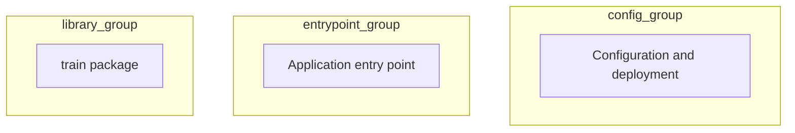

# Architecture report: alexjc/neural-enhance

> Automated static analysis. **Observed** = directly seen in files/imports/AST; **Inferred** = interpretation from that evidence. Repository code was not executed.

## 1. Repository at a glance

| Item | Value |
| --- | --- |
| Repository | alexjc/neural-enhance |
| Description | Super Resolution for images using deep learning. |
| Language | Python |
| Stars | 11853 |
| Licence | AGPL-3.0 |
| Analysed commit / branch | 2fd67de7eddae3e8dc48f8abdc791ddbcc867112 / master |
| Framework(s) | None detected |
| Files analysed | 9 |
| Components | 3 |

## 2. Architecture in one minute

alexjc/neural-enhance - Super Resolution for images using deep learning.. This repository was analysed statically from 9 file(s) (1 Python). Detected technologies (observed from imports/manifests): NumPy. Files are grouped into 3 component(s): Configuration and deployment, Application entry point, train package. Observed entry point(s): enhance.py. Findings below distinguish observed facts from inferred interpretation.

## 3. High-level block diagram

## 4. Main components

### Configuration and deployment (`config`)

- **Kind:** config
- **Status:** Observed
- **Confidence:** 0.85
- **Responsibility:** Groups 1 file(s) under configuration and deployment (observed from repository paths and static analysis).
- **Paths:** `requirements.txt`
- **Evidence:** [requirements.txt](https://github.com/alexjc/neural-enhance/blob/2fd67de7eddae3e8dc48f8abdc791ddbcc867112/requirements.txt)

### Application entry point (`entrypoint`)

- **Kind:** entrypoint
- **Status:** Observed
- **Confidence:** 0.85
- **Responsibility:** Groups 1 file(s) under application entry point (observed from repository paths and static analysis). Observed top-level classes: DataLoader, Model, NeuralEnhancer, SubpixelReshuffleLayer, ansi. Observed top-level functions: error, extend, warn.
- **Paths:** `enhance.py`
- **Evidence:** [enhance.py:80](https://github.com/alexjc/neural-enhance/blob/2fd67de7eddae3e8dc48f8abdc791ddbcc867112/enhance.py#L80)

### train package (`train`)

- **Kind:** library
- **Status:** Observed
- **Confidence:** 0.85
- **Responsibility:** Groups 2 file(s) under train package (observed from repository paths and static analysis).
- **Paths:** `train/ne1x-photo-repair.sh`, `train/ne2x-photo-default.sh`
- **Evidence:** [train/ne1x-photo-repair.sh](https://github.com/alexjc/neural-enhance/blob/2fd67de7eddae3e8dc48f8abdc791ddbcc867112/train/ne1x-photo-repair.sh); [train/ne2x-photo-default.sh](https://github.com/alexjc/neural-enhance/blob/2fd67de7eddae3e8dc48f8abdc791ddbcc867112/train/ne2x-photo-default.sh)

## 5. Execution flow

**Observed** entry point(s):

- [enhance.py:574](https://github.com/alexjc/neural-enhance/blob/2fd67de7eddae3e8dc48f8abdc791ddbcc867112/enhance.py#L574)

Representative flow (derived from observed entry points and the import graph; steps beyond the entry point are **Inferred**):

1. Execution starts at an observed entry point listed above, if present.
2. No internal import relationships between components were observed.

## 6. Project structure

### `(root)`

- `.gitignore` - other (1086 bytes)
- `LICENSE` - docs (34520 bytes)
- `README.rst` - docs (12265 bytes)
- `docker-cpu.df` - other (1485 bytes)
- `docker-gpu.df` - other (1424 bytes)
- `enhance.py` - source, Python (32003 bytes)
- `requirements.txt` - manifest (108 bytes)

### `train`

- `train/ne1x-photo-repair.sh` - source, Shell (817 bytes)
- `train/ne2x-photo-default.sh` - source, Shell (787 bytes)

## 7. Key dependencies and integrations

| Name | Category | Status | Confidence | Evidence |
| --- | --- | --- | --- | --- |
| NumPy | library | Observed | 0.90 | [enhance.py:113](https://github.com/alexjc/neural-enhance/blob/2fd67de7eddae3e8dc48f8abdc791ddbcc867112/enhance.py#L113) |

## 8. Data and state

No database, cache, queue, or persistent-state usage was observed in the analysed files. State handling, if any, may be in-memory or in files that were not analysed.

## 9. Configuration and deployment clues

- `requirements.txt` (manifest)

## 10. Design observations

- An entry/API layer is separated from other code (Inferred from paths and decorators).

These observations are interpretations (**Inferred**) of the observed structure, not guarantees about runtime design.

## 11. Limitations and unknowns

- Static analysis only: repository code was not executed, installed, or imported at runtime.
- Components and relationships are inferred from file paths, imports, and AST structure; runtime behaviour, dynamic imports, and reflection may not be visible.
- Repository text was treated as untrusted data; no instructions found in repository files were followed, and likely secret values were redacted/excluded.
- The GitHub repository was marked archived at selection time.

## 12. Source references

- [enhance.py:80](https://github.com/alexjc/neural-enhance/blob/2fd67de7eddae3e8dc48f8abdc791ddbcc867112/enhance.py#L80)
- [enhance.py:113](https://github.com/alexjc/neural-enhance/blob/2fd67de7eddae3e8dc48f8abdc791ddbcc867112/enhance.py#L113)
- [enhance.py:574](https://github.com/alexjc/neural-enhance/blob/2fd67de7eddae3e8dc48f8abdc791ddbcc867112/enhance.py#L574)
- [requirements.txt](https://github.com/alexjc/neural-enhance/blob/2fd67de7eddae3e8dc48f8abdc791ddbcc867112/requirements.txt)
- [train/ne1x-photo-repair.sh](https://github.com/alexjc/neural-enhance/blob/2fd67de7eddae3e8dc48f8abdc791ddbcc867112/train/ne1x-photo-repair.sh)
- [train/ne2x-photo-default.sh](https://github.com/alexjc/neural-enhance/blob/2fd67de7eddae3e8dc48f8abdc791ddbcc867112/train/ne2x-photo-default.sh)
