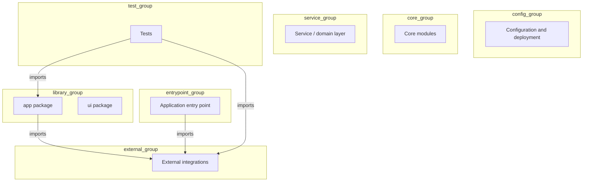

# Architecture report: alexta69/metube

> Automated static analysis. **Observed** = directly seen in files/imports/AST; **Inferred** = interpretation from that evidence. Repository code was not executed.

## 1. Repository at a glance

| Item | Value |
| --- | --- |
| Repository | alexta69/metube |
| Description | Self-hosted video downloader for YouTube and other sites (web UI for yt-dlp) |
| Language | Python |
| Stars | 15263 |
| Licence | AGPL-3.0 |
| Analysed commit / branch | 7594d26dc418ec0e24985d562e4f24e737e7c0fe / master |
| Framework(s) | None detected |
| Files analysed | 120 |
| Components | 8 |

## 2. Architecture in one minute

alexta69/metube - Self-hosted video downloader for YouTube and other sites (web UI for yt-dlp). This repository was analysed statically from 120 file(s) (26 Python). Detected technologies (observed from imports/manifests): GitHub Actions, aiohttp, Poetry, Docker, pytest, TypeScript. Files are grouped into 8 component(s): app package, Configuration and deployment, Core modules, Application entry point, External integrations, Service / domain layer, Tests, ui package. Observed entry point(s): app/main.py. Findings below distinguish observed facts from inferred interpretation.

## 3. High-level block diagram

## 4. Main components

### app package (`app`)

- **Kind:** library
- **Status:** Observed
- **Confidence:** 0.85
- **Responsibility:** Groups 9 file(s) under app package (observed from repository paths and static analysis). Observed top-level classes: AtomicJsonStore, Download, DownloadInfo, DownloadOptions, DownloadQueue, DownloadQueueNotifier. Observed top-level functions: _address_allowed_at_connect, _address_is_global, _audio_format, _build_ydl_params, _check, _choice.
- **Paths:** `app/bg_tasks.py`, `app/dl_formats.py`, `app/download_options.py`, `app/format_catalog.py`, `app/music_metadata.py`, `app/state_store.py`, `app/subscriptions.py`, `app/url_guard.py`, `app/ytdl.py`
- **Evidence:** [app/bg_tasks.py:8](https://github.com/alexta69/metube/blob/7594d26dc418ec0e24985d562e4f24e737e7c0fe/app/bg_tasks.py#L8); [app/dl_formats.py:26](https://github.com/alexta69/metube/blob/7594d26dc418ec0e24985d562e4f24e737e7c0fe/app/dl_formats.py#L26); [app/download_options.py:21](https://github.com/alexta69/metube/blob/7594d26dc418ec0e24985d562e4f24e737e7c0fe/app/download_options.py#L21); [app/format_catalog.py:20](https://github.com/alexta69/metube/blob/7594d26dc418ec0e24985d562e4f24e737e7c0fe/app/format_catalog.py#L20); [app/music_metadata.py:15](https://github.com/alexta69/metube/blob/7594d26dc418ec0e24985d562e4f24e737e7c0fe/app/music_metadata.py#L15); [app/state_store.py:41](https://github.com/alexta69/metube/blob/7594d26dc418ec0e24985d562e4f24e737e7c0fe/app/state_store.py#L41); [app/subscriptions.py:47](https://github.com/alexta69/metube/blob/7594d26dc418ec0e24985d562e4f24e737e7c0fe/app/subscriptions.py#L47); [app/url_guard.py:77](https://github.com/alexta69/metube/blob/7594d26dc418ec0e24985d562e4f24e737e7c0fe/app/url_guard.py#L77)

### Configuration and deployment (`config`)

- **Kind:** config
- **Status:** Observed
- **Confidence:** 0.85
- **Responsibility:** Groups 10 file(s) under configuration and deployment (observed from repository paths and static analysis).
- **Paths:** `Dockerfile`, `pyproject.toml`, `ui/.editorconfig`, `ui/angular.json`, `ui/ngsw-config.json`, `ui/package.json`, `ui/pnpm-workspace.yaml`, `ui/tsconfig.app.json`, `ui/tsconfig.json`, `ui/tsconfig.spec.json`
- **Evidence:** [Dockerfile](https://github.com/alexta69/metube/blob/7594d26dc418ec0e24985d562e4f24e737e7c0fe/Dockerfile); [pyproject.toml](https://github.com/alexta69/metube/blob/7594d26dc418ec0e24985d562e4f24e737e7c0fe/pyproject.toml); [ui/.editorconfig](https://github.com/alexta69/metube/blob/7594d26dc418ec0e24985d562e4f24e737e7c0fe/ui/.editorconfig); [ui/angular.json](https://github.com/alexta69/metube/blob/7594d26dc418ec0e24985d562e4f24e737e7c0fe/ui/angular.json); [ui/ngsw-config.json](https://github.com/alexta69/metube/blob/7594d26dc418ec0e24985d562e4f24e737e7c0fe/ui/ngsw-config.json); [ui/package.json](https://github.com/alexta69/metube/blob/7594d26dc418ec0e24985d562e4f24e737e7c0fe/ui/package.json); [ui/pnpm-workspace.yaml](https://github.com/alexta69/metube/blob/7594d26dc418ec0e24985d562e4f24e737e7c0fe/ui/pnpm-workspace.yaml); [ui/tsconfig.app.json](https://github.com/alexta69/metube/blob/7594d26dc418ec0e24985d562e4f24e737e7c0fe/ui/tsconfig.app.json)

### Core modules (`core`)

- **Kind:** core
- **Status:** Observed
- **Confidence:** 0.85
- **Responsibility:** Groups 1 file(s) under core modules (observed from repository paths and static analysis).
- **Paths:** `docker-entrypoint.sh`
- **Evidence:** [docker-entrypoint.sh](https://github.com/alexta69/metube/blob/7594d26dc418ec0e24985d562e4f24e737e7c0fe/docker-entrypoint.sh)

### Application entry point (`entrypoint`)

- **Kind:** entrypoint
- **Status:** Observed
- **Confidence:** 0.85
- **Responsibility:** Groups 1 file(s) under application entry point (observed from repository paths and static analysis). Observed routes: POST (path not a literal), GET (path not a literal), POST (path not a literal), GET (path not a literal), POST (path not a literal). Observed top-level classes: Config, MetubeSubscriptionNotifier, Notifier, ObjectSerializer. Observed top-level functions: _bool_field, _clip_field_provided_in_post, _download_queue_startup, _emit_connect_finish, _extract_t_query_from_url, _is_within_state_dir.
- **Paths:** `app/main.py`
- **Evidence:** [app/main.py:34](https://github.com/alexta69/metube/blob/7594d26dc418ec0e24985d562e4f24e737e7c0fe/app/main.py#L34)

### External integrations (`external_integrations`)

- **Kind:** external
- **Status:** Inferred
- **Confidence:** 0.70
- **Responsibility:** Groups 0 file(s) under external integrations (observed from repository paths and static analysis).
- **Evidence:** [app/main.py:9](https://github.com/alexta69/metube/blob/7594d26dc418ec0e24985d562e4f24e737e7c0fe/app/main.py#L9); [app/main.py:10](https://github.com/alexta69/metube/blob/7594d26dc418ec0e24985d562e4f24e737e7c0fe/app/main.py#L10); [app/main.py:11](https://github.com/alexta69/metube/blob/7594d26dc418ec0e24985d562e4f24e737e7c0fe/app/main.py#L11); [app/tests/test_api.py:13](https://github.com/alexta69/metube/blob/7594d26dc418ec0e24985d562e4f24e737e7c0fe/app/tests/test_api.py#L13); [app/tests/test_api.py:14](https://github.com/alexta69/metube/blob/7594d26dc418ec0e24985d562e4f24e737e7c0fe/app/tests/test_api.py#L14); [app/tests/test_download_queue.py:10](https://github.com/alexta69/metube/blob/7594d26dc418ec0e24985d562e4f24e737e7c0fe/app/tests/test_download_queue.py#L10)

### Service / domain layer (`service_layer`)

- **Kind:** service
- **Status:** Observed
- **Confidence:** 0.85
- **Responsibility:** Groups 11 file(s) under service / domain layer (observed from repository paths and static analysis).
- **Paths:** `ui/src/app/services/batch-urls.service.ts`, `ui/src/app/services/downloads.service.spec.ts`, `ui/src/app/services/downloads.service.ts`, `ui/src/app/services/index.ts`, `ui/src/app/services/metube-socket.service.ts`, `ui/src/app/services/settings-store.service.spec.ts`, `ui/src/app/services/settings-store.service.ts`, `ui/src/app/services/subscriptions.service.spec.ts`, `ui/src/app/services/subscriptions.service.ts`, `ui/src/app/services/toast.service.spec.ts`, `ui/src/app/services/toast.service.ts`
- **Evidence:** [ui/src/app/services/batch-urls.service.ts](https://github.com/alexta69/metube/blob/7594d26dc418ec0e24985d562e4f24e737e7c0fe/ui/src/app/services/batch-urls.service.ts); [ui/src/app/services/downloads.service.spec.ts](https://github.com/alexta69/metube/blob/7594d26dc418ec0e24985d562e4f24e737e7c0fe/ui/src/app/services/downloads.service.spec.ts); [ui/src/app/services/downloads.service.ts](https://github.com/alexta69/metube/blob/7594d26dc418ec0e24985d562e4f24e737e7c0fe/ui/src/app/services/downloads.service.ts); [ui/src/app/services/index.ts](https://github.com/alexta69/metube/blob/7594d26dc418ec0e24985d562e4f24e737e7c0fe/ui/src/app/services/index.ts); [ui/src/app/services/metube-socket.service.ts](https://github.com/alexta69/metube/blob/7594d26dc418ec0e24985d562e4f24e737e7c0fe/ui/src/app/services/metube-socket.service.ts); [ui/src/app/services/settings-store.service.spec.ts](https://github.com/alexta69/metube/blob/7594d26dc418ec0e24985d562e4f24e737e7c0fe/ui/src/app/services/settings-store.service.spec.ts); [ui/src/app/services/settings-store.service.ts](https://github.com/alexta69/metube/blob/7594d26dc418ec0e24985d562e4f24e737e7c0fe/ui/src/app/services/settings-store.service.ts); [ui/src/app/services/subscriptions.service.spec.ts](https://github.com/alexta69/metube/blob/7594d26dc418ec0e24985d562e4f24e737e7c0fe/ui/src/app/services/subscriptions.service.spec.ts)

### Tests (`tests`)

- **Kind:** test
- **Status:** Observed
- **Confidence:** 0.85
- **Responsibility:** Groups 16 file(s) under tests (observed from repository paths and static analysis). Observed top-level classes: AddressResolutionTests, AlbumArtistPostProcessorTests, AlbumArtistRegistrationTests, AllowPrivateBypassTests, AudioTagsParamsTests, AudioTagsTests. Observed top-level functions: _add_and_get_template, _addrinfo, _all_selections, _base_env, _capture_ytdl_params, _channel_extraction.
- **Paths:** `app/tests/conftest.py`, `app/tests/test_api.py`, `app/tests/test_bg_tasks.py`, `app/tests/test_config.py`, `app/tests/test_dl_formats.py`, `app/tests/test_download_options.py`, `app/tests/test_download_queue.py`, `app/tests/test_format_catalog.py`, `app/tests/test_main_helpers.py`, `app/tests/test_music_metadata.py`, `app/tests/test_nightly_update.py`, `app/tests/test_persistent_queue.py`, `app/tests/test_state_store.py`, `app/tests/test_subscriptions.py`, `app/tests/test_url_guard.py`, `app/tests/test_ytdl_utils.py`
- **Evidence:** [app/tests/conftest.py:10](https://github.com/alexta69/metube/blob/7594d26dc418ec0e24985d562e4f24e737e7c0fe/app/tests/conftest.py#L10); [app/tests/test_api.py:20](https://github.com/alexta69/metube/blob/7594d26dc418ec0e24985d562e4f24e737e7c0fe/app/tests/test_api.py#L20); [app/tests/test_bg_tasks.py:14](https://github.com/alexta69/metube/blob/7594d26dc418ec0e24985d562e4f24e737e7c0fe/app/tests/test_bg_tasks.py#L14); [app/tests/test_config.py:14](https://github.com/alexta69/metube/blob/7594d26dc418ec0e24985d562e4f24e737e7c0fe/app/tests/test_config.py#L14); [app/tests/test_dl_formats.py:17](https://github.com/alexta69/metube/blob/7594d26dc418ec0e24985d562e4f24e737e7c0fe/app/tests/test_dl_formats.py#L17); [app/tests/test_download_options.py:13](https://github.com/alexta69/metube/blob/7594d26dc418ec0e24985d562e4f24e737e7c0fe/app/tests/test_download_options.py#L13); [app/tests/test_download_queue.py:31](https://github.com/alexta69/metube/blob/7594d26dc418ec0e24985d562e4f24e737e7c0fe/app/tests/test_download_queue.py#L31); [app/tests/test_format_catalog.py:18](https://github.com/alexta69/metube/blob/7594d26dc418ec0e24985d562e4f24e737e7c0fe/app/tests/test_format_catalog.py#L18)

### ui package (`ui`)

- **Kind:** library
- **Status:** Observed
- **Confidence:** 0.85
- **Responsibility:** Groups 38 file(s) under ui package (observed from repository paths and static analysis).
- **Paths:** `ui/eslint.config.js`, `ui/src/app/action-result.ts`, `ui/src/app/app.config.ts`, `ui/src/app/app.spec.ts`, `ui/src/app/app.ts`, `ui/src/app/catalog-labels.ts`, `ui/src/app/components/batch-import.component.spec.ts`, `ui/src/app/components/batch-import.component.ts`, `ui/src/app/components/completed-section.component.ts`, `ui/src/app/components/downloading-section.component.ts`, `ui/src/app/components/index.ts`, `ui/src/app/components/master-checkbox.component.spec.ts`, `ui/src/app/components/master-checkbox.component.ts`, `ui/src/app/components/playlist-browser.component.spec.ts`, `ui/src/app/components/playlist-browser.component.ts`, `ui/src/app/components/slave-checkbox.component.spec.ts`, `ui/src/app/components/slave-checkbox.component.ts`, `ui/src/app/components/subscriptions-section.component.spec.ts`, `ui/src/app/components/subscriptions-section.component.ts`, `ui/src/app/components/toast-container.component.ts`, `ui/src/app/interfaces/checkable.ts`, `ui/src/app/interfaces/download.ts`, `ui/src/app/interfaces/formats.ts`, `ui/src/app/interfaces/index.ts`, `ui/src/app/interfaces/state.ts`, `ui/src/app/interfaces/status.ts`, `ui/src/app/interfaces/subscription.ts`, `ui/src/app/interfaces/theme.ts`, `ui/src/app/pipes/eta.pipe.spec.ts`, `ui/src/app/pipes/eta.pipe.ts`, `ui/src/app/pipes/file-size.pipe.spec.ts`, `ui/src/app/pipes/file-size.pipe.ts`, `ui/src/app/pipes/index.ts`, `ui/src/app/pipes/speed.pipe.spec.ts`, `ui/src/app/pipes/speed.pipe.ts`, `ui/src/app/theme.ts`, `ui/src/custom-service-worker.js`, `ui/src/main.ts`
- **Evidence:** [ui/eslint.config.js](https://github.com/alexta69/metube/blob/7594d26dc418ec0e24985d562e4f24e737e7c0fe/ui/eslint.config.js); [ui/src/app/action-result.ts](https://github.com/alexta69/metube/blob/7594d26dc418ec0e24985d562e4f24e737e7c0fe/ui/src/app/action-result.ts); [ui/src/app/app.config.ts](https://github.com/alexta69/metube/blob/7594d26dc418ec0e24985d562e4f24e737e7c0fe/ui/src/app/app.config.ts); [ui/src/app/app.spec.ts](https://github.com/alexta69/metube/blob/7594d26dc418ec0e24985d562e4f24e737e7c0fe/ui/src/app/app.spec.ts); [ui/src/app/app.ts](https://github.com/alexta69/metube/blob/7594d26dc418ec0e24985d562e4f24e737e7c0fe/ui/src/app/app.ts); [ui/src/app/catalog-labels.ts](https://github.com/alexta69/metube/blob/7594d26dc418ec0e24985d562e4f24e737e7c0fe/ui/src/app/catalog-labels.ts); [ui/src/app/components/batch-import.component.spec.ts](https://github.com/alexta69/metube/blob/7594d26dc418ec0e24985d562e4f24e737e7c0fe/ui/src/app/components/batch-import.component.spec.ts); [ui/src/app/components/batch-import.component.ts](https://github.com/alexta69/metube/blob/7594d26dc418ec0e24985d562e4f24e737e7c0fe/ui/src/app/components/batch-import.component.ts)

## 5. Execution flow

**Observed** entry point(s):

- [app/main.py:1603](https://github.com/alexta69/metube/blob/7594d26dc418ec0e24985d562e4f24e737e7c0fe/app/main.py#L1603)
- [ui/src/app/app.ts](https://github.com/alexta69/metube/blob/7594d26dc418ec0e24985d562e4f24e737e7c0fe/ui/src/app/app.ts)
- [ui/src/main.ts](https://github.com/alexta69/metube/blob/7594d26dc418ec0e24985d562e4f24e737e7c0fe/ui/src/main.ts)

**Observed** routes (from decorators):

- `POST ` -> `add` in `app/main.py:1082`
- `GET ` -> `formats` in `app/main.py:1103`
- `POST ` -> `browse` in `app/main.py:1111`
- `GET ` -> `presets` in `app/main.py:1132`
- `POST ` -> `cancel_add` in `app/main.py:1139`
- `POST ` -> `retry` in `app/main.py:1145`
- `POST ` -> `subscribe` in `app/main.py:1156`
- `GET ` -> `subscriptions_list` in `app/main.py:1211`
- `POST ` -> `subscriptions_update` in `app/main.py:1216`
- `POST ` -> `subscriptions_delete` in `app/main.py:1235`
- `POST ` -> `subscriptions_check` in `app/main.py:1245`
- `POST ` -> `delete` in `app/main.py:1269`
- `POST ` -> `start` in `app/main.py:1284`
- `POST ` -> `upload_cookies` in `app/main.py:1319`
- `POST ` -> `delete_cookies` in `app/main.py:1353`
- `GET ` -> `cookie_status` in `app/main.py:1380`
- `GET ` -> `history` in `app/main.py:1388`
- `GET ` -> `index` in `app/main.py:1495`
- `GET ` -> `robots` in `app/main.py:1502`
- `GET ` -> `version` in `app/main.py:1512`

Representative flow (derived from observed entry points and the import graph; steps beyond the entry point are **Inferred**):

1. Execution starts at an observed entry point listed above, if present.
2. `app` imports `external_integrations` (app package -> External integrations).
3. `entrypoint` imports `external_integrations` (Application entry point -> External integrations).
4. `tests` imports `app` (Tests -> app package).
5. `tests` imports `external_integrations` (Tests -> External integrations).

## 6. Project structure

### `(root)`

- `.dockerignore` - container (39 bytes)
- `.editorconfig` - config (270 bytes)
- `.gitignore` - other (826 bytes)
- `AGENTS.md` - docs (9674 bytes)
- `CONTRIBUTING.md` - docs (3244 bytes)
- `Dockerfile` - container (4755 bytes)
- `LICENSE` - docs (34523 bytes)
- `README.md` - docs (12156 bytes)
- `SECURITY.md` - docs (1102 bytes)
- `docker-entrypoint.sh` - source, Shell (2850 bytes)
- `pyproject.toml` - manifest (577 bytes)

### `.github`

- `.github/DISCUSSION_TEMPLATE/general.yml` - config (963 bytes)
- `.github/DISCUSSION_TEMPLATE/ideas.yml` - config (2339 bytes)
- `.github/DISCUSSION_TEMPLATE/q-a.yml` - config (1022 bytes)
- `.github/ISSUE_TEMPLATE/bug_report.yml` - config (3033 bytes)
- `.github/ISSUE_TEMPLATE/config.yml` - config (677 bytes)
- `.github/ISSUE_TEMPLATE/feature_request.yml` - config (3885 bytes)
- `.github/dependabot.yml` - config (555 bytes)
- `.github/workflows/main.yml` - ci, YAML (6827 bytes)
- `.github/workflows/readme-size.yml` - ci, YAML (665 bytes)
- `.github/workflows/update-yt-dlp.yml` - ci, YAML (1481 bytes)

### `.vscode`

- `.vscode/launch.json` - config (2020 bytes)

### `app`

- `app/bg_tasks.py` - source, Python (939 bytes)
- `app/dl_formats.py` - source, Python (9399 bytes)
- `app/download_options.py` - source, Python (2890 bytes)
- `app/format_catalog.py` - source, Python (8823 bytes)
- `app/main.py` - source, Python (68773 bytes)
- `app/music_metadata.py` - source, Python (4527 bytes)
- `app/state_store.py` - source, Python (8626 bytes)
- `app/subscriptions.py` - source, Python (47272 bytes)
- `app/tests/conftest.py` - test, Python (964 bytes)
- `app/tests/test_api.py` - test, Python (50303 bytes)
- `app/tests/test_bg_tasks.py` - test, Python (1592 bytes)
- `app/tests/test_config.py` - test, Python (16904 bytes)
- `app/tests/test_dl_formats.py` - test, Python (12370 bytes)
- `app/tests/test_download_options.py` - test, Python (2027 bytes)
- `app/tests/test_download_queue.py` - test, Python (87068 bytes)
- `app/tests/test_format_catalog.py` - test, Python (9256 bytes)
- `app/tests/test_main_helpers.py` - test, Python (22679 bytes)
- `app/tests/test_music_metadata.py` - test, Python (3382 bytes)
- `app/tests/test_nightly_update.py` - test, Python (916 bytes)
- `app/tests/test_persistent_queue.py` - test, Python (14021 bytes)
- `app/tests/test_state_store.py` - test, Python (7661 bytes)
- `app/tests/test_subscriptions.py` - test, Python (87434 bytes)
- `app/tests/test_url_guard.py` - test, Python (25846 bytes)
- `app/tests/test_ytdl_utils.py` - test, Python (59751 bytes)
- `app/url_guard.py` - source, Python (20739 bytes)
- `app/ytdl.py` - source, Python (103413 bytes)

### `ui`

- `ui/.editorconfig` - config (274 bytes)
- `ui/angular.json` - config (3477 bytes)
- `ui/eslint.config.js` - source, JavaScript (1004 bytes)
- `ui/ngsw-config.json` - config (606 bytes)
- `ui/package.json` - manifest (1776 bytes)
- `ui/pnpm-workspace.yaml` - config (109 bytes)
- `ui/src/app/action-result.ts` - source, TypeScript (348 bytes)
- `ui/src/app/app.config.ts` - source, TypeScript (815 bytes)
- `ui/src/app/app.html` - other (31637 bytes)
- `ui/src/app/app.sass` - other (3930 bytes)
- `ui/src/app/app.spec.ts` - source, TypeScript (57465 bytes)
- `ui/src/app/app.ts` - source, TypeScript (35329 bytes)
- `ui/src/app/catalog-labels.ts` - source, TypeScript (2191 bytes)
- `ui/src/app/components/batch-import.component.spec.ts` - source, TypeScript (2677 bytes)
- `ui/src/app/components/batch-import.component.ts` - source, TypeScript (4809 bytes)
- `ui/src/app/components/completed-section.component.html` - other (8851 bytes)
- `ui/src/app/components/completed-section.component.sass` - other (26 bytes)
- `ui/src/app/components/completed-section.component.ts` - source, TypeScript (18303 bytes)
- `ui/src/app/components/downloading-section.component.html` - other (4383 bytes)
- `ui/src/app/components/downloading-section.component.sass` - other (88 bytes)
- `ui/src/app/components/downloading-section.component.ts` - source, TypeScript (5649 bytes)
- `ui/src/app/components/index.ts` - source, TypeScript (588 bytes)
- `ui/src/app/components/master-checkbox.component.spec.ts` - source, TypeScript (4807 bytes)
- `ui/src/app/components/master-checkbox.component.ts` - source, TypeScript (3264 bytes)
- `ui/src/app/components/playlist-browser.component.spec.ts` - source, TypeScript (5910 bytes)
- `ui/src/app/components/playlist-browser.component.ts` - source, TypeScript (5992 bytes)
- `ui/src/app/components/slave-checkbox.component.spec.ts` - source, TypeScript (2185 bytes)
- `ui/src/app/components/slave-checkbox.component.ts` - source, TypeScript (1578 bytes)
- `ui/src/app/components/subscriptions-section.component.html` - other (8974 bytes)
- `ui/src/app/components/subscriptions-section.component.sass` - other (26 bytes)
- `ui/src/app/components/subscriptions-section.component.spec.ts` - source, TypeScript (5050 bytes)
- `ui/src/app/components/subscriptions-section.component.ts` - source, TypeScript (9490 bytes)
- `ui/src/app/components/toast-container.component.ts` - source, TypeScript (2410 bytes)
- `ui/src/app/interfaces/checkable.ts` - source, TypeScript (50 bytes)
- `ui/src/app/interfaces/download.ts` - source, TypeScript (850 bytes)
- `ui/src/app/interfaces/formats.ts` - source, TypeScript (972 bytes)
- `ui/src/app/interfaces/index.ts` - source, TypeScript (197 bytes)
- `ui/src/app/interfaces/state.ts` - source, TypeScript (38 bytes)
- `ui/src/app/interfaces/status.ts` - source, TypeScript (62 bytes)
- `ui/src/app/interfaces/subscription.ts` - source, TypeScript (426 bytes)
- `ui/src/app/interfaces/theme.ts` - source, TypeScript (156 bytes)
- `ui/src/app/pipes/eta.pipe.spec.ts` - source, TypeScript (740 bytes)
- `ui/src/app/pipes/eta.pipe.ts` - source, TypeScript (544 bytes)
- `ui/src/app/pipes/file-size.pipe.spec.ts` - source, TypeScript (883 bytes)
- `ui/src/app/pipes/file-size.pipe.ts` - source, TypeScript (594 bytes)
- `ui/src/app/pipes/index.ts` - source, TypeScript (128 bytes)
- `ui/src/app/pipes/speed.pipe.spec.ts` - source, TypeScript (652 bytes)
- `ui/src/app/pipes/speed.pipe.ts` - source, TypeScript (570 bytes)
- `ui/src/app/services/batch-urls.service.ts` - source, TypeScript (2081 bytes)
- `ui/src/app/services/downloads.service.spec.ts` - source, TypeScript (14229 bytes)
- `ui/src/app/services/downloads.service.ts` - source, TypeScript (9561 bytes)
- `ui/src/app/services/index.ts` - source, TypeScript (275 bytes)
- `ui/src/app/services/metube-socket.service.ts` - source, TypeScript (437 bytes)
- `ui/src/app/services/settings-store.service.spec.ts` - source, TypeScript (2798 bytes)
- `ui/src/app/services/settings-store.service.ts` - source, TypeScript (2619 bytes)
- `ui/src/app/services/subscriptions.service.spec.ts` - source, TypeScript (2784 bytes)
- `ui/src/app/services/subscriptions.service.ts` - source, TypeScript (5061 bytes)
- `ui/src/app/services/toast.service.spec.ts` - source, TypeScript (2142 bytes)
- `ui/src/app/services/toast.service.ts` - source, TypeScript (2725 bytes)
- `ui/src/app/styles/_sections.sass` - other (1607 bytes)
- `ui/src/app/theme.ts` - source, TypeScript (387 bytes)
- `ui/src/assets/.gitkeep` - other (0 bytes)
- `ui/src/assets/icons/browserconfig.xml` - other (253 bytes)
- `ui/src/assets/icons/safari-pinned-tab.svg` - other (1147 bytes)
- `ui/src/custom-service-worker.js` - source, JavaScript (1633 bytes)
- `ui/src/index.html` - other (961 bytes)
- `ui/src/main.ts` - source, TypeScript (267 bytes)
- `ui/src/manifest.webmanifest` - other (621 bytes)
- `ui/src/styles.sass` - other (594 bytes)
- `ui/tsconfig.app.json` - config (496 bytes)
- `ui/tsconfig.json` - config (750 bytes)
- `ui/tsconfig.spec.json` - config (280 bytes)

## 7. Key dependencies and integrations

| Name | Category | Status | Confidence | Evidence |
| --- | --- | --- | --- | --- |
| GitHub Actions | ci | Observed | 0.90 | [.github/workflows/main.yml](https://github.com/alexta69/metube/blob/7594d26dc418ec0e24985d562e4f24e737e7c0fe/.github/workflows/main.yml); [.github/workflows/readme-size.yml](https://github.com/alexta69/metube/blob/7594d26dc418ec0e24985d562e4f24e737e7c0fe/.github/workflows/readme-size.yml); [.github/workflows/update-yt-dlp.yml](https://github.com/alexta69/metube/blob/7594d26dc418ec0e24985d562e4f24e737e7c0fe/.github/workflows/update-yt-dlp.yml) |
| aiohttp | library | Observed | 0.95 | [app/main.py:9](https://github.com/alexta69/metube/blob/7594d26dc418ec0e24985d562e4f24e737e7c0fe/app/main.py#L9); [app/main.py:10](https://github.com/alexta69/metube/blob/7594d26dc418ec0e24985d562e4f24e737e7c0fe/app/main.py#L10); [app/main.py:11](https://github.com/alexta69/metube/blob/7594d26dc418ec0e24985d562e4f24e737e7c0fe/app/main.py#L11); [app/tests/test_api.py:13](https://github.com/alexta69/metube/blob/7594d26dc418ec0e24985d562e4f24e737e7c0fe/app/tests/test_api.py#L13) |
| Poetry | packaging | Observed | 0.85 | [pyproject.toml](https://github.com/alexta69/metube/blob/7594d26dc418ec0e24985d562e4f24e737e7c0fe/pyproject.toml) |
| Docker | tooling | Observed | 0.90 | [.github/workflows/main.yml:54](https://github.com/alexta69/metube/blob/7594d26dc418ec0e24985d562e4f24e737e7c0fe/.github/workflows/main.yml#L54); [.github/workflows/readme-size.yml:17](https://github.com/alexta69/metube/blob/7594d26dc418ec0e24985d562e4f24e737e7c0fe/.github/workflows/readme-size.yml#L17); [Dockerfile](https://github.com/alexta69/metube/blob/7594d26dc418ec0e24985d562e4f24e737e7c0fe/Dockerfile) |
| pytest | tooling | Observed | 0.95 | [.github/workflows/main.yml:45](https://github.com/alexta69/metube/blob/7594d26dc418ec0e24985d562e4f24e737e7c0fe/.github/workflows/main.yml#L45); [app/tests/test_api.py:12](https://github.com/alexta69/metube/blob/7594d26dc418ec0e24985d562e4f24e737e7c0fe/app/tests/test_api.py#L12); [app/tests/test_bg_tasks.py:8](https://github.com/alexta69/metube/blob/7594d26dc418ec0e24985d562e4f24e737e7c0fe/app/tests/test_bg_tasks.py#L8); [app/tests/test_download_options.py:7](https://github.com/alexta69/metube/blob/7594d26dc418ec0e24985d562e4f24e737e7c0fe/app/tests/test_download_options.py#L7) |
| TypeScript | tooling | Observed | 0.85 | [ui/package.json:60](https://github.com/alexta69/metube/blob/7594d26dc418ec0e24985d562e4f24e737e7c0fe/ui/package.json#L60) |
| unittest | tooling | Observed | 0.95 | [app/tests/test_api.py:9](https://github.com/alexta69/metube/blob/7594d26dc418ec0e24985d562e4f24e737e7c0fe/app/tests/test_api.py#L9); [app/tests/test_config.py:8](https://github.com/alexta69/metube/blob/7594d26dc418ec0e24985d562e4f24e737e7c0fe/app/tests/test_config.py#L8); [app/tests/test_config.py:9](https://github.com/alexta69/metube/blob/7594d26dc418ec0e24985d562e4f24e737e7c0fe/app/tests/test_config.py#L9); [app/tests/test_dl_formats.py:6](https://github.com/alexta69/metube/blob/7594d26dc418ec0e24985d562e4f24e737e7c0fe/app/tests/test_dl_formats.py#L6) |
| Vitest | tooling | Observed | 0.85 | [ui/package.json:62](https://github.com/alexta69/metube/blob/7594d26dc418ec0e24985d562e4f24e737e7c0fe/ui/package.json#L62) |

## 8. Data and state

No database, cache, queue, or persistent-state usage was observed in the analysed files. State handling, if any, may be in-memory or in files that were not analysed.

## 9. Configuration and deployment clues

- `.dockerignore` (container)
- `.editorconfig` (config)
- `.github/DISCUSSION_TEMPLATE/general.yml` (config)
- `.github/DISCUSSION_TEMPLATE/ideas.yml` (config)
- `.github/DISCUSSION_TEMPLATE/q-a.yml` (config)
- `.github/ISSUE_TEMPLATE/bug_report.yml` (config)
- `.github/ISSUE_TEMPLATE/config.yml` (config)
- `.github/ISSUE_TEMPLATE/feature_request.yml` (config)
- `.github/dependabot.yml` (config)
- `.github/workflows/main.yml` (ci)
- `.github/workflows/readme-size.yml` (ci)
- `.github/workflows/update-yt-dlp.yml` (ci)
- `.vscode/launch.json` (config)
- `Dockerfile` (container)
- `pyproject.toml` (manifest)
- `ui/.editorconfig` (config)
- `ui/angular.json` (config)
- `ui/ngsw-config.json` (config)
- `ui/package.json` (manifest)
- `ui/pnpm-workspace.yaml` (config)
- `ui/tsconfig.app.json` (config)
- `ui/tsconfig.json` (config)
- `ui/tsconfig.spec.json` (config)

## 10. Design observations

- An entry/API layer is separated from other code (Inferred from paths and decorators).
- Service/domain code is distinct from entry and data code, suggesting layered separation (Inferred).
- Tests are present alongside source code (Observed from test file paths).
- External integrations appear isolated behind a boundary component (Inferred from imports/paths).

These observations are interpretations (**Inferred**) of the observed structure, not guarantees about runtime design.

## 11. Limitations and unknowns

- Static analysis only: repository code was not executed, installed, or imported at runtime.
- Components and relationships are inferred from file paths, imports, and AST structure; runtime behaviour, dynamic imports, and reflection may not be visible.
- 1 file(s) were skipped during inventory (1 x file exceeds per-file size limit (200000 bytes)).
- Repository text was treated as untrusted data; no instructions found in repository files were followed, and likely secret values were redacted/excluded.

## 12. Source references

- [.github/workflows/main.yml](https://github.com/alexta69/metube/blob/7594d26dc418ec0e24985d562e4f24e737e7c0fe/.github/workflows/main.yml)
- [.github/workflows/main.yml:45](https://github.com/alexta69/metube/blob/7594d26dc418ec0e24985d562e4f24e737e7c0fe/.github/workflows/main.yml#L45)
- [.github/workflows/main.yml:54](https://github.com/alexta69/metube/blob/7594d26dc418ec0e24985d562e4f24e737e7c0fe/.github/workflows/main.yml#L54)
- [.github/workflows/readme-size.yml](https://github.com/alexta69/metube/blob/7594d26dc418ec0e24985d562e4f24e737e7c0fe/.github/workflows/readme-size.yml)
- [.github/workflows/readme-size.yml:17](https://github.com/alexta69/metube/blob/7594d26dc418ec0e24985d562e4f24e737e7c0fe/.github/workflows/readme-size.yml#L17)
- [.github/workflows/update-yt-dlp.yml](https://github.com/alexta69/metube/blob/7594d26dc418ec0e24985d562e4f24e737e7c0fe/.github/workflows/update-yt-dlp.yml)
- [Dockerfile](https://github.com/alexta69/metube/blob/7594d26dc418ec0e24985d562e4f24e737e7c0fe/Dockerfile)
- [app/bg_tasks.py:8](https://github.com/alexta69/metube/blob/7594d26dc418ec0e24985d562e4f24e737e7c0fe/app/bg_tasks.py#L8)
- [app/dl_formats.py:26](https://github.com/alexta69/metube/blob/7594d26dc418ec0e24985d562e4f24e737e7c0fe/app/dl_formats.py#L26)
- [app/download_options.py:21](https://github.com/alexta69/metube/blob/7594d26dc418ec0e24985d562e4f24e737e7c0fe/app/download_options.py#L21)
- [app/format_catalog.py:20](https://github.com/alexta69/metube/blob/7594d26dc418ec0e24985d562e4f24e737e7c0fe/app/format_catalog.py#L20)
- [app/main.py:9](https://github.com/alexta69/metube/blob/7594d26dc418ec0e24985d562e4f24e737e7c0fe/app/main.py#L9)
- [app/main.py:10](https://github.com/alexta69/metube/blob/7594d26dc418ec0e24985d562e4f24e737e7c0fe/app/main.py#L10)
- [app/main.py:11](https://github.com/alexta69/metube/blob/7594d26dc418ec0e24985d562e4f24e737e7c0fe/app/main.py#L11)
- [app/main.py:34](https://github.com/alexta69/metube/blob/7594d26dc418ec0e24985d562e4f24e737e7c0fe/app/main.py#L34)
- [app/main.py:1603](https://github.com/alexta69/metube/blob/7594d26dc418ec0e24985d562e4f24e737e7c0fe/app/main.py#L1603)
- [app/music_metadata.py:15](https://github.com/alexta69/metube/blob/7594d26dc418ec0e24985d562e4f24e737e7c0fe/app/music_metadata.py#L15)
- [app/state_store.py:41](https://github.com/alexta69/metube/blob/7594d26dc418ec0e24985d562e4f24e737e7c0fe/app/state_store.py#L41)
- [app/subscriptions.py:47](https://github.com/alexta69/metube/blob/7594d26dc418ec0e24985d562e4f24e737e7c0fe/app/subscriptions.py#L47)
- [app/tests/conftest.py:10](https://github.com/alexta69/metube/blob/7594d26dc418ec0e24985d562e4f24e737e7c0fe/app/tests/conftest.py#L10)
- [app/tests/test_api.py:9](https://github.com/alexta69/metube/blob/7594d26dc418ec0e24985d562e4f24e737e7c0fe/app/tests/test_api.py#L9)
- [app/tests/test_api.py:12](https://github.com/alexta69/metube/blob/7594d26dc418ec0e24985d562e4f24e737e7c0fe/app/tests/test_api.py#L12)
- [app/tests/test_api.py:13](https://github.com/alexta69/metube/blob/7594d26dc418ec0e24985d562e4f24e737e7c0fe/app/tests/test_api.py#L13)
- [app/tests/test_api.py:14](https://github.com/alexta69/metube/blob/7594d26dc418ec0e24985d562e4f24e737e7c0fe/app/tests/test_api.py#L14)
- [app/tests/test_api.py:20](https://github.com/alexta69/metube/blob/7594d26dc418ec0e24985d562e4f24e737e7c0fe/app/tests/test_api.py#L20)
- [app/tests/test_bg_tasks.py:8](https://github.com/alexta69/metube/blob/7594d26dc418ec0e24985d562e4f24e737e7c0fe/app/tests/test_bg_tasks.py#L8)
- [app/tests/test_bg_tasks.py:14](https://github.com/alexta69/metube/blob/7594d26dc418ec0e24985d562e4f24e737e7c0fe/app/tests/test_bg_tasks.py#L14)
- [app/tests/test_config.py:8](https://github.com/alexta69/metube/blob/7594d26dc418ec0e24985d562e4f24e737e7c0fe/app/tests/test_config.py#L8)
- [app/tests/test_config.py:9](https://github.com/alexta69/metube/blob/7594d26dc418ec0e24985d562e4f24e737e7c0fe/app/tests/test_config.py#L9)
- [app/tests/test_config.py:14](https://github.com/alexta69/metube/blob/7594d26dc418ec0e24985d562e4f24e737e7c0fe/app/tests/test_config.py#L14)
- [app/tests/test_dl_formats.py:6](https://github.com/alexta69/metube/blob/7594d26dc418ec0e24985d562e4f24e737e7c0fe/app/tests/test_dl_formats.py#L6)
- [app/tests/test_dl_formats.py:17](https://github.com/alexta69/metube/blob/7594d26dc418ec0e24985d562e4f24e737e7c0fe/app/tests/test_dl_formats.py#L17)
- [app/tests/test_download_options.py:7](https://github.com/alexta69/metube/blob/7594d26dc418ec0e24985d562e4f24e737e7c0fe/app/tests/test_download_options.py#L7)
- [app/tests/test_download_options.py:13](https://github.com/alexta69/metube/blob/7594d26dc418ec0e24985d562e4f24e737e7c0fe/app/tests/test_download_options.py#L13)
- [app/tests/test_download_queue.py:10](https://github.com/alexta69/metube/blob/7594d26dc418ec0e24985d562e4f24e737e7c0fe/app/tests/test_download_queue.py#L10)
- [app/tests/test_download_queue.py:12](https://github.com/alexta69/metube/blob/7594d26dc418ec0e24985d562e4f24e737e7c0fe/app/tests/test_download_queue.py#L12)
- [app/tests/test_download_queue.py:14](https://github.com/alexta69/metube/blob/7594d26dc418ec0e24985d562e4f24e737e7c0fe/app/tests/test_download_queue.py#L14)
- [app/tests/test_download_queue.py:31](https://github.com/alexta69/metube/blob/7594d26dc418ec0e24985d562e4f24e737e7c0fe/app/tests/test_download_queue.py#L31)
- [app/tests/test_format_catalog.py:9](https://github.com/alexta69/metube/blob/7594d26dc418ec0e24985d562e4f24e737e7c0fe/app/tests/test_format_catalog.py#L9)
- [app/tests/test_format_catalog.py:18](https://github.com/alexta69/metube/blob/7594d26dc418ec0e24985d562e4f24e737e7c0fe/app/tests/test_format_catalog.py#L18)
- [app/tests/test_main_helpers.py:10](https://github.com/alexta69/metube/blob/7594d26dc418ec0e24985d562e4f24e737e7c0fe/app/tests/test_main_helpers.py#L10)
- [app/tests/test_main_helpers.py:11](https://github.com/alexta69/metube/blob/7594d26dc418ec0e24985d562e4f24e737e7c0fe/app/tests/test_main_helpers.py#L11)
- [app/tests/test_nightly_update.py:5](https://github.com/alexta69/metube/blob/7594d26dc418ec0e24985d562e4f24e737e7c0fe/app/tests/test_nightly_update.py#L5)
- [app/url_guard.py:77](https://github.com/alexta69/metube/blob/7594d26dc418ec0e24985d562e4f24e737e7c0fe/app/url_guard.py#L77)
- [docker-entrypoint.sh](https://github.com/alexta69/metube/blob/7594d26dc418ec0e24985d562e4f24e737e7c0fe/docker-entrypoint.sh)
- [pyproject.toml](https://github.com/alexta69/metube/blob/7594d26dc418ec0e24985d562e4f24e737e7c0fe/pyproject.toml)
- [pyproject.toml:7](https://github.com/alexta69/metube/blob/7594d26dc418ec0e24985d562e4f24e737e7c0fe/pyproject.toml#L7)
- [ui/.editorconfig](https://github.com/alexta69/metube/blob/7594d26dc418ec0e24985d562e4f24e737e7c0fe/ui/.editorconfig)
- [ui/angular.json](https://github.com/alexta69/metube/blob/7594d26dc418ec0e24985d562e4f24e737e7c0fe/ui/angular.json)
- [ui/eslint.config.js](https://github.com/alexta69/metube/blob/7594d26dc418ec0e24985d562e4f24e737e7c0fe/ui/eslint.config.js)
- [ui/ngsw-config.json](https://github.com/alexta69/metube/blob/7594d26dc418ec0e24985d562e4f24e737e7c0fe/ui/ngsw-config.json)
- [ui/package.json](https://github.com/alexta69/metube/blob/7594d26dc418ec0e24985d562e4f24e737e7c0fe/ui/package.json)
- [ui/package.json:60](https://github.com/alexta69/metube/blob/7594d26dc418ec0e24985d562e4f24e737e7c0fe/ui/package.json#L60)
- [ui/package.json:62](https://github.com/alexta69/metube/blob/7594d26dc418ec0e24985d562e4f24e737e7c0fe/ui/package.json#L62)
- [ui/pnpm-workspace.yaml](https://github.com/alexta69/metube/blob/7594d26dc418ec0e24985d562e4f24e737e7c0fe/ui/pnpm-workspace.yaml)
- [ui/src/app/action-result.ts](https://github.com/alexta69/metube/blob/7594d26dc418ec0e24985d562e4f24e737e7c0fe/ui/src/app/action-result.ts)
- [ui/src/app/app.config.ts](https://github.com/alexta69/metube/blob/7594d26dc418ec0e24985d562e4f24e737e7c0fe/ui/src/app/app.config.ts)
- [ui/src/app/app.spec.ts](https://github.com/alexta69/metube/blob/7594d26dc418ec0e24985d562e4f24e737e7c0fe/ui/src/app/app.spec.ts)
- [ui/src/app/app.ts](https://github.com/alexta69/metube/blob/7594d26dc418ec0e24985d562e4f24e737e7c0fe/ui/src/app/app.ts)
- [ui/src/app/catalog-labels.ts](https://github.com/alexta69/metube/blob/7594d26dc418ec0e24985d562e4f24e737e7c0fe/ui/src/app/catalog-labels.ts)
- [ui/src/app/components/batch-import.component.spec.ts](https://github.com/alexta69/metube/blob/7594d26dc418ec0e24985d562e4f24e737e7c0fe/ui/src/app/components/batch-import.component.spec.ts)
- [ui/src/app/components/batch-import.component.ts](https://github.com/alexta69/metube/blob/7594d26dc418ec0e24985d562e4f24e737e7c0fe/ui/src/app/components/batch-import.component.ts)
- [ui/src/app/services/batch-urls.service.ts](https://github.com/alexta69/metube/blob/7594d26dc418ec0e24985d562e4f24e737e7c0fe/ui/src/app/services/batch-urls.service.ts)
- [ui/src/app/services/downloads.service.spec.ts](https://github.com/alexta69/metube/blob/7594d26dc418ec0e24985d562e4f24e737e7c0fe/ui/src/app/services/downloads.service.spec.ts)
- [ui/src/app/services/downloads.service.ts](https://github.com/alexta69/metube/blob/7594d26dc418ec0e24985d562e4f24e737e7c0fe/ui/src/app/services/downloads.service.ts)
- [ui/src/app/services/index.ts](https://github.com/alexta69/metube/blob/7594d26dc418ec0e24985d562e4f24e737e7c0fe/ui/src/app/services/index.ts)
- [ui/src/app/services/metube-socket.service.ts](https://github.com/alexta69/metube/blob/7594d26dc418ec0e24985d562e4f24e737e7c0fe/ui/src/app/services/metube-socket.service.ts)
- [ui/src/app/services/settings-store.service.spec.ts](https://github.com/alexta69/metube/blob/7594d26dc418ec0e24985d562e4f24e737e7c0fe/ui/src/app/services/settings-store.service.spec.ts)
- [ui/src/app/services/settings-store.service.ts](https://github.com/alexta69/metube/blob/7594d26dc418ec0e24985d562e4f24e737e7c0fe/ui/src/app/services/settings-store.service.ts)
- [ui/src/app/services/subscriptions.service.spec.ts](https://github.com/alexta69/metube/blob/7594d26dc418ec0e24985d562e4f24e737e7c0fe/ui/src/app/services/subscriptions.service.spec.ts)
- [ui/src/main.ts](https://github.com/alexta69/metube/blob/7594d26dc418ec0e24985d562e4f24e737e7c0fe/ui/src/main.ts)
- [ui/tsconfig.app.json](https://github.com/alexta69/metube/blob/7594d26dc418ec0e24985d562e4f24e737e7c0fe/ui/tsconfig.app.json)
