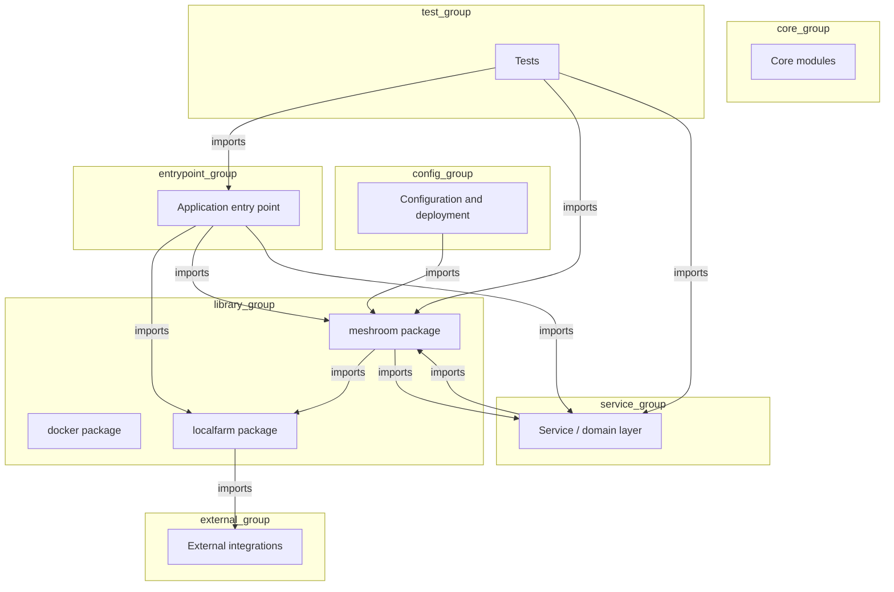

# Architecture report: alicevision/Meshroom

> Automated static analysis. **Observed** = directly seen in files/imports/AST; **Inferred** = interpretation from that evidence. Repository code was not executed.

## 1. Repository at a glance

| Item | Value |
| --- | --- |
| Repository | alicevision/Meshroom |
| Description | Node-based Visual Programming Toolbox |
| Language | Python |
| Stars | 13091 |
| Licence | Other |
| Analysed commit / branch | d787a6bf29f5e318f0e32d22d6e7109b065dad4c / develop |
| Framework(s) | None detected |
| Files analysed | 470 |
| Components | 9 |

## 2. Architecture in one minute

alicevision/Meshroom - Node-based Visual Programming Toolbox. This repository was analysed statically from 470 file(s) (187 Python). Detected technologies (observed from imports/manifests): GitHub Actions, NumPy, Poetry, setuptools, Docker, pytest. Files are grouped into 9 component(s): Configuration and deployment, Core modules, docker package, Application entry point, External integrations, localfarm package, meshroom package, Service / domain layer. Observed entry point(s): .github/scripts/pyside6-smoke-test.py, localfarm/localFarmBackend.py, localfarm/localFarmLauncher.py. Findings below distinguish observed facts from inferred interpretation.

## 3. High-level block diagram

## 4. Main components

### Configuration and deployment (`config`)

- **Kind:** config
- **Status:** Observed
- **Confidence:** 0.85
- **Responsibility:** Groups 7 file(s) under configuration and deployment (observed from repository paths and static analysis). Observed top-level classes: PlatformExecutable.
- **Paths:** `docker/Dockerfile`, `docker/Dockerfile_rocky_deps`, `docker/Dockerfile_ubuntu_deps`, `meshroom/core/plugins/registries/meshroomHub.json`, `meshroom/nodes/general/pyproject.toml`, `requirements.txt`, `setup.py`
- **Evidence:** [docker/Dockerfile](https://github.com/alicevision/Meshroom/blob/d787a6bf29f5e318f0e32d22d6e7109b065dad4c/docker/Dockerfile); [docker/Dockerfile_rocky_deps](https://github.com/alicevision/Meshroom/blob/d787a6bf29f5e318f0e32d22d6e7109b065dad4c/docker/Dockerfile_rocky_deps); [docker/Dockerfile_ubuntu_deps](https://github.com/alicevision/Meshroom/blob/d787a6bf29f5e318f0e32d22d6e7109b065dad4c/docker/Dockerfile_ubuntu_deps); [meshroom/core/plugins/registries/meshroomHub.json](https://github.com/alicevision/Meshroom/blob/d787a6bf29f5e318f0e32d22d6e7109b065dad4c/meshroom/core/plugins/registries/meshroomHub.json); [meshroom/nodes/general/pyproject.toml](https://github.com/alicevision/Meshroom/blob/d787a6bf29f5e318f0e32d22d6e7109b065dad4c/meshroom/nodes/general/pyproject.toml); [requirements.txt](https://github.com/alicevision/Meshroom/blob/d787a6bf29f5e318f0e32d22d6e7109b065dad4c/requirements.txt); [setup.py:14](https://github.com/alicevision/Meshroom/blob/d787a6bf29f5e318f0e32d22d6e7109b065dad4c/setup.py#L14)

### Core modules (`core`)

- **Kind:** core
- **Status:** Observed
- **Confidence:** 0.85
- **Responsibility:** Groups 3 file(s) under core modules (observed from repository paths and static analysis). Observed top-level functions: run.
- **Paths:** `setupInitScriptUnix.py`, `setupInitScriptWindows.py`, `start.sh`
- **Evidence:** [setupInitScriptUnix.py:42](https://github.com/alicevision/Meshroom/blob/d787a6bf29f5e318f0e32d22d6e7109b065dad4c/setupInitScriptUnix.py#L42); [setupInitScriptWindows.py:23](https://github.com/alicevision/Meshroom/blob/d787a6bf29f5e318f0e32d22d6e7109b065dad4c/setupInitScriptWindows.py#L23); [start.sh](https://github.com/alicevision/Meshroom/blob/d787a6bf29f5e318f0e32d22d6e7109b065dad4c/start.sh)

### docker package (`docker`)

- **Kind:** library
- **Status:** Observed
- **Confidence:** 0.85
- **Responsibility:** Groups 9 file(s) under docker package (observed from repository paths and static analysis).
- **Paths:** `docker/build-all.sh`, `docker/build-image.sh`, `docker/build-rocky.sh`, `docker/build-ubuntu.sh`, `docker/common.sh`, `docker/download-models.sh`, `docker/extract-image.sh`, `docker/extract-rocky.sh`, `docker/extract-ubuntu.sh`
- **Evidence:** [docker/build-all.sh](https://github.com/alicevision/Meshroom/blob/d787a6bf29f5e318f0e32d22d6e7109b065dad4c/docker/build-all.sh); [docker/build-image.sh](https://github.com/alicevision/Meshroom/blob/d787a6bf29f5e318f0e32d22d6e7109b065dad4c/docker/build-image.sh); [docker/build-rocky.sh](https://github.com/alicevision/Meshroom/blob/d787a6bf29f5e318f0e32d22d6e7109b065dad4c/docker/build-rocky.sh); [docker/build-ubuntu.sh](https://github.com/alicevision/Meshroom/blob/d787a6bf29f5e318f0e32d22d6e7109b065dad4c/docker/build-ubuntu.sh); [docker/common.sh](https://github.com/alicevision/Meshroom/blob/d787a6bf29f5e318f0e32d22d6e7109b065dad4c/docker/common.sh); [docker/download-models.sh](https://github.com/alicevision/Meshroom/blob/d787a6bf29f5e318f0e32d22d6e7109b065dad4c/docker/download-models.sh); [docker/extract-image.sh](https://github.com/alicevision/Meshroom/blob/d787a6bf29f5e318f0e32d22d6e7109b065dad4c/docker/extract-image.sh); [docker/extract-rocky.sh](https://github.com/alicevision/Meshroom/blob/d787a6bf29f5e318f0e32d22d6e7109b065dad4c/docker/extract-rocky.sh)

### Application entry point (`entrypoint`)

- **Kind:** entrypoint
- **Status:** Observed
- **Confidence:** 0.85
- **Responsibility:** Groups 6 file(s) under application entry point (observed from repository paths and static analysis). Observed top-level classes: FarmLauncher, FileStatus, Job, LocalFarmEngine, LocalFarmRequestHandler, MeshroomApp. Observed top-level functions: createMeshroomParser, exportJson, extractParameters, getRequestedParams, main, openGraph.
- **Paths:** `localfarm/localFarmBackend.py`, `localfarm/localFarmLauncher.py`, `localfarm/test.py`, `meshroom/nodes/general/scripts/extractMeshroomSceneParams.py`, `meshroom/ui/__main__.py`, `meshroom/ui/app.py`
- **Evidence:** [localfarm/localFarmBackend.py:38](https://github.com/alicevision/Meshroom/blob/d787a6bf29f5e318f0e32d22d6e7109b065dad4c/localfarm/localFarmBackend.py#L38); [localfarm/localFarmLauncher.py:16](https://github.com/alicevision/Meshroom/blob/d787a6bf29f5e318f0e32d22d6e7109b065dad4c/localfarm/localFarmLauncher.py#L16); [localfarm/test.py:11](https://github.com/alicevision/Meshroom/blob/d787a6bf29f5e318f0e32d22d6e7109b065dad4c/localfarm/test.py#L11); [meshroom/nodes/general/scripts/extractMeshroomSceneParams.py:23](https://github.com/alicevision/Meshroom/blob/d787a6bf29f5e318f0e32d22d6e7109b065dad4c/meshroom/nodes/general/scripts/extractMeshroomSceneParams.py#L23); [meshroom/ui/__main__.py](https://github.com/alicevision/Meshroom/blob/d787a6bf29f5e318f0e32d22d6e7109b065dad4c/meshroom/ui/__main__.py); [meshroom/ui/app.py:42](https://github.com/alicevision/Meshroom/blob/d787a6bf29f5e318f0e32d22d6e7109b065dad4c/meshroom/ui/app.py#L42)

### External integrations (`external_integrations`)

- **Kind:** external
- **Status:** Inferred
- **Confidence:** 0.70
- **Responsibility:** Groups 0 file(s) under external integrations (observed from repository paths and static analysis).
- **Evidence:** [localfarm/localFarmClient.py:11](https://github.com/alicevision/Meshroom/blob/d787a6bf29f5e318f0e32d22d6e7109b065dad4c/localfarm/localFarmClient.py#L11)

### localfarm package (`localfarm`)

- **Kind:** library
- **Status:** Observed
- **Confidence:** 0.85
- **Responsibility:** Groups 2 file(s) under localfarm package (observed from repository paths and static analysis). Observed top-level classes: Job, LocalFarmClient, LocalFarmClientContext, Task. Observed top-level functions: test.
- **Paths:** `localfarm/__init__.py`, `localfarm/localFarmClient.py`
- **Evidence:** [localfarm/__init__.py](https://github.com/alicevision/Meshroom/blob/d787a6bf29f5e318f0e32d22d6e7109b065dad4c/localfarm/__init__.py); [localfarm/localFarmClient.py:27](https://github.com/alicevision/Meshroom/blob/d787a6bf29f5e318f0e32d22d6e7109b065dad4c/localfarm/localFarmClient.py#L27)

### meshroom package (`meshroom`)

- **Kind:** library
- **Status:** Observed
- **Confidence:** 0.85
- **Responsibility:** Groups 62 file(s) under meshroom package (observed from repository paths and static analysis). Observed top-level classes: ActiveNode, AddAttributeKeyValueCommand, AddEdgeCommand, AddNodeCommand, AnySetNode, Backdrop. Observed top-level functions: CoreSlot, GroupedGraphModification, _cleanGeometry, _isNumber, _isPositiveNumber, addTraceLevel.
- **Paths:** `meshroom/__init__.py`, `meshroom/common/PySignal.py`, `meshroom/common/__init__.py`, `meshroom/common/core.py`, `meshroom/common/deprecated.py`, `meshroom/common/qt.py`, `meshroom/env.py`, `meshroom/multiview.py`, `meshroom/nodes/__init__.py`, `meshroom/nodes/general/AnySetNode.py`, `meshroom/nodes/general/Backdrop.py`, `meshroom/nodes/general/ComputeMeshroomScene.py`, `meshroom/nodes/general/CopyFiles.py`, `meshroom/nodes/general/FlattenFiles.py`, `meshroom/nodes/general/GenerateMeshroomScene.py`, `meshroom/nodes/general/GetMgSceneParams.py`, `meshroom/nodes/general/GetParentFolder.py`, `meshroom/nodes/general/GraphIO.py`, `meshroom/nodes/general/InputFile.py`, `meshroom/nodes/general/InputInt.py`, `meshroom/nodes/general/InputString.py`, `meshroom/nodes/general/MeshroomSceneParameter.py`, `meshroom/nodes/general/PathJoin.py`, `meshroom/nodes/general/ReadEnvironmentVariable.py`, `meshroom/nodes/general/StringJoin.py`, `meshroom/nodes/general/UnwrapMeshroomSceneParam.py`, `meshroom/nodes/general/__init__.py`, `meshroom/submitters/__init__.py`, `meshroom/submitters/localFarm/__init__.py`, `meshroom/submitters/localFarm/localFarmSubmitter.py`, `meshroom/ui/__init__.py`, `meshroom/ui/commands.py`, `meshroom/ui/components/__init__.py`, `meshroom/ui/components/clipboard.py`, `meshroom/ui/components/csvData.py`, `meshroom/ui/components/edge.py`, `meshroom/ui/components/filepath.py`, `meshroom/ui/components/geom2D.py`, `meshroom/ui/components/logLinesModel.py`, `meshroom/ui/components/messaging.py`, `meshroom/ui/components/scene3D.py`, `meshroom/ui/components/scriptEditor.py`, `meshroom/ui/components/shapes/__init__.py`, `meshroom/ui/components/shapes/shapeFile.py`, `meshroom/ui/components/shapes/shapeFilesHelper.py`, `meshroom/ui/components/shapes/shapeViewerHelper.py`, `meshroom/ui/components/shapes/surveyPoint.py`, `meshroom/ui/components/shapes/surveyPointViewerHelper.py`, `meshroom/ui/components/thumbnail.py`, `meshroom/ui/dockLayout.py`, `meshroom/ui/dockLayoutManager.py`, `meshroom/ui/graph.py`, `meshroom/ui/palette.py`, `meshroom/ui/qml/GraphEditor/AnySetUtils.js`, `meshroom/ui/qml/MaterialIcons/generate_material_icons.py`, `meshroom/ui/qml/PluginManager/Common/PluginUtils.js`, `meshroom/ui/qml/Utils/errorHandler.js`, `meshroom/ui/qml/Utils/format.js`, `meshroom/ui/qml/Utils/request.js`, `meshroom/ui/qml/Viewer3D/Inspector3DUtils.js`, `meshroom/ui/scene.py`, `meshroom/ui/utils.py`
- **Evidence:** [meshroom/__init__.py:8](https://github.com/alicevision/Meshroom/blob/d787a6bf29f5e318f0e32d22d6e7109b065dad4c/meshroom/__init__.py#L8); [meshroom/common/PySignal.py:19](https://github.com/alicevision/Meshroom/blob/d787a6bf29f5e318f0e32d22d6e7109b065dad4c/meshroom/common/PySignal.py#L19); [meshroom/common/__init__.py:11](https://github.com/alicevision/Meshroom/blob/d787a6bf29f5e318f0e32d22d6e7109b065dad4c/meshroom/common/__init__.py#L11); [meshroom/common/core.py:4](https://github.com/alicevision/Meshroom/blob/d787a6bf29f5e318f0e32d22d6e7109b065dad4c/meshroom/common/core.py#L4); [meshroom/common/deprecated.py:7](https://github.com/alicevision/Meshroom/blob/d787a6bf29f5e318f0e32d22d6e7109b065dad4c/meshroom/common/deprecated.py#L7); [meshroom/common/qt.py:5](https://github.com/alicevision/Meshroom/blob/d787a6bf29f5e318f0e32d22d6e7109b065dad4c/meshroom/common/qt.py#L5); [meshroom/env.py:21](https://github.com/alicevision/Meshroom/blob/d787a6bf29f5e318f0e32d22d6e7109b065dad4c/meshroom/env.py#L21); [meshroom/multiview.py:76](https://github.com/alicevision/Meshroom/blob/d787a6bf29f5e318f0e32d22d6e7109b065dad4c/meshroom/multiview.py#L76)

### Service / domain layer (`service_layer`)

- **Kind:** service
- **Status:** Observed
- **Confidence:** 0.85
- **Responsibility:** Groups 52 file(s) under service / domain layer (observed from repository paths and static analysis). Observed top-level classes: AVCommandLineNode, AnySet, ArchivePluginProvider, Attribute, AttributeValidator, BackdropNode. Observed top-level functions: GraphModification, _captureExpressionTemplates, _contentLength, _open, _readChunks, atomicOpen.
- **Paths:** `meshroom/core/__init__.py`, `meshroom/core/attribute.py`, `meshroom/core/cgroup.py`, `meshroom/core/desc/__init__.py`, `meshroom/core/desc/anySet.py`, `meshroom/core/desc/attribute.py`, `meshroom/core/desc/computation.py`, `meshroom/core/desc/geometryAttribute.py`, `meshroom/core/desc/node.py`, `meshroom/core/desc/shapeAttribute.py`, `meshroom/core/desc/validators.py`, `meshroom/core/evaluation.py`, `meshroom/core/exception.py`, `meshroom/core/fileUtils.py`, `meshroom/core/files.py`, `meshroom/core/graph.py`, `meshroom/core/graphIO.py`, `meshroom/core/httpUtils.py`, `meshroom/core/keyValues.py`, `meshroom/core/mixins.py`, `meshroom/core/mtyping.py`, `meshroom/core/node/__init__.py`, `meshroom/core/node/backdropNode.py`, `meshroom/core/node/baseNode.py`, `meshroom/core/node/chunk.py`, `meshroom/core/node/compatibilityNode.py`, `meshroom/core/node/logManager.py`, `meshroom/core/node/node.py`, `meshroom/core/node/status.py`, `meshroom/core/nodeFactory.py`, `meshroom/core/plugins/__init__.py`, `meshroom/core/plugins/base.py`, `meshroom/core/plugins/env.py`, `meshroom/core/plugins/loader.py`, `meshroom/core/plugins/local/__init__.py`, `meshroom/core/plugins/local/installer.py`, `meshroom/core/plugins/local/service.py`, `meshroom/core/plugins/local/task.py`, `meshroom/core/plugins/local/taskQueue.py`, `meshroom/core/plugins/local/uninstaller.py`, `meshroom/core/plugins/local/updater.py`, `meshroom/core/plugins/local/uv.py`, `meshroom/core/plugins/manager.py`, `meshroom/core/plugins/metadata.py`, `meshroom/core/plugins/provider.py`, `meshroom/core/plugins/record.py`, `meshroom/core/plugins/registry.py`, `meshroom/core/stats.py`, `meshroom/core/submitter.py`, `meshroom/core/taskManager.py`, `meshroom/core/test.py`, `meshroom/core/utils.py`
- **Evidence:** [meshroom/core/__init__.py:37](https://github.com/alicevision/Meshroom/blob/d787a6bf29f5e318f0e32d22d6e7109b065dad4c/meshroom/core/__init__.py#L37); [meshroom/core/attribute.py:33](https://github.com/alicevision/Meshroom/blob/d787a6bf29f5e318f0e32d22d6e7109b065dad4c/meshroom/core/attribute.py#L33); [meshroom/core/cgroup.py:7](https://github.com/alicevision/Meshroom/blob/d787a6bf29f5e318f0e32d22d6e7109b065dad4c/meshroom/core/cgroup.py#L7); [meshroom/core/desc/__init__.py](https://github.com/alicevision/Meshroom/blob/d787a6bf29f5e318f0e32d22d6e7109b065dad4c/meshroom/core/desc/__init__.py); [meshroom/core/desc/anySet.py:5](https://github.com/alicevision/Meshroom/blob/d787a6bf29f5e318f0e32d22d6e7109b065dad4c/meshroom/core/desc/anySet.py#L5); [meshroom/core/desc/attribute.py:25](https://github.com/alicevision/Meshroom/blob/d787a6bf29f5e318f0e32d22d6e7109b065dad4c/meshroom/core/desc/attribute.py#L25); [meshroom/core/desc/computation.py:7](https://github.com/alicevision/Meshroom/blob/d787a6bf29f5e318f0e32d22d6e7109b065dad4c/meshroom/core/desc/computation.py#L7); [meshroom/core/desc/geometryAttribute.py:4](https://github.com/alicevision/Meshroom/blob/d787a6bf29f5e318f0e32d22d6e7109b065dad4c/meshroom/core/desc/geometryAttribute.py#L4)

### Tests (`tests`)

- **Kind:** test
- **Status:** Observed
- **Confidence:** 0.85
- **Responsibility:** Groups 65 file(s) under tests (observed from repository paths and static analysis). Observed top-level classes: AllAttributesNode, AppendFiles, AppendText, Color, ConnectedNodeV1, ConnectedNodeV2. Observed top-level functions: _brokenSource, _nodeDescSource, _saveScene, _submitterSource, anyset_child, anyset_children.
- **Paths:** `tests/__init__.py`, `tests/appendTextAndFiles.mg`, `tests/conftest.py`, `tests/nodes/__init__.py`, `tests/nodes/test/AllAttributesNodes.py`, `tests/nodes/test/Color.py`, `tests/nodes/test/DynamicNode.py`, `tests/nodes/test/GroupAttributes.py`, `tests/nodes/test/InitDynamicOutputs.py`, `tests/nodes/test/NestedTest.py`, `tests/nodes/test/OutputNode.py`, `tests/nodes/test/Position.py`, `tests/nodes/test/__init__.py`, `tests/nodes/test/appendFiles.py`, `tests/nodes/test/appendText.py`, `tests/nodes/test/ls.py`, `tests/nodes/test/nodeValidators.py`, `tests/plugins/pluginA/meshroom/PluginAInitInputNode.py`, `tests/plugins/pluginA/meshroom/PluginAInitNode.py`, `tests/plugins/pluginA/meshroom/PluginANodeA.py`, `tests/plugins/pluginA/meshroom/PluginANodeB.py`, `tests/plugins/pluginA/meshroom/config.json`, `tests/plugins/pluginA/meshroom/sharedTemplate.mg`, `tests/plugins/pluginB/meshroom/PluginBNodeA.py`, `tests/plugins/pluginB/meshroom/PluginBNodeB.py`, `tests/plugins/pluginC/meshroom/PluginCNodeA.py`, `tests/plugins/pluginSubmitter/meshroom/PluginSubmitter.py`, `tests/test_anySet_attribute.py`, `tests/test_attributeChoiceParam.py`, `tests/test_attributeDescDefaults.py`, `tests/test_attributeKeyValues.py`, `tests/test_attributeLambda.py`, `tests/test_attributeShape.py`, `tests/test_attributes.py`, `tests/test_compatibility.py`, `tests/test_compute.py`, `tests/test_computeMeshroomScene.py`, `tests/test_flowAttribute.py`, `tests/test_graph.py`, `tests/test_graphIO.py`, `tests/test_graphInputOutput.py`, `tests/test_groupAttributes.py`, `tests/test_invalidation.py`, `tests/test_listAttributes.py`, `tests/test_model.py`, `tests/test_multiview.py`, `tests/test_nodeAttributeChangedCallback.py`, `tests/test_nodeAttributesFormatting.py`, `tests/test_nodeCallbacks.py`, `tests/test_nodeCommandLineFormatting.py`, `tests/test_nodeDynamicOutputs.py`, `tests/test_nodes.py`, `tests/test_pipeline.py`, `tests/test_plugins/__init__.py`, `tests/test_plugins/test_loader.py`, `tests/test_plugins/test_localPluginsFolder.py`, `tests/test_plugins/test_manager.py`, `tests/test_plugins/test_metadata.py`, `tests/test_plugins/test_provider.py`, `tests/test_plugins/test_registry.py`, `tests/test_plugins/test_services.py`, `tests/test_plugins/test_task.py`, `tests/test_submit.py`, `tests/test_template_files.py`, `tests/utils.py`
- **Evidence:** [tests/__init__.py](https://github.com/alicevision/Meshroom/blob/d787a6bf29f5e318f0e32d22d6e7109b065dad4c/tests/__init__.py); [tests/appendTextAndFiles.mg](https://github.com/alicevision/Meshroom/blob/d787a6bf29f5e318f0e32d22d6e7109b065dad4c/tests/appendTextAndFiles.mg); [tests/conftest.py:9](https://github.com/alicevision/Meshroom/blob/d787a6bf29f5e318f0e32d22d6e7109b065dad4c/tests/conftest.py#L9); [tests/nodes/__init__.py](https://github.com/alicevision/Meshroom/blob/d787a6bf29f5e318f0e32d22d6e7109b065dad4c/tests/nodes/__init__.py); [tests/nodes/test/AllAttributesNodes.py:7](https://github.com/alicevision/Meshroom/blob/d787a6bf29f5e318f0e32d22d6e7109b065dad4c/tests/nodes/test/AllAttributesNodes.py#L7); [tests/nodes/test/Color.py:4](https://github.com/alicevision/Meshroom/blob/d787a6bf29f5e318f0e32d22d6e7109b065dad4c/tests/nodes/test/Color.py#L4); [tests/nodes/test/DynamicNode.py:4](https://github.com/alicevision/Meshroom/blob/d787a6bf29f5e318f0e32d22d6e7109b065dad4c/tests/nodes/test/DynamicNode.py#L4); [tests/nodes/test/GroupAttributes.py:4](https://github.com/alicevision/Meshroom/blob/d787a6bf29f5e318f0e32d22d6e7109b065dad4c/tests/nodes/test/GroupAttributes.py#L4)

## 5. Execution flow

**Observed** entry point(s):

- [.github/scripts/pyside6-smoke-test.py:152](https://github.com/alicevision/Meshroom/blob/d787a6bf29f5e318f0e32d22d6e7109b065dad4c/.github/scripts/pyside6-smoke-test.py#L152)
- [localfarm/localFarmBackend.py:674](https://github.com/alicevision/Meshroom/blob/d787a6bf29f5e318f0e32d22d6e7109b065dad4c/localfarm/localFarmBackend.py#L674)
- [localfarm/localFarmLauncher.py:186](https://github.com/alicevision/Meshroom/blob/d787a6bf29f5e318f0e32d22d6e7109b065dad4c/localfarm/localFarmLauncher.py#L186)
- [localfarm/test.py:103](https://github.com/alicevision/Meshroom/blob/d787a6bf29f5e318f0e32d22d6e7109b065dad4c/localfarm/test.py#L103)
- [meshroom/nodes/general/scripts/extractMeshroomSceneParams.py:127](https://github.com/alicevision/Meshroom/blob/d787a6bf29f5e318f0e32d22d6e7109b065dad4c/meshroom/nodes/general/scripts/extractMeshroomSceneParams.py#L127)

Representative flow (derived from observed entry points and the import graph; steps beyond the entry point are **Inferred**):

1. Execution starts at an observed entry point listed above, if present.
2. `config` imports `meshroom` (Configuration and deployment -> meshroom package).
3. `entrypoint` imports `localfarm` (Application entry point -> localfarm package).
4. `entrypoint` imports `meshroom` (Application entry point -> meshroom package).
5. `entrypoint` imports `service_layer` (Application entry point -> Service / domain layer).
6. `localfarm` imports `external_integrations` (localfarm package -> External integrations).
7. `meshroom` imports `localfarm` (meshroom package -> localfarm package).
8. `meshroom` imports `service_layer` (meshroom package -> Service / domain layer).
9. `service_layer` imports `meshroom` (Service / domain layer -> meshroom package).

## 6. Project structure

### `(root)`

- `.codecov.yml` - config (1557 bytes)
- `.git-blame-ignore-revs` - other (3502 bytes)
- `.gitignore` - other (684 bytes)
- `.readthedocs.yaml` - config (417 bytes)
- `AGENTS.md` - docs (15560 bytes)
- `CHANGES.md` - docs (91605 bytes)
- `CLAUDE.md` - docs (11 bytes)
- `CMakeLists.txt` - docs (1958 bytes)
- `CODE_OF_CONDUCT.md` - docs (3211 bytes)
- `CONTRIBUTING.md` - docs (1632 bytes)
- `COPYING.md` - docs (1175 bytes)
- `INSTALL.md` - docs (8571 bytes)
- `INSTALL_PLUGINS.md` - docs (5554 bytes)
- `LICENSE-MPL2.md` - docs (16726 bytes)
- `NODE_DEVELOPMENT.md` - docs (14665 bytes)
- `README.md` - docs (9038 bytes)
- `RELEASING.md` - docs (2021 bytes)
- `WINDOWS_EXE.md` - docs (1593 bytes)
- `dev_requirements.txt` - docs (191 bytes)
- `requirements.txt` - manifest (157 bytes)
- `setup.py` - manifest, Python (7457 bytes)
- `setupInitScriptUnix.py` - source, Python (2176 bytes)
- `setupInitScriptWindows.py` - source, Python (1270 bytes)
- `start.bat` - other (566 bytes)
- `start.sh` - source, Shell (407 bytes)

### `.claude`

- `.claude/settings.json` - config (58 bytes)

### `.github`

- `.github/FUNDING.yml` - config (78 bytes)
- `.github/ISSUE_TEMPLATE/bug_report.md` - docs (1021 bytes)
- `.github/ISSUE_TEMPLATE/feature_request.md` - docs (622 bytes)
- `.github/ISSUE_TEMPLATE/question_help.md` - docs (1123 bytes)
- `.github/pull_request_template.md` - docs (717 bytes)
- `.github/scripts/nightly-check.sh` - source, Shell (21110 bytes)
- `.github/scripts/nightly-common.sh` - source, Shell (1380 bytes)
- `.github/scripts/nightly-publish.sh` - source, Shell (10192 bytes)
- `.github/scripts/pyside6-smoke-test.py` - source, Python (5846 bytes)
- `.github/stale.yml` - config (838 bytes)
- `.github/workflows/build-binary.yml` - ci, YAML (25142 bytes)
- `.github/workflows/build-pyside6-linux.yml` - ci, YAML (13422 bytes)
- `.github/workflows/continuous-integration.yml` - ci, YAML (741 bytes)
- `.github/workflows/nightly.yml` - ci, YAML (6933 bytes)
- `.github/workflows/run-tests.yml` - ci, YAML (4487 bytes)

### `.vscode`

- `.vscode/launch.json` - config (926 bytes)

### `bin`

- `bin/meshroom_batch` - other (14122 bytes)
- `bin/meshroom_compute` - other (8809 bytes)
- `bin/meshroom_createChunks` - other (6627 bytes)
- `bin/meshroom_info` - other (6108 bytes)
- `bin/meshroom_localfarm` - other (2521 bytes)
- `bin/meshroom_newNodeType` - other (9157 bytes)
- `bin/meshroom_plugins` - other (17592 bytes)
- `bin/meshroom_statistics` - other (3339 bytes)
- `bin/meshroom_status` - other (2419 bytes)
- `bin/meshroom_submit` - other (1043 bytes)

### `docker`

- `docker/Dockerfile` - container (3510 bytes)
- `docker/Dockerfile_rocky_deps` - container (2938 bytes)
- `docker/Dockerfile_ubuntu_deps` - container (2976 bytes)
- `docker/build-all.sh` - source, Shell (346 bytes)
- `docker/build-image.sh` - source, Shell (735 bytes)
- `docker/build-rocky.sh` - source, Shell (358 bytes)
- `docker/build-ubuntu.sh` - source, Shell (359 bytes)
- `docker/common.sh` - source, Shell (2089 bytes)
- `docker/download-models.sh` - source, Shell (1398 bytes)
- `docker/extract-image.sh` - source, Shell (958 bytes)
- `docker/extract-rocky.sh` - source, Shell (368 bytes)
- `docker/extract-ubuntu.sh` - source, Shell (369 bytes)

### `docs`

- `docs/.gitignore` - docs (34 bytes)
- `docs/Makefile` - docs (638 bytes)
- `docs/README.md` - docs (681 bytes)
- `docs/make.bat` - docs (769 bytes)
- `docs/requirements.txt` - manifest (12 bytes)
- `docs/source/_ext/__init__.py` - docs (0 bytes)
- `docs/source/_ext/fetch_md.py` - docs (1749 bytes)
- `docs/source/_ext/meshroom_doc.py` - docs (2034 bytes)
- `docs/source/_ext/utils.py` - docs (678 bytes)
- `docs/source/_templates/autosummary/class.rst` - docs (666 bytes)
- `docs/source/_templates/autosummary/module.rst` - docs (1106 bytes)
- `docs/source/api.rst` - docs (121 bytes)
- `docs/source/changes.rst` - docs (55 bytes)
- `docs/source/conf.py` - docs (1309 bytes)
- `docs/source/index.rst` - docs (184 bytes)
- `docs/source/install.rst` - docs (43 bytes)

### `localfarm`

- `localfarm/README.md` - docs (4880 bytes)
- `localfarm/__init__.py` - source, Python (0 bytes)
- `localfarm/localFarmBackend.py` - source, Python (25131 bytes)
- `localfarm/localFarmClient.py` - source, Python (11728 bytes)
- `localfarm/localFarmLauncher.py` - source, Python (6199 bytes)
- `localfarm/test.py` - source, Python (3686 bytes)

### `meshroom`

- `meshroom/__init__.py` - source, Python (8692 bytes)
- `meshroom/common/PySignal.py` - source, Python (8810 bytes)
- `meshroom/common/__init__.py` - source, Python (1518 bytes)
- `meshroom/common/core.py` - source, Python (4809 bytes)
- `meshroom/common/deprecated.py` - source, Python (1414 bytes)
- `meshroom/common/qt.py` - source, Python (14672 bytes)
- `meshroom/core/__init__.py` - source, Python (10385 bytes)
- `meshroom/core/attribute.py` - source, Python (85788 bytes)
- `meshroom/core/cgroup.py` - source, Python (2483 bytes)
- `meshroom/core/desc/__init__.py` - source, Python (868 bytes)
- `meshroom/core/desc/anySet.py` - source, Python (1496 bytes)
- `meshroom/core/desc/attribute.py` - source, Python (40405 bytes)
- `meshroom/core/desc/computation.py` - source, Python (4354 bytes)
- `meshroom/core/desc/geometryAttribute.py` - source, Python (5947 bytes)
- `meshroom/core/desc/node.py` - source, Python (29254 bytes)
- `meshroom/core/desc/shapeAttribute.py` - source, Python (14572 bytes)
- `meshroom/core/desc/validators.py` - source, Python (2590 bytes)
- `meshroom/core/evaluation.py` - source, Python (1817 bytes)
- `meshroom/core/exception.py` - source, Python (1980 bytes)
- `meshroom/core/fileUtils.py` - source, Python (2177 bytes)
- `meshroom/core/files.py` - source, Python (4036 bytes)
- `meshroom/core/graph.py` - source, Python (88572 bytes)
- `meshroom/core/graphIO.py` - source, Python (10660 bytes)
- `meshroom/core/httpUtils.py` - source, Python (6947 bytes)
- `meshroom/core/keyValues.py` - source, Python (4257 bytes)
- `meshroom/core/mixins.py` - source, Python (817 bytes)
- `meshroom/core/mtyping.py` - source, Python (128 bytes)
- `meshroom/core/node/__init__.py` - source, Python (624 bytes)
- `meshroom/core/node/backdropNode.py` - source, Python (1342 bytes)
- `meshroom/core/node/baseNode.py` - source, Python (69317 bytes)
- `meshroom/core/node/chunk.py` - source, Python (14524 bytes)
- `meshroom/core/node/compatibilityNode.py` - source, Python (23362 bytes)
- `meshroom/core/node/logManager.py` - source, Python (3657 bytes)
- `meshroom/core/node/node.py` - source, Python (11834 bytes)
- `meshroom/core/node/status.py` - source, Python (12057 bytes)
- `meshroom/core/nodeFactory.py` - source, Python (13719 bytes)
- `meshroom/core/plugins/__init__.py` - source, Python (2355 bytes)
- `meshroom/core/plugins/base.py` - source, Python (24926 bytes)
- `meshroom/core/plugins/env.py` - source, Python (11177 bytes)
- `meshroom/core/plugins/loader.py` - source, Python (19908 bytes)
- `meshroom/core/plugins/local/__init__.py` - source, Python (0 bytes)
- `meshroom/core/plugins/local/installer.py` - source, Python (16751 bytes)
- `meshroom/core/plugins/local/service.py` - source, Python (5232 bytes)
- `meshroom/core/plugins/local/task.py` - source, Python (8005 bytes)
- `meshroom/core/plugins/local/taskQueue.py` - source, Python (9225 bytes)
- `meshroom/core/plugins/local/uninstaller.py` - source, Python (1729 bytes)
- `meshroom/core/plugins/local/updater.py` - source, Python (4741 bytes)
- `meshroom/core/plugins/local/uv.py` - source, Python (4612 bytes)
- `meshroom/core/plugins/manager.py` - source, Python (20546 bytes)
- `meshroom/core/plugins/metadata.py` - source, Python (23097 bytes)
- `meshroom/core/plugins/provider.py` - source, Python (5210 bytes)
- `meshroom/core/plugins/record.py` - source, Python (2055 bytes)
- `meshroom/core/plugins/registries/meshroomHub.json` - config (262 bytes)
- `meshroom/core/plugins/registry.py` - source, Python (12102 bytes)
- `meshroom/core/stats.py` - source, Python (11690 bytes)
- `meshroom/core/submitter.py` - source, Python (25896 bytes)
- `meshroom/core/taskManager.py` - source, Python (25007 bytes)
- `meshroom/core/test.py` - source, Python (3261 bytes)
- `meshroom/core/utils.py` - source, Python (1042 bytes)
- `meshroom/env.py` - source, Python (4456 bytes)
- `meshroom/multiview.py` - source, Python (5492 bytes)
- `meshroom/nodes/__init__.py` - source, Python (0 bytes)
- `meshroom/nodes/general/AnySetNode.py` - source, Python (597 bytes)
- `meshroom/nodes/general/Backdrop.py` - source, Python (204 bytes)
- `meshroom/nodes/general/ComputeMeshroomScene.py` - source, Python (16087 bytes)
- `meshroom/nodes/general/CopyFiles.py` - source, Python (3067 bytes)
- `meshroom/nodes/general/FlattenFiles.py` - source, Python (1709 bytes)
- `meshroom/nodes/general/GenerateMeshroomScene.py` - source, Python (5191 bytes)
- `meshroom/nodes/general/GetMgSceneParams.py` - source, Python (3869 bytes)
- `meshroom/nodes/general/GetParentFolder.py` - source, Python (968 bytes)
- `meshroom/nodes/general/GraphIO.py` - source, Python (1817 bytes)
- `meshroom/nodes/general/InputFile.py` - source, Python (1659 bytes)
- `meshroom/nodes/general/InputInt.py` - source, Python (400 bytes)
- `meshroom/nodes/general/InputString.py` - source, Python (435 bytes)
- `meshroom/nodes/general/MeshroomSceneParameter.py` - source, Python (2274 bytes)
- `meshroom/nodes/general/PathJoin.py` - source, Python (1185 bytes)
- `meshroom/nodes/general/ReadEnvironmentVariable.py` - source, Python (797 bytes)
- `meshroom/nodes/general/StringJoin.py` - source, Python (3952 bytes)
- `meshroom/nodes/general/UnwrapMeshroomSceneParam.py` - source, Python (3274 bytes)
- `meshroom/nodes/general/__init__.py` - source, Python (0 bytes)
- `meshroom/nodes/general/pyproject.toml` - manifest (220 bytes)
- `meshroom/nodes/general/scripts/extractMeshroomSceneParams.py` - source, Python (4789 bytes)
- `meshroom/submitters/__init__.py` - source, Python (0 bytes)
- `meshroom/submitters/localFarm/__init__.py` - source, Python (0 bytes)
- `meshroom/submitters/localFarm/localFarmSubmitter.py` - source, Python (14318 bytes)
- `meshroom/ui/__init__.py` - source, Python (0 bytes)
- `meshroom/ui/__main__.py` - source, Python (393 bytes)
- `meshroom/ui/app.py` - source, Python (36966 bytes)
- `meshroom/ui/commands.py` - source, Python (35944 bytes)
- `meshroom/ui/components/__init__.py` - source, Python (1736 bytes)
- `meshroom/ui/components/clipboard.py` - source, Python (596 bytes)
- `meshroom/ui/components/csvData.py` - source, Python (3878 bytes)
- `meshroom/ui/components/edge.py` - source, Python (4631 bytes)
- `meshroom/ui/components/filepath.py` - source, Python (5815 bytes)
- `meshroom/ui/components/geom2D.py` - source, Python (791 bytes)
- `meshroom/ui/components/logLinesModel.py` - source, Python (9571 bytes)
- `meshroom/ui/components/messaging.py` - source, Python (2471 bytes)
- `meshroom/ui/components/scene3D.py` - source, Python (21739 bytes)
- `meshroom/ui/components/scriptEditor.py` - source, Python (10911 bytes)
- `meshroom/ui/components/shapes/__init__.py` - source, Python (181 bytes)
- `meshroom/ui/components/shapes/shapeFile.py` - source, Python (8225 bytes)
- `meshroom/ui/components/shapes/shapeFilesHelper.py` - source, Python (4250 bytes)
- `meshroom/ui/components/shapes/shapeViewerHelper.py` - source, Python (26379 bytes)
- `meshroom/ui/components/shapes/surveyPoint.py` - source, Python (4024 bytes)
- `meshroom/ui/components/shapes/surveyPointViewerHelper.py` - source, Python (4716 bytes)
- `meshroom/ui/components/thumbnail.py` - source, Python (13552 bytes)
- `meshroom/ui/dockLayout.py` - source, Python (24841 bytes)
- `meshroom/ui/dockLayoutManager.py` - source, Python (9717 bytes)
- `meshroom/ui/graph.py` - source, Python (71171 bytes)
- `meshroom/ui/img/github-mark-white.svg` - other (960 bytes)
- `meshroom/ui/img/meshroom-tagline-vertical.svg` - other (44973 bytes)
- `meshroom/ui/img/meshroom.svg` - other (2064 bytes)
- `meshroom/ui/palette.py` - source, Python (2406 bytes)
- `meshroom/ui/qml/AboutDialog.qml` - other (7375 bytes)
- `meshroom/ui/qml/Application.qml` - other (63552 bytes)
- `meshroom/ui/qml/Charts/ChartViewCheckBox.qml` - other (816 bytes)
- `meshroom/ui/qml/Charts/ChartViewLegend.qml` - other (2932 bytes)
- `meshroom/ui/qml/Charts/InteractiveChartView.qml` - other (611 bytes)
- `meshroom/ui/qml/Charts/qmldir` - other (149 bytes)
- `meshroom/ui/qml/Controls/ApplicationChunks.qml` - other (947 bytes)
- `meshroom/ui/qml/Controls/ColorChart.qml` - other (1911 bytes)
- `meshroom/ui/qml/Controls/ColorSelector.qml` - other (4001 bytes)
- `meshroom/ui/qml/Controls/DelegateSelectionBox.qml` - other (1889 bytes)
- `meshroom/ui/qml/Controls/DelegateSelectionLine.qml` - other (1237 bytes)
- `meshroom/ui/qml/Controls/DirectionalLightPane.qml` - other (9617 bytes)
- `meshroom/ui/qml/Controls/ExifOrientedViewer.qml` - other (802 bytes)
- `meshroom/ui/qml/Controls/ExpandableGroup.qml` - other (2080 bytes)
- `meshroom/ui/qml/Controls/FilterComboBox.qml` - other (4465 bytes)
- `meshroom/ui/qml/Controls/FloatingPane.qml` - other (479 bytes)
- `meshroom/ui/qml/Controls/Group.qml` - other (1018 bytes)
- `meshroom/ui/qml/Controls/IntSelector.qml` - other (2284 bytes)
- `meshroom/ui/qml/Controls/KeyValue.qml` - other (1471 bytes)
- `meshroom/ui/qml/Controls/MScrollBar.qml` - other (762 bytes)
- `meshroom/ui/qml/Controls/MSplitView.qml` - other (745 bytes)
- `meshroom/ui/qml/Controls/MessageDialog.qml` - other (4224 bytes)
- `meshroom/ui/qml/Controls/NodeActions.qml` - other (16385 bytes)
- `meshroom/ui/qml/Controls/Panel.qml` - other (4163 bytes)
- `meshroom/ui/qml/Controls/SearchBar.qml` - other (2931 bytes)
- `meshroom/ui/qml/Controls/SelectionBox.qml` - other (1702 bytes)
- `meshroom/ui/qml/Controls/SelectionLine.qml` - other (2150 bytes)
- `meshroom/ui/qml/Controls/StatusBar.qml` - other (3420 bytes)
- `meshroom/ui/qml/Controls/StatusMessages.qml` - other (5388 bytes)
- `meshroom/ui/qml/Controls/TabPanel.qml` - other (3039 bytes)
- `meshroom/ui/qml/Controls/TextFileViewer.qml` - other (17395 bytes)
- `meshroom/ui/qml/Controls/ThinSlider.qml` - other (1168 bytes)
- `meshroom/ui/qml/Controls/TimelineSlider.qml` - other (5476 bytes)
- `meshroom/ui/qml/Controls/qmldir` - other (921 bytes)
- `meshroom/ui/qml/CurveEditor/CurveCanvas.qml` - other (4657 bytes)
- `meshroom/ui/qml/CurveEditor/CurveEditor.qml` - other (5808 bytes)
- `meshroom/ui/qml/CurveEditor/CurveList.qml` - other (5028 bytes)
- `meshroom/ui/qml/CurveEditor/CurveListDelegate.qml` - other (3544 bytes)
- `meshroom/ui/qml/CurveEditor/CurveTimeBar.qml` - other (5181 bytes)
- `meshroom/ui/qml/CurveEditor/qmldir` - other (51 bytes)
- `meshroom/ui/qml/DialogsFactory.qml` - other (1041 bytes)
- `meshroom/ui/qml/Docking/DockArea.qml` - other (1906 bytes)
- `meshroom/ui/qml/Docking/DockGroup.qml` - other (12304 bytes)
- `meshroom/ui/qml/Docking/DockManager.qml` - other (11501 bytes)
- `meshroom/ui/qml/Docking/DockNode.qml` - other (3929 bytes)
- `meshroom/ui/qml/Docking/DockPanel.qml` - other (1282 bytes)
- `meshroom/ui/qml/Docking/DockWindow.qml` - other (1825 bytes)
- `meshroom/ui/qml/Docking/WorkspaceDialogs.qml` - other (2534 bytes)
- `meshroom/ui/qml/Docking/WorkspacesMenu.qml` - other (1400 bytes)
- `meshroom/ui/qml/Docking/qmldir` - other (266 bytes)
- `meshroom/ui/qml/GraphEditor/AnySetUtils.js` - source, JavaScript (725 bytes)
- `meshroom/ui/qml/GraphEditor/AttributeControls/CheckBoxRow.qml` - other (273 bytes)
- `meshroom/ui/qml/GraphEditor/AttributeControls/Choice.qml` - other (784 bytes)
- `meshroom/ui/qml/GraphEditor/AttributeControls/ChoiceMulti.qml` - other (1138 bytes)
- `meshroom/ui/qml/GraphEditor/AttributeControls/Color.qml` - other (1976 bytes)
- `meshroom/ui/qml/GraphEditor/AttributeControls/ColorHue.qml` - other (1752 bytes)
- `meshroom/ui/qml/GraphEditor/AttributeControls/NotComputed.qml` - other (373 bytes)
- `meshroom/ui/qml/GraphEditor/AttributeControls/SliderField.qml` - other (3062 bytes)
- `meshroom/ui/qml/GraphEditor/AttributeControls/TextAreaFlick.qml` - other (1596 bytes)
- `meshroom/ui/qml/GraphEditor/AttributeControls/TextFieldRow.qml` - other (4401 bytes)
- `meshroom/ui/qml/GraphEditor/AttributeEditor.qml` - other (2824 bytes)
- `meshroom/ui/qml/GraphEditor/AttributeItemDelegate.qml` - other (37854 bytes)
- `meshroom/ui/qml/GraphEditor/AttributePin.qml` - other (28017 bytes)
- `meshroom/ui/qml/GraphEditor/Backdrop.qml` - other (15722 bytes)
- `meshroom/ui/qml/GraphEditor/ChunksListView.qml` - other (3900 bytes)
- `meshroom/ui/qml/GraphEditor/CompatibilityBadge.qml` - other (2340 bytes)
- `meshroom/ui/qml/GraphEditor/CompatibilityManager.qml` - other (5382 bytes)
- `meshroom/ui/qml/GraphEditor/Edge.qml` - other (5327 bytes)
- `meshroom/ui/qml/GraphEditor/GraphEditor.qml` - other (76639 bytes)
- `meshroom/ui/qml/GraphEditor/GraphEditorSettings.qml` - other (497 bytes)
- `meshroom/ui/qml/GraphEditor/Node.qml` - other (49031 bytes)
- `meshroom/ui/qml/GraphEditor/NodeCategoryMenu.qml` - other (1715 bytes)
- `meshroom/ui/qml/GraphEditor/NodeChunks.qml` - other (3307 bytes)
- `meshroom/ui/qml/GraphEditor/NodeDocumentation.qml` - other (4621 bytes)
- `meshroom/ui/qml/GraphEditor/NodeEditor.qml` - other (27875 bytes)
- `meshroom/ui/qml/GraphEditor/NodeFileBrowser.qml` - other (7345 bytes)
- `meshroom/ui/qml/GraphEditor/NodeLog.qml` - other (1111 bytes)
- `meshroom/ui/qml/GraphEditor/NodeStatistics.qml` - other (1522 bytes)
- `meshroom/ui/qml/GraphEditor/NodeStatus.qml` - other (6189 bytes)
- `meshroom/ui/qml/GraphEditor/ScriptEditor.qml` - other (12454 bytes)
- `meshroom/ui/qml/GraphEditor/StatViewer.qml` - other (17447 bytes)
- `meshroom/ui/qml/GraphEditor/TaskManager.qml` - other (18860 bytes)
- `meshroom/ui/qml/GraphEditor/qmldir` - other (601 bytes)
- `meshroom/ui/qml/Homepage.qml` - other (23680 bytes)
- `meshroom/ui/qml/ImageGallery/ImageBadge.qml` - other (312 bytes)
- `meshroom/ui/qml/ImageGallery/ImageDelegate.qml` - other (13419 bytes)
- `meshroom/ui/qml/ImageGallery/ImageGallery.qml` - other (37561 bytes)
- `meshroom/ui/qml/ImageGallery/ImageGridView.qml` - other (8120 bytes)
- `meshroom/ui/qml/ImageGallery/ImageListView.qml` - other (7856 bytes)
- `meshroom/ui/qml/ImageGallery/IntrinsicDisplayDelegate.qml` - other (6250 bytes)
- `meshroom/ui/qml/ImageGallery/IntrinsicsIndicator.qml` - other (4782 bytes)
- `meshroom/ui/qml/ImageGallery/SensorDBDialog.qml` - other (2600 bytes)
- `meshroom/ui/qml/ImageGallery/qmldir` - other (326 bytes)
- `meshroom/ui/qml/MaterialIcons/MLabel.qml` - other (529 bytes)
- `meshroom/ui/qml/MaterialIcons/MaterialIcons.qml` - other (115756 bytes)
- `meshroom/ui/qml/MaterialIcons/MaterialLabel.qml` - other (587 bytes)
- `meshroom/ui/qml/MaterialIcons/MaterialToolButton.qml` - other (1016 bytes)
- `meshroom/ui/qml/MaterialIcons/MaterialToolLabel.qml` - other (1559 bytes)
- `meshroom/ui/qml/MaterialIcons/MaterialToolLabelButton.qml` - other (1523 bytes)
- `meshroom/ui/qml/MaterialIcons/generate_material_icons.py` - source, Python (2180 bytes)
- `meshroom/ui/qml/MaterialIcons/qmldir` - other (271 bytes)
- `meshroom/ui/qml/PluginManager/Common/PluginPublisherLabel.qml` - other (1206 bytes)
- `meshroom/ui/qml/PluginManager/Common/PluginTypeBadge.qml` - other (1304 bytes)
- `meshroom/ui/qml/PluginManager/Common/PluginUtils.js` - source, JavaScript (442 bytes)
- `meshroom/ui/qml/PluginManager/Details/NoticePane.qml` - other (1151 bytes)
- `meshroom/ui/qml/PluginManager/Details/PluginDetailsPane.qml` - other (9687 bytes)
- `meshroom/ui/qml/PluginManager/List/PluginColumnHeader.qml` - other (1602 bytes)
- `meshroom/ui/qml/PluginManager/List/PluginListItemDelegate.qml` - other (4675 bytes)
- `meshroom/ui/qml/PluginManager/List/PluginListPane.qml` - other (10003 bytes)
- `meshroom/ui/qml/PluginManager/PluginManagerWindow.qml` - other (6807 bytes)
- `meshroom/ui/qml/PluginManager/Tasks/PluginTaskDelegate.qml` - other (3713 bytes)
- `meshroom/ui/qml/PluginManager/Tasks/PluginTaskPane.qml` - other (5473 bytes)
- `meshroom/ui/qml/PluginManager/qmldir` - other (70 bytes)
- `meshroom/ui/qml/Shapes/Editor/Items/ShapeAttributeItem.qml` - other (722 bytes)
- `meshroom/ui/qml/Shapes/Editor/Items/ShapeDataItem.qml` - other (629 bytes)
- `meshroom/ui/qml/Shapes/Editor/Items/ShapeFileItem.qml` - other (1289 bytes)
- `meshroom/ui/qml/Shapes/Editor/Items/ShapeListAttributeItem.qml` - other (1428 bytes)
- `meshroom/ui/qml/Shapes/Editor/Items/Utils/ItemHeader.qml` - other (19434 bytes)
- `meshroom/ui/qml/Shapes/Editor/ShapeEditor.qml` - other (2406 bytes)
- `meshroom/ui/qml/Shapes/Editor/ShapeEditorItem.qml` - other (1117 bytes)
- `meshroom/ui/qml/Shapes/Viewer/Layers/BaseLayer.qml` - other (3709 bytes)
- `meshroom/ui/qml/Shapes/Viewer/Layers/CircleLayer.qml` - other (4285 bytes)
- `meshroom/ui/qml/Shapes/Viewer/Layers/LineLayer.qml` - other (4962 bytes)
- `meshroom/ui/qml/Shapes/Viewer/Layers/PointLayer.qml` - other (3767 bytes)
- `meshroom/ui/qml/Shapes/Viewer/Layers/RectangleLayer.qml` - other (6449 bytes)
- `meshroom/ui/qml/Shapes/Viewer/Layers/SurveyPointLayer.qml` - other (4747 bytes)
- `meshroom/ui/qml/Shapes/Viewer/Layers/TextLayer.qml` - other (922 bytes)
- `meshroom/ui/qml/Shapes/Viewer/Layers/Utils/Handle.qml` - other (3082 bytes)
- `meshroom/ui/qml/Shapes/Viewer/Layers/Utils/MoveArea.qml` - other (1902 bytes)
- `meshroom/ui/qml/Shapes/Viewer/ShapeViewer.qml` - other (7621 bytes)
- `meshroom/ui/qml/Shapes/Viewer/ShapeViewerAttributeLayer.qml` - other (1511 bytes)
- `meshroom/ui/qml/Shapes/Viewer/ShapeViewerAttributeLoader.qml` - other (1398 bytes)
- `meshroom/ui/qml/Shapes/Viewer/ShapeViewerLayer.qml` - other (3331 bytes)
- `meshroom/ui/qml/Shapes/qmldir` - other (92 bytes)
- `meshroom/ui/qml/Utils/Clipboard.qml` - other (138 bytes)
- `meshroom/ui/qml/Utils/Colors.qml` - other (4357 bytes)
- `meshroom/ui/qml/Utils/ExifOrientation.qml` - other (1230 bytes)
- `meshroom/ui/qml/Utils/ExpressionTextField.qml` - other (5583 bytes)
- `meshroom/ui/qml/Utils/Filepath.qml` - other (67 bytes)
- `meshroom/ui/qml/Utils/Scene3DHelper.qml` - other (65 bytes)
- `meshroom/ui/qml/Utils/SortFilterDelegateModel.qml` - other (6176 bytes)
- `meshroom/ui/qml/Utils/Transformations3DHelper.qml` - other (75 bytes)
- `meshroom/ui/qml/Utils/errorHandler.js` - source, JavaScript (859 bytes)
- `meshroom/ui/qml/Utils/format.js` - source, JavaScript (3253 bytes)
- `meshroom/ui/qml/Utils/qmldir` - other (534 bytes)
- `meshroom/ui/qml/Utils/request.js` - source, JavaScript (298 bytes)
- `meshroom/ui/qml/Viewer/CameraResponseGraph.qml` - other (4077 bytes)
- `meshroom/ui/qml/Viewer/CircleGizmo.qml` - other (2857 bytes)
- `meshroom/ui/qml/Viewer/ColorCheckerEntity.qml` - other (958 bytes)
- `meshroom/ui/qml/Viewer/ColorCheckerPane.qml` - other (823 bytes)
- `meshroom/ui/qml/Viewer/ColorCheckerViewer.qml` - other (3201 bytes)
- `meshroom/ui/qml/Viewer/FeaturesInfoOverlay.qml` - other (14894 bytes)
- `meshroom/ui/qml/Viewer/FeaturesViewer.qml` - other (2879 bytes)
- `meshroom/ui/qml/Viewer/FloatImage.qml` - other (4810 bytes)
- `meshroom/ui/qml/Viewer/HdrImageToolbar.qml` - other (11831 bytes)
- `meshroom/ui/qml/Viewer/HistogramView.qml` - other (9278 bytes)
- `meshroom/ui/qml/Viewer/ImageMetadataView.qml` - other (9932 bytes)
- `meshroom/ui/qml/Viewer/LensDistortionToolbar.qml` - other (4873 bytes)
- `meshroom/ui/qml/Viewer/MFeatures.qml` - other (128 bytes)
- `meshroom/ui/qml/Viewer/MSfMData.qml` - other (115 bytes)
- `meshroom/ui/qml/Viewer/MTracks.qml` - other (92 bytes)
- `meshroom/ui/qml/Viewer/PanoramaToolbar.qml` - other (5347 bytes)
- `meshroom/ui/qml/Viewer/PanoramaViewer.qml` - other (11770 bytes)
- `meshroom/ui/qml/Viewer/PhongImageViewer.qml` - other (1786 bytes)
- `meshroom/ui/qml/Viewer/PhongImageViewerToolbar.qml` - other (9052 bytes)
- `meshroom/ui/qml/Viewer/SequencePlayer.qml` - other (14638 bytes)
- `meshroom/ui/qml/Viewer/SfmGlobalStats.qml` - other (10338 bytes)
- `meshroom/ui/qml/Viewer/SfmStatsView.qml` - other (7468 bytes)
- `meshroom/ui/qml/Viewer/TestAliceVisionPlugin.qml` - other (128 bytes)
- `meshroom/ui/qml/Viewer/TextViewer.qml` - other (1902 bytes)
- `meshroom/ui/qml/Viewer/VectorScopeView.qml` - other (8262 bytes)
- `meshroom/ui/qml/Viewer/Viewer2D.qml` - other (99133 bytes)
- `meshroom/ui/qml/Viewer/WaveformView.qml` - other (8765 bytes)
- `meshroom/ui/qml/Viewer/qmldir` - other (115 bytes)
- `meshroom/ui/qml/Viewer3D/AttributeWatcher.qml` - other (1304 bytes)
- `meshroom/ui/qml/Viewer3D/BoxControlMouseArea.qml` - other (9123 bytes)
- `meshroom/ui/qml/Viewer3D/CameraGroup.qml` - other (2281 bytes)
- `meshroom/ui/qml/Viewer3D/DepthmapEntry.qml` - other (568 bytes)
- `meshroom/ui/qml/Viewer3D/DepthmapGroup3D.qml` - other (185 bytes)
- `meshroom/ui/qml/Viewer3D/DragMouseArea.qml` - other (1290 bytes)
- `meshroom/ui/qml/Viewer3D/FreeViewMouseArea.qml` - other (2816 bytes)
- `meshroom/ui/qml/Viewer3D/ImageGroup3D.qml` - other (1961 bytes)
- `meshroom/ui/qml/Viewer3D/Inspector3D.qml` - other (5341 bytes)
- `meshroom/ui/qml/Viewer3D/Inspector3DUtils.js` - source, JavaScript (205 bytes)
- `meshroom/ui/qml/Viewer3D/LayerList.qml` - other (5398 bytes)
- `meshroom/ui/qml/Viewer3D/LayerListGroup.qml` - other (1511 bytes)
- `meshroom/ui/qml/Viewer3D/LayerRow.qml` - other (4893 bytes)
- `meshroom/ui/qml/Viewer3D/LoadingRemoveButton.qml` - other (837 bytes)
- `meshroom/ui/qml/Viewer3D/MeshEntry.qml` - other (589 bytes)
- `meshroom/ui/qml/Viewer3D/MeshesGroup3D.qml` - other (1504 bytes)
- `meshroom/ui/qml/Viewer3D/MeshingBoundingBox.qml` - other (4087 bytes)
- `meshroom/ui/qml/Viewer3D/PointGroup3D.qml` - other (678 bytes)
- `meshroom/ui/qml/Viewer3D/PropertyComboBox.qml` - other (816 bytes)
- `meshroom/ui/qml/Viewer3D/PropertySlider.qml` - other (1719 bytes)
- `meshroom/ui/qml/Viewer3D/SceneObjectCollection.qml` - other (2297 bytes)
- `meshroom/ui/qml/Viewer3D/SfmDataEntry.qml` - other (610 bytes)
- `meshroom/ui/qml/Viewer3D/SfmDataGroup3D.qml` - other (4122 bytes)
- `meshroom/ui/qml/Viewer3D/SfmViewMouseArea.qml` - other (1096 bytes)
- `meshroom/ui/qml/Viewer3D/ToggleIconButton.qml` - other (707 bytes)
- `meshroom/ui/qml/Viewer3D/Viewer3D.qml` - other (14960 bytes)
- `meshroom/ui/qml/Viewer3D/Viewer3DPanel.qml` - other (1323 bytes)
- `meshroom/ui/qml/Viewer3D/qmldir` - other (995 bytes)
- `meshroom/ui/qml/WorkspaceView.qml` - other (8250 bytes)
- `meshroom/ui/qml/main.qml` - other (5807 bytes)
- `meshroom/ui/scene.py` - source, Python (55666 bytes)
- `meshroom/ui/utils.py` - source, Python (9844 bytes)

### `tests`

- `tests/__init__.py` - test, Python (429 bytes)
- `tests/appendTextAndFiles.mg` - test (1075 bytes)
- `tests/conftest.py` - test, Python (390 bytes)
- `tests/nodes/__init__.py` - test, Python (0 bytes)
- `tests/nodes/test/AllAttributesNodes.py` - test, Python (9925 bytes)
- `tests/nodes/test/Color.py` - test, Python (1429 bytes)
- `tests/nodes/test/DynamicNode.py` - test, Python (669 bytes)
- `tests/nodes/test/GroupAttributes.py` - test, Python (5495 bytes)
- `tests/nodes/test/InitDynamicOutputs.py` - test, Python (440 bytes)
- `tests/nodes/test/NestedTest.py` - test, Python (958 bytes)
- `tests/nodes/test/OutputNode.py` - test, Python (1092 bytes)
- `tests/nodes/test/Position.py` - test, Python (1435 bytes)
- `tests/nodes/test/__init__.py` - test, Python (0 bytes)
- `tests/nodes/test/appendFiles.py` - test, Python (961 bytes)
- `tests/nodes/test/appendText.py` - test, Python (671 bytes)
- `tests/nodes/test/ls.py` - test, Python (451 bytes)
- `tests/nodes/test/nodeValidators.py` - test, Python (1118 bytes)
- `tests/plugins/pluginA/meshroom/PluginAInitInputNode.py` - test, Python (571 bytes)
- `tests/plugins/pluginA/meshroom/PluginAInitNode.py` - test, Python (383 bytes)
- `tests/plugins/pluginA/meshroom/PluginANodeA.py` - test, Python (548 bytes)
- `tests/plugins/pluginA/meshroom/PluginANodeB.py` - test, Python (626 bytes)
- `tests/plugins/pluginA/meshroom/config.json` - test (318 bytes)
- `tests/plugins/pluginA/meshroom/sharedTemplate.mg` - test (177 bytes)
- `tests/plugins/pluginB/meshroom/PluginBNodeA.py` - test, Python (397 bytes)
- `tests/plugins/pluginB/meshroom/PluginBNodeB.py` - test, Python (548 bytes)
- `tests/plugins/pluginC/meshroom/PluginCNodeA.py` - test, Python (475 bytes)
- `tests/plugins/pluginSubmitter/meshroom/PluginSubmitter.py` - test, Python (2051 bytes)
- `tests/test_anySet_attribute.py` - test, Python (16956 bytes)
- `tests/test_attributeChoiceParam.py` - test, Python (13946 bytes)
- `tests/test_attributeDescDefaults.py` - test, Python (7914 bytes)
- `tests/test_attributeKeyValues.py` - test, Python (10808 bytes)
- `tests/test_attributeLambda.py` - test, Python (4722 bytes)
- `tests/test_attributeShape.py` - test, Python (33237 bytes)
- `tests/test_attributes.py` - test, Python (5128 bytes)
- `tests/test_compatibility.py` - test, Python (62485 bytes)
- `tests/test_compute.py` - test, Python (27279 bytes)
- `tests/test_computeMeshroomScene.py` - test, Python (13153 bytes)
- `tests/test_flowAttribute.py` - test, Python (11172 bytes)
- `tests/test_graph.py` - test, Python (14026 bytes)
- `tests/test_graphIO.py` - test, Python (21202 bytes)
- `tests/test_graphInputOutput.py` - test, Python (6808 bytes)
- `tests/test_groupAttributes.py` - test, Python (19312 bytes)
- `tests/test_invalidation.py` - test, Python (2042 bytes)
- `tests/test_listAttributes.py` - test, Python (17580 bytes)
- `tests/test_model.py` - test, Python (1301 bytes)
- `tests/test_multiview.py` - test, Python (430 bytes)
- `tests/test_nodeAttributeChangedCallback.py` - test, Python (15380 bytes)
- `tests/test_nodeAttributesFormatting.py` - test, Python (7151 bytes)
- `tests/test_nodeCallbacks.py` - test, Python (2366 bytes)
- `tests/test_nodeCommandLineFormatting.py` - test, Python (4560 bytes)
- `tests/test_nodeDynamicOutputs.py` - test, Python (16052 bytes)
- `tests/test_nodes.py` - test, Python (34852 bytes)
- `tests/test_pipeline.py` - test, Python (3343 bytes)
- `tests/test_plugins/__init__.py` - test, Python (230 bytes)
- `tests/test_plugins/test_loader.py` - test, Python (18822 bytes)
- `tests/test_plugins/test_localPluginsFolder.py` - test, Python (1591 bytes)
- `tests/test_plugins/test_manager.py` - test, Python (13831 bytes)
- `tests/test_plugins/test_metadata.py` - test, Python (15299 bytes)
- `tests/test_plugins/test_provider.py` - test, Python (3061 bytes)
- `tests/test_plugins/test_registry.py` - test, Python (13864 bytes)
- `tests/test_plugins/test_services.py` - test, Python (10511 bytes)
- `tests/test_plugins/test_task.py` - test, Python (8512 bytes)
- `tests/test_submit.py` - test, Python (9899 bytes)
- `tests/test_template_files.py` - test, Python (5320 bytes)
- `tests/utils.py` - test, Python (2896 bytes)

## 7. Key dependencies and integrations

| Name | Category | Status | Confidence | Evidence |
| --- | --- | --- | --- | --- |
| GitHub Actions | ci | Observed | 0.90 | [.github/workflows/build-binary.yml](https://github.com/alicevision/Meshroom/blob/d787a6bf29f5e318f0e32d22d6e7109b065dad4c/.github/workflows/build-binary.yml); [.github/workflows/build-pyside6-linux.yml](https://github.com/alicevision/Meshroom/blob/d787a6bf29f5e318f0e32d22d6e7109b065dad4c/.github/workflows/build-pyside6-linux.yml); [.github/workflows/continuous-integration.yml](https://github.com/alicevision/Meshroom/blob/d787a6bf29f5e318f0e32d22d6e7109b065dad4c/.github/workflows/continuous-integration.yml); [.github/workflows/nightly.yml](https://github.com/alicevision/Meshroom/blob/d787a6bf29f5e318f0e32d22d6e7109b065dad4c/.github/workflows/nightly.yml) |
| NumPy | library | Observed | 0.85 | [setup.py:61](https://github.com/alicevision/Meshroom/blob/d787a6bf29f5e318f0e32d22d6e7109b065dad4c/setup.py#L61) |
| Poetry | packaging | Observed | 0.85 | [meshroom/nodes/general/pyproject.toml](https://github.com/alicevision/Meshroom/blob/d787a6bf29f5e318f0e32d22d6e7109b065dad4c/meshroom/nodes/general/pyproject.toml) |
| setuptools | packaging | Observed | 0.90 | [setup.py:5](https://github.com/alicevision/Meshroom/blob/d787a6bf29f5e318f0e32d22d6e7109b065dad4c/setup.py#L5) |
| Docker | tooling | Observed | 0.90 | [.github/workflows/build-pyside6-linux.yml:6](https://github.com/alicevision/Meshroom/blob/d787a6bf29f5e318f0e32d22d6e7109b065dad4c/.github/workflows/build-pyside6-linux.yml#L6); [.github/workflows/nightly.yml:11](https://github.com/alicevision/Meshroom/blob/d787a6bf29f5e318f0e32d22d6e7109b065dad4c/.github/workflows/nightly.yml#L11); [docker/Dockerfile](https://github.com/alicevision/Meshroom/blob/d787a6bf29f5e318f0e32d22d6e7109b065dad4c/docker/Dockerfile); [docker/Dockerfile_rocky_deps](https://github.com/alicevision/Meshroom/blob/d787a6bf29f5e318f0e32d22d6e7109b065dad4c/docker/Dockerfile_rocky_deps) |
| pytest | tooling | Observed | 0.95 | [.github/workflows/run-tests.yml:6](https://github.com/alicevision/Meshroom/blob/d787a6bf29f5e318f0e32d22d6e7109b065dad4c/.github/workflows/run-tests.yml#L6); [tests/conftest.py:3](https://github.com/alicevision/Meshroom/blob/d787a6bf29f5e318f0e32d22d6e7109b065dad4c/tests/conftest.py#L3); [tests/test_attributeChoiceParam.py:1](https://github.com/alicevision/Meshroom/blob/d787a6bf29f5e318f0e32d22d6e7109b065dad4c/tests/test_attributeChoiceParam.py#L1); [tests/test_attributeDescDefaults.py:10](https://github.com/alicevision/Meshroom/blob/d787a6bf29f5e318f0e32d22d6e7109b065dad4c/tests/test_attributeDescDefaults.py#L10) |
| unittest | tooling | Observed | 0.90 | [setup.py:99](https://github.com/alicevision/Meshroom/blob/d787a6bf29f5e318f0e32d22d6e7109b065dad4c/setup.py#L99); [tests/utils.py:3](https://github.com/alicevision/Meshroom/blob/d787a6bf29f5e318f0e32d22d6e7109b065dad4c/tests/utils.py#L3) |

## 8. Data and state

No database, cache, queue, or persistent-state usage was observed in the analysed files. State handling, if any, may be in-memory or in files that were not analysed.

## 9. Configuration and deployment clues

- `.claude/settings.json` (config)
- `.codecov.yml` (config)
- `.github/FUNDING.yml` (config)
- `.github/stale.yml` (config)
- `.github/workflows/build-binary.yml` (ci)
- `.github/workflows/build-pyside6-linux.yml` (ci)
- `.github/workflows/continuous-integration.yml` (ci)
- `.github/workflows/nightly.yml` (ci)
- `.github/workflows/run-tests.yml` (ci)
- `.readthedocs.yaml` (config)
- `.vscode/launch.json` (config)
- `docker/Dockerfile` (container)
- `docker/Dockerfile_rocky_deps` (container)
- `docker/Dockerfile_ubuntu_deps` (container)
- `docs/requirements.txt` (manifest)
- `meshroom/core/plugins/registries/meshroomHub.json` (config)
- `meshroom/nodes/general/pyproject.toml` (manifest)
- `requirements.txt` (manifest)
- `setup.py` (manifest)

## 10. Design observations

- An entry/API layer is separated from other code (Inferred from paths and decorators).
- Service/domain code is distinct from entry and data code, suggesting layered separation (Inferred).
- Tests are present alongside source code (Observed from test file paths).
- External integrations appear isolated behind a boundary component (Inferred from imports/paths).

These observations are interpretations (**Inferred**) of the observed structure, not guarantees about runtime design.

## 11. Limitations and unknowns

- Static analysis only: repository code was not executed, installed, or imported at runtime.
- Components and relationships are inferred from file paths, imports, and AST structure; runtime behaviour, dynamic imports, and reflection may not be visible.
- Repository text was treated as untrusted data; no instructions found in repository files were followed, and likely secret values were redacted/excluded.

## 12. Source references

- [.github/scripts/pyside6-smoke-test.py:152](https://github.com/alicevision/Meshroom/blob/d787a6bf29f5e318f0e32d22d6e7109b065dad4c/.github/scripts/pyside6-smoke-test.py#L152)
- [.github/workflows/build-binary.yml](https://github.com/alicevision/Meshroom/blob/d787a6bf29f5e318f0e32d22d6e7109b065dad4c/.github/workflows/build-binary.yml)
- [.github/workflows/build-pyside6-linux.yml](https://github.com/alicevision/Meshroom/blob/d787a6bf29f5e318f0e32d22d6e7109b065dad4c/.github/workflows/build-pyside6-linux.yml)
- [.github/workflows/build-pyside6-linux.yml:6](https://github.com/alicevision/Meshroom/blob/d787a6bf29f5e318f0e32d22d6e7109b065dad4c/.github/workflows/build-pyside6-linux.yml#L6)
- [.github/workflows/continuous-integration.yml](https://github.com/alicevision/Meshroom/blob/d787a6bf29f5e318f0e32d22d6e7109b065dad4c/.github/workflows/continuous-integration.yml)
- [.github/workflows/nightly.yml](https://github.com/alicevision/Meshroom/blob/d787a6bf29f5e318f0e32d22d6e7109b065dad4c/.github/workflows/nightly.yml)
- [.github/workflows/nightly.yml:11](https://github.com/alicevision/Meshroom/blob/d787a6bf29f5e318f0e32d22d6e7109b065dad4c/.github/workflows/nightly.yml#L11)
- [.github/workflows/run-tests.yml](https://github.com/alicevision/Meshroom/blob/d787a6bf29f5e318f0e32d22d6e7109b065dad4c/.github/workflows/run-tests.yml)
- [.github/workflows/run-tests.yml:6](https://github.com/alicevision/Meshroom/blob/d787a6bf29f5e318f0e32d22d6e7109b065dad4c/.github/workflows/run-tests.yml#L6)
- [docker/Dockerfile](https://github.com/alicevision/Meshroom/blob/d787a6bf29f5e318f0e32d22d6e7109b065dad4c/docker/Dockerfile)
- [docker/Dockerfile_rocky_deps](https://github.com/alicevision/Meshroom/blob/d787a6bf29f5e318f0e32d22d6e7109b065dad4c/docker/Dockerfile_rocky_deps)
- [docker/Dockerfile_ubuntu_deps](https://github.com/alicevision/Meshroom/blob/d787a6bf29f5e318f0e32d22d6e7109b065dad4c/docker/Dockerfile_ubuntu_deps)
- [docker/build-all.sh](https://github.com/alicevision/Meshroom/blob/d787a6bf29f5e318f0e32d22d6e7109b065dad4c/docker/build-all.sh)
- [docker/build-image.sh](https://github.com/alicevision/Meshroom/blob/d787a6bf29f5e318f0e32d22d6e7109b065dad4c/docker/build-image.sh)
- [docker/build-rocky.sh](https://github.com/alicevision/Meshroom/blob/d787a6bf29f5e318f0e32d22d6e7109b065dad4c/docker/build-rocky.sh)
- [docker/build-ubuntu.sh](https://github.com/alicevision/Meshroom/blob/d787a6bf29f5e318f0e32d22d6e7109b065dad4c/docker/build-ubuntu.sh)
- [docker/common.sh](https://github.com/alicevision/Meshroom/blob/d787a6bf29f5e318f0e32d22d6e7109b065dad4c/docker/common.sh)
- [docker/download-models.sh](https://github.com/alicevision/Meshroom/blob/d787a6bf29f5e318f0e32d22d6e7109b065dad4c/docker/download-models.sh)
- [docker/extract-image.sh](https://github.com/alicevision/Meshroom/blob/d787a6bf29f5e318f0e32d22d6e7109b065dad4c/docker/extract-image.sh)
- [docker/extract-rocky.sh](https://github.com/alicevision/Meshroom/blob/d787a6bf29f5e318f0e32d22d6e7109b065dad4c/docker/extract-rocky.sh)
- [localfarm/__init__.py](https://github.com/alicevision/Meshroom/blob/d787a6bf29f5e318f0e32d22d6e7109b065dad4c/localfarm/__init__.py)
- [localfarm/localFarmBackend.py:38](https://github.com/alicevision/Meshroom/blob/d787a6bf29f5e318f0e32d22d6e7109b065dad4c/localfarm/localFarmBackend.py#L38)
- [localfarm/localFarmBackend.py:674](https://github.com/alicevision/Meshroom/blob/d787a6bf29f5e318f0e32d22d6e7109b065dad4c/localfarm/localFarmBackend.py#L674)
- [localfarm/localFarmClient.py:11](https://github.com/alicevision/Meshroom/blob/d787a6bf29f5e318f0e32d22d6e7109b065dad4c/localfarm/localFarmClient.py#L11)
- [localfarm/localFarmClient.py:27](https://github.com/alicevision/Meshroom/blob/d787a6bf29f5e318f0e32d22d6e7109b065dad4c/localfarm/localFarmClient.py#L27)
- [localfarm/localFarmLauncher.py:16](https://github.com/alicevision/Meshroom/blob/d787a6bf29f5e318f0e32d22d6e7109b065dad4c/localfarm/localFarmLauncher.py#L16)
- [localfarm/localFarmLauncher.py:186](https://github.com/alicevision/Meshroom/blob/d787a6bf29f5e318f0e32d22d6e7109b065dad4c/localfarm/localFarmLauncher.py#L186)
- [localfarm/test.py:11](https://github.com/alicevision/Meshroom/blob/d787a6bf29f5e318f0e32d22d6e7109b065dad4c/localfarm/test.py#L11)
- [localfarm/test.py:103](https://github.com/alicevision/Meshroom/blob/d787a6bf29f5e318f0e32d22d6e7109b065dad4c/localfarm/test.py#L103)
- [meshroom/__init__.py:8](https://github.com/alicevision/Meshroom/blob/d787a6bf29f5e318f0e32d22d6e7109b065dad4c/meshroom/__init__.py#L8)
- [meshroom/common/PySignal.py:19](https://github.com/alicevision/Meshroom/blob/d787a6bf29f5e318f0e32d22d6e7109b065dad4c/meshroom/common/PySignal.py#L19)
- [meshroom/common/__init__.py:11](https://github.com/alicevision/Meshroom/blob/d787a6bf29f5e318f0e32d22d6e7109b065dad4c/meshroom/common/__init__.py#L11)
- [meshroom/common/core.py:4](https://github.com/alicevision/Meshroom/blob/d787a6bf29f5e318f0e32d22d6e7109b065dad4c/meshroom/common/core.py#L4)
- [meshroom/common/deprecated.py:7](https://github.com/alicevision/Meshroom/blob/d787a6bf29f5e318f0e32d22d6e7109b065dad4c/meshroom/common/deprecated.py#L7)
- [meshroom/common/qt.py:5](https://github.com/alicevision/Meshroom/blob/d787a6bf29f5e318f0e32d22d6e7109b065dad4c/meshroom/common/qt.py#L5)
- [meshroom/core/__init__.py:37](https://github.com/alicevision/Meshroom/blob/d787a6bf29f5e318f0e32d22d6e7109b065dad4c/meshroom/core/__init__.py#L37)
- [meshroom/core/attribute.py:33](https://github.com/alicevision/Meshroom/blob/d787a6bf29f5e318f0e32d22d6e7109b065dad4c/meshroom/core/attribute.py#L33)
- [meshroom/core/cgroup.py:7](https://github.com/alicevision/Meshroom/blob/d787a6bf29f5e318f0e32d22d6e7109b065dad4c/meshroom/core/cgroup.py#L7)
- [meshroom/core/desc/__init__.py](https://github.com/alicevision/Meshroom/blob/d787a6bf29f5e318f0e32d22d6e7109b065dad4c/meshroom/core/desc/__init__.py)
- [meshroom/core/desc/anySet.py:5](https://github.com/alicevision/Meshroom/blob/d787a6bf29f5e318f0e32d22d6e7109b065dad4c/meshroom/core/desc/anySet.py#L5)
- [meshroom/core/desc/attribute.py:25](https://github.com/alicevision/Meshroom/blob/d787a6bf29f5e318f0e32d22d6e7109b065dad4c/meshroom/core/desc/attribute.py#L25)
- [meshroom/core/desc/computation.py:7](https://github.com/alicevision/Meshroom/blob/d787a6bf29f5e318f0e32d22d6e7109b065dad4c/meshroom/core/desc/computation.py#L7)
- [meshroom/core/desc/geometryAttribute.py:4](https://github.com/alicevision/Meshroom/blob/d787a6bf29f5e318f0e32d22d6e7109b065dad4c/meshroom/core/desc/geometryAttribute.py#L4)
- [meshroom/core/plugins/registries/meshroomHub.json](https://github.com/alicevision/Meshroom/blob/d787a6bf29f5e318f0e32d22d6e7109b065dad4c/meshroom/core/plugins/registries/meshroomHub.json)
- [meshroom/env.py:21](https://github.com/alicevision/Meshroom/blob/d787a6bf29f5e318f0e32d22d6e7109b065dad4c/meshroom/env.py#L21)
- [meshroom/multiview.py:76](https://github.com/alicevision/Meshroom/blob/d787a6bf29f5e318f0e32d22d6e7109b065dad4c/meshroom/multiview.py#L76)
- [meshroom/nodes/general/pyproject.toml](https://github.com/alicevision/Meshroom/blob/d787a6bf29f5e318f0e32d22d6e7109b065dad4c/meshroom/nodes/general/pyproject.toml)
- [meshroom/nodes/general/scripts/extractMeshroomSceneParams.py:23](https://github.com/alicevision/Meshroom/blob/d787a6bf29f5e318f0e32d22d6e7109b065dad4c/meshroom/nodes/general/scripts/extractMeshroomSceneParams.py#L23)
- [meshroom/nodes/general/scripts/extractMeshroomSceneParams.py:127](https://github.com/alicevision/Meshroom/blob/d787a6bf29f5e318f0e32d22d6e7109b065dad4c/meshroom/nodes/general/scripts/extractMeshroomSceneParams.py#L127)
- [meshroom/ui/__main__.py](https://github.com/alicevision/Meshroom/blob/d787a6bf29f5e318f0e32d22d6e7109b065dad4c/meshroom/ui/__main__.py)
- [meshroom/ui/app.py:42](https://github.com/alicevision/Meshroom/blob/d787a6bf29f5e318f0e32d22d6e7109b065dad4c/meshroom/ui/app.py#L42)
- [requirements.txt](https://github.com/alicevision/Meshroom/blob/d787a6bf29f5e318f0e32d22d6e7109b065dad4c/requirements.txt)
- [setup.py:5](https://github.com/alicevision/Meshroom/blob/d787a6bf29f5e318f0e32d22d6e7109b065dad4c/setup.py#L5)
- [setup.py:14](https://github.com/alicevision/Meshroom/blob/d787a6bf29f5e318f0e32d22d6e7109b065dad4c/setup.py#L14)
- [setup.py:61](https://github.com/alicevision/Meshroom/blob/d787a6bf29f5e318f0e32d22d6e7109b065dad4c/setup.py#L61)
- [setup.py:99](https://github.com/alicevision/Meshroom/blob/d787a6bf29f5e318f0e32d22d6e7109b065dad4c/setup.py#L99)
- [setupInitScriptUnix.py:42](https://github.com/alicevision/Meshroom/blob/d787a6bf29f5e318f0e32d22d6e7109b065dad4c/setupInitScriptUnix.py#L42)
- [setupInitScriptWindows.py:23](https://github.com/alicevision/Meshroom/blob/d787a6bf29f5e318f0e32d22d6e7109b065dad4c/setupInitScriptWindows.py#L23)
- [start.sh](https://github.com/alicevision/Meshroom/blob/d787a6bf29f5e318f0e32d22d6e7109b065dad4c/start.sh)
- [tests/__init__.py](https://github.com/alicevision/Meshroom/blob/d787a6bf29f5e318f0e32d22d6e7109b065dad4c/tests/__init__.py)
- [tests/appendTextAndFiles.mg](https://github.com/alicevision/Meshroom/blob/d787a6bf29f5e318f0e32d22d6e7109b065dad4c/tests/appendTextAndFiles.mg)
- [tests/conftest.py:3](https://github.com/alicevision/Meshroom/blob/d787a6bf29f5e318f0e32d22d6e7109b065dad4c/tests/conftest.py#L3)
- [tests/conftest.py:9](https://github.com/alicevision/Meshroom/blob/d787a6bf29f5e318f0e32d22d6e7109b065dad4c/tests/conftest.py#L9)
- [tests/nodes/__init__.py](https://github.com/alicevision/Meshroom/blob/d787a6bf29f5e318f0e32d22d6e7109b065dad4c/tests/nodes/__init__.py)
- [tests/nodes/test/AllAttributesNodes.py:7](https://github.com/alicevision/Meshroom/blob/d787a6bf29f5e318f0e32d22d6e7109b065dad4c/tests/nodes/test/AllAttributesNodes.py#L7)
- [tests/nodes/test/Color.py:4](https://github.com/alicevision/Meshroom/blob/d787a6bf29f5e318f0e32d22d6e7109b065dad4c/tests/nodes/test/Color.py#L4)
- [tests/nodes/test/DynamicNode.py:4](https://github.com/alicevision/Meshroom/blob/d787a6bf29f5e318f0e32d22d6e7109b065dad4c/tests/nodes/test/DynamicNode.py#L4)
- [tests/nodes/test/GroupAttributes.py:4](https://github.com/alicevision/Meshroom/blob/d787a6bf29f5e318f0e32d22d6e7109b065dad4c/tests/nodes/test/GroupAttributes.py#L4)
- [tests/test_attributeChoiceParam.py:1](https://github.com/alicevision/Meshroom/blob/d787a6bf29f5e318f0e32d22d6e7109b065dad4c/tests/test_attributeChoiceParam.py#L1)
- [tests/test_attributeDescDefaults.py:10](https://github.com/alicevision/Meshroom/blob/d787a6bf29f5e318f0e32d22d6e7109b065dad4c/tests/test_attributeDescDefaults.py#L10)
- [tests/test_attributeShape.py:1](https://github.com/alicevision/Meshroom/blob/d787a6bf29f5e318f0e32d22d6e7109b065dad4c/tests/test_attributeShape.py#L1)
- [tests/test_attributes.py:5](https://github.com/alicevision/Meshroom/blob/d787a6bf29f5e318f0e32d22d6e7109b065dad4c/tests/test_attributes.py#L5)
- [tests/test_compatibility.py:10](https://github.com/alicevision/Meshroom/blob/d787a6bf29f5e318f0e32d22d6e7109b065dad4c/tests/test_compatibility.py#L10)
- [tests/test_computeMeshroomScene.py:9](https://github.com/alicevision/Meshroom/blob/d787a6bf29f5e318f0e32d22d6e7109b065dad4c/tests/test_computeMeshroomScene.py#L9)
- [tests/utils.py:3](https://github.com/alicevision/Meshroom/blob/d787a6bf29f5e318f0e32d22d6e7109b065dad4c/tests/utils.py#L3)
