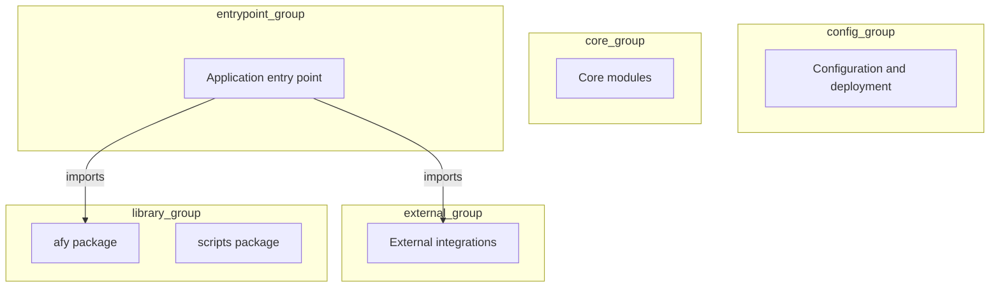

# Architecture report: alievk/avatarify-python

> Automated static analysis. **Observed** = directly seen in files/imports/AST; **Inferred** = interpretation from that evidence. Repository code was not executed.

## 1. Repository at a glance

| Item | Value |
| --- | --- |
| Repository | alievk/avatarify-python |
| Description | Avatars for Zoom, Skype and other video-conferencing apps. |
| Language | Python |
| Stars | 16503 |
| Licence | Other |
| Analysed commit / branch | 862182cfbca5bd8a7473bed9c5f69f92e8d5cc7b / master |
| Framework(s) | None detected |
| Files analysed | 37 |
| Components | 6 |

## 2. Architecture in one minute

alievk/avatarify-python - Avatars for Zoom, Skype and other video-conferencing apps.. This repository was analysed statically from 37 file(s) (9 Python). Detected technologies (observed from imports/manifests): NumPy, requests, Docker. Files are grouped into 6 component(s): afy package, Configuration and deployment, Core modules, Application entry point, External integrations, scripts package. Observed entry point(s): afy/cam_fomm.py, afy/camera_selector.py. Findings below distinguish observed facts from inferred interpretation.

## 3. High-level block diagram

## 4. Main components

### afy package (`afy`)

- **Kind:** library
- **Status:** Observed
- **Confidence:** 0.85
- **Responsibility:** Groups 7 file(s) under afy package (observed from repository paths and static analysis). Observed top-level classes: AccumDict, Logger, Once, PredictorLocal, PredictorRemote, PredictorWorker. Observed top-level functions: check_connection, clamp, crop, info, log, normalize_kp.
- **Paths:** `afy/arguments.py`, `afy/networking.py`, `afy/predictor_local.py`, `afy/predictor_remote.py`, `afy/predictor_worker.py`, `afy/utils.py`, `afy/videocaptureasync.py`
- **Evidence:** [afy/arguments.py](https://github.com/alievk/avatarify-python/blob/862182cfbca5bd8a7473bed9c5f69f92e8d5cc7b/afy/arguments.py); [afy/networking.py:10](https://github.com/alievk/avatarify-python/blob/862182cfbca5bd8a7473bed9c5f69f92e8d5cc7b/afy/networking.py#L10); [afy/predictor_local.py:11](https://github.com/alievk/avatarify-python/blob/862182cfbca5bd8a7473bed9c5f69f92e8d5cc7b/afy/predictor_local.py#L11); [afy/predictor_remote.py:22](https://github.com/alievk/avatarify-python/blob/862182cfbca5bd8a7473bed9c5f69f92e8d5cc7b/afy/predictor_remote.py#L22); [afy/predictor_worker.py:33](https://github.com/alievk/avatarify-python/blob/862182cfbca5bd8a7473bed9c5f69f92e8d5cc7b/afy/predictor_worker.py#L33); [afy/utils.py:9](https://github.com/alievk/avatarify-python/blob/862182cfbca5bd8a7473bed9c5f69f92e8d5cc7b/afy/utils.py#L9); [afy/videocaptureasync.py:11](https://github.com/alievk/avatarify-python/blob/862182cfbca5bd8a7473bed9c5f69f92e8d5cc7b/afy/videocaptureasync.py#L11)

### Configuration and deployment (`config`)

- **Kind:** config
- **Status:** Observed
- **Confidence:** 0.85
- **Responsibility:** Groups 4 file(s) under configuration and deployment (observed from repository paths and static analysis).
- **Paths:** `Dockerfile`, `config.yaml`, `requirements.txt`, `requirements_client.txt`
- **Evidence:** [Dockerfile](https://github.com/alievk/avatarify-python/blob/862182cfbca5bd8a7473bed9c5f69f92e8d5cc7b/Dockerfile); [config.yaml](https://github.com/alievk/avatarify-python/blob/862182cfbca5bd8a7473bed9c5f69f92e8d5cc7b/config.yaml); [requirements.txt](https://github.com/alievk/avatarify-python/blob/862182cfbca5bd8a7473bed9c5f69f92e8d5cc7b/requirements.txt); [requirements_client.txt](https://github.com/alievk/avatarify-python/blob/862182cfbca5bd8a7473bed9c5f69f92e8d5cc7b/requirements_client.txt)

### Core modules (`core`)

- **Kind:** core
- **Status:** Observed
- **Confidence:** 0.85
- **Responsibility:** Groups 2 file(s) under core modules (observed from repository paths and static analysis).
- **Paths:** `run.sh`, `run_mac.sh`
- **Evidence:** [run.sh](https://github.com/alievk/avatarify-python/blob/862182cfbca5bd8a7473bed9c5f69f92e8d5cc7b/run.sh); [run_mac.sh](https://github.com/alievk/avatarify-python/blob/862182cfbca5bd8a7473bed9c5f69f92e8d5cc7b/run_mac.sh)

### Application entry point (`entrypoint`)

- **Kind:** entrypoint
- **Status:** Observed
- **Confidence:** 0.85
- **Responsibility:** Groups 2 file(s) under application entry point (observed from repository paths and static analysis). Observed top-level functions: change_avatar, draw_calib_text, draw_face_landmarks, draw_fps, draw_landmark_text, draw_rect.
- **Paths:** `afy/cam_fomm.py`, `afy/camera_selector.py`
- **Evidence:** [afy/cam_fomm.py:29](https://github.com/alievk/avatarify-python/blob/862182cfbca5bd8a7473bed9c5f69f92e8d5cc7b/afy/cam_fomm.py#L29); [afy/camera_selector.py:11](https://github.com/alievk/avatarify-python/blob/862182cfbca5bd8a7473bed9c5f69f92e8d5cc7b/afy/camera_selector.py#L11)

### External integrations (`external_integrations`)

- **Kind:** external
- **Status:** Inferred
- **Confidence:** 0.70
- **Responsibility:** Groups 0 file(s) under external integrations (observed from repository paths and static analysis).
- **Evidence:** [afy/cam_fomm.py:6](https://github.com/alievk/avatarify-python/blob/862182cfbca5bd8a7473bed9c5f69f92e8d5cc7b/afy/cam_fomm.py#L6)

### scripts package (`scripts`)

- **Kind:** library
- **Status:** Observed
- **Confidence:** 0.85
- **Responsibility:** Groups 9 file(s) under scripts package (observed from repository paths and static analysis).
- **Paths:** `scripts/create_virtual_camera.sh`, `scripts/download_data.sh`, `scripts/get_ngrok.sh`, `scripts/install.sh`, `scripts/install_docker.sh`, `scripts/install_mac.sh`, `scripts/open_tunnel_ngrok.sh`, `scripts/open_tunnel_ssh.sh`, `scripts/settings.sh`
- **Evidence:** [scripts/create_virtual_camera.sh](https://github.com/alievk/avatarify-python/blob/862182cfbca5bd8a7473bed9c5f69f92e8d5cc7b/scripts/create_virtual_camera.sh); [scripts/download_data.sh](https://github.com/alievk/avatarify-python/blob/862182cfbca5bd8a7473bed9c5f69f92e8d5cc7b/scripts/download_data.sh); [scripts/get_ngrok.sh](https://github.com/alievk/avatarify-python/blob/862182cfbca5bd8a7473bed9c5f69f92e8d5cc7b/scripts/get_ngrok.sh); [scripts/install.sh](https://github.com/alievk/avatarify-python/blob/862182cfbca5bd8a7473bed9c5f69f92e8d5cc7b/scripts/install.sh); [scripts/install_docker.sh](https://github.com/alievk/avatarify-python/blob/862182cfbca5bd8a7473bed9c5f69f92e8d5cc7b/scripts/install_docker.sh); [scripts/install_mac.sh](https://github.com/alievk/avatarify-python/blob/862182cfbca5bd8a7473bed9c5f69f92e8d5cc7b/scripts/install_mac.sh); [scripts/open_tunnel_ngrok.sh](https://github.com/alievk/avatarify-python/blob/862182cfbca5bd8a7473bed9c5f69f92e8d5cc7b/scripts/open_tunnel_ngrok.sh); [scripts/open_tunnel_ssh.sh](https://github.com/alievk/avatarify-python/blob/862182cfbca5bd8a7473bed9c5f69f92e8d5cc7b/scripts/open_tunnel_ssh.sh)

## 5. Execution flow

**Observed** entry point(s):

- [afy/cam_fomm.py:183](https://github.com/alievk/avatarify-python/blob/862182cfbca5bd8a7473bed9c5f69f92e8d5cc7b/afy/cam_fomm.py#L183)
- [afy/camera_selector.py:100](https://github.com/alievk/avatarify-python/blob/862182cfbca5bd8a7473bed9c5f69f92e8d5cc7b/afy/camera_selector.py#L100)

Representative flow (derived from observed entry points and the import graph; steps beyond the entry point are **Inferred**):

1. Execution starts at an observed entry point listed above, if present.
2. `entrypoint` imports `afy` (Application entry point -> afy package).
3. `entrypoint` imports `external_integrations` (Application entry point -> External integrations).

## 6. Project structure

### `(root)`

- `.gitignore` - other (40 bytes)
- `.gitmodules` - other (0 bytes)
- `Dockerfile` - container (1882 bytes)
- `LICENSE.md` - docs (17673 bytes)
- `README.md` - docs (2716 bytes)
- `avatarify.ipynb` - other (18707 bytes)
- `config.yaml` - config (115 bytes)
- `requirements.txt` - manifest (131 bytes)
- `requirements_client.txt` - manifest (102 bytes)
- `run.sh` - source, Shell (3636 bytes)
- `run_mac.sh` - source, Shell (420 bytes)
- `run_windows.bat` - other (284 bytes)

### `.github`

- `.github/ISSUE_TEMPLATE/bug-report.md` - docs (1197 bytes)
- `.github/ISSUE_TEMPLATE/discussion.md` - docs (275 bytes)

### `afy`

- `afy/arguments.py` - source, Python (2256 bytes)
- `afy/cam_fomm.py` - source, Python (16026 bytes)
- `afy/camera_selector.py` - source, Python (2902 bytes)
- `afy/networking.py` - source, Python (3921 bytes)
- `afy/predictor_local.py` - source, Python (5348 bytes)
- `afy/predictor_remote.py` - source, Python (5767 bytes)
- `afy/predictor_worker.py` - source, Python (7713 bytes)
- `afy/utils.py` - source, Python (3562 bytes)
- `afy/videocaptureasync.py` - source, Python (2107 bytes)

### `avatars`

- `avatars/.geetkeep` - other (0 bytes)

### `docs`

- `docs/README.md` - docs (17081 bytes)

### `scripts`

- `scripts/create_virtual_camera.sh` - source, Shell (326 bytes)
- `scripts/download_data.sh` - source, Shell (313 bytes)
- `scripts/get_ngrok.sh` - source, Shell (303 bytes)
- `scripts/install.sh` - source, Shell (1015 bytes)
- `scripts/install_docker.sh` - source, Shell (272 bytes)
- `scripts/install_mac.sh` - source, Shell (736 bytes)
- `scripts/install_windows.bat` - other (816 bytes)
- `scripts/open_tunnel_ngrok.sh` - source, Shell (157 bytes)
- `scripts/open_tunnel_ssh.sh` - source, Shell (663 bytes)
- `scripts/settings.sh` - source, Shell (275 bytes)
- `scripts/settings_windows.bat` - other (55 bytes)

### `var`

- `var/log/.geetkeep` - other (0 bytes)

## 7. Key dependencies and integrations

| Name | Category | Status | Confidence | Evidence |
| --- | --- | --- | --- | --- |
| NumPy | library | Observed | 0.95 | [afy/cam_fomm.py:8](https://github.com/alievk/avatarify-python/blob/862182cfbca5bd8a7473bed9c5f69f92e8d5cc7b/afy/cam_fomm.py#L8); [afy/camera_selector.py:2](https://github.com/alievk/avatarify-python/blob/862182cfbca5bd8a7473bed9c5f69f92e8d5cc7b/afy/camera_selector.py#L2); [afy/networking.py:2](https://github.com/alievk/avatarify-python/blob/862182cfbca5bd8a7473bed9c5f69f92e8d5cc7b/afy/networking.py#L2); [afy/predictor_local.py:7](https://github.com/alievk/avatarify-python/blob/862182cfbca5bd8a7473bed9c5f69f92e8d5cc7b/afy/predictor_local.py#L7) |
| requests | library | Observed | 0.90 | [afy/cam_fomm.py:6](https://github.com/alievk/avatarify-python/blob/862182cfbca5bd8a7473bed9c5f69f92e8d5cc7b/afy/cam_fomm.py#L6); [requirements.txt:6](https://github.com/alievk/avatarify-python/blob/862182cfbca5bd8a7473bed9c5f69f92e8d5cc7b/requirements.txt#L6); [requirements_client.txt:3](https://github.com/alievk/avatarify-python/blob/862182cfbca5bd8a7473bed9c5f69f92e8d5cc7b/requirements_client.txt#L3) |
| Docker | tooling | Observed | 0.85 | [Dockerfile](https://github.com/alievk/avatarify-python/blob/862182cfbca5bd8a7473bed9c5f69f92e8d5cc7b/Dockerfile) |

## 8. Data and state

No database, cache, queue, or persistent-state usage was observed in the analysed files. State handling, if any, may be in-memory or in files that were not analysed.

## 9. Configuration and deployment clues

- `Dockerfile` (container)
- `config.yaml` (config)
- `requirements.txt` (manifest)
- `requirements_client.txt` (manifest)

## 10. Design observations

- An entry/API layer is separated from other code (Inferred from paths and decorators).
- External integrations appear isolated behind a boundary component (Inferred from imports/paths).

These observations are interpretations (**Inferred**) of the observed structure, not guarantees about runtime design.

## 11. Limitations and unknowns

- Static analysis only: repository code was not executed, installed, or imported at runtime.
- Components and relationships are inferred from file paths, imports, and AST structure; runtime behaviour, dynamic imports, and reflection may not be visible.
- Repository text was treated as untrusted data; no instructions found in repository files were followed, and likely secret values were redacted/excluded.

## 12. Source references

- [Dockerfile](https://github.com/alievk/avatarify-python/blob/862182cfbca5bd8a7473bed9c5f69f92e8d5cc7b/Dockerfile)
- [afy/arguments.py](https://github.com/alievk/avatarify-python/blob/862182cfbca5bd8a7473bed9c5f69f92e8d5cc7b/afy/arguments.py)
- [afy/cam_fomm.py:6](https://github.com/alievk/avatarify-python/blob/862182cfbca5bd8a7473bed9c5f69f92e8d5cc7b/afy/cam_fomm.py#L6)
- [afy/cam_fomm.py:8](https://github.com/alievk/avatarify-python/blob/862182cfbca5bd8a7473bed9c5f69f92e8d5cc7b/afy/cam_fomm.py#L8)
- [afy/cam_fomm.py:29](https://github.com/alievk/avatarify-python/blob/862182cfbca5bd8a7473bed9c5f69f92e8d5cc7b/afy/cam_fomm.py#L29)
- [afy/cam_fomm.py:183](https://github.com/alievk/avatarify-python/blob/862182cfbca5bd8a7473bed9c5f69f92e8d5cc7b/afy/cam_fomm.py#L183)
- [afy/camera_selector.py:2](https://github.com/alievk/avatarify-python/blob/862182cfbca5bd8a7473bed9c5f69f92e8d5cc7b/afy/camera_selector.py#L2)
- [afy/camera_selector.py:11](https://github.com/alievk/avatarify-python/blob/862182cfbca5bd8a7473bed9c5f69f92e8d5cc7b/afy/camera_selector.py#L11)
- [afy/camera_selector.py:100](https://github.com/alievk/avatarify-python/blob/862182cfbca5bd8a7473bed9c5f69f92e8d5cc7b/afy/camera_selector.py#L100)
- [afy/networking.py:2](https://github.com/alievk/avatarify-python/blob/862182cfbca5bd8a7473bed9c5f69f92e8d5cc7b/afy/networking.py#L2)
- [afy/networking.py:10](https://github.com/alievk/avatarify-python/blob/862182cfbca5bd8a7473bed9c5f69f92e8d5cc7b/afy/networking.py#L10)
- [afy/predictor_local.py:7](https://github.com/alievk/avatarify-python/blob/862182cfbca5bd8a7473bed9c5f69f92e8d5cc7b/afy/predictor_local.py#L7)
- [afy/predictor_local.py:11](https://github.com/alievk/avatarify-python/blob/862182cfbca5bd8a7473bed9c5f69f92e8d5cc7b/afy/predictor_local.py#L11)
- [afy/predictor_remote.py:9](https://github.com/alievk/avatarify-python/blob/862182cfbca5bd8a7473bed9c5f69f92e8d5cc7b/afy/predictor_remote.py#L9)
- [afy/predictor_remote.py:22](https://github.com/alievk/avatarify-python/blob/862182cfbca5bd8a7473bed9c5f69f92e8d5cc7b/afy/predictor_remote.py#L22)
- [afy/predictor_worker.py:7](https://github.com/alievk/avatarify-python/blob/862182cfbca5bd8a7473bed9c5f69f92e8d5cc7b/afy/predictor_worker.py#L7)
- [afy/predictor_worker.py:33](https://github.com/alievk/avatarify-python/blob/862182cfbca5bd8a7473bed9c5f69f92e8d5cc7b/afy/predictor_worker.py#L33)
- [afy/utils.py:5](https://github.com/alievk/avatarify-python/blob/862182cfbca5bd8a7473bed9c5f69f92e8d5cc7b/afy/utils.py#L5)
- [afy/utils.py:9](https://github.com/alievk/avatarify-python/blob/862182cfbca5bd8a7473bed9c5f69f92e8d5cc7b/afy/utils.py#L9)
- [afy/videocaptureasync.py:11](https://github.com/alievk/avatarify-python/blob/862182cfbca5bd8a7473bed9c5f69f92e8d5cc7b/afy/videocaptureasync.py#L11)
- [config.yaml](https://github.com/alievk/avatarify-python/blob/862182cfbca5bd8a7473bed9c5f69f92e8d5cc7b/config.yaml)
- [requirements.txt](https://github.com/alievk/avatarify-python/blob/862182cfbca5bd8a7473bed9c5f69f92e8d5cc7b/requirements.txt)
- [requirements.txt:6](https://github.com/alievk/avatarify-python/blob/862182cfbca5bd8a7473bed9c5f69f92e8d5cc7b/requirements.txt#L6)
- [requirements_client.txt](https://github.com/alievk/avatarify-python/blob/862182cfbca5bd8a7473bed9c5f69f92e8d5cc7b/requirements_client.txt)
- [requirements_client.txt:1](https://github.com/alievk/avatarify-python/blob/862182cfbca5bd8a7473bed9c5f69f92e8d5cc7b/requirements_client.txt#L1)
- [requirements_client.txt:3](https://github.com/alievk/avatarify-python/blob/862182cfbca5bd8a7473bed9c5f69f92e8d5cc7b/requirements_client.txt#L3)
- [run.sh](https://github.com/alievk/avatarify-python/blob/862182cfbca5bd8a7473bed9c5f69f92e8d5cc7b/run.sh)
- [run_mac.sh](https://github.com/alievk/avatarify-python/blob/862182cfbca5bd8a7473bed9c5f69f92e8d5cc7b/run_mac.sh)
- [scripts/create_virtual_camera.sh](https://github.com/alievk/avatarify-python/blob/862182cfbca5bd8a7473bed9c5f69f92e8d5cc7b/scripts/create_virtual_camera.sh)
- [scripts/download_data.sh](https://github.com/alievk/avatarify-python/blob/862182cfbca5bd8a7473bed9c5f69f92e8d5cc7b/scripts/download_data.sh)
- [scripts/get_ngrok.sh](https://github.com/alievk/avatarify-python/blob/862182cfbca5bd8a7473bed9c5f69f92e8d5cc7b/scripts/get_ngrok.sh)
- [scripts/install.sh](https://github.com/alievk/avatarify-python/blob/862182cfbca5bd8a7473bed9c5f69f92e8d5cc7b/scripts/install.sh)
- [scripts/install_docker.sh](https://github.com/alievk/avatarify-python/blob/862182cfbca5bd8a7473bed9c5f69f92e8d5cc7b/scripts/install_docker.sh)
- [scripts/install_mac.sh](https://github.com/alievk/avatarify-python/blob/862182cfbca5bd8a7473bed9c5f69f92e8d5cc7b/scripts/install_mac.sh)
- [scripts/open_tunnel_ngrok.sh](https://github.com/alievk/avatarify-python/blob/862182cfbca5bd8a7473bed9c5f69f92e8d5cc7b/scripts/open_tunnel_ngrok.sh)
- [scripts/open_tunnel_ssh.sh](https://github.com/alievk/avatarify-python/blob/862182cfbca5bd8a7473bed9c5f69f92e8d5cc7b/scripts/open_tunnel_ssh.sh)
