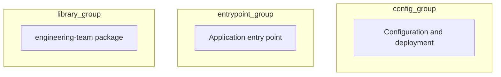

# Architecture report: alirezarezvani/claude-skills

> Automated static analysis. **Observed** = directly seen in files/imports/AST; **Inferred** = interpretation from that evidence. Repository code was not executed.

## 1. Repository at a glance

| Item | Value |
| --- | --- |
| Repository | alirezarezvani/claude-skills |
| Description | 410 Claude Code skills & agent skills & plugins (120+ Agents, custom commands, 410+ skills, customizable references, scripts)for Claude Code, Codex, Gemini CLI, Cursor, and 8 more coding agents — engineering, marketing, product, compliance, C-level advisory, research, business operations, commercia… |
| Language | Python |
| Stars | 29802 |
| Licence | MIT |
| Analysed commit / branch | 08cd8a9fc86cc370e2c0d448e8171fbcfdbc5a30 / main |
| Framework(s) | None detected |
| Files analysed | 800 |
| Components | 3 |

## 2. Architecture in one minute

alirezarezvani/claude-skills - 410 Claude Code skills & agent skills & plugins (120+ Agents, custom commands, 410+ skills, customizable references, scripts)for Claude Code, Codex, Gemini CLI, Cursor, and 8 more coding agents — eng…. This repository was analysed statically from 800 file(s) (136 Python). Detected technologies (observed from imports/manifests): GitHub Actions, Docker. Files are grouped into 3 component(s): Configuration and deployment, engineering-team package, Application entry point. Observed entry point(s): agent-launcher/hooks/session_end.py, agent-launcher/hooks/session_start.py, agent-launcher/skills/agent-launcher-orchestrator/scripts/goal_router.py. Findings below distinguish observed facts from inferred interpretation.

## 3. High-level block diagram

## 4. Main components

### Configuration and deployment (`config`)

- **Kind:** config
- **Status:** Observed
- **Confidence:** 0.85
- **Responsibility:** Groups 40 file(s) under configuration and deployment (observed from repository paths and static analysis).
- **Paths:** `agent-launcher/.claude-plugin/authoring-notes.json`, `agent-launcher/.claude-plugin/plugin.json`, `agent-launcher/assets/build-sheet.schema.json`, `agent-launcher/assets/example-build-sheet.json`, `agent-launcher/hooks/hooks.json`, `audit/verified-tier/trigger_results.json`, `business-growth/.claude-plugin/plugin.json`, `business-growth/skills/customer-success-manager/assets/expected_output.json`, `business-growth/skills/customer-success-manager/assets/sample_customer_data.json`, `business-growth/skills/revenue-operations/assets/expected_output.json`, `business-growth/skills/revenue-operations/assets/sample_forecast_data.json`, `business-growth/skills/revenue-operations/assets/sample_gtm_data.json`, `business-growth/skills/revenue-operations/assets/sample_pipeline_data.json`, `business-growth/skills/sales-engineer/assets/expected_output.json`, `business-growth/skills/sales-engineer/assets/sample_rfp_data.json`, `business-operations/.claude-plugin/authoring-notes.json`, `business-operations/.claude-plugin/plugin.json`, `c-level-advisor/.claude-plugin/plugin.json`, `c-level-advisor/arquiteto-de-empresa/.claude-plugin/plugin.json`, `c-level-advisor/chief-ai-officer-advisor/.claude-plugin/plugin.json`, `c-level-advisor/chief-customer-officer-advisor/.claude-plugin/plugin.json`, `c-level-advisor/chief-data-officer-advisor/.claude-plugin/plugin.json`, `c-level-advisor/executive-mentor/.claude-plugin/plugin.json`, `c-level-advisor/general-counsel-advisor/.claude-plugin/plugin.json`, `c-level-advisor/hooks/hooks.json`, `c-level-advisor/hooks/skill_routes.json`, `c-level-advisor/vpe-advisor/.claude-plugin/plugin.json`, `c-level-agents/.claude-plugin/plugin.json`, `commercial/.claude-plugin/authoring-notes.json`, `commercial/.claude-plugin/plugin.json`, `compliance-os/.claude-plugin/plugin.json`, `compliance-os/skills/compliance-os/assets/company_profile_template.json`, `compliance-os/skills/compliance-os/assets/control_library_template.json`, `compliance-os/skills/compliance-os/assets/mock_audit_library.json`, `engineering-team/.claude-plugin/plugin.json`, `engineering-team/a11y-audit/.claude-plugin/plugin.json`, `engineering-team/a11y-audit/settings.json`, `engineering-team/a11y-audit/skills/a11y-audit/expected_outputs/sample-scan-output.json`, `engineering-team/google-workspace-cli/.claude-plugin/plugin.json`, `engineering-team/google-workspace-cli/skills/google-workspace-cli/assets/workspace-config.json`
- **Evidence:** [agent-launcher/.claude-plugin/authoring-notes.json](https://github.com/alirezarezvani/claude-skills/blob/08cd8a9fc86cc370e2c0d448e8171fbcfdbc5a30/agent-launcher/.claude-plugin/authoring-notes.json); [agent-launcher/.claude-plugin/plugin.json](https://github.com/alirezarezvani/claude-skills/blob/08cd8a9fc86cc370e2c0d448e8171fbcfdbc5a30/agent-launcher/.claude-plugin/plugin.json); [agent-launcher/assets/build-sheet.schema.json](https://github.com/alirezarezvani/claude-skills/blob/08cd8a9fc86cc370e2c0d448e8171fbcfdbc5a30/agent-launcher/assets/build-sheet.schema.json); [agent-launcher/assets/example-build-sheet.json](https://github.com/alirezarezvani/claude-skills/blob/08cd8a9fc86cc370e2c0d448e8171fbcfdbc5a30/agent-launcher/assets/example-build-sheet.json); [agent-launcher/hooks/hooks.json](https://github.com/alirezarezvani/claude-skills/blob/08cd8a9fc86cc370e2c0d448e8171fbcfdbc5a30/agent-launcher/hooks/hooks.json); [audit/verified-tier/trigger_results.json](https://github.com/alirezarezvani/claude-skills/blob/08cd8a9fc86cc370e2c0d448e8171fbcfdbc5a30/audit/verified-tier/trigger_results.json); [business-growth/.claude-plugin/plugin.json](https://github.com/alirezarezvani/claude-skills/blob/08cd8a9fc86cc370e2c0d448e8171fbcfdbc5a30/business-growth/.claude-plugin/plugin.json); [business-growth/skills/customer-success-manager/assets/expected_output.json](https://github.com/alirezarezvani/claude-skills/blob/08cd8a9fc86cc370e2c0d448e8171fbcfdbc5a30/business-growth/skills/customer-success-manager/assets/expected_output.json)

### engineering-team package (`engineering_team`)

- **Kind:** library
- **Status:** Observed
- **Confidence:** 0.85
- **Responsibility:** Groups 1 file(s) under engineering-team package (observed from repository paths and static analysis).
- **Paths:** `engineering-team/a11y-audit/skills/a11y-audit/assets/sample-component.tsx`
- **Evidence:** [engineering-team/a11y-audit/skills/a11y-audit/assets/sample-component.tsx](https://github.com/alirezarezvani/claude-skills/blob/08cd8a9fc86cc370e2c0d448e8171fbcfdbc5a30/engineering-team/a11y-audit/skills/a11y-audit/assets/sample-component.tsx)

### Application entry point (`entrypoint`)

- **Kind:** entrypoint
- **Status:** Observed
- **Confidence:** 0.85
- **Responsibility:** Groups 136 file(s) under application entry point (observed from repository paths and static analysis). Observed top-level classes: ActionItem, Announcement, AuditResult, BandDefinition, CalendarReport, CalendarTouchpoint. Observed top-level functions: _announcement_body, _approver_chain_for, _approver_for, _assess_kr_risk, _attrs, _band.
- **Paths:** `agent-launcher/hooks/session_end.py`, `agent-launcher/hooks/session_start.py`, `agent-launcher/skills/agent-launcher-orchestrator/scripts/goal_router.py`, `agent-launcher/skills/agent-launcher-orchestrator/scripts/goal_state.py`, `agent-launcher/skills/agent-launcher-orchestrator/scripts/loop_compiler.py`, `agent-launcher/skills/grade-iterate/scripts/eval_scaffold.py`, `agent-launcher/skills/grade-iterate/scripts/outcome_builder.py`, `agent-launcher/skills/grade-iterate/scripts/verdict_reader.py`, `agent-launcher/skills/interview/scripts/build_sheet_builder.py`, `agent-launcher/skills/interview/scripts/interview_planner.py`, `agent-launcher/skills/interview/scripts/primitives_validator.py`, `agent-launcher/skills/run-without-you/scripts/cron_validator.py`, `agent-launcher/skills/run-without-you/scripts/deployment_builder.py`, `agent-launcher/skills/run-without-you/scripts/next_directions_writer.py`, `agent-launcher/skills/stage-launch/scripts/launch_script_writer.py`, `agent-launcher/skills/stage-launch/scripts/payload_generator.py`, `agent-launcher/skills/stage-launch/scripts/payload_validator.py`, `agent-launcher/skills/wrap-up/scripts/overview_page.py`, `agent-launcher/skills/wrap-up/scripts/primitives_inventory.py`, `agent-launcher/skills/wrap-up/scripts/upgrade_suggester.py`, `business-growth/skills/customer-success-manager/scripts/churn_risk_analyzer.py`, `business-growth/skills/customer-success-manager/scripts/expansion_opportunity_scorer.py`, `business-growth/skills/customer-success-manager/scripts/health_score_calculator.py`, `business-growth/skills/revenue-operations/scripts/forecast_accuracy_tracker.py`, `business-growth/skills/revenue-operations/scripts/gtm_efficiency_calculator.py`, `business-growth/skills/revenue-operations/scripts/pipeline_analyzer.py`, `business-growth/skills/sales-engineer/scripts/competitive_matrix_builder.py`, `business-growth/skills/sales-engineer/scripts/poc_planner.py`, `business-growth/skills/sales-engineer/scripts/rfp_response_analyzer.py`, `business-operations/skills/capacity-planner/scripts/capacity_modeler.py`, `business-operations/skills/capacity-planner/scripts/hiring_sequencer.py`, `business-operations/skills/capacity-planner/scripts/utilization_analyzer.py`, `business-operations/skills/internal-comms/scripts/change_announcement_builder.py`, `business-operations/skills/internal-comms/scripts/comms_calendar_builder.py`, `business-operations/skills/internal-comms/scripts/comms_template_filler.py`, `business-operations/skills/knowledge-ops/scripts/kb_ingester.py`, `business-operations/skills/knowledge-ops/scripts/runbook_validator.py`, `business-operations/skills/knowledge-ops/scripts/sop_generator.py`, `business-operations/skills/process-mapper/scripts/bottleneck_detector.py`, `business-operations/skills/process-mapper/scripts/cycle_time_analyzer.py`, `business-operations/skills/process-mapper/scripts/process_documenter.py`, `business-operations/skills/procurement-optimizer/scripts/purchasing_cycle_analyzer.py`, `business-operations/skills/procurement-optimizer/scripts/spend_categorizer.py`, `business-operations/skills/procurement-optimizer/scripts/supplier_consolidation.py`, `business-operations/skills/vendor-management/scripts/sla_compliance_tracker.py`, `business-operations/skills/vendor-management/scripts/vendor_risk_classifier.py`, `business-operations/skills/vendor-management/scripts/vendor_scorer.py`, `c-level-advisor/arquiteto-de-empresa/skills/arquiteto-de-empresa/scripts/index_generator.py`, `c-level-advisor/arquiteto-de-empresa/skills/arquiteto-de-empresa/scripts/okf_linter.py`, `c-level-advisor/arquiteto-de-empresa/skills/arquiteto-de-empresa/scripts/scaffold_bundle.py`, `c-level-advisor/chief-ai-officer-advisor/skills/chief-ai-officer-advisor/scripts/ai_cost_economics.py`, `c-level-advisor/chief-ai-officer-advisor/skills/chief-ai-officer-advisor/scripts/ai_risk_classifier.py`, `c-level-advisor/chief-ai-officer-advisor/skills/chief-ai-officer-advisor/scripts/model_buildvsbuy_calculator.py`, `c-level-advisor/chief-customer-officer-advisor/skills/chief-customer-officer-advisor/scripts/cs_coverage_calculator.py`, `c-level-advisor/chief-customer-officer-advisor/skills/chief-customer-officer-advisor/scripts/customer_segmentation_designer.py`, `c-level-advisor/chief-customer-officer-advisor/skills/chief-customer-officer-advisor/scripts/retention_decomposition_analyzer.py`, `c-level-advisor/chief-data-officer-advisor/skills/chief-data-officer-advisor/scripts/ai_training_data_audit.py`, `c-level-advisor/chief-data-officer-advisor/skills/chief-data-officer-advisor/scripts/data_asset_valuator.py`, `c-level-advisor/chief-data-officer-advisor/skills/chief-data-officer-advisor/scripts/data_product_strategy_picker.py`, `c-level-advisor/executive-mentor/skills/executive-mentor/scripts/decision_matrix_scorer.py`, `c-level-advisor/executive-mentor/skills/executive-mentor/scripts/stakeholder_mapper.py`, `c-level-advisor/general-counsel-advisor/skills/general-counsel-advisor/scripts/contract_risk_scanner.py`, `c-level-advisor/general-counsel-advisor/skills/general-counsel-advisor/scripts/term_sheet_analyzer.py`, `c-level-advisor/hooks/skill_router.py`, `c-level-advisor/skills/arquiteto-de-empresa/scripts/index_generator.py`, `c-level-advisor/skills/arquiteto-de-empresa/scripts/okf_linter.py`, `c-level-advisor/skills/arquiteto-de-empresa/scripts/scaffold_bundle.py`, `c-level-advisor/skills/ceo-advisor/scripts/financial_scenario_analyzer.py`, `c-level-advisor/skills/ceo-advisor/scripts/strategy_analyzer.py`, `c-level-advisor/skills/cfo-advisor/scripts/burn_rate_calculator.py`, `c-level-advisor/skills/cfo-advisor/scripts/fundraising_model.py`, `c-level-advisor/skills/cfo-advisor/scripts/unit_economics_analyzer.py`, `c-level-advisor/skills/chief-ai-officer-advisor/scripts/ai_cost_economics.py`, `c-level-advisor/skills/chief-ai-officer-advisor/scripts/ai_risk_classifier.py`, `c-level-advisor/skills/chief-ai-officer-advisor/scripts/model_buildvsbuy_calculator.py`, `c-level-advisor/skills/chief-customer-officer-advisor/scripts/cs_coverage_calculator.py`, `c-level-advisor/skills/chief-customer-officer-advisor/scripts/customer_segmentation_designer.py`, `c-level-advisor/skills/chief-customer-officer-advisor/scripts/retention_decomposition_analyzer.py`, `c-level-advisor/skills/chief-data-officer-advisor/scripts/ai_training_data_audit.py`, `c-level-advisor/skills/chief-data-officer-advisor/scripts/data_asset_valuator.py`, `c-level-advisor/skills/chief-data-officer-advisor/scripts/data_product_strategy_picker.py`, `c-level-advisor/skills/chro-advisor/scripts/comp_benchmarker.py`, `c-level-advisor/skills/chro-advisor/scripts/hiring_plan_modeler.py`, `c-level-advisor/skills/ciso-advisor/scripts/compliance_tracker.py`, `c-level-advisor/skills/ciso-advisor/scripts/risk_quantifier.py`, `c-level-advisor/skills/cmo-advisor/scripts/growth_model_simulator.py`, `c-level-advisor/skills/cmo-advisor/scripts/marketing_budget_modeler.py`, `c-level-advisor/skills/coo-advisor/scripts/okr_tracker.py`, `c-level-advisor/skills/coo-advisor/scripts/ops_efficiency_analyzer.py`, `c-level-advisor/skills/cpo-advisor/scripts/pmf_scorer.py`, `c-level-advisor/skills/cpo-advisor/scripts/portfolio_analyzer.py`, `c-level-advisor/skills/cro-advisor/scripts/churn_analyzer.py`, `c-level-advisor/skills/cro-advisor/scripts/revenue_forecast_model.py`, `c-level-advisor/skills/cto-advisor/scripts/team_scaling_calculator.py`, `c-level-advisor/skills/cto-advisor/scripts/tech_debt_analyzer.py`, `c-level-advisor/skills/decision-logger/scripts/decision_tracker.py`, `c-level-advisor/skills/general-counsel-advisor/scripts/contract_risk_scanner.py`, `c-level-advisor/skills/general-counsel-advisor/scripts/term_sheet_analyzer.py`, `c-level-advisor/skills/org-health-diagnostic/scripts/health_scorer.py`, `c-level-advisor/skills/scenario-war-room/scripts/scenario_modeler.py`, `c-level-advisor/skills/strategic-alignment/scripts/alignment_checker.py`, `c-level-advisor/skills/vpe-advisor/scripts/delivery_throughput_analyzer.py`, `c-level-advisor/skills/vpe-advisor/scripts/eng_hiring_funnel_calculator.py`, `c-level-advisor/skills/vpe-advisor/scripts/eng_team_structure_designer.py`, `c-level-advisor/vpe-advisor/skills/vpe-advisor/scripts/delivery_throughput_analyzer.py`, `c-level-advisor/vpe-advisor/skills/vpe-advisor/scripts/eng_hiring_funnel_calculator.py`, `c-level-advisor/vpe-advisor/skills/vpe-advisor/scripts/eng_team_structure_designer.py`, `commercial/skills/channel-economics/scripts/channel_mix_optimizer.py`, `commercial/skills/channel-economics/scripts/channel_roi_analyzer.py`, `commercial/skills/channel-economics/scripts/cost_to_serve_calculator.py`, `commercial/skills/commercial-forecaster/scripts/bookings_forecaster.py`, `commercial/skills/commercial-forecaster/scripts/cohort_arr_projector.py`, `commercial/skills/commercial-forecaster/scripts/funnel_confidence_scorer.py`, `commercial/skills/commercial-policy/scripts/discount_matrix_builder.py`, `commercial/skills/commercial-policy/scripts/exception_router.py`, `commercial/skills/commercial-policy/scripts/policy_linter.py`, `commercial/skills/deal-desk/scripts/deal_scorer.py`, `commercial/skills/deal-desk/scripts/discount_approval_router.py`, `commercial/skills/deal-desk/scripts/terms_redliner.py`, `commercial/skills/partnerships-architect/scripts/joint_gtm_planner.py`, `commercial/skills/partnerships-architect/scripts/partner_tier_classifier.py`, `commercial/skills/partnerships-architect/scripts/revshare_modeler.py`, `commercial/skills/pricing-strategist/scripts/packaging_designer.py`, `commercial/skills/pricing-strategist/scripts/pricing_model_picker.py`, `commercial/skills/pricing-strategist/scripts/wtp_analyzer.py`, `commercial/skills/rfp-responder/scripts/response_drafter.py`, `commercial/skills/rfp-responder/scripts/rfp_parser.py`, `commercial/skills/rfp-responder/scripts/winrate_predictor.py`, `compliance-os/skills/compliance-os/scripts/audit_simulator.py`, `compliance-os/skills/compliance-os/scripts/cross_framework_mapper.py`, `compliance-os/skills/compliance-os/scripts/evidence_pool_generator.py`, `compliance-os/skills/compliance-os/scripts/framework_selector.py`, `engineering-team/a11y-audit/skills/a11y-audit/scripts/a11y_scanner.py`, `engineering-team/a11y-audit/skills/a11y-audit/scripts/contrast_checker.py`, `engineering-team/google-workspace-cli/skills/google-workspace-cli/scripts/auth_setup_guide.py`, `engineering-team/google-workspace-cli/skills/google-workspace-cli/scripts/gws_doctor.py`
- **Evidence:** [agent-launcher/hooks/session_end.py:17](https://github.com/alirezarezvani/claude-skills/blob/08cd8a9fc86cc370e2c0d448e8171fbcfdbc5a30/agent-launcher/hooks/session_end.py#L17); [agent-launcher/hooks/session_start.py:22](https://github.com/alirezarezvani/claude-skills/blob/08cd8a9fc86cc370e2c0d448e8171fbcfdbc5a30/agent-launcher/hooks/session_start.py#L22); [agent-launcher/skills/agent-launcher-orchestrator/scripts/goal_router.py:53](https://github.com/alirezarezvani/claude-skills/blob/08cd8a9fc86cc370e2c0d448e8171fbcfdbc5a30/agent-launcher/skills/agent-launcher-orchestrator/scripts/goal_router.py#L53); [agent-launcher/skills/agent-launcher-orchestrator/scripts/goal_state.py:29](https://github.com/alirezarezvani/claude-skills/blob/08cd8a9fc86cc370e2c0d448e8171fbcfdbc5a30/agent-launcher/skills/agent-launcher-orchestrator/scripts/goal_state.py#L29); [agent-launcher/skills/agent-launcher-orchestrator/scripts/loop_compiler.py:39](https://github.com/alirezarezvani/claude-skills/blob/08cd8a9fc86cc370e2c0d448e8171fbcfdbc5a30/agent-launcher/skills/agent-launcher-orchestrator/scripts/loop_compiler.py#L39); [agent-launcher/skills/grade-iterate/scripts/eval_scaffold.py:20](https://github.com/alirezarezvani/claude-skills/blob/08cd8a9fc86cc370e2c0d448e8171fbcfdbc5a30/agent-launcher/skills/grade-iterate/scripts/eval_scaffold.py#L20); [agent-launcher/skills/grade-iterate/scripts/outcome_builder.py:22](https://github.com/alirezarezvani/claude-skills/blob/08cd8a9fc86cc370e2c0d448e8171fbcfdbc5a30/agent-launcher/skills/grade-iterate/scripts/outcome_builder.py#L22); [agent-launcher/skills/grade-iterate/scripts/verdict_reader.py:35](https://github.com/alirezarezvani/claude-skills/blob/08cd8a9fc86cc370e2c0d448e8171fbcfdbc5a30/agent-launcher/skills/grade-iterate/scripts/verdict_reader.py#L35)

## 5. Execution flow

**Observed** entry point(s):

- [agent-launcher/hooks/session_end.py:56](https://github.com/alirezarezvani/claude-skills/blob/08cd8a9fc86cc370e2c0d448e8171fbcfdbc5a30/agent-launcher/hooks/session_end.py#L56)
- [agent-launcher/hooks/session_start.py:82](https://github.com/alirezarezvani/claude-skills/blob/08cd8a9fc86cc370e2c0d448e8171fbcfdbc5a30/agent-launcher/hooks/session_start.py#L82)
- [agent-launcher/skills/agent-launcher-orchestrator/scripts/goal_router.py:170](https://github.com/alirezarezvani/claude-skills/blob/08cd8a9fc86cc370e2c0d448e8171fbcfdbc5a30/agent-launcher/skills/agent-launcher-orchestrator/scripts/goal_router.py#L170)
- [agent-launcher/skills/agent-launcher-orchestrator/scripts/goal_state.py:222](https://github.com/alirezarezvani/claude-skills/blob/08cd8a9fc86cc370e2c0d448e8171fbcfdbc5a30/agent-launcher/skills/agent-launcher-orchestrator/scripts/goal_state.py#L222)
- [agent-launcher/skills/agent-launcher-orchestrator/scripts/loop_compiler.py:183](https://github.com/alirezarezvani/claude-skills/blob/08cd8a9fc86cc370e2c0d448e8171fbcfdbc5a30/agent-launcher/skills/agent-launcher-orchestrator/scripts/loop_compiler.py#L183)
- [agent-launcher/skills/grade-iterate/scripts/eval_scaffold.py:91](https://github.com/alirezarezvani/claude-skills/blob/08cd8a9fc86cc370e2c0d448e8171fbcfdbc5a30/agent-launcher/skills/grade-iterate/scripts/eval_scaffold.py#L91)
- [agent-launcher/skills/grade-iterate/scripts/outcome_builder.py:101](https://github.com/alirezarezvani/claude-skills/blob/08cd8a9fc86cc370e2c0d448e8171fbcfdbc5a30/agent-launcher/skills/grade-iterate/scripts/outcome_builder.py#L101)
- [agent-launcher/skills/grade-iterate/scripts/verdict_reader.py:108](https://github.com/alirezarezvani/claude-skills/blob/08cd8a9fc86cc370e2c0d448e8171fbcfdbc5a30/agent-launcher/skills/grade-iterate/scripts/verdict_reader.py#L108)
- [agent-launcher/skills/interview/scripts/build_sheet_builder.py:94](https://github.com/alirezarezvani/claude-skills/blob/08cd8a9fc86cc370e2c0d448e8171fbcfdbc5a30/agent-launcher/skills/interview/scripts/build_sheet_builder.py#L94)
- [agent-launcher/skills/interview/scripts/interview_planner.py:200](https://github.com/alirezarezvani/claude-skills/blob/08cd8a9fc86cc370e2c0d448e8171fbcfdbc5a30/agent-launcher/skills/interview/scripts/interview_planner.py#L200)
- [agent-launcher/skills/interview/scripts/primitives_validator.py:177](https://github.com/alirezarezvani/claude-skills/blob/08cd8a9fc86cc370e2c0d448e8171fbcfdbc5a30/agent-launcher/skills/interview/scripts/primitives_validator.py#L177)
- [agent-launcher/skills/run-without-you/scripts/cron_validator.py:133](https://github.com/alirezarezvani/claude-skills/blob/08cd8a9fc86cc370e2c0d448e8171fbcfdbc5a30/agent-launcher/skills/run-without-you/scripts/cron_validator.py#L133)

Representative flow (derived from observed entry points and the import graph; steps beyond the entry point are **Inferred**):

1. Execution starts at an observed entry point listed above, if present.
2. No internal import relationships between components were observed.

## 6. Project structure

### `(root)`

- `.gitignore` - other (2522 bytes)
- `.mcp.json` - config (151 bytes)
- `.yamllintignore` - other (125 bytes)
- `CLAUDE.md` - docs (120920 bytes)
- `CODE_OF_CONDUCT.md` - docs (5343 bytes)
- `CONTRIBUTING.md` - docs (6877 bytes)
- `CONVENTIONS.md` - docs (9705 bytes)
- `GEMINI.md` - docs (3114 bytes)
- `INSTALLATION.md` - docs (34861 bytes)
- `LICENSE` - docs (1072 bytes)
- `README.md` - docs (31158 bytes)
- `SECURITY.md` - docs (7040 bytes)
- `SKILL-AUTHORING-STANDARD.md` - docs (15216 bytes)
- `SKILL_PIPELINE.md` - docs (14566 bytes)
- `STORE.md` - docs (4601 bytes)
- `VERIFIED.md` - docs (36780 bytes)

### `.claude`

- `.claude/COMMANDS.md` - docs (2566 bytes)
- `.claude/claudex/log` - other (551 bytes)
- `.claude/commands/focused-fix.md` - docs (964 bytes)
- `.claude/commands/git/clean.md` - docs (1497 bytes)
- `.claude/commands/git/cm.md` - docs (919 bytes)
- `.claude/commands/git/cp.md` - docs (916 bytes)
- `.claude/commands/git/pr.md` - docs (940 bytes)
- `.claude/commands/plugin-audit.md` - docs (6645 bytes)
- `.claude/commands/quality-gate.md` - docs (1178 bytes)
- `.claude/commands/security-scan.md` - docs (659 bytes)
- `.claude/commands/seo-auditor.md` - docs (3066 bytes)
- `.claude/commands/update-docs.md` - docs (7200 bytes)
- `.claude/settings.json` - config (76 bytes)

### `.claude-plugin`

- `.claude-plugin/marketplace.json` - config (110496 bytes)

### `.codex`

- `.codex/skills-index.json` - config (167121 bytes)

### `.codex-plugin`

- `.codex-plugin/plugin.json` - config (2199 bytes)

### `.gemini`

- `.gemini/skills-index.json` - config (153579 bytes)

### `.github`

- `.github/AUTOMATION_SETUP.md` - docs (8081 bytes)
- `.github/AUTOMATION_TEST.md` - docs (813 bytes)
- `.github/FUNDING.yml` - config (884 bytes)
- `.github/ISSUE_TEMPLATE/bug_report.md` - docs (1176 bytes)
- `.github/ISSUE_TEMPLATE/documentation.md` - docs (1810 bytes)
- `.github/ISSUE_TEMPLATE/feature_request.md` - docs (2025 bytes)
- `.github/ISSUE_TEMPLATE/skill_improvement.md` - docs (2433 bytes)
- `.github/PULL_REQUEST_TEMPLATE.md` - docs (669 bytes)
- `.github/TRIAGE_POLICY.md` - docs (10738 bytes)
- `.github/WORKFLOW_KILLSWITCH` - other (16 bytes)
- `.github/branch-protection-config.json` - config (386 bytes)
- `.github/commit-template.txt` - docs (203 bytes)
- `.github/workflows/ci-quality-gate.yml` - ci, YAML (9837 bytes)
- `.github/workflows/claude-code-review.yml` - ci, YAML (5601 bytes)
- `.github/workflows/claude.yml` - ci, YAML (1897 bytes)
- `.github/workflows/docs-preview.yml` - ci, YAML (1560 bytes)
- `.github/workflows/enforce-pr-target.yml` - ci, YAML (2825 bytes)
- `.github/workflows/harness-compat.yml` - ci, YAML (4500 bytes)
- `.github/workflows/hero-sync.yml` - ci, YAML (3147 bytes)
- `.github/workflows/pr-issue-auto-close.yml` - ci, YAML (7252 bytes)
- `.github/workflows/release.yml` - ci, YAML (6085 bytes)
- `.github/workflows/skill-evals.yml` - ci, YAML (4114 bytes)
- `.github/workflows/skill-quality-review.yml` - ci, YAML (13797 bytes)
- `.github/workflows/skill-security-audit.yml` - ci, YAML (8670 bytes)
- `.github/workflows/smart-sync.yml` - ci, YAML (13899 bytes)
- `.github/workflows/static.yml` - ci, YAML (1814 bytes)
- `.github/workflows/sync-codex-skills.yml` - ci, YAML (2905 bytes)
- `.github/workflows/traffic-snapshot.yml` - ci, YAML (3548 bytes)
- `.github/workflows/trigger-gate.yml` - ci, YAML (7116 bytes)
- `.github/workflows/virustotal-scan.yml` - ci, YAML (5264 bytes)

### `.hermes`

- `.hermes/skills/claude-skills/skills-index.json` - config (135084 bytes)

### `.vibe`

- `.vibe/skills/claude-skills/skills-index.json` - config (135106 bytes)

### `agent-launcher`

- `agent-launcher/.claude-plugin/authoring-notes.json` - config (1545 bytes)
- `agent-launcher/.claude-plugin/plugin.json` - config (2080 bytes)
- `agent-launcher/CLAUDE.md` - docs (2890 bytes)
- `agent-launcher/PUBLISH-CLAWHUB.md` - docs (2069 bytes)
- `agent-launcher/README.md` - docs (3946 bytes)
- `agent-launcher/SPEC.md` - docs (6389 bytes)
- `agent-launcher/agents/cs-agent-deployer.md` - docs (2049 bytes)
- `agent-launcher/agents/cs-agent-grader.md` - docs (1974 bytes)
- `agent-launcher/agents/cs-agent-interviewer.md` - docs (1877 bytes)
- `agent-launcher/agents/cs-agent-launcher-orchestrator.md` - docs (2407 bytes)
- `agent-launcher/assets/NEXT-DIRECTIONS.template.md` - docs (842 bytes)
- `agent-launcher/assets/agent-overview.template.html` - other (2011 bytes)
- `agent-launcher/assets/build-sheet.schema.json` - config (3427 bytes)
- `agent-launcher/assets/example-build-sheet.json` - config (2422 bytes)
- `agent-launcher/commands/cs-goal.md` - docs (1106 bytes)
- `agent-launcher/commands/cs-grade.md` - docs (1313 bytes)
- `agent-launcher/commands/cs-grill-agent-launcher.md` - docs (1457 bytes)
- `agent-launcher/commands/cs-interview.md` - docs (1237 bytes)
- `agent-launcher/commands/cs-launch.md` - docs (1536 bytes)
- `agent-launcher/commands/cs-run-without-you.md` - docs (1425 bytes)
- `agent-launcher/commands/cs-stage-launch.md` - docs (1399 bytes)
- `agent-launcher/commands/cs-wrap-up.md` - docs (1059 bytes)
- `agent-launcher/hooks/hooks.json` - config (936 bytes)
- `agent-launcher/hooks/session_end.py` - source, Python (1586 bytes)
- `agent-launcher/hooks/session_start.py` - source, Python (2517 bytes)
- `agent-launcher/references/cma-primitives.md` - docs (7114 bytes)
- `agent-launcher/references/examples-bank.md` - docs (3494 bytes)
- `agent-launcher/references/interview-to-config.md` - docs (3683 bytes)
- `agent-launcher/references/loops-and-workflows.md` - docs (3551 bytes)
- `agent-launcher/references/session-goal-model.md` - docs (3454 bytes)
- `agent-launcher/skills/agent-launcher-orchestrator/README.md` - docs (1261 bytes)
- `agent-launcher/skills/agent-launcher-orchestrator/SKILL.md` - docs (4617 bytes)
- `agent-launcher/skills/agent-launcher-orchestrator/scripts/goal_router.py` - source, Python (6249 bytes)
- `agent-launcher/skills/agent-launcher-orchestrator/scripts/goal_state.py` - source, Python (7582 bytes)
- `agent-launcher/skills/agent-launcher-orchestrator/scripts/loop_compiler.py` - source, Python (7658 bytes)
- `agent-launcher/skills/grade-iterate/README.md` - docs (997 bytes)
- `agent-launcher/skills/grade-iterate/SKILL.md` - docs (3575 bytes)
- `agent-launcher/skills/grade-iterate/scripts/eval_scaffold.py` - source, Python (3870 bytes)
- `agent-launcher/skills/grade-iterate/scripts/outcome_builder.py` - source, Python (3735 bytes)
- `agent-launcher/skills/grade-iterate/scripts/verdict_reader.py` - source, Python (4283 bytes)
- `agent-launcher/skills/interview/README.md` - docs (1107 bytes)
- `agent-launcher/skills/interview/SKILL.md` - docs (3873 bytes)
- `agent-launcher/skills/interview/scripts/build_sheet_builder.py` - source, Python (3700 bytes)
- `agent-launcher/skills/interview/scripts/interview_planner.py` - source, Python (8382 bytes)
- `agent-launcher/skills/interview/scripts/primitives_validator.py` - source, Python (6825 bytes)
- `agent-launcher/skills/run-without-you/README.md` - docs (1115 bytes)
- `agent-launcher/skills/run-without-you/SKILL.md` - docs (3691 bytes)
- `agent-launcher/skills/run-without-you/scripts/cron_validator.py` - source, Python (5296 bytes)
- `agent-launcher/skills/run-without-you/scripts/deployment_builder.py` - source, Python (6067 bytes)
- `agent-launcher/skills/run-without-you/scripts/next_directions_writer.py` - source, Python (3986 bytes)
- `agent-launcher/skills/stage-launch/README.md` - docs (1060 bytes)
- `agent-launcher/skills/stage-launch/SKILL.md` - docs (3431 bytes)
- `agent-launcher/skills/stage-launch/scripts/launch_script_writer.py` - source, Python (4308 bytes)
- `agent-launcher/skills/stage-launch/scripts/payload_generator.py` - source, Python (4653 bytes)
- `agent-launcher/skills/stage-launch/scripts/payload_validator.py` - source, Python (6616 bytes)
- `agent-launcher/skills/wrap-up/README.md` - docs (844 bytes)
- `agent-launcher/skills/wrap-up/SKILL.md` - docs (2661 bytes)
- `agent-launcher/skills/wrap-up/scripts/overview_page.py` - source, Python (4602 bytes)
- `agent-launcher/skills/wrap-up/scripts/primitives_inventory.py` - source, Python (4070 bytes)
- `agent-launcher/skills/wrap-up/scripts/upgrade_suggester.py` - source, Python (3996 bytes)

### `agents`

- `agents/CLAUDE.md` - docs (13994 bytes)
- `agents/business-growth/cs-growth-strategist.md` - docs (2793 bytes)
- `agents/c-level/.gitkeep` - other (0 bytes)
- `agents/c-level/cs-ceo-advisor.md` - docs (15991 bytes)
- `agents/c-level/cs-cto-advisor.md` - docs (17093 bytes)
- `agents/engineering-team/cs-engineering-lead.md` - docs (3500 bytes)
- `agents/engineering-team/cs-workspace-admin.md` - docs (7884 bytes)
- `agents/engineering/cs-backend-engineer.md` - docs (8760 bytes)
- `agents/engineering/cs-frontend-engineer.md` - docs (7890 bytes)
- `agents/engineering/cs-fullstack-engineer.md` - docs (10669 bytes)
- `agents/engineering/cs-karpathy-reviewer.md` - docs (2858 bytes)
- `agents/engineering/cs-senior-engineer.md` - docs (4519 bytes)
- `agents/engineering/cs-wiki-ingestor.md` - docs (4445 bytes)
- `agents/engineering/cs-wiki-librarian.md` - docs (3752 bytes)
- `agents/engineering/cs-wiki-linter.md` - docs (4140 bytes)
- `agents/finance/cs-financial-analyst.md` - docs (4744 bytes)
- `agents/marketing/.gitkeep` - other (0 bytes)
- `agents/marketing/cs-aeo.md` - docs (6126 bytes)
- `agents/marketing/cs-content-creator.md` - docs (9853 bytes)
- `agents/marketing/cs-demand-gen-specialist.md` - docs (11629 bytes)
- `agents/marketing/cs-webinar-marketer.md` - docs (7474 bytes)
- `agents/personas/README.md` - docs (2713 bytes)
- `agents/personas/TEMPLATE.md` - docs (2334 bytes)
- `agents/personas/content-strategist.md` - docs (4484 bytes)
- `agents/personas/devops-engineer.md` - docs (5345 bytes)
- `agents/personas/finance-lead.md` - docs (5447 bytes)
- `agents/personas/growth-marketer.md` - docs (9979 bytes)
- `agents/personas/product-manager.md` - docs (4960 bytes)
- `agents/personas/solo-founder.md` - docs (10315 bytes)
- `agents/personas/startup-cto.md` - docs (9545 bytes)
- `agents/product/.gitkeep` - other (0 bytes)
- `agents/product/cs-agile-product-owner.md` - docs (16821 bytes)
- `agents/product/cs-product-analyst.md` - docs (4447 bytes)
- `agents/product/cs-product-manager.md` - docs (31196 bytes)
- `agents/product/cs-product-strategist.md` - docs (21092 bytes)
- `agents/product/cs-ux-researcher.md` - docs (23916 bytes)
- `agents/project-management/cs-project-manager.md` - docs (25645 bytes)
- `agents/ra-qm-team/cs-quality-regulatory.md` - docs (3887 bytes)

### `audit`

- `audit/engineering-agentic-2026-07/00-MASTER.md` - docs (8102 bytes)
- `audit/engineering-agentic-2026-07/RUBRIC.md` - docs (2560 bytes)
- `audit/engineering-agentic-2026-07/engineering-team.md` - docs (13507 bytes)
- `audit/engineering-agentic-2026-07/engineering.md` - docs (18423 bytes)
- `audit/engineering-agentic-2026-07/improvement-fields.md` - docs (5051 bytes)
- `audit/engineering-agentic-2026-07/research-digest.md` - docs (5198 bytes)
- `audit/human-review-2026-08/AUDIT.md` - docs (11927 bytes)
- `audit/newgen-2026-06/00-MASTER.md` - docs (15290 bytes)
- `audit/newgen-2026-06/RUBRIC.md` - docs (3828 bytes)
- `audit/newgen-2026-06/bizops-commercial-finance.md` - docs (21292 bytes)
- `audit/newgen-2026-06/c-level-advisor.md` - docs (27811 bytes)
- `audit/newgen-2026-06/compliance.md` - docs (25140 bytes)
- `audit/newgen-2026-06/cross-cutting.md` - docs (19567 bytes)
- `audit/newgen-2026-06/engineering-team.md` - docs (28785 bytes)
- `audit/newgen-2026-06/engineering.md` - docs (30851 bytes)
- `audit/newgen-2026-06/marketing.md` - docs (26789 bytes)
- `audit/newgen-2026-06/product-pm.md` - docs (26324 bytes)
- `audit/newgen-2026-06/productivity-markdown-html.md` - docs (16839 bytes)
- `audit/newgen-2026-06/research.md` - docs (18472 bytes)
- `audit/pm-product-agentic-2026-07/00-MASTER.md` - docs (7443 bytes)
- `audit/pm-product-agentic-2026-07/RUBRIC.md` - docs (1883 bytes)
- `audit/pm-product-agentic-2026-07/improvement-fields.md` - docs (5759 bytes)
- `audit/pm-product-agentic-2026-07/product-team.md` - docs (7617 bytes)
- `audit/pm-product-agentic-2026-07/project-management.md` - docs (7440 bytes)
- `audit/pm-product-agentic-2026-07/research-digest.md` - docs (5306 bytes)
- `audit/pr-stream-2026-08/00-MASTER.md` - docs (15236 bytes)
- `audit/pr-stream-2026-08/closures.md` - docs (9539 bytes)
- `audit/pr-stream-2026-08/fix-series-governance.md` - docs (12261 bytes)
- `audit/pr-stream-2026-08/fix-series-small.md` - docs (9841 bytes)
- `audit/pr-stream-2026-08/maintainer-drafts.md` - docs (10581 bytes)
- `audit/pr-stream-2026-08/new-skills.md` - docs (14724 bytes)
- `audit/productivity-2026-07/00-MASTER.md` - docs (6349 bytes)
- `audit/silent-skill-triggers-2026-11/README.md` - docs (7391 bytes)
- `audit/verified-tier/trigger_results.json` - config (111858 bytes)

### `business-growth`

- `business-growth/.claude-plugin/plugin.json` - config (684 bytes)
- `business-growth/.codex/instructions.md` - docs (948 bytes)
- `business-growth/CLAUDE.md` - docs (6279 bytes)
- `business-growth/skills/business-growth-skills/SKILL.md` - docs (1728 bytes)
- `business-growth/skills/contract-and-proposal-writer/SKILL.md` - docs (13442 bytes)
- `business-growth/skills/customer-success-manager/SKILL.md` - docs (8873 bytes)
- `business-growth/skills/customer-success-manager/assets/executive_business_review_template.md` - docs (6951 bytes)
- `business-growth/skills/customer-success-manager/assets/expected_output.json` - config (4280 bytes)
- `business-growth/skills/customer-success-manager/assets/onboarding_checklist_template.md` - docs (7353 bytes)
- `business-growth/skills/customer-success-manager/assets/qbr_template.md` - docs (4711 bytes)
- `business-growth/skills/customer-success-manager/assets/sample_customer_data.json` - config (9231 bytes)
- `business-growth/skills/customer-success-manager/assets/success_plan_template.md` - docs (5889 bytes)
- `business-growth/skills/customer-success-manager/references/cs-metrics-benchmarks.md` - docs (9116 bytes)
- `business-growth/skills/customer-success-manager/references/cs-playbooks.md` - docs (10656 bytes)
- `business-growth/skills/customer-success-manager/references/health-scoring-framework.md` - docs (8540 bytes)
- `business-growth/skills/customer-success-manager/scripts/churn_risk_analyzer.py` - source, Python (19540 bytes)
- `business-growth/skills/customer-success-manager/scripts/expansion_opportunity_scorer.py` - source, Python (15734 bytes)
- `business-growth/skills/customer-success-manager/scripts/health_score_calculator.py` - source, Python (18103 bytes)
- `business-growth/skills/revenue-operations/SKILL.md` - docs (9198 bytes)
- `business-growth/skills/revenue-operations/assets/expected_output.json` - config (2580 bytes)
- `business-growth/skills/revenue-operations/assets/forecast_report_template.md` - docs (3710 bytes)
- `business-growth/skills/revenue-operations/assets/gtm_dashboard_template.md` - docs (5310 bytes)
- `business-growth/skills/revenue-operations/assets/pipeline_review_template.md` - docs (3259 bytes)
- `business-growth/skills/revenue-operations/assets/sample_forecast_data.json` - config (999 bytes)
- `business-growth/skills/revenue-operations/assets/sample_gtm_data.json` - config (525 bytes)
- `business-growth/skills/revenue-operations/assets/sample_pipeline_data.json` - config (3486 bytes)
- `business-growth/skills/revenue-operations/references/gtm-efficiency-benchmarks.md` - docs (10850 bytes)
- `business-growth/skills/revenue-operations/references/pipeline-management-framework.md` - docs (9710 bytes)
- `business-growth/skills/revenue-operations/references/revops-metrics-guide.md` - docs (10151 bytes)
- `business-growth/skills/revenue-operations/scripts/forecast_accuracy_tracker.py` - source, Python (16889 bytes)
- `business-growth/skills/revenue-operations/scripts/gtm_efficiency_calculator.py` - source, Python (22585 bytes)
- `business-growth/skills/revenue-operations/scripts/pipeline_analyzer.py` - source, Python (17545 bytes)
- `business-growth/skills/sales-engineer/SKILL.md` - docs (8979 bytes)
- `business-growth/skills/sales-engineer/assets/demo_script_template.md` - docs (7833 bytes)
- `business-growth/skills/sales-engineer/assets/expected_output.json` - config (14764 bytes)
- `business-growth/skills/sales-engineer/assets/poc_scorecard_template.md` - docs (5771 bytes)
- `business-growth/skills/sales-engineer/assets/sample_rfp_data.json` - config (7663 bytes)
- `business-growth/skills/sales-engineer/assets/technical_proposal_template.md` - docs (6855 bytes)
- `business-growth/skills/sales-engineer/references/competitive-positioning-framework.md` - docs (9421 bytes)
- `business-growth/skills/sales-engineer/references/poc-best-practices.md` - docs (11349 bytes)
- `business-growth/skills/sales-engineer/references/rfp-response-guide.md` - docs (7340 bytes)
- `business-growth/skills/sales-engineer/scripts/competitive_matrix_builder.py` - source, Python (17622 bytes)
- `business-growth/skills/sales-engineer/scripts/poc_planner.py` - source, Python (26723 bytes)
- `business-growth/skills/sales-engineer/scripts/rfp_response_analyzer.py` - source, Python (19885 bytes)

### `business-operations`

- `business-operations/.claude-plugin/authoring-notes.json` - config (983 bytes)
- `business-operations/.claude-plugin/plugin.json` - config (1325 bytes)
- `business-operations/CLAUDE.md` - docs (3990 bytes)
- `business-operations/README.md` - docs (2220 bytes)
- `business-operations/agents/cs-bizops-orchestrator.md` - docs (5164 bytes)
- `business-operations/commands/cs-bizops.md` - docs (1781 bytes)
- `business-operations/commands/cs-capacity-plan.md` - docs (1811 bytes)
- `business-operations/commands/cs-grill-bizops.md` - docs (3774 bytes)
- `business-operations/commands/cs-internal-comms.md` - docs (1839 bytes)
- `business-operations/commands/cs-knowledge-ops.md` - docs (1410 bytes)
- `business-operations/commands/cs-process-map.md` - docs (1591 bytes)
- `business-operations/commands/cs-procurement.md` - docs (1402 bytes)
- `business-operations/commands/cs-vendor-review.md` - docs (1682 bytes)
- `business-operations/skills/business-operations-skills/SKILL.md` - docs (8668 bytes)
- `business-operations/skills/capacity-planner/SKILL.md` - docs (11653 bytes)
- `business-operations/skills/capacity-planner/assets/capacity_brief_template.md` - docs (4984 bytes)
- `business-operations/skills/capacity-planner/references/capacity_anti_patterns.md` - docs (9049 bytes)
- `business-operations/skills/capacity-planner/references/ops_workforce_planning_canon.md` - docs (6317 bytes)
- `business-operations/skills/capacity-planner/references/queueing_theory_canon.md` - docs (5981 bytes)
- `business-operations/skills/capacity-planner/scripts/capacity_modeler.py` - source, Python (16385 bytes)
- `business-operations/skills/capacity-planner/scripts/hiring_sequencer.py` - source, Python (12501 bytes)
- `business-operations/skills/capacity-planner/scripts/utilization_analyzer.py` - source, Python (9906 bytes)
- `business-operations/skills/internal-comms/SKILL.md` - docs (13247 bytes)
- `business-operations/skills/internal-comms/assets/comms_brief_template.md` - docs (7286 bytes)
- `business-operations/skills/internal-comms/references/announcement_anti_patterns.md` - docs (8307 bytes)
- `business-operations/skills/internal-comms/references/change_management_canon.md` - docs (7479 bytes)
- `business-operations/skills/internal-comms/references/internal_comms_canon.md` - docs (7621 bytes)
- `business-operations/skills/internal-comms/scripts/change_announcement_builder.py` - source, Python (14739 bytes)
- `business-operations/skills/internal-comms/scripts/comms_calendar_builder.py` - source, Python (11259 bytes)
- `business-operations/skills/internal-comms/scripts/comms_template_filler.py` - source, Python (13089 bytes)
- `business-operations/skills/knowledge-ops/SKILL.md` - docs (15750 bytes)
- `business-operations/skills/knowledge-ops/assets/runbook_template.md` - docs (5778 bytes)
- `business-operations/skills/knowledge-ops/assets/sop_template.md` - docs (4661 bytes)
- `business-operations/skills/knowledge-ops/references/5w2h_sop_canon.md` - docs (5999 bytes)
- `business-operations/skills/knowledge-ops/references/kb_hygiene_anti_patterns.md` - docs (9744 bytes)
- `business-operations/skills/knowledge-ops/references/runbook_canon.md` - docs (6739 bytes)
- `business-operations/skills/knowledge-ops/scripts/kb_ingester.py` - source, Python (19352 bytes)
- `business-operations/skills/knowledge-ops/scripts/runbook_validator.py` - source, Python (16522 bytes)
- `business-operations/skills/knowledge-ops/scripts/sop_generator.py` - source, Python (17100 bytes)
- `business-operations/skills/process-mapper/SKILL.md` - docs (8452 bytes)
- `business-operations/skills/process-mapper/assets/process_template.md` - docs (4333 bytes)
- `business-operations/skills/process-mapper/references/bottleneck_anti_patterns.md` - docs (7800 bytes)
- `business-operations/skills/process-mapper/references/bpmn_essentials.md` - docs (6491 bytes)
- `business-operations/skills/process-mapper/references/lean_six_sigma_canon.md` - docs (6569 bytes)
- `business-operations/skills/process-mapper/scripts/bottleneck_detector.py` - source, Python (11051 bytes)
- `business-operations/skills/process-mapper/scripts/cycle_time_analyzer.py` - source, Python (8559 bytes)
- `business-operations/skills/process-mapper/scripts/process_documenter.py` - source, Python (9145 bytes)
- `business-operations/skills/procurement-optimizer/SKILL.md` - docs (13842 bytes)
- `business-operations/skills/procurement-optimizer/assets/spend_intake_template.md` - docs (5353 bytes)
- `business-operations/skills/procurement-optimizer/references/procurement_anti_patterns.md` - docs (10822 bytes)
- `business-operations/skills/procurement-optimizer/references/saas_management_canon.md` - docs (6754 bytes)
- `business-operations/skills/procurement-optimizer/references/spend_management_canon.md` - docs (6776 bytes)
- `business-operations/skills/procurement-optimizer/scripts/purchasing_cycle_analyzer.py` - source, Python (10931 bytes)
- `business-operations/skills/procurement-optimizer/scripts/spend_categorizer.py` - source, Python (16034 bytes)
- `business-operations/skills/procurement-optimizer/scripts/supplier_consolidation.py` - source, Python (16348 bytes)
- `business-operations/skills/vendor-management/SKILL.md` - docs (10934 bytes)
- `business-operations/skills/vendor-management/assets/vendor_catalog_template.md` - docs (6799 bytes)
- `business-operations/skills/vendor-management/references/sla_design_patterns.md` - docs (6574 bytes)
- `business-operations/skills/vendor-management/references/vendor_management_canon.md` - docs (5537 bytes)
- `business-operations/skills/vendor-management/references/vendor_risk_anti_patterns.md` - docs (8707 bytes)
- `business-operations/skills/vendor-management/scripts/sla_compliance_tracker.py` - source, Python (10679 bytes)
- `business-operations/skills/vendor-management/scripts/vendor_risk_classifier.py` - source, Python (12269 bytes)
- `business-operations/skills/vendor-management/scripts/vendor_scorer.py` - source, Python (13334 bytes)

### `c-level-advisor`

- `c-level-advisor/.claude-plugin/plugin.json` - config (1244 bytes)
- `c-level-advisor/.codex/instructions.md` - docs (1338 bytes)
- `c-level-advisor/CLAUDE.md` - docs (9434 bytes)
- `c-level-advisor/README.md` - docs (11365 bytes)
- `c-level-advisor/arquiteto-de-empresa/.claude-plugin/plugin.json` - config (1095 bytes)
- `c-level-advisor/arquiteto-de-empresa/README.md` - docs (1332 bytes)
- `c-level-advisor/arquiteto-de-empresa/agents/cs-arquiteto.md` - docs (2899 bytes)
- `c-level-advisor/arquiteto-de-empresa/commands/cs-arquiteto.md` - docs (1740 bytes)
- `c-level-advisor/arquiteto-de-empresa/skills/arquiteto-de-empresa/SKILL.md` - docs (5993 bytes)
- `c-level-advisor/arquiteto-de-empresa/skills/arquiteto-de-empresa/assets/exemplo-bundle/00-fundacao/identidade.md` - docs (784 bytes)
- `c-level-advisor/arquiteto-de-empresa/skills/arquiteto-de-empresa/assets/exemplo-bundle/00-fundacao/index.md` - docs (334 bytes)
- `c-level-advisor/arquiteto-de-empresa/skills/arquiteto-de-empresa/assets/exemplo-bundle/00-fundacao/problema-solucao.md` - docs (748 bytes)
- `c-level-advisor/arquiteto-de-empresa/skills/arquiteto-de-empresa/assets/exemplo-bundle/index.md` - docs (853 bytes)
- `c-level-advisor/arquiteto-de-empresa/skills/arquiteto-de-empresa/assets/exemplo-bundle/log.md` - docs (469 bytes)
- `c-level-advisor/arquiteto-de-empresa/skills/arquiteto-de-empresa/assets/frontmatter_template.md` - docs (536 bytes)
- `c-level-advisor/arquiteto-de-empresa/skills/arquiteto-de-empresa/assets/index_template.md` - docs (449 bytes)
- `c-level-advisor/arquiteto-de-empresa/skills/arquiteto-de-empresa/assets/log_template.md` - docs (363 bytes)
- `c-level-advisor/arquiteto-de-empresa/skills/arquiteto-de-empresa/references/okf_conformance.md` - docs (5169 bytes)
- `c-level-advisor/arquiteto-de-empresa/skills/arquiteto-de-empresa/references/phase_playbook.md` - docs (6404 bytes)
- `c-level-advisor/arquiteto-de-empresa/skills/arquiteto-de-empresa/references/type_vocabulary.md` - docs (4101 bytes)
- `c-level-advisor/arquiteto-de-empresa/skills/arquiteto-de-empresa/scripts/index_generator.py` - source, Python (6225 bytes)
- `c-level-advisor/arquiteto-de-empresa/skills/arquiteto-de-empresa/scripts/okf_linter.py` - source, Python (7707 bytes)
- `c-level-advisor/arquiteto-de-empresa/skills/arquiteto-de-empresa/scripts/scaffold_bundle.py` - source, Python (7593 bytes)
- `c-level-advisor/c_level_leadership_skills_overview.md` - docs (9399 bytes)
- `c-level-advisor/chief-ai-officer-advisor/.claude-plugin/plugin.json` - config (1132 bytes)
- `c-level-advisor/chief-ai-officer-advisor/README.md` - docs (1121 bytes)
- `c-level-advisor/chief-ai-officer-advisor/skills/chief-ai-officer-advisor/SKILL.md` - docs (14181 bytes)
- `c-level-advisor/chief-ai-officer-advisor/skills/chief-ai-officer-advisor/references/ai_cost_economics.md` - docs (10569 bytes)
- `c-level-advisor/chief-ai-officer-advisor/skills/chief-ai-officer-advisor/references/ai_risk_governance.md` - docs (13555 bytes)
- `c-level-advisor/chief-ai-officer-advisor/skills/chief-ai-officer-advisor/references/ai_team_org_evolution.md` - docs (11986 bytes)
- `c-level-advisor/chief-ai-officer-advisor/skills/chief-ai-officer-advisor/references/model_buildvsbuy_strategy.md` - docs (8046 bytes)
- `c-level-advisor/chief-ai-officer-advisor/skills/chief-ai-officer-advisor/scripts/ai_cost_economics.py` - source, Python (16472 bytes)
- `c-level-advisor/chief-ai-officer-advisor/skills/chief-ai-officer-advisor/scripts/ai_risk_classifier.py` - source, Python (20450 bytes)
- `c-level-advisor/chief-ai-officer-advisor/skills/chief-ai-officer-advisor/scripts/model_buildvsbuy_calculator.py` - source, Python (17089 bytes)
- `c-level-advisor/chief-customer-officer-advisor/.claude-plugin/plugin.json` - config (1023 bytes)
- `c-level-advisor/chief-customer-officer-advisor/README.md` - docs (1005 bytes)
- `c-level-advisor/chief-customer-officer-advisor/skills/chief-customer-officer-advisor/SKILL.md` - docs (11664 bytes)
- `c-level-advisor/chief-customer-officer-advisor/skills/chief-customer-officer-advisor/references/cs_coverage_model.md` - docs (7246 bytes)
- `c-level-advisor/chief-customer-officer-advisor/skills/chief-customer-officer-advisor/references/cs_team_org_evolution.md` - docs (10515 bytes)
- `c-level-advisor/chief-customer-officer-advisor/skills/chief-customer-officer-advisor/references/customer_segmentation_strategy.md` - docs (7579 bytes)
- `c-level-advisor/chief-customer-officer-advisor/skills/chief-customer-officer-advisor/references/retention_decomposition.md` - docs (7100 bytes)
- `c-level-advisor/chief-customer-officer-advisor/skills/chief-customer-officer-advisor/scripts/cs_coverage_calculator.py` - source, Python (11084 bytes)
- `c-level-advisor/chief-customer-officer-advisor/skills/chief-customer-officer-advisor/scripts/customer_segmentation_designer.py` - source, Python (12335 bytes)
- `c-level-advisor/chief-customer-officer-advisor/skills/chief-customer-officer-advisor/scripts/retention_decomposition_analyzer.py` - source, Python (11581 bytes)
- `c-level-advisor/chief-data-officer-advisor/.claude-plugin/plugin.json` - config (1061 bytes)
- `c-level-advisor/chief-data-officer-advisor/README.md` - docs (766 bytes)
- `c-level-advisor/chief-data-officer-advisor/skills/chief-data-officer-advisor/SKILL.md` - docs (11328 bytes)
- `c-level-advisor/chief-data-officer-advisor/skills/chief-data-officer-advisor/references/ai_training_data_rights.md` - docs (7563 bytes)
- `c-level-advisor/chief-data-officer-advisor/skills/chief-data-officer-advisor/references/customer_data_as_asset.md` - docs (10285 bytes)
- `c-level-advisor/chief-data-officer-advisor/skills/chief-data-officer-advisor/references/data_product_strategy.md` - docs (8612 bytes)
- `c-level-advisor/chief-data-officer-advisor/skills/chief-data-officer-advisor/references/data_team_org_evolution.md` - docs (10446 bytes)
- `c-level-advisor/chief-data-officer-advisor/skills/chief-data-officer-advisor/scripts/ai_training_data_audit.py` - source, Python (19434 bytes)
- `c-level-advisor/chief-data-officer-advisor/skills/chief-data-officer-advisor/scripts/data_asset_valuator.py` - source, Python (14664 bytes)
- `c-level-advisor/chief-data-officer-advisor/skills/chief-data-officer-advisor/scripts/data_product_strategy_picker.py` - source, Python (14828 bytes)
- `c-level-advisor/executive-mentor/.claude-plugin/plugin.json` - config (560 bytes)
- `c-level-advisor/executive-mentor/agents/devils-advocate.md` - docs (6012 bytes)
- `c-level-advisor/executive-mentor/skills/board-prep/SKILL.md` - docs (6519 bytes)
- `c-level-advisor/executive-mentor/skills/challenge/SKILL.md` - docs (6698 bytes)
- `c-level-advisor/executive-mentor/skills/executive-mentor/SKILL.md` - docs (7291 bytes)
- `c-level-advisor/executive-mentor/skills/executive-mentor/references/board_dynamics.md` - docs (11521 bytes)
- `c-level-advisor/executive-mentor/skills/executive-mentor/references/crisis_playbook.md` - docs (13593 bytes)
- `c-level-advisor/executive-mentor/skills/executive-mentor/references/hard_things.md` - docs (12250 bytes)
- `c-level-advisor/executive-mentor/skills/executive-mentor/scripts/decision_matrix_scorer.py` - source, Python (17751 bytes)
- `c-level-advisor/executive-mentor/skills/executive-mentor/scripts/stakeholder_mapper.py` - source, Python (20297 bytes)
- `c-level-advisor/executive-mentor/skills/hard-call/SKILL.md` - docs (7269 bytes)
- `c-level-advisor/executive-mentor/skills/postmortem/SKILL.md` - docs (7905 bytes)
- `c-level-advisor/executive-mentor/skills/stress-test/SKILL.md` - docs (7804 bytes)
- `c-level-advisor/general-counsel-advisor/.claude-plugin/plugin.json` - config (1148 bytes)
- `c-level-advisor/general-counsel-advisor/README.md` - docs (700 bytes)
- `c-level-advisor/general-counsel-advisor/skills/general-counsel-advisor/SKILL.md` - docs (8834 bytes)
- `c-level-advisor/general-counsel-advisor/skills/general-counsel-advisor/references/contracts_playbook.md` - docs (7861 bytes)
- `c-level-advisor/general-counsel-advisor/skills/general-counsel-advisor/references/ip_and_regulatory.md` - docs (10746 bytes)
- `c-level-advisor/general-counsel-advisor/skills/general-counsel-advisor/references/term_sheet_decoder.md` - docs (11893 bytes)
- `c-level-advisor/general-counsel-advisor/skills/general-counsel-advisor/scripts/contract_risk_scanner.py` - source, Python (16767 bytes)
- `c-level-advisor/general-counsel-advisor/skills/general-counsel-advisor/scripts/term_sheet_analyzer.py` - source, Python (16942 bytes)
- `c-level-advisor/hooks/hooks.json` - config (667 bytes)
- `c-level-advisor/hooks/skill_router.py` - source, Python (4541 bytes)
- `c-level-advisor/hooks/skill_routes.json` - config (873 bytes)
- `c-level-advisor/skills/agent-protocol/SKILL.md` - docs (16710 bytes)
- `c-level-advisor/skills/agent-protocol/references/invocation-patterns.md` - docs (9392 bytes)
- `c-level-advisor/skills/arquiteto-de-empresa/SKILL.md` - docs (5993 bytes)
- `c-level-advisor/skills/arquiteto-de-empresa/assets/exemplo-bundle/00-fundacao/identidade.md` - docs (784 bytes)
- `c-level-advisor/skills/arquiteto-de-empresa/assets/exemplo-bundle/00-fundacao/index.md` - docs (334 bytes)
- `c-level-advisor/skills/arquiteto-de-empresa/assets/exemplo-bundle/00-fundacao/problema-solucao.md` - docs (748 bytes)
- `c-level-advisor/skills/arquiteto-de-empresa/assets/exemplo-bundle/index.md` - docs (853 bytes)
- `c-level-advisor/skills/arquiteto-de-empresa/assets/exemplo-bundle/log.md` - docs (469 bytes)
- `c-level-advisor/skills/arquiteto-de-empresa/assets/frontmatter_template.md` - docs (536 bytes)
- `c-level-advisor/skills/arquiteto-de-empresa/assets/index_template.md` - docs (449 bytes)
- `c-level-advisor/skills/arquiteto-de-empresa/assets/log_template.md` - docs (363 bytes)
- `c-level-advisor/skills/arquiteto-de-empresa/references/okf_conformance.md` - docs (5169 bytes)
- `c-level-advisor/skills/arquiteto-de-empresa/references/phase_playbook.md` - docs (6404 bytes)
- `c-level-advisor/skills/arquiteto-de-empresa/references/type_vocabulary.md` - docs (4101 bytes)
- `c-level-advisor/skills/arquiteto-de-empresa/scripts/index_generator.py` - source, Python (6225 bytes)
- `c-level-advisor/skills/arquiteto-de-empresa/scripts/okf_linter.py` - source, Python (7707 bytes)
- `c-level-advisor/skills/arquiteto-de-empresa/scripts/scaffold_bundle.py` - source, Python (7593 bytes)
- `c-level-advisor/skills/board-deck-builder/SKILL.md` - docs (7394 bytes)
- `c-level-advisor/skills/board-deck-builder/references/deck-frameworks.md` - docs (6952 bytes)
- `c-level-advisor/skills/board-deck-builder/templates/board-deck-template.md` - docs (5885 bytes)
- `c-level-advisor/skills/board-meeting/SKILL.md` - docs (6454 bytes)
- `c-level-advisor/skills/board-meeting/references/meeting-facilitation.md` - docs (8210 bytes)
- `c-level-advisor/skills/board-meeting/templates/meeting-agenda.md` - docs (1997 bytes)
- `c-level-advisor/skills/board-meeting/templates/meeting-minutes.md` - docs (2522 bytes)
- `c-level-advisor/skills/c-level-skills/SKILL.md` - docs (3111 bytes)
- `c-level-advisor/skills/ceo-advisor/SKILL.md` - docs (7992 bytes)
- `c-level-advisor/skills/ceo-advisor/references/board_governance_investor_relations.md` - docs (11661 bytes)
- `c-level-advisor/skills/ceo-advisor/references/executive_decision_framework.md` - docs (11112 bytes)
- `c-level-advisor/skills/ceo-advisor/references/leadership_organizational_culture.md` - docs (14703 bytes)
- `c-level-advisor/skills/ceo-advisor/scripts/financial_scenario_analyzer.py` - source, Python (17693 bytes)
- `c-level-advisor/skills/ceo-advisor/scripts/strategy_analyzer.py` - source, Python (23352 bytes)
- `c-level-advisor/skills/cfo-advisor/SKILL.md` - docs (7089 bytes)
- `c-level-advisor/skills/cfo-advisor/references/cash_management.md` - docs (12836 bytes)
- `c-level-advisor/skills/cfo-advisor/references/financial_planning.md` - docs (16269 bytes)
- `c-level-advisor/skills/cfo-advisor/references/fundraising_playbook.md` - docs (13928 bytes)
- `c-level-advisor/skills/cfo-advisor/scripts/burn_rate_calculator.py` - source, Python (15952 bytes)
- `c-level-advisor/skills/cfo-advisor/scripts/fundraising_model.py` - source, Python (18627 bytes)
- `c-level-advisor/skills/cfo-advisor/scripts/unit_economics_analyzer.py` - source, Python (21030 bytes)
- `c-level-advisor/skills/change-management/SKILL.md` - docs (11158 bytes)
- `c-level-advisor/skills/change-management/references/change-playbook.md` - docs (12125 bytes)
- `c-level-advisor/skills/chief-ai-officer-advisor/SKILL.md` - docs (14181 bytes)
- `c-level-advisor/skills/chief-ai-officer-advisor/references/ai_cost_economics.md` - docs (10569 bytes)
- `c-level-advisor/skills/chief-ai-officer-advisor/references/ai_risk_governance.md` - docs (13555 bytes)
- `c-level-advisor/skills/chief-ai-officer-advisor/references/ai_team_org_evolution.md` - docs (11986 bytes)
- `c-level-advisor/skills/chief-ai-officer-advisor/references/model_buildvsbuy_strategy.md` - docs (8046 bytes)
- `c-level-advisor/skills/chief-ai-officer-advisor/scripts/ai_cost_economics.py` - source, Python (16472 bytes)
- `c-level-advisor/skills/chief-ai-officer-advisor/scripts/ai_risk_classifier.py` - source, Python (20450 bytes)
- `c-level-advisor/skills/chief-ai-officer-advisor/scripts/model_buildvsbuy_calculator.py` - source, Python (17089 bytes)
- `c-level-advisor/skills/chief-customer-officer-advisor/SKILL.md` - docs (11664 bytes)
- `c-level-advisor/skills/chief-customer-officer-advisor/references/cs_coverage_model.md` - docs (7246 bytes)
- `c-level-advisor/skills/chief-customer-officer-advisor/references/cs_team_org_evolution.md` - docs (10515 bytes)
- `c-level-advisor/skills/chief-customer-officer-advisor/references/customer_segmentation_strategy.md` - docs (7579 bytes)
- `c-level-advisor/skills/chief-customer-officer-advisor/references/retention_decomposition.md` - docs (7100 bytes)
- `c-level-advisor/skills/chief-customer-officer-advisor/scripts/cs_coverage_calculator.py` - source, Python (11084 bytes)
- `c-level-advisor/skills/chief-customer-officer-advisor/scripts/customer_segmentation_designer.py` - source, Python (12335 bytes)
- `c-level-advisor/skills/chief-customer-officer-advisor/scripts/retention_decomposition_analyzer.py` - source, Python (11581 bytes)
- `c-level-advisor/skills/chief-data-officer-advisor/SKILL.md` - docs (11328 bytes)
- `c-level-advisor/skills/chief-data-officer-advisor/references/ai_training_data_rights.md` - docs (7563 bytes)
- `c-level-advisor/skills/chief-data-officer-advisor/references/customer_data_as_asset.md` - docs (10285 bytes)
- `c-level-advisor/skills/chief-data-officer-advisor/references/data_product_strategy.md` - docs (8612 bytes)
- `c-level-advisor/skills/chief-data-officer-advisor/references/data_team_org_evolution.md` - docs (10446 bytes)
- `c-level-advisor/skills/chief-data-officer-advisor/scripts/ai_training_data_audit.py` - source, Python (19434 bytes)
- `c-level-advisor/skills/chief-data-officer-advisor/scripts/data_asset_valuator.py` - source, Python (14664 bytes)
- `c-level-advisor/skills/chief-data-officer-advisor/scripts/data_product_strategy_picker.py` - source, Python (14828 bytes)
- `c-level-advisor/skills/chief-of-staff/SKILL.md` - docs (6499 bytes)
- `c-level-advisor/skills/chief-of-staff/references/routing-matrix.md` - docs (12070 bytes)
- `c-level-advisor/skills/chief-of-staff/references/synthesis-framework.md` - docs (7887 bytes)
- `c-level-advisor/skills/chro-advisor/SKILL.md` - docs (7049 bytes)
- `c-level-advisor/skills/chro-advisor/references/comp_frameworks.md` - docs (12570 bytes)
- `c-level-advisor/skills/chro-advisor/references/org_design.md` - docs (13711 bytes)
- `c-level-advisor/skills/chro-advisor/references/people_strategy.md` - docs (12788 bytes)
- `c-level-advisor/skills/chro-advisor/scripts/comp_benchmarker.py` - source, Python (27540 bytes)
- `c-level-advisor/skills/chro-advisor/scripts/hiring_plan_modeler.py` - source, Python (24646 bytes)
- `c-level-advisor/skills/ciso-advisor/SKILL.md` - docs (7047 bytes)
- `c-level-advisor/skills/ciso-advisor/references/compliance_roadmap.md` - docs (16627 bytes)
- `c-level-advisor/skills/ciso-advisor/references/incident_response.md` - docs (16423 bytes)
- `c-level-advisor/skills/ciso-advisor/references/security_strategy.md` - docs (12079 bytes)
- `c-level-advisor/skills/ciso-advisor/scripts/compliance_tracker.py` - source, Python (31058 bytes)
- `c-level-advisor/skills/ciso-advisor/scripts/risk_quantifier.py` - source, Python (28429 bytes)
- `c-level-advisor/skills/cmo-advisor/SKILL.md` - docs (8355 bytes)
- `c-level-advisor/skills/cmo-advisor/references/brand_positioning.md` - docs (16585 bytes)
- `c-level-advisor/skills/cmo-advisor/references/growth_frameworks.md` - docs (18927 bytes)
- `c-level-advisor/skills/cmo-advisor/references/marketing_org.md` - docs (11595 bytes)
- `c-level-advisor/skills/cmo-advisor/scripts/growth_model_simulator.py` - source, Python (16870 bytes)
- `c-level-advisor/skills/cmo-advisor/scripts/marketing_budget_modeler.py` - source, Python (15511 bytes)
- `c-level-advisor/skills/company-os/SKILL.md` - docs (10402 bytes)
- `c-level-advisor/skills/company-os/references/implementation-guide.md` - docs (9990 bytes)
- `c-level-advisor/skills/company-os/references/os-comparison.md` - docs (10996 bytes)
- `c-level-advisor/skills/competitive-intel/SKILL.md` - docs (8121 bytes)
- `c-level-advisor/skills/competitive-intel/references/ci-playbook.md` - docs (9978 bytes)
- `c-level-advisor/skills/competitive-intel/templates/battlecard-template.md` - docs (3589 bytes)
- `c-level-advisor/skills/context-engine/SKILL.md` - docs (4358 bytes)
- `c-level-advisor/skills/context-engine/references/anonymization-protocol.md` - docs (5766 bytes)
- `c-level-advisor/skills/coo-advisor/SKILL.md` - docs (6287 bytes)
- `c-level-advisor/skills/coo-advisor/references/ops_cadence.md` - docs (18849 bytes)
- `c-level-advisor/skills/coo-advisor/references/process_frameworks.md` - docs (20077 bytes)
- `c-level-advisor/skills/coo-advisor/references/scaling_playbook.md` - docs (24048 bytes)
- `c-level-advisor/skills/coo-advisor/scripts/okr_tracker.py` - source, Python (43573 bytes)
- `c-level-advisor/skills/coo-advisor/scripts/ops_efficiency_analyzer.py` - source, Python (40590 bytes)
- `c-level-advisor/skills/cpo-advisor/SKILL.md` - docs (8867 bytes)
- `c-level-advisor/skills/cpo-advisor/references/pmf_playbook.md` - docs (11877 bytes)
- `c-level-advisor/skills/cpo-advisor/references/product_org_design.md` - docs (15025 bytes)
- `c-level-advisor/skills/cpo-advisor/references/product_strategy.md` - docs (16866 bytes)
- `c-level-advisor/skills/cpo-advisor/scripts/pmf_scorer.py` - source, Python (24204 bytes)
- `c-level-advisor/skills/cpo-advisor/scripts/portfolio_analyzer.py` - source, Python (21214 bytes)
- `c-level-advisor/skills/cro-advisor/SKILL.md` - docs (8643 bytes)
- `c-level-advisor/skills/cro-advisor/references/nrr_playbook.md` - docs (15504 bytes)
- `c-level-advisor/skills/cro-advisor/references/pricing_strategy.md` - docs (15234 bytes)
- `c-level-advisor/skills/cro-advisor/references/sales_playbook.md` - docs (16845 bytes)
- `c-level-advisor/skills/cro-advisor/scripts/churn_analyzer.py` - source, Python (29896 bytes)
- `c-level-advisor/skills/cro-advisor/scripts/revenue_forecast_model.py` - source, Python (22484 bytes)
- `c-level-advisor/skills/cs-onboard/SKILL.md` - docs (4648 bytes)
- `c-level-advisor/skills/cs-onboard/references/interview-guide.md` - docs (7747 bytes)
- `c-level-advisor/skills/cs-onboard/templates/company-context-template.md` - docs (3100 bytes)
- `c-level-advisor/skills/cto-advisor/SKILL.md` - docs (11768 bytes)
- `c-level-advisor/skills/cto-advisor/references/architecture_decision_records.md` - docs (8716 bytes)
- `c-level-advisor/skills/cto-advisor/references/engineering_metrics.md` - docs (12365 bytes)
- `c-level-advisor/skills/cto-advisor/references/technology_evaluation_framework.md` - docs (9875 bytes)
- `c-level-advisor/skills/cto-advisor/scripts/team_scaling_calculator.py` - source, Python (22541 bytes)
- `c-level-advisor/skills/cto-advisor/scripts/tech_debt_analyzer.py` - source, Python (17297 bytes)
- `c-level-advisor/skills/culture-architect/SKILL.md` - docs (8312 bytes)
- `c-level-advisor/skills/culture-architect/references/culture-playbook.md` - docs (12449 bytes)
- `c-level-advisor/skills/culture-architect/templates/culture-code-template.md` - docs (4833 bytes)
- `c-level-advisor/skills/decision-logger/SKILL.md` - docs (5602 bytes)
- `c-level-advisor/skills/decision-logger/scripts/decision_tracker.py` - source, Python (23573 bytes)
- `c-level-advisor/skills/decision-logger/templates/decision-entry.md` - docs (2316 bytes)
- `c-level-advisor/skills/founder-coach/SKILL.md` - docs (13819 bytes)
- `c-level-advisor/skills/founder-coach/references/founder-toolkit.md` - docs (9406 bytes)
- `c-level-advisor/skills/founder-coach/references/leadership-growth.md` - docs (8666 bytes)
- `c-level-advisor/skills/general-counsel-advisor/SKILL.md` - docs (8834 bytes)
- `c-level-advisor/skills/general-counsel-advisor/references/contracts_playbook.md` - docs (7861 bytes)
- `c-level-advisor/skills/general-counsel-advisor/references/ip_and_regulatory.md` - docs (10746 bytes)
- `c-level-advisor/skills/general-counsel-advisor/references/term_sheet_decoder.md` - docs (11893 bytes)
- `c-level-advisor/skills/general-counsel-advisor/scripts/contract_risk_scanner.py` - source, Python (16767 bytes)
- `c-level-advisor/skills/general-counsel-advisor/scripts/term_sheet_analyzer.py` - source, Python (16942 bytes)
- `c-level-advisor/skills/internal-narrative/SKILL.md` - docs (10334 bytes)
- `c-level-advisor/skills/internal-narrative/references/narrative-frameworks.md` - docs (10442 bytes)
- `c-level-advisor/skills/internal-narrative/templates/all-hands-template.md` - docs (3778 bytes)
- `c-level-advisor/skills/intl-expansion/SKILL.md` - docs (4408 bytes)
- `c-level-advisor/skills/intl-expansion/references/market-entry-playbook.md` - docs (6282 bytes)
- `c-level-advisor/skills/intl-expansion/references/regional-guide.md` - docs (6059 bytes)
- `c-level-advisor/skills/ma-playbook/SKILL.md` - docs (5992 bytes)
- `c-level-advisor/skills/ma-playbook/references/due-diligence-checklist.md` - docs (4943 bytes)
- `c-level-advisor/skills/ma-playbook/references/integration-playbook.md` - docs (5733 bytes)
- `c-level-advisor/skills/org-health-diagnostic/SKILL.md` - docs (8417 bytes)
- `c-level-advisor/skills/org-health-diagnostic/references/health-benchmarks.md` - docs (9094 bytes)
- `c-level-advisor/skills/org-health-diagnostic/scripts/health_scorer.py` - source, Python (21377 bytes)
- `c-level-advisor/skills/scenario-war-room/SKILL.md` - docs (7874 bytes)
- `c-level-advisor/skills/scenario-war-room/references/scenario-planning.md` - docs (8011 bytes)
- `c-level-advisor/skills/scenario-war-room/scripts/scenario_modeler.py` - source, Python (17706 bytes)
- `c-level-advisor/skills/strategic-alignment/SKILL.md` - docs (9143 bytes)
- `c-level-advisor/skills/strategic-alignment/references/alignment-playbook.md` - docs (8606 bytes)
- `c-level-advisor/skills/strategic-alignment/scripts/alignment_checker.py` - source, Python (17679 bytes)
- `c-level-advisor/skills/vpe-advisor/SKILL.md` - docs (13030 bytes)
- `c-level-advisor/skills/vpe-advisor/references/delivery_throughput.md` - docs (7327 bytes)
- `c-level-advisor/skills/vpe-advisor/references/eng_team_structure.md` - docs (7950 bytes)
- `c-level-advisor/skills/vpe-advisor/references/engineering_hiring_funnel.md` - docs (8312 bytes)
- `c-level-advisor/skills/vpe-advisor/references/production_discipline.md` - docs (8002 bytes)
- `c-level-advisor/skills/vpe-advisor/scripts/delivery_throughput_analyzer.py` - source, Python (10052 bytes)
- `c-level-advisor/skills/vpe-advisor/scripts/eng_hiring_funnel_calculator.py` - source, Python (11049 bytes)
- `c-level-advisor/skills/vpe-advisor/scripts/eng_team_structure_designer.py` - source, Python (11271 bytes)
- `c-level-advisor/vpe-advisor/.claude-plugin/plugin.json` - config (991 bytes)
- `c-level-advisor/vpe-advisor/README.md` - docs (1082 bytes)
- `c-level-advisor/vpe-advisor/skills/vpe-advisor/SKILL.md` - docs (13030 bytes)
- `c-level-advisor/vpe-advisor/skills/vpe-advisor/references/delivery_throughput.md` - docs (7327 bytes)
- `c-level-advisor/vpe-advisor/skills/vpe-advisor/references/eng_team_structure.md` - docs (7950 bytes)
- `c-level-advisor/vpe-advisor/skills/vpe-advisor/references/engineering_hiring_funnel.md` - docs (8312 bytes)
- `c-level-advisor/vpe-advisor/skills/vpe-advisor/references/production_discipline.md` - docs (8002 bytes)
- `c-level-advisor/vpe-advisor/skills/vpe-advisor/scripts/delivery_throughput_analyzer.py` - source, Python (10052 bytes)
- `c-level-advisor/vpe-advisor/skills/vpe-advisor/scripts/eng_hiring_funnel_calculator.py` - source, Python (11049 bytes)
- `c-level-advisor/vpe-advisor/skills/vpe-advisor/scripts/eng_team_structure_designer.py` - source, Python (11271 bytes)

### `c-level-agents`

- `c-level-agents/.claude-plugin/plugin.json` - config (976 bytes)
- `c-level-agents/README.md` - docs (5702 bytes)
- `c-level-agents/agents/cs-caio-advisor.md` - docs (10919 bytes)
- `c-level-agents/agents/cs-cco-advisor.md` - docs (10565 bytes)
- `c-level-agents/agents/cs-cdo-advisor.md` - docs (9160 bytes)
- `c-level-agents/agents/cs-cfo-advisor.md` - docs (5962 bytes)
- `c-level-agents/agents/cs-chief-of-staff.md` - docs (5869 bytes)
- `c-level-agents/agents/cs-chro-advisor.md` - docs (5009 bytes)
- `c-level-agents/agents/cs-ciso-advisor.md` - docs (5185 bytes)
- `c-level-agents/agents/cs-cmo-advisor.md` - docs (5148 bytes)
- `c-level-agents/agents/cs-coo-advisor.md` - docs (5094 bytes)
- `c-level-agents/agents/cs-cpo-advisor.md` - docs (5106 bytes)
- `c-level-agents/agents/cs-cro-advisor.md` - docs (4923 bytes)
- `c-level-agents/agents/cs-general-counsel-advisor.md` - docs (9374 bytes)
- `c-level-agents/agents/cs-vpe-advisor.md` - docs (9504 bytes)
- `c-level-agents/references/llm-wiki-bridge.md` - docs (3835 bytes)
- `c-level-agents/references/persona-voices.md` - docs (8755 bytes)
- `c-level-agents/skills/boardroom/SKILL.md` - docs (4863 bytes)
- `c-level-agents/skills/brief/SKILL.md` - docs (3930 bytes)
- `c-level-agents/skills/c-level-agents/SKILL.md` - docs (5311 bytes)
- `c-level-agents/skills/caio-review/SKILL.md` - docs (5995 bytes)
- `c-level-agents/skills/cco-review/SKILL.md` - docs (5180 bytes)
- `c-level-agents/skills/cdo-review/SKILL.md` - docs (5119 bytes)
- `c-level-agents/skills/cfo-review/SKILL.md` - docs (3301 bytes)
- `c-level-agents/skills/ciso-review/SKILL.md` - docs (3245 bytes)
- `c-level-agents/skills/cmo-review/SKILL.md` - docs (3254 bytes)
- `c-level-agents/skills/cpo-review/SKILL.md` - docs (3171 bytes)
- `c-level-agents/skills/cro-review/SKILL.md` - docs (3133 bytes)
- `c-level-agents/skills/cross-eval/SKILL.md` - docs (4308 bytes)
- `c-level-agents/skills/cto-review/SKILL.md` - docs (3338 bytes)
- `c-level-agents/skills/decide/SKILL.md` - docs (3552 bytes)
- `c-level-agents/skills/execute/SKILL.md` - docs (3366 bytes)
- `c-level-agents/skills/founder-mode/SKILL.md` - docs (4591 bytes)
- `c-level-agents/skills/freeze/SKILL.md` - docs (3670 bytes)
- `c-level-agents/skills/gc-review/SKILL.md` - docs (4633 bytes)
- `c-level-agents/skills/office-hours/SKILL.md` - docs (3714 bytes)
- `c-level-agents/skills/onboard/SKILL.md` - docs (4959 bytes)
- `c-level-agents/skills/post-mortem/SKILL.md` - docs (3965 bytes)
- `c-level-agents/skills/vpe-review/SKILL.md` - docs (4803 bytes)

### `commands`

- `commands/.gitkeep` - other (0 bytes)
- `commands/a11y-audit.md` - docs (2591 bytes)
- `commands/changelog.md` - docs (1104 bytes)
- `commands/chaos-experiment.md` - docs (2096 bytes)
- `commands/code-to-prd.md` - docs (2646 bytes)
- `commands/competitive-matrix.md` - docs (1122 bytes)
- `commands/cs-aeo.md` - docs (6157 bytes)
- `commands/cs-backend-review.md` - docs (3956 bytes)
- `commands/cs-engineer-grill.md` - docs (4708 bytes)
- `commands/cs-frontend-review.md` - docs (3347 bytes)
- `commands/cs-fullstack-review.md` - docs (3255 bytes)
- `commands/cs-webinar.md` - docs (5648 bytes)
- `commands/financial-health.md` - docs (1605 bytes)
- `commands/flag-cleanup.md` - docs (1872 bytes)
- `commands/focused-fix.md` - docs (3240 bytes)
- `commands/google-workspace.md` - docs (3518 bytes)
- `commands/karpathy-check.md` - docs (2017 bytes)
- `commands/okr.md` - docs (982 bytes)
- `commands/operator-audit.md` - docs (1712 bytes)
- `commands/persona.md` - docs (1049 bytes)
- `commands/pipeline.md` - docs (1060 bytes)
- `commands/plugin-audit.md` - docs (11743 bytes)
- `commands/prd.md` - docs (2938 bytes)
- `commands/project-health.md` - docs (1487 bytes)
- `commands/retro.md` - docs (1111 bytes)
- `commands/rice.md` - docs (1014 bytes)
- `commands/saas-health.md` - docs (1479 bytes)
- `commands/seo-auditor.md` - docs (14086 bytes)
- `commands/slo-design.md` - docs (2026 bytes)
- `commands/sprint-health.md` - docs (1342 bytes)
- `commands/sprint-plan.md` - docs (3541 bytes)
- `commands/tc.md` - docs (6159 bytes)
- `commands/tdd.md` - docs (3882 bytes)
- `commands/tech-debt.md` - docs (1280 bytes)
- `commands/user-story.md` - docs (1212 bytes)
- `commands/wiki-ingest.md` - docs (2534 bytes)
- `commands/wiki-init.md` - docs (1914 bytes)
- `commands/wiki-lint.md` - docs (2714 bytes)
- `commands/wiki-log.md` - docs (1956 bytes)
- `commands/wiki-query.md` - docs (2577 bytes)

### `commercial`

- `commercial/.claude-plugin/authoring-notes.json` - config (1144 bytes)
- `commercial/.claude-plugin/plugin.json` - config (1471 bytes)
- `commercial/CLAUDE.md` - docs (3931 bytes)
- `commercial/README.md` - docs (2544 bytes)
- `commercial/agents/cs-commercial-orchestrator.md` - docs (5496 bytes)
- `commercial/commands/cs-channel-econ.md` - docs (1887 bytes)
- `commercial/commands/cs-commercial-forecast.md` - docs (1706 bytes)
- `commercial/commands/cs-commercial-policy.md` - docs (1768 bytes)
- `commercial/commands/cs-commercial.md` - docs (1920 bytes)
- `commercial/commands/cs-deal-review.md` - docs (2163 bytes)
- `commercial/commands/cs-grill-commercial.md` - docs (4312 bytes)
- `commercial/commands/cs-partner-tier.md` - docs (1789 bytes)
- `commercial/commands/cs-pricing-strategy.md` - docs (1873 bytes)
- `commercial/commands/cs-rfp-respond.md` - docs (1815 bytes)
- `commercial/skills/channel-economics/SKILL.md` - docs (12905 bytes)
- `commercial/skills/channel-economics/assets/channel_data_template.md` - docs (8041 bytes)
- `commercial/skills/channel-economics/references/channel_anti_patterns.md` - docs (7847 bytes)
- `commercial/skills/channel-economics/references/channel_economics_canon.md` - docs (5753 bytes)
- `commercial/skills/channel-economics/references/cost_to_serve_canon.md` - docs (6696 bytes)
- `commercial/skills/channel-economics/scripts/channel_mix_optimizer.py` - source, Python (12018 bytes)
- `commercial/skills/channel-economics/scripts/channel_roi_analyzer.py` - source, Python (9468 bytes)
- `commercial/skills/channel-economics/scripts/cost_to_serve_calculator.py` - source, Python (7935 bytes)
- `commercial/skills/commercial-forecaster/SKILL.md` - docs (11584 bytes)
- `commercial/skills/commercial-forecaster/assets/forecast_intake_template.md` - docs (6089 bytes)
- `commercial/skills/commercial-forecaster/references/cohort_analysis_canon.md` - docs (6570 bytes)
- `commercial/skills/commercial-forecaster/references/forecast_anti_patterns.md` - docs (8732 bytes)
- `commercial/skills/commercial-forecaster/references/saas_forecasting_canon.md` - docs (7139 bytes)
- `commercial/skills/commercial-forecaster/scripts/bookings_forecaster.py` - source, Python (18797 bytes)
- `commercial/skills/commercial-forecaster/scripts/cohort_arr_projector.py` - source, Python (12487 bytes)
- `commercial/skills/commercial-forecaster/scripts/funnel_confidence_scorer.py` - source, Python (7825 bytes)
- `commercial/skills/commercial-policy/SKILL.md` - docs (13921 bytes)
- `commercial/skills/commercial-policy/assets/policy_design_template.md` - docs (6751 bytes)
- `commercial/skills/commercial-policy/references/discount_governance_canon.md` - docs (8246 bytes)
- `commercial/skills/commercial-policy/references/policy_anti_patterns.md` - docs (10766 bytes)
- `commercial/skills/commercial-policy/references/policy_design_canon.md` - docs (7607 bytes)
- `commercial/skills/commercial-policy/scripts/discount_matrix_builder.py` - source, Python (14176 bytes)
- `commercial/skills/commercial-policy/scripts/exception_router.py` - source, Python (10400 bytes)
- `commercial/skills/commercial-policy/scripts/policy_linter.py` - source, Python (17478 bytes)
- `commercial/skills/commercial-skills/SKILL.md` - docs (8805 bytes)
- `commercial/skills/deal-desk/SKILL.md` - docs (10853 bytes)
- `commercial/skills/deal-desk/assets/deal_intake_template.md` - docs (4909 bytes)
- `commercial/skills/deal-desk/references/contract_landmines.md` - docs (9221 bytes)
- `commercial/skills/deal-desk/references/deal_desk_canon.md` - docs (5256 bytes)
- `commercial/skills/deal-desk/references/discount_economics.md` - docs (6214 bytes)
- `commercial/skills/deal-desk/scripts/deal_scorer.py` - source, Python (13815 bytes)
- `commercial/skills/deal-desk/scripts/discount_approval_router.py` - source, Python (9156 bytes)
- `commercial/skills/deal-desk/scripts/terms_redliner.py` - source, Python (11574 bytes)
- `commercial/skills/partnerships-architect/SKILL.md` - docs (12491 bytes)
- `commercial/skills/partnerships-architect/assets/partnership_intake_template.md` - docs (4756 bytes)
- `commercial/skills/partnerships-architect/references/channel_partner_canon.md` - docs (7267 bytes)
- `commercial/skills/partnerships-architect/references/joint_gtm_canon.md` - docs (6966 bytes)
- `commercial/skills/partnerships-architect/references/partnership_anti_patterns.md` - docs (8822 bytes)
- `commercial/skills/partnerships-architect/scripts/joint_gtm_planner.py` - source, Python (16304 bytes)
- `commercial/skills/partnerships-architect/scripts/partner_tier_classifier.py` - source, Python (21094 bytes)
- `commercial/skills/partnerships-architect/scripts/revshare_modeler.py` - source, Python (17856 bytes)
- `commercial/skills/pricing-strategist/SKILL.md` - docs (9139 bytes)
- `commercial/skills/pricing-strategist/assets/pricing_brief_template.md` - docs (3396 bytes)
- `commercial/skills/pricing-strategist/references/packaging_anti_patterns.md` - docs (6152 bytes)
- `commercial/skills/pricing-strategist/references/saas_pricing_canon.md` - docs (5217 bytes)
- `commercial/skills/pricing-strategist/references/van_westendorp_methodology.md` - docs (6579 bytes)
- `commercial/skills/pricing-strategist/scripts/packaging_designer.py` - source, Python (11970 bytes)
- `commercial/skills/pricing-strategist/scripts/pricing_model_picker.py` - source, Python (11402 bytes)
- `commercial/skills/pricing-strategist/scripts/wtp_analyzer.py` - source, Python (10492 bytes)
- `commercial/skills/rfp-responder/SKILL.md` - docs (12436 bytes)
- `commercial/skills/rfp-responder/assets/rfp_intake_template.md` - docs (4612 bytes)
- `commercial/skills/rfp-responder/references/rfp_anti_patterns.md` - docs (9055 bytes)
- `commercial/skills/rfp-responder/references/rfp_strategy_canon.md` - docs (5862 bytes)
- `commercial/skills/rfp-responder/references/shipley_method_canon.md` - docs (5758 bytes)
- `commercial/skills/rfp-responder/scripts/response_drafter.py` - source, Python (12493 bytes)
- `commercial/skills/rfp-responder/scripts/rfp_parser.py` - source, Python (10731 bytes)
- `commercial/skills/rfp-responder/scripts/winrate_predictor.py` - source, Python (9111 bytes)

### `compliance-os`

- `compliance-os/.claude-plugin/plugin.json` - config (1878 bytes)
- `compliance-os/README.md` - docs (4103 bytes)
- `compliance-os/agents/cs-ai-act-compliance.md` - docs (9187 bytes)
- `compliance-os/agents/cs-aims-iso42001.md` - docs (8022 bytes)
- `compliance-os/agents/cs-ciso-iso27001.md` - docs (8422 bytes)
- `compliance-os/agents/cs-compliance-officer.md` - docs (11103 bytes)
- `compliance-os/agents/cs-cqm-iso13485.md` - docs (8613 bytes)
- `compliance-os/agents/cs-dpo-gdpr.md` - docs (9217 bytes)
- `compliance-os/agents/cs-fda-qsr-auditor.md` - docs (9630 bytes)
- `compliance-os/agents/cs-soc2-auditor.md` - docs (8746 bytes)
- `compliance-os/skills/ai-act-readiness/SKILL.md` - docs (7620 bytes)
- `compliance-os/skills/aims-audit/SKILL.md` - docs (5305 bytes)
- `compliance-os/skills/compliance-os/SKILL.md` - docs (12774 bytes)
- `compliance-os/skills/compliance-os/assets/company_profile_template.json` - config (747 bytes)
- `compliance-os/skills/compliance-os/assets/control_library_template.json` - config (483 bytes)
- `compliance-os/skills/compliance-os/assets/mock_audit_library.json` - config (88795 bytes)
- `compliance-os/skills/compliance-os/references/audit_simulation_methodology.md` - docs (8270 bytes)
- `compliance-os/skills/compliance-os/references/compliance_os_pattern.md` - docs (9527 bytes)
- `compliance-os/skills/compliance-os/references/cross_framework_overlap.md` - docs (7071 bytes)
- `compliance-os/skills/compliance-os/references/evidence_artifact_reuse_index.md` - docs (11363 bytes)
- `compliance-os/skills/compliance-os/references/evidence_management.md` - docs (8475 bytes)
- `compliance-os/skills/compliance-os/references/multi_framework_audit_playbook.md` - docs (9298 bytes)
- `compliance-os/skills/compliance-os/scripts/audit_simulator.py` - source, Python (16126 bytes)
- `compliance-os/skills/compliance-os/scripts/cross_framework_mapper.py` - source, Python (22062 bytes)
- `compliance-os/skills/compliance-os/scripts/evidence_pool_generator.py` - source, Python (13748 bytes)
- `compliance-os/skills/compliance-os/scripts/framework_selector.py` - source, Python (13584 bytes)
- `compliance-os/skills/compliance-readiness/SKILL.md` - docs (5624 bytes)
- `compliance-os/skills/fda-qsr-audit-prep/SKILL.md` - docs (6431 bytes)
- `compliance-os/skills/gdpr-audit-prep/SKILL.md` - docs (6860 bytes)
- `compliance-os/skills/iso13485-audit-prep/SKILL.md` - docs (6720 bytes)
- `compliance-os/skills/iso27001-audit-prep/SKILL.md` - docs (5738 bytes)
- `compliance-os/skills/soc2-audit-prep/SKILL.md` - docs (6111 bytes)

### `custom-gpt`

- `custom-gpt/README.md` - docs (4993 bytes)

### `docs`

- `docs/custom-gpts.md` - docs (4267 bytes)
- `docs/getting-started.md` - docs (11506 bytes)
- `docs/googlec3db22c96191d971.html` - docs (53 bytes)
- `docs/guides/agent-skills-for-codex.md` - docs (4865 bytes)
- `docs/guides/best-claude-code-plugins.md` - docs (6604 bytes)
- `docs/guides/cursor-skills-guide.md` - docs (2842 bytes)
- `docs/guides/gemini-cli-skills-guide.md` - docs (3892 bytes)
- `docs/guides/hermes-agent-skills-guide.md` - docs (2104 bytes)
- `docs/guides/mistral-vibe-skills-guide.md` - docs (2440 bytes)
- `docs/guides/openclaw-skills-guide.md` - docs (5690 bytes)
- `docs/index.md` - docs (16808 bytes)
- `docs/integrations.md` - docs (29729 bytes)
- `docs/llms-full.txt` - docs (15946 bytes)
- `docs/llms.txt` - docs (5053 bytes)
- `docs/orchestration.md` - docs (3777 bytes)
- `docs/overrides/.gitkeep` - docs (0 bytes)
- `docs/overrides/404.html` - docs (656 bytes)
- `docs/overrides/main.html` - docs (4101 bytes)
- `docs/overrides/partials/announce.html` - docs (229 bytes)
- `docs/overrides/partials/copyright.html` - docs (1317 bytes)
- `docs/personas/growth-marketer.md` - docs (1927 bytes)
- `docs/personas/index.md` - docs (2448 bytes)
- `docs/personas/solo-founder.md` - docs (1888 bytes)
- `docs/personas/startup-cto.md` - docs (1880 bytes)
- `docs/plugins/index.md` - docs (13710 bytes)
- `docs/robots.txt` - docs (92 bytes)
- `docs/skills/index.md` - docs (10118 bytes)
- `docs/stylesheets/extra.css` - docs (22442 bytes)
- `docs/whats-new.md` - docs (734 bytes)

### `engineering-team`

- `engineering-team/.claude-plugin/plugin.json` - config (1336 bytes)
- `engineering-team/.codex/instructions.md` - docs (1285 bytes)
- `engineering-team/CLAUDE.md` - docs (9195 bytes)
- `engineering-team/README.md` - docs (17952 bytes)
- `engineering-team/START_HERE.md` - docs (11901 bytes)
- `engineering-team/TEAM_STRUCTURE_GUIDE.md` - docs (15387 bytes)
- `engineering-team/a11y-audit/.claude-plugin/plugin.json` - config (618 bytes)
- `engineering-team/a11y-audit/README.md` - docs (1678 bytes)
- `engineering-team/a11y-audit/settings.json` - config (670 bytes)
- `engineering-team/a11y-audit/skills/a11y-audit/SKILL.md` - docs (9696 bytes)
- `engineering-team/a11y-audit/skills/a11y-audit/assets/sample-component.tsx` - source, TypeScript (1263 bytes)
- `engineering-team/a11y-audit/skills/a11y-audit/expected_outputs/sample-contrast-output.txt` - docs (813 bytes)
- `engineering-team/a11y-audit/skills/a11y-audit/expected_outputs/sample-scan-output.json` - config (898 bytes)
- `engineering-team/a11y-audit/skills/a11y-audit/expected_outputs/sample-scan-report.md` - docs (2213 bytes)
- `engineering-team/a11y-audit/skills/a11y-audit/references/aria-patterns.md` - docs (6034 bytes)
- `engineering-team/a11y-audit/skills/a11y-audit/references/audit-report-template.md` - docs (1280 bytes)
- `engineering-team/a11y-audit/skills/a11y-audit/references/ci-cd-integration.md` - docs (3346 bytes)
- `engineering-team/a11y-audit/skills/a11y-audit/references/color-contrast-guide.md` - docs (2521 bytes)
- `engineering-team/a11y-audit/skills/a11y-audit/references/examples-by-framework.md` - docs (8159 bytes)
- `engineering-team/a11y-audit/skills/a11y-audit/references/framework-a11y-patterns.md` - docs (14416 bytes)
- `engineering-team/a11y-audit/skills/a11y-audit/references/testing-checklist.md` - docs (1790 bytes)
- `engineering-team/a11y-audit/skills/a11y-audit/references/wcag-22-new-criteria.md` - docs (2201 bytes)
- `engineering-team/a11y-audit/skills/a11y-audit/references/wcag-quick-ref.md` - docs (6528 bytes)
- `engineering-team/a11y-audit/skills/a11y-audit/scripts/a11y_scanner.py` - source, Python (29650 bytes)
- `engineering-team/a11y-audit/skills/a11y-audit/scripts/contrast_checker.py` - source, Python (16581 bytes)
- `engineering-team/google-workspace-cli/.claude-plugin/plugin.json` - config (761 bytes)
- `engineering-team/google-workspace-cli/.gitignore` - other (106 bytes)
- `engineering-team/google-workspace-cli/skills/google-workspace-cli/SKILL.md` - docs (12364 bytes)
- `engineering-team/google-workspace-cli/skills/google-workspace-cli/assets/persona-profiles.md` - docs (8960 bytes)
- `engineering-team/google-workspace-cli/skills/google-workspace-cli/assets/workspace-config.json` - config (1762 bytes)
- `engineering-team/google-workspace-cli/skills/google-workspace-cli/references/gws-command-reference.md` - docs (11083 bytes)
- `engineering-team/google-workspace-cli/skills/google-workspace-cli/references/recipes-cookbook.md` - docs (9333 bytes)
- `engineering-team/google-workspace-cli/skills/google-workspace-cli/references/troubleshooting.md` - docs (7530 bytes)
- `engineering-team/google-workspace-cli/skills/google-workspace-cli/scripts/auth_setup_guide.py` - source, Python (14082 bytes)
- `engineering-team/google-workspace-cli/skills/google-workspace-cli/scripts/gws_doctor.py` - source, Python (9302 bytes)

## 7. Key dependencies and integrations

| Name | Category | Status | Confidence | Evidence |
| --- | --- | --- | --- | --- |
| GitHub Actions | ci | Observed | 0.90 | [.github/workflows/ci-quality-gate.yml](https://github.com/alirezarezvani/claude-skills/blob/08cd8a9fc86cc370e2c0d448e8171fbcfdbc5a30/.github/workflows/ci-quality-gate.yml); [.github/workflows/claude-code-review.yml](https://github.com/alirezarezvani/claude-skills/blob/08cd8a9fc86cc370e2c0d448e8171fbcfdbc5a30/.github/workflows/claude-code-review.yml); [.github/workflows/claude.yml](https://github.com/alirezarezvani/claude-skills/blob/08cd8a9fc86cc370e2c0d448e8171fbcfdbc5a30/.github/workflows/claude.yml); [.github/workflows/docs-preview.yml](https://github.com/alirezarezvani/claude-skills/blob/08cd8a9fc86cc370e2c0d448e8171fbcfdbc5a30/.github/workflows/docs-preview.yml) |
| Docker | tooling | Observed | 0.70 | [.github/workflows/docs-preview.yml:45](https://github.com/alirezarezvani/claude-skills/blob/08cd8a9fc86cc370e2c0d448e8171fbcfdbc5a30/.github/workflows/docs-preview.yml#L45) |

## 8. Data and state

No database, cache, queue, or persistent-state usage was observed in the analysed files. State handling, if any, may be in-memory or in files that were not analysed.

## 9. Configuration and deployment clues

- `.claude-plugin/marketplace.json` (config)
- `.claude/settings.json` (config)
- `.codex-plugin/plugin.json` (config)
- `.codex/skills-index.json` (config)
- `.gemini/skills-index.json` (config)
- `.github/FUNDING.yml` (config)
- `.github/branch-protection-config.json` (config)
- `.github/workflows/ci-quality-gate.yml` (ci)
- `.github/workflows/claude-code-review.yml` (ci)
- `.github/workflows/claude.yml` (ci)
- `.github/workflows/docs-preview.yml` (ci)
- `.github/workflows/enforce-pr-target.yml` (ci)
- `.github/workflows/harness-compat.yml` (ci)
- `.github/workflows/hero-sync.yml` (ci)
- `.github/workflows/pr-issue-auto-close.yml` (ci)
- `.github/workflows/release.yml` (ci)
- `.github/workflows/skill-evals.yml` (ci)
- `.github/workflows/skill-quality-review.yml` (ci)
- `.github/workflows/skill-security-audit.yml` (ci)
- `.github/workflows/smart-sync.yml` (ci)
- `.github/workflows/static.yml` (ci)
- `.github/workflows/sync-codex-skills.yml` (ci)
- `.github/workflows/traffic-snapshot.yml` (ci)
- `.github/workflows/trigger-gate.yml` (ci)
- `.github/workflows/virustotal-scan.yml` (ci)
- `.hermes/skills/claude-skills/skills-index.json` (config)
- `.mcp.json` (config)
- `.vibe/skills/claude-skills/skills-index.json` (config)
- `agent-launcher/.claude-plugin/authoring-notes.json` (config)
- `agent-launcher/.claude-plugin/plugin.json` (config)
- `agent-launcher/assets/build-sheet.schema.json` (config)
- `agent-launcher/assets/example-build-sheet.json` (config)
- `agent-launcher/hooks/hooks.json` (config)
- `audit/verified-tier/trigger_results.json` (config)
- `business-growth/.claude-plugin/plugin.json` (config)
- `business-growth/skills/customer-success-manager/assets/expected_output.json` (config)
- `business-growth/skills/customer-success-manager/assets/sample_customer_data.json` (config)
- `business-growth/skills/revenue-operations/assets/expected_output.json` (config)
- `business-growth/skills/revenue-operations/assets/sample_forecast_data.json` (config)
- `business-growth/skills/revenue-operations/assets/sample_gtm_data.json` (config)
- `business-growth/skills/revenue-operations/assets/sample_pipeline_data.json` (config)
- `business-growth/skills/sales-engineer/assets/expected_output.json` (config)
- `business-growth/skills/sales-engineer/assets/sample_rfp_data.json` (config)
- `business-operations/.claude-plugin/authoring-notes.json` (config)
- `business-operations/.claude-plugin/plugin.json` (config)
- `c-level-advisor/.claude-plugin/plugin.json` (config)
- `c-level-advisor/arquiteto-de-empresa/.claude-plugin/plugin.json` (config)
- `c-level-advisor/chief-ai-officer-advisor/.claude-plugin/plugin.json` (config)
- `c-level-advisor/chief-customer-officer-advisor/.claude-plugin/plugin.json` (config)
- `c-level-advisor/chief-data-officer-advisor/.claude-plugin/plugin.json` (config)
- `c-level-advisor/executive-mentor/.claude-plugin/plugin.json` (config)
- `c-level-advisor/general-counsel-advisor/.claude-plugin/plugin.json` (config)
- `c-level-advisor/hooks/hooks.json` (config)
- `c-level-advisor/hooks/skill_routes.json` (config)
- `c-level-advisor/vpe-advisor/.claude-plugin/plugin.json` (config)
- `c-level-agents/.claude-plugin/plugin.json` (config)
- `commercial/.claude-plugin/authoring-notes.json` (config)
- `commercial/.claude-plugin/plugin.json` (config)
- `compliance-os/.claude-plugin/plugin.json` (config)
- `compliance-os/skills/compliance-os/assets/company_profile_template.json` (config)
- `compliance-os/skills/compliance-os/assets/control_library_template.json` (config)
- `compliance-os/skills/compliance-os/assets/mock_audit_library.json` (config)
- `engineering-team/.claude-plugin/plugin.json` (config)
- `engineering-team/a11y-audit/.claude-plugin/plugin.json` (config)
- `engineering-team/a11y-audit/settings.json` (config)
- `engineering-team/a11y-audit/skills/a11y-audit/expected_outputs/sample-scan-output.json` (config)
- `engineering-team/google-workspace-cli/.claude-plugin/plugin.json` (config)
- `engineering-team/google-workspace-cli/skills/google-workspace-cli/assets/workspace-config.json` (config)

## 10. Design observations

- An entry/API layer is separated from other code (Inferred from paths and decorators).

These observations are interpretations (**Inferred**) of the observed structure, not guarantees about runtime design.

## 11. Limitations and unknowns

- Static analysis only: repository code was not executed, installed, or imported at runtime.
- Components and relationships are inferred from file paths, imports, and AST structure; runtime behaviour, dynamic imports, and reflection may not be visible.
- Repository text was treated as untrusted data; no instructions found in repository files were followed, and likely secret values were redacted/excluded.

## 12. Source references

- [.github/workflows/ci-quality-gate.yml](https://github.com/alirezarezvani/claude-skills/blob/08cd8a9fc86cc370e2c0d448e8171fbcfdbc5a30/.github/workflows/ci-quality-gate.yml)
- [.github/workflows/claude-code-review.yml](https://github.com/alirezarezvani/claude-skills/blob/08cd8a9fc86cc370e2c0d448e8171fbcfdbc5a30/.github/workflows/claude-code-review.yml)
- [.github/workflows/claude.yml](https://github.com/alirezarezvani/claude-skills/blob/08cd8a9fc86cc370e2c0d448e8171fbcfdbc5a30/.github/workflows/claude.yml)
- [.github/workflows/docs-preview.yml](https://github.com/alirezarezvani/claude-skills/blob/08cd8a9fc86cc370e2c0d448e8171fbcfdbc5a30/.github/workflows/docs-preview.yml)
- [.github/workflows/docs-preview.yml:45](https://github.com/alirezarezvani/claude-skills/blob/08cd8a9fc86cc370e2c0d448e8171fbcfdbc5a30/.github/workflows/docs-preview.yml#L45)
- [.github/workflows/enforce-pr-target.yml](https://github.com/alirezarezvani/claude-skills/blob/08cd8a9fc86cc370e2c0d448e8171fbcfdbc5a30/.github/workflows/enforce-pr-target.yml)
- [.github/workflows/harness-compat.yml](https://github.com/alirezarezvani/claude-skills/blob/08cd8a9fc86cc370e2c0d448e8171fbcfdbc5a30/.github/workflows/harness-compat.yml)
- [.github/workflows/hero-sync.yml](https://github.com/alirezarezvani/claude-skills/blob/08cd8a9fc86cc370e2c0d448e8171fbcfdbc5a30/.github/workflows/hero-sync.yml)
- [.github/workflows/pr-issue-auto-close.yml](https://github.com/alirezarezvani/claude-skills/blob/08cd8a9fc86cc370e2c0d448e8171fbcfdbc5a30/.github/workflows/pr-issue-auto-close.yml)
- [agent-launcher/.claude-plugin/authoring-notes.json](https://github.com/alirezarezvani/claude-skills/blob/08cd8a9fc86cc370e2c0d448e8171fbcfdbc5a30/agent-launcher/.claude-plugin/authoring-notes.json)
- [agent-launcher/.claude-plugin/plugin.json](https://github.com/alirezarezvani/claude-skills/blob/08cd8a9fc86cc370e2c0d448e8171fbcfdbc5a30/agent-launcher/.claude-plugin/plugin.json)
- [agent-launcher/assets/build-sheet.schema.json](https://github.com/alirezarezvani/claude-skills/blob/08cd8a9fc86cc370e2c0d448e8171fbcfdbc5a30/agent-launcher/assets/build-sheet.schema.json)
- [agent-launcher/assets/example-build-sheet.json](https://github.com/alirezarezvani/claude-skills/blob/08cd8a9fc86cc370e2c0d448e8171fbcfdbc5a30/agent-launcher/assets/example-build-sheet.json)
- [agent-launcher/hooks/hooks.json](https://github.com/alirezarezvani/claude-skills/blob/08cd8a9fc86cc370e2c0d448e8171fbcfdbc5a30/agent-launcher/hooks/hooks.json)
- [agent-launcher/hooks/session_end.py:17](https://github.com/alirezarezvani/claude-skills/blob/08cd8a9fc86cc370e2c0d448e8171fbcfdbc5a30/agent-launcher/hooks/session_end.py#L17)
- [agent-launcher/hooks/session_end.py:56](https://github.com/alirezarezvani/claude-skills/blob/08cd8a9fc86cc370e2c0d448e8171fbcfdbc5a30/agent-launcher/hooks/session_end.py#L56)
- [agent-launcher/hooks/session_start.py:22](https://github.com/alirezarezvani/claude-skills/blob/08cd8a9fc86cc370e2c0d448e8171fbcfdbc5a30/agent-launcher/hooks/session_start.py#L22)
- [agent-launcher/hooks/session_start.py:82](https://github.com/alirezarezvani/claude-skills/blob/08cd8a9fc86cc370e2c0d448e8171fbcfdbc5a30/agent-launcher/hooks/session_start.py#L82)
- [agent-launcher/skills/agent-launcher-orchestrator/scripts/goal_router.py:53](https://github.com/alirezarezvani/claude-skills/blob/08cd8a9fc86cc370e2c0d448e8171fbcfdbc5a30/agent-launcher/skills/agent-launcher-orchestrator/scripts/goal_router.py#L53)
- [agent-launcher/skills/agent-launcher-orchestrator/scripts/goal_router.py:170](https://github.com/alirezarezvani/claude-skills/blob/08cd8a9fc86cc370e2c0d448e8171fbcfdbc5a30/agent-launcher/skills/agent-launcher-orchestrator/scripts/goal_router.py#L170)
- [agent-launcher/skills/agent-launcher-orchestrator/scripts/goal_state.py:29](https://github.com/alirezarezvani/claude-skills/blob/08cd8a9fc86cc370e2c0d448e8171fbcfdbc5a30/agent-launcher/skills/agent-launcher-orchestrator/scripts/goal_state.py#L29)
- [agent-launcher/skills/agent-launcher-orchestrator/scripts/goal_state.py:222](https://github.com/alirezarezvani/claude-skills/blob/08cd8a9fc86cc370e2c0d448e8171fbcfdbc5a30/agent-launcher/skills/agent-launcher-orchestrator/scripts/goal_state.py#L222)
- [agent-launcher/skills/agent-launcher-orchestrator/scripts/loop_compiler.py:39](https://github.com/alirezarezvani/claude-skills/blob/08cd8a9fc86cc370e2c0d448e8171fbcfdbc5a30/agent-launcher/skills/agent-launcher-orchestrator/scripts/loop_compiler.py#L39)
- [agent-launcher/skills/agent-launcher-orchestrator/scripts/loop_compiler.py:183](https://github.com/alirezarezvani/claude-skills/blob/08cd8a9fc86cc370e2c0d448e8171fbcfdbc5a30/agent-launcher/skills/agent-launcher-orchestrator/scripts/loop_compiler.py#L183)
- [agent-launcher/skills/grade-iterate/scripts/eval_scaffold.py:20](https://github.com/alirezarezvani/claude-skills/blob/08cd8a9fc86cc370e2c0d448e8171fbcfdbc5a30/agent-launcher/skills/grade-iterate/scripts/eval_scaffold.py#L20)
- [agent-launcher/skills/grade-iterate/scripts/eval_scaffold.py:91](https://github.com/alirezarezvani/claude-skills/blob/08cd8a9fc86cc370e2c0d448e8171fbcfdbc5a30/agent-launcher/skills/grade-iterate/scripts/eval_scaffold.py#L91)
- [agent-launcher/skills/grade-iterate/scripts/outcome_builder.py:22](https://github.com/alirezarezvani/claude-skills/blob/08cd8a9fc86cc370e2c0d448e8171fbcfdbc5a30/agent-launcher/skills/grade-iterate/scripts/outcome_builder.py#L22)
- [agent-launcher/skills/grade-iterate/scripts/outcome_builder.py:101](https://github.com/alirezarezvani/claude-skills/blob/08cd8a9fc86cc370e2c0d448e8171fbcfdbc5a30/agent-launcher/skills/grade-iterate/scripts/outcome_builder.py#L101)
- [agent-launcher/skills/grade-iterate/scripts/verdict_reader.py:35](https://github.com/alirezarezvani/claude-skills/blob/08cd8a9fc86cc370e2c0d448e8171fbcfdbc5a30/agent-launcher/skills/grade-iterate/scripts/verdict_reader.py#L35)
- [agent-launcher/skills/grade-iterate/scripts/verdict_reader.py:108](https://github.com/alirezarezvani/claude-skills/blob/08cd8a9fc86cc370e2c0d448e8171fbcfdbc5a30/agent-launcher/skills/grade-iterate/scripts/verdict_reader.py#L108)
- [agent-launcher/skills/interview/scripts/build_sheet_builder.py:94](https://github.com/alirezarezvani/claude-skills/blob/08cd8a9fc86cc370e2c0d448e8171fbcfdbc5a30/agent-launcher/skills/interview/scripts/build_sheet_builder.py#L94)
- [agent-launcher/skills/interview/scripts/interview_planner.py:200](https://github.com/alirezarezvani/claude-skills/blob/08cd8a9fc86cc370e2c0d448e8171fbcfdbc5a30/agent-launcher/skills/interview/scripts/interview_planner.py#L200)
- [agent-launcher/skills/interview/scripts/primitives_validator.py:177](https://github.com/alirezarezvani/claude-skills/blob/08cd8a9fc86cc370e2c0d448e8171fbcfdbc5a30/agent-launcher/skills/interview/scripts/primitives_validator.py#L177)
- [agent-launcher/skills/run-without-you/scripts/cron_validator.py:133](https://github.com/alirezarezvani/claude-skills/blob/08cd8a9fc86cc370e2c0d448e8171fbcfdbc5a30/agent-launcher/skills/run-without-you/scripts/cron_validator.py#L133)
- [audit/verified-tier/trigger_results.json](https://github.com/alirezarezvani/claude-skills/blob/08cd8a9fc86cc370e2c0d448e8171fbcfdbc5a30/audit/verified-tier/trigger_results.json)
- [business-growth/.claude-plugin/plugin.json](https://github.com/alirezarezvani/claude-skills/blob/08cd8a9fc86cc370e2c0d448e8171fbcfdbc5a30/business-growth/.claude-plugin/plugin.json)
- [business-growth/skills/customer-success-manager/assets/expected_output.json](https://github.com/alirezarezvani/claude-skills/blob/08cd8a9fc86cc370e2c0d448e8171fbcfdbc5a30/business-growth/skills/customer-success-manager/assets/expected_output.json)
- [engineering-team/a11y-audit/skills/a11y-audit/assets/sample-component.tsx](https://github.com/alirezarezvani/claude-skills/blob/08cd8a9fc86cc370e2c0d448e8171fbcfdbc5a30/engineering-team/a11y-audit/skills/a11y-audit/assets/sample-component.tsx)
