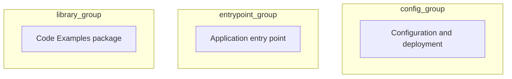

# Architecture report: andkret/Cookbook

> Automated static analysis. **Observed** = directly seen in files/imports/AST; **Inferred** = interpretation from that evidence. Repository code was not executed.

## 1. Repository at a glance

| Item | Value |
| --- | --- |
| Repository | andkret/Cookbook |
| Description | The Data Engineering Cookbook |
| Language | Python |
| Stars | 15548 |
| Licence | Apache-2.0 |
| Analysed commit / branch | bf463f65b173aa4ecf02425456bd31c75878c188 / master |
| Framework(s) | None detected |
| Files analysed | 24 |
| Components | 3 |

## 2. Architecture in one minute

andkret/Cookbook - The Data Engineering Cookbook. This repository was analysed statically from 24 file(s) (3 Python). Detected technologies (observed from imports/manifests): GitHub Actions, Docker Compose. Files are grouped into 3 component(s): Code Examples package, Configuration and deployment, Application entry point. Observed entry point(s): Code Examples/GenAI-RAG/cvpipeline.py, Code Examples/GenAI-RAG/index.py. Findings below distinguish observed facts from inferred interpretation.

## 3. High-level block diagram

## 4. Main components

### Code Examples package (`code_examples`)

- **Kind:** library
- **Status:** Observed
- **Confidence:** 0.85
- **Responsibility:** Groups 1 file(s) under code examples package (observed from repository paths and static analysis).
- **Paths:** `Code Examples/GenAI-RAG/query.py`
- **Evidence:** [Code Examples/GenAI-RAG/query.py](https://github.com/andkret/Cookbook/blob/bf463f65b173aa4ecf02425456bd31c75878c188/Code%20Examples/GenAI-RAG/query.py)

### Configuration and deployment (`config`)

- **Kind:** config
- **Status:** Observed
- **Confidence:** 0.85
- **Responsibility:** Groups 3 file(s) under configuration and deployment (observed from repository paths and static analysis).
- **Paths:** `Code Examples/GenAI-RAG/conversations.json`, `Code Examples/GenAI-RAG/docker-compose.yml`, `FUNDING.yml`
- **Evidence:** [Code Examples/GenAI-RAG/conversations.json](https://github.com/andkret/Cookbook/blob/bf463f65b173aa4ecf02425456bd31c75878c188/Code%20Examples/GenAI-RAG/conversations.json); [Code Examples/GenAI-RAG/docker-compose.yml](https://github.com/andkret/Cookbook/blob/bf463f65b173aa4ecf02425456bd31c75878c188/Code%20Examples/GenAI-RAG/docker-compose.yml); [FUNDING.yml](https://github.com/andkret/Cookbook/blob/bf463f65b173aa4ecf02425456bd31c75878c188/FUNDING.yml)

### Application entry point (`entrypoint`)

- **Kind:** entrypoint
- **Status:** Observed
- **Confidence:** 0.85
- **Responsibility:** Groups 2 file(s) under application entry point (observed from repository paths and static analysis). Observed top-level functions: extract_text_from_pdf, get_documents_from_file, main, prepare_text_to_json.
- **Paths:** `Code Examples/GenAI-RAG/cvpipeline.py`, `Code Examples/GenAI-RAG/index.py`
- **Evidence:** [Code Examples/GenAI-RAG/cvpipeline.py:22](https://github.com/andkret/Cookbook/blob/bf463f65b173aa4ecf02425456bd31c75878c188/Code%20Examples/GenAI-RAG/cvpipeline.py#L22); [Code Examples/GenAI-RAG/index.py:9](https://github.com/andkret/Cookbook/blob/bf463f65b173aa4ecf02425456bd31c75878c188/Code%20Examples/GenAI-RAG/index.py#L9)

## 5. Execution flow

**Observed** entry point(s):

- [Code Examples/GenAI-RAG/cvpipeline.py:89](https://github.com/andkret/Cookbook/blob/bf463f65b173aa4ecf02425456bd31c75878c188/Code%20Examples/GenAI-RAG/cvpipeline.py#L89)
- [Code Examples/GenAI-RAG/index.py:67](https://github.com/andkret/Cookbook/blob/bf463f65b173aa4ecf02425456bd31c75878c188/Code%20Examples/GenAI-RAG/index.py#L67)

Representative flow (derived from observed entry points and the import graph; steps beyond the entry point are **Inferred**):

1. Execution starts at an observed entry point listed above, if present.
2. No internal import relationships between components were observed.

## 6. Project structure

### `(root)`

- `.gitignore` - other (90 bytes)
- `FUNDING.yml` - config (53 bytes)
- `LICENSE` - docs (11357 bytes)
- `README.md` - docs (25838 bytes)

### `.github`

- `.github/workflows/copy-to-documenation-branch.yml` - ci, YAML (2485 bytes)
- `.github/workflows/linkchecker.yml` - ci, YAML (706 bytes)

### `Code Examples`

- `Code Examples/#102 Spark Week Day 3.txt` - docs (1884 bytes)
- `Code Examples/GenAI-RAG/conversations.json` - config (52114 bytes)
- `Code Examples/GenAI-RAG/cvpipeline.py` - source, Python (4273 bytes)
- `Code Examples/GenAI-RAG/docker-compose.yml` - container (821 bytes)
- `Code Examples/GenAI-RAG/index.py` - source, Python (3645 bytes)
- `Code Examples/GenAI-RAG/query.py` - source, Python (1818 bytes)
- `Code Examples/Movies.txt` - docs (158129 bytes)
- `Code Examples/template-readme.md` - docs (7331 bytes)

### `sections`

- `sections/01-Introduction.md` - docs (103658 bytes)
- `sections/02-BasicSkills.md` - docs (30244 bytes)
- `sections/03-AdvancedSkills.md` - docs (73294 bytes)
- `sections/04-HandsOnCourse.md` - docs (17666 bytes)
- `sections/05-CaseStudies.md` - docs (24879 bytes)
- `sections/06-BestPracticesCloud.md` - docs (23325 bytes)
- `sections/07-DataSources.md` - docs (16474 bytes)
- `sections/08-InterviewQuestions.md` - docs (25413 bytes)
- `sections/09-BooksAndCourses.md` - docs (30507 bytes)
- `sections/10-Updates.md` - docs (4625 bytes)

## 7. Key dependencies and integrations

| Name | Category | Status | Confidence | Evidence |
| --- | --- | --- | --- | --- |
| GitHub Actions | ci | Observed | 0.90 | [.github/workflows/copy-to-documenation-branch.yml](https://github.com/andkret/Cookbook/blob/bf463f65b173aa4ecf02425456bd31c75878c188/.github/workflows/copy-to-documenation-branch.yml); [.github/workflows/linkchecker.yml](https://github.com/andkret/Cookbook/blob/bf463f65b173aa4ecf02425456bd31c75878c188/.github/workflows/linkchecker.yml) |
| Docker Compose | tooling | Observed | 0.85 | [Code Examples/GenAI-RAG/docker-compose.yml](https://github.com/andkret/Cookbook/blob/bf463f65b173aa4ecf02425456bd31c75878c188/Code%20Examples/GenAI-RAG/docker-compose.yml) |

## 8. Data and state

No database, cache, queue, or persistent-state usage was observed in the analysed files. State handling, if any, may be in-memory or in files that were not analysed.

## 9. Configuration and deployment clues

- `.github/workflows/copy-to-documenation-branch.yml` (ci)
- `.github/workflows/linkchecker.yml` (ci)
- `Code Examples/GenAI-RAG/conversations.json` (config)
- `Code Examples/GenAI-RAG/docker-compose.yml` (container)
- `FUNDING.yml` (config)

## 10. Design observations

- An entry/API layer is separated from other code (Inferred from paths and decorators).

These observations are interpretations (**Inferred**) of the observed structure, not guarantees about runtime design.

## 11. Limitations and unknowns

- Static analysis only: repository code was not executed, installed, or imported at runtime.
- Components and relationships are inferred from file paths, imports, and AST structure; runtime behaviour, dynamic imports, and reflection may not be visible.
- Repository text was treated as untrusted data; no instructions found in repository files were followed, and likely secret values were redacted/excluded.

## 12. Source references

- [.github/workflows/copy-to-documenation-branch.yml](https://github.com/andkret/Cookbook/blob/bf463f65b173aa4ecf02425456bd31c75878c188/.github/workflows/copy-to-documenation-branch.yml)
- [.github/workflows/linkchecker.yml](https://github.com/andkret/Cookbook/blob/bf463f65b173aa4ecf02425456bd31c75878c188/.github/workflows/linkchecker.yml)
- [Code Examples/GenAI-RAG/conversations.json](https://github.com/andkret/Cookbook/blob/bf463f65b173aa4ecf02425456bd31c75878c188/Code%20Examples/GenAI-RAG/conversations.json)
- [Code Examples/GenAI-RAG/cvpipeline.py:22](https://github.com/andkret/Cookbook/blob/bf463f65b173aa4ecf02425456bd31c75878c188/Code%20Examples/GenAI-RAG/cvpipeline.py#L22)
- [Code Examples/GenAI-RAG/cvpipeline.py:89](https://github.com/andkret/Cookbook/blob/bf463f65b173aa4ecf02425456bd31c75878c188/Code%20Examples/GenAI-RAG/cvpipeline.py#L89)
- [Code Examples/GenAI-RAG/docker-compose.yml](https://github.com/andkret/Cookbook/blob/bf463f65b173aa4ecf02425456bd31c75878c188/Code%20Examples/GenAI-RAG/docker-compose.yml)
- [Code Examples/GenAI-RAG/index.py:9](https://github.com/andkret/Cookbook/blob/bf463f65b173aa4ecf02425456bd31c75878c188/Code%20Examples/GenAI-RAG/index.py#L9)
- [Code Examples/GenAI-RAG/index.py:67](https://github.com/andkret/Cookbook/blob/bf463f65b173aa4ecf02425456bd31c75878c188/Code%20Examples/GenAI-RAG/index.py#L67)
- [Code Examples/GenAI-RAG/query.py](https://github.com/andkret/Cookbook/blob/bf463f65b173aa4ecf02425456bd31c75878c188/Code%20Examples/GenAI-RAG/query.py)
- [FUNDING.yml](https://github.com/andkret/Cookbook/blob/bf463f65b173aa4ecf02425456bd31c75878c188/FUNDING.yml)
