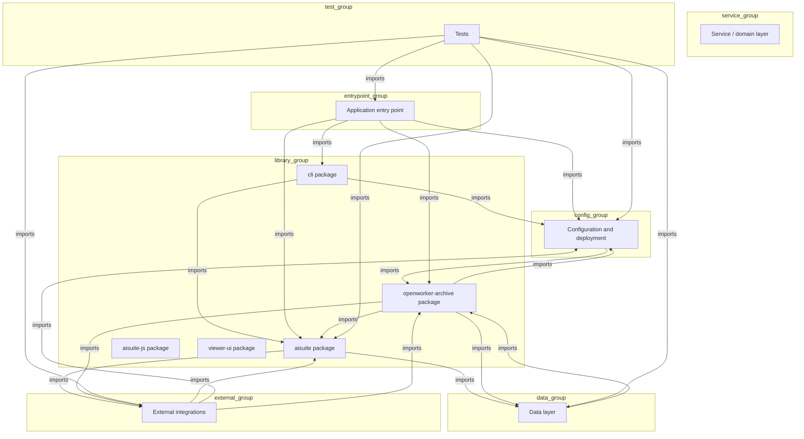

# Architecture report: andrewyng/aisuite

> Automated static analysis. **Observed** = directly seen in files/imports/AST; **Inferred** = interpretation from that evidence. Repository code was not executed.

## 1. Repository at a glance

| Item | Value |
| --- | --- |
| Repository | andrewyng/aisuite |
| Description | Simple, unified interface to multiple Generative AI providers  |
| Language | Python |
| Stars | 16400 |
| Licence | MIT |
| Analysed commit / branch | 66c7890c2d68c2d67f41723bc848bb6713d82a9c / main |
| Framework(s) | FastAPI, React, Starlette |
| Files analysed | 715 |
| Components | 11 |

## 2. Architecture in one minute

andrewyng/aisuite - Simple, unified interface to multiple Generative AI providers . This repository was analysed statically from 715 file(s) (355 Python). Detected technologies (observed from imports/manifests): GitHub Actions, PostgreSQL, SQLite, FastAPI, React, Starlette. Files are grouped into 11 component(s): aisuite package, aisuite-js package, cli package, Configuration and deployment, Data layer, Application entry point, External integrations, openworker-archive package. Observed entry point(s): aisuite/agents/viewer.py, aisuite/tracing/viewer.py, cli/py/aisuite-code-cli/aisuite_code_cli/main.py. Findings below distinguish observed facts from inferred interpretation.

## 3. High-level block diagram

## 4. Main components

### aisuite package (`aisuite`)

- **Kind:** library
- **Status:** Observed
- **Confidence:** 0.85
- **Responsibility:** Groups 64 file(s) under aisuite package (observed from repository paths and static analysis). Observed top-level classes: ASRError, ActiveRunContext, Agent, AllowAllToolPolicy, AllowToolsPolicy, Alternative. Observed top-level functions: _artifact_id, _artifact_metadata, _artifactize_value, _assert_revision, _collect_artifactized_fields, _content_modalities.
- **Paths:** `aisuite/__init__.py`, `aisuite/agents/__init__.py`, `aisuite/agents/artifact_store.py`, `aisuite/agents/artifacts.py`, `aisuite/agents/context.py`, `aisuite/agents/policies.py`, `aisuite/agents/postgres_state_store.py`, `aisuite/agents/runner.py`, `aisuite/agents/state_store.py`, `aisuite/agents/tools.py`, `aisuite/agents/types.py`, `aisuite/agents/utils.py`, `aisuite/framework/__init__.py`, `aisuite/framework/asr_params.py`, `aisuite/framework/chat_completion_chunk.py`, `aisuite/framework/chat_completion_response.py`, `aisuite/framework/choice.py`, `aisuite/framework/message.py`, `aisuite/framework/parameter_mapper.py`, `aisuite/framework/provider_interface.py`, `aisuite/mcp/__init__.py`, `aisuite/mcp/schema_converter.py`, `aisuite/mcp/tool_wrapper.py`, `aisuite/provider.py`, `aisuite/providers/__init__.py`, `aisuite/providers/anthropic_provider.py`, `aisuite/providers/aws_provider.py`, `aisuite/providers/azure_provider.py`, `aisuite/providers/cerebras_provider.py`, `aisuite/providers/cohere_provider.py`, `aisuite/providers/crusoe_provider.py`, `aisuite/providers/deepgram_provider.py`, `aisuite/providers/deepseek_provider.py`, `aisuite/providers/edenai_provider.py`, `aisuite/providers/featherless_provider.py`, `aisuite/providers/fireworks_provider.py`, `aisuite/providers/gemini_provider.py`, `aisuite/providers/google_provider.py`, `aisuite/providers/groq_provider.py`, `aisuite/providers/huggingface_provider.py`, `aisuite/providers/inception_provider.py`, `aisuite/providers/lmstudio_provider.py`, `aisuite/providers/message_converter.py`, `aisuite/providers/mistral_provider.py`, `aisuite/providers/nebius_provider.py`, `aisuite/providers/ollama_provider.py`, `aisuite/providers/openai_provider.py`, `aisuite/providers/openrouter_provider.py`, `aisuite/providers/requesty_provider.py`, `aisuite/providers/sambanova_provider.py`, `aisuite/providers/together_provider.py`, `aisuite/providers/tongyi_provider.py`, `aisuite/providers/watsonx_provider.py`, `aisuite/providers/xai_provider.py`, `aisuite/toolkits/__init__.py`, `aisuite/toolkits/files.py`, `aisuite/toolkits/git.py`, `aisuite/toolkits/shell.py`, `aisuite/tracing/__init__.py`, `aisuite/tracing/normalize.py`, `aisuite/tracing/sinks.py`, `aisuite/tracing/store.py`, `aisuite/utils/tools.py`, `aisuite/utils/utils.py`
- **Evidence:** [aisuite/__init__.py](https://github.com/andrewyng/aisuite/blob/66c7890c2d68c2d67f41723bc848bb6713d82a9c/aisuite/__init__.py); [aisuite/agents/__init__.py](https://github.com/andrewyng/aisuite/blob/66c7890c2d68c2d67f41723bc848bb6713d82a9c/aisuite/agents/__init__.py); [aisuite/agents/artifact_store.py:15](https://github.com/andrewyng/aisuite/blob/66c7890c2d68c2d67f41723bc848bb6713d82a9c/aisuite/agents/artifact_store.py#L15); [aisuite/agents/artifacts.py:16](https://github.com/andrewyng/aisuite/blob/66c7890c2d68c2d67f41723bc848bb6713d82a9c/aisuite/agents/artifacts.py#L16); [aisuite/agents/context.py:16](https://github.com/andrewyng/aisuite/blob/66c7890c2d68c2d67f41723bc848bb6713d82a9c/aisuite/agents/context.py#L16); [aisuite/agents/policies.py:9](https://github.com/andrewyng/aisuite/blob/66c7890c2d68c2d67f41723bc848bb6713d82a9c/aisuite/agents/policies.py#L9); [aisuite/agents/postgres_state_store.py:64](https://github.com/andrewyng/aisuite/blob/66c7890c2d68c2d67f41723bc848bb6713d82a9c/aisuite/agents/postgres_state_store.py#L64); [aisuite/agents/runner.py:26](https://github.com/andrewyng/aisuite/blob/66c7890c2d68c2d67f41723bc848bb6713d82a9c/aisuite/agents/runner.py#L26)

### aisuite-js package (`aisuite_js`)

- **Kind:** library
- **Status:** Observed
- **Confidence:** 0.85
- **Responsibility:** Groups 54 file(s) under aisuite-js package (observed from repository paths and static analysis).
- **Paths:** `aisuite-js/examples/basic-usage.ts`, `aisuite-js/examples/chat-app/.eslintrc.cjs`, `aisuite-js/examples/chat-app/postcss.config.js`, `aisuite-js/examples/chat-app/src/App.tsx`, `aisuite-js/examples/chat-app/src/components/ApiKeyModal.tsx`, `aisuite-js/examples/chat-app/src/components/ChatContainer.tsx`, `aisuite-js/examples/chat-app/src/components/ChatInput.tsx`, `aisuite-js/examples/chat-app/src/components/ChatMessage.tsx`, `aisuite-js/examples/chat-app/src/components/ModelSelector.tsx`, `aisuite-js/examples/chat-app/src/components/ProviderSelector.tsx`, `aisuite-js/examples/chat-app/src/main.tsx`, `aisuite-js/examples/chat-app/src/types/chat.ts`, `aisuite-js/examples/chat-app/src/utils/cn.ts`, `aisuite-js/examples/chat-app/tailwind.config.js`, `aisuite-js/examples/chat-app/vite.config.ts`, `aisuite-js/examples/deepgram.ts`, `aisuite-js/examples/groq.ts`, `aisuite-js/examples/mistral.ts`, `aisuite-js/examples/openai-asr.ts`, `aisuite-js/examples/streaming.ts`, `aisuite-js/examples/test-suite.ts`, `aisuite-js/examples/tool-calling.ts`, `aisuite-js/jest.config.ts`, `aisuite-js/src/asr-providers/deepgram/adapters.ts`, `aisuite-js/src/asr-providers/deepgram/index.ts`, `aisuite-js/src/asr-providers/deepgram/provider.ts`, `aisuite-js/src/asr-providers/deepgram/types.ts`, `aisuite-js/src/asr-providers/index.ts`, `aisuite-js/src/client.ts`, `aisuite-js/src/index.ts`, `aisuite-js/src/providers/anthropic/adapters.ts`, `aisuite-js/src/providers/anthropic/index.ts`, `aisuite-js/src/providers/anthropic/provider.ts`, `aisuite-js/src/providers/anthropic/types.ts`, `aisuite-js/src/providers/groq/adapters.ts`, `aisuite-js/src/providers/groq/index.ts`, `aisuite-js/src/providers/groq/provider.ts`, `aisuite-js/src/providers/groq/types.ts`, `aisuite-js/src/providers/index.ts`, `aisuite-js/src/providers/mistral/adapters.ts`, `aisuite-js/src/providers/mistral/index.ts`, `aisuite-js/src/providers/mistral/provider.ts`, `aisuite-js/src/providers/mistral/types.ts`, `aisuite-js/src/providers/openai/adapters.ts`, `aisuite-js/src/providers/openai/index.ts`, `aisuite-js/src/providers/openai/provider.ts`, `aisuite-js/src/providers/openai/types.ts`, `aisuite-js/src/types/chat.ts`, `aisuite-js/src/types/common.ts`, `aisuite-js/src/types/index.ts`, `aisuite-js/src/types/providers.ts`, `aisuite-js/src/types/tools.ts`, `aisuite-js/src/types/transcription.ts`, `aisuite-js/src/utils/streaming.ts`
- **Evidence:** [aisuite-js/examples/basic-usage.ts](https://github.com/andrewyng/aisuite/blob/66c7890c2d68c2d67f41723bc848bb6713d82a9c/aisuite-js/examples/basic-usage.ts); [aisuite-js/examples/chat-app/.eslintrc.cjs](https://github.com/andrewyng/aisuite/blob/66c7890c2d68c2d67f41723bc848bb6713d82a9c/aisuite-js/examples/chat-app/.eslintrc.cjs); [aisuite-js/examples/chat-app/postcss.config.js](https://github.com/andrewyng/aisuite/blob/66c7890c2d68c2d67f41723bc848bb6713d82a9c/aisuite-js/examples/chat-app/postcss.config.js); [aisuite-js/examples/chat-app/src/App.tsx](https://github.com/andrewyng/aisuite/blob/66c7890c2d68c2d67f41723bc848bb6713d82a9c/aisuite-js/examples/chat-app/src/App.tsx); [aisuite-js/examples/chat-app/src/components/ApiKeyModal.tsx](https://github.com/andrewyng/aisuite/blob/66c7890c2d68c2d67f41723bc848bb6713d82a9c/aisuite-js/examples/chat-app/src/components/ApiKeyModal.tsx); [aisuite-js/examples/chat-app/src/components/ChatContainer.tsx](https://github.com/andrewyng/aisuite/blob/66c7890c2d68c2d67f41723bc848bb6713d82a9c/aisuite-js/examples/chat-app/src/components/ChatContainer.tsx); [aisuite-js/examples/chat-app/src/components/ChatInput.tsx](https://github.com/andrewyng/aisuite/blob/66c7890c2d68c2d67f41723bc848bb6713d82a9c/aisuite-js/examples/chat-app/src/components/ChatInput.tsx); [aisuite-js/examples/chat-app/src/components/ChatMessage.tsx](https://github.com/andrewyng/aisuite/blob/66c7890c2d68c2d67f41723bc848bb6713d82a9c/aisuite-js/examples/chat-app/src/components/ChatMessage.tsx)

### cli package (`cli`)

- **Kind:** library
- **Status:** Observed
- **Confidence:** 0.85
- **Responsibility:** Groups 4 file(s) under cli package (observed from repository paths and static analysis). Observed top-level classes: ApprovalController. Observed top-level functions: _approval_action, _approval_effect, _approval_preview, _coding_tools, _exact_command, _is_artifact_ref.
- **Paths:** `cli/py/aisuite-code-cli/aisuite_code_cli/__init__.py`, `cli/py/aisuite-code-cli/aisuite_code_cli/agent.py`, `cli/py/aisuite-code-cli/aisuite_code_cli/approval.py`, `cli/py/aisuite-code-cli/aisuite_code_cli/rendering.py`
- **Evidence:** [cli/py/aisuite-code-cli/aisuite_code_cli/__init__.py](https://github.com/andrewyng/aisuite/blob/66c7890c2d68c2d67f41723bc848bb6713d82a9c/cli/py/aisuite-code-cli/aisuite_code_cli/__init__.py); [cli/py/aisuite-code-cli/aisuite_code_cli/agent.py:8](https://github.com/andrewyng/aisuite/blob/66c7890c2d68c2d67f41723bc848bb6713d82a9c/cli/py/aisuite-code-cli/aisuite_code_cli/agent.py#L8); [cli/py/aisuite-code-cli/aisuite_code_cli/approval.py:10](https://github.com/andrewyng/aisuite/blob/66c7890c2d68c2d67f41723bc848bb6713d82a9c/cli/py/aisuite-code-cli/aisuite_code_cli/approval.py#L10); [cli/py/aisuite-code-cli/aisuite_code_cli/rendering.py:16](https://github.com/andrewyng/aisuite/blob/66c7890c2d68c2d67f41723bc848bb6713d82a9c/cli/py/aisuite-code-cli/aisuite_code_cli/rendering.py#L16)

### Configuration and deployment (`config`)

- **Kind:** config
- **Status:** Observed
- **Confidence:** 0.85
- **Responsibility:** Groups 26 file(s) under configuration and deployment (observed from repository paths and static analysis). Observed top-level classes: CliConfig, Config, ConnectorSettings, MCPConfig, MCPServerDef, TeamAuth. Observed top-level functions: _config_paths, _csv, _gcal_account_list, _github_install_profiles, _github_installations, _gmail_account_list.
- **Paths:** `aisuite-js/examples/.env.example`, `aisuite-js/examples/chat-app/package.json`, `aisuite-js/examples/chat-app/src/config/llm-config.ts`, `aisuite-js/examples/chat-app/tsconfig.json`, `aisuite-js/examples/chat-app/tsconfig.node.json`, `aisuite-js/package.json`, `aisuite-js/tsconfig.json`, `aisuite/mcp/config.py`, `cli/py/aisuite-code-cli/aisuite_code_cli/config.py`, `cli/py/aisuite-code-cli/pyproject.toml`, `openworker-archive/coworker/config.py`, `openworker-archive/coworker/connectors/config.py`, `openworker-archive/coworker/connectors/setup.py`, `openworker-archive/coworker/mcp/config.py`, `openworker-archive/docs/config.example.toml`, `openworker-archive/pyproject.toml`, `openworker-archive/release-workflow.yml`, `openworker-archive/stt/Cargo.toml`, `openworker-archive/surfaces/gui/package.json`, `openworker-archive/surfaces/gui/src-tauri/Cargo.toml`, `openworker-archive/surfaces/gui/src-tauri/capabilities/default.json`, `openworker-archive/surfaces/gui/src-tauri/tauri.conf.json`, `openworker-archive/surfaces/gui/tsconfig.json`, `openworker-archive/surfaces/gui/tsconfig.node.json`, `pyproject.toml`, `viewer-ui/package.json`
- **Evidence:** [aisuite-js/examples/.env.example](https://github.com/andrewyng/aisuite/blob/66c7890c2d68c2d67f41723bc848bb6713d82a9c/aisuite-js/examples/.env.example); [aisuite-js/examples/chat-app/package.json](https://github.com/andrewyng/aisuite/blob/66c7890c2d68c2d67f41723bc848bb6713d82a9c/aisuite-js/examples/chat-app/package.json); [aisuite-js/examples/chat-app/src/config/llm-config.ts](https://github.com/andrewyng/aisuite/blob/66c7890c2d68c2d67f41723bc848bb6713d82a9c/aisuite-js/examples/chat-app/src/config/llm-config.ts); [aisuite-js/examples/chat-app/tsconfig.json](https://github.com/andrewyng/aisuite/blob/66c7890c2d68c2d67f41723bc848bb6713d82a9c/aisuite-js/examples/chat-app/tsconfig.json); [aisuite-js/examples/chat-app/tsconfig.node.json](https://github.com/andrewyng/aisuite/blob/66c7890c2d68c2d67f41723bc848bb6713d82a9c/aisuite-js/examples/chat-app/tsconfig.node.json); [aisuite-js/package.json](https://github.com/andrewyng/aisuite/blob/66c7890c2d68c2d67f41723bc848bb6713d82a9c/aisuite-js/package.json); [aisuite-js/tsconfig.json](https://github.com/andrewyng/aisuite/blob/66c7890c2d68c2d67f41723bc848bb6713d82a9c/aisuite-js/tsconfig.json); [aisuite/mcp/config.py:11](https://github.com/andrewyng/aisuite/blob/66c7890c2d68c2d67f41723bc848bb6713d82a9c/aisuite/mcp/config.py#L11)

### Data layer (`data_layer`)

- **Kind:** data
- **Status:** Observed
- **Confidence:** 0.85
- **Responsibility:** Groups 1 file(s) under data layer (observed from repository paths and static analysis). Observed top-level classes: Schedule, ScheduledTask, TaskRun. Observed top-level functions: _human_time, _now, grant_entries, rule_entry, rule_parts.
- **Paths:** `openworker-archive/coworker/automation/models.py`
- **Evidence:** [openworker-archive/coworker/automation/models.py:16](https://github.com/andrewyng/aisuite/blob/66c7890c2d68c2d67f41723bc848bb6713d82a9c/openworker-archive/coworker/automation/models.py#L16)

### Application entry point (`entrypoint`)

- **Kind:** entrypoint
- **Status:** Observed
- **Confidence:** 0.85
- **Responsibility:** Groups 13 file(s) under application entry point (observed from repository paths and static analysis). Observed application object created via FastAPI. Observed top-level classes: ApprovalScreen, CodeCli, CoworkerApp, FakeSlack, ViewerServer, ViewerTraceState. Observed top-level functions: _activity_base, _artifact_payload, _browser_page, _child_run_summary, _cmd_send, _cmd_status.
- **Paths:** `aisuite/agents/viewer.py`, `aisuite/tracing/viewer.py`, `cli/py/aisuite-code-cli/aisuite_code_cli/app.py`, `cli/py/aisuite-code-cli/aisuite_code_cli/main.py`, `openworker-archive/coworker/cli.py`, `openworker-archive/coworker/connectors/cli.py`, `openworker-archive/coworker/server/app.py`, `openworker-archive/coworker/server/run.py`, `openworker-archive/coworker/testing/fake_slack/__main__.py`, `openworker-archive/coworker/testing/fake_slack/server.py`, `openworker-archive/coworker/tui/app.py`, `openworker-archive/packaging/make_update_manifest.py`, `openworker-archive/packaging/server_entry.py`
- **Evidence:** [aisuite/agents/viewer.py](https://github.com/andrewyng/aisuite/blob/66c7890c2d68c2d67f41723bc848bb6713d82a9c/aisuite/agents/viewer.py); [aisuite/tracing/viewer.py:441](https://github.com/andrewyng/aisuite/blob/66c7890c2d68c2d67f41723bc848bb6713d82a9c/aisuite/tracing/viewer.py#L441); [cli/py/aisuite-code-cli/aisuite_code_cli/app.py:15](https://github.com/andrewyng/aisuite/blob/66c7890c2d68c2d67f41723bc848bb6713d82a9c/cli/py/aisuite-code-cli/aisuite_code_cli/app.py#L15); [cli/py/aisuite-code-cli/aisuite_code_cli/main.py:9](https://github.com/andrewyng/aisuite/blob/66c7890c2d68c2d67f41723bc848bb6713d82a9c/cli/py/aisuite-code-cli/aisuite_code_cli/main.py#L9); [openworker-archive/coworker/cli.py:18](https://github.com/andrewyng/aisuite/blob/66c7890c2d68c2d67f41723bc848bb6713d82a9c/openworker-archive/coworker/cli.py#L18); [openworker-archive/coworker/connectors/cli.py:29](https://github.com/andrewyng/aisuite/blob/66c7890c2d68c2d67f41723bc848bb6713d82a9c/openworker-archive/coworker/connectors/cli.py#L29); [openworker-archive/coworker/server/app.py:151](https://github.com/andrewyng/aisuite/blob/66c7890c2d68c2d67f41723bc848bb6713d82a9c/openworker-archive/coworker/server/app.py#L151); [openworker-archive/coworker/server/run.py:17](https://github.com/andrewyng/aisuite/blob/66c7890c2d68c2d67f41723bc848bb6713d82a9c/openworker-archive/coworker/server/run.py#L17)

### External integrations (`external_integrations`)

- **Kind:** external
- **Status:** Observed
- **Confidence:** 0.85
- **Responsibility:** Groups 4 file(s) under external integrations (observed from repository paths and static analysis). Observed top-level classes: Audio, Chat, Client, Completions, MCPClient, MCPManager. Observed top-level functions: _result_payload.
- **Paths:** `aisuite/client.py`, `aisuite/mcp/client.py`, `openworker-archive/coworker/connectors/relay_client.py`, `openworker-archive/coworker/mcp/client.py`
- **Evidence:** [aisuite/client.py:23](https://github.com/andrewyng/aisuite/blob/66c7890c2d68c2d67f41723bc848bb6713d82a9c/aisuite/client.py#L23); [aisuite/mcp/client.py:34](https://github.com/andrewyng/aisuite/blob/66c7890c2d68c2d67f41723bc848bb6713d82a9c/aisuite/mcp/client.py#L34); [openworker-archive/coworker/connectors/relay_client.py:40](https://github.com/andrewyng/aisuite/blob/66c7890c2d68c2d67f41723bc848bb6713d82a9c/openworker-archive/coworker/connectors/relay_client.py#L40); [openworker-archive/coworker/mcp/client.py:26](https://github.com/andrewyng/aisuite/blob/66c7890c2d68c2d67f41723bc848bb6713d82a9c/openworker-archive/coworker/mcp/client.py#L26)

### openworker-archive package (`openworker_archive`)

- **Kind:** library
- **Status:** Observed
- **Confidence:** 0.85
- **Responsibility:** Groups 250 file(s) under openworker-archive package (observed from repository paths and static analysis). Observed top-level classes: Agent, AgentContext, AnthropicProvider, ApprovalOutcome, AssistantTurn, AuditStore. Observed top-level functions: _account_profile, _acct_result, _api_base, _approval_body, _artifact_kind, _assistant_message.
- **Paths:** `openworker-archive/coworker/__init__.py`, `openworker-archive/coworker/agent.py`, `openworker-archive/coworker/agents/__init__.py`, `openworker-archive/coworker/agents/base.py`, `openworker-archive/coworker/agents/chat.py`, `openworker-archive/coworker/agents/code.py`, `openworker-archive/coworker/agents/cowork.py`, `openworker-archive/coworker/agents/myhelper.py`, `openworker-archive/coworker/agents/registry.py`, `openworker-archive/coworker/attachments.py`, `openworker-archive/coworker/audit.py`, `openworker-archive/coworker/automation/__init__.py`, `openworker-archive/coworker/automation/scheduler.py`, `openworker-archive/coworker/automation/store.py`, `openworker-archive/coworker/automation/tools.py`, `openworker-archive/coworker/catalog.py`, `openworker-archive/coworker/cloud.py`, `openworker-archive/coworker/connections.py`, `openworker-archive/coworker/connectors/__init__.py`, `openworker-archive/coworker/connectors/accounts.py`, `openworker-archive/coworker/connectors/adapters.py`, `openworker-archive/coworker/connectors/attribution.py`, `openworker-archive/coworker/connectors/base.py`, `openworker-archive/coworker/connectors/browser_automation.py`, `openworker-archive/coworker/connectors/catalog_copy.py`, `openworker-archive/coworker/connectors/descriptors.py`, `openworker-archive/coworker/connectors/email_tools.py`, `openworker-archive/coworker/connectors/experimental/__init__.py`, `openworker-archive/coworker/connectors/fake.py`, `openworker-archive/coworker/connectors/gateway.py`, `openworker-archive/coworker/connectors/gcal_accounts.py`, `openworker-archive/coworker/connectors/github_installs.py`, `openworker-archive/coworker/connectors/github_relay.py`, `openworker-archive/coworker/connectors/gmail_accounts.py`, `openworker-archive/coworker/connectors/hubspot_portals.py`, `openworker-archive/coworker/connectors/integration_tools.py`, `openworker-archive/coworker/connectors/parked.py`, `openworker-archive/coworker/connectors/senders.py`, `openworker-archive/coworker/connectors/slack_addr.py`, `openworker-archive/coworker/connectors/slack_directory.py`, `openworker-archive/coworker/connectors/tool_defs.py`, `openworker-archive/coworker/connectors/tools.py`, `openworker-archive/coworker/conversations.py`, `openworker-archive/coworker/engine.py`, `openworker-archive/coworker/environment.py`, `openworker-archive/coworker/events.py`, `openworker-archive/coworker/inbox.py`, `openworker-archive/coworker/inbox_routing.py`, `openworker-archive/coworker/interactions.py`, `openworker-archive/coworker/mcp/__init__.py`, `openworker-archive/coworker/mcp/oauth.py`, `openworker-archive/coworker/mcp/tools.py`, `openworker-archive/coworker/memory/__init__.py`, `openworker-archive/coworker/memory/base.py`, `openworker-archive/coworker/memory/sqlite_store.py`, `openworker-archive/coworker/memory/tools.py`, `openworker-archive/coworker/mentions.py`, `openworker-archive/coworker/overrides.py`, `openworker-archive/coworker/pdf_support.py`, `openworker-archive/coworker/permissions.py`, `openworker-archive/coworker/personas/__init__.py`, `openworker-archive/coworker/personas/loading.py`, `openworker-archive/coworker/personas/manifest.py`, `openworker-archive/coworker/personas/registry.py`, `openworker-archive/coworker/project.py`, `openworker-archive/coworker/providers/__init__.py`, `openworker-archive/coworker/providers/anthropic_provider.py`, `openworker-archive/coworker/providers/base.py`, `openworker-archive/coworker/providers/capabilities.py`, `openworker-archive/coworker/providers/errors.py`, `openworker-archive/coworker/providers/gemini_provider.py`, `openworker-archive/coworker/providers/matrix.py`, `openworker-archive/coworker/providers/openai_provider.py`, `openworker-archive/coworker/providers/registry.py`, `openworker-archive/coworker/providers/router.py`, `openworker-archive/coworker/risk.py`, `openworker-archive/coworker/roots.py`, `openworker-archive/coworker/secrets.py`, `openworker-archive/coworker/selfwake.py`, `openworker-archive/coworker/server/__init__.py`, `openworker-archive/coworker/server/manager.py`, `openworker-archive/coworker/sessions.py`, `openworker-archive/coworker/skills/__init__.py`, `openworker-archive/coworker/skills/base.py`, `openworker-archive/coworker/subscriptions.py`, `openworker-archive/coworker/testing/__init__.py`, `openworker-archive/coworker/testing/fake_slack/__init__.py`, `openworker-archive/coworker/tools/__init__.py`, `openworker-archive/coworker/tools/ask.py`, `openworker-archive/coworker/tools/directories.py`, `openworker-archive/coworker/tools/files.py`, `openworker-archive/coworker/tools/git.py`, `openworker-archive/coworker/tools/plan.py`, `openworker-archive/coworker/tools/registry.py`, `openworker-archive/coworker/tools/search.py`, `openworker-archive/coworker/tools/shell.py`, `openworker-archive/coworker/tools/subagent.py`, `openworker-archive/coworker/tools/todo.py`, `openworker-archive/coworker/tui/__init__.py`, `openworker-archive/coworker/unattended.py`, `openworker-archive/coworker/unrouted.py`, `openworker-archive/coworker/web/__init__.py`, `openworker-archive/coworker/web/fetch.py`, `openworker-archive/coworker/web/providers.py`, `openworker-archive/coworker/web/tool.py`, `openworker-archive/packaging/build_dmg.sh`, `openworker-archive/packaging/setup_dev_env.sh`, `openworker-archive/stt/src/lib.rs`, `openworker-archive/surfaces/gui/e2e-live/api-smoke.spec.ts`, `openworker-archive/surfaces/gui/e2e-live/approval.spec.ts`, `openworker-archive/surfaces/gui/e2e-live/fib.spec.ts`, `openworker-archive/surfaces/gui/e2e-live/helpers.ts`, `openworker-archive/surfaces/gui/e2e-live/inbox.spec.ts`, `openworker-archive/surfaces/gui/e2e-live/persistence.spec.ts`, `openworker-archive/surfaces/gui/e2e-live/persona-install.spec.ts`, `openworker-archive/surfaces/gui/e2e/access-section.spec.ts`, `openworker-archive/surfaces/gui/e2e/accounts-page.spec.ts`, `openworker-archive/surfaces/gui/e2e/approval-card.spec.ts`, `openworker-archive/surfaces/gui/e2e/automations-manage.spec.ts`, `openworker-archive/surfaces/gui/e2e/automations-quickstart.spec.ts`, `openworker-archive/surfaces/gui/e2e/automations.spec.ts`, `openworker-archive/surfaces/gui/e2e/available-detail.spec.ts`, `openworker-archive/surfaces/gui/e2e/chat.spec.ts`, `openworker-archive/surfaces/gui/e2e/cloud-signin-placement.spec.ts`, `openworker-archive/surfaces/gui/e2e/cloud-status-pending.spec.ts`, `openworker-archive/surfaces/gui/e2e/cloud.spec.ts`, `openworker-archive/surfaces/gui/e2e/composer.spec.ts`, `openworker-archive/surfaces/gui/e2e/connector-page.spec.ts`, `openworker-archive/surfaces/gui/e2e/connectors-list.spec.ts`, `openworker-archive/surfaces/gui/e2e/family-gate.spec.ts`, `openworker-archive/surfaces/gui/e2e/fixtures.ts`, `openworker-archive/surfaces/gui/e2e/gallery.spec.ts`, `openworker-archive/surfaces/gui/e2e/gcal-page.spec.ts`, `openworker-archive/surfaces/gui/e2e/github-page.spec.ts`, `openworker-archive/surfaces/gui/e2e/gmail-page.spec.ts`, `openworker-archive/surfaces/gui/e2e/hubspot-page.spec.ts`, `openworker-archive/surfaces/gui/e2e/inbox.spec.ts`, `openworker-archive/surfaces/gui/e2e/mcp-connectors.spec.ts`, `openworker-archive/surfaces/gui/e2e/mcp-oauth.spec.ts`, `openworker-archive/surfaces/gui/e2e/nav-collapse.spec.ts`, `openworker-archive/surfaces/gui/e2e/onboarding.spec.ts`, `openworker-archive/surfaces/gui/e2e/persona-surfacing.spec.ts`, `openworker-archive/surfaces/gui/e2e/provider-keys.spec.ts`, `openworker-archive/surfaces/gui/e2e/roots.spec.ts`, `openworker-archive/surfaces/gui/e2e/session-intro.spec.ts`, `openworker-archive/surfaces/gui/e2e/session-shell.spec.ts`, `openworker-archive/surfaces/gui/e2e/settings.spec.ts`, `openworker-archive/surfaces/gui/e2e/sidebar-account.spec.ts`, `openworker-archive/surfaces/gui/e2e/sidebar-automations.spec.ts`, `openworker-archive/surfaces/gui/e2e/sidebar-sessions.spec.ts`, `openworker-archive/surfaces/gui/e2e/slack-directory.spec.ts`, `openworker-archive/surfaces/gui/e2e/slack-health.spec.ts`, `openworker-archive/surfaces/gui/e2e/slack-workspaces.spec.ts`, `openworker-archive/surfaces/gui/e2e/smoke.spec.ts`, `openworker-archive/surfaces/gui/e2e/sources-channels.spec.ts`, `openworker-archive/surfaces/gui/e2e/standing-approvals.spec.ts`, `openworker-archive/surfaces/gui/e2e/transcript-scroll.spec.ts`, `openworker-archive/surfaces/gui/e2e/unattended.spec.ts`, `openworker-archive/surfaces/gui/playwright.config.ts`, `openworker-archive/surfaces/gui/playwright.live.config.ts`, `openworker-archive/surfaces/gui/postcss.config.js`, `openworker-archive/surfaces/gui/src-tauri/build.rs`, `openworker-archive/surfaces/gui/src-tauri/src/lib.rs`, `openworker-archive/surfaces/gui/src-tauri/src/main.rs`, `openworker-archive/surfaces/gui/src/App.tsx`, `openworker-archive/surfaces/gui/src/api.ts`, `openworker-archive/surfaces/gui/src/attach.ts`, `openworker-archive/surfaces/gui/src/components/AccessSection.tsx`, `openworker-archive/surfaces/gui/src/components/AddFolderForm.tsx`, `openworker-archive/surfaces/gui/src/components/ApprovalCard.test.tsx`, `openworker-archive/surfaces/gui/src/components/ApprovalCard.tsx`, `openworker-archive/surfaces/gui/src/components/AuditView.tsx`, `openworker-archive/surfaces/gui/src/components/AutomationQuickstart.tsx`, `openworker-archive/surfaces/gui/src/components/Composer.tsx`, `openworker-archive/surfaces/gui/src/components/Composer.voice.test.tsx`, `openworker-archive/surfaces/gui/src/components/ConnectorMessageCard.test.tsx`, `openworker-archive/surfaces/gui/src/components/ConnectorMessageCard.tsx`, `openworker-archive/surfaces/gui/src/components/DirectoryRequestCard.tsx`, `openworker-archive/surfaces/gui/src/components/Dropdown.tsx`, `openworker-archive/surfaces/gui/src/components/FolderGate.tsx`, `openworker-archive/surfaces/gui/src/components/GalleryModal.tsx`, `openworker-archive/surfaces/gui/src/components/Icon.tsx`, `openworker-archive/surfaces/gui/src/components/InboxConfigure.tsx`, `openworker-archive/surfaces/gui/src/components/InboxItemCard.tsx`, `openworker-archive/surfaces/gui/src/components/InboxView.tsx`, `openworker-archive/surfaces/gui/src/components/IntegrationsView.tsx`, `openworker-archive/surfaces/gui/src/components/ManageTabs.tsx`, `openworker-archive/surfaces/gui/src/components/Markdown.test.tsx`, `openworker-archive/surfaces/gui/src/components/Markdown.tsx`, `openworker-archive/surfaces/gui/src/components/ModelChecklist.tsx`, `openworker-archive/surfaces/gui/src/components/Onboarding.tsx`, `openworker-archive/surfaces/gui/src/components/PersonaHero.tsx`, `openworker-archive/surfaces/gui/src/components/PersonaView.test.tsx`, `openworker-archive/surfaces/gui/src/components/PersonaView.tsx`, `openworker-archive/surfaces/gui/src/components/PersonasTab.tsx`, `openworker-archive/surfaces/gui/src/components/PlanCard.tsx`, `openworker-archive/surfaces/gui/src/components/RightRail.tsx`, `openworker-archive/surfaces/gui/src/components/RootRow.tsx`, `openworker-archive/surfaces/gui/src/components/ScheduledView.tsx`, `openworker-archive/surfaces/gui/src/components/SearchModal.tsx`, `openworker-archive/surfaces/gui/src/components/SelectMenu.tsx`, `openworker-archive/surfaces/gui/src/components/SessionIntro.tsx`, `openworker-archive/surfaces/gui/src/components/SettingsView.tsx`, `openworker-archive/surfaces/gui/src/components/Sidebar.test.tsx`, `openworker-archive/surfaces/gui/src/components/Sidebar.tsx`, `openworker-archive/surfaces/gui/src/components/SubscriptionsChip.tsx`, `openworker-archive/surfaces/gui/src/components/TodoPanel.tsx`, `openworker-archive/surfaces/gui/src/components/Toggle.tsx`, `openworker-archive/surfaces/gui/src/components/Transcript.test.tsx`, `openworker-archive/surfaces/gui/src/components/Transcript.tsx`, `openworker-archive/surfaces/gui/src/components/UpdateBanner.test.tsx`, `openworker-archive/surfaces/gui/src/components/UpdateBanner.tsx`, `openworker-archive/surfaces/gui/src/components/brandIcons.tsx`, `openworker-archive/surfaces/gui/src/components/connectors/AccountsDetail.tsx`, `openworker-archive/surfaces/gui/src/components/connectors/AddConnectionModal.tsx`, `openworker-archive/surfaces/gui/src/components/connectors/AvailableDetail.tsx`, `openworker-archive/surfaces/gui/src/components/connectors/CalendarDetail.tsx`, `openworker-archive/surfaces/gui/src/components/connectors/CloudSignIn.tsx`, `openworker-archive/surfaces/gui/src/components/connectors/ConnectorsList.tsx`, `openworker-archive/surfaces/gui/src/components/connectors/ConnectorsSection.tsx`, `openworker-archive/surfaces/gui/src/components/connectors/GithubDetail.tsx`, `openworker-archive/surfaces/gui/src/components/connectors/GmailDetail.tsx`, `openworker-archive/surfaces/gui/src/components/connectors/HubSpotDetail.tsx`, `openworker-archive/surfaces/gui/src/components/connectors/SlackDetail.tsx`, `openworker-archive/surfaces/gui/src/components/connectors/ToolsDisclosure.tsx`, `openworker-archive/surfaces/gui/src/components/connectors/ui.ts`, `openworker-archive/surfaces/gui/src/components/personaIcon.tsx`, `openworker-archive/surfaces/gui/src/connectors/ConnectorIcon.test.tsx`, `openworker-archive/surfaces/gui/src/connectors/ConnectorIcon.tsx`, `openworker-archive/surfaces/gui/src/connectors/registry.tsx`, `openworker-archive/surfaces/gui/src/connectors/visuals.ts`, `openworker-archive/surfaces/gui/src/flags.ts`, `openworker-archive/surfaces/gui/src/humanize.ts`, `openworker-archive/surfaces/gui/src/itemsFromMessages.test.ts`, `openworker-archive/surfaces/gui/src/itemsFromMessages.ts`, `openworker-archive/surfaces/gui/src/main.tsx`, `openworker-archive/surfaces/gui/src/paths.ts`, `openworker-archive/surfaces/gui/src/personaScope.ts`, `openworker-archive/surfaces/gui/src/providers/ProviderSetup.tsx`, `openworker-archive/surfaces/gui/src/providers/logos.ts`, `openworker-archive/surfaces/gui/src/streamGate.test.ts`, `openworker-archive/surfaces/gui/src/streamGate.ts`, `openworker-archive/surfaces/gui/src/tauri.ts`, `openworker-archive/surfaces/gui/src/theme.ts`, `openworker-archive/surfaces/gui/src/types.ts`, `openworker-archive/surfaces/gui/src/useRoots.ts`, `openworker-archive/surfaces/gui/src/vite-env.d.ts`, `openworker-archive/surfaces/gui/tailwind.config.js`, `openworker-archive/surfaces/gui/vite.config.ts`, `openworker-archive/surfaces/gui/vitest.config.ts`
- **Evidence:** [openworker-archive/coworker/__init__.py](https://github.com/andrewyng/aisuite/blob/66c7890c2d68c2d67f41723bc848bb6713d82a9c/openworker-archive/coworker/__init__.py); [openworker-archive/coworker/agent.py:84](https://github.com/andrewyng/aisuite/blob/66c7890c2d68c2d67f41723bc848bb6713d82a9c/openworker-archive/coworker/agent.py#L84); [openworker-archive/coworker/agents/__init__.py](https://github.com/andrewyng/aisuite/blob/66c7890c2d68c2d67f41723bc848bb6713d82a9c/openworker-archive/coworker/agents/__init__.py); [openworker-archive/coworker/agents/base.py:18](https://github.com/andrewyng/aisuite/blob/66c7890c2d68c2d67f41723bc848bb6713d82a9c/openworker-archive/coworker/agents/base.py#L18); [openworker-archive/coworker/agents/chat.py:15](https://github.com/andrewyng/aisuite/blob/66c7890c2d68c2d67f41723bc848bb6713d82a9c/openworker-archive/coworker/agents/chat.py#L15); [openworker-archive/coworker/agents/code.py:66](https://github.com/andrewyng/aisuite/blob/66c7890c2d68c2d67f41723bc848bb6713d82a9c/openworker-archive/coworker/agents/code.py#L66); [openworker-archive/coworker/agents/cowork.py:39](https://github.com/andrewyng/aisuite/blob/66c7890c2d68c2d67f41723bc848bb6713d82a9c/openworker-archive/coworker/agents/cowork.py#L39); [openworker-archive/coworker/agents/myhelper.py:17](https://github.com/andrewyng/aisuite/blob/66c7890c2d68c2d67f41723bc848bb6713d82a9c/openworker-archive/coworker/agents/myhelper.py#L17)

### Service / domain layer (`service_layer`)

- **Kind:** service
- **Status:** Observed
- **Confidence:** 0.85
- **Responsibility:** Groups 5 file(s) under service / domain layer (observed from repository paths and static analysis).
- **Paths:** `aisuite-js/examples/chat-app/src/services/aisuite-service.ts`, `aisuite-js/src/core/base-asr-provider.ts`, `aisuite-js/src/core/base-provider.ts`, `aisuite-js/src/core/errors.ts`, `aisuite-js/src/core/model-parser.ts`
- **Evidence:** [aisuite-js/examples/chat-app/src/services/aisuite-service.ts](https://github.com/andrewyng/aisuite/blob/66c7890c2d68c2d67f41723bc848bb6713d82a9c/aisuite-js/examples/chat-app/src/services/aisuite-service.ts); [aisuite-js/src/core/base-asr-provider.ts](https://github.com/andrewyng/aisuite/blob/66c7890c2d68c2d67f41723bc848bb6713d82a9c/aisuite-js/src/core/base-asr-provider.ts); [aisuite-js/src/core/base-provider.ts](https://github.com/andrewyng/aisuite/blob/66c7890c2d68c2d67f41723bc848bb6713d82a9c/aisuite-js/src/core/base-provider.ts); [aisuite-js/src/core/errors.ts](https://github.com/andrewyng/aisuite/blob/66c7890c2d68c2d67f41723bc848bb6713d82a9c/aisuite-js/src/core/errors.ts); [aisuite-js/src/core/model-parser.ts](https://github.com/andrewyng/aisuite/blob/66c7890c2d68c2d67f41723bc848bb6713d82a9c/aisuite-js/src/core/model-parser.ts)

### Tests (`tests`)

- **Kind:** test
- **Status:** Observed
- **Confidence:** 0.85
- **Responsibility:** Groups 161 file(s) under tests (observed from repository paths and static analysis). Observed routes: PATCH aisuite.provider.ProviderFactory.create_provider, PATCH aisuite.provider.ProviderFactory.create_provider, PATCH aisuite.provider.ProviderFactory.create_provider, PATCH aisuite.provider.ProviderFactory.create_provider, PATCH aisuite.provider.ProviderFactory.create_provider. Observed top-level classes: CapturingProvider, E2EProvider, FakeIMAP, FakeProvider, FakeResponse, FakeSMTP. Observed top-level functions: _account, _adapter, _allow_all, _approve_button, _bare_engine, _blank_pdf_url.
- **Paths:** `aisuite-js/tests/client.test.ts`, `aisuite-js/tests/providers/anthropic-provider.test.ts`, `aisuite-js/tests/providers/deepgram-provider.test.ts`, `aisuite-js/tests/providers/groq-provider.test.ts`, `aisuite-js/tests/providers/mistral-provider.test.ts`, `aisuite-js/tests/providers/openai-provider.test.ts`, `aisuite-js/tests/providers/openai_asr_provider.test.ts`, `aisuite-js/tests/utils/streaming.test.ts`, `openworker-archive/tests/conftest.py`, `openworker-archive/tests/test_accounts.py`, `openworker-archive/tests/test_anthropic_provider.py`, `openworker-archive/tests/test_attachments.py`, `openworker-archive/tests/test_automation.py`, `openworker-archive/tests/test_automation_create.py`, `openworker-archive/tests/test_autotitle.py`, `openworker-archive/tests/test_builtin_personas.py`, `openworker-archive/tests/test_catalog.py`, `openworker-archive/tests/test_cloud.py`, `openworker-archive/tests/test_cloud_server.py`, `openworker-archive/tests/test_code_tools.py`, `openworker-archive/tests/test_config.py`, `openworker-archive/tests/test_connections.py`, `openworker-archive/tests/test_connector_registry.py`, `openworker-archive/tests/test_connectors.py`, `openworker-archive/tests/test_connectors_allowlist.py`, `openworker-archive/tests/test_dm_routing.py`, `openworker-archive/tests/test_durable_resume.py`, `openworker-archive/tests/test_email_tools.py`, `openworker-archive/tests/test_engine.py`, `openworker-archive/tests/test_environment.py`, `openworker-archive/tests/test_fake_slack.py`, `openworker-archive/tests/test_gateway_inbox_reply.py`, `openworker-archive/tests/test_gcal_accounts.py`, `openworker-archive/tests/test_gemini_provider.py`, `openworker-archive/tests/test_github_installs.py`, `openworker-archive/tests/test_gmail_accounts.py`, `openworker-archive/tests/test_hubspot_portals.py`, `openworker-archive/tests/test_inbox.py`, `openworker-archive/tests/test_inbox_routing.py`, `openworker-archive/tests/test_interactions.py`, `openworker-archive/tests/test_mcp.py`, `openworker-archive/tests/test_mcp_connectors.py`, `openworker-archive/tests/test_mcp_oauth.py`, `openworker-archive/tests/test_memory.py`, `openworker-archive/tests/test_mention_router.py`, `openworker-archive/tests/test_message_source.py`, `openworker-archive/tests/test_message_timestamps.py`, `openworker-archive/tests/test_model_errors.py`, `openworker-archive/tests/test_multiroot.py`, `openworker-archive/tests/test_pdf_support.py`, `openworker-archive/tests/test_permissions_risk.py`, `openworker-archive/tests/test_persona_connections.py`, `openworker-archive/tests/test_persona_loading.py`, `openworker-archive/tests/test_persona_manifest.py`, `openworker-archive/tests/test_persona_registry.py`, `openworker-archive/tests/test_plan_mode.py`, `openworker-archive/tests/test_provider_router.py`, `openworker-archive/tests/test_provider_verify.py`, `openworker-archive/tests/test_providers.py`, `openworker-archive/tests/test_risk_overrides.py`, `openworker-archive/tests/test_secrets.py`, `openworker-archive/tests/test_self_wake.py`, `openworker-archive/tests/test_send_file.py`, `openworker-archive/tests/test_send_target_resolution.py`, `openworker-archive/tests/test_sender_attribution.py`, `openworker-archive/tests/test_server.py`, `openworker-archive/tests/test_session_events.py`, `openworker-archive/tests/test_session_persona.py`, `openworker-archive/tests/test_settings.py`, `openworker-archive/tests/test_shell.py`, `openworker-archive/tests/test_skills.py`, `openworker-archive/tests/test_slack_directory.py`, `openworker-archive/tests/test_slack_relay.py`, `openworker-archive/tests/test_slack_status.py`, `openworker-archive/tests/test_slack_workspaces.py`, `openworker-archive/tests/test_standing_approvals.py`, `openworker-archive/tests/test_subagent.py`, `openworker-archive/tests/test_subscriptions.py`, `openworker-archive/tests/test_team_allowlist.py`, `openworker-archive/tests/test_tools_permissions.py`, `openworker-archive/tests/test_tui.py`, `openworker-archive/tests/test_ui_refresh_e2e.py`, `openworker-archive/tests/test_unattended.py`, `openworker-archive/tests/test_wake_resume.py`, `openworker-archive/tests/test_web_search.py`, `tests/__init__.py`, `tests/agents/__init__.py`, `tests/agents/helpers.py`, `tests/agents/test_agent.py`, `tests/agents/test_agent_integration_flows.py`, `tests/agents/test_artifact_store.py`, `tests/agents/test_async_runner.py`, `tests/agents/test_continuation.py`, `tests/agents/test_openai_integration.py`, `tests/agents/test_postgres_state_store.py`, `tests/agents/test_runner.py`, `tests/agents/test_state_store.py`, `tests/agents/test_subagent_tool.py`, `tests/agents/test_tool_metadata_policy.py`, `tests/agents/test_tool_policy.py`, `tests/agents/test_trace_output.py`, `tests/agents/test_trace_sinks.py`, `tests/agents/test_viewer.py`, `tests/cli/test_aisuite_code_cli.py`, `tests/client/__init__.py`, `tests/client/test_async_client.py`, `tests/client/test_client.py`, `tests/client/test_manual_tool_calling.py`, `tests/client/test_prerelease.py`, `tests/client/test_streaming.py`, `tests/examples/test_dev_cli.py`, `tests/framework/test_asr_models.py`, `tests/framework/test_asr_params.py`, `tests/mcp/README.md`, `tests/mcp/__init__.py`, `tests/mcp/conftest.py`, `tests/mcp/test_client.py`, `tests/mcp/test_e2e.py`, `tests/mcp/test_http_llm_e2e.py`, `tests/mcp/test_http_transport.py`, `tests/mcp/test_llm_e2e.py`, `tests/providers/__init__.py`, `tests/providers/test_anthropic_converter.py`, `tests/providers/test_anthropic_images.py`, `tests/providers/test_anthropic_streaming.py`, `tests/providers/test_asr_parameter_passthrough.py`, `tests/providers/test_async_provider.py`, `tests/providers/test_aws_converter.py`, `tests/providers/test_azure_provider.py`, `tests/providers/test_cerebras_provider.py`, `tests/providers/test_cohere_provider.py`, `tests/providers/test_crusoe_provider.py`, `tests/providers/test_deepgram_provider.py`, `tests/providers/test_deepseek_provider.py`, `tests/providers/test_edenai_provider.py`, `tests/providers/test_featherless_provider.py`, `tests/providers/test_gemini_provider.py`, `tests/providers/test_google_converter.py`, `tests/providers/test_google_provider.py`, `tests/providers/test_groq_provider.py`, `tests/providers/test_huggingface_provider.py`, `tests/providers/test_inception_provider.py`, `tests/providers/test_lmstudio_provider.py`, `tests/providers/test_mistral_provider.py`, `tests/providers/test_nebius_provider.py`, `tests/providers/test_ollama_provider.py`, `tests/providers/test_openai_provider.py`, `tests/providers/test_openrouter_provider.py`, `tests/providers/test_requesty_provider.py`, `tests/providers/test_sambanova_provider.py`, `tests/providers/test_streaming_provider.py`, `tests/providers/test_tongyi_provider.py`, `tests/providers/test_watsonx_provider.py`, `tests/test_provider.py`, `tests/toolkits/test_files.py`, `tests/toolkits/test_git.py`, `tests/toolkits/test_shell.py`, `tests/utils/test_async_tools.py`, `tests/utils/test_mcp_memory_integration.py`, `tests/utils/test_tool_manager.py`, `tests/utils/test_tools_mcp_schema.py`
- **Evidence:** [aisuite-js/tests/client.test.ts](https://github.com/andrewyng/aisuite/blob/66c7890c2d68c2d67f41723bc848bb6713d82a9c/aisuite-js/tests/client.test.ts); [aisuite-js/tests/providers/anthropic-provider.test.ts](https://github.com/andrewyng/aisuite/blob/66c7890c2d68c2d67f41723bc848bb6713d82a9c/aisuite-js/tests/providers/anthropic-provider.test.ts); [aisuite-js/tests/providers/deepgram-provider.test.ts](https://github.com/andrewyng/aisuite/blob/66c7890c2d68c2d67f41723bc848bb6713d82a9c/aisuite-js/tests/providers/deepgram-provider.test.ts); [aisuite-js/tests/providers/groq-provider.test.ts](https://github.com/andrewyng/aisuite/blob/66c7890c2d68c2d67f41723bc848bb6713d82a9c/aisuite-js/tests/providers/groq-provider.test.ts); [aisuite-js/tests/providers/mistral-provider.test.ts](https://github.com/andrewyng/aisuite/blob/66c7890c2d68c2d67f41723bc848bb6713d82a9c/aisuite-js/tests/providers/mistral-provider.test.ts); [aisuite-js/tests/providers/openai-provider.test.ts](https://github.com/andrewyng/aisuite/blob/66c7890c2d68c2d67f41723bc848bb6713d82a9c/aisuite-js/tests/providers/openai-provider.test.ts); [aisuite-js/tests/providers/openai_asr_provider.test.ts](https://github.com/andrewyng/aisuite/blob/66c7890c2d68c2d67f41723bc848bb6713d82a9c/aisuite-js/tests/providers/openai_asr_provider.test.ts); [aisuite-js/tests/utils/streaming.test.ts](https://github.com/andrewyng/aisuite/blob/66c7890c2d68c2d67f41723bc848bb6713d82a9c/aisuite-js/tests/utils/streaming.test.ts)

### viewer-ui package (`viewer_ui`)

- **Kind:** library
- **Status:** Observed
- **Confidence:** 0.85
- **Responsibility:** Groups 5 file(s) under viewer-ui package (observed from repository paths and static analysis).
- **Paths:** `viewer-ui/postcss.config.js`, `viewer-ui/src/App.jsx`, `viewer-ui/src/main.jsx`, `viewer-ui/tailwind.config.js`, `viewer-ui/vite.config.js`
- **Evidence:** [viewer-ui/postcss.config.js](https://github.com/andrewyng/aisuite/blob/66c7890c2d68c2d67f41723bc848bb6713d82a9c/viewer-ui/postcss.config.js); [viewer-ui/src/App.jsx](https://github.com/andrewyng/aisuite/blob/66c7890c2d68c2d67f41723bc848bb6713d82a9c/viewer-ui/src/App.jsx); [viewer-ui/src/main.jsx](https://github.com/andrewyng/aisuite/blob/66c7890c2d68c2d67f41723bc848bb6713d82a9c/viewer-ui/src/main.jsx); [viewer-ui/tailwind.config.js](https://github.com/andrewyng/aisuite/blob/66c7890c2d68c2d67f41723bc848bb6713d82a9c/viewer-ui/tailwind.config.js); [viewer-ui/vite.config.js](https://github.com/andrewyng/aisuite/blob/66c7890c2d68c2d67f41723bc848bb6713d82a9c/viewer-ui/vite.config.js)

## 5. Execution flow

**Observed** entry point(s):

- [aisuite-js/src/asr-providers/index.ts](https://github.com/andrewyng/aisuite/blob/66c7890c2d68c2d67f41723bc848bb6713d82a9c/aisuite-js/src/asr-providers/index.ts)
- [aisuite-js/src/index.ts](https://github.com/andrewyng/aisuite/blob/66c7890c2d68c2d67f41723bc848bb6713d82a9c/aisuite-js/src/index.ts)
- [aisuite/agents/viewer.py:3](https://github.com/andrewyng/aisuite/blob/66c7890c2d68c2d67f41723bc848bb6713d82a9c/aisuite/agents/viewer.py#L3)
- [aisuite/tracing/viewer.py:1677](https://github.com/andrewyng/aisuite/blob/66c7890c2d68c2d67f41723bc848bb6713d82a9c/aisuite/tracing/viewer.py#L1677)
- [cli/py/aisuite-code-cli/aisuite_code_cli/main.py:14](https://github.com/andrewyng/aisuite/blob/66c7890c2d68c2d67f41723bc848bb6713d82a9c/cli/py/aisuite-code-cli/aisuite_code_cli/main.py#L14)
- [openworker-archive/coworker/cli.py:69](https://github.com/andrewyng/aisuite/blob/66c7890c2d68c2d67f41723bc848bb6713d82a9c/openworker-archive/coworker/cli.py#L69)
- [openworker-archive/coworker/connectors/cli.py:109](https://github.com/andrewyng/aisuite/blob/66c7890c2d68c2d67f41723bc848bb6713d82a9c/openworker-archive/coworker/connectors/cli.py#L109)
- [openworker-archive/coworker/server/app.py:151](https://github.com/andrewyng/aisuite/blob/66c7890c2d68c2d67f41723bc848bb6713d82a9c/openworker-archive/coworker/server/app.py#L151)
- [openworker-archive/coworker/server/run.py:155](https://github.com/andrewyng/aisuite/blob/66c7890c2d68c2d67f41723bc848bb6713d82a9c/openworker-archive/coworker/server/run.py#L155)
- [openworker-archive/coworker/testing/fake_slack/__main__.py:68](https://github.com/andrewyng/aisuite/blob/66c7890c2d68c2d67f41723bc848bb6713d82a9c/openworker-archive/coworker/testing/fake_slack/__main__.py#L68)
- [openworker-archive/packaging/make_update_manifest.py:98](https://github.com/andrewyng/aisuite/blob/66c7890c2d68c2d67f41723bc848bb6713d82a9c/openworker-archive/packaging/make_update_manifest.py#L98)
- [openworker-archive/packaging/server_entry.py:9](https://github.com/andrewyng/aisuite/blob/66c7890c2d68c2d67f41723bc848bb6713d82a9c/openworker-archive/packaging/server_entry.py#L9)

**Observed** routes (from decorators):

- `PATCH aisuite.provider.ProviderFactory.create_provider` -> `test_acreate_runs_full_tool_loop` in `tests/client/test_async_client.py:25`
- `PATCH aisuite.provider.ProviderFactory.create_provider` -> `test_acreate_without_tools` in `tests/client/test_async_client.py:55`
- `PATCH aisuite.provider.ProviderFactory.create_provider` -> `test_acreate_manual_tool_calling_passes_tools` in `tests/client/test_async_client.py:74`
- `PATCH aisuite.provider.ProviderFactory.create_provider` -> `test_acreate_awaits_async_tool` in `tests/client/test_async_client.py:112`
- `PATCH aisuite.provider.ProviderFactory.create_provider` -> `test_provider_initialization_uses_config_copy` in `tests/client/test_client.py:93`
- `PATCH aisuite.provider.ProviderFactory.create_provider` -> `test_chat_completions_executes_tools_until_final_response` in `tests/client/test_client.py:212`
- `PATCH aisuite.provider.ProviderFactory.create_provider` -> `test_ollama_model_runs_full_tool_loop` in `tests/client/test_client.py:253`
- `PATCH aisuite.provider.ProviderFactory.create_provider` -> `test_chat_completions_returns_last_response_when_max_turns_reached` in `tests/client/test_client.py:290`
- `PATCH aisuite.provider.ProviderFactory.create_provider` -> `test_chat_completions_extracts_thinking_content` in `tests/client/test_client.py:318`
- `PATCH aisuite.provider.ProviderFactory.create_provider` -> `test_transcriptions_create_success` in `tests/client/test_client.py:345`
- `PATCH aisuite.provider.ProviderFactory.create_provider` -> `test_transcriptions_create_deepgram` in `tests/client/test_client.py:374`
- `PATCH aisuite.provider.ProviderFactory.create_provider` -> `test_strict_mode_rejects_unknown_param` in `tests/client/test_client.py:444`
- `PATCH aisuite.provider.ProviderFactory.create_provider` -> `test_strict_mode_typo_detection` in `tests/client/test_client.py:466`
- `PATCH aisuite.provider.ProviderFactory.create_provider` -> `test_warn_mode_continues_execution` in `tests/client/test_client.py:485`
- `PATCH aisuite.provider.ProviderFactory.create_provider` -> `test_permissive_mode_allows_unknown_params` in `tests/client/test_client.py:517`
- `PATCH aisuite.provider.ProviderFactory.create_provider` -> `test_common_param_mapping_at_client_level` in `tests/client/test_client.py:552`
- `PATCH aisuite.provider.ProviderFactory.create_provider` -> `test_provider_specific_params_passthrough` in `tests/client/test_client.py:581`
- `PATCH aisuite.provider.ProviderFactory.create_provider` -> `test_mixed_common_and_provider_params` in `tests/client/test_client.py:608`
- `PATCH aisuite.provider.ProviderFactory.create_provider` -> `test_validation_happens_before_provider_call` in `tests/client/test_client.py:639`
- `PATCH aisuite.provider.ProviderFactory.create_provider` -> `test_unsupported_common_param_ignored` in `tests/client/test_client.py:661`
- `PATCH aisuite.provider.ProviderFactory.create_provider` -> `test_multiple_providers_with_same_client` in `tests/client/test_client.py:689`
- `PATCH aisuite.provider.ProviderFactory.create_provider` -> `test_create_stream_routes_to_provider_stream` in `tests/client/test_streaming.py:17`
- `PATCH aisuite.provider.ProviderFactory.create_provider` -> `test_create_stream_converts_tools` in `tests/client/test_streaming.py:39`
- `PATCH aisuite.provider.ProviderFactory.create_provider` -> `test_create_stream_with_max_turns_raises` in `tests/client/test_streaming.py:71`
- `PATCH aisuite.provider.ProviderFactory.create_provider` -> `test_create_stream_rejects_mcp_configs` in `tests/client/test_streaming.py:86`
- `PATCH aisuite.provider.ProviderFactory.create_provider` -> `test_stream_false_keeps_non_streaming_path` in `tests/client/test_streaming.py:100`
- `PATCH aisuite.provider.ProviderFactory.create_provider` -> `test_acreate_stream_returns_async_iterator` in `tests/client/test_streaming.py:118`
- `PATCH aisuite.provider.ProviderFactory.create_provider` -> `test_acreate_stream_with_max_turns_raises_eagerly` in `tests/client/test_streaming.py:143`
- `PATCH aisuite.providers.google_provider.vertexai.init` -> `test_language_code_param_passthrough` in `tests/providers/test_asr_parameter_passthrough.py:140`
- `PATCH aisuite.providers.google_provider.vertexai.init` -> `test_enable_automatic_punctuation_passthrough` in `tests/providers/test_asr_parameter_passthrough.py:168`
- `PATCH aisuite.providers.google_provider.vertexai.init` -> `test_speech_contexts_passthrough` in `tests/providers/test_asr_parameter_passthrough.py:196`
- `PATCH openai.OpenAI` -> `test_chat_completions_create_success` in `tests/providers/test_openrouter_provider.py:51`
- `PATCH openai.OpenAI` -> `test_chat_completions_create_error_handling` in `tests/providers/test_openrouter_provider.py:86`
- `PATCH openai.OpenAI` -> `test_chat_completions_create_success` in `tests/providers/test_requesty_provider.py:51`
- `PATCH openai.OpenAI` -> `test_chat_completions_create_error_handling` in `tests/providers/test_requesty_provider.py:86`

Representative flow (derived from observed entry points and the import graph; steps beyond the entry point are **Inferred**):

1. Execution starts at an observed entry point listed above, if present.
2. `aisuite` imports `data_layer` (aisuite package -> Data layer).
3. `aisuite` imports `external_integrations` (aisuite package -> External integrations).
4. `cli` imports `aisuite` (cli package -> aisuite package).
5. `cli` imports `config` (cli package -> Configuration and deployment).
6. `config` imports `openworker_archive` (Configuration and deployment -> openworker-archive package).
7. `data_layer` imports `openworker_archive` (Data layer -> openworker-archive package).
8. `entrypoint` imports `aisuite` (Application entry point -> aisuite package).
9. `entrypoint` imports `cli` (Application entry point -> cli package).

## 6. Project structure

### `(root)`

- `.env.sample` - config (787 bytes)
- `.git-blame-ignore-revs` - other (120 bytes)
- `.gitignore` - other (741 bytes)
- `.pre-commit-config.yaml` - config (480 bytes)
- `.runtests.sh` - source, Shell (279 bytes)
- `CONTRIBUTING.md` - docs (10168 bytes)
- `LICENSE` - docs (1066 bytes)
- `README-alternative.md` - docs (3912 bytes)
- `README.md` - docs (10298 bytes)
- `pyproject.toml` - manifest (3334 bytes)

### `.github`

- `.github/workflows/black.yml` - ci, YAML (154 bytes)
- `.github/workflows/run_pytest.yml` - ci, YAML (636 bytes)

### `aisuite`

- `aisuite/__init__.py` - source, Python (1422 bytes)
- `aisuite/agents/__init__.py` - source, Python (1339 bytes)
- `aisuite/agents/artifact_store.py` - source, Python (5963 bytes)
- `aisuite/agents/artifacts.py` - source, Python (6932 bytes)
- `aisuite/agents/context.py` - source, Python (1091 bytes)
- `aisuite/agents/policies.py` - source, Python (2032 bytes)
- `aisuite/agents/postgres_state_store.py` - source, Python (20991 bytes)
- `aisuite/agents/runner.py` - source, Python (21363 bytes)
- `aisuite/agents/state_store.py` - source, Python (5552 bytes)
- `aisuite/agents/tools.py` - source, Python (1527 bytes)
- `aisuite/agents/types.py` - source, Python (9594 bytes)
- `aisuite/agents/utils.py` - source, Python (2677 bytes)
- `aisuite/agents/viewer.py` - source, Python (73 bytes)
- `aisuite/client.py` - source, Python (29989 bytes)
- `aisuite/design-notes/asr-parameter-design-motivation.md` - docs (7168 bytes)
- `aisuite/framework/__init__.py` - source, Python (289 bytes)
- `aisuite/framework/asr_params.py` - source, Python (10198 bytes)
- `aisuite/framework/chat_completion_chunk.py` - source, Python (1858 bytes)
- `aisuite/framework/chat_completion_response.py` - source, Python (521 bytes)
- `aisuite/framework/choice.py` - source, Python (448 bytes)
- `aisuite/framework/message.py` - source, Python (10229 bytes)
- `aisuite/framework/parameter_mapper.py` - source, Python (9181 bytes)
- `aisuite/framework/provider_interface.py` - source, Python (973 bytes)
- `aisuite/mcp/__init__.py` - source, Python (1059 bytes)
- `aisuite/mcp/client.py` - source, Python (28125 bytes)
- `aisuite/mcp/config.py` - source, Python (8162 bytes)
- `aisuite/mcp/schema_converter.py` - source, Python (5843 bytes)
- `aisuite/mcp/tool_wrapper.py` - source, Python (5469 bytes)
- `aisuite/provider.py` - source, Python (5521 bytes)
- `aisuite/providers/__init__.py` - source, Python (0 bytes)
- `aisuite/providers/anthropic_provider.py` - source, Python (17020 bytes)
- `aisuite/providers/aws_provider.py` - source, Python (10790 bytes)
- `aisuite/providers/azure_provider.py` - source, Python (5392 bytes)
- `aisuite/providers/cerebras_provider.py` - source, Python (1464 bytes)
- `aisuite/providers/cohere_provider.py` - source, Python (6853 bytes)
- `aisuite/providers/crusoe_provider.py` - source, Python (1216 bytes)
- `aisuite/providers/deepgram_provider.py` - source, Python (17457 bytes)
- `aisuite/providers/deepseek_provider.py` - source, Python (2136 bytes)
- `aisuite/providers/edenai_provider.py` - source, Python (2052 bytes)
- `aisuite/providers/featherless_provider.py` - source, Python (1539 bytes)
- `aisuite/providers/fireworks_provider.py` - source, Python (5415 bytes)
- `aisuite/providers/gemini_provider.py` - source, Python (19375 bytes)
- `aisuite/providers/google_provider.py` - source, Python (21999 bytes)
- `aisuite/providers/groq_provider.py` - source, Python (2318 bytes)
- `aisuite/providers/huggingface_provider.py` - source, Python (11736 bytes)
- `aisuite/providers/inception_provider.py` - source, Python (1443 bytes)
- `aisuite/providers/lmstudio_provider.py` - source, Python (1111 bytes)
- `aisuite/providers/message_converter.py` - source, Python (3339 bytes)
- `aisuite/providers/mistral_provider.py` - source, Python (2619 bytes)
- `aisuite/providers/nebius_provider.py` - source, Python (1207 bytes)
- `aisuite/providers/ollama_provider.py` - source, Python (1732 bytes)
- `aisuite/providers/openai_provider.py` - source, Python (11931 bytes)
- `aisuite/providers/openrouter_provider.py` - source, Python (2135 bytes)
- `aisuite/providers/requesty_provider.py` - source, Python (2122 bytes)
- `aisuite/providers/sambanova_provider.py` - source, Python (1965 bytes)
- `aisuite/providers/together_provider.py` - source, Python (2220 bytes)
- `aisuite/providers/tongyi_provider.py` - source, Python (1205 bytes)
- `aisuite/providers/watsonx_provider.py` - source, Python (1531 bytes)
- `aisuite/providers/xai_provider.py` - source, Python (2193 bytes)
- `aisuite/toolkits/__init__.py` - source, Python (108 bytes)
- `aisuite/toolkits/files.py` - source, Python (30065 bytes)
- `aisuite/toolkits/git.py` - source, Python (2915 bytes)
- `aisuite/toolkits/shell.py` - source, Python (5866 bytes)
- `aisuite/tracing/__init__.py` - source, Python (677 bytes)
- `aisuite/tracing/normalize.py` - source, Python (6817 bytes)
- `aisuite/tracing/sinks.py` - source, Python (4259 bytes)
- `aisuite/tracing/static/viewer/assets/index-C2bMCWqj.css` - other (20553 bytes)
- `aisuite/tracing/static/viewer/index.html` - other (397 bytes)
- `aisuite/tracing/store.py` - source, Python (8141 bytes)
- `aisuite/tracing/viewer.py` - source, Python (67429 bytes)
- `aisuite/utils/tools.py` - source, Python (25297 bytes)
- `aisuite/utils/utils.py` - source, Python (1987 bytes)

### `aisuite-js`

- `aisuite-js/README.md` - docs (8015 bytes)
- `aisuite-js/examples/.env.example` - config (214 bytes)
- `aisuite-js/examples/basic-usage.ts` - source, TypeScript (2116 bytes)
- `aisuite-js/examples/chat-app/.eslintrc.cjs` - source, JavaScript (429 bytes)
- `aisuite-js/examples/chat-app/.gitignore` - other (355 bytes)
- `aisuite-js/examples/chat-app/README.md` - docs (4744 bytes)
- `aisuite-js/examples/chat-app/index.html` - other (365 bytes)
- `aisuite-js/examples/chat-app/package.json` - manifest (978 bytes)
- `aisuite-js/examples/chat-app/postcss.config.js` - source, JavaScript (80 bytes)
- `aisuite-js/examples/chat-app/src/App.tsx` - source, TypeScript (12623 bytes)
- `aisuite-js/examples/chat-app/src/components/ApiKeyModal.tsx` - source, TypeScript (7109 bytes)
- `aisuite-js/examples/chat-app/src/components/ChatContainer.tsx` - source, TypeScript (2774 bytes)
- `aisuite-js/examples/chat-app/src/components/ChatInput.tsx` - source, TypeScript (2777 bytes)
- `aisuite-js/examples/chat-app/src/components/ChatMessage.tsx` - source, TypeScript (1645 bytes)
- `aisuite-js/examples/chat-app/src/components/ModelSelector.tsx` - source, TypeScript (1164 bytes)
- `aisuite-js/examples/chat-app/src/components/ProviderSelector.tsx` - source, TypeScript (1632 bytes)
- `aisuite-js/examples/chat-app/src/config/llm-config.ts` - source, TypeScript (1297 bytes)
- `aisuite-js/examples/chat-app/src/index.css` - other (2209 bytes)
- `aisuite-js/examples/chat-app/src/main.tsx` - source, TypeScript (236 bytes)
- `aisuite-js/examples/chat-app/src/services/aisuite-service.ts` - source, TypeScript (1887 bytes)
- `aisuite-js/examples/chat-app/src/types/chat.ts` - source, TypeScript (861 bytes)
- `aisuite-js/examples/chat-app/src/utils/cn.ts` - source, TypeScript (166 bytes)
- `aisuite-js/examples/chat-app/tailwind.config.js` - source, JavaScript (1668 bytes)
- `aisuite-js/examples/chat-app/tsconfig.json` - config (605 bytes)
- `aisuite-js/examples/chat-app/tsconfig.node.json` - config (213 bytes)
- `aisuite-js/examples/chat-app/vite.config.ts` - source, TypeScript (210 bytes)
- `aisuite-js/examples/deepgram.ts` - source, TypeScript (2208 bytes)
- `aisuite-js/examples/groq.ts` - source, TypeScript (6750 bytes)
- `aisuite-js/examples/mistral.ts` - source, TypeScript (7069 bytes)
- `aisuite-js/examples/openai-asr.ts` - source, TypeScript (1944 bytes)
- `aisuite-js/examples/streaming.ts` - source, TypeScript (6419 bytes)
- `aisuite-js/examples/test-suite.ts` - source, TypeScript (10071 bytes)
- `aisuite-js/examples/tool-calling.ts` - source, TypeScript (5292 bytes)
- `aisuite-js/jest.config.ts` - source, TypeScript (714 bytes)
- `aisuite-js/package.json` - manifest (1872 bytes)
- `aisuite-js/src/asr-providers/deepgram/adapters.ts` - source, TypeScript (1435 bytes)
- `aisuite-js/src/asr-providers/deepgram/index.ts` - source, TypeScript (97 bytes)
- `aisuite-js/src/asr-providers/deepgram/provider.ts` - source, TypeScript (3349 bytes)
- `aisuite-js/src/asr-providers/deepgram/types.ts` - source, TypeScript (74 bytes)
- `aisuite-js/src/asr-providers/index.ts` - source, TypeScript (98 bytes)
- `aisuite-js/src/client.ts` - source, TypeScript (3808 bytes)
- `aisuite-js/src/core/base-asr-provider.ts` - source, TypeScript (430 bytes)
- `aisuite-js/src/core/base-provider.ts` - source, TypeScript (435 bytes)
- `aisuite-js/src/core/errors.ts` - source, TypeScript (1441 bytes)
- `aisuite-js/src/core/model-parser.ts` - source, TypeScript (539 bytes)
- `aisuite-js/src/index.ts` - source, TypeScript (345 bytes)
- `aisuite-js/src/providers/anthropic/adapters.ts` - source, TypeScript (4842 bytes)
- `aisuite-js/src/providers/anthropic/index.ts` - source, TypeScript (95 bytes)
- `aisuite-js/src/providers/anthropic/provider.ts` - source, TypeScript (2790 bytes)
- `aisuite-js/src/providers/anthropic/types.ts` - source, TypeScript (235 bytes)
- `aisuite-js/src/providers/groq/adapters.ts` - source, TypeScript (1464 bytes)
- `aisuite-js/src/providers/groq/index.ts` - source, TypeScript (86 bytes)
- `aisuite-js/src/providers/groq/provider.ts` - source, TypeScript (2653 bytes)
- `aisuite-js/src/providers/groq/types.ts` - source, TypeScript (107 bytes)
- `aisuite-js/src/providers/index.ts` - source, TypeScript (277 bytes)
- `aisuite-js/src/providers/mistral/adapters.ts` - source, TypeScript (2081 bytes)
- `aisuite-js/src/providers/mistral/index.ts` - source, TypeScript (92 bytes)
- `aisuite-js/src/providers/mistral/provider.ts` - source, TypeScript (2552 bytes)
- `aisuite-js/src/providers/mistral/types.ts` - source, TypeScript (259 bytes)
- `aisuite-js/src/providers/openai/adapters.ts` - source, TypeScript (4250 bytes)
- `aisuite-js/src/providers/openai/index.ts` - source, TypeScript (89 bytes)
- `aisuite-js/src/providers/openai/provider.ts` - source, TypeScript (3798 bytes)
- `aisuite-js/src/providers/openai/types.ts` - source, TypeScript (1024 bytes)
- `aisuite-js/src/types/chat.ts` - source, TypeScript (1336 bytes)
- `aisuite-js/src/types/common.ts` - source, TypeScript (177 bytes)
- `aisuite-js/src/types/index.ts` - source, TypeScript (137 bytes)
- `aisuite-js/src/types/providers.ts` - source, TypeScript (564 bytes)
- `aisuite-js/src/types/tools.ts` - source, TypeScript (506 bytes)
- `aisuite-js/src/types/transcription.ts` - source, TypeScript (663 bytes)
- `aisuite-js/src/utils/streaming.ts` - source, TypeScript (606 bytes)
- `aisuite-js/tests/client.test.ts` - test, TypeScript (19946 bytes)
- `aisuite-js/tests/providers/anthropic-provider.test.ts` - test, TypeScript (11790 bytes)
- `aisuite-js/tests/providers/deepgram-provider.test.ts` - test, TypeScript (15465 bytes)
- `aisuite-js/tests/providers/groq-provider.test.ts` - test, TypeScript (12101 bytes)
- `aisuite-js/tests/providers/mistral-provider.test.ts` - test, TypeScript (11177 bytes)
- `aisuite-js/tests/providers/openai-provider.test.ts` - test, TypeScript (10350 bytes)
- `aisuite-js/tests/providers/openai_asr_provider.test.ts` - test, TypeScript (2239 bytes)
- `aisuite-js/tests/utils/streaming.test.ts` - test, TypeScript (6318 bytes)
- `aisuite-js/tsconfig.json` - config (593 bytes)

### `cli`

- `cli/py/aisuite-code-cli/README.md` - docs (1450 bytes)
- `cli/py/aisuite-code-cli/TRY_IT.md` - docs (1203 bytes)
- `cli/py/aisuite-code-cli/aisuite_code_cli/__init__.py` - source, Python (178 bytes)
- `cli/py/aisuite-code-cli/aisuite_code_cli/agent.py` - source, Python (3820 bytes)
- `cli/py/aisuite-code-cli/aisuite_code_cli/app.py` - source, Python (11339 bytes)
- `cli/py/aisuite-code-cli/aisuite_code_cli/approval.py` - source, Python (8213 bytes)
- `cli/py/aisuite-code-cli/aisuite_code_cli/config.py` - source, Python (3157 bytes)
- `cli/py/aisuite-code-cli/aisuite_code_cli/main.py` - source, Python (271 bytes)
- `cli/py/aisuite-code-cli/aisuite_code_cli/rendering.py` - source, Python (5236 bytes)
- `cli/py/aisuite-code-cli/pyproject.toml` - manifest (549 bytes)

### `docs`

- `docs/agents-quickstart.md` - docs (5217 bytes)
- `docs/chat-completions-quickstart.md` - docs (2194 bytes)
- `docs/openworker-quickstart.md` - docs (3139 bytes)

### `examples`

- `examples/AISuiteDemo.ipynb` - other (33475 bytes)
- `examples/DeepseekPost.ipynb` - other (12422 bytes)
- `examples/QnA_with_pdf.ipynb` - other (7637 bytes)
- `examples/agents/agent_api_quickstart.ipynb` - other (5162 bytes)
- `examples/agents/local_observability_demo.ipynb` - other (9549 bytes)
- `examples/agents/movie_buff_assistant.ipynb` - other (20067 bytes)
- `examples/agents/recipe_chef_assistant.ipynb` - other (23535 bytes)
- `examples/agents/simple_agent.py` - source, Python (1397 bytes)
- `examples/agents/snake_game_generator.ipynb` - other (5871 bytes)
- `examples/agents/stock_dashboard.html` - other (5110 bytes)
- `examples/agents/stock_market_dashboard.html` - other (4231 bytes)
- `examples/agents/stock_market_mini_tracker.ipynb` - other (8036 bytes)
- `examples/agents/stock_market_tracker.ipynb` - other (18044 bytes)
- `examples/agents/world_weather_dashboard.ipynb` - other (7026 bytes)
- `examples/aisuite_tool_abstraction.ipynb` - other (8725 bytes)
- `examples/asr_example.ipynb` - other (4050 bytes)
- `examples/chat-ui/.streamlit/config.toml` - config (242 bytes)
- `examples/chat-ui/README.md` - docs (1201 bytes)
- `examples/chat-ui/chat.py` - source, Python (8038 bytes)
- `examples/chat-ui/config.yaml` - config (375 bytes)
- `examples/cli/create_demo_trace.py` - source, Python (9409 bytes)
- `examples/cli/dev.py` - source, Python (13705 bytes)
- `examples/client.ipynb` - other (9052 bytes)
- `examples/llm_reasoning.ipynb` - other (8591 bytes)
- `examples/mcp_config_dict_example.py` - source, Python (5413 bytes)
- `examples/mcp_http_example.py` - source, Python (7841 bytes)
- `examples/mcp_tools_example.ipynb` - other (11665 bytes)
- `examples/simple_tool_calling.ipynb` - other (9908 bytes)
- `examples/tool_calling_abstraction.ipynb` - other (13350 bytes)

### `guides`

- `guides/README.md` - docs (767 bytes)
- `guides/anthropic.md` - docs (1044 bytes)
- `guides/aws.md` - docs (2200 bytes)
- `guides/azure.md` - docs (2824 bytes)
- `guides/cerebras.md` - docs (2293 bytes)
- `guides/cohere.md` - docs (1016 bytes)
- `guides/crusoe.md` - docs (1215 bytes)
- `guides/deepseek.md` - docs (1232 bytes)
- `guides/edenai.md` - docs (1365 bytes)
- `guides/featherless.md` - docs (1061 bytes)
- `guides/gemini.md` - docs (1167 bytes)
- `guides/google.md` - docs (4118 bytes)
- `guides/groq.md` - docs (1272 bytes)
- `guides/huggingface.md` - docs (2530 bytes)
- `guides/lmstudio.md` - docs (5010 bytes)
- `guides/mistral.md` - docs (1238 bytes)
- `guides/nebius.md` - docs (1162 bytes)
- `guides/ollama.md` - docs (1386 bytes)
- `guides/openai.md` - docs (1071 bytes)
- `guides/sambanova.md` - docs (1064 bytes)
- `guides/tongyi.md` - docs (1050 bytes)
- `guides/watsonx.md` - docs (2212 bytes)
- `guides/xai.md` - docs (780 bytes)

### `openworker-archive`

- `openworker-archive/.gitignore` - other (76 bytes)
- `openworker-archive/README.md` - docs (872 bytes)
- `openworker-archive/abandoned-ux-mocks/index.html` - other (3599 bytes)
- `openworker-archive/abandoned-ux-mocks/integrations.html` - other (20054 bytes)
- `openworker-archive/abandoned-ux-mocks/session-view.html` - other (16816 bytes)
- `openworker-archive/coworker/__init__.py` - source, Python (83 bytes)
- `openworker-archive/coworker/agent.py` - source, Python (15314 bytes)
- `openworker-archive/coworker/agents/__init__.py` - source, Python (373 bytes)
- `openworker-archive/coworker/agents/base.py` - source, Python (1637 bytes)
- `openworker-archive/coworker/agents/chat.py` - source, Python (718 bytes)
- `openworker-archive/coworker/agents/code.py` - source, Python (3967 bytes)
- `openworker-archive/coworker/agents/cowork.py` - source, Python (2923 bytes)
- `openworker-archive/coworker/agents/myhelper.py` - source, Python (1744 bytes)
- `openworker-archive/coworker/agents/registry.py` - source, Python (931 bytes)
- `openworker-archive/coworker/attachments.py` - source, Python (3930 bytes)
- `openworker-archive/coworker/audit.py` - source, Python (5599 bytes)
- `openworker-archive/coworker/automation/__init__.py` - source, Python (426 bytes)
- `openworker-archive/coworker/automation/models.py` - source, Python (8893 bytes)
- `openworker-archive/coworker/automation/scheduler.py` - source, Python (4405 bytes)
- `openworker-archive/coworker/automation/store.py` - source, Python (6839 bytes)
- `openworker-archive/coworker/automation/tools.py` - source, Python (9118 bytes)
- `openworker-archive/coworker/catalog.py` - source, Python (6061 bytes)
- `openworker-archive/coworker/cli.py` - source, Python (2152 bytes)
- `openworker-archive/coworker/cloud.py` - source, Python (26051 bytes)
- `openworker-archive/coworker/config.py` - source, Python (3490 bytes)
- `openworker-archive/coworker/connections.py` - source, Python (8226 bytes)
- `openworker-archive/coworker/connectors/__init__.py` - source, Python (2011 bytes)
- `openworker-archive/coworker/connectors/accounts.py` - source, Python (7260 bytes)
- `openworker-archive/coworker/connectors/adapters.py` - source, Python (19165 bytes)
- `openworker-archive/coworker/connectors/attribution.py` - source, Python (2670 bytes)
- `openworker-archive/coworker/connectors/base.py` - source, Python (6464 bytes)
- `openworker-archive/coworker/connectors/browser_automation.py` - source, Python (18718 bytes)
- `openworker-archive/coworker/connectors/catalog_copy.py` - source, Python (9068 bytes)
- `openworker-archive/coworker/connectors/cli.py` - source, Python (3473 bytes)
- `openworker-archive/coworker/connectors/config.py` - source, Python (5429 bytes)
- `openworker-archive/coworker/connectors/descriptors.py` - source, Python (50766 bytes)
- `openworker-archive/coworker/connectors/email_tools.py` - source, Python (31114 bytes)
- `openworker-archive/coworker/connectors/experimental/__init__.py` - source, Python (896 bytes)
- `openworker-archive/coworker/connectors/fake.py` - source, Python (1802 bytes)
- `openworker-archive/coworker/connectors/gateway.py` - source, Python (8013 bytes)
- `openworker-archive/coworker/connectors/gcal_accounts.py` - source, Python (4887 bytes)
- `openworker-archive/coworker/connectors/github_installs.py` - source, Python (5133 bytes)
- `openworker-archive/coworker/connectors/github_relay.py` - source, Python (8474 bytes)
- `openworker-archive/coworker/connectors/gmail_accounts.py` - source, Python (7053 bytes)
- `openworker-archive/coworker/connectors/hubspot_portals.py` - source, Python (7289 bytes)
- `openworker-archive/coworker/connectors/integration_tools.py` - source, Python (167725 bytes)
- `openworker-archive/coworker/connectors/parked.py` - source, Python (3516 bytes)
- `openworker-archive/coworker/connectors/relay_client.py` - source, Python (21321 bytes)
- `openworker-archive/coworker/connectors/senders.py` - source, Python (7246 bytes)
- `openworker-archive/coworker/connectors/setup.py` - manifest, Python (21191 bytes)
- `openworker-archive/coworker/connectors/slack_addr.py` - source, Python (1374 bytes)
- `openworker-archive/coworker/connectors/slack_directory.py` - source, Python (6818 bytes)
- `openworker-archive/coworker/connectors/tool_defs.py` - source, Python (31767 bytes)
- `openworker-archive/coworker/connectors/tools.py` - source, Python (14086 bytes)
- `openworker-archive/coworker/conversations.py` - source, Python (16593 bytes)
- `openworker-archive/coworker/engine.py` - source, Python (33370 bytes)
- `openworker-archive/coworker/environment.py` - source, Python (2921 bytes)
- `openworker-archive/coworker/events.py` - source, Python (1200 bytes)
- `openworker-archive/coworker/inbox.py` - source, Python (13166 bytes)
- `openworker-archive/coworker/inbox_routing.py` - source, Python (5522 bytes)
- `openworker-archive/coworker/interactions.py` - source, Python (2032 bytes)
- `openworker-archive/coworker/mcp/__init__.py` - source, Python (641 bytes)
- `openworker-archive/coworker/mcp/client.py` - source, Python (6027 bytes)
- `openworker-archive/coworker/mcp/config.py` - source, Python (4507 bytes)
- `openworker-archive/coworker/mcp/oauth.py` - source, Python (5979 bytes)
- `openworker-archive/coworker/mcp/tools.py` - source, Python (3242 bytes)
- `openworker-archive/coworker/memory/__init__.py` - source, Python (275 bytes)
- `openworker-archive/coworker/memory/base.py` - source, Python (1937 bytes)
- `openworker-archive/coworker/memory/sqlite_store.py` - source, Python (3808 bytes)
- `openworker-archive/coworker/memory/tools.py` - source, Python (2408 bytes)
- `openworker-archive/coworker/mentions.py` - source, Python (3645 bytes)
- `openworker-archive/coworker/overrides.py` - source, Python (3254 bytes)
- `openworker-archive/coworker/pdf_support.py` - source, Python (8985 bytes)
- `openworker-archive/coworker/permissions.py` - source, Python (8854 bytes)
- `openworker-archive/coworker/personas/__init__.py` - source, Python (780 bytes)
- `openworker-archive/coworker/personas/builtin/ops.md` - docs (2724 bytes)
- `openworker-archive/coworker/personas/loading.py` - source, Python (2424 bytes)
- `openworker-archive/coworker/personas/manifest.py` - source, Python (10053 bytes)
- `openworker-archive/coworker/personas/registry.py` - source, Python (16061 bytes)
- `openworker-archive/coworker/project.py` - source, Python (1185 bytes)
- `openworker-archive/coworker/providers/__init__.py` - source, Python (1010 bytes)
- `openworker-archive/coworker/providers/anthropic_provider.py` - source, Python (15135 bytes)
- `openworker-archive/coworker/providers/base.py` - source, Python (2866 bytes)
- `openworker-archive/coworker/providers/capabilities.py` - source, Python (2811 bytes)
- `openworker-archive/coworker/providers/errors.py` - source, Python (2564 bytes)
- `openworker-archive/coworker/providers/gemini_provider.py` - source, Python (16152 bytes)
- `openworker-archive/coworker/providers/matrix.py` - source, Python (5629 bytes)
- `openworker-archive/coworker/providers/openai_provider.py` - source, Python (18254 bytes)
- `openworker-archive/coworker/providers/registry.py` - source, Python (15994 bytes)
- `openworker-archive/coworker/providers/router.py` - source, Python (4440 bytes)
- `openworker-archive/coworker/risk.py` - source, Python (2327 bytes)
- `openworker-archive/coworker/roots.py` - source, Python (2981 bytes)
- `openworker-archive/coworker/secrets.py` - source, Python (6909 bytes)
- `openworker-archive/coworker/selfwake.py` - source, Python (6710 bytes)
- `openworker-archive/coworker/server/__init__.py` - source, Python (108 bytes)
- `openworker-archive/coworker/server/app.py` - source, Python (75333 bytes)
- `openworker-archive/coworker/server/manager.py` - source, Python (154906 bytes)
- `openworker-archive/coworker/server/run.py` - source, Python (5876 bytes)
- `openworker-archive/coworker/sessions.py` - source, Python (1194 bytes)
- `openworker-archive/coworker/skills/__init__.py` - source, Python (143 bytes)
- `openworker-archive/coworker/skills/base.py` - source, Python (3743 bytes)
- `openworker-archive/coworker/subscriptions.py` - source, Python (11454 bytes)
- `openworker-archive/coworker/testing/__init__.py` - source, Python (83 bytes)
- `openworker-archive/coworker/testing/fake_slack/__init__.py` - source, Python (267 bytes)
- `openworker-archive/coworker/testing/fake_slack/__main__.py` - source, Python (2575 bytes)
- `openworker-archive/coworker/testing/fake_slack/server.py` - source, Python (19338 bytes)
- `openworker-archive/coworker/tools/__init__.py` - source, Python (85 bytes)
- `openworker-archive/coworker/tools/ask.py` - source, Python (2782 bytes)
- `openworker-archive/coworker/tools/directories.py` - source, Python (1884 bytes)
- `openworker-archive/coworker/tools/files.py` - source, Python (3887 bytes)
- `openworker-archive/coworker/tools/git.py` - source, Python (2865 bytes)
- `openworker-archive/coworker/tools/plan.py` - source, Python (1888 bytes)
- `openworker-archive/coworker/tools/registry.py` - source, Python (2481 bytes)
- `openworker-archive/coworker/tools/search.py` - source, Python (5701 bytes)
- `openworker-archive/coworker/tools/shell.py` - source, Python (21009 bytes)
- `openworker-archive/coworker/tools/subagent.py` - source, Python (5527 bytes)
- `openworker-archive/coworker/tools/todo.py` - source, Python (2727 bytes)
- `openworker-archive/coworker/tui/__init__.py` - source, Python (56 bytes)
- `openworker-archive/coworker/tui/app.py` - source, Python (9759 bytes)
- `openworker-archive/coworker/unattended.py` - source, Python (1601 bytes)
- `openworker-archive/coworker/unrouted.py` - source, Python (2534 bytes)
- `openworker-archive/coworker/web/__init__.py` - source, Python (644 bytes)
- `openworker-archive/coworker/web/fetch.py` - source, Python (3790 bytes)
- `openworker-archive/coworker/web/providers.py` - source, Python (3608 bytes)
- `openworker-archive/coworker/web/tool.py` - source, Python (3230 bytes)
- `openworker-archive/docs/CONNECTORS-BATCH2-SPEC.md` - docs (10876 bytes)
- `openworker-archive/docs/FAKE-SLACK-SPEC.md` - docs (6440 bytes)
- `openworker-archive/docs/GDOCS-SHEETS-SPEC.md` - docs (6963 bytes)
- `openworker-archive/docs/IMPLEMENTATION-LEDGER.md` - docs (49813 bytes)
- `openworker-archive/docs/MESSAGING-AND-SESSIONS.md` - docs (14827 bytes)
- `openworker-archive/docs/PERMISSIONS-AND-INBOX.md` - docs (14690 bytes)
- `openworker-archive/docs/PERSONAS.md` - docs (19639 bytes)
- `openworker-archive/docs/UI-REFRESH-KICKOFF.md` - docs (3865 bytes)
- `openworker-archive/docs/UI-REFRESH-SPEC.md` - docs (16804 bytes)
- `openworker-archive/docs/UI-REFRESH-VERIFICATION.md` - docs (8208 bytes)
- `openworker-archive/docs/UX-DECISIONS.md` - docs (103391 bytes)
- `openworker-archive/docs/config.example.toml` - config (1007 bytes)
- `openworker-archive/docs/email-connector-spec.md` - docs (9189 bytes)
- `openworker-archive/packaging/.gitignore` - other (31 bytes)
- `openworker-archive/packaging/build_dmg.sh` - source, Shell (15057 bytes)
- `openworker-archive/packaging/build_windows.ps1` - other (5210 bytes)
- `openworker-archive/packaging/coworker-server.spec` - other (4677 bytes)
- `openworker-archive/packaging/make_update_manifest.py` - source, Python (3569 bytes)
- `openworker-archive/packaging/server_entry.py` - source, Python (308 bytes)
- `openworker-archive/packaging/setup_dev_env.sh` - source, Shell (1157 bytes)
- `openworker-archive/pyproject.toml` - manifest (2512 bytes)
- `openworker-archive/release-workflow.yml` - config (8786 bytes)
- `openworker-archive/stt/.gitignore` - other (9 bytes)
- `openworker-archive/stt/Cargo.toml` - manifest (482 bytes)
- `openworker-archive/stt/src/lib.rs` - source, Rust (24562 bytes)
- `openworker-archive/surfaces/gui/.gitignore` - other (101 bytes)
- `openworker-archive/surfaces/gui/README.md` - docs (1687 bytes)
- `openworker-archive/surfaces/gui/e2e-live/api-smoke.spec.ts` - source, TypeScript (1767 bytes)
- `openworker-archive/surfaces/gui/e2e-live/approval.spec.ts` - source, TypeScript (1737 bytes)
- `openworker-archive/surfaces/gui/e2e-live/fib.spec.ts` - source, TypeScript (1758 bytes)
- `openworker-archive/surfaces/gui/e2e-live/fixtures/persona/e2e-tester.md` - docs (508 bytes)
- `openworker-archive/surfaces/gui/e2e-live/helpers.ts` - source, TypeScript (2323 bytes)
- `openworker-archive/surfaces/gui/e2e-live/inbox.spec.ts` - source, TypeScript (1893 bytes)
- `openworker-archive/surfaces/gui/e2e-live/persistence.spec.ts` - source, TypeScript (1848 bytes)
- `openworker-archive/surfaces/gui/e2e-live/persona-install.spec.ts` - source, TypeScript (3683 bytes)
- `openworker-archive/surfaces/gui/e2e/README.md` - docs (3724 bytes)
- `openworker-archive/surfaces/gui/e2e/access-section.spec.ts` - source, TypeScript (5369 bytes)
- `openworker-archive/surfaces/gui/e2e/accounts-page.spec.ts` - source, TypeScript (3367 bytes)
- `openworker-archive/surfaces/gui/e2e/approval-card.spec.ts` - source, TypeScript (3689 bytes)
- `openworker-archive/surfaces/gui/e2e/automations-manage.spec.ts` - source, TypeScript (2677 bytes)
- `openworker-archive/surfaces/gui/e2e/automations-quickstart.spec.ts` - source, TypeScript (6233 bytes)
- `openworker-archive/surfaces/gui/e2e/automations.spec.ts` - source, TypeScript (1670 bytes)
- `openworker-archive/surfaces/gui/e2e/available-detail.spec.ts` - source, TypeScript (2418 bytes)
- `openworker-archive/surfaces/gui/e2e/chat.spec.ts` - source, TypeScript (2960 bytes)
- `openworker-archive/surfaces/gui/e2e/cloud-signin-placement.spec.ts` - source, TypeScript (1812 bytes)
- `openworker-archive/surfaces/gui/e2e/cloud-status-pending.spec.ts` - source, TypeScript (2460 bytes)
- `openworker-archive/surfaces/gui/e2e/cloud.spec.ts` - source, TypeScript (4207 bytes)
- `openworker-archive/surfaces/gui/e2e/composer.spec.ts` - source, TypeScript (4732 bytes)
- `openworker-archive/surfaces/gui/e2e/connector-page.spec.ts` - source, TypeScript (2970 bytes)
- `openworker-archive/surfaces/gui/e2e/connectors-list.spec.ts` - source, TypeScript (3136 bytes)
- `openworker-archive/surfaces/gui/e2e/family-gate.spec.ts` - source, TypeScript (2035 bytes)
- `openworker-archive/surfaces/gui/e2e/fixtures.ts` - source, TypeScript (71159 bytes)
- `openworker-archive/surfaces/gui/e2e/gallery.spec.ts` - source, TypeScript (5587 bytes)
- `openworker-archive/surfaces/gui/e2e/gcal-page.spec.ts` - source, TypeScript (2849 bytes)
- `openworker-archive/surfaces/gui/e2e/github-page.spec.ts` - source, TypeScript (5347 bytes)
- `openworker-archive/surfaces/gui/e2e/gmail-page.spec.ts` - source, TypeScript (3976 bytes)
- `openworker-archive/surfaces/gui/e2e/hubspot-page.spec.ts` - source, TypeScript (4363 bytes)
- `openworker-archive/surfaces/gui/e2e/inbox.spec.ts` - source, TypeScript (3938 bytes)
- `openworker-archive/surfaces/gui/e2e/mcp-connectors.spec.ts` - source, TypeScript (3068 bytes)
- `openworker-archive/surfaces/gui/e2e/mcp-oauth.spec.ts` - source, TypeScript (1786 bytes)
- `openworker-archive/surfaces/gui/e2e/nav-collapse.spec.ts` - source, TypeScript (2184 bytes)
- `openworker-archive/surfaces/gui/e2e/onboarding.spec.ts` - source, TypeScript (8290 bytes)
- `openworker-archive/surfaces/gui/e2e/persona-surfacing.spec.ts` - source, TypeScript (4314 bytes)
- `openworker-archive/surfaces/gui/e2e/provider-keys.spec.ts` - source, TypeScript (2860 bytes)
- `openworker-archive/surfaces/gui/e2e/roots.spec.ts` - source, TypeScript (2851 bytes)
- `openworker-archive/surfaces/gui/e2e/session-intro.spec.ts` - source, TypeScript (4032 bytes)
- `openworker-archive/surfaces/gui/e2e/session-shell.spec.ts` - source, TypeScript (4065 bytes)
- `openworker-archive/surfaces/gui/e2e/settings.spec.ts` - source, TypeScript (6611 bytes)
- `openworker-archive/surfaces/gui/e2e/sidebar-account.spec.ts` - source, TypeScript (3365 bytes)
- `openworker-archive/surfaces/gui/e2e/sidebar-automations.spec.ts` - source, TypeScript (3524 bytes)
- `openworker-archive/surfaces/gui/e2e/sidebar-sessions.spec.ts` - source, TypeScript (4837 bytes)
- `openworker-archive/surfaces/gui/e2e/slack-directory.spec.ts` - source, TypeScript (3944 bytes)
- `openworker-archive/surfaces/gui/e2e/slack-health.spec.ts` - source, TypeScript (3438 bytes)
- `openworker-archive/surfaces/gui/e2e/slack-workspaces.spec.ts` - source, TypeScript (4374 bytes)
- `openworker-archive/surfaces/gui/e2e/smoke.spec.ts` - source, TypeScript (465 bytes)
- `openworker-archive/surfaces/gui/e2e/sources-channels.spec.ts` - source, TypeScript (4972 bytes)
- `openworker-archive/surfaces/gui/e2e/standing-approvals.spec.ts` - source, TypeScript (4501 bytes)
- `openworker-archive/surfaces/gui/e2e/transcript-scroll.spec.ts` - source, TypeScript (3554 bytes)
- `openworker-archive/surfaces/gui/e2e/unattended.spec.ts` - source, TypeScript (5265 bytes)
- `openworker-archive/surfaces/gui/index.html` - other (777 bytes)
- `openworker-archive/surfaces/gui/package.json` - manifest (1060 bytes)
- `openworker-archive/surfaces/gui/playwright.config.ts` - source, TypeScript (998 bytes)
- `openworker-archive/surfaces/gui/playwright.live.config.ts` - source, TypeScript (1108 bytes)
- `openworker-archive/surfaces/gui/postcss.config.js` - source, JavaScript (81 bytes)
- `openworker-archive/surfaces/gui/src-tauri/.gitignore` - other (31 bytes)
- `openworker-archive/surfaces/gui/src-tauri/Cargo.toml` - manifest (663 bytes)
- `openworker-archive/surfaces/gui/src-tauri/Info.plist` - other (1424 bytes)
- `openworker-archive/surfaces/gui/src-tauri/build.rs` - source, Rust (39 bytes)
- `openworker-archive/surfaces/gui/src-tauri/capabilities/default.json` - config (388 bytes)
- `openworker-archive/surfaces/gui/src-tauri/entitlements.plist` - other (978 bytes)
- `openworker-archive/surfaces/gui/src-tauri/src/lib.rs` - source, Rust (30043 bytes)
- `openworker-archive/surfaces/gui/src-tauri/src/main.rs` - source, Rust (170 bytes)
- `openworker-archive/surfaces/gui/src-tauri/tauri.conf.json` - config (1376 bytes)
- `openworker-archive/surfaces/gui/src/App.tsx` - source, TypeScript (67444 bytes)
- `openworker-archive/surfaces/gui/src/api.ts` - source, TypeScript (60533 bytes)
- `openworker-archive/surfaces/gui/src/attach.ts` - source, TypeScript (1505 bytes)
- `openworker-archive/surfaces/gui/src/components/AccessSection.tsx` - source, TypeScript (25109 bytes)
- `openworker-archive/surfaces/gui/src/components/AddFolderForm.tsx` - source, TypeScript (2765 bytes)
- `openworker-archive/surfaces/gui/src/components/ApprovalCard.test.tsx` - source, TypeScript (8849 bytes)
- `openworker-archive/surfaces/gui/src/components/ApprovalCard.tsx` - source, TypeScript (11237 bytes)
- `openworker-archive/surfaces/gui/src/components/AuditView.tsx` - source, TypeScript (3770 bytes)
- `openworker-archive/surfaces/gui/src/components/AutomationQuickstart.tsx` - source, TypeScript (23975 bytes)
- `openworker-archive/surfaces/gui/src/components/Composer.tsx` - source, TypeScript (26204 bytes)
- `openworker-archive/surfaces/gui/src/components/Composer.voice.test.tsx` - source, TypeScript (4061 bytes)
- `openworker-archive/surfaces/gui/src/components/ConnectorMessageCard.test.tsx` - source, TypeScript (3615 bytes)
- `openworker-archive/surfaces/gui/src/components/ConnectorMessageCard.tsx` - source, TypeScript (4518 bytes)
- `openworker-archive/surfaces/gui/src/components/DirectoryRequestCard.tsx` - source, TypeScript (2068 bytes)
- `openworker-archive/surfaces/gui/src/components/Dropdown.tsx` - source, TypeScript (1796 bytes)
- `openworker-archive/surfaces/gui/src/components/FolderGate.tsx` - source, TypeScript (3232 bytes)
- `openworker-archive/surfaces/gui/src/components/GalleryModal.tsx` - source, TypeScript (16949 bytes)
- `openworker-archive/surfaces/gui/src/components/Icon.tsx` - source, TypeScript (10416 bytes)
- `openworker-archive/surfaces/gui/src/components/InboxConfigure.tsx` - source, TypeScript (12749 bytes)
- `openworker-archive/surfaces/gui/src/components/InboxItemCard.tsx` - source, TypeScript (8691 bytes)
- `openworker-archive/surfaces/gui/src/components/InboxView.tsx` - source, TypeScript (9957 bytes)
- `openworker-archive/surfaces/gui/src/components/IntegrationsView.tsx` - source, TypeScript (3715 bytes)
- `openworker-archive/surfaces/gui/src/components/ManageTabs.tsx` - source, TypeScript (32216 bytes)
- `openworker-archive/surfaces/gui/src/components/Markdown.test.tsx` - source, TypeScript (1813 bytes)
- `openworker-archive/surfaces/gui/src/components/Markdown.tsx` - source, TypeScript (2436 bytes)
- `openworker-archive/surfaces/gui/src/components/ModelChecklist.tsx` - source, TypeScript (3928 bytes)
- `openworker-archive/surfaces/gui/src/components/Onboarding.tsx` - source, TypeScript (17945 bytes)
- `openworker-archive/surfaces/gui/src/components/PersonaHero.tsx` - source, TypeScript (2287 bytes)
- `openworker-archive/surfaces/gui/src/components/PersonaView.test.tsx` - source, TypeScript (5501 bytes)
- `openworker-archive/surfaces/gui/src/components/PersonaView.tsx` - source, TypeScript (10998 bytes)
- `openworker-archive/surfaces/gui/src/components/PersonasTab.tsx` - source, TypeScript (10425 bytes)
- `openworker-archive/surfaces/gui/src/components/PlanCard.tsx` - source, TypeScript (2342 bytes)
- `openworker-archive/surfaces/gui/src/components/RightRail.tsx` - source, TypeScript (20617 bytes)
- `openworker-archive/surfaces/gui/src/components/RootRow.tsx` - source, TypeScript (2093 bytes)
- `openworker-archive/surfaces/gui/src/components/ScheduledView.tsx` - source, TypeScript (17758 bytes)
- `openworker-archive/surfaces/gui/src/components/SearchModal.tsx` - source, TypeScript (5709 bytes)
- `openworker-archive/surfaces/gui/src/components/SelectMenu.tsx` - source, TypeScript (4200 bytes)
- `openworker-archive/surfaces/gui/src/components/SessionIntro.tsx` - source, TypeScript (5767 bytes)
- `openworker-archive/surfaces/gui/src/components/SettingsView.tsx` - source, TypeScript (30177 bytes)
- `openworker-archive/surfaces/gui/src/components/Sidebar.test.tsx` - source, TypeScript (11832 bytes)
- `openworker-archive/surfaces/gui/src/components/Sidebar.tsx` - source, TypeScript (62144 bytes)
- `openworker-archive/surfaces/gui/src/components/SubscriptionsChip.tsx` - source, TypeScript (12083 bytes)
- `openworker-archive/surfaces/gui/src/components/TodoPanel.tsx` - source, TypeScript (619 bytes)
- `openworker-archive/surfaces/gui/src/components/Toggle.tsx` - source, TypeScript (794 bytes)
- `openworker-archive/surfaces/gui/src/components/Transcript.test.tsx` - source, TypeScript (10549 bytes)
- `openworker-archive/surfaces/gui/src/components/Transcript.tsx` - source, TypeScript (17506 bytes)
- `openworker-archive/surfaces/gui/src/components/UpdateBanner.test.tsx` - source, TypeScript (3586 bytes)
- `openworker-archive/surfaces/gui/src/components/UpdateBanner.tsx` - source, TypeScript (5262 bytes)
- `openworker-archive/surfaces/gui/src/components/brandIcons.tsx` - source, TypeScript (6050 bytes)
- `openworker-archive/surfaces/gui/src/components/connectors/AccountsDetail.tsx` - source, TypeScript (5243 bytes)
- `openworker-archive/surfaces/gui/src/components/connectors/AddConnectionModal.tsx` - source, TypeScript (14891 bytes)
- `openworker-archive/surfaces/gui/src/components/connectors/AvailableDetail.tsx` - source, TypeScript (3539 bytes)
- `openworker-archive/surfaces/gui/src/components/connectors/CalendarDetail.tsx` - source, TypeScript (4364 bytes)
- `openworker-archive/surfaces/gui/src/components/connectors/CloudSignIn.tsx` - source, TypeScript (1998 bytes)
- `openworker-archive/surfaces/gui/src/components/connectors/ConnectorsList.tsx` - source, TypeScript (6119 bytes)
- `openworker-archive/surfaces/gui/src/components/connectors/ConnectorsSection.tsx` - source, TypeScript (5806 bytes)
- `openworker-archive/surfaces/gui/src/components/connectors/GithubDetail.tsx` - source, TypeScript (11585 bytes)
- `openworker-archive/surfaces/gui/src/components/connectors/GmailDetail.tsx` - source, TypeScript (7036 bytes)
- `openworker-archive/surfaces/gui/src/components/connectors/HubSpotDetail.tsx` - source, TypeScript (6530 bytes)
- `openworker-archive/surfaces/gui/src/components/connectors/SlackDetail.tsx` - source, TypeScript (17323 bytes)
- `openworker-archive/surfaces/gui/src/components/connectors/ToolsDisclosure.tsx` - source, TypeScript (1699 bytes)
- `openworker-archive/surfaces/gui/src/components/connectors/ui.ts` - source, TypeScript (2117 bytes)
- `openworker-archive/surfaces/gui/src/components/personaIcon.tsx` - source, TypeScript (1829 bytes)
- `openworker-archive/surfaces/gui/src/connectors/ConnectorIcon.test.tsx` - source, TypeScript (2992 bytes)
- `openworker-archive/surfaces/gui/src/connectors/ConnectorIcon.tsx` - source, TypeScript (4089 bytes)
- `openworker-archive/surfaces/gui/src/connectors/registry.tsx` - source, TypeScript (12328 bytes)
- `openworker-archive/surfaces/gui/src/connectors/visuals.ts` - source, TypeScript (2095 bytes)
- `openworker-archive/surfaces/gui/src/flags.ts` - source, TypeScript (893 bytes)
- `openworker-archive/surfaces/gui/src/humanize.ts` - source, TypeScript (6640 bytes)
- `openworker-archive/surfaces/gui/src/itemsFromMessages.test.ts` - source, TypeScript (1941 bytes)
- `openworker-archive/surfaces/gui/src/itemsFromMessages.ts` - source, TypeScript (3617 bytes)
- `openworker-archive/surfaces/gui/src/main.tsx` - source, TypeScript (826 bytes)
- `openworker-archive/surfaces/gui/src/paths.ts` - source, TypeScript (323 bytes)
- `openworker-archive/surfaces/gui/src/personaScope.ts` - source, TypeScript (1617 bytes)
- `openworker-archive/surfaces/gui/src/providers/ProviderSetup.tsx` - source, TypeScript (17224 bytes)
- `openworker-archive/surfaces/gui/src/providers/logos.ts` - source, TypeScript (1510 bytes)
- `openworker-archive/surfaces/gui/src/providers/logos/anthropic.svg` - other (1696 bytes)
- `openworker-archive/surfaces/gui/src/providers/logos/deepseek.svg` - other (2164 bytes)
- `openworker-archive/surfaces/gui/src/providers/logos/fireworks.svg` - other (592 bytes)
- `openworker-archive/surfaces/gui/src/providers/logos/gemini.svg` - other (2836 bytes)
- `openworker-archive/surfaces/gui/src/providers/logos/kimi.svg` - other (4028 bytes)
- `openworker-archive/surfaces/gui/src/providers/logos/minimax.svg` - other (1570 bytes)
- `openworker-archive/surfaces/gui/src/providers/logos/mistral.svg` - other (655 bytes)
- `openworker-archive/surfaces/gui/src/providers/logos/ollama.svg` - other (3290 bytes)
- `openworker-archive/surfaces/gui/src/providers/logos/openai.svg` - other (1687 bytes)
- `openworker-archive/surfaces/gui/src/providers/logos/qwen.svg` - other (2044 bytes)
- `openworker-archive/surfaces/gui/src/providers/logos/together.svg` - other (582 bytes)
- `openworker-archive/surfaces/gui/src/providers/logos/xai.svg` - other (756 bytes)
- `openworker-archive/surfaces/gui/src/providers/logos/zai.svg` - other (3597 bytes)
- `openworker-archive/surfaces/gui/src/streamGate.test.ts` - source, TypeScript (1915 bytes)
- `openworker-archive/surfaces/gui/src/streamGate.ts` - source, TypeScript (2045 bytes)
- `openworker-archive/surfaces/gui/src/styles.css` - other (69853 bytes)
- `openworker-archive/surfaces/gui/src/tailwind.css` - other (243 bytes)
- `openworker-archive/surfaces/gui/src/tauri.ts` - source, TypeScript (6208 bytes)
- `openworker-archive/surfaces/gui/src/theme.ts` - source, TypeScript (1950 bytes)
- `openworker-archive/surfaces/gui/src/types.ts` - source, TypeScript (4056 bytes)
- `openworker-archive/surfaces/gui/src/useRoots.ts` - source, TypeScript (2692 bytes)
- `openworker-archive/surfaces/gui/src/vite-env.d.ts` - source, TypeScript (38 bytes)
- `openworker-archive/surfaces/gui/tailwind.config.js` - source, JavaScript (1913 bytes)
- `openworker-archive/surfaces/gui/tsconfig.json` - config (562 bytes)
- `openworker-archive/surfaces/gui/tsconfig.node.json` - config (233 bytes)
- `openworker-archive/surfaces/gui/vite.config.ts` - source, TypeScript (742 bytes)
- `openworker-archive/surfaces/gui/vitest.config.ts` - source, TypeScript (412 bytes)
- `openworker-archive/tests/conftest.py` - test, Python (1307 bytes)
- `openworker-archive/tests/test_accounts.py` - test, Python (7603 bytes)
- `openworker-archive/tests/test_anthropic_provider.py` - test, Python (17572 bytes)
- `openworker-archive/tests/test_attachments.py` - test, Python (7533 bytes)
- `openworker-archive/tests/test_automation.py` - test, Python (14913 bytes)
- `openworker-archive/tests/test_automation_create.py` - test, Python (2349 bytes)
- `openworker-archive/tests/test_autotitle.py` - test, Python (6235 bytes)
- `openworker-archive/tests/test_builtin_personas.py` - test, Python (2001 bytes)
- `openworker-archive/tests/test_catalog.py` - test, Python (4060 bytes)
- `openworker-archive/tests/test_cloud.py` - test, Python (17528 bytes)
- `openworker-archive/tests/test_cloud_server.py` - test, Python (6651 bytes)
- `openworker-archive/tests/test_code_tools.py` - test, Python (6109 bytes)
- `openworker-archive/tests/test_config.py` - test, Python (2111 bytes)
- `openworker-archive/tests/test_connections.py` - test, Python (9331 bytes)
- `openworker-archive/tests/test_connector_registry.py` - test, Python (4000 bytes)
- `openworker-archive/tests/test_connectors.py` - test, Python (66848 bytes)
- `openworker-archive/tests/test_connectors_allowlist.py` - test, Python (3337 bytes)
- `openworker-archive/tests/test_dm_routing.py` - test, Python (3738 bytes)
- `openworker-archive/tests/test_durable_resume.py` - test, Python (3791 bytes)
- `openworker-archive/tests/test_email_tools.py` - test, Python (13002 bytes)
- `openworker-archive/tests/test_engine.py` - test, Python (11528 bytes)
- `openworker-archive/tests/test_environment.py` - test, Python (2271 bytes)
- `openworker-archive/tests/test_fake_slack.py` - test, Python (13539 bytes)
- `openworker-archive/tests/test_gateway_inbox_reply.py` - test, Python (2372 bytes)
- `openworker-archive/tests/test_gcal_accounts.py` - test, Python (9681 bytes)
- `openworker-archive/tests/test_gemini_provider.py` - test, Python (16897 bytes)
- `openworker-archive/tests/test_github_installs.py` - test, Python (21854 bytes)
- `openworker-archive/tests/test_gmail_accounts.py` - test, Python (11283 bytes)
- `openworker-archive/tests/test_hubspot_portals.py` - test, Python (9179 bytes)
- `openworker-archive/tests/test_inbox.py` - test, Python (4468 bytes)
- `openworker-archive/tests/test_inbox_routing.py` - test, Python (2924 bytes)
- `openworker-archive/tests/test_interactions.py` - test, Python (3306 bytes)
- `openworker-archive/tests/test_mcp.py` - test, Python (5695 bytes)
- `openworker-archive/tests/test_mcp_connectors.py` - test, Python (10061 bytes)
- `openworker-archive/tests/test_mcp_oauth.py` - test, Python (6206 bytes)
- `openworker-archive/tests/test_memory.py` - test, Python (6205 bytes)
- `openworker-archive/tests/test_mention_router.py` - test, Python (10304 bytes)
- `openworker-archive/tests/test_message_source.py` - test, Python (9553 bytes)
- `openworker-archive/tests/test_message_timestamps.py` - test, Python (5178 bytes)
- `openworker-archive/tests/test_model_errors.py` - test, Python (3429 bytes)
- `openworker-archive/tests/test_multiroot.py` - test, Python (11558 bytes)
- `openworker-archive/tests/test_pdf_support.py` - test, Python (3951 bytes)
- `openworker-archive/tests/test_permissions_risk.py` - test, Python (4131 bytes)
- `openworker-archive/tests/test_persona_connections.py` - test, Python (10585 bytes)
- `openworker-archive/tests/test_persona_loading.py` - test, Python (4872 bytes)
- `openworker-archive/tests/test_persona_manifest.py` - test, Python (5685 bytes)
- `openworker-archive/tests/test_persona_registry.py` - test, Python (3850 bytes)
- `openworker-archive/tests/test_plan_mode.py` - test, Python (8384 bytes)
- `openworker-archive/tests/test_provider_router.py` - test, Python (22271 bytes)
- `openworker-archive/tests/test_provider_verify.py` - test, Python (3431 bytes)
- `openworker-archive/tests/test_providers.py` - test, Python (15699 bytes)
- `openworker-archive/tests/test_risk_overrides.py` - test, Python (3013 bytes)
- `openworker-archive/tests/test_secrets.py` - test, Python (3160 bytes)
- `openworker-archive/tests/test_self_wake.py` - test, Python (2370 bytes)
- `openworker-archive/tests/test_send_file.py` - test, Python (5316 bytes)
- `openworker-archive/tests/test_send_target_resolution.py` - test, Python (7429 bytes)
- `openworker-archive/tests/test_sender_attribution.py` - test, Python (4465 bytes)
- `openworker-archive/tests/test_server.py` - test, Python (25769 bytes)
- `openworker-archive/tests/test_session_events.py` - test, Python (4374 bytes)
- `openworker-archive/tests/test_session_persona.py` - test, Python (2037 bytes)
- `openworker-archive/tests/test_settings.py` - test, Python (5850 bytes)
- `openworker-archive/tests/test_shell.py` - test, Python (6322 bytes)
- `openworker-archive/tests/test_skills.py` - test, Python (3424 bytes)
- `openworker-archive/tests/test_slack_directory.py` - test, Python (5491 bytes)
- `openworker-archive/tests/test_slack_relay.py` - test, Python (12998 bytes)
- `openworker-archive/tests/test_slack_status.py` - test, Python (7265 bytes)
- `openworker-archive/tests/test_slack_workspaces.py` - test, Python (5097 bytes)
- `openworker-archive/tests/test_standing_approvals.py` - test, Python (19448 bytes)
- `openworker-archive/tests/test_subagent.py` - test, Python (4167 bytes)
- `openworker-archive/tests/test_subscriptions.py` - test, Python (13162 bytes)
- `openworker-archive/tests/test_team_allowlist.py` - test, Python (8276 bytes)
- `openworker-archive/tests/test_tools_permissions.py` - test, Python (5108 bytes)
- `openworker-archive/tests/test_tui.py` - test, Python (2149 bytes)
- `openworker-archive/tests/test_ui_refresh_e2e.py` - test, Python (12818 bytes)
- `openworker-archive/tests/test_unattended.py` - test, Python (1749 bytes)
- `openworker-archive/tests/test_wake_resume.py` - test, Python (1860 bytes)
- `openworker-archive/tests/test_web_search.py` - test, Python (4893 bytes)
- `openworker-archive/ui-mocks/connectors-redesign.html` - other (36343 bytes)
- `openworker-archive/ui-mocks/redesign.html` - other (65514 bytes)
- `openworker-archive/ui-mocks/voice-input-composer-states.html` - other (10042 bytes)
- `openworker-archive/ui-mocks/voice-input-settings.html` - other (12424 bytes)

### `scripts`

- `scripts/aisuite-code` - other (180 bytes)

### `tests`

- `tests/__init__.py` - test, Python (0 bytes)
- `tests/agents/__init__.py` - test, Python (1 bytes)
- `tests/agents/helpers.py` - test, Python (557 bytes)
- `tests/agents/test_agent.py` - test, Python (1065 bytes)
- `tests/agents/test_agent_integration_flows.py` - test, Python (3515 bytes)
- `tests/agents/test_artifact_store.py` - test, Python (4699 bytes)
- `tests/agents/test_async_runner.py` - test, Python (2944 bytes)
- `tests/agents/test_continuation.py` - test, Python (7086 bytes)
- `tests/agents/test_openai_integration.py` - test, Python (3088 bytes)
- `tests/agents/test_postgres_state_store.py` - test, Python (5758 bytes)
- `tests/agents/test_runner.py` - test, Python (4088 bytes)
- `tests/agents/test_state_store.py` - test, Python (3087 bytes)
- `tests/agents/test_subagent_tool.py` - test, Python (2920 bytes)
- `tests/agents/test_tool_metadata_policy.py` - test, Python (5028 bytes)
- `tests/agents/test_tool_policy.py` - test, Python (7603 bytes)
- `tests/agents/test_trace_output.py` - test, Python (2145 bytes)
- `tests/agents/test_trace_sinks.py` - test, Python (7648 bytes)
- `tests/agents/test_viewer.py` - test, Python (30721 bytes)
- `tests/cli/test_aisuite_code_cli.py` - test, Python (21619 bytes)
- `tests/client/__init__.py` - test, Python (0 bytes)
- `tests/client/test_async_client.py` - test, Python (4495 bytes)
- `tests/client/test_client.py` - test, Python (27097 bytes)
- `tests/client/test_manual_tool_calling.py` - test, Python (7185 bytes)
- `tests/client/test_prerelease.py` - test, Python (8709 bytes)
- `tests/client/test_streaming.py` - test, Python (5173 bytes)
- `tests/examples/test_dev_cli.py` - test, Python (8464 bytes)
- `tests/framework/test_asr_models.py` - test, Python (4334 bytes)
- `tests/framework/test_asr_params.py` - test, Python (19455 bytes)
- `tests/mcp/README.md` - test (6932 bytes)
- `tests/mcp/__init__.py` - test, Python (58 bytes)
- `tests/mcp/conftest.py` - test, Python (2113 bytes)
- `tests/mcp/test_client.py` - test, Python (11437 bytes)
- `tests/mcp/test_e2e.py` - test, Python (14993 bytes)
- `tests/mcp/test_http_llm_e2e.py` - test, Python (22038 bytes)
- `tests/mcp/test_http_transport.py` - test, Python (30618 bytes)
- `tests/mcp/test_llm_e2e.py` - test, Python (14115 bytes)
- `tests/providers/__init__.py` - test, Python (0 bytes)
- `tests/providers/test_anthropic_converter.py` - test, Python (8201 bytes)
- `tests/providers/test_anthropic_images.py` - test, Python (3561 bytes)
- `tests/providers/test_anthropic_streaming.py` - test, Python (5980 bytes)
- `tests/providers/test_asr_parameter_passthrough.py` - test, Python (9057 bytes)
- `tests/providers/test_async_provider.py` - test, Python (1908 bytes)
- `tests/providers/test_aws_converter.py` - test, Python (4703 bytes)
- `tests/providers/test_azure_provider.py` - test, Python (3313 bytes)
- `tests/providers/test_cerebras_provider.py` - test, Python (2630 bytes)
- `tests/providers/test_cohere_provider.py` - test, Python (2125 bytes)
- `tests/providers/test_crusoe_provider.py` - test, Python (3428 bytes)
- `tests/providers/test_deepgram_provider.py` - test, Python (8815 bytes)
- `tests/providers/test_deepseek_provider.py` - test, Python (3507 bytes)
- `tests/providers/test_edenai_provider.py` - test, Python (3454 bytes)
- `tests/providers/test_featherless_provider.py` - test, Python (1004 bytes)
- `tests/providers/test_gemini_provider.py` - test, Python (11814 bytes)
- `tests/providers/test_google_converter.py` - test, Python (4293 bytes)
- `tests/providers/test_google_provider.py` - test, Python (13156 bytes)
- `tests/providers/test_groq_provider.py` - test, Python (2641 bytes)
- `tests/providers/test_huggingface_provider.py` - test, Python (9830 bytes)
- `tests/providers/test_inception_provider.py` - test, Python (1467 bytes)
- `tests/providers/test_lmstudio_provider.py` - test, Python (1712 bytes)
- `tests/providers/test_mistral_provider.py` - test, Python (2567 bytes)
- `tests/providers/test_nebius_provider.py` - test, Python (3428 bytes)
- `tests/providers/test_ollama_provider.py` - test, Python (3958 bytes)
- `tests/providers/test_openai_provider.py` - test, Python (9533 bytes)
- `tests/providers/test_openrouter_provider.py` - test, Python (3946 bytes)
- `tests/providers/test_requesty_provider.py` - test, Python (3919 bytes)
- `tests/providers/test_sambanova_provider.py` - test, Python (2722 bytes)
- `tests/providers/test_streaming_provider.py` - test, Python (4796 bytes)
- `tests/providers/test_tongyi_provider.py` - test, Python (1453 bytes)
- `tests/providers/test_watsonx_provider.py` - test, Python (2485 bytes)
- `tests/test_provider.py` - test, Python (3936 bytes)
- `tests/toolkits/test_files.py` - test, Python (15184 bytes)
- `tests/toolkits/test_git.py` - test, Python (1178 bytes)
- `tests/toolkits/test_shell.py` - test, Python (5985 bytes)
- `tests/utils/test_async_tools.py` - test, Python (2549 bytes)
- `tests/utils/test_mcp_memory_integration.py` - test, Python (5749 bytes)
- `tests/utils/test_tool_manager.py` - test, Python (10261 bytes)
- `tests/utils/test_tools_mcp_schema.py` - test, Python (12634 bytes)

### `viewer-ui`

- `viewer-ui/index.html` - other (299 bytes)
- `viewer-ui/package.json` - manifest (533 bytes)
- `viewer-ui/postcss.config.js` - source, JavaScript (81 bytes)
- `viewer-ui/src/App.jsx` - source, JavaScript (42566 bytes)
- `viewer-ui/src/index.css` - other (12248 bytes)
- `viewer-ui/src/main.jsx` - source, JavaScript (237 bytes)
- `viewer-ui/tailwind.config.js` - source, JavaScript (374 bytes)
- `viewer-ui/vite.config.js` - source, JavaScript (223 bytes)

## 7. Key dependencies and integrations

| Name | Category | Status | Confidence | Evidence |
| --- | --- | --- | --- | --- |
| GitHub Actions | ci | Observed | 0.90 | [.github/workflows/black.yml](https://github.com/andrewyng/aisuite/blob/66c7890c2d68c2d67f41723bc848bb6713d82a9c/.github/workflows/black.yml); [.github/workflows/run_pytest.yml](https://github.com/andrewyng/aisuite/blob/66c7890c2d68c2d67f41723bc848bb6713d82a9c/.github/workflows/run_pytest.yml) |
| PostgreSQL | database | Observed | 0.90 | [aisuite/agents/postgres_state_store.py:104](https://github.com/andrewyng/aisuite/blob/66c7890c2d68c2d67f41723bc848bb6713d82a9c/aisuite/agents/postgres_state_store.py#L104); [pyproject.toml:31](https://github.com/andrewyng/aisuite/blob/66c7890c2d68c2d67f41723bc848bb6713d82a9c/pyproject.toml#L31) |
| SQLite | database | Observed | 0.95 | [openworker-archive/coworker/audit.py:6](https://github.com/andrewyng/aisuite/blob/66c7890c2d68c2d67f41723bc848bb6713d82a9c/openworker-archive/coworker/audit.py#L6); [openworker-archive/coworker/automation/store.py:12](https://github.com/andrewyng/aisuite/blob/66c7890c2d68c2d67f41723bc848bb6713d82a9c/openworker-archive/coworker/automation/store.py#L12); [openworker-archive/coworker/conversations.py:15](https://github.com/andrewyng/aisuite/blob/66c7890c2d68c2d67f41723bc848bb6713d82a9c/openworker-archive/coworker/conversations.py#L15); [openworker-archive/coworker/memory/sqlite_store.py:5](https://github.com/andrewyng/aisuite/blob/66c7890c2d68c2d67f41723bc848bb6713d82a9c/openworker-archive/coworker/memory/sqlite_store.py#L5) |
| FastAPI | framework | Observed | 0.95 | [openworker-archive/coworker/server/app.py:19](https://github.com/andrewyng/aisuite/blob/66c7890c2d68c2d67f41723bc848bb6713d82a9c/openworker-archive/coworker/server/app.py#L19); [openworker-archive/coworker/server/app.py:20](https://github.com/andrewyng/aisuite/blob/66c7890c2d68c2d67f41723bc848bb6713d82a9c/openworker-archive/coworker/server/app.py#L20); [openworker-archive/coworker/server/app.py:619](https://github.com/andrewyng/aisuite/blob/66c7890c2d68c2d67f41723bc848bb6713d82a9c/openworker-archive/coworker/server/app.py#L619); [openworker-archive/coworker/server/app.py:907](https://github.com/andrewyng/aisuite/blob/66c7890c2d68c2d67f41723bc848bb6713d82a9c/openworker-archive/coworker/server/app.py#L907) |
| React | framework | Observed | 0.90 | [aisuite-js/examples/chat-app/package.json:4](https://github.com/andrewyng/aisuite/blob/66c7890c2d68c2d67f41723bc848bb6713d82a9c/aisuite-js/examples/chat-app/package.json#L4); [aisuite-js/examples/chat-app/package.json:14](https://github.com/andrewyng/aisuite/blob/66c7890c2d68c2d67f41723bc848bb6713d82a9c/aisuite-js/examples/chat-app/package.json#L14); [openworker-archive/surfaces/gui/package.json:18](https://github.com/andrewyng/aisuite/blob/66c7890c2d68c2d67f41723bc848bb6713d82a9c/openworker-archive/surfaces/gui/package.json#L18); [openworker-archive/surfaces/gui/package.json:19](https://github.com/andrewyng/aisuite/blob/66c7890c2d68c2d67f41723bc848bb6713d82a9c/openworker-archive/surfaces/gui/package.json#L19) |
| Starlette | framework | Observed | 0.95 | [openworker-archive/coworker/testing/fake_slack/server.py:29](https://github.com/andrewyng/aisuite/blob/66c7890c2d68c2d67f41723bc848bb6713d82a9c/openworker-archive/coworker/testing/fake_slack/server.py#L29); [openworker-archive/coworker/testing/fake_slack/server.py:30](https://github.com/andrewyng/aisuite/blob/66c7890c2d68c2d67f41723bc848bb6713d82a9c/openworker-archive/coworker/testing/fake_slack/server.py#L30); [openworker-archive/coworker/testing/fake_slack/server.py:31](https://github.com/andrewyng/aisuite/blob/66c7890c2d68c2d67f41723bc848bb6713d82a9c/openworker-archive/coworker/testing/fake_slack/server.py#L31); [openworker-archive/coworker/testing/fake_slack/server.py:32](https://github.com/andrewyng/aisuite/blob/66c7890c2d68c2d67f41723bc848bb6713d82a9c/openworker-archive/coworker/testing/fake_slack/server.py#L32) |
| aiohttp | library | Observed | 0.85 | [openworker-archive/pyproject.toml:40](https://github.com/andrewyng/aisuite/blob/66c7890c2d68c2d67f41723bc848bb6713d82a9c/openworker-archive/pyproject.toml#L40) |
| AWS (boto3) | library | Observed | 0.90 | [aisuite/providers/aws_provider.py:7](https://github.com/andrewyng/aisuite/blob/66c7890c2d68c2d67f41723bc848bb6713d82a9c/aisuite/providers/aws_provider.py#L7); [pyproject.toml:13](https://github.com/andrewyng/aisuite/blob/66c7890c2d68c2d67f41723bc848bb6713d82a9c/pyproject.toml#L13) |
| httpx | library | Observed | 0.95 | [aisuite/mcp/client.py:16](https://github.com/andrewyng/aisuite/blob/66c7890c2d68c2d67f41723bc848bb6713d82a9c/aisuite/mcp/client.py#L16); [aisuite/providers/fireworks_provider.py:2](https://github.com/andrewyng/aisuite/blob/66c7890c2d68c2d67f41723bc848bb6713d82a9c/aisuite/providers/fireworks_provider.py#L2); [aisuite/providers/together_provider.py:2](https://github.com/andrewyng/aisuite/blob/66c7890c2d68c2d67f41723bc848bb6713d82a9c/aisuite/providers/together_provider.py#L2); [aisuite/providers/xai_provider.py:2](https://github.com/andrewyng/aisuite/blob/66c7890c2d68c2d67f41723bc848bb6713d82a9c/aisuite/providers/xai_provider.py#L2) |
| NumPy | library | Observed | 0.95 | [aisuite/providers/deepgram_provider.py:3](https://github.com/andrewyng/aisuite/blob/66c7890c2d68c2d67f41723bc848bb6713d82a9c/aisuite/providers/deepgram_provider.py#L3); [pyproject.toml:21](https://github.com/andrewyng/aisuite/blob/66c7890c2d68c2d67f41723bc848bb6713d82a9c/pyproject.toml#L21); [tests/providers/test_deepgram_provider.py:176](https://github.com/andrewyng/aisuite/blob/66c7890c2d68c2d67f41723bc848bb6713d82a9c/tests/providers/test_deepgram_provider.py#L176) |
| Pydantic | library | Observed | 0.95 | [aisuite/framework/chat_completion_chunk.py:12](https://github.com/andrewyng/aisuite/blob/66c7890c2d68c2d67f41723bc848bb6713d82a9c/aisuite/framework/chat_completion_chunk.py#L12); [aisuite/framework/message.py:7](https://github.com/andrewyng/aisuite/blob/66c7890c2d68c2d67f41723bc848bb6713d82a9c/aisuite/framework/message.py#L7); [aisuite/utils/tools.py:2](https://github.com/andrewyng/aisuite/blob/66c7890c2d68c2d67f41723bc848bb6713d82a9c/aisuite/utils/tools.py#L2); [aisuite/utils/utils.py:5](https://github.com/andrewyng/aisuite/blob/66c7890c2d68c2d67f41723bc848bb6713d82a9c/aisuite/utils/utils.py#L5) |
| requests | library | Observed | 0.95 | [aisuite/providers/huggingface_provider.py:5](https://github.com/andrewyng/aisuite/blob/66c7890c2d68c2d67f41723bc848bb6713d82a9c/aisuite/providers/huggingface_provider.py#L5); [examples/chat-ui/chat.py:2](https://github.com/andrewyng/aisuite/blob/66c7890c2d68c2d67f41723bc848bb6713d82a9c/examples/chat-ui/chat.py#L2); [tests/providers/test_huggingface_provider.py:142](https://github.com/andrewyng/aisuite/blob/66c7890c2d68c2d67f41723bc848bb6713d82a9c/tests/providers/test_huggingface_provider.py#L142) |
| Tailwind CSS | library | Observed | 0.90 | [aisuite-js/examples/chat-app/package.json:30](https://github.com/andrewyng/aisuite/blob/66c7890c2d68c2d67f41723bc848bb6713d82a9c/aisuite-js/examples/chat-app/package.json#L30); [openworker-archive/surfaces/gui/package.json:36](https://github.com/andrewyng/aisuite/blob/66c7890c2d68c2d67f41723bc848bb6713d82a9c/openworker-archive/surfaces/gui/package.json#L36); [viewer-ui/package.json:20](https://github.com/andrewyng/aisuite/blob/66c7890c2d68c2d67f41723bc848bb6713d82a9c/viewer-ui/package.json#L20) |
| Uvicorn | library | Observed | 0.95 | [openworker-archive/coworker/server/run.py:148](https://github.com/andrewyng/aisuite/blob/66c7890c2d68c2d67f41723bc848bb6713d82a9c/openworker-archive/coworker/server/run.py#L148); [openworker-archive/coworker/testing/fake_slack/__main__.py:14](https://github.com/andrewyng/aisuite/blob/66c7890c2d68c2d67f41723bc848bb6713d82a9c/openworker-archive/coworker/testing/fake_slack/__main__.py#L14); [openworker-archive/coworker/testing/fake_slack/server.py:28](https://github.com/andrewyng/aisuite/blob/66c7890c2d68c2d67f41723bc848bb6713d82a9c/openworker-archive/coworker/testing/fake_slack/server.py#L28); [openworker-archive/pyproject.toml:16](https://github.com/andrewyng/aisuite/blob/66c7890c2d68c2d67f41723bc848bb6713d82a9c/openworker-archive/pyproject.toml#L16) |
| Poetry | packaging | Observed | 0.90 | [cli/py/aisuite-code-cli/pyproject.toml:1](https://github.com/andrewyng/aisuite/blob/66c7890c2d68c2d67f41723bc848bb6713d82a9c/cli/py/aisuite-code-cli/pyproject.toml#L1); [openworker-archive/pyproject.toml](https://github.com/andrewyng/aisuite/blob/66c7890c2d68c2d67f41723bc848bb6713d82a9c/openworker-archive/pyproject.toml); [pyproject.toml:1](https://github.com/andrewyng/aisuite/blob/66c7890c2d68c2d67f41723bc848bb6713d82a9c/pyproject.toml#L1) |
| setuptools | packaging | Observed | 0.85 | [openworker-archive/pyproject.toml:2](https://github.com/andrewyng/aisuite/blob/66c7890c2d68c2d67f41723bc848bb6713d82a9c/openworker-archive/pyproject.toml#L2) |
| Jest | tooling | Observed | 0.85 | [aisuite-js/package.json:9](https://github.com/andrewyng/aisuite/blob/66c7890c2d68c2d67f41723bc848bb6713d82a9c/aisuite-js/package.json#L9) |
| pytest | tooling | Observed | 0.95 | [.github/workflows/run_pytest.yml:22](https://github.com/andrewyng/aisuite/blob/66c7890c2d68c2d67f41723bc848bb6713d82a9c/.github/workflows/run_pytest.yml#L22); [openworker-archive/pyproject.toml:38](https://github.com/andrewyng/aisuite/blob/66c7890c2d68c2d67f41723bc848bb6713d82a9c/openworker-archive/pyproject.toml#L38); [openworker-archive/tests/conftest.py:11](https://github.com/andrewyng/aisuite/blob/66c7890c2d68c2d67f41723bc848bb6713d82a9c/openworker-archive/tests/conftest.py#L11); [openworker-archive/tests/test_accounts.py:8](https://github.com/andrewyng/aisuite/blob/66c7890c2d68c2d67f41723bc848bb6713d82a9c/openworker-archive/tests/test_accounts.py#L8) |
| TypeScript | tooling | Observed | 0.90 | [aisuite-js/examples/chat-app/package.json:4](https://github.com/andrewyng/aisuite/blob/66c7890c2d68c2d67f41723bc848bb6713d82a9c/aisuite-js/examples/chat-app/package.json#L4); [aisuite-js/package.json:4](https://github.com/andrewyng/aisuite/blob/66c7890c2d68c2d67f41723bc848bb6713d82a9c/aisuite-js/package.json#L4); [openworker-archive/surfaces/gui/package.json:37](https://github.com/andrewyng/aisuite/blob/66c7890c2d68c2d67f41723bc848bb6713d82a9c/openworker-archive/surfaces/gui/package.json#L37); [viewer-ui/package.json:21](https://github.com/andrewyng/aisuite/blob/66c7890c2d68c2d67f41723bc848bb6713d82a9c/viewer-ui/package.json#L21) |
| unittest | tooling | Observed | 0.95 | [aisuite/utils/utils.py:4](https://github.com/andrewyng/aisuite/blob/66c7890c2d68c2d67f41723bc848bb6713d82a9c/aisuite/utils/utils.py#L4); [tests/agents/test_agent_integration_flows.py:1](https://github.com/andrewyng/aisuite/blob/66c7890c2d68c2d67f41723bc848bb6713d82a9c/tests/agents/test_agent_integration_flows.py#L1); [tests/agents/test_artifact_store.py:5](https://github.com/andrewyng/aisuite/blob/66c7890c2d68c2d67f41723bc848bb6713d82a9c/tests/agents/test_artifact_store.py#L5); [tests/agents/test_async_runner.py:4](https://github.com/andrewyng/aisuite/blob/66c7890c2d68c2d67f41723bc848bb6713d82a9c/tests/agents/test_async_runner.py#L4) |
| Vite | tooling | Observed | 0.90 | [aisuite-js/examples/chat-app/package.json:7](https://github.com/andrewyng/aisuite/blob/66c7890c2d68c2d67f41723bc848bb6713d82a9c/aisuite-js/examples/chat-app/package.json#L7); [openworker-archive/surfaces/gui/package.json:7](https://github.com/andrewyng/aisuite/blob/66c7890c2d68c2d67f41723bc848bb6713d82a9c/openworker-archive/surfaces/gui/package.json#L7); [viewer-ui/package.json:7](https://github.com/andrewyng/aisuite/blob/66c7890c2d68c2d67f41723bc848bb6713d82a9c/viewer-ui/package.json#L7) |
| Vitest | tooling | Observed | 0.85 | [openworker-archive/surfaces/gui/package.json:10](https://github.com/andrewyng/aisuite/blob/66c7890c2d68c2d67f41723bc848bb6713d82a9c/openworker-archive/surfaces/gui/package.json#L10) |

## 8. Data and state

- **PostgreSQL** (Observed, confidence 0.90) - evidence: [aisuite/agents/postgres_state_store.py:104](https://github.com/andrewyng/aisuite/blob/66c7890c2d68c2d67f41723bc848bb6713d82a9c/aisuite/agents/postgres_state_store.py#L104); [pyproject.toml:31](https://github.com/andrewyng/aisuite/blob/66c7890c2d68c2d67f41723bc848bb6713d82a9c/pyproject.toml#L31)
- **SQLite** (Observed, confidence 0.95) - evidence: [openworker-archive/coworker/audit.py:6](https://github.com/andrewyng/aisuite/blob/66c7890c2d68c2d67f41723bc848bb6713d82a9c/openworker-archive/coworker/audit.py#L6); [openworker-archive/coworker/automation/store.py:12](https://github.com/andrewyng/aisuite/blob/66c7890c2d68c2d67f41723bc848bb6713d82a9c/openworker-archive/coworker/automation/store.py#L12); [openworker-archive/coworker/conversations.py:15](https://github.com/andrewyng/aisuite/blob/66c7890c2d68c2d67f41723bc848bb6713d82a9c/openworker-archive/coworker/conversations.py#L15); [openworker-archive/coworker/memory/sqlite_store.py:5](https://github.com/andrewyng/aisuite/blob/66c7890c2d68c2d67f41723bc848bb6713d82a9c/openworker-archive/coworker/memory/sqlite_store.py#L5)
- Data component `data_layer` (Observed): Groups 1 file(s) under data layer (observed from repository paths and static analysis). Observed top-level classes: Schedule, ScheduledTask, TaskRun. Observed top-level functions: _human_time, _now, grant_entries, rule_entry, rule_parts.

## 9. Configuration and deployment clues

- `.env.sample` (config)
- `.github/workflows/black.yml` (ci)
- `.github/workflows/run_pytest.yml` (ci)
- `.pre-commit-config.yaml` (config)
- `aisuite-js/examples/.env.example` (config)
- `aisuite-js/examples/chat-app/package.json` (manifest)
- `aisuite-js/examples/chat-app/tsconfig.json` (config)
- `aisuite-js/examples/chat-app/tsconfig.node.json` (config)
- `aisuite-js/package.json` (manifest)
- `aisuite-js/tsconfig.json` (config)
- `cli/py/aisuite-code-cli/pyproject.toml` (manifest)
- `examples/chat-ui/.streamlit/config.toml` (config)
- `examples/chat-ui/config.yaml` (config)
- `openworker-archive/coworker/connectors/setup.py` (manifest)
- `openworker-archive/docs/config.example.toml` (config)
- `openworker-archive/pyproject.toml` (manifest)
- `openworker-archive/release-workflow.yml` (config)
- `openworker-archive/stt/Cargo.toml` (manifest)
- `openworker-archive/surfaces/gui/package.json` (manifest)
- `openworker-archive/surfaces/gui/src-tauri/Cargo.toml` (manifest)
- `openworker-archive/surfaces/gui/src-tauri/capabilities/default.json` (config)
- `openworker-archive/surfaces/gui/src-tauri/tauri.conf.json` (config)
- `openworker-archive/surfaces/gui/tsconfig.json` (config)
- `openworker-archive/surfaces/gui/tsconfig.node.json` (config)
- `pyproject.toml` (manifest)
- `viewer-ui/package.json` (manifest)

Environment variable *names* seen in example env files (values never recorded):

- `.env.sample`: `ANTHROPIC_API_KEY`, `AWS_ACCESS_KEY_ID`, `AWS_REGION`, `AWS_SECRET_ACCESS_KEY`, `AZURE_API_KEY`, `CEREBRAS_API_KEY`, `FEATHERLESS_API_KEY`, `FIREWORKS_API_KEY`, `GEMINI_API_KEY`, `GOOGLE_APPLICATION_CREDENTIALS`, `GOOGLE_PROJECT_ID`, `GOOGLE_REGION`, `HF_TOKEN`, `INCEPTION_API_KEY`, `MISTRAL_API_KEY`, `OPENAI_API_KEY`, `OPENROUTER_API_KEY`, `SAMBANOVA_API_KEY`, `TOGETHER_API_KEY`, `TONGYI_API_KEY`, `WATSONX_API_KEY`, `WATSONX_PROJECT_ID`, `WATSONX_SERVICE_URL`, `XAI_API_KEY`
- `aisuite-js/examples/.env.example`: `ANTHROPIC_API_KEY`, `GROQ_API_KEY`, `MISTRAL_API_KEY`, `OPENAI_API_KEY`

Console scripts declared in packaging metadata (**Observed**):

- `coworker` -> `coworker.cli:main`
- `coworker-connectors` -> `coworker.connectors.cli:main`
- `coworker-server` -> `coworker.server.run:main`

## 10. Design observations

- An entry/API layer is separated from other code (Inferred from paths and decorators).
- Data-related code is grouped separately, suggesting a data-layer boundary (Inferred).
- Service/domain code is distinct from entry and data code, suggesting layered separation (Inferred).
- Tests are present alongside source code (Observed from test file paths).
- External integrations appear isolated behind a boundary component (Inferred from imports/paths).

These observations are interpretations (**Inferred**) of the observed structure, not guarantees about runtime design.

## 11. Limitations and unknowns

- Static analysis only: repository code was not executed, installed, or imported at runtime.
- Components and relationships are inferred from file paths, imports, and AST structure; runtime behaviour, dynamic imports, and reflection may not be visible.
- 4 file(s) were skipped during inventory (4 x lockfile excluded).
- Repository text was treated as untrusted data; no instructions found in repository files were followed, and likely secret values were redacted/excluded.

## 12. Source references

- [.github/workflows/black.yml](https://github.com/andrewyng/aisuite/blob/66c7890c2d68c2d67f41723bc848bb6713d82a9c/.github/workflows/black.yml)
- [.github/workflows/run_pytest.yml](https://github.com/andrewyng/aisuite/blob/66c7890c2d68c2d67f41723bc848bb6713d82a9c/.github/workflows/run_pytest.yml)
- [.github/workflows/run_pytest.yml:22](https://github.com/andrewyng/aisuite/blob/66c7890c2d68c2d67f41723bc848bb6713d82a9c/.github/workflows/run_pytest.yml#L22)
- [aisuite-js/examples/.env.example](https://github.com/andrewyng/aisuite/blob/66c7890c2d68c2d67f41723bc848bb6713d82a9c/aisuite-js/examples/.env.example)
- [aisuite-js/examples/basic-usage.ts](https://github.com/andrewyng/aisuite/blob/66c7890c2d68c2d67f41723bc848bb6713d82a9c/aisuite-js/examples/basic-usage.ts)
- [aisuite-js/examples/chat-app/.eslintrc.cjs](https://github.com/andrewyng/aisuite/blob/66c7890c2d68c2d67f41723bc848bb6713d82a9c/aisuite-js/examples/chat-app/.eslintrc.cjs)
- [aisuite-js/examples/chat-app/package.json](https://github.com/andrewyng/aisuite/blob/66c7890c2d68c2d67f41723bc848bb6713d82a9c/aisuite-js/examples/chat-app/package.json)
- [aisuite-js/examples/chat-app/package.json:4](https://github.com/andrewyng/aisuite/blob/66c7890c2d68c2d67f41723bc848bb6713d82a9c/aisuite-js/examples/chat-app/package.json#L4)
- [aisuite-js/examples/chat-app/package.json:7](https://github.com/andrewyng/aisuite/blob/66c7890c2d68c2d67f41723bc848bb6713d82a9c/aisuite-js/examples/chat-app/package.json#L7)
- [aisuite-js/examples/chat-app/package.json:14](https://github.com/andrewyng/aisuite/blob/66c7890c2d68c2d67f41723bc848bb6713d82a9c/aisuite-js/examples/chat-app/package.json#L14)
- [aisuite-js/examples/chat-app/package.json:30](https://github.com/andrewyng/aisuite/blob/66c7890c2d68c2d67f41723bc848bb6713d82a9c/aisuite-js/examples/chat-app/package.json#L30)
- [aisuite-js/examples/chat-app/postcss.config.js](https://github.com/andrewyng/aisuite/blob/66c7890c2d68c2d67f41723bc848bb6713d82a9c/aisuite-js/examples/chat-app/postcss.config.js)
- [aisuite-js/examples/chat-app/src/App.tsx](https://github.com/andrewyng/aisuite/blob/66c7890c2d68c2d67f41723bc848bb6713d82a9c/aisuite-js/examples/chat-app/src/App.tsx)
- [aisuite-js/examples/chat-app/src/components/ApiKeyModal.tsx](https://github.com/andrewyng/aisuite/blob/66c7890c2d68c2d67f41723bc848bb6713d82a9c/aisuite-js/examples/chat-app/src/components/ApiKeyModal.tsx)
- [aisuite-js/examples/chat-app/src/components/ChatContainer.tsx](https://github.com/andrewyng/aisuite/blob/66c7890c2d68c2d67f41723bc848bb6713d82a9c/aisuite-js/examples/chat-app/src/components/ChatContainer.tsx)
- [aisuite-js/examples/chat-app/src/components/ChatInput.tsx](https://github.com/andrewyng/aisuite/blob/66c7890c2d68c2d67f41723bc848bb6713d82a9c/aisuite-js/examples/chat-app/src/components/ChatInput.tsx)
- [aisuite-js/examples/chat-app/src/components/ChatMessage.tsx](https://github.com/andrewyng/aisuite/blob/66c7890c2d68c2d67f41723bc848bb6713d82a9c/aisuite-js/examples/chat-app/src/components/ChatMessage.tsx)
- [aisuite-js/examples/chat-app/src/config/llm-config.ts](https://github.com/andrewyng/aisuite/blob/66c7890c2d68c2d67f41723bc848bb6713d82a9c/aisuite-js/examples/chat-app/src/config/llm-config.ts)
- [aisuite-js/examples/chat-app/src/services/aisuite-service.ts](https://github.com/andrewyng/aisuite/blob/66c7890c2d68c2d67f41723bc848bb6713d82a9c/aisuite-js/examples/chat-app/src/services/aisuite-service.ts)
- [aisuite-js/examples/chat-app/tsconfig.json](https://github.com/andrewyng/aisuite/blob/66c7890c2d68c2d67f41723bc848bb6713d82a9c/aisuite-js/examples/chat-app/tsconfig.json)
- [aisuite-js/examples/chat-app/tsconfig.node.json](https://github.com/andrewyng/aisuite/blob/66c7890c2d68c2d67f41723bc848bb6713d82a9c/aisuite-js/examples/chat-app/tsconfig.node.json)
- [aisuite-js/package.json](https://github.com/andrewyng/aisuite/blob/66c7890c2d68c2d67f41723bc848bb6713d82a9c/aisuite-js/package.json)
- [aisuite-js/package.json:4](https://github.com/andrewyng/aisuite/blob/66c7890c2d68c2d67f41723bc848bb6713d82a9c/aisuite-js/package.json#L4)
- [aisuite-js/package.json:9](https://github.com/andrewyng/aisuite/blob/66c7890c2d68c2d67f41723bc848bb6713d82a9c/aisuite-js/package.json#L9)
- [aisuite-js/src/asr-providers/index.ts](https://github.com/andrewyng/aisuite/blob/66c7890c2d68c2d67f41723bc848bb6713d82a9c/aisuite-js/src/asr-providers/index.ts)
- [aisuite-js/src/core/base-asr-provider.ts](https://github.com/andrewyng/aisuite/blob/66c7890c2d68c2d67f41723bc848bb6713d82a9c/aisuite-js/src/core/base-asr-provider.ts)
- [aisuite-js/src/core/base-provider.ts](https://github.com/andrewyng/aisuite/blob/66c7890c2d68c2d67f41723bc848bb6713d82a9c/aisuite-js/src/core/base-provider.ts)
- [aisuite-js/src/core/errors.ts](https://github.com/andrewyng/aisuite/blob/66c7890c2d68c2d67f41723bc848bb6713d82a9c/aisuite-js/src/core/errors.ts)
- [aisuite-js/src/core/model-parser.ts](https://github.com/andrewyng/aisuite/blob/66c7890c2d68c2d67f41723bc848bb6713d82a9c/aisuite-js/src/core/model-parser.ts)
- [aisuite-js/src/index.ts](https://github.com/andrewyng/aisuite/blob/66c7890c2d68c2d67f41723bc848bb6713d82a9c/aisuite-js/src/index.ts)
- [aisuite-js/tests/client.test.ts](https://github.com/andrewyng/aisuite/blob/66c7890c2d68c2d67f41723bc848bb6713d82a9c/aisuite-js/tests/client.test.ts)
- [aisuite-js/tests/providers/anthropic-provider.test.ts](https://github.com/andrewyng/aisuite/blob/66c7890c2d68c2d67f41723bc848bb6713d82a9c/aisuite-js/tests/providers/anthropic-provider.test.ts)
- [aisuite-js/tests/providers/deepgram-provider.test.ts](https://github.com/andrewyng/aisuite/blob/66c7890c2d68c2d67f41723bc848bb6713d82a9c/aisuite-js/tests/providers/deepgram-provider.test.ts)
- [aisuite-js/tests/providers/groq-provider.test.ts](https://github.com/andrewyng/aisuite/blob/66c7890c2d68c2d67f41723bc848bb6713d82a9c/aisuite-js/tests/providers/groq-provider.test.ts)
- [aisuite-js/tests/providers/mistral-provider.test.ts](https://github.com/andrewyng/aisuite/blob/66c7890c2d68c2d67f41723bc848bb6713d82a9c/aisuite-js/tests/providers/mistral-provider.test.ts)
- [aisuite-js/tests/providers/openai-provider.test.ts](https://github.com/andrewyng/aisuite/blob/66c7890c2d68c2d67f41723bc848bb6713d82a9c/aisuite-js/tests/providers/openai-provider.test.ts)
- [aisuite-js/tests/providers/openai_asr_provider.test.ts](https://github.com/andrewyng/aisuite/blob/66c7890c2d68c2d67f41723bc848bb6713d82a9c/aisuite-js/tests/providers/openai_asr_provider.test.ts)
- [aisuite-js/tests/utils/streaming.test.ts](https://github.com/andrewyng/aisuite/blob/66c7890c2d68c2d67f41723bc848bb6713d82a9c/aisuite-js/tests/utils/streaming.test.ts)
- [aisuite-js/tsconfig.json](https://github.com/andrewyng/aisuite/blob/66c7890c2d68c2d67f41723bc848bb6713d82a9c/aisuite-js/tsconfig.json)
- [aisuite/__init__.py](https://github.com/andrewyng/aisuite/blob/66c7890c2d68c2d67f41723bc848bb6713d82a9c/aisuite/__init__.py)
- [aisuite/agents/__init__.py](https://github.com/andrewyng/aisuite/blob/66c7890c2d68c2d67f41723bc848bb6713d82a9c/aisuite/agents/__init__.py)
- [aisuite/agents/artifact_store.py:15](https://github.com/andrewyng/aisuite/blob/66c7890c2d68c2d67f41723bc848bb6713d82a9c/aisuite/agents/artifact_store.py#L15)
- [aisuite/agents/artifacts.py:16](https://github.com/andrewyng/aisuite/blob/66c7890c2d68c2d67f41723bc848bb6713d82a9c/aisuite/agents/artifacts.py#L16)
- [aisuite/agents/context.py:16](https://github.com/andrewyng/aisuite/blob/66c7890c2d68c2d67f41723bc848bb6713d82a9c/aisuite/agents/context.py#L16)
- [aisuite/agents/policies.py:9](https://github.com/andrewyng/aisuite/blob/66c7890c2d68c2d67f41723bc848bb6713d82a9c/aisuite/agents/policies.py#L9)
- [aisuite/agents/postgres_state_store.py:64](https://github.com/andrewyng/aisuite/blob/66c7890c2d68c2d67f41723bc848bb6713d82a9c/aisuite/agents/postgres_state_store.py#L64)
- [aisuite/agents/postgres_state_store.py:104](https://github.com/andrewyng/aisuite/blob/66c7890c2d68c2d67f41723bc848bb6713d82a9c/aisuite/agents/postgres_state_store.py#L104)
- [aisuite/agents/runner.py:26](https://github.com/andrewyng/aisuite/blob/66c7890c2d68c2d67f41723bc848bb6713d82a9c/aisuite/agents/runner.py#L26)
- [aisuite/agents/viewer.py](https://github.com/andrewyng/aisuite/blob/66c7890c2d68c2d67f41723bc848bb6713d82a9c/aisuite/agents/viewer.py)
- [aisuite/agents/viewer.py:3](https://github.com/andrewyng/aisuite/blob/66c7890c2d68c2d67f41723bc848bb6713d82a9c/aisuite/agents/viewer.py#L3)
- [aisuite/client.py:23](https://github.com/andrewyng/aisuite/blob/66c7890c2d68c2d67f41723bc848bb6713d82a9c/aisuite/client.py#L23)
- [aisuite/framework/chat_completion_chunk.py:12](https://github.com/andrewyng/aisuite/blob/66c7890c2d68c2d67f41723bc848bb6713d82a9c/aisuite/framework/chat_completion_chunk.py#L12)
- [aisuite/framework/message.py:7](https://github.com/andrewyng/aisuite/blob/66c7890c2d68c2d67f41723bc848bb6713d82a9c/aisuite/framework/message.py#L7)
- [aisuite/mcp/client.py:16](https://github.com/andrewyng/aisuite/blob/66c7890c2d68c2d67f41723bc848bb6713d82a9c/aisuite/mcp/client.py#L16)
- [aisuite/mcp/client.py:34](https://github.com/andrewyng/aisuite/blob/66c7890c2d68c2d67f41723bc848bb6713d82a9c/aisuite/mcp/client.py#L34)
- [aisuite/mcp/config.py:11](https://github.com/andrewyng/aisuite/blob/66c7890c2d68c2d67f41723bc848bb6713d82a9c/aisuite/mcp/config.py#L11)
- [aisuite/providers/aws_provider.py:7](https://github.com/andrewyng/aisuite/blob/66c7890c2d68c2d67f41723bc848bb6713d82a9c/aisuite/providers/aws_provider.py#L7)
- [aisuite/providers/deepgram_provider.py:3](https://github.com/andrewyng/aisuite/blob/66c7890c2d68c2d67f41723bc848bb6713d82a9c/aisuite/providers/deepgram_provider.py#L3)
- [aisuite/providers/fireworks_provider.py:2](https://github.com/andrewyng/aisuite/blob/66c7890c2d68c2d67f41723bc848bb6713d82a9c/aisuite/providers/fireworks_provider.py#L2)
- [aisuite/providers/huggingface_provider.py:5](https://github.com/andrewyng/aisuite/blob/66c7890c2d68c2d67f41723bc848bb6713d82a9c/aisuite/providers/huggingface_provider.py#L5)
- [aisuite/providers/together_provider.py:2](https://github.com/andrewyng/aisuite/blob/66c7890c2d68c2d67f41723bc848bb6713d82a9c/aisuite/providers/together_provider.py#L2)
- [aisuite/providers/xai_provider.py:2](https://github.com/andrewyng/aisuite/blob/66c7890c2d68c2d67f41723bc848bb6713d82a9c/aisuite/providers/xai_provider.py#L2)
- [aisuite/tracing/viewer.py:441](https://github.com/andrewyng/aisuite/blob/66c7890c2d68c2d67f41723bc848bb6713d82a9c/aisuite/tracing/viewer.py#L441)
- [aisuite/tracing/viewer.py:1677](https://github.com/andrewyng/aisuite/blob/66c7890c2d68c2d67f41723bc848bb6713d82a9c/aisuite/tracing/viewer.py#L1677)
- [aisuite/utils/tools.py:2](https://github.com/andrewyng/aisuite/blob/66c7890c2d68c2d67f41723bc848bb6713d82a9c/aisuite/utils/tools.py#L2)
- [aisuite/utils/utils.py:4](https://github.com/andrewyng/aisuite/blob/66c7890c2d68c2d67f41723bc848bb6713d82a9c/aisuite/utils/utils.py#L4)
- [aisuite/utils/utils.py:5](https://github.com/andrewyng/aisuite/blob/66c7890c2d68c2d67f41723bc848bb6713d82a9c/aisuite/utils/utils.py#L5)
- [cli/py/aisuite-code-cli/aisuite_code_cli/__init__.py](https://github.com/andrewyng/aisuite/blob/66c7890c2d68c2d67f41723bc848bb6713d82a9c/cli/py/aisuite-code-cli/aisuite_code_cli/__init__.py)
- [cli/py/aisuite-code-cli/aisuite_code_cli/agent.py:8](https://github.com/andrewyng/aisuite/blob/66c7890c2d68c2d67f41723bc848bb6713d82a9c/cli/py/aisuite-code-cli/aisuite_code_cli/agent.py#L8)
- [cli/py/aisuite-code-cli/aisuite_code_cli/app.py:15](https://github.com/andrewyng/aisuite/blob/66c7890c2d68c2d67f41723bc848bb6713d82a9c/cli/py/aisuite-code-cli/aisuite_code_cli/app.py#L15)
- [cli/py/aisuite-code-cli/aisuite_code_cli/approval.py:10](https://github.com/andrewyng/aisuite/blob/66c7890c2d68c2d67f41723bc848bb6713d82a9c/cli/py/aisuite-code-cli/aisuite_code_cli/approval.py#L10)
- [cli/py/aisuite-code-cli/aisuite_code_cli/main.py:9](https://github.com/andrewyng/aisuite/blob/66c7890c2d68c2d67f41723bc848bb6713d82a9c/cli/py/aisuite-code-cli/aisuite_code_cli/main.py#L9)
- [cli/py/aisuite-code-cli/aisuite_code_cli/main.py:14](https://github.com/andrewyng/aisuite/blob/66c7890c2d68c2d67f41723bc848bb6713d82a9c/cli/py/aisuite-code-cli/aisuite_code_cli/main.py#L14)
- [cli/py/aisuite-code-cli/aisuite_code_cli/rendering.py:16](https://github.com/andrewyng/aisuite/blob/66c7890c2d68c2d67f41723bc848bb6713d82a9c/cli/py/aisuite-code-cli/aisuite_code_cli/rendering.py#L16)
- [cli/py/aisuite-code-cli/pyproject.toml:1](https://github.com/andrewyng/aisuite/blob/66c7890c2d68c2d67f41723bc848bb6713d82a9c/cli/py/aisuite-code-cli/pyproject.toml#L1)
- [examples/chat-ui/chat.py:2](https://github.com/andrewyng/aisuite/blob/66c7890c2d68c2d67f41723bc848bb6713d82a9c/examples/chat-ui/chat.py#L2)
- [openworker-archive/coworker/__init__.py](https://github.com/andrewyng/aisuite/blob/66c7890c2d68c2d67f41723bc848bb6713d82a9c/openworker-archive/coworker/__init__.py)
- [openworker-archive/coworker/agent.py:84](https://github.com/andrewyng/aisuite/blob/66c7890c2d68c2d67f41723bc848bb6713d82a9c/openworker-archive/coworker/agent.py#L84)
- [openworker-archive/coworker/agents/__init__.py](https://github.com/andrewyng/aisuite/blob/66c7890c2d68c2d67f41723bc848bb6713d82a9c/openworker-archive/coworker/agents/__init__.py)
- [openworker-archive/coworker/agents/base.py:18](https://github.com/andrewyng/aisuite/blob/66c7890c2d68c2d67f41723bc848bb6713d82a9c/openworker-archive/coworker/agents/base.py#L18)
- [openworker-archive/coworker/agents/chat.py:15](https://github.com/andrewyng/aisuite/blob/66c7890c2d68c2d67f41723bc848bb6713d82a9c/openworker-archive/coworker/agents/chat.py#L15)
- [openworker-archive/coworker/agents/code.py:66](https://github.com/andrewyng/aisuite/blob/66c7890c2d68c2d67f41723bc848bb6713d82a9c/openworker-archive/coworker/agents/code.py#L66)
- [openworker-archive/coworker/agents/cowork.py:39](https://github.com/andrewyng/aisuite/blob/66c7890c2d68c2d67f41723bc848bb6713d82a9c/openworker-archive/coworker/agents/cowork.py#L39)
- [openworker-archive/coworker/agents/myhelper.py:17](https://github.com/andrewyng/aisuite/blob/66c7890c2d68c2d67f41723bc848bb6713d82a9c/openworker-archive/coworker/agents/myhelper.py#L17)
- [openworker-archive/coworker/audit.py:6](https://github.com/andrewyng/aisuite/blob/66c7890c2d68c2d67f41723bc848bb6713d82a9c/openworker-archive/coworker/audit.py#L6)
- [openworker-archive/coworker/automation/models.py:16](https://github.com/andrewyng/aisuite/blob/66c7890c2d68c2d67f41723bc848bb6713d82a9c/openworker-archive/coworker/automation/models.py#L16)
- [openworker-archive/coworker/automation/store.py:12](https://github.com/andrewyng/aisuite/blob/66c7890c2d68c2d67f41723bc848bb6713d82a9c/openworker-archive/coworker/automation/store.py#L12)
- [openworker-archive/coworker/cli.py:18](https://github.com/andrewyng/aisuite/blob/66c7890c2d68c2d67f41723bc848bb6713d82a9c/openworker-archive/coworker/cli.py#L18)
- [openworker-archive/coworker/cli.py:69](https://github.com/andrewyng/aisuite/blob/66c7890c2d68c2d67f41723bc848bb6713d82a9c/openworker-archive/coworker/cli.py#L69)
- [openworker-archive/coworker/cloud.py:32](https://github.com/andrewyng/aisuite/blob/66c7890c2d68c2d67f41723bc848bb6713d82a9c/openworker-archive/coworker/cloud.py#L32)
- [openworker-archive/coworker/connectors/attribution.py:33](https://github.com/andrewyng/aisuite/blob/66c7890c2d68c2d67f41723bc848bb6713d82a9c/openworker-archive/coworker/connectors/attribution.py#L33)
- [openworker-archive/coworker/connectors/cli.py:29](https://github.com/andrewyng/aisuite/blob/66c7890c2d68c2d67f41723bc848bb6713d82a9c/openworker-archive/coworker/connectors/cli.py#L29)
- [openworker-archive/coworker/connectors/cli.py:109](https://github.com/andrewyng/aisuite/blob/66c7890c2d68c2d67f41723bc848bb6713d82a9c/openworker-archive/coworker/connectors/cli.py#L109)
- [openworker-archive/coworker/connectors/descriptors.py:94](https://github.com/andrewyng/aisuite/blob/66c7890c2d68c2d67f41723bc848bb6713d82a9c/openworker-archive/coworker/connectors/descriptors.py#L94)
- [openworker-archive/coworker/connectors/descriptors.py:118](https://github.com/andrewyng/aisuite/blob/66c7890c2d68c2d67f41723bc848bb6713d82a9c/openworker-archive/coworker/connectors/descriptors.py#L118)
- [openworker-archive/coworker/connectors/relay_client.py:40](https://github.com/andrewyng/aisuite/blob/66c7890c2d68c2d67f41723bc848bb6713d82a9c/openworker-archive/coworker/connectors/relay_client.py#L40)
- [openworker-archive/coworker/conversations.py:15](https://github.com/andrewyng/aisuite/blob/66c7890c2d68c2d67f41723bc848bb6713d82a9c/openworker-archive/coworker/conversations.py#L15)
- [openworker-archive/coworker/mcp/client.py:26](https://github.com/andrewyng/aisuite/blob/66c7890c2d68c2d67f41723bc848bb6713d82a9c/openworker-archive/coworker/mcp/client.py#L26)
- [openworker-archive/coworker/memory/sqlite_store.py:5](https://github.com/andrewyng/aisuite/blob/66c7890c2d68c2d67f41723bc848bb6713d82a9c/openworker-archive/coworker/memory/sqlite_store.py#L5)
- [openworker-archive/coworker/server/app.py:19](https://github.com/andrewyng/aisuite/blob/66c7890c2d68c2d67f41723bc848bb6713d82a9c/openworker-archive/coworker/server/app.py#L19)
- [openworker-archive/coworker/server/app.py:20](https://github.com/andrewyng/aisuite/blob/66c7890c2d68c2d67f41723bc848bb6713d82a9c/openworker-archive/coworker/server/app.py#L20)
- [openworker-archive/coworker/server/app.py:151](https://github.com/andrewyng/aisuite/blob/66c7890c2d68c2d67f41723bc848bb6713d82a9c/openworker-archive/coworker/server/app.py#L151)
- [openworker-archive/coworker/server/app.py:619](https://github.com/andrewyng/aisuite/blob/66c7890c2d68c2d67f41723bc848bb6713d82a9c/openworker-archive/coworker/server/app.py#L619)
- [openworker-archive/coworker/server/app.py:907](https://github.com/andrewyng/aisuite/blob/66c7890c2d68c2d67f41723bc848bb6713d82a9c/openworker-archive/coworker/server/app.py#L907)
- [openworker-archive/coworker/server/app.py:985](https://github.com/andrewyng/aisuite/blob/66c7890c2d68c2d67f41723bc848bb6713d82a9c/openworker-archive/coworker/server/app.py#L985)
- [openworker-archive/coworker/server/run.py:17](https://github.com/andrewyng/aisuite/blob/66c7890c2d68c2d67f41723bc848bb6713d82a9c/openworker-archive/coworker/server/run.py#L17)
- [openworker-archive/coworker/server/run.py:148](https://github.com/andrewyng/aisuite/blob/66c7890c2d68c2d67f41723bc848bb6713d82a9c/openworker-archive/coworker/server/run.py#L148)
- [openworker-archive/coworker/server/run.py:155](https://github.com/andrewyng/aisuite/blob/66c7890c2d68c2d67f41723bc848bb6713d82a9c/openworker-archive/coworker/server/run.py#L155)
- [openworker-archive/coworker/testing/fake_slack/__main__.py:14](https://github.com/andrewyng/aisuite/blob/66c7890c2d68c2d67f41723bc848bb6713d82a9c/openworker-archive/coworker/testing/fake_slack/__main__.py#L14)
- [openworker-archive/coworker/testing/fake_slack/__main__.py:68](https://github.com/andrewyng/aisuite/blob/66c7890c2d68c2d67f41723bc848bb6713d82a9c/openworker-archive/coworker/testing/fake_slack/__main__.py#L68)
- [openworker-archive/coworker/testing/fake_slack/server.py:28](https://github.com/andrewyng/aisuite/blob/66c7890c2d68c2d67f41723bc848bb6713d82a9c/openworker-archive/coworker/testing/fake_slack/server.py#L28)
- [openworker-archive/coworker/testing/fake_slack/server.py:29](https://github.com/andrewyng/aisuite/blob/66c7890c2d68c2d67f41723bc848bb6713d82a9c/openworker-archive/coworker/testing/fake_slack/server.py#L29)
- [openworker-archive/coworker/testing/fake_slack/server.py:30](https://github.com/andrewyng/aisuite/blob/66c7890c2d68c2d67f41723bc848bb6713d82a9c/openworker-archive/coworker/testing/fake_slack/server.py#L30)
- [openworker-archive/coworker/testing/fake_slack/server.py:31](https://github.com/andrewyng/aisuite/blob/66c7890c2d68c2d67f41723bc848bb6713d82a9c/openworker-archive/coworker/testing/fake_slack/server.py#L31)
- [openworker-archive/coworker/testing/fake_slack/server.py:32](https://github.com/andrewyng/aisuite/blob/66c7890c2d68c2d67f41723bc848bb6713d82a9c/openworker-archive/coworker/testing/fake_slack/server.py#L32)
- [openworker-archive/coworker/testing/fake_slack/server.py:33](https://github.com/andrewyng/aisuite/blob/66c7890c2d68c2d67f41723bc848bb6713d82a9c/openworker-archive/coworker/testing/fake_slack/server.py#L33)
- [openworker-archive/packaging/make_update_manifest.py:98](https://github.com/andrewyng/aisuite/blob/66c7890c2d68c2d67f41723bc848bb6713d82a9c/openworker-archive/packaging/make_update_manifest.py#L98)
- [openworker-archive/packaging/server_entry.py:9](https://github.com/andrewyng/aisuite/blob/66c7890c2d68c2d67f41723bc848bb6713d82a9c/openworker-archive/packaging/server_entry.py#L9)
- [openworker-archive/pyproject.toml](https://github.com/andrewyng/aisuite/blob/66c7890c2d68c2d67f41723bc848bb6713d82a9c/openworker-archive/pyproject.toml)
- [openworker-archive/pyproject.toml:2](https://github.com/andrewyng/aisuite/blob/66c7890c2d68c2d67f41723bc848bb6713d82a9c/openworker-archive/pyproject.toml#L2)
- [openworker-archive/pyproject.toml:15](https://github.com/andrewyng/aisuite/blob/66c7890c2d68c2d67f41723bc848bb6713d82a9c/openworker-archive/pyproject.toml#L15)
- [openworker-archive/pyproject.toml:16](https://github.com/andrewyng/aisuite/blob/66c7890c2d68c2d67f41723bc848bb6713d82a9c/openworker-archive/pyproject.toml#L16)
- [openworker-archive/pyproject.toml:21](https://github.com/andrewyng/aisuite/blob/66c7890c2d68c2d67f41723bc848bb6713d82a9c/openworker-archive/pyproject.toml#L21)
- [openworker-archive/pyproject.toml:38](https://github.com/andrewyng/aisuite/blob/66c7890c2d68c2d67f41723bc848bb6713d82a9c/openworker-archive/pyproject.toml#L38)
- [openworker-archive/pyproject.toml:40](https://github.com/andrewyng/aisuite/blob/66c7890c2d68c2d67f41723bc848bb6713d82a9c/openworker-archive/pyproject.toml#L40)
- [openworker-archive/surfaces/gui/package.json:7](https://github.com/andrewyng/aisuite/blob/66c7890c2d68c2d67f41723bc848bb6713d82a9c/openworker-archive/surfaces/gui/package.json#L7)
- [openworker-archive/surfaces/gui/package.json:10](https://github.com/andrewyng/aisuite/blob/66c7890c2d68c2d67f41723bc848bb6713d82a9c/openworker-archive/surfaces/gui/package.json#L10)
- [openworker-archive/surfaces/gui/package.json:18](https://github.com/andrewyng/aisuite/blob/66c7890c2d68c2d67f41723bc848bb6713d82a9c/openworker-archive/surfaces/gui/package.json#L18)
- [openworker-archive/surfaces/gui/package.json:19](https://github.com/andrewyng/aisuite/blob/66c7890c2d68c2d67f41723bc848bb6713d82a9c/openworker-archive/surfaces/gui/package.json#L19)
- [openworker-archive/surfaces/gui/package.json:36](https://github.com/andrewyng/aisuite/blob/66c7890c2d68c2d67f41723bc848bb6713d82a9c/openworker-archive/surfaces/gui/package.json#L36)
- [openworker-archive/surfaces/gui/package.json:37](https://github.com/andrewyng/aisuite/blob/66c7890c2d68c2d67f41723bc848bb6713d82a9c/openworker-archive/surfaces/gui/package.json#L37)
- [openworker-archive/tests/conftest.py:11](https://github.com/andrewyng/aisuite/blob/66c7890c2d68c2d67f41723bc848bb6713d82a9c/openworker-archive/tests/conftest.py#L11)
- [openworker-archive/tests/test_accounts.py:8](https://github.com/andrewyng/aisuite/blob/66c7890c2d68c2d67f41723bc848bb6713d82a9c/openworker-archive/tests/test_accounts.py#L8)
- [openworker-archive/tests/test_accounts.py:152](https://github.com/andrewyng/aisuite/blob/66c7890c2d68c2d67f41723bc848bb6713d82a9c/openworker-archive/tests/test_accounts.py#L152)
- [openworker-archive/tests/test_anthropic_provider.py:9](https://github.com/andrewyng/aisuite/blob/66c7890c2d68c2d67f41723bc848bb6713d82a9c/openworker-archive/tests/test_anthropic_provider.py#L9)
- [openworker-archive/tests/test_attachments.py:16](https://github.com/andrewyng/aisuite/blob/66c7890c2d68c2d67f41723bc848bb6713d82a9c/openworker-archive/tests/test_attachments.py#L16)
- [openworker-archive/tests/test_automation.py:13](https://github.com/andrewyng/aisuite/blob/66c7890c2d68c2d67f41723bc848bb6713d82a9c/openworker-archive/tests/test_automation.py#L13)
- [openworker-archive/tests/test_automation.py:340](https://github.com/andrewyng/aisuite/blob/66c7890c2d68c2d67f41723bc848bb6713d82a9c/openworker-archive/tests/test_automation.py#L340)
- [openworker-archive/tests/test_catalog.py:10](https://github.com/andrewyng/aisuite/blob/66c7890c2d68c2d67f41723bc848bb6713d82a9c/openworker-archive/tests/test_catalog.py#L10)
- [openworker-archive/tests/test_mention_router.py:11](https://github.com/andrewyng/aisuite/blob/66c7890c2d68c2d67f41723bc848bb6713d82a9c/openworker-archive/tests/test_mention_router.py#L11)
- [openworker-archive/tests/test_server.py:344](https://github.com/andrewyng/aisuite/blob/66c7890c2d68c2d67f41723bc848bb6713d82a9c/openworker-archive/tests/test_server.py#L344)
- [pyproject.toml:1](https://github.com/andrewyng/aisuite/blob/66c7890c2d68c2d67f41723bc848bb6713d82a9c/pyproject.toml#L1)
- [pyproject.toml:13](https://github.com/andrewyng/aisuite/blob/66c7890c2d68c2d67f41723bc848bb6713d82a9c/pyproject.toml#L13)
- [pyproject.toml:21](https://github.com/andrewyng/aisuite/blob/66c7890c2d68c2d67f41723bc848bb6713d82a9c/pyproject.toml#L21)
- [pyproject.toml:26](https://github.com/andrewyng/aisuite/blob/66c7890c2d68c2d67f41723bc848bb6713d82a9c/pyproject.toml#L26)
- [pyproject.toml:31](https://github.com/andrewyng/aisuite/blob/66c7890c2d68c2d67f41723bc848bb6713d82a9c/pyproject.toml#L31)
- [tests/agents/test_agent_integration_flows.py:1](https://github.com/andrewyng/aisuite/blob/66c7890c2d68c2d67f41723bc848bb6713d82a9c/tests/agents/test_agent_integration_flows.py#L1)
- [tests/agents/test_artifact_store.py:5](https://github.com/andrewyng/aisuite/blob/66c7890c2d68c2d67f41723bc848bb6713d82a9c/tests/agents/test_artifact_store.py#L5)
- [tests/agents/test_async_runner.py:4](https://github.com/andrewyng/aisuite/blob/66c7890c2d68c2d67f41723bc848bb6713d82a9c/tests/agents/test_async_runner.py#L4)
- [tests/agents/test_continuation.py:1](https://github.com/andrewyng/aisuite/blob/66c7890c2d68c2d67f41723bc848bb6713d82a9c/tests/agents/test_continuation.py#L1)
- [tests/agents/test_runner.py:1](https://github.com/andrewyng/aisuite/blob/66c7890c2d68c2d67f41723bc848bb6713d82a9c/tests/agents/test_runner.py#L1)
- [tests/agents/test_subagent_tool.py:1](https://github.com/andrewyng/aisuite/blob/66c7890c2d68c2d67f41723bc848bb6713d82a9c/tests/agents/test_subagent_tool.py#L1)
- [tests/agents/test_tool_metadata_policy.py:1](https://github.com/andrewyng/aisuite/blob/66c7890c2d68c2d67f41723bc848bb6713d82a9c/tests/agents/test_tool_metadata_policy.py#L1)
- [tests/framework/test_asr_models.py:4](https://github.com/andrewyng/aisuite/blob/66c7890c2d68c2d67f41723bc848bb6713d82a9c/tests/framework/test_asr_models.py#L4)
- [tests/providers/test_deepgram_provider.py:176](https://github.com/andrewyng/aisuite/blob/66c7890c2d68c2d67f41723bc848bb6713d82a9c/tests/providers/test_deepgram_provider.py#L176)
- [tests/providers/test_huggingface_provider.py:142](https://github.com/andrewyng/aisuite/blob/66c7890c2d68c2d67f41723bc848bb6713d82a9c/tests/providers/test_huggingface_provider.py#L142)
- [tests/utils/test_tool_manager.py:2](https://github.com/andrewyng/aisuite/blob/66c7890c2d68c2d67f41723bc848bb6713d82a9c/tests/utils/test_tool_manager.py#L2)
- [viewer-ui/package.json:7](https://github.com/andrewyng/aisuite/blob/66c7890c2d68c2d67f41723bc848bb6713d82a9c/viewer-ui/package.json#L7)
- [viewer-ui/package.json:12](https://github.com/andrewyng/aisuite/blob/66c7890c2d68c2d67f41723bc848bb6713d82a9c/viewer-ui/package.json#L12)
- [viewer-ui/package.json:13](https://github.com/andrewyng/aisuite/blob/66c7890c2d68c2d67f41723bc848bb6713d82a9c/viewer-ui/package.json#L13)
- [viewer-ui/package.json:20](https://github.com/andrewyng/aisuite/blob/66c7890c2d68c2d67f41723bc848bb6713d82a9c/viewer-ui/package.json#L20)
- [viewer-ui/package.json:21](https://github.com/andrewyng/aisuite/blob/66c7890c2d68c2d67f41723bc848bb6713d82a9c/viewer-ui/package.json#L21)
- [viewer-ui/postcss.config.js](https://github.com/andrewyng/aisuite/blob/66c7890c2d68c2d67f41723bc848bb6713d82a9c/viewer-ui/postcss.config.js)
- [viewer-ui/src/App.jsx](https://github.com/andrewyng/aisuite/blob/66c7890c2d68c2d67f41723bc848bb6713d82a9c/viewer-ui/src/App.jsx)
- [viewer-ui/src/main.jsx](https://github.com/andrewyng/aisuite/blob/66c7890c2d68c2d67f41723bc848bb6713d82a9c/viewer-ui/src/main.jsx)
- [viewer-ui/tailwind.config.js](https://github.com/andrewyng/aisuite/blob/66c7890c2d68c2d67f41723bc848bb6713d82a9c/viewer-ui/tailwind.config.js)
- [viewer-ui/vite.config.js](https://github.com/andrewyng/aisuite/blob/66c7890c2d68c2d67f41723bc848bb6713d82a9c/viewer-ui/vite.config.js)
