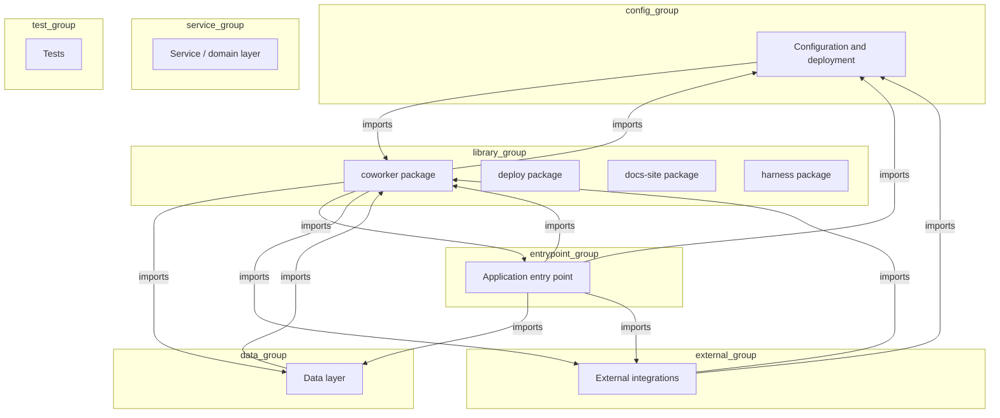

# Architecture report: andrewyng/openworker

> Automated static analysis. **Observed** = directly seen in files/imports/AST; **Inferred** = interpretation from that evidence. Repository code was not executed.

## 1. Repository at a glance

| Item | Value |
| --- | --- |
| Repository | andrewyng/openworker |
| Description | Not provided |
| Language | Python |
| Stars | 19195 |
| Licence | MIT |
| Analysed commit / branch | ecb445490fc054d52b8ea610d97ba947f57033d2 / main |
| Framework(s) | Electron, FastAPI, React, Starlette |
| Files analysed | 798 |
| Components | 10 |

## 2. Architecture in one minute

andrewyng/openworker. This repository was analysed statically from 798 file(s) (266 Python). Detected technologies (observed from imports/manifests): GitHub Actions, PostgreSQL, SQLite, Electron, FastAPI, React. Files are grouped into 10 component(s): Configuration and deployment, coworker package, Data layer, deploy package, docs-site package, Application entry point, External integrations, harness package. Observed entry point(s): coworker/cli.py, coworker/connectors/cli.py, coworker/headless/runner.py. Findings below distinguish observed facts from inferred interpretation.

## 3. High-level block diagram

## 4. Main components

### Configuration and deployment (`config`)

- **Kind:** config
- **Status:** Observed
- **Confidence:** 0.85
- **Responsibility:** Groups 92 file(s) under configuration and deployment (observed from repository paths and static analysis). Observed top-level classes: Config, ConnectorSettings, MCPServerDef, MemorySettingsStore, TeamAuth. Observed top-level functions: _availability, _config_paths, _csv, _effort_level, _for_display, _gcal_account_list.
- **Paths:** `coworker/config.py`, `coworker/connectors/config.py`, `coworker/connectors/setup.py`, `coworker/headless/prices.yaml`, `coworker/mcp/config.py`, `coworker/memory/settings.py`, `coworker/observability/signals.yaml`, `coworker/providers/llamacpp_models.json`, `coworker/providers/model_controls.json`, `coworker/providers/recommended_models.json`, `coworker/sandbox/settings.py`, `deploy/containers/Dockerfile`, `deploy/containers/Dockerfile.dockerignore`, `deploy/helm/openshell-local.yaml`, `deploy/helm/openworker/Chart.yaml`, `deploy/helm/openworker/templates/config.yaml`, `deploy/helm/openworker/templates/network.yaml`, `deploy/helm/openworker/templates/service.yaml`, `deploy/helm/openworker/templates/task-desk.yaml`, `deploy/helm/openworker/templates/workloads.yaml`, `deploy/helm/openworker/values.schema.json`, `deploy/helm/openworker/values.yaml`, `deploy/local/kind.yaml`, `deploy/local/openshell-values.yaml`, `deploy/local/sandbox-policy.yaml`, `deploy/reference/Dockerfile.artifact-probe`, `deploy/reference/Dockerfile.artifact-probe.dockerignore`, `deploy/reference/Dockerfile.observability`, `deploy/reference/Dockerfile.observability.dockerignore`, `deploy/reference/compose.yaml`, `deploy/reference/connection.example.json`, `deploy/reference/dashboards/dashboard.json`, `deploy/reference/dashboards/provider.yaml`, `deploy/reference/export-qualification-images.json`, `deploy/resilience/Dockerfile`, `deploy/resilience/Dockerfile.dockerignore`, `deploy/service/Dockerfile`, `deploy/service/Dockerfile.coding-runner`, `deploy/service/Dockerfile.coding-service`, `deploy/service/Dockerfile.coding-service.dockerignore`, `deploy/service/Dockerfile.dockerignore`, `deploy/service/bundle/tools.json`, `deploy/service/chart/Chart.yaml`, `deploy/service/chart/templates/bootstrap.yaml`, `deploy/service/chart/templates/config.yaml`, `deploy/service/chart/templates/management-ui.yaml`, `deploy/service/chart/templates/rbac.yaml`, `deploy/service/chart/templates/workloads.yaml`, `deploy/service/chart/values.yaml`, `deploy/service/coding-bundle/tools.json`, `deploy/service/compose.yaml`, `deploy/service/connection.example.json`, `deploy/service/examples/aws/deployment.yaml`, `deploy/service/examples/azure/deployment.yaml`, `deploy/service/examples/local-k8s/deployment.yaml`, `deploy/service/up/aws.yaml`, `deploy/service/up/azure.yaml`, `docs-site/desktop-pages.json`, `docs-site/package.json`, `docs-site/pages.json`, `harness/Cargo.toml`, `harness/artifacts/Cargo.toml`, `harness/compliance/Cargo.toml`, `harness/desktop-starters/package.json`, `harness/desktop-starters/templates/electron-game-builder/electron-builder.json`, `harness/desktop-starters/templates/electron-game-builder/package.json`, `harness/desktop-starters/templates/shared/tsconfig.json`, `harness/desktop-starters/templates/tauri-game-builder/package.json`, `harness/desktop-starters/templates/tauri-game-builder/src-tauri/Cargo.toml`, `harness/desktop-starters/templates/tauri-game-builder/src-tauri/tauri.conf.json`, `harness/examples/arcade/asset-library/catalog.json`, `harness/examples/arcade/electron-builder.json`, `harness/examples/arcade/package.json`, `harness/examples/arcade/starter-games/lumen-garden/manifest.json`, `harness/examples/arcade/starter-games/moonlight-rally/courses/neon.json`, `harness/examples/arcade/starter-games/moonlight-rally/courses/sunset.json`, `harness/examples/arcade/starter-games/moonlight-rally/credits.json`, `harness/examples/arcade/starter-games/moonlight-rally/manifest.json`, `harness/examples/arcade/starter-games/neon-drift/manifest.json`, `harness/examples/arcade/starter-games/orbit-runner/manifest.json`, `harness/examples/arcade/starter-games/pip-garden/art-credits.json`, `harness/examples/arcade/starter-games/pip-garden/generation.json`, `harness/examples/arcade/starter-games/pip-garden/manifest.json`, `harness/examples/arcade/starter-games/skybound-carrier/asset-credits.json`, `harness/examples/arcade/starter-games/skybound-carrier/config.json`, `harness/examples/arcade/starter-games/skybound-carrier/manifest.json`, `harness/examples/arcade/tsconfig.json`, `harness/examples/arcade/tsconfig.main.json`, `harness/examples/assistant/tools.json`, `harness/examples/computer-tools/Cargo.toml`, `harness/examples/device-tools/Cargo.toml`, `harness/examples/mixed/tools.json`
- **Evidence:** [coworker/config.py:39](https://github.com/andrewyng/openworker/blob/ecb445490fc054d52b8ea610d97ba947f57033d2/coworker/config.py#L39); [coworker/connectors/config.py:21](https://github.com/andrewyng/openworker/blob/ecb445490fc054d52b8ea610d97ba947f57033d2/coworker/connectors/config.py#L21); [coworker/connectors/setup.py:20](https://github.com/andrewyng/openworker/blob/ecb445490fc054d52b8ea610d97ba947f57033d2/coworker/connectors/setup.py#L20); [coworker/headless/prices.yaml](https://github.com/andrewyng/openworker/blob/ecb445490fc054d52b8ea610d97ba947f57033d2/coworker/headless/prices.yaml); [coworker/mcp/config.py:26](https://github.com/andrewyng/openworker/blob/ecb445490fc054d52b8ea610d97ba947f57033d2/coworker/mcp/config.py#L26); [coworker/memory/settings.py:26](https://github.com/andrewyng/openworker/blob/ecb445490fc054d52b8ea610d97ba947f57033d2/coworker/memory/settings.py#L26); [coworker/observability/signals.yaml](https://github.com/andrewyng/openworker/blob/ecb445490fc054d52b8ea610d97ba947f57033d2/coworker/observability/signals.yaml); [coworker/providers/llamacpp_models.json](https://github.com/andrewyng/openworker/blob/ecb445490fc054d52b8ea610d97ba947f57033d2/coworker/providers/llamacpp_models.json)

### coworker package (`coworker`)

- **Kind:** library
- **Status:** Observed
- **Confidence:** 0.85
- **Responsibility:** Groups 237 file(s) under coworker package (observed from repository paths and static analysis). Observed top-level classes: Agent, AgentContext, AgentTask, AgentTaskRegistry, AgentTaskStore, AllowListProxy. Observed top-level functions: _abort, _account_profile, _acct_result, _add_cache_breakpoints, _ago, _alive.
- **Paths:** `coworker/__init__.py`, `coworker/_psl_private.py`, `coworker/agent.py`, `coworker/agents/__init__.py`, `coworker/agents/base.py`, `coworker/agents/chat.py`, `coworker/agents/code.py`, `coworker/agents/cowork.py`, `coworker/agents/myhelper.py`, `coworker/agents/registry.py`, `coworker/attachment_workspace.py`, `coworker/attachments.py`, `coworker/audit.py`, `coworker/automation/__init__.py`, `coworker/automation/scheduler.py`, `coworker/automation/store.py`, `coworker/automation/tools.py`, `coworker/basedir.py`, `coworker/catalog.py`, `coworker/clock.py`, `coworker/cloud.py`, `coworker/compaction.py`, `coworker/connections.py`, `coworker/connectors/__init__.py`, `coworker/connectors/accounts.py`, `coworker/connectors/adapters.py`, `coworker/connectors/attribution.py`, `coworker/connectors/base.py`, `coworker/connectors/browser_automation.py`, `coworker/connectors/catalog_copy.py`, `coworker/connectors/chat_tools.py`, `coworker/connectors/descriptors.py`, `coworker/connectors/email_tools.py`, `coworker/connectors/experimental/__init__.py`, `coworker/connectors/fake.py`, `coworker/connectors/gateway.py`, `coworker/connectors/gcal_accounts.py`, `coworker/connectors/github_installs.py`, `coworker/connectors/github_relay.py`, `coworker/connectors/github_send.py`, `coworker/connectors/gmail_accounts.py`, `coworker/connectors/hubspot_portals.py`, `coworker/connectors/integration_tools.py`, `coworker/connectors/machine_poll.py`, `coworker/connectors/origin.py`, `coworker/connectors/parked.py`, `coworker/connectors/senders.py`, `coworker/connectors/slack_addr.py`, `coworker/connectors/slack_directory.py`, `coworker/connectors/tool_defs.py`, `coworker/connectors/tools.py`, `coworker/conversations.py`, `coworker/decision_reviewer.py`, `coworker/environment.py`, `coworker/events.py`, `coworker/git_settings.py`, `coworker/headless/__init__.py`, `coworker/headless/pricing.py`, `coworker/headless/terminal.py`, `coworker/headless/trajectory.py`, `coworker/inbox.py`, `coworker/inbox_routing.py`, `coworker/interactions.py`, `coworker/mcp/__init__.py`, `coworker/mcp/oauth.py`, `coworker/mcp/tools.py`, `coworker/memory/__init__.py`, `coworker/memory/base.py`, `coworker/memory/sqlite_store.py`, `coworker/memory/tools.py`, `coworker/mentions.py`, `coworker/model_config.py`, `coworker/observability/__init__.py`, `coworker/observability/calculator.py`, `coworker/observability/canonical.py`, `coworker/observability/capture.py`, `coworker/observability/decision.py`, `coworker/observability/engine_hooks.py`, `coworker/observability/export.py`, `coworker/observability/export_spans.py`, `coworker/observability/gaps.py`, `coworker/observability/ids.py`, `coworker/observability/model_names.py`, `coworker/observability/provider_view.py`, `coworker/observability/recorder.py`, `coworker/observability/rollups.py`, `coworker/observability/scopes.py`, `coworker/observability/signals.py`, `coworker/observability/stamps.py`, `coworker/observability/store.py`, `coworker/overrides.py`, `coworker/pdf_support.py`, `coworker/permissions.py`, `coworker/personas/__init__.py`, `coworker/personas/loading.py`, `coworker/personas/manifest.py`, `coworker/personas/registry.py`, `coworker/plan_steps.py`, `coworker/project.py`, `coworker/projects.py`, `coworker/provenance.py`, `coworker/providers/__init__.py`, `coworker/providers/anthropic_provider.py`, `coworker/providers/base.py`, `coworker/providers/bedrock_provider.py`, `coworker/providers/capabilities.py`, `coworker/providers/codex_auth.py`, `coworker/providers/codex_provider.py`, `coworker/providers/effort.py`, `coworker/providers/errors.py`, `coworker/providers/gemini_provider.py`, `coworker/providers/llamacpp_setup.py`, `coworker/providers/local_machine.py`, `coworker/providers/local_server.py`, `coworker/providers/matrix.py`, `coworker/providers/model_controls.py`, `coworker/providers/ollama_context.py`, `coworker/providers/ollama_facts.py`, `coworker/providers/openai_provider.py`, `coworker/providers/openai_responses.py`, `coworker/providers/openrouter_auth.py`, `coworker/providers/recommended.py`, `coworker/providers/registry.py`, `coworker/providers/router.py`, `coworker/providers/vertex_provider.py`, `coworker/public_suffix.py`, `coworker/readonly.py`, `coworker/remote/__init__.py`, `coworker/remote/acceptor.py`, `coworker/remote/audit.py`, `coworker/remote/audit_export.py`, `coworker/remote/channel.py`, `coworker/remote/cloudproxy.py`, `coworker/remote/identity.py`, `coworker/remote/joiner.py`, `coworker/remote/provision.py`, `coworker/remote/registry.py`, `coworker/remote/stores.py`, `coworker/review_facts.py`, `coworker/reviewer.py`, `coworker/risk.py`, `coworker/roots.py`, `coworker/runtime_context.py`, `coworker/sandbox/__init__.py`, `coworker/sandbox/bundle.py`, `coworker/sandbox/credentials.py`, `coworker/sandbox/executor.py`, `coworker/sandbox/inside.py`, `coworker/sandbox/launch.py`, `coworker/sandbox/netproxy.py`, `coworker/sandbox/network_profiles.py`, `coworker/sandbox/providers/__init__.py`, `coworker/sandbox/providers/openshell.py`, `coworker/sandbox/providers/openshell_policy.py`, `coworker/sandbox/providers/openshell_wire.py`, `coworker/sandbox/providers/runner_local.py`, `coworker/sandbox/providers/seatbelt.py`, `coworker/sandbox/providers/seatbelt_profile.py`, `coworker/sandbox/providers/windows.py`, `coworker/sandbox/providers/windows_setup.py`, `coworker/sandbox/proxy.py`, `coworker/sandbox/registry.py`, `coworker/sandbox/runner/__init__.py`, `coworker/sandbox/runner/connect.py`, `coworker/sandbox/runner/daemon.py`, `coworker/sandbox/runner/executor.py`, `coworker/sandbox/runner/fsops.py`, `coworker/sandbox/runner/protocol.py`, `coworker/sandbox/runner/relay.py`, `coworker/sandbox/runner/toolcalls.py`, `coworker/sandbox/runner/tools_git.py`, `coworker/sandbox/runner/tools_grep.py`, `coworker/sandbox/runner/tools_read.py`, `coworker/sandbox/runner/winpipe.py`, `coworker/sandbox/selection.py`, `coworker/sandbox/setup_cmd.py`, `coworker/sandbox/setup_job.py`, `coworker/sandbox/stages.py`, `coworker/sandbox/toolchains.py`, `coworker/sandbox/transport.py`, `coworker/sandbox/winsec.py`, `coworker/sandbox/workspace.py`, `coworker/secrets.py`, `coworker/selfwake.py`, `coworker/server/__init__.py`, `coworker/server/ws_guard.py`, `coworker/session_facts.py`, `coworker/sessions.py`, `coworker/skills/__init__.py`, `coworker/skills/base.py`, `coworker/skills/store.py`, `coworker/statelock.py`, `coworker/subscription_sync.py`, `coworker/subscriptions.py`, `coworker/teams/__init__.py`, `coworker/teams/artifacts.py`, `coworker/teams/attachments.py`, `coworker/teams/chat.py`, `coworker/teams/dialect.py`, `coworker/teams/journal.py`, `coworker/teams/mcp_server.py`, `coworker/teams/proposals.py`, `coworker/teams/registry.py`, `coworker/teams/store.py`, `coworker/teams/summary.py`, `coworker/teams/tokens.py`, `coworker/teams/tools.py`, `coworker/testing/__init__.py`, `coworker/testing/fake_slack/__init__.py`, `coworker/toolchain.py`, `coworker/toolresult.py`, `coworker/tools/__init__.py`, `coworker/tools/agent_tasks.py`, `coworker/tools/ask.py`, `coworker/tools/connreq.py`, `coworker/tools/directories.py`, `coworker/tools/files.py`, `coworker/tools/git.py`, `coworker/tools/network.py`, `coworker/tools/plan.py`, `coworker/tools/registry.py`, `coworker/tools/search.py`, `coworker/tools/shell.py`, `coworker/tools/subagent.py`, `coworker/tools/todo.py`, `coworker/tools/toolreq.py`, `coworker/tui/__init__.py`, `coworker/unattended.py`, `coworker/unrouted.py`, `coworker/web/__init__.py`, `coworker/web/fetch.py`, `coworker/web/guard.py`, `coworker/web/providers.py`, `coworker/web/tool.py`, `coworker/workspace_safety.py`, `coworker/workspace_trust.py`, `coworker/worktrees.py`
- **Evidence:** [coworker/__init__.py](https://github.com/andrewyng/openworker/blob/ecb445490fc054d52b8ea610d97ba947f57033d2/coworker/__init__.py); [coworker/_psl_private.py](https://github.com/andrewyng/openworker/blob/ecb445490fc054d52b8ea610d97ba947f57033d2/coworker/_psl_private.py); [coworker/agent.py:143](https://github.com/andrewyng/openworker/blob/ecb445490fc054d52b8ea610d97ba947f57033d2/coworker/agent.py#L143); [coworker/agents/__init__.py](https://github.com/andrewyng/openworker/blob/ecb445490fc054d52b8ea610d97ba947f57033d2/coworker/agents/__init__.py); [coworker/agents/base.py:18](https://github.com/andrewyng/openworker/blob/ecb445490fc054d52b8ea610d97ba947f57033d2/coworker/agents/base.py#L18); [coworker/agents/chat.py:15](https://github.com/andrewyng/openworker/blob/ecb445490fc054d52b8ea610d97ba947f57033d2/coworker/agents/chat.py#L15); [coworker/agents/code.py:72](https://github.com/andrewyng/openworker/blob/ecb445490fc054d52b8ea610d97ba947f57033d2/coworker/agents/code.py#L72); [coworker/agents/cowork.py:42](https://github.com/andrewyng/openworker/blob/ecb445490fc054d52b8ea610d97ba947f57033d2/coworker/agents/cowork.py#L42)

### Data layer (`data_layer`)

- **Kind:** data
- **Status:** Observed
- **Confidence:** 0.85
- **Responsibility:** Groups 2 file(s) under data layer (observed from repository paths and static analysis). Observed top-level classes: Actor, AuthorityError, BoardError, BoardNotFoundError, ChainError, ItemState. Observed top-level functions: _human_time, _now, grant_entries, rule_entry, rule_parts, space_for_workspace.
- **Paths:** `coworker/automation/models.py`, `coworker/teams/model.py`
- **Evidence:** [coworker/automation/models.py:19](https://github.com/andrewyng/openworker/blob/ecb445490fc054d52b8ea610d97ba947f57033d2/coworker/automation/models.py#L19); [coworker/teams/model.py:16](https://github.com/andrewyng/openworker/blob/ecb445490fc054d52b8ea610d97ba947f57033d2/coworker/teams/model.py#L16)

### deploy package (`deploy`)

- **Kind:** library
- **Status:** Observed
- **Confidence:** 0.85
- **Responsibility:** Groups 67 file(s) under deploy package (observed from repository paths and static analysis). Observed top-level functions: apply, kubectl, observe, policy.
- **Paths:** `deploy/aws/boundary-qualify.mjs`, `deploy/aws/capture-result.mjs`, `deploy/aws/cleanup.cjs`, `deploy/aws/cleanup.test.mjs`, `deploy/aws/client.mjs`, `deploy/aws/cost-preflight.mjs`, `deploy/aws/diagnose-database.mjs`, `deploy/aws/experiment.mjs`, `deploy/aws/finalize-qualification.mjs`, `deploy/aws/guard.mjs`, `deploy/aws/images.mjs`, `deploy/aws/inventory.mjs`, `deploy/aws/kubernetes.mjs`, `deploy/aws/live-model.mjs`, `deploy/aws/live-qualify.mjs`, `deploy/aws/preflight.mjs`, `deploy/aws/probe-network.mjs`, `deploy/aws/qualification-lib.mjs`, `deploy/aws/qualification.test.mjs`, `deploy/aws/qualify-current.mjs`, `deploy/aws/qualify-live.mjs`, `deploy/aws/qualify-operations.mjs`, `deploy/aws/qualify-restore.mjs`, `deploy/aws/qualify-telemetry.mjs`, `deploy/aws/reconcile-first-migration.mjs`, `deploy/aws/shell-admin.mjs`, `deploy/aws/teardown.mjs`, `deploy/aws/templates.mjs`, `deploy/aws/verify-existing.mjs`, `deploy/aws/verify-guard.mjs`, `deploy/aws/verify-removed.mjs`, `deploy/helm/chart.test.mjs`, `deploy/helm/load-images.mjs`, `deploy/helm/local.mjs`, `deploy/helm/qualify.mjs`, `deploy/helm/version-drill.mjs`, `deploy/local/probe-network.py`, `deploy/recovery/backup.mjs`, `deploy/recovery/backup.test.mjs`, `deploy/recovery/local.mjs`, `deploy/reference/check-recorded-langfuse.mjs`, `deploy/reference/export-contract.mjs`, `deploy/reference/langfuse-kubernetes-local.mjs`, `deploy/reference/observability-entrypoint.sh`, `deploy/reference/observability-local-views.mjs`, `deploy/reference/operations.mjs`, `deploy/reference/operations.test.mjs`, `deploy/reference/qualify-artifact-storage.mjs`, `deploy/reference/qualify-coding-limits.mjs`, `deploy/reference/qualify-coding-runner.mjs`, `deploy/reference/qualify-coding-service.mjs`, `deploy/reference/qualify-exports.mjs`, `deploy/reference/qualify-live-observability.mjs`, `deploy/reference/qualify-observability.mjs`, `deploy/reference/qualify-operations.mjs`, `deploy/reference/qualify-process-continuity.mjs`, `deploy/reference/qualify-sdk-observability.mjs`, `deploy/reference/qualify.mjs`, `deploy/reference/stack.mjs`, `deploy/reference/stack.test.mjs`, `deploy/resilience/cluster.mjs`, `deploy/resilience/contract.mjs`, `deploy/resilience/contract.test.mjs`, `deploy/resilience/postgres-workers.mjs`, `deploy/resilience/prepare-local.mjs`, `deploy/resilience/run.mjs`, `deploy/teams/cluster.mjs`
- **Evidence:** [deploy/aws/boundary-qualify.mjs](https://github.com/andrewyng/openworker/blob/ecb445490fc054d52b8ea610d97ba947f57033d2/deploy/aws/boundary-qualify.mjs); [deploy/aws/capture-result.mjs](https://github.com/andrewyng/openworker/blob/ecb445490fc054d52b8ea610d97ba947f57033d2/deploy/aws/capture-result.mjs); [deploy/aws/cleanup.cjs](https://github.com/andrewyng/openworker/blob/ecb445490fc054d52b8ea610d97ba947f57033d2/deploy/aws/cleanup.cjs); [deploy/aws/cleanup.test.mjs](https://github.com/andrewyng/openworker/blob/ecb445490fc054d52b8ea610d97ba947f57033d2/deploy/aws/cleanup.test.mjs); [deploy/aws/client.mjs](https://github.com/andrewyng/openworker/blob/ecb445490fc054d52b8ea610d97ba947f57033d2/deploy/aws/client.mjs); [deploy/aws/cost-preflight.mjs](https://github.com/andrewyng/openworker/blob/ecb445490fc054d52b8ea610d97ba947f57033d2/deploy/aws/cost-preflight.mjs); [deploy/aws/diagnose-database.mjs](https://github.com/andrewyng/openworker/blob/ecb445490fc054d52b8ea610d97ba947f57033d2/deploy/aws/diagnose-database.mjs); [deploy/aws/experiment.mjs](https://github.com/andrewyng/openworker/blob/ecb445490fc054d52b8ea610d97ba947f57033d2/deploy/aws/experiment.mjs)

### docs-site package (`docs_site`)

- **Kind:** library
- **Status:** Observed
- **Confidence:** 0.85
- **Responsibility:** Groups 26 file(s) under docs-site package (observed from repository paths and static analysis). Observed top-level classes: Page.
- **Paths:** `docs-site/astro.config.mjs`, `docs-site/product.mjs`, `docs-site/scripts/code-tabs.mjs`, `docs-site/scripts/code-tabs.test.mjs`, `docs-site/scripts/hosting.test.mjs`, `docs-site/scripts/prepare-hosting.mjs`, `docs-site/scripts/prepare.mjs`, `docs-site/scripts/product.test.mjs`, `docs-site/scripts/render-guide.test.mjs`, `docs-site/scripts/site.test.mjs`, `docs-site/scripts/source-examples.mjs`, `docs-site/scripts/source-examples.test.mjs`, `docs-site/scripts/source-tree.test.mjs`, `docs-site/scripts/verify-built.py`, `docs-site/src/content.config.ts`, `docs-site/src/lib/desktop-navigation.mjs`, `docs-site/src/lib/desktop-preview.mjs`, `docs-site/src/lib/navigation.mjs`, `docs-site/src/lib/render-guide.mjs`, `docs-site/src/lib/source-tree.mjs`, `docs-site/src/scripts/code-tabs.ts`, `docs-site/src/scripts/desktop-preview.ts`, `docs-site/src/scripts/docs-search.ts`, `docs-site/src/scripts/guide.ts`, `docs-site/src/scripts/source-editor.ts`, `docs-site/src/scripts/source-explorer.ts`
- **Evidence:** [docs-site/astro.config.mjs](https://github.com/andrewyng/openworker/blob/ecb445490fc054d52b8ea610d97ba947f57033d2/docs-site/astro.config.mjs); [docs-site/product.mjs](https://github.com/andrewyng/openworker/blob/ecb445490fc054d52b8ea610d97ba947f57033d2/docs-site/product.mjs); [docs-site/scripts/code-tabs.mjs](https://github.com/andrewyng/openworker/blob/ecb445490fc054d52b8ea610d97ba947f57033d2/docs-site/scripts/code-tabs.mjs); [docs-site/scripts/code-tabs.test.mjs](https://github.com/andrewyng/openworker/blob/ecb445490fc054d52b8ea610d97ba947f57033d2/docs-site/scripts/code-tabs.test.mjs); [docs-site/scripts/hosting.test.mjs](https://github.com/andrewyng/openworker/blob/ecb445490fc054d52b8ea610d97ba947f57033d2/docs-site/scripts/hosting.test.mjs); [docs-site/scripts/prepare-hosting.mjs](https://github.com/andrewyng/openworker/blob/ecb445490fc054d52b8ea610d97ba947f57033d2/docs-site/scripts/prepare-hosting.mjs); [docs-site/scripts/prepare.mjs](https://github.com/andrewyng/openworker/blob/ecb445490fc054d52b8ea610d97ba947f57033d2/docs-site/scripts/prepare.mjs); [docs-site/scripts/product.test.mjs](https://github.com/andrewyng/openworker/blob/ecb445490fc054d52b8ea610d97ba947f57033d2/docs-site/scripts/product.test.mjs)

### Application entry point (`entrypoint`)

- **Kind:** entrypoint
- **Status:** Observed
- **Confidence:** 0.85
- **Responsibility:** Groups 13 file(s) under application entry point (observed from repository paths and static analysis). Observed application object created via FastAPI. Observed top-level classes: Answers, ApprovalScreen, CoworkerApp, Engine, FWPM_ACTION0, FWPM_DISPLAY_DATA0. Observed top-level functions: _agent_version, _attach_mcp, _backing_args, _browser_page, _check, _cmd_append.
- **Paths:** `coworker/cli.py`, `coworker/connectors/cli.py`, `coworker/headless/runner.py`, `coworker/remote/service.py`, `coworker/sandbox/runner/__main__.py`, `coworker/sandbox/windows_wfp.py`, `coworker/server/app.py`, `coworker/server/run.py`, `coworker/teams/cli.py`, `coworker/testing/fake_slack/__main__.py`, `coworker/testing/fake_slack/server.py`, `coworker/tui/app.py`, `deploy/service/up/package.py`
- **Evidence:** [coworker/cli.py:57](https://github.com/andrewyng/openworker/blob/ecb445490fc054d52b8ea610d97ba947f57033d2/coworker/cli.py#L57); [coworker/connectors/cli.py:29](https://github.com/andrewyng/openworker/blob/ecb445490fc054d52b8ea610d97ba947f57033d2/coworker/connectors/cli.py#L29); [coworker/headless/runner.py:57](https://github.com/andrewyng/openworker/blob/ecb445490fc054d52b8ea610d97ba947f57033d2/coworker/headless/runner.py#L57); [coworker/remote/service.py:95](https://github.com/andrewyng/openworker/blob/ecb445490fc054d52b8ea610d97ba947f57033d2/coworker/remote/service.py#L95); [coworker/sandbox/runner/__main__.py:17](https://github.com/andrewyng/openworker/blob/ecb445490fc054d52b8ea610d97ba947f57033d2/coworker/sandbox/runner/__main__.py#L17); [coworker/sandbox/windows_wfp.py:64](https://github.com/andrewyng/openworker/blob/ecb445490fc054d52b8ea610d97ba947f57033d2/coworker/sandbox/windows_wfp.py#L64); [coworker/server/app.py:236](https://github.com/andrewyng/openworker/blob/ecb445490fc054d52b8ea610d97ba947f57033d2/coworker/server/app.py#L236); [coworker/server/run.py:18](https://github.com/andrewyng/openworker/blob/ecb445490fc054d52b8ea610d97ba947f57033d2/coworker/server/run.py#L18)

### External integrations (`external_integrations`)

- **Kind:** external
- **Status:** Observed
- **Confidence:** 0.85
- **Responsibility:** Groups 5 file(s) under external integrations (observed from repository paths and static analysis). Observed top-level classes: MCPManager, RelayHub, RelayTransport, RunnerClient, SlackRelayAdapter, _Conn. Observed top-level functions: _cut, _light, _read_tail, _rebuilt, _result_payload, _skill_version.
- **Paths:** `coworker/connectors/relay_client.py`, `coworker/mcp/client.py`, `coworker/observability/read_api.py`, `coworker/observability/usage_api.py`, `coworker/sandbox/client.py`
- **Evidence:** [coworker/connectors/relay_client.py:40](https://github.com/andrewyng/openworker/blob/ecb445490fc054d52b8ea610d97ba947f57033d2/coworker/connectors/relay_client.py#L40); [coworker/mcp/client.py:31](https://github.com/andrewyng/openworker/blob/ecb445490fc054d52b8ea610d97ba947f57033d2/coworker/mcp/client.py#L31); [coworker/observability/read_api.py:26](https://github.com/andrewyng/openworker/blob/ecb445490fc054d52b8ea610d97ba947f57033d2/coworker/observability/read_api.py#L26); [coworker/observability/usage_api.py:23](https://github.com/andrewyng/openworker/blob/ecb445490fc054d52b8ea610d97ba947f57033d2/coworker/observability/usage_api.py#L23); [coworker/sandbox/client.py:33](https://github.com/andrewyng/openworker/blob/ecb445490fc054d52b8ea610d97ba947f57033d2/coworker/sandbox/client.py#L33)

### harness package (`harness`)

- **Kind:** library
- **Status:** Observed
- **Confidence:** 0.85
- **Responsibility:** Groups 102 file(s) under harness package (observed from repository paths and static analysis).
- **Paths:** `harness/artifacts/examples/pod_identity_access.rs`, `harness/artifacts/src/azure.rs`, `harness/artifacts/src/filesystem.rs`, `harness/artifacts/src/lib.rs`, `harness/artifacts/src/s3.rs`, `harness/compliance/src/delivery.rs`, `harness/compliance/src/lib.rs`, `harness/console/browser-check.mjs`, `harness/console/public/app.js`, `harness/console/server.mjs`, `harness/console/server.test.mjs`, `harness/desktop-starters/create.mjs`, `harness/desktop-starters/live-acceptance.mjs`, `harness/desktop-starters/qualify-electron.mjs`, `harness/desktop-starters/recovery.test.mjs`, `harness/desktop-starters/tauri-test-model.mjs`, `harness/desktop-starters/templates/electron-game-builder/electron/main.mjs`, `harness/desktop-starters/templates/electron-game-builder/electron/preload.cjs`, `harness/desktop-starters/templates/electron-game-builder/electron/recovery.mjs`, `harness/desktop-starters/templates/electron-game-builder/scripts/dev.mjs`, `harness/desktop-starters/templates/shared/scripts/runtime-identity.mjs`, `harness/desktop-starters/templates/shared/scripts/runtime.mjs`, `harness/desktop-starters/templates/shared/src/bridge.ts`, `harness/desktop-starters/templates/shared/src/main.tsx`, `harness/desktop-starters/templates/shared/vite.config.ts`, `harness/desktop-starters/templates/tauri-game-builder/src-tauri/build.rs`, `harness/desktop-starters/templates/tauri-game-builder/src-tauri/src/main.rs`, `harness/desktop-starters/templates/tauri-game-builder/src-tauri/src/recovery.rs`, `harness/desktop-starters/test.mjs`, `harness/examples/arcade/electron/agent-service.ts`, `harness/examples/arcade/electron/asset-catalog.ts`, `harness/examples/arcade/electron/event-projection.ts`, `harness/examples/arcade/electron/files.ts`, `harness/examples/arcade/electron/game-progress.ts`, `harness/examples/arcade/electron/library.ts`, `harness/examples/arcade/electron/main.ts`, `harness/examples/arcade/electron/playtest-contract.ts`, `harness/examples/arcade/electron/playtest.ts`, `harness/examples/arcade/electron/preload.cjs`, `harness/examples/arcade/electron/preview.ts`, `harness/examples/arcade/electron/project.ts`, `harness/examples/arcade/electron/review.ts`, `harness/examples/arcade/electron/save-client.ts`, `harness/examples/arcade/electron/settings.ts`, `harness/examples/arcade/electron/starters.ts`, `harness/examples/arcade/electron/templates.ts`, `harness/examples/arcade/electron/temporary-preview.ts`, `harness/examples/arcade/electron/test-evidence.ts`, `harness/examples/arcade/scripts/bundle-libraries.mjs`, `harness/examples/arcade/scripts/bundle-pilot-game.mjs`, `harness/examples/arcade/scripts/dev.mjs`, `harness/examples/arcade/scripts/package-dev.mjs`, `harness/examples/arcade/scripts/prepare-asset-pilot.mjs`, `harness/examples/arcade/scripts/runtime.mjs`, `harness/examples/arcade/shared/contracts.ts`, `harness/examples/arcade/shared/game-progress.ts`, `harness/examples/arcade/src/App.tsx`, `harness/examples/arcade/src/ArcadeHome.tsx`, `harness/examples/arcade/src/GameFrame.tsx`, `harness/examples/arcade/src/LibraryScreen.tsx`, `harness/examples/arcade/src/TestingPanel.tsx`, `harness/examples/arcade/src/bridge.ts`, `harness/examples/arcade/src/icons.tsx`, `harness/examples/arcade/src/main.tsx`, `harness/examples/arcade/starter-games/lumen-garden/game.js`, `harness/examples/arcade/starter-games/lumen-garden/test.mjs`, `harness/examples/arcade/starter-games/moonlight-rally/art.js`, `harness/examples/arcade/starter-games/moonlight-rally/game.js`, `harness/examples/arcade/starter-games/moonlight-rally/physics.js`, `harness/examples/arcade/starter-games/moonlight-rally/progress.js`, `harness/examples/arcade/starter-games/moonlight-rally/test.mjs`, `harness/examples/arcade/starter-games/moonlight-rally/vehicle.js`, `harness/examples/arcade/starter-games/neon-drift/game.js`, `harness/examples/arcade/starter-games/neon-drift/test.mjs`, `harness/examples/arcade/starter-games/orbit-runner/src/game.js`, `harness/examples/arcade/starter-games/pip-garden/src/actor.js`, `harness/examples/arcade/starter-games/pip-garden/src/adventure-input.js`, `harness/examples/arcade/starter-games/pip-garden/src/adventure-world.js`, `harness/examples/arcade/starter-games/pip-garden/src/adventure.js`, `harness/examples/arcade/starter-games/pip-garden/src/fireflies.js`, `harness/examples/arcade/starter-games/pip-garden/src/game.js`, `harness/examples/arcade/starter-games/pip-garden/src/input.js`, `harness/examples/arcade/starter-games/pip-garden/src/journey.js`, `harness/examples/arcade/starter-games/pip-garden/src/player.js`, `harness/examples/arcade/starter-games/pip-garden/src/progress.js`, `harness/examples/arcade/starter-games/pip-garden/src/sound.js`, `harness/examples/arcade/starter-games/pip-garden/src/world.js`, `harness/examples/arcade/starter-games/pip-garden/test.mjs`, `harness/examples/arcade/starter-games/skybound-carrier/build-assets.mjs`, `harness/examples/arcade/starter-games/skybound-carrier/game.js`, `harness/examples/arcade/starter-games/skybound-carrier/rules.js`, `harness/examples/arcade/starter-games/skybound-carrier/test.mjs`, `harness/examples/arcade/vite.config.ts`, `harness/examples/computer-tools/examples/fixture.rs`, `harness/examples/computer-tools/src/lib.rs`, `harness/examples/computer-tools/src/windows.rs`, `harness/examples/device-tools/src/lib.rs`, `harness/examples/device-tools/src/windows.rs`, `harness/examples/direct-client.mjs`, `harness/examples/grants-client.mjs`, `harness/examples/long-session-client.mjs`, `harness/examples/multi-client.mjs`
- **Evidence:** [harness/artifacts/examples/pod_identity_access.rs](https://github.com/andrewyng/openworker/blob/ecb445490fc054d52b8ea610d97ba947f57033d2/harness/artifacts/examples/pod_identity_access.rs); [harness/artifacts/src/azure.rs](https://github.com/andrewyng/openworker/blob/ecb445490fc054d52b8ea610d97ba947f57033d2/harness/artifacts/src/azure.rs); [harness/artifacts/src/filesystem.rs](https://github.com/andrewyng/openworker/blob/ecb445490fc054d52b8ea610d97ba947f57033d2/harness/artifacts/src/filesystem.rs); [harness/artifacts/src/lib.rs](https://github.com/andrewyng/openworker/blob/ecb445490fc054d52b8ea610d97ba947f57033d2/harness/artifacts/src/lib.rs); [harness/artifacts/src/s3.rs](https://github.com/andrewyng/openworker/blob/ecb445490fc054d52b8ea610d97ba947f57033d2/harness/artifacts/src/s3.rs); [harness/compliance/src/delivery.rs](https://github.com/andrewyng/openworker/blob/ecb445490fc054d52b8ea610d97ba947f57033d2/harness/compliance/src/delivery.rs); [harness/compliance/src/lib.rs](https://github.com/andrewyng/openworker/blob/ecb445490fc054d52b8ea610d97ba947f57033d2/harness/compliance/src/lib.rs); [harness/console/browser-check.mjs](https://github.com/andrewyng/openworker/blob/ecb445490fc054d52b8ea610d97ba947f57033d2/harness/console/browser-check.mjs)

### Service / domain layer (`service_layer`)

- **Kind:** service
- **Status:** Observed
- **Confidence:** 0.85
- **Responsibility:** Groups 21 file(s) under service / domain layer (observed from repository paths and static analysis).
- **Paths:** `deploy/service/chart.test.mjs`, `deploy/service/entrypoint.sh`, `deploy/service/guard/guard.test.cjs`, `deploy/service/guard/index.cjs`, `deploy/service/install.sh`, `deploy/service/kubernetes-local.mjs`, `deploy/service/local-drain.mjs`, `deploy/service/local-drain.test.mjs`, `deploy/service/local-values.mjs`, `deploy/service/local-values.test.mjs`, `deploy/service/local-views.mjs`, `deploy/service/prepare-local-install.mjs`, `deploy/service/probe-local-network.mjs`, `deploy/service/proxy.test.mjs`, `deploy/service/qualify-kubernetes.mjs`, `deploy/service/qualify-local-install.mjs`, `deploy/service/qualify-ui-kubernetes.mjs`, `deploy/service/qualify.mjs`, `deploy/service/stack.mjs`, `deploy/service/ui-kubernetes-local.mjs`, `deploy/service/up/test-plan.py`
- **Evidence:** [deploy/service/chart.test.mjs](https://github.com/andrewyng/openworker/blob/ecb445490fc054d52b8ea610d97ba947f57033d2/deploy/service/chart.test.mjs); [deploy/service/entrypoint.sh](https://github.com/andrewyng/openworker/blob/ecb445490fc054d52b8ea610d97ba947f57033d2/deploy/service/entrypoint.sh); [deploy/service/guard/guard.test.cjs](https://github.com/andrewyng/openworker/blob/ecb445490fc054d52b8ea610d97ba947f57033d2/deploy/service/guard/guard.test.cjs); [deploy/service/guard/index.cjs](https://github.com/andrewyng/openworker/blob/ecb445490fc054d52b8ea610d97ba947f57033d2/deploy/service/guard/index.cjs); [deploy/service/install.sh](https://github.com/andrewyng/openworker/blob/ecb445490fc054d52b8ea610d97ba947f57033d2/deploy/service/install.sh); [deploy/service/kubernetes-local.mjs](https://github.com/andrewyng/openworker/blob/ecb445490fc054d52b8ea610d97ba947f57033d2/deploy/service/kubernetes-local.mjs); [deploy/service/local-drain.mjs](https://github.com/andrewyng/openworker/blob/ecb445490fc054d52b8ea610d97ba947f57033d2/deploy/service/local-drain.mjs); [deploy/service/local-drain.test.mjs](https://github.com/andrewyng/openworker/blob/ecb445490fc054d52b8ea610d97ba947f57033d2/deploy/service/local-drain.test.mjs)

### Tests (`tests`)

- **Kind:** test
- **Status:** Observed
- **Confidence:** 0.85
- **Responsibility:** Groups 35 file(s) under tests (observed from repository paths and static analysis).
- **Paths:** `harness/artifacts/tests/pod_identity.rs`, `harness/artifacts/tests/store.rs`, `harness/examples/arcade/test/adventure-ui.mjs`, `harness/examples/arcade/test/asset-catalog.test.mjs`, `harness/examples/arcade/test/asset-export-helper.mjs`, `harness/examples/arcade/test/asset-ui.mjs`, `harness/examples/arcade/test/assets.test.mjs`, `harness/examples/arcade/test/discovery-ui.mjs`, `harness/examples/arcade/test/game-progress.test.mjs`, `harness/examples/arcade/test/integration.test.mjs`, `harness/examples/arcade/test/live-asset-pilot.mjs`, `harness/examples/arcade/test/live-playtest.mjs`, `harness/examples/arcade/test/live-ui.mjs`, `harness/examples/arcade/test/live.mjs`, `harness/examples/arcade/test/model-fixture.mjs`, `harness/examples/arcade/test/offline-ui.mjs`, `harness/examples/arcade/test/pip-ui.mjs`, `harness/examples/arcade/test/playtest-app-ui.mjs`, `harness/examples/arcade/test/playtest-ui.mjs`, `harness/examples/arcade/test/preview-agent.test.mjs`, `harness/examples/arcade/test/preview-host.mjs`, `harness/examples/arcade/test/progress-ui.mjs`, `harness/examples/arcade/test/project-agent.test.mjs`, `harness/examples/arcade/test/projection.test.mjs`, `harness/examples/arcade/test/projects.test.mjs`, `harness/examples/arcade/test/provider-probe.test.mjs`, `harness/examples/arcade/test/rally-ui.mjs`, `harness/examples/arcade/test/review-ui.mjs`, `harness/examples/arcade/test/review.test.mjs`, `harness/examples/arcade/test/skybound-ui.mjs`, `harness/examples/arcade/test/starters.test.mjs`, `harness/examples/arcade/test/storage.test.mjs`, `harness/examples/arcade/test/studio-ui.mjs`, `harness/examples/arcade/test/test-evidence.test.mjs`, `harness/examples/arcade/test/ui.mjs`
- **Evidence:** [harness/artifacts/tests/pod_identity.rs](https://github.com/andrewyng/openworker/blob/ecb445490fc054d52b8ea610d97ba947f57033d2/harness/artifacts/tests/pod_identity.rs); [harness/artifacts/tests/store.rs](https://github.com/andrewyng/openworker/blob/ecb445490fc054d52b8ea610d97ba947f57033d2/harness/artifacts/tests/store.rs); [harness/examples/arcade/test/adventure-ui.mjs](https://github.com/andrewyng/openworker/blob/ecb445490fc054d52b8ea610d97ba947f57033d2/harness/examples/arcade/test/adventure-ui.mjs); [harness/examples/arcade/test/asset-catalog.test.mjs](https://github.com/andrewyng/openworker/blob/ecb445490fc054d52b8ea610d97ba947f57033d2/harness/examples/arcade/test/asset-catalog.test.mjs); [harness/examples/arcade/test/asset-export-helper.mjs](https://github.com/andrewyng/openworker/blob/ecb445490fc054d52b8ea610d97ba947f57033d2/harness/examples/arcade/test/asset-export-helper.mjs); [harness/examples/arcade/test/asset-ui.mjs](https://github.com/andrewyng/openworker/blob/ecb445490fc054d52b8ea610d97ba947f57033d2/harness/examples/arcade/test/asset-ui.mjs); [harness/examples/arcade/test/assets.test.mjs](https://github.com/andrewyng/openworker/blob/ecb445490fc054d52b8ea610d97ba947f57033d2/harness/examples/arcade/test/assets.test.mjs); [harness/examples/arcade/test/discovery-ui.mjs](https://github.com/andrewyng/openworker/blob/ecb445490fc054d52b8ea610d97ba947f57033d2/harness/examples/arcade/test/discovery-ui.mjs)

## 5. Execution flow

**Observed** entry point(s):

- [coworker/cli.py:163](https://github.com/andrewyng/openworker/blob/ecb445490fc054d52b8ea610d97ba947f57033d2/coworker/cli.py#L163)
- [coworker/connectors/cli.py:109](https://github.com/andrewyng/openworker/blob/ecb445490fc054d52b8ea610d97ba947f57033d2/coworker/connectors/cli.py#L109)
- [coworker/headless/runner.py:1606](https://github.com/andrewyng/openworker/blob/ecb445490fc054d52b8ea610d97ba947f57033d2/coworker/headless/runner.py#L1606)
- [coworker/remote/service.py:95](https://github.com/andrewyng/openworker/blob/ecb445490fc054d52b8ea610d97ba947f57033d2/coworker/remote/service.py#L95)
- [coworker/sandbox/runner/__main__.py:65](https://github.com/andrewyng/openworker/blob/ecb445490fc054d52b8ea610d97ba947f57033d2/coworker/sandbox/runner/__main__.py#L65)
- [coworker/sandbox/windows_wfp.py:401](https://github.com/andrewyng/openworker/blob/ecb445490fc054d52b8ea610d97ba947f57033d2/coworker/sandbox/windows_wfp.py#L401)
- [coworker/server/app.py:236](https://github.com/andrewyng/openworker/blob/ecb445490fc054d52b8ea610d97ba947f57033d2/coworker/server/app.py#L236)
- [coworker/server/run.py:250](https://github.com/andrewyng/openworker/blob/ecb445490fc054d52b8ea610d97ba947f57033d2/coworker/server/run.py#L250)
- [coworker/teams/cli.py:517](https://github.com/andrewyng/openworker/blob/ecb445490fc054d52b8ea610d97ba947f57033d2/coworker/teams/cli.py#L517)
- [coworker/testing/fake_slack/__main__.py:68](https://github.com/andrewyng/openworker/blob/ecb445490fc054d52b8ea610d97ba947f57033d2/coworker/testing/fake_slack/__main__.py#L68)
- [deploy/service/up/package.py:69](https://github.com/andrewyng/openworker/blob/ecb445490fc054d52b8ea610d97ba947f57033d2/deploy/service/up/package.py#L69)
- [harness/desktop-starters/create.mjs](https://github.com/andrewyng/openworker/blob/ecb445490fc054d52b8ea610d97ba947f57033d2/harness/desktop-starters/create.mjs)

Representative flow (derived from observed entry points and the import graph; steps beyond the entry point are **Inferred**):

1. Execution starts at an observed entry point listed above, if present.
2. `config` imports `coworker` (Configuration and deployment -> coworker package).
3. `coworker` imports `config` (coworker package -> Configuration and deployment).
4. `coworker` imports `data_layer` (coworker package -> Data layer).
5. `coworker` imports `entrypoint` (coworker package -> Application entry point).
6. `coworker` imports `external_integrations` (coworker package -> External integrations).
7. `data_layer` imports `coworker` (Data layer -> coworker package).
8. `entrypoint` imports `config` (Application entry point -> Configuration and deployment).
9. `entrypoint` imports `coworker` (Application entry point -> coworker package).

## 6. Project structure

### `(root)`

- `.dockerignore` - container (192 bytes)
- `.gitattributes` - other (396 bytes)
- `.gitignore` - other (698 bytes)
- `CONTRIBUTING.md` - docs (3626 bytes)
- `LICENSE` - docs (1066 bytes)
- `README.md` - docs (13902 bytes)
- `SECURITY.md` - docs (1440 bytes)

### `.claude`

- `.claude/launch.json` - config (380 bytes)

### `.github`

- `.github/workflows/ci.yml` - ci, YAML (1873 bytes)
- `.github/workflows/harness-packages.yml` - ci, YAML (4566 bytes)
- `.github/workflows/image.yml` - ci, YAML (3274 bytes)
- `.github/workflows/release.yml` - ci, YAML (11404 bytes)
- `.github/workflows/rust-sdk.yml` - ci, YAML (13481 bytes)
- `.github/workflows/sdk-skills.yml` - ci, YAML (1066 bytes)

### `coworker`

- `coworker/__init__.py` - source, Python (83 bytes)
- `coworker/_psl_private.py` - source, Python (73146 bytes)
- `coworker/agent.py` - source, Python (52418 bytes)
- `coworker/agents/__init__.py` - source, Python (373 bytes)
- `coworker/agents/base.py` - source, Python (3029 bytes)
- `coworker/agents/chat.py` - source, Python (687 bytes)
- `coworker/agents/code.py` - source, Python (4845 bytes)
- `coworker/agents/cowork.py` - source, Python (3093 bytes)
- `coworker/agents/myhelper.py` - source, Python (1897 bytes)
- `coworker/agents/registry.py` - source, Python (931 bytes)
- `coworker/attachment_workspace.py` - source, Python (2476 bytes)
- `coworker/attachments.py` - source, Python (5961 bytes)
- `coworker/audit.py` - source, Python (17187 bytes)
- `coworker/automation/__init__.py` - source, Python (426 bytes)
- `coworker/automation/models.py` - source, Python (9974 bytes)
- `coworker/automation/scheduler.py` - source, Python (5004 bytes)
- `coworker/automation/store.py` - source, Python (7601 bytes)
- `coworker/automation/tools.py` - source, Python (9118 bytes)
- `coworker/basedir.py` - source, Python (1702 bytes)
- `coworker/catalog.py` - source, Python (9868 bytes)
- `coworker/cli.py` - source, Python (5717 bytes)
- `coworker/clock.py` - source, Python (1461 bytes)
- `coworker/cloud.py` - source, Python (34649 bytes)
- `coworker/compaction.py` - source, Python (35339 bytes)
- `coworker/config.py` - source, Python (20708 bytes)
- `coworker/connections.py` - source, Python (8226 bytes)
- `coworker/connectors/__init__.py` - source, Python (2011 bytes)
- `coworker/connectors/accounts.py` - source, Python (7260 bytes)
- `coworker/connectors/adapters.py` - source, Python (22688 bytes)
- `coworker/connectors/attribution.py` - source, Python (2670 bytes)
- `coworker/connectors/base.py` - source, Python (7859 bytes)
- `coworker/connectors/browser_automation.py` - source, Python (27466 bytes)
- `coworker/connectors/catalog_copy.py` - source, Python (9073 bytes)
- `coworker/connectors/chat_tools.py` - source, Python (13123 bytes)
- `coworker/connectors/cli.py` - source, Python (3487 bytes)
- `coworker/connectors/config.py` - source, Python (5429 bytes)
- `coworker/connectors/descriptors.py` - source, Python (51295 bytes)
- `coworker/connectors/email_tools.py` - source, Python (31117 bytes)
- `coworker/connectors/experimental/__init__.py` - source, Python (898 bytes)
- `coworker/connectors/fake.py` - source, Python (1802 bytes)
- `coworker/connectors/gateway.py` - source, Python (10481 bytes)
- `coworker/connectors/gcal_accounts.py` - source, Python (4887 bytes)
- `coworker/connectors/github_installs.py` - source, Python (5537 bytes)
- `coworker/connectors/github_relay.py` - source, Python (9432 bytes)
- `coworker/connectors/github_send.py` - source, Python (2249 bytes)
- `coworker/connectors/gmail_accounts.py` - source, Python (7053 bytes)
- `coworker/connectors/hubspot_portals.py` - source, Python (7289 bytes)
- `coworker/connectors/integration_tools.py` - source, Python (180647 bytes)
- `coworker/connectors/machine_poll.py` - source, Python (6149 bytes)
- `coworker/connectors/origin.py` - source, Python (5810 bytes)
- `coworker/connectors/parked.py` - source, Python (3631 bytes)
- `coworker/connectors/relay_client.py` - source, Python (22740 bytes)
- `coworker/connectors/senders.py` - source, Python (7253 bytes)
- `coworker/connectors/setup.py` - manifest, Python (32091 bytes)
- `coworker/connectors/slack_addr.py` - source, Python (1374 bytes)
- `coworker/connectors/slack_directory.py` - source, Python (6832 bytes)
- `coworker/connectors/tool_defs.py` - source, Python (36659 bytes)
- `coworker/connectors/tools.py` - source, Python (14522 bytes)
- `coworker/conversations.py` - source, Python (32868 bytes)
- `coworker/decision_reviewer.py` - source, Python (69486 bytes)
- `coworker/environment.py` - source, Python (2978 bytes)
- `coworker/events.py` - source, Python (2563 bytes)
- `coworker/git_settings.py` - source, Python (15543 bytes)
- `coworker/headless/__init__.py` - source, Python (588 bytes)
- `coworker/headless/prices.yaml` - config (4585 bytes)
- `coworker/headless/pricing.py` - source, Python (1994 bytes)
- `coworker/headless/runner.py` - source, Python (69641 bytes)
- `coworker/headless/terminal.py` - source, Python (16308 bytes)
- `coworker/headless/trajectory.py` - source, Python (8807 bytes)
- `coworker/inbox.py` - source, Python (20923 bytes)
- `coworker/inbox_routing.py` - source, Python (6878 bytes)
- `coworker/interactions.py` - source, Python (3087 bytes)
- `coworker/mcp/__init__.py` - source, Python (681 bytes)
- `coworker/mcp/client.py` - source, Python (9371 bytes)
- `coworker/mcp/config.py` - source, Python (6550 bytes)
- `coworker/mcp/oauth.py` - source, Python (16193 bytes)
- `coworker/mcp/tools.py` - source, Python (4692 bytes)
- `coworker/memory/__init__.py` - source, Python (569 bytes)
- `coworker/memory/base.py` - source, Python (4739 bytes)
- `coworker/memory/settings.py` - source, Python (2786 bytes)
- `coworker/memory/sqlite_store.py` - source, Python (11019 bytes)
- `coworker/memory/tools.py` - source, Python (6735 bytes)
- `coworker/mentions.py` - source, Python (4776 bytes)
- `coworker/model_config.py` - source, Python (8180 bytes)
- `coworker/observability/__init__.py` - source, Python (614 bytes)
- `coworker/observability/calculator.py` - source, Python (7645 bytes)
- `coworker/observability/canonical.py` - source, Python (2226 bytes)
- `coworker/observability/capture.py` - source, Python (25197 bytes)
- `coworker/observability/decision.py` - source, Python (5452 bytes)
- `coworker/observability/engine_hooks.py` - source, Python (30822 bytes)
- `coworker/observability/export.py` - source, Python (35720 bytes)
- `coworker/observability/export_spans.py` - source, Python (44737 bytes)
- `coworker/observability/gaps.py` - source, Python (4261 bytes)
- `coworker/observability/ids.py` - source, Python (1458 bytes)
- `coworker/observability/model_names.py` - source, Python (1675 bytes)
- `coworker/observability/provider_view.py` - source, Python (19719 bytes)
- `coworker/observability/read_api.py` - source, Python (9535 bytes)
- `coworker/observability/recorder.py` - source, Python (26855 bytes)
- `coworker/observability/rollups.py` - source, Python (13388 bytes)
- `coworker/observability/scopes.py` - source, Python (17722 bytes)
- `coworker/observability/signals.py` - source, Python (28498 bytes)
- `coworker/observability/signals.yaml` - config (33666 bytes)
- `coworker/observability/stamps.py` - source, Python (7001 bytes)
- `coworker/observability/store.py` - source, Python (70125 bytes)
- `coworker/observability/usage_api.py` - source, Python (26399 bytes)
- `coworker/overrides.py` - source, Python (6941 bytes)
- `coworker/pdf_support.py` - source, Python (8985 bytes)
- `coworker/permissions.py` - source, Python (92558 bytes)
- `coworker/personas/__init__.py` - source, Python (780 bytes)
- `coworker/personas/builtin/appsec-worker/manifest.md` - docs (3470 bytes)
- `coworker/personas/builtin/appsec-worker/skills/security-fix-pr/SKILL.md` - docs (1417 bytes)
- `coworker/personas/builtin/appsec-worker/skills/semgrep-review/SKILL.md` - docs (2259 bytes)
- `coworker/personas/builtin/change-worker/manifest.md` - docs (3132 bytes)
- `coworker/personas/builtin/cloud-posture/manifest.md` - docs (3670 bytes)
- `coworker/personas/builtin/cloud-posture/skills/aws-posture/SKILL.md` - docs (1761 bytes)
- `coworker/personas/builtin/cloud-posture/skills/iac-scan/SKILL.md` - docs (1850 bytes)
- `coworker/personas/builtin/dep-audit/manifest.md` - docs (3426 bytes)
- `coworker/personas/builtin/dep-audit/skills/dependency-audit/SKILL.md` - docs (1519 bytes)
- `coworker/personas/builtin/dep-audit/skills/safe-upgrade-pr/SKILL.md` - docs (1308 bytes)
- `coworker/personas/builtin/design-worker/manifest.md` - docs (2067 bytes)
- `coworker/personas/builtin/devops-lead/manifest.md` - docs (5930 bytes)
- `coworker/personas/builtin/devsecops-lead/manifest.md` - docs (6568 bytes)
- `coworker/personas/builtin/infra-worker/manifest.md` - docs (3127 bytes)
- `coworker/personas/builtin/logs-worker/manifest.md` - docs (2943 bytes)
- `coworker/personas/builtin/ops.md` - docs (2707 bytes)
- `coworker/personas/builtin/posture-worker/manifest.md` - docs (3564 bytes)
- `coworker/personas/builtin/posture-worker/skills/aws-posture/SKILL.md` - docs (1761 bytes)
- `coworker/personas/builtin/posture-worker/skills/iac-scan/SKILL.md` - docs (1850 bytes)
- `coworker/personas/builtin/reviewer/manifest.md` - docs (3220 bytes)
- `coworker/personas/builtin/secrets-worker/manifest.md` - docs (3636 bytes)
- `coworker/personas/builtin/secrets-worker/skills/secret-scan/SKILL.md` - docs (2676 bytes)
- `coworker/personas/builtin/security/manifest.md` - docs (5393 bytes)
- `coworker/personas/builtin/security/skills/secret-scan/SKILL.md` - docs (2676 bytes)
- `coworker/personas/builtin/security/skills/security-fix-pr/SKILL.md` - docs (1417 bytes)
- `coworker/personas/builtin/security/skills/semgrep-review/SKILL.md` - docs (2259 bytes)
- `coworker/personas/builtin/swe-lead/manifest.md` - docs (8989 bytes)
- `coworker/personas/builtin/swe-worker/manifest.md` - docs (5078 bytes)
- `coworker/personas/builtin/test-worker/manifest.md` - docs (5352 bytes)
- `coworker/personas/builtin/triage-lead/manifest.md` - docs (5336 bytes)
- `coworker/personas/loading.py` - source, Python (5520 bytes)
- `coworker/personas/manifest.py` - source, Python (17854 bytes)
- `coworker/personas/registry.py` - source, Python (24489 bytes)
- `coworker/plan_steps.py` - source, Python (20604 bytes)
- `coworker/project.py` - source, Python (1185 bytes)
- `coworker/projects.py` - source, Python (8168 bytes)
- `coworker/provenance.py` - source, Python (31056 bytes)
- `coworker/providers/__init__.py` - source, Python (1465 bytes)
- `coworker/providers/anthropic_provider.py` - source, Python (36679 bytes)
- `coworker/providers/base.py` - source, Python (6430 bytes)
- `coworker/providers/bedrock_provider.py` - source, Python (23442 bytes)
- `coworker/providers/capabilities.py` - source, Python (4448 bytes)
- `coworker/providers/codex_auth.py` - source, Python (20197 bytes)
- `coworker/providers/codex_provider.py` - source, Python (5548 bytes)
- `coworker/providers/effort.py` - source, Python (8786 bytes)
- `coworker/providers/errors.py` - source, Python (5758 bytes)
- `coworker/providers/gemini_provider.py` - source, Python (21328 bytes)
- `coworker/providers/llamacpp_models.json` - config (2867 bytes)
- `coworker/providers/llamacpp_setup.py` - source, Python (36872 bytes)
- `coworker/providers/local_machine.py` - source, Python (9347 bytes)
- `coworker/providers/local_server.py` - source, Python (12598 bytes)
- `coworker/providers/matrix.py` - source, Python (26501 bytes)
- `coworker/providers/model_controls.json` - config (2966 bytes)
- `coworker/providers/model_controls.py` - source, Python (6528 bytes)
- `coworker/providers/ollama_context.py` - source, Python (21143 bytes)
- `coworker/providers/ollama_facts.py` - source, Python (4714 bytes)
- `coworker/providers/openai_provider.py` - source, Python (33069 bytes)
- `coworker/providers/openai_responses.py` - source, Python (19633 bytes)
- `coworker/providers/openrouter_auth.py` - source, Python (7115 bytes)
- `coworker/providers/recommended.py` - source, Python (3979 bytes)
- `coworker/providers/recommended_models.json` - config (3534 bytes)
- `coworker/providers/registry.py` - source, Python (67757 bytes)
- `coworker/providers/router.py` - source, Python (5521 bytes)
- `coworker/providers/vertex_provider.py` - source, Python (10269 bytes)
- `coworker/public_suffix.py` - source, Python (1701 bytes)
- `coworker/readonly.py` - source, Python (69911 bytes)
- `coworker/remote/__init__.py` - source, Python (540 bytes)
- `coworker/remote/acceptor.py` - source, Python (59368 bytes)
- `coworker/remote/audit.py` - source, Python (3155 bytes)
- `coworker/remote/audit_export.py` - source, Python (14376 bytes)
- `coworker/remote/channel.py` - source, Python (11135 bytes)
- `coworker/remote/cloudproxy.py` - source, Python (12269 bytes)
- `coworker/remote/identity.py` - source, Python (7599 bytes)
- `coworker/remote/joiner.py` - source, Python (54478 bytes)
- `coworker/remote/provision.py` - source, Python (2206 bytes)
- `coworker/remote/registry.py` - source, Python (16488 bytes)
- `coworker/remote/service.py` - source, Python (6712 bytes)
- `coworker/remote/stores.py` - source, Python (8228 bytes)
- `coworker/review_facts.py` - source, Python (50190 bytes)
- `coworker/reviewer.py` - source, Python (28372 bytes)
- `coworker/risk.py` - source, Python (7107 bytes)
- `coworker/roots.py` - source, Python (3940 bytes)
- `coworker/runtime_context.py` - source, Python (1796 bytes)
- `coworker/sandbox/__init__.py` - source, Python (133 bytes)
- `coworker/sandbox/bundle.py` - source, Python (4137 bytes)
- `coworker/sandbox/client.py` - source, Python (10945 bytes)
- `coworker/sandbox/credentials.py` - source, Python (18846 bytes)
- `coworker/sandbox/executor.py` - source, Python (5127 bytes)
- `coworker/sandbox/inside.py` - source, Python (4479 bytes)
- `coworker/sandbox/launch.py` - source, Python (4594 bytes)
- `coworker/sandbox/netproxy.py` - source, Python (10037 bytes)
- `coworker/sandbox/network_profiles.py` - source, Python (3367 bytes)
- `coworker/sandbox/providers/__init__.py` - source, Python (157 bytes)
- `coworker/sandbox/providers/openshell.py` - source, Python (30599 bytes)
- `coworker/sandbox/providers/openshell_policy.py` - source, Python (5606 bytes)
- `coworker/sandbox/providers/openshell_wire.py` - source, Python (4345 bytes)
- `coworker/sandbox/providers/runner_local.py` - source, Python (2936 bytes)
- `coworker/sandbox/providers/seatbelt.py` - source, Python (13107 bytes)
- `coworker/sandbox/providers/seatbelt_profile.py` - source, Python (6513 bytes)
- `coworker/sandbox/providers/windows.py` - source, Python (20180 bytes)
- `coworker/sandbox/providers/windows_setup.py` - source, Python (19623 bytes)
- `coworker/sandbox/proxy.py` - source, Python (2710 bytes)
- `coworker/sandbox/registry.py` - source, Python (8367 bytes)
- `coworker/sandbox/runner/__init__.py` - source, Python (222 bytes)
- `coworker/sandbox/runner/__main__.py` - source, Python (3619 bytes)
- `coworker/sandbox/runner/connect.py` - source, Python (2295 bytes)
- `coworker/sandbox/runner/daemon.py` - source, Python (25892 bytes)
- `coworker/sandbox/runner/executor.py` - source, Python (25780 bytes)
- `coworker/sandbox/runner/fsops.py` - source, Python (7749 bytes)
- `coworker/sandbox/runner/protocol.py` - source, Python (3272 bytes)
- `coworker/sandbox/runner/relay.py` - source, Python (2684 bytes)
- `coworker/sandbox/runner/toolcalls.py` - source, Python (3417 bytes)
- `coworker/sandbox/runner/tools_git.py` - source, Python (1349 bytes)
- `coworker/sandbox/runner/tools_grep.py` - source, Python (6672 bytes)
- `coworker/sandbox/runner/tools_read.py` - source, Python (5130 bytes)
- `coworker/sandbox/runner/winpipe.py` - source, Python (7409 bytes)
- `coworker/sandbox/selection.py` - source, Python (4481 bytes)
- `coworker/sandbox/settings.py` - source, Python (18604 bytes)
- `coworker/sandbox/setup_cmd.py` - source, Python (32701 bytes)
- `coworker/sandbox/setup_job.py` - source, Python (7129 bytes)
- `coworker/sandbox/stages.py` - source, Python (3369 bytes)
- `coworker/sandbox/toolchains.py` - source, Python (4851 bytes)
- `coworker/sandbox/transport.py` - source, Python (1717 bytes)
- `coworker/sandbox/windows_wfp.py` - source, Python (16540 bytes)
- `coworker/sandbox/winsec.py` - source, Python (21489 bytes)
- `coworker/sandbox/workspace.py` - source, Python (24109 bytes)
- `coworker/secrets.py` - source, Python (13319 bytes)
- `coworker/selfwake.py` - source, Python (11794 bytes)
- `coworker/server/__init__.py` - source, Python (108 bytes)
- `coworker/server/app.py` - source, Python (181787 bytes)
- `coworker/server/run.py` - source, Python (9968 bytes)
- `coworker/server/ws_guard.py` - source, Python (5004 bytes)
- `coworker/session_facts.py` - source, Python (8069 bytes)
- `coworker/sessions.py` - source, Python (4893 bytes)
- `coworker/skills/__init__.py` - source, Python (397 bytes)
- `coworker/skills/base.py` - source, Python (6091 bytes)
- `coworker/skills/store.py` - source, Python (25283 bytes)
- `coworker/statelock.py` - source, Python (3844 bytes)
- `coworker/subscription_sync.py` - source, Python (7814 bytes)
- `coworker/subscriptions.py` - source, Python (12235 bytes)
- `coworker/teams/__init__.py` - source, Python (914 bytes)
- `coworker/teams/artifacts.py` - source, Python (9028 bytes)
- `coworker/teams/attachments.py` - source, Python (7705 bytes)
- `coworker/teams/chat.py` - source, Python (8406 bytes)
- `coworker/teams/cli.py` - source, Python (17692 bytes)
- `coworker/teams/dialect.py` - source, Python (19710 bytes)
- `coworker/teams/journal.py` - source, Python (17992 bytes)
- `coworker/teams/mcp_server.py` - source, Python (10987 bytes)
- `coworker/teams/model.py` - source, Python (3838 bytes)
- `coworker/teams/proposals.py` - source, Python (9567 bytes)
- `coworker/teams/registry.py` - source, Python (5506 bytes)
- `coworker/teams/store.py` - source, Python (66566 bytes)
- `coworker/teams/summary.py` - source, Python (20823 bytes)
- `coworker/teams/tokens.py` - source, Python (3466 bytes)
- `coworker/teams/tools.py` - source, Python (23436 bytes)
- `coworker/testing/__init__.py` - source, Python (83 bytes)
- `coworker/testing/fake_slack/__init__.py` - source, Python (267 bytes)
- `coworker/testing/fake_slack/__main__.py` - source, Python (2579 bytes)
- `coworker/testing/fake_slack/server.py` - source, Python (19338 bytes)
- `coworker/toolchain.py` - source, Python (11985 bytes)
- `coworker/toolresult.py` - source, Python (6419 bytes)
- `coworker/tools/__init__.py` - source, Python (85 bytes)
- `coworker/tools/agent_tasks.py` - source, Python (31026 bytes)
- `coworker/tools/ask.py` - source, Python (15046 bytes)
- `coworker/tools/connreq.py` - source, Python (2998 bytes)
- `coworker/tools/directories.py` - source, Python (2170 bytes)
- `coworker/tools/files.py` - source, Python (5002 bytes)
- `coworker/tools/git.py` - source, Python (1755 bytes)
- `coworker/tools/network.py` - source, Python (3108 bytes)
- `coworker/tools/plan.py` - source, Python (5262 bytes)
- `coworker/tools/registry.py` - source, Python (2936 bytes)
- `coworker/tools/search.py` - source, Python (2508 bytes)
- `coworker/tools/shell.py` - source, Python (8490 bytes)
- `coworker/tools/subagent.py` - source, Python (6919 bytes)
- `coworker/tools/todo.py` - source, Python (3226 bytes)
- `coworker/tools/toolreq.py` - source, Python (2338 bytes)
- `coworker/tui/__init__.py` - source, Python (56 bytes)
- `coworker/tui/app.py` - source, Python (10148 bytes)
- `coworker/unattended.py` - source, Python (4544 bytes)
- `coworker/unrouted.py` - source, Python (2534 bytes)
- `coworker/web/__init__.py` - source, Python (993 bytes)
- `coworker/web/fetch.py` - source, Python (6006 bytes)
- `coworker/web/guard.py` - source, Python (7894 bytes)
- `coworker/web/providers.py` - source, Python (14728 bytes)
- `coworker/web/tool.py` - source, Python (7569 bytes)
- `coworker/workspace_safety.py` - source, Python (19964 bytes)
- `coworker/workspace_trust.py` - source, Python (2407 bytes)
- `coworker/worktrees.py` - source, Python (13224 bytes)

### `deploy`

- `deploy/aws/README.md` - docs (1635 bytes)
- `deploy/aws/boundary-qualify.mjs` - source, JavaScript (3535 bytes)
- `deploy/aws/capture-result.mjs` - source, JavaScript (1304 bytes)
- `deploy/aws/cleanup.cjs` - source, JavaScript (3723 bytes)
- `deploy/aws/cleanup.test.mjs` - source, JavaScript (5164 bytes)
- `deploy/aws/client.mjs` - source, JavaScript (1651 bytes)
- `deploy/aws/cost-preflight.mjs` - source, JavaScript (2683 bytes)
- `deploy/aws/diagnose-database.mjs` - source, JavaScript (3653 bytes)
- `deploy/aws/experiment.mjs` - source, JavaScript (5994 bytes)
- `deploy/aws/finalize-qualification.mjs` - source, JavaScript (2100 bytes)
- `deploy/aws/fixtures/manifest.md` - docs (353 bytes)
- `deploy/aws/fixtures/variant.Dockerfile` - other (103 bytes)
- `deploy/aws/guard.mjs` - source, JavaScript (7613 bytes)
- `deploy/aws/images.mjs` - source, JavaScript (2755 bytes)
- `deploy/aws/inventory.mjs` - source, JavaScript (4612 bytes)
- `deploy/aws/kubernetes.mjs` - source, JavaScript (23761 bytes)
- `deploy/aws/live-model.mjs` - source, JavaScript (2426 bytes)
- `deploy/aws/live-qualify.mjs` - source, JavaScript (5384 bytes)
- `deploy/aws/preflight.mjs` - source, JavaScript (1436 bytes)
- `deploy/aws/probe-network.mjs` - source, JavaScript (5134 bytes)
- `deploy/aws/qualification-lib.mjs` - source, JavaScript (9634 bytes)
- `deploy/aws/qualification.test.mjs` - source, JavaScript (1939 bytes)
- `deploy/aws/qualify-current.mjs` - source, JavaScript (8278 bytes)
- `deploy/aws/qualify-live.mjs` - source, JavaScript (5909 bytes)
- `deploy/aws/qualify-operations.mjs` - source, JavaScript (11086 bytes)
- `deploy/aws/qualify-restore.mjs` - source, JavaScript (9472 bytes)
- `deploy/aws/qualify-telemetry.mjs` - source, JavaScript (5920 bytes)
- `deploy/aws/reconcile-first-migration.mjs` - source, JavaScript (1785 bytes)
- `deploy/aws/shell-admin.mjs` - source, JavaScript (3255 bytes)
- `deploy/aws/teardown.mjs` - source, JavaScript (6287 bytes)
- `deploy/aws/templates.mjs` - source, JavaScript (11748 bytes)
- `deploy/aws/verify-existing.mjs` - source, JavaScript (1970 bytes)
- `deploy/aws/verify-guard.mjs` - source, JavaScript (754 bytes)
- `deploy/aws/verify-removed.mjs` - source, JavaScript (2779 bytes)
- `deploy/containers/Dockerfile` - container (1532 bytes)
- `deploy/containers/Dockerfile.dockerignore` - container (510 bytes)
- `deploy/helm/README.md` - docs (12849 bytes)
- `deploy/helm/chart.test.mjs` - source, JavaScript (9114 bytes)
- `deploy/helm/load-images.mjs` - source, JavaScript (3043 bytes)
- `deploy/helm/local.mjs` - source, JavaScript (21060 bytes)
- `deploy/helm/openshell-local.yaml` - config (351 bytes)
- `deploy/helm/openworker/Chart.yaml` - config (184 bytes)
- `deploy/helm/openworker/README.md` - docs (627 bytes)
- `deploy/helm/openworker/templates/_helpers.tpl` - other (455 bytes)
- `deploy/helm/openworker/templates/config.yaml` - config (2657 bytes)
- `deploy/helm/openworker/templates/network.yaml` - config (1114 bytes)
- `deploy/helm/openworker/templates/service.yaml` - config (313 bytes)
- `deploy/helm/openworker/templates/task-desk.yaml` - config (3329 bytes)
- `deploy/helm/openworker/templates/workloads.yaml` - config (6863 bytes)
- `deploy/helm/openworker/values.schema.json` - config (10944 bytes)
- `deploy/helm/openworker/values.yaml` - config (1325 bytes)
- `deploy/helm/qualify.mjs` - source, JavaScript (13556 bytes)
- `deploy/helm/version-drill.mjs` - source, JavaScript (18050 bytes)
- `deploy/local/README.md` - docs (4707 bytes)
- `deploy/local/kind.yaml` - config (271 bytes)
- `deploy/local/openshell-values.yaml` - config (405 bytes)
- `deploy/local/probe-network.py` - source, Python (4337 bytes)
- `deploy/local/runner.Dockerfile` - other (475 bytes)
- `deploy/local/sandbox-policy.yaml` - config (344 bytes)
- `deploy/local/versions.env` - other (233 bytes)
- `deploy/recovery/README.md` - docs (7828 bytes)
- `deploy/recovery/backup.mjs` - source, JavaScript (6603 bytes)
- `deploy/recovery/backup.test.mjs` - source, JavaScript (4248 bytes)
- `deploy/recovery/local.mjs` - source, JavaScript (29362 bytes)
- `deploy/reference/DRAINING.md` - docs (5585 bytes)
- `deploy/reference/Dockerfile.artifact-probe` - container (867 bytes)
- `deploy/reference/Dockerfile.artifact-probe.dockerignore` - container (163 bytes)
- `deploy/reference/Dockerfile.observability` - container (2098 bytes)
- `deploy/reference/Dockerfile.observability.dockerignore` - container (322 bytes)
- `deploy/reference/LANGFUSE-LOCAL.md` - docs (3401 bytes)
- `deploy/reference/OPERATIONS.md` - docs (10183 bytes)
- `deploy/reference/README.md` - docs (13672 bytes)
- `deploy/reference/SIZING.md` - docs (2256 bytes)
- `deploy/reference/UPGRADES.md` - docs (7007 bytes)
- `deploy/reference/check-recorded-langfuse.mjs` - source, JavaScript (2586 bytes)
- `deploy/reference/compose.yaml` - container (2855 bytes)
- `deploy/reference/connection.example.json` - config (357 bytes)
- `deploy/reference/dashboards/dashboard.json` - config (12478 bytes)
- `deploy/reference/dashboards/provider.yaml` - config (214 bytes)
- `deploy/reference/export-contract.mjs` - source, JavaScript (7509 bytes)
- `deploy/reference/export-qualification-images.json` - config (889 bytes)
- `deploy/reference/langfuse-kubernetes-local.mjs` - source, JavaScript (14756 bytes)
- `deploy/reference/observability-entrypoint.sh` - source, Shell (294 bytes)
- `deploy/reference/observability-local-views.mjs` - source, JavaScript (4014 bytes)
- `deploy/reference/operations.mjs` - source, JavaScript (14090 bytes)
- `deploy/reference/operations.test.mjs` - source, JavaScript (1255 bytes)
- `deploy/reference/qualify-artifact-storage.mjs` - source, JavaScript (7436 bytes)
- `deploy/reference/qualify-coding-limits.mjs` - source, JavaScript (6278 bytes)
- `deploy/reference/qualify-coding-runner.mjs` - source, JavaScript (4066 bytes)
- `deploy/reference/qualify-coding-service.mjs` - source, JavaScript (10513 bytes)
- `deploy/reference/qualify-exports.mjs` - source, JavaScript (21101 bytes)
- `deploy/reference/qualify-live-observability.mjs` - source, JavaScript (7768 bytes)
- `deploy/reference/qualify-observability.mjs` - source, JavaScript (9956 bytes)
- `deploy/reference/qualify-operations.mjs` - source, JavaScript (10745 bytes)
- `deploy/reference/qualify-process-continuity.mjs` - source, JavaScript (5939 bytes)
- `deploy/reference/qualify-sdk-observability.mjs` - source, JavaScript (7440 bytes)
- `deploy/reference/qualify.mjs` - source, JavaScript (13597 bytes)
- `deploy/reference/stack.mjs` - source, JavaScript (16083 bytes)
- `deploy/reference/stack.test.mjs` - source, JavaScript (4455 bytes)
- `deploy/resilience/Dockerfile` - container (1831 bytes)
- `deploy/resilience/Dockerfile.dockerignore` - container (669 bytes)
- `deploy/resilience/cluster.mjs` - source, JavaScript (30876 bytes)
- `deploy/resilience/contract.mjs` - source, JavaScript (1438 bytes)
- `deploy/resilience/contract.test.mjs` - source, JavaScript (2031 bytes)
- `deploy/resilience/postgres-workers.mjs` - source, JavaScript (7358 bytes)
- `deploy/resilience/prepare-local.mjs` - source, JavaScript (3694 bytes)
- `deploy/resilience/run.mjs` - source, JavaScript (10998 bytes)
- `deploy/service/Dockerfile` - container (4599 bytes)
- `deploy/service/Dockerfile.coding-runner` - container (1003 bytes)
- `deploy/service/Dockerfile.coding-service` - container (286 bytes)
- `deploy/service/Dockerfile.coding-service.dockerignore` - container (93 bytes)
- `deploy/service/Dockerfile.dockerignore` - container (554 bytes)
- `deploy/service/README.md` - docs (9696 bytes)
- `deploy/service/bundle/coworker/manifest.md` - docs (150 bytes)
- `deploy/service/bundle/tools.json` - config (265 bytes)
- `deploy/service/chart.test.mjs` - source, JavaScript (13426 bytes)
- `deploy/service/chart/Chart.yaml` - config (174 bytes)
- `deploy/service/chart/README.md` - docs (10482 bytes)
- `deploy/service/chart/templates/bootstrap.yaml` - config (3246 bytes)
- `deploy/service/chart/templates/config.yaml` - config (5628 bytes)
- `deploy/service/chart/templates/management-ui.yaml` - config (4405 bytes)
- `deploy/service/chart/templates/rbac.yaml` - config (1372 bytes)
- `deploy/service/chart/templates/workloads.yaml` - config (9439 bytes)
- `deploy/service/chart/values.yaml` - config (1120 bytes)
- `deploy/service/coding-bundle/coworker/manifest.md` - docs (625 bytes)
- `deploy/service/coding-bundle/tools.json` - config (1382 bytes)
- `deploy/service/compose.yaml` - container (3575 bytes)
- `deploy/service/connection.example.json` - config (392 bytes)
- `deploy/service/entrypoint.sh` - source, Shell (905 bytes)
- `deploy/service/examples/README.md` - docs (6015 bytes)
- `deploy/service/examples/aws/deployment.yaml` - config (1590 bytes)
- `deploy/service/examples/azure/deployment.yaml` - config (1899 bytes)
- `deploy/service/examples/local-k8s/deployment.yaml` - config (1184 bytes)
- `deploy/service/guard/guard.test.cjs` - source, JavaScript (7741 bytes)
- `deploy/service/guard/index.cjs` - source, JavaScript (13092 bytes)
- `deploy/service/install.sh` - source, Shell (1286 bytes)
- `deploy/service/kubernetes-local.mjs` - source, JavaScript (13393 bytes)
- `deploy/service/local-drain.mjs` - source, JavaScript (638 bytes)
- `deploy/service/local-drain.test.mjs` - source, JavaScript (1158 bytes)
- `deploy/service/local-values.mjs` - source, JavaScript (501 bytes)
- `deploy/service/local-values.test.mjs` - source, JavaScript (4171 bytes)
- `deploy/service/local-views.mjs` - source, JavaScript (3963 bytes)
- `deploy/service/platform/LICENSE.agent-sandbox` - other (11357 bytes)
- `deploy/service/platform/NOTICE.md` - docs (776 bytes)
- `deploy/service/prepare-local-install.mjs` - source, JavaScript (6605 bytes)
- `deploy/service/probe-local-network.mjs` - source, JavaScript (5075 bytes)
- `deploy/service/proxy.test.mjs` - source, JavaScript (4544 bytes)
- `deploy/service/qualify-kubernetes.mjs` - source, JavaScript (15086 bytes)
- `deploy/service/qualify-local-install.mjs` - source, JavaScript (8282 bytes)
- `deploy/service/qualify-ui-kubernetes.mjs` - source, JavaScript (20238 bytes)
- `deploy/service/qualify.mjs` - source, JavaScript (9983 bytes)
- `deploy/service/stack.mjs` - source, JavaScript (12588 bytes)
- `deploy/service/ui-kubernetes-local.mjs` - source, JavaScript (6636 bytes)
- `deploy/service/up/README.md` - docs (8995 bytes)
- `deploy/service/up/aws.yaml` - config (1590 bytes)
- `deploy/service/up/azure.yaml` - config (1899 bytes)
- `deploy/service/up/package.py` - source, Python (2959 bytes)
- `deploy/service/up/test-plan.py` - source, Python (6210 bytes)
- `deploy/teams/cluster.mjs` - source, JavaScript (14901 bytes)

### `docs`

- `docs/approval-guidance.md` - docs (2467 bytes)
- `docs/assets/first-task.svg` - docs (1988 bytes)
- `docs/config.example.toml` - config (4816 bytes)
- `docs/desktop-models.md` - docs (2187 bytes)
- `docs/desktop/guides/approvals.md` - docs (3760 bytes)
- `docs/desktop/guides/automations.md` - docs (2170 bytes)
- `docs/desktop/guides/coding.md` - docs (2880 bytes)
- `docs/desktop/guides/connectors.md` - docs (2484 bytes)
- `docs/desktop/guides/coworkers.md` - docs (3206 bytes)
- `docs/desktop/guides/first-task.md` - docs (5753 bytes)
- `docs/desktop/guides/how-it-works.md` - docs (3251 bytes)
- `docs/desktop/guides/images/notes-to-brief.svg` - docs (2357 bytes)
- `docs/desktop/guides/index.md` - docs (4151 bytes)
- `docs/desktop/guides/local-models.md` - docs (3368 bytes)
- `docs/desktop/guides/machines.md` - docs (4203 bytes)
- `docs/desktop/guides/models.md` - docs (3393 bytes)
- `docs/desktop/guides/native-sandbox.md` - docs (3381 bytes)
- `docs/desktop/guides/openshell.md` - docs (3050 bytes)
- `docs/desktop/guides/privacy.md` - docs (3443 bytes)
- `docs/desktop/guides/run-location.md` - docs (2396 bytes)
- `docs/desktop/guides/sandbox.md` - docs (2859 bytes)
- `docs/desktop/guides/security.md` - docs (2779 bytes)
- `docs/desktop/guides/sessions-files.md` - docs (2776 bytes)
- `docs/desktop/guides/skills-memory.md` - docs (2583 bytes)
- `docs/desktop/guides/troubleshooting.md` - docs (3639 bytes)
- `docs/desktop/guides/voice.md` - docs (3129 bytes)
- `docs/desktop/samples/meeting-notes/01-kickoff.md` - docs (479 bytes)
- `docs/desktop/samples/meeting-notes/02-design-review.md` - docs (484 bytes)
- `docs/desktop/samples/meeting-notes/03-launch-check.md` - docs (640 bytes)
- `docs/harness/assets/architecture.svg` - docs (4014 bytes)
- `docs/harness/guides/alignment.md` - docs (3416 bytes)
- `docs/harness/guides/architecture.md` - docs (3907 bytes)
- `docs/harness/guides/attachments.md` - docs (7866 bytes)
- `docs/harness/guides/aws.md` - docs (2574 bytes)
- `docs/harness/guides/azure.md` - docs (4612 bytes)
- `docs/harness/guides/compliance.md` - docs (4250 bytes)
- `docs/harness/guides/deployment.md` - docs (2408 bytes)
- `docs/harness/guides/desktop.md` - docs (13111 bytes)
- `docs/harness/guides/gcp.md` - docs (1181 bytes)
- `docs/harness/guides/guardrails.md` - docs (11845 bytes)
- `docs/harness/guides/index.md` - docs (2442 bytes)
- `docs/harness/guides/installation.md` - docs (578 bytes)
- `docs/harness/guides/observability.md` - docs (10790 bytes)
- `docs/harness/guides/openshell.md` - docs (2285 bytes)
- `docs/harness/guides/private-kubernetes.md` - docs (2172 bytes)
- `docs/harness/guides/providers.md` - docs (8955 bytes)
- `docs/harness/guides/railway.md` - docs (4008 bytes)
- `docs/harness/guides/reference.md` - docs (1676 bytes)
- `docs/harness/guides/releases.md` - docs (4113 bytes)
- `docs/harness/guides/server.md` - docs (9278 bytes)
- `docs/harness/guides/sessions.md` - docs (11513 bytes)
- `docs/harness/guides/streaming.md` - docs (10588 bytes)
- `docs/harness/guides/subagents.md` - docs (4949 bytes)
- `docs/harness/guides/tools.md` - docs (9820 bytes)
- `docs/harness/guides/troubleshooting.md` - docs (2574 bytes)
- `docs/harness/guides/upgrades.md` - docs (1689 bytes)
- `docs/headless.md` - docs (11497 bytes)
- `docs/local-servers.md` - docs (4440 bytes)
- `docs/macos-sandbox.md` - docs (9731 bytes)
- `docs/model-settings.md` - docs (3204 bytes)
- `docs/openshell-inside.md` - docs (6210 bytes)
- `docs/openshell.md` - docs (15189 bytes)
- `docs/remote-machines.md` - docs (8346 bytes)
- `docs/team-board-evidence.md` - docs (8077 bytes)
- `docs/windows-sandbox.md` - docs (18205 bytes)

### `docs-site`

- `docs-site/.gitignore` - other (115 bytes)
- `docs-site/DESIGN-PREVIEWS.md` - docs (1981 bytes)
- `docs-site/README.md` - docs (6494 bytes)
- `docs-site/astro.config.mjs` - source, JavaScript (486 bytes)
- `docs-site/desktop-pages.json` - config (1772 bytes)
- `docs-site/package.json` - manifest (1278 bytes)
- `docs-site/pages.json` - config (2064 bytes)
- `docs-site/product.mjs` - source, JavaScript (910 bytes)
- `docs-site/scripts/code-tabs.mjs` - source, JavaScript (2182 bytes)
- `docs-site/scripts/code-tabs.test.mjs` - source, JavaScript (1879 bytes)
- `docs-site/scripts/hosting.test.mjs` - source, JavaScript (2500 bytes)
- `docs-site/scripts/prepare-hosting.mjs` - source, JavaScript (3586 bytes)
- `docs-site/scripts/prepare.mjs` - source, JavaScript (3240 bytes)
- `docs-site/scripts/product.test.mjs` - source, JavaScript (2557 bytes)
- `docs-site/scripts/render-guide.test.mjs` - source, JavaScript (1108 bytes)
- `docs-site/scripts/site.test.mjs` - source, JavaScript (2279 bytes)
- `docs-site/scripts/source-examples.mjs` - source, JavaScript (1764 bytes)
- `docs-site/scripts/source-examples.test.mjs` - source, JavaScript (1450 bytes)
- `docs-site/scripts/source-tree.test.mjs` - source, JavaScript (1584 bytes)
- `docs-site/scripts/verify-built.py` - source, Python (3279 bytes)
- `docs-site/src/components/SourceDrawer.astro` - other (1893 bytes)
- `docs-site/src/content.config.ts` - source, TypeScript (238 bytes)
- `docs-site/src/layouts/DesktopPreview.astro` - other (4263 bytes)
- `docs-site/src/layouts/StudioDocs.astro` - other (6747 bytes)
- `docs-site/src/lib/desktop-navigation.mjs` - source, JavaScript (1832 bytes)
- `docs-site/src/lib/desktop-preview.mjs` - source, JavaScript (1296 bytes)
- `docs-site/src/lib/navigation.mjs` - source, JavaScript (953 bytes)
- `docs-site/src/lib/render-guide.mjs` - source, JavaScript (1357 bytes)
- `docs-site/src/lib/source-tree.mjs` - source, JavaScript (2461 bytes)
- `docs-site/src/pages/404.astro` - other (419 bytes)
- `docs-site/src/pages/[...slug].astro` - other (585 bytes)
- `docs-site/src/pages/previews/desktop/[design].astro` - other (322 bytes)
- `docs-site/src/scripts/code-tabs.ts` - source, TypeScript (2373 bytes)
- `docs-site/src/scripts/desktop-preview.ts` - source, TypeScript (653 bytes)
- `docs-site/src/scripts/docs-search.ts` - source, TypeScript (3098 bytes)
- `docs-site/src/scripts/guide.ts` - source, TypeScript (1236 bytes)
- `docs-site/src/scripts/source-editor.ts` - source, TypeScript (4680 bytes)
- `docs-site/src/scripts/source-explorer.ts` - source, TypeScript (8603 bytes)
- `docs-site/src/styles/editorial-preview.css` - other (3314 bytes)
- `docs-site/src/styles/source-explorer.css` - other (6242 bytes)
- `docs-site/src/styles/studio.css` - other (16014 bytes)

### `harness`

- `harness/.gitignore` - other (23 bytes)
- `harness/Cargo.toml` - manifest (498 bytes)
- `harness/README.md` - docs (13750 bytes)
- `harness/WINDOWS.md` - docs (2593 bytes)
- `harness/artifacts/Cargo.toml` - manifest (1468 bytes)
- `harness/artifacts/LICENSE` - docs (1066 bytes)
- `harness/artifacts/README.md` - docs (12271 bytes)
- `harness/artifacts/examples/pod_identity_access.rs` - source, Rust (6643 bytes)
- `harness/artifacts/src/azure.rs` - source, Rust (22931 bytes)
- `harness/artifacts/src/filesystem.rs` - source, Rust (4734 bytes)
- `harness/artifacts/src/lib.rs` - source, Rust (13552 bytes)
- `harness/artifacts/src/s3.rs` - source, Rust (7530 bytes)
- `harness/artifacts/tests/pod_identity.rs` - test, Rust (9582 bytes)
- `harness/artifacts/tests/store.rs` - test, Rust (10455 bytes)
- `harness/compliance/Cargo.toml` - manifest (410 bytes)
- `harness/compliance/LICENSE` - docs (1066 bytes)
- `harness/compliance/README.md` - docs (202 bytes)
- `harness/compliance/src/delivery.rs` - source, Rust (3637 bytes)
- `harness/compliance/src/lib.rs` - source, Rust (4710 bytes)
- `harness/console/README.md` - docs (3367 bytes)
- `harness/console/browser-check.mjs` - source, JavaScript (4550 bytes)
- `harness/console/public/app.js` - source, JavaScript (12314 bytes)
- `harness/console/public/index.html` - other (7295 bytes)
- `harness/console/public/style.css` - other (15507 bytes)
- `harness/console/server.mjs` - source, JavaScript (10022 bytes)
- `harness/console/server.test.mjs` - source, JavaScript (5986 bytes)
- `harness/desktop-starters/README.md` - docs (5534 bytes)
- `harness/desktop-starters/create.mjs` - source, JavaScript (3901 bytes)
- `harness/desktop-starters/live-acceptance.mjs` - source, JavaScript (6615 bytes)
- `harness/desktop-starters/package.json` - manifest (555 bytes)
- `harness/desktop-starters/qualify-electron.mjs` - source, JavaScript (6717 bytes)
- `harness/desktop-starters/recovery.test.mjs` - source, JavaScript (4995 bytes)
- `harness/desktop-starters/tauri-test-model.mjs` - source, JavaScript (3774 bytes)
- `harness/desktop-starters/templates/electron-game-builder/electron-builder.json` - config (415 bytes)
- `harness/desktop-starters/templates/electron-game-builder/electron/main.mjs` - source, JavaScript (10361 bytes)
- `harness/desktop-starters/templates/electron-game-builder/electron/preload.cjs` - source, JavaScript (371 bytes)
- `harness/desktop-starters/templates/electron-game-builder/electron/recovery.mjs` - source, JavaScript (2912 bytes)
- `harness/desktop-starters/templates/electron-game-builder/package.json` - manifest (810 bytes)
- `harness/desktop-starters/templates/electron-game-builder/scripts/dev.mjs` - source, JavaScript (915 bytes)
- `harness/desktop-starters/templates/shared/.gitignore` - other (72 bytes)
- `harness/desktop-starters/templates/shared/README.md` - docs (2208 bytes)
- `harness/desktop-starters/templates/shared/icon.svg` - other (429 bytes)
- `harness/desktop-starters/templates/shared/index.html` - other (621 bytes)
- `harness/desktop-starters/templates/shared/scripts/runtime-identity.mjs` - source, JavaScript (1252 bytes)
- `harness/desktop-starters/templates/shared/scripts/runtime.mjs` - source, JavaScript (3238 bytes)
- `harness/desktop-starters/templates/shared/src/bridge.ts` - source, TypeScript (750 bytes)
- `harness/desktop-starters/templates/shared/src/main.tsx` - source, TypeScript (10791 bytes)
- `harness/desktop-starters/templates/shared/src/style.css` - other (5348 bytes)
- `harness/desktop-starters/templates/shared/tsconfig.json` - config (295 bytes)
- `harness/desktop-starters/templates/shared/vite.config.ts` - source, TypeScript (234 bytes)
- `harness/desktop-starters/templates/tauri-game-builder/package.json` - manifest (628 bytes)
- `harness/desktop-starters/templates/tauri-game-builder/src-tauri/Cargo.toml` - manifest (356 bytes)
- `harness/desktop-starters/templates/tauri-game-builder/src-tauri/build.rs` - source, Rust (220 bytes)
- `harness/desktop-starters/templates/tauri-game-builder/src-tauri/src/main.rs` - source, Rust (15810 bytes)
- `harness/desktop-starters/templates/tauri-game-builder/src-tauri/src/recovery.rs` - source, Rust (6068 bytes)
- `harness/desktop-starters/templates/tauri-game-builder/src-tauri/tauri.conf.json` - config (1510 bytes)
- `harness/desktop-starters/test.mjs` - source, JavaScript (3462 bytes)
- `harness/examples/arcade/.gitignore` - other (234 bytes)
- `harness/examples/arcade/README.md` - docs (30417 bytes)
- `harness/examples/arcade/asset-library/LICENSE.txt` - docs (1030 bytes)
- `harness/examples/arcade/asset-library/catalog.json` - config (4151 bytes)
- `harness/examples/arcade/electron-builder.json` - config (484 bytes)
- `harness/examples/arcade/electron/agent-service.ts` - source, TypeScript (39636 bytes)
- `harness/examples/arcade/electron/asset-catalog.ts` - source, TypeScript (1984 bytes)
- `harness/examples/arcade/electron/event-projection.ts` - source, TypeScript (4650 bytes)
- `harness/examples/arcade/electron/files.ts` - source, TypeScript (3842 bytes)
- `harness/examples/arcade/electron/game-progress.ts` - source, TypeScript (4130 bytes)
- `harness/examples/arcade/electron/library.ts` - source, TypeScript (22445 bytes)
- `harness/examples/arcade/electron/main.ts` - source, TypeScript (17225 bytes)
- `harness/examples/arcade/electron/playtest-contract.ts` - source, TypeScript (3441 bytes)
- `harness/examples/arcade/electron/playtest.ts` - source, TypeScript (13160 bytes)
- `harness/examples/arcade/electron/preload.cjs` - source, JavaScript (458 bytes)
- `harness/examples/arcade/electron/preview.ts` - source, TypeScript (4614 bytes)
- `harness/examples/arcade/electron/project.ts` - source, TypeScript (9935 bytes)
- `harness/examples/arcade/electron/review.ts` - source, TypeScript (3640 bytes)
- `harness/examples/arcade/electron/save-client.ts` - source, TypeScript (1526 bytes)
- `harness/examples/arcade/electron/settings.ts` - source, TypeScript (3488 bytes)
- `harness/examples/arcade/electron/starters.ts` - source, TypeScript (4694 bytes)
- `harness/examples/arcade/electron/templates.ts` - source, TypeScript (1175 bytes)
- `harness/examples/arcade/electron/temporary-preview.ts` - source, TypeScript (1823 bytes)
- `harness/examples/arcade/electron/test-evidence.ts` - source, TypeScript (5550 bytes)
- `harness/examples/arcade/index.html` - other (521 bytes)
- `harness/examples/arcade/package.json` - manifest (2496 bytes)
- `harness/examples/arcade/scripts/bundle-libraries.mjs` - source, JavaScript (751 bytes)
- `harness/examples/arcade/scripts/bundle-pilot-game.mjs` - source, JavaScript (2896 bytes)
- `harness/examples/arcade/scripts/dev.mjs` - source, JavaScript (1283 bytes)
- `harness/examples/arcade/scripts/package-dev.mjs` - source, JavaScript (1429 bytes)
- `harness/examples/arcade/scripts/prepare-asset-pilot.mjs` - source, JavaScript (8396 bytes)
- `harness/examples/arcade/scripts/qualify-review-windows.ps1` - other (2051 bytes)
- `harness/examples/arcade/scripts/qualify-windows.ps1` - other (1980 bytes)
- `harness/examples/arcade/scripts/runtime.mjs` - source, JavaScript (1932 bytes)
- `harness/examples/arcade/shared/contracts.ts` - source, TypeScript (4230 bytes)
- `harness/examples/arcade/shared/game-progress.ts` - source, TypeScript (1892 bytes)
- `harness/examples/arcade/skills/arcade-game-builder/SKILL.md` - docs (5192 bytes)
- `harness/examples/arcade/src/App.tsx` - source, TypeScript (55125 bytes)
- `harness/examples/arcade/src/ArcadeHome.tsx` - source, TypeScript (5108 bytes)
- `harness/examples/arcade/src/GameFrame.tsx` - source, TypeScript (2039 bytes)
- `harness/examples/arcade/src/LibraryScreen.tsx` - source, TypeScript (6561 bytes)
- `harness/examples/arcade/src/TestingPanel.tsx` - source, TypeScript (2429 bytes)
- `harness/examples/arcade/src/bridge.ts` - source, TypeScript (166 bytes)
- `harness/examples/arcade/src/discovery.css` - other (10167 bytes)
- `harness/examples/arcade/src/icons.tsx` - source, TypeScript (2681 bytes)
- `harness/examples/arcade/src/main.tsx` - source, TypeScript (236 bytes)
- `harness/examples/arcade/src/studio.css` - other (15345 bytes)
- `harness/examples/arcade/src/style.css` - other (23252 bytes)
- `harness/examples/arcade/starter-games/lumen-garden/LICENSE.txt` - docs (1080 bytes)
- `harness/examples/arcade/starter-games/lumen-garden/cover.svg` - other (3422 bytes)
- `harness/examples/arcade/starter-games/lumen-garden/game.js` - source, JavaScript (16035 bytes)
- `harness/examples/arcade/starter-games/lumen-garden/hero.svg` - other (2709 bytes)
- `harness/examples/arcade/starter-games/lumen-garden/index.html` - other (3549 bytes)
- `harness/examples/arcade/starter-games/lumen-garden/manifest.json` - config (495 bytes)
- `harness/examples/arcade/starter-games/lumen-garden/styles.css` - other (7894 bytes)
- `harness/examples/arcade/starter-games/lumen-garden/test.mjs` - source, JavaScript (3198 bytes)
- `harness/examples/arcade/starter-games/moonlight-rally/LICENSE.txt` - docs (1080 bytes)
- `harness/examples/arcade/starter-games/moonlight-rally/art.js` - source, JavaScript (5370 bytes)
- `harness/examples/arcade/starter-games/moonlight-rally/courses/neon.json` - config (734 bytes)
- `harness/examples/arcade/starter-games/moonlight-rally/courses/sunset.json` - config (748 bytes)
- `harness/examples/arcade/starter-games/moonlight-rally/credits.json` - config (506 bytes)
- `harness/examples/arcade/starter-games/moonlight-rally/game.js` - source, JavaScript (51045 bytes)
- `harness/examples/arcade/starter-games/moonlight-rally/index.html` - other (4189 bytes)
- `harness/examples/arcade/starter-games/moonlight-rally/manifest.json` - config (712 bytes)
- `harness/examples/arcade/starter-games/moonlight-rally/physics.js` - source, JavaScript (6571 bytes)
- `harness/examples/arcade/starter-games/moonlight-rally/progress.js` - source, JavaScript (3924 bytes)
- `harness/examples/arcade/starter-games/moonlight-rally/styles.css` - other (8379 bytes)
- `harness/examples/arcade/starter-games/moonlight-rally/test.mjs` - source, JavaScript (7617 bytes)
- `harness/examples/arcade/starter-games/moonlight-rally/vehicle.js` - source, JavaScript (2073 bytes)
- `harness/examples/arcade/starter-games/neon-drift/LICENSE.txt` - docs (1080 bytes)
- `harness/examples/arcade/starter-games/neon-drift/cover.svg` - other (2975 bytes)
- `harness/examples/arcade/starter-games/neon-drift/game.js` - source, JavaScript (12819 bytes)
- `harness/examples/arcade/starter-games/neon-drift/hero.svg` - other (2531 bytes)
- `harness/examples/arcade/starter-games/neon-drift/index.html` - other (2492 bytes)
- `harness/examples/arcade/starter-games/neon-drift/manifest.json` - config (527 bytes)
- `harness/examples/arcade/starter-games/neon-drift/styles.css` - other (5924 bytes)
- `harness/examples/arcade/starter-games/neon-drift/test.mjs` - source, JavaScript (5610 bytes)
- `harness/examples/arcade/starter-games/orbit-runner/LICENSE.txt` - docs (1080 bytes)
- `harness/examples/arcade/starter-games/orbit-runner/cover.svg` - other (1613 bytes)
- `harness/examples/arcade/starter-games/orbit-runner/index.html` - other (888 bytes)
- `harness/examples/arcade/starter-games/orbit-runner/manifest.json` - config (408 bytes)
- `harness/examples/arcade/starter-games/orbit-runner/src/game.js` - source, JavaScript (4339 bytes)
- `harness/examples/arcade/starter-games/orbit-runner/styles/game.css` - other (1444 bytes)
- `harness/examples/arcade/starter-games/pip-garden/LICENSE.txt` - docs (1080 bytes)
- `harness/examples/arcade/starter-games/pip-garden/art-credits.json` - config (2447 bytes)
- `harness/examples/arcade/starter-games/pip-garden/assets/kenney-license.txt` - docs (611 bytes)
- `harness/examples/arcade/starter-games/pip-garden/generation.json` - config (2240 bytes)
- `harness/examples/arcade/starter-games/pip-garden/index.html` - other (2988 bytes)
- `harness/examples/arcade/starter-games/pip-garden/manifest.json` - config (889 bytes)
- `harness/examples/arcade/starter-games/pip-garden/src/actor.js` - source, JavaScript (2456 bytes)
- `harness/examples/arcade/starter-games/pip-garden/src/adventure-input.js` - source, JavaScript (1752 bytes)
- `harness/examples/arcade/starter-games/pip-garden/src/adventure-world.js` - source, JavaScript (14859 bytes)
- `harness/examples/arcade/starter-games/pip-garden/src/adventure.js` - source, JavaScript (13116 bytes)
- `harness/examples/arcade/starter-games/pip-garden/src/fireflies.js` - source, JavaScript (2918 bytes)
- `harness/examples/arcade/starter-games/pip-garden/src/game.js` - source, JavaScript (5740 bytes)
- `harness/examples/arcade/starter-games/pip-garden/src/input.js` - source, JavaScript (1886 bytes)
- `harness/examples/arcade/starter-games/pip-garden/src/journey.js` - source, JavaScript (8111 bytes)
- `harness/examples/arcade/starter-games/pip-garden/src/player.js` - source, JavaScript (1365 bytes)
- `harness/examples/arcade/starter-games/pip-garden/src/progress.js` - source, JavaScript (849 bytes)
- `harness/examples/arcade/starter-games/pip-garden/src/sound.js` - source, JavaScript (1115 bytes)
- `harness/examples/arcade/starter-games/pip-garden/src/world.js` - source, JavaScript (4771 bytes)
- `harness/examples/arcade/starter-games/pip-garden/styles/adventure.css` - other (8149 bytes)
- `harness/examples/arcade/starter-games/pip-garden/styles/game.css` - other (2827 bytes)
- `harness/examples/arcade/starter-games/pip-garden/test.mjs` - source, JavaScript (3972 bytes)
- `harness/examples/arcade/starter-games/skybound-carrier/LICENSE.txt` - docs (1080 bytes)
- `harness/examples/arcade/starter-games/skybound-carrier/asset-credits.json` - config (964 bytes)
- `harness/examples/arcade/starter-games/skybound-carrier/build-assets.mjs` - source, JavaScript (4342 bytes)
- `harness/examples/arcade/starter-games/skybound-carrier/config.json` - config (253 bytes)
- `harness/examples/arcade/starter-games/skybound-carrier/game.js` - source, JavaScript (17767 bytes)
- `harness/examples/arcade/starter-games/skybound-carrier/index.html` - other (2730 bytes)
- `harness/examples/arcade/starter-games/skybound-carrier/manifest.json` - config (648 bytes)
- `harness/examples/arcade/starter-games/skybound-carrier/rules.js` - source, JavaScript (2377 bytes)
- `harness/examples/arcade/starter-games/skybound-carrier/styles.css` - other (5440 bytes)
- `harness/examples/arcade/starter-games/skybound-carrier/test.mjs` - source, JavaScript (2666 bytes)
- `harness/examples/arcade/test/adventure-ui.mjs` - test, JavaScript (9524 bytes)
- `harness/examples/arcade/test/asset-catalog.test.mjs` - test, JavaScript (3093 bytes)
- `harness/examples/arcade/test/asset-export-helper.mjs` - test, JavaScript (1164 bytes)
- `harness/examples/arcade/test/asset-ui.mjs` - test, JavaScript (4983 bytes)
- `harness/examples/arcade/test/assets.test.mjs` - test, JavaScript (5069 bytes)
- `harness/examples/arcade/test/discovery-ui.mjs` - test, JavaScript (6122 bytes)
- `harness/examples/arcade/test/game-progress.test.mjs` - test, JavaScript (5320 bytes)
- `harness/examples/arcade/test/integration.test.mjs` - test, JavaScript (6886 bytes)
- `harness/examples/arcade/test/live-asset-pilot.mjs` - test, JavaScript (6007 bytes)
- `harness/examples/arcade/test/live-playtest.mjs` - test, JavaScript (11017 bytes)
- `harness/examples/arcade/test/live-ui.mjs` - test, JavaScript (1473 bytes)
- `harness/examples/arcade/test/live.mjs` - test, JavaScript (4088 bytes)
- `harness/examples/arcade/test/model-fixture.mjs` - test, JavaScript (7947 bytes)
- `harness/examples/arcade/test/offline-ui.mjs` - test, JavaScript (4629 bytes)
- `harness/examples/arcade/test/pip-ui.mjs` - test, JavaScript (5920 bytes)
- `harness/examples/arcade/test/playtest-app-ui.mjs` - test, JavaScript (3032 bytes)
- `harness/examples/arcade/test/playtest-ui.mjs` - test, JavaScript (7390 bytes)
- `harness/examples/arcade/test/preview-agent.test.mjs` - test, JavaScript (3524 bytes)
- `harness/examples/arcade/test/preview-host.mjs` - test, JavaScript (1094 bytes)
- `harness/examples/arcade/test/progress-ui.mjs` - test, JavaScript (6914 bytes)
- `harness/examples/arcade/test/project-agent.test.mjs` - test, JavaScript (8707 bytes)
- `harness/examples/arcade/test/projection.test.mjs` - test, JavaScript (3318 bytes)
- `harness/examples/arcade/test/projects.test.mjs` - test, JavaScript (5006 bytes)
- `harness/examples/arcade/test/provider-probe.test.mjs` - test, JavaScript (1678 bytes)
- `harness/examples/arcade/test/rally-ui.mjs` - test, JavaScript (13333 bytes)
- `harness/examples/arcade/test/review-ui.mjs` - test, JavaScript (5511 bytes)
- `harness/examples/arcade/test/review.test.mjs` - test, JavaScript (1831 bytes)
- `harness/examples/arcade/test/skybound-ui.mjs` - test, JavaScript (6692 bytes)
- `harness/examples/arcade/test/starters.test.mjs` - test, JavaScript (3517 bytes)
- `harness/examples/arcade/test/storage.test.mjs` - test, JavaScript (8060 bytes)
- `harness/examples/arcade/test/studio-ui.mjs` - test, JavaScript (8470 bytes)
- `harness/examples/arcade/test/test-evidence.test.mjs` - test, JavaScript (3110 bytes)
- `harness/examples/arcade/test/ui.mjs` - test, JavaScript (7494 bytes)
- `harness/examples/arcade/tsconfig.json` - config (261 bytes)
- `harness/examples/arcade/tsconfig.main.json` - config (306 bytes)
- `harness/examples/arcade/vite.config.ts` - source, TypeScript (205 bytes)
- `harness/examples/assistant/coworker/manifest.md` - docs (729 bytes)
- `harness/examples/assistant/tools.json` - config (393 bytes)
- `harness/examples/computer-tools/Cargo.toml` - manifest (671 bytes)
- `harness/examples/computer-tools/examples/fixture.rs` - source, Rust (7266 bytes)
- `harness/examples/computer-tools/src/lib.rs` - source, Rust (20382 bytes)
- `harness/examples/computer-tools/src/windows.rs` - source, Rust (13944 bytes)
- `harness/examples/device-tools/Cargo.toml` - manifest (593 bytes)
- `harness/examples/device-tools/src/lib.rs` - source, Rust (5186 bytes)
- `harness/examples/device-tools/src/windows.rs` - source, Rust (4623 bytes)
- `harness/examples/direct-client.mjs` - source, JavaScript (6693 bytes)
- `harness/examples/grants-client.mjs` - source, JavaScript (15441 bytes)
- `harness/examples/long-session-client.mjs` - source, JavaScript (6924 bytes)
- `harness/examples/mixed/coworker/manifest.md` - docs (367 bytes)
- `harness/examples/mixed/tools.json` - config (473 bytes)
- `harness/examples/multi-client.mjs` - source, JavaScript (11902 bytes)

## 7. Key dependencies and integrations

| Name | Category | Status | Confidence | Evidence |
| --- | --- | --- | --- | --- |
| GitHub Actions | ci | Observed | 0.90 | [.github/workflows/ci.yml](https://github.com/andrewyng/openworker/blob/ecb445490fc054d52b8ea610d97ba947f57033d2/.github/workflows/ci.yml); [.github/workflows/harness-packages.yml](https://github.com/andrewyng/openworker/blob/ecb445490fc054d52b8ea610d97ba947f57033d2/.github/workflows/harness-packages.yml); [.github/workflows/image.yml](https://github.com/andrewyng/openworker/blob/ecb445490fc054d52b8ea610d97ba947f57033d2/.github/workflows/image.yml); [.github/workflows/release.yml](https://github.com/andrewyng/openworker/blob/ecb445490fc054d52b8ea610d97ba947f57033d2/.github/workflows/release.yml) |
| PostgreSQL | database | Observed | 0.85 | [deploy/reference/compose.yaml:4](https://github.com/andrewyng/openworker/blob/ecb445490fc054d52b8ea610d97ba947f57033d2/deploy/reference/compose.yaml#L4); [deploy/service/compose.yaml:14](https://github.com/andrewyng/openworker/blob/ecb445490fc054d52b8ea610d97ba947f57033d2/deploy/service/compose.yaml#L14) |
| SQLite | database | Observed | 0.95 | [coworker/audit.py:6](https://github.com/andrewyng/openworker/blob/ecb445490fc054d52b8ea610d97ba947f57033d2/coworker/audit.py#L6); [coworker/automation/store.py:12](https://github.com/andrewyng/openworker/blob/ecb445490fc054d52b8ea610d97ba947f57033d2/coworker/automation/store.py#L12); [coworker/conversations.py:16](https://github.com/andrewyng/openworker/blob/ecb445490fc054d52b8ea610d97ba947f57033d2/coworker/conversations.py#L16); [coworker/memory/sqlite_store.py:6](https://github.com/andrewyng/openworker/blob/ecb445490fc054d52b8ea610d97ba947f57033d2/coworker/memory/sqlite_store.py#L6) |
| Electron | framework | Observed | 0.90 | [harness/desktop-starters/templates/electron-game-builder/package.json:6](https://github.com/andrewyng/openworker/blob/ecb445490fc054d52b8ea610d97ba947f57033d2/harness/desktop-starters/templates/electron-game-builder/package.json#L6); [harness/examples/arcade/package.json:7](https://github.com/andrewyng/openworker/blob/ecb445490fc054d52b8ea610d97ba947f57033d2/harness/examples/arcade/package.json#L7) |
| FastAPI | framework | Observed | 0.95 | [coworker/remote/acceptor.py:32](https://github.com/andrewyng/openworker/blob/ecb445490fc054d52b8ea610d97ba947f57033d2/coworker/remote/acceptor.py#L32); [coworker/remote/acceptor.py:33](https://github.com/andrewyng/openworker/blob/ecb445490fc054d52b8ea610d97ba947f57033d2/coworker/remote/acceptor.py#L33); [coworker/remote/cloudproxy.py:23](https://github.com/andrewyng/openworker/blob/ecb445490fc054d52b8ea610d97ba947f57033d2/coworker/remote/cloudproxy.py#L23); [coworker/remote/cloudproxy.py:24](https://github.com/andrewyng/openworker/blob/ecb445490fc054d52b8ea610d97ba947f57033d2/coworker/remote/cloudproxy.py#L24) |
| React | framework | Observed | 0.90 | [harness/desktop-starters/templates/electron-game-builder/package.json:18](https://github.com/andrewyng/openworker/blob/ecb445490fc054d52b8ea610d97ba947f57033d2/harness/desktop-starters/templates/electron-game-builder/package.json#L18); [harness/desktop-starters/templates/electron-game-builder/package.json:19](https://github.com/andrewyng/openworker/blob/ecb445490fc054d52b8ea610d97ba947f57033d2/harness/desktop-starters/templates/electron-game-builder/package.json#L19); [harness/desktop-starters/templates/tauri-game-builder/package.json:16](https://github.com/andrewyng/openworker/blob/ecb445490fc054d52b8ea610d97ba947f57033d2/harness/desktop-starters/templates/tauri-game-builder/package.json#L16); [harness/desktop-starters/templates/tauri-game-builder/package.json:17](https://github.com/andrewyng/openworker/blob/ecb445490fc054d52b8ea610d97ba947f57033d2/harness/desktop-starters/templates/tauri-game-builder/package.json#L17) |
| Starlette | framework | Observed | 0.95 | [coworker/server/ws_guard.py:30](https://github.com/andrewyng/openworker/blob/ecb445490fc054d52b8ea610d97ba947f57033d2/coworker/server/ws_guard.py#L30); [coworker/testing/fake_slack/server.py:29](https://github.com/andrewyng/openworker/blob/ecb445490fc054d52b8ea610d97ba947f57033d2/coworker/testing/fake_slack/server.py#L29); [coworker/testing/fake_slack/server.py:30](https://github.com/andrewyng/openworker/blob/ecb445490fc054d52b8ea610d97ba947f57033d2/coworker/testing/fake_slack/server.py#L30); [coworker/testing/fake_slack/server.py:31](https://github.com/andrewyng/openworker/blob/ecb445490fc054d52b8ea610d97ba947f57033d2/coworker/testing/fake_slack/server.py#L31) |
| AWS (boto3) | library | Observed | 0.95 | [coworker/providers/bedrock_provider.py:310](https://github.com/andrewyng/openworker/blob/ecb445490fc054d52b8ea610d97ba947f57033d2/coworker/providers/bedrock_provider.py#L310); [coworker/providers/registry.py:1297](https://github.com/andrewyng/openworker/blob/ecb445490fc054d52b8ea610d97ba947f57033d2/coworker/providers/registry.py#L1297) |
| httpx | library | Observed | 0.95 | [coworker/cloud.py:32](https://github.com/andrewyng/openworker/blob/ecb445490fc054d52b8ea610d97ba947f57033d2/coworker/cloud.py#L32); [coworker/connectors/attribution.py:33](https://github.com/andrewyng/openworker/blob/ecb445490fc054d52b8ea610d97ba947f57033d2/coworker/connectors/attribution.py#L33); [coworker/connectors/descriptors.py:98](https://github.com/andrewyng/openworker/blob/ecb445490fc054d52b8ea610d97ba947f57033d2/coworker/connectors/descriptors.py#L98); [coworker/connectors/descriptors.py:122](https://github.com/andrewyng/openworker/blob/ecb445490fc054d52b8ea610d97ba947f57033d2/coworker/connectors/descriptors.py#L122) |
| Uvicorn | library | Observed | 0.95 | [coworker/remote/service.py:175](https://github.com/andrewyng/openworker/blob/ecb445490fc054d52b8ea610d97ba947f57033d2/coworker/remote/service.py#L175); [coworker/server/run.py:227](https://github.com/andrewyng/openworker/blob/ecb445490fc054d52b8ea610d97ba947f57033d2/coworker/server/run.py#L227); [coworker/server/ws_guard.py:29](https://github.com/andrewyng/openworker/blob/ecb445490fc054d52b8ea610d97ba947f57033d2/coworker/server/ws_guard.py#L29); [coworker/testing/fake_slack/__main__.py:14](https://github.com/andrewyng/openworker/blob/ecb445490fc054d52b8ea610d97ba947f57033d2/coworker/testing/fake_slack/__main__.py#L14) |
| Docker | tooling | Observed | 0.90 | [.github/workflows/image.yml:1](https://github.com/andrewyng/openworker/blob/ecb445490fc054d52b8ea610d97ba947f57033d2/.github/workflows/image.yml#L1); [.github/workflows/sdk-skills.yml:23](https://github.com/andrewyng/openworker/blob/ecb445490fc054d52b8ea610d97ba947f57033d2/.github/workflows/sdk-skills.yml#L23); [deploy/containers/Dockerfile](https://github.com/andrewyng/openworker/blob/ecb445490fc054d52b8ea610d97ba947f57033d2/deploy/containers/Dockerfile); [deploy/containers/Dockerfile.dockerignore](https://github.com/andrewyng/openworker/blob/ecb445490fc054d52b8ea610d97ba947f57033d2/deploy/containers/Dockerfile.dockerignore) |
| Docker Compose | tooling | Observed | 0.90 | [deploy/reference/compose.yaml](https://github.com/andrewyng/openworker/blob/ecb445490fc054d52b8ea610d97ba947f57033d2/deploy/reference/compose.yaml); [deploy/service/compose.yaml](https://github.com/andrewyng/openworker/blob/ecb445490fc054d52b8ea610d97ba947f57033d2/deploy/service/compose.yaml) |
| pytest | tooling | Observed | 0.75 | [.github/workflows/ci.yml:9](https://github.com/andrewyng/openworker/blob/ecb445490fc054d52b8ea610d97ba947f57033d2/.github/workflows/ci.yml#L9) |
| TypeScript | tooling | Observed | 0.90 | [harness/desktop-starters/templates/electron-game-builder/package.json:16](https://github.com/andrewyng/openworker/blob/ecb445490fc054d52b8ea610d97ba947f57033d2/harness/desktop-starters/templates/electron-game-builder/package.json#L16); [harness/desktop-starters/templates/tauri-game-builder/package.json:25](https://github.com/andrewyng/openworker/blob/ecb445490fc054d52b8ea610d97ba947f57033d2/harness/desktop-starters/templates/tauri-game-builder/package.json#L25); [harness/examples/arcade/package.json:12](https://github.com/andrewyng/openworker/blob/ecb445490fc054d52b8ea610d97ba947f57033d2/harness/examples/arcade/package.json#L12) |
| Vite | tooling | Observed | 0.90 | [harness/desktop-starters/templates/electron-game-builder/package.json:11](https://github.com/andrewyng/openworker/blob/ecb445490fc054d52b8ea610d97ba947f57033d2/harness/desktop-starters/templates/electron-game-builder/package.json#L11); [harness/desktop-starters/templates/tauri-game-builder/package.json:10](https://github.com/andrewyng/openworker/blob/ecb445490fc054d52b8ea610d97ba947f57033d2/harness/desktop-starters/templates/tauri-game-builder/package.json#L10); [harness/examples/arcade/package.json:16](https://github.com/andrewyng/openworker/blob/ecb445490fc054d52b8ea610d97ba947f57033d2/harness/examples/arcade/package.json#L16) |

## 8. Data and state

- **PostgreSQL** (Observed, confidence 0.85) - evidence: [deploy/reference/compose.yaml:4](https://github.com/andrewyng/openworker/blob/ecb445490fc054d52b8ea610d97ba947f57033d2/deploy/reference/compose.yaml#L4); [deploy/service/compose.yaml:14](https://github.com/andrewyng/openworker/blob/ecb445490fc054d52b8ea610d97ba947f57033d2/deploy/service/compose.yaml#L14)
- **SQLite** (Observed, confidence 0.95) - evidence: [coworker/audit.py:6](https://github.com/andrewyng/openworker/blob/ecb445490fc054d52b8ea610d97ba947f57033d2/coworker/audit.py#L6); [coworker/automation/store.py:12](https://github.com/andrewyng/openworker/blob/ecb445490fc054d52b8ea610d97ba947f57033d2/coworker/automation/store.py#L12); [coworker/conversations.py:16](https://github.com/andrewyng/openworker/blob/ecb445490fc054d52b8ea610d97ba947f57033d2/coworker/conversations.py#L16); [coworker/memory/sqlite_store.py:6](https://github.com/andrewyng/openworker/blob/ecb445490fc054d52b8ea610d97ba947f57033d2/coworker/memory/sqlite_store.py#L6)
- Data component `data_layer` (Observed): Groups 2 file(s) under data layer (observed from repository paths and static analysis). Observed top-level classes: Actor, AuthorityError, BoardError, BoardNotFoundError, ChainError, ItemState. Observed top-level functions: _human_time, _now, grant_entries, rule_entry, rule_parts, space_for_workspa…

## 9. Configuration and deployment clues

- `.claude/launch.json` (config)
- `.dockerignore` (container)
- `.github/workflows/ci.yml` (ci)
- `.github/workflows/harness-packages.yml` (ci)
- `.github/workflows/image.yml` (ci)
- `.github/workflows/release.yml` (ci)
- `.github/workflows/rust-sdk.yml` (ci)
- `.github/workflows/sdk-skills.yml` (ci)
- `coworker/connectors/setup.py` (manifest)
- `coworker/headless/prices.yaml` (config)
- `coworker/observability/signals.yaml` (config)
- `coworker/providers/llamacpp_models.json` (config)
- `coworker/providers/model_controls.json` (config)
- `coworker/providers/recommended_models.json` (config)
- `deploy/containers/Dockerfile` (container)
- `deploy/containers/Dockerfile.dockerignore` (container)
- `deploy/helm/openshell-local.yaml` (config)
- `deploy/helm/openworker/Chart.yaml` (config)
- `deploy/helm/openworker/templates/config.yaml` (config)
- `deploy/helm/openworker/templates/network.yaml` (config)
- `deploy/helm/openworker/templates/service.yaml` (config)
- `deploy/helm/openworker/templates/task-desk.yaml` (config)
- `deploy/helm/openworker/templates/workloads.yaml` (config)
- `deploy/helm/openworker/values.schema.json` (config)
- `deploy/helm/openworker/values.yaml` (config)
- `deploy/local/kind.yaml` (config)
- `deploy/local/openshell-values.yaml` (config)
- `deploy/local/sandbox-policy.yaml` (config)
- `deploy/reference/Dockerfile.artifact-probe` (container)
- `deploy/reference/Dockerfile.artifact-probe.dockerignore` (container)
- `deploy/reference/Dockerfile.observability` (container)
- `deploy/reference/Dockerfile.observability.dockerignore` (container)
- `deploy/reference/compose.yaml` (container)
- `deploy/reference/connection.example.json` (config)
- `deploy/reference/dashboards/dashboard.json` (config)
- `deploy/reference/dashboards/provider.yaml` (config)
- `deploy/reference/export-qualification-images.json` (config)
- `deploy/resilience/Dockerfile` (container)
- `deploy/resilience/Dockerfile.dockerignore` (container)
- `deploy/service/Dockerfile` (container)
- `deploy/service/Dockerfile.coding-runner` (container)
- `deploy/service/Dockerfile.coding-service` (container)
- `deploy/service/Dockerfile.coding-service.dockerignore` (container)
- `deploy/service/Dockerfile.dockerignore` (container)
- `deploy/service/bundle/tools.json` (config)
- `deploy/service/chart/Chart.yaml` (config)
- `deploy/service/chart/templates/bootstrap.yaml` (config)
- `deploy/service/chart/templates/config.yaml` (config)
- `deploy/service/chart/templates/management-ui.yaml` (config)
- `deploy/service/chart/templates/rbac.yaml` (config)
- `deploy/service/chart/templates/workloads.yaml` (config)
- `deploy/service/chart/values.yaml` (config)
- `deploy/service/coding-bundle/tools.json` (config)
- `deploy/service/compose.yaml` (container)
- `deploy/service/connection.example.json` (config)
- `deploy/service/examples/aws/deployment.yaml` (config)
- `deploy/service/examples/azure/deployment.yaml` (config)
- `deploy/service/examples/local-k8s/deployment.yaml` (config)
- `deploy/service/up/aws.yaml` (config)
- `deploy/service/up/azure.yaml` (config)
- `docs-site/desktop-pages.json` (config)
- `docs-site/package.json` (manifest)
- `docs-site/pages.json` (config)
- `docs/config.example.toml` (config)
- `harness/Cargo.toml` (manifest)
- `harness/artifacts/Cargo.toml` (manifest)
- `harness/compliance/Cargo.toml` (manifest)
- `harness/desktop-starters/package.json` (manifest)
- `harness/desktop-starters/templates/electron-game-builder/electron-builder.json` (config)
- `harness/desktop-starters/templates/electron-game-builder/package.json` (manifest)
- `harness/desktop-starters/templates/shared/tsconfig.json` (config)
- `harness/desktop-starters/templates/tauri-game-builder/package.json` (manifest)
- `harness/desktop-starters/templates/tauri-game-builder/src-tauri/Cargo.toml` (manifest)
- `harness/desktop-starters/templates/tauri-game-builder/src-tauri/tauri.conf.json` (config)
- `harness/examples/arcade/asset-library/catalog.json` (config)
- `harness/examples/arcade/electron-builder.json` (config)
- `harness/examples/arcade/package.json` (manifest)
- `harness/examples/arcade/starter-games/lumen-garden/manifest.json` (config)
- `harness/examples/arcade/starter-games/moonlight-rally/courses/neon.json` (config)
- `harness/examples/arcade/starter-games/moonlight-rally/courses/sunset.json` (config)
- `harness/examples/arcade/starter-games/moonlight-rally/credits.json` (config)
- `harness/examples/arcade/starter-games/moonlight-rally/manifest.json` (config)
- `harness/examples/arcade/starter-games/neon-drift/manifest.json` (config)
- `harness/examples/arcade/starter-games/orbit-runner/manifest.json` (config)
- `harness/examples/arcade/starter-games/pip-garden/art-credits.json` (config)
- `harness/examples/arcade/starter-games/pip-garden/generation.json` (config)
- `harness/examples/arcade/starter-games/pip-garden/manifest.json` (config)
- `harness/examples/arcade/starter-games/skybound-carrier/asset-credits.json` (config)
- `harness/examples/arcade/starter-games/skybound-carrier/config.json` (config)
- `harness/examples/arcade/starter-games/skybound-carrier/manifest.json` (config)
- `harness/examples/arcade/tsconfig.json` (config)
- `harness/examples/arcade/tsconfig.main.json` (config)
- `harness/examples/assistant/tools.json` (config)
- `harness/examples/computer-tools/Cargo.toml` (manifest)
- `harness/examples/device-tools/Cargo.toml` (manifest)
- `harness/examples/mixed/tools.json` (config)

## 10. Design observations

- An entry/API layer is separated from other code (Inferred from paths and decorators).
- Data-related code is grouped separately, suggesting a data-layer boundary (Inferred).
- Service/domain code is distinct from entry and data code, suggesting layered separation (Inferred).
- Tests are present alongside source code (Observed from test file paths).
- External integrations appear isolated behind a boundary component (Inferred from imports/paths).

These observations are interpretations (**Inferred**) of the observed structure, not guarantees about runtime design.

## 11. Limitations and unknowns

- Static analysis only: repository code was not executed, installed, or imported at runtime.
- Components and relationships are inferred from file paths, imports, and AST structure; runtime behaviour, dynamic imports, and reflection may not be visible.
- 2 file(s) were skipped during inventory (2 x lockfile excluded).
- Repository text was treated as untrusted data; no instructions found in repository files were followed, and likely secret values were redacted/excluded.

## 12. Source references

- [.github/workflows/ci.yml](https://github.com/andrewyng/openworker/blob/ecb445490fc054d52b8ea610d97ba947f57033d2/.github/workflows/ci.yml)
- [.github/workflows/ci.yml:9](https://github.com/andrewyng/openworker/blob/ecb445490fc054d52b8ea610d97ba947f57033d2/.github/workflows/ci.yml#L9)
- [.github/workflows/harness-packages.yml](https://github.com/andrewyng/openworker/blob/ecb445490fc054d52b8ea610d97ba947f57033d2/.github/workflows/harness-packages.yml)
- [.github/workflows/image.yml](https://github.com/andrewyng/openworker/blob/ecb445490fc054d52b8ea610d97ba947f57033d2/.github/workflows/image.yml)
- [.github/workflows/image.yml:1](https://github.com/andrewyng/openworker/blob/ecb445490fc054d52b8ea610d97ba947f57033d2/.github/workflows/image.yml#L1)
- [.github/workflows/release.yml](https://github.com/andrewyng/openworker/blob/ecb445490fc054d52b8ea610d97ba947f57033d2/.github/workflows/release.yml)
- [.github/workflows/rust-sdk.yml](https://github.com/andrewyng/openworker/blob/ecb445490fc054d52b8ea610d97ba947f57033d2/.github/workflows/rust-sdk.yml)
- [.github/workflows/sdk-skills.yml](https://github.com/andrewyng/openworker/blob/ecb445490fc054d52b8ea610d97ba947f57033d2/.github/workflows/sdk-skills.yml)
- [.github/workflows/sdk-skills.yml:23](https://github.com/andrewyng/openworker/blob/ecb445490fc054d52b8ea610d97ba947f57033d2/.github/workflows/sdk-skills.yml#L23)
- [coworker/__init__.py](https://github.com/andrewyng/openworker/blob/ecb445490fc054d52b8ea610d97ba947f57033d2/coworker/__init__.py)
- [coworker/_psl_private.py](https://github.com/andrewyng/openworker/blob/ecb445490fc054d52b8ea610d97ba947f57033d2/coworker/_psl_private.py)
- [coworker/agent.py:143](https://github.com/andrewyng/openworker/blob/ecb445490fc054d52b8ea610d97ba947f57033d2/coworker/agent.py#L143)
- [coworker/agents/__init__.py](https://github.com/andrewyng/openworker/blob/ecb445490fc054d52b8ea610d97ba947f57033d2/coworker/agents/__init__.py)
- [coworker/agents/base.py:18](https://github.com/andrewyng/openworker/blob/ecb445490fc054d52b8ea610d97ba947f57033d2/coworker/agents/base.py#L18)
- [coworker/agents/chat.py:15](https://github.com/andrewyng/openworker/blob/ecb445490fc054d52b8ea610d97ba947f57033d2/coworker/agents/chat.py#L15)
- [coworker/agents/code.py:72](https://github.com/andrewyng/openworker/blob/ecb445490fc054d52b8ea610d97ba947f57033d2/coworker/agents/code.py#L72)
- [coworker/agents/cowork.py:42](https://github.com/andrewyng/openworker/blob/ecb445490fc054d52b8ea610d97ba947f57033d2/coworker/agents/cowork.py#L42)
- [coworker/audit.py:6](https://github.com/andrewyng/openworker/blob/ecb445490fc054d52b8ea610d97ba947f57033d2/coworker/audit.py#L6)
- [coworker/automation/models.py:19](https://github.com/andrewyng/openworker/blob/ecb445490fc054d52b8ea610d97ba947f57033d2/coworker/automation/models.py#L19)
- [coworker/automation/store.py:12](https://github.com/andrewyng/openworker/blob/ecb445490fc054d52b8ea610d97ba947f57033d2/coworker/automation/store.py#L12)
- [coworker/cli.py:57](https://github.com/andrewyng/openworker/blob/ecb445490fc054d52b8ea610d97ba947f57033d2/coworker/cli.py#L57)
- [coworker/cli.py:163](https://github.com/andrewyng/openworker/blob/ecb445490fc054d52b8ea610d97ba947f57033d2/coworker/cli.py#L163)
- [coworker/cloud.py:32](https://github.com/andrewyng/openworker/blob/ecb445490fc054d52b8ea610d97ba947f57033d2/coworker/cloud.py#L32)
- [coworker/config.py:39](https://github.com/andrewyng/openworker/blob/ecb445490fc054d52b8ea610d97ba947f57033d2/coworker/config.py#L39)
- [coworker/connectors/attribution.py:33](https://github.com/andrewyng/openworker/blob/ecb445490fc054d52b8ea610d97ba947f57033d2/coworker/connectors/attribution.py#L33)
- [coworker/connectors/cli.py:29](https://github.com/andrewyng/openworker/blob/ecb445490fc054d52b8ea610d97ba947f57033d2/coworker/connectors/cli.py#L29)
- [coworker/connectors/cli.py:109](https://github.com/andrewyng/openworker/blob/ecb445490fc054d52b8ea610d97ba947f57033d2/coworker/connectors/cli.py#L109)
- [coworker/connectors/config.py:21](https://github.com/andrewyng/openworker/blob/ecb445490fc054d52b8ea610d97ba947f57033d2/coworker/connectors/config.py#L21)
- [coworker/connectors/descriptors.py:98](https://github.com/andrewyng/openworker/blob/ecb445490fc054d52b8ea610d97ba947f57033d2/coworker/connectors/descriptors.py#L98)
- [coworker/connectors/descriptors.py:122](https://github.com/andrewyng/openworker/blob/ecb445490fc054d52b8ea610d97ba947f57033d2/coworker/connectors/descriptors.py#L122)
- [coworker/connectors/descriptors.py:149](https://github.com/andrewyng/openworker/blob/ecb445490fc054d52b8ea610d97ba947f57033d2/coworker/connectors/descriptors.py#L149)
- [coworker/connectors/gateway.py:114](https://github.com/andrewyng/openworker/blob/ecb445490fc054d52b8ea610d97ba947f57033d2/coworker/connectors/gateway.py#L114)
- [coworker/connectors/github_relay.py:198](https://github.com/andrewyng/openworker/blob/ecb445490fc054d52b8ea610d97ba947f57033d2/coworker/connectors/github_relay.py#L198)
- [coworker/connectors/github_send.py:22](https://github.com/andrewyng/openworker/blob/ecb445490fc054d52b8ea610d97ba947f57033d2/coworker/connectors/github_send.py#L22)
- [coworker/connectors/relay_client.py:40](https://github.com/andrewyng/openworker/blob/ecb445490fc054d52b8ea610d97ba947f57033d2/coworker/connectors/relay_client.py#L40)
- [coworker/connectors/setup.py:20](https://github.com/andrewyng/openworker/blob/ecb445490fc054d52b8ea610d97ba947f57033d2/coworker/connectors/setup.py#L20)
- [coworker/conversations.py:16](https://github.com/andrewyng/openworker/blob/ecb445490fc054d52b8ea610d97ba947f57033d2/coworker/conversations.py#L16)
- [coworker/headless/prices.yaml](https://github.com/andrewyng/openworker/blob/ecb445490fc054d52b8ea610d97ba947f57033d2/coworker/headless/prices.yaml)
- [coworker/headless/runner.py:57](https://github.com/andrewyng/openworker/blob/ecb445490fc054d52b8ea610d97ba947f57033d2/coworker/headless/runner.py#L57)
- [coworker/headless/runner.py:1606](https://github.com/andrewyng/openworker/blob/ecb445490fc054d52b8ea610d97ba947f57033d2/coworker/headless/runner.py#L1606)
- [coworker/mcp/client.py:31](https://github.com/andrewyng/openworker/blob/ecb445490fc054d52b8ea610d97ba947f57033d2/coworker/mcp/client.py#L31)
- [coworker/mcp/config.py:26](https://github.com/andrewyng/openworker/blob/ecb445490fc054d52b8ea610d97ba947f57033d2/coworker/mcp/config.py#L26)
- [coworker/memory/settings.py:26](https://github.com/andrewyng/openworker/blob/ecb445490fc054d52b8ea610d97ba947f57033d2/coworker/memory/settings.py#L26)
- [coworker/memory/sqlite_store.py:6](https://github.com/andrewyng/openworker/blob/ecb445490fc054d52b8ea610d97ba947f57033d2/coworker/memory/sqlite_store.py#L6)
- [coworker/observability/read_api.py:26](https://github.com/andrewyng/openworker/blob/ecb445490fc054d52b8ea610d97ba947f57033d2/coworker/observability/read_api.py#L26)
- [coworker/observability/signals.yaml](https://github.com/andrewyng/openworker/blob/ecb445490fc054d52b8ea610d97ba947f57033d2/coworker/observability/signals.yaml)
- [coworker/observability/store.py:23](https://github.com/andrewyng/openworker/blob/ecb445490fc054d52b8ea610d97ba947f57033d2/coworker/observability/store.py#L23)
- [coworker/observability/usage_api.py:23](https://github.com/andrewyng/openworker/blob/ecb445490fc054d52b8ea610d97ba947f57033d2/coworker/observability/usage_api.py#L23)
- [coworker/projects.py:12](https://github.com/andrewyng/openworker/blob/ecb445490fc054d52b8ea610d97ba947f57033d2/coworker/projects.py#L12)
- [coworker/providers/bedrock_provider.py:310](https://github.com/andrewyng/openworker/blob/ecb445490fc054d52b8ea610d97ba947f57033d2/coworker/providers/bedrock_provider.py#L310)
- [coworker/providers/llamacpp_models.json](https://github.com/andrewyng/openworker/blob/ecb445490fc054d52b8ea610d97ba947f57033d2/coworker/providers/llamacpp_models.json)
- [coworker/providers/registry.py:1297](https://github.com/andrewyng/openworker/blob/ecb445490fc054d52b8ea610d97ba947f57033d2/coworker/providers/registry.py#L1297)
- [coworker/remote/acceptor.py:32](https://github.com/andrewyng/openworker/blob/ecb445490fc054d52b8ea610d97ba947f57033d2/coworker/remote/acceptor.py#L32)
- [coworker/remote/acceptor.py:33](https://github.com/andrewyng/openworker/blob/ecb445490fc054d52b8ea610d97ba947f57033d2/coworker/remote/acceptor.py#L33)
- [coworker/remote/cloudproxy.py:23](https://github.com/andrewyng/openworker/blob/ecb445490fc054d52b8ea610d97ba947f57033d2/coworker/remote/cloudproxy.py#L23)
- [coworker/remote/cloudproxy.py:24](https://github.com/andrewyng/openworker/blob/ecb445490fc054d52b8ea610d97ba947f57033d2/coworker/remote/cloudproxy.py#L24)
- [coworker/remote/registry.py:10](https://github.com/andrewyng/openworker/blob/ecb445490fc054d52b8ea610d97ba947f57033d2/coworker/remote/registry.py#L10)
- [coworker/remote/service.py:26](https://github.com/andrewyng/openworker/blob/ecb445490fc054d52b8ea610d97ba947f57033d2/coworker/remote/service.py#L26)
- [coworker/remote/service.py:27](https://github.com/andrewyng/openworker/blob/ecb445490fc054d52b8ea610d97ba947f57033d2/coworker/remote/service.py#L27)
- [coworker/remote/service.py:95](https://github.com/andrewyng/openworker/blob/ecb445490fc054d52b8ea610d97ba947f57033d2/coworker/remote/service.py#L95)
- [coworker/remote/service.py:172](https://github.com/andrewyng/openworker/blob/ecb445490fc054d52b8ea610d97ba947f57033d2/coworker/remote/service.py#L172)
- [coworker/remote/service.py:175](https://github.com/andrewyng/openworker/blob/ecb445490fc054d52b8ea610d97ba947f57033d2/coworker/remote/service.py#L175)
- [coworker/sandbox/client.py:33](https://github.com/andrewyng/openworker/blob/ecb445490fc054d52b8ea610d97ba947f57033d2/coworker/sandbox/client.py#L33)
- [coworker/sandbox/registry.py:19](https://github.com/andrewyng/openworker/blob/ecb445490fc054d52b8ea610d97ba947f57033d2/coworker/sandbox/registry.py#L19)
- [coworker/sandbox/runner/__main__.py:17](https://github.com/andrewyng/openworker/blob/ecb445490fc054d52b8ea610d97ba947f57033d2/coworker/sandbox/runner/__main__.py#L17)
- [coworker/sandbox/runner/__main__.py:65](https://github.com/andrewyng/openworker/blob/ecb445490fc054d52b8ea610d97ba947f57033d2/coworker/sandbox/runner/__main__.py#L65)
- [coworker/sandbox/windows_wfp.py:64](https://github.com/andrewyng/openworker/blob/ecb445490fc054d52b8ea610d97ba947f57033d2/coworker/sandbox/windows_wfp.py#L64)
- [coworker/sandbox/windows_wfp.py:401](https://github.com/andrewyng/openworker/blob/ecb445490fc054d52b8ea610d97ba947f57033d2/coworker/sandbox/windows_wfp.py#L401)
- [coworker/server/app.py:25](https://github.com/andrewyng/openworker/blob/ecb445490fc054d52b8ea610d97ba947f57033d2/coworker/server/app.py#L25)
- [coworker/server/app.py:236](https://github.com/andrewyng/openworker/blob/ecb445490fc054d52b8ea610d97ba947f57033d2/coworker/server/app.py#L236)
- [coworker/server/run.py:18](https://github.com/andrewyng/openworker/blob/ecb445490fc054d52b8ea610d97ba947f57033d2/coworker/server/run.py#L18)
- [coworker/server/run.py:227](https://github.com/andrewyng/openworker/blob/ecb445490fc054d52b8ea610d97ba947f57033d2/coworker/server/run.py#L227)
- [coworker/server/run.py:250](https://github.com/andrewyng/openworker/blob/ecb445490fc054d52b8ea610d97ba947f57033d2/coworker/server/run.py#L250)
- [coworker/server/ws_guard.py:29](https://github.com/andrewyng/openworker/blob/ecb445490fc054d52b8ea610d97ba947f57033d2/coworker/server/ws_guard.py#L29)
- [coworker/server/ws_guard.py:30](https://github.com/andrewyng/openworker/blob/ecb445490fc054d52b8ea610d97ba947f57033d2/coworker/server/ws_guard.py#L30)
- [coworker/teams/cli.py:517](https://github.com/andrewyng/openworker/blob/ecb445490fc054d52b8ea610d97ba947f57033d2/coworker/teams/cli.py#L517)
- [coworker/teams/model.py:16](https://github.com/andrewyng/openworker/blob/ecb445490fc054d52b8ea610d97ba947f57033d2/coworker/teams/model.py#L16)
- [coworker/testing/fake_slack/__main__.py:14](https://github.com/andrewyng/openworker/blob/ecb445490fc054d52b8ea610d97ba947f57033d2/coworker/testing/fake_slack/__main__.py#L14)
- [coworker/testing/fake_slack/__main__.py:68](https://github.com/andrewyng/openworker/blob/ecb445490fc054d52b8ea610d97ba947f57033d2/coworker/testing/fake_slack/__main__.py#L68)
- [coworker/testing/fake_slack/server.py:28](https://github.com/andrewyng/openworker/blob/ecb445490fc054d52b8ea610d97ba947f57033d2/coworker/testing/fake_slack/server.py#L28)
- [coworker/testing/fake_slack/server.py:29](https://github.com/andrewyng/openworker/blob/ecb445490fc054d52b8ea610d97ba947f57033d2/coworker/testing/fake_slack/server.py#L29)
- [coworker/testing/fake_slack/server.py:30](https://github.com/andrewyng/openworker/blob/ecb445490fc054d52b8ea610d97ba947f57033d2/coworker/testing/fake_slack/server.py#L30)
- [coworker/testing/fake_slack/server.py:31](https://github.com/andrewyng/openworker/blob/ecb445490fc054d52b8ea610d97ba947f57033d2/coworker/testing/fake_slack/server.py#L31)
- [coworker/testing/fake_slack/server.py:32](https://github.com/andrewyng/openworker/blob/ecb445490fc054d52b8ea610d97ba947f57033d2/coworker/testing/fake_slack/server.py#L32)
- [coworker/testing/fake_slack/server.py:33](https://github.com/andrewyng/openworker/blob/ecb445490fc054d52b8ea610d97ba947f57033d2/coworker/testing/fake_slack/server.py#L33)
- [deploy/aws/boundary-qualify.mjs](https://github.com/andrewyng/openworker/blob/ecb445490fc054d52b8ea610d97ba947f57033d2/deploy/aws/boundary-qualify.mjs)
- [deploy/aws/capture-result.mjs](https://github.com/andrewyng/openworker/blob/ecb445490fc054d52b8ea610d97ba947f57033d2/deploy/aws/capture-result.mjs)
- [deploy/aws/cleanup.cjs](https://github.com/andrewyng/openworker/blob/ecb445490fc054d52b8ea610d97ba947f57033d2/deploy/aws/cleanup.cjs)
- [deploy/aws/cleanup.test.mjs](https://github.com/andrewyng/openworker/blob/ecb445490fc054d52b8ea610d97ba947f57033d2/deploy/aws/cleanup.test.mjs)
- [deploy/aws/client.mjs](https://github.com/andrewyng/openworker/blob/ecb445490fc054d52b8ea610d97ba947f57033d2/deploy/aws/client.mjs)
- [deploy/aws/cost-preflight.mjs](https://github.com/andrewyng/openworker/blob/ecb445490fc054d52b8ea610d97ba947f57033d2/deploy/aws/cost-preflight.mjs)
- [deploy/aws/diagnose-database.mjs](https://github.com/andrewyng/openworker/blob/ecb445490fc054d52b8ea610d97ba947f57033d2/deploy/aws/diagnose-database.mjs)
- [deploy/aws/experiment.mjs](https://github.com/andrewyng/openworker/blob/ecb445490fc054d52b8ea610d97ba947f57033d2/deploy/aws/experiment.mjs)
- [deploy/containers/Dockerfile](https://github.com/andrewyng/openworker/blob/ecb445490fc054d52b8ea610d97ba947f57033d2/deploy/containers/Dockerfile)
- [deploy/containers/Dockerfile.dockerignore](https://github.com/andrewyng/openworker/blob/ecb445490fc054d52b8ea610d97ba947f57033d2/deploy/containers/Dockerfile.dockerignore)
- [deploy/reference/Dockerfile.artifact-probe](https://github.com/andrewyng/openworker/blob/ecb445490fc054d52b8ea610d97ba947f57033d2/deploy/reference/Dockerfile.artifact-probe)
- [deploy/reference/Dockerfile.artifact-probe.dockerignore](https://github.com/andrewyng/openworker/blob/ecb445490fc054d52b8ea610d97ba947f57033d2/deploy/reference/Dockerfile.artifact-probe.dockerignore)
- [deploy/reference/Dockerfile.observability](https://github.com/andrewyng/openworker/blob/ecb445490fc054d52b8ea610d97ba947f57033d2/deploy/reference/Dockerfile.observability)
- [deploy/reference/Dockerfile.observability.dockerignore](https://github.com/andrewyng/openworker/blob/ecb445490fc054d52b8ea610d97ba947f57033d2/deploy/reference/Dockerfile.observability.dockerignore)
- [deploy/reference/compose.yaml](https://github.com/andrewyng/openworker/blob/ecb445490fc054d52b8ea610d97ba947f57033d2/deploy/reference/compose.yaml)
- [deploy/reference/compose.yaml:4](https://github.com/andrewyng/openworker/blob/ecb445490fc054d52b8ea610d97ba947f57033d2/deploy/reference/compose.yaml#L4)
- [deploy/service/chart.test.mjs](https://github.com/andrewyng/openworker/blob/ecb445490fc054d52b8ea610d97ba947f57033d2/deploy/service/chart.test.mjs)
- [deploy/service/compose.yaml](https://github.com/andrewyng/openworker/blob/ecb445490fc054d52b8ea610d97ba947f57033d2/deploy/service/compose.yaml)
- [deploy/service/compose.yaml:14](https://github.com/andrewyng/openworker/blob/ecb445490fc054d52b8ea610d97ba947f57033d2/deploy/service/compose.yaml#L14)
- [deploy/service/entrypoint.sh](https://github.com/andrewyng/openworker/blob/ecb445490fc054d52b8ea610d97ba947f57033d2/deploy/service/entrypoint.sh)
- [deploy/service/guard/guard.test.cjs](https://github.com/andrewyng/openworker/blob/ecb445490fc054d52b8ea610d97ba947f57033d2/deploy/service/guard/guard.test.cjs)
- [deploy/service/guard/index.cjs](https://github.com/andrewyng/openworker/blob/ecb445490fc054d52b8ea610d97ba947f57033d2/deploy/service/guard/index.cjs)
- [deploy/service/install.sh](https://github.com/andrewyng/openworker/blob/ecb445490fc054d52b8ea610d97ba947f57033d2/deploy/service/install.sh)
- [deploy/service/kubernetes-local.mjs](https://github.com/andrewyng/openworker/blob/ecb445490fc054d52b8ea610d97ba947f57033d2/deploy/service/kubernetes-local.mjs)
- [deploy/service/local-drain.mjs](https://github.com/andrewyng/openworker/blob/ecb445490fc054d52b8ea610d97ba947f57033d2/deploy/service/local-drain.mjs)
- [deploy/service/local-drain.test.mjs](https://github.com/andrewyng/openworker/blob/ecb445490fc054d52b8ea610d97ba947f57033d2/deploy/service/local-drain.test.mjs)
- [deploy/service/up/package.py:69](https://github.com/andrewyng/openworker/blob/ecb445490fc054d52b8ea610d97ba947f57033d2/deploy/service/up/package.py#L69)
- [docs-site/astro.config.mjs](https://github.com/andrewyng/openworker/blob/ecb445490fc054d52b8ea610d97ba947f57033d2/docs-site/astro.config.mjs)
- [docs-site/product.mjs](https://github.com/andrewyng/openworker/blob/ecb445490fc054d52b8ea610d97ba947f57033d2/docs-site/product.mjs)
- [docs-site/scripts/code-tabs.mjs](https://github.com/andrewyng/openworker/blob/ecb445490fc054d52b8ea610d97ba947f57033d2/docs-site/scripts/code-tabs.mjs)
- [docs-site/scripts/code-tabs.test.mjs](https://github.com/andrewyng/openworker/blob/ecb445490fc054d52b8ea610d97ba947f57033d2/docs-site/scripts/code-tabs.test.mjs)
- [docs-site/scripts/hosting.test.mjs](https://github.com/andrewyng/openworker/blob/ecb445490fc054d52b8ea610d97ba947f57033d2/docs-site/scripts/hosting.test.mjs)
- [docs-site/scripts/prepare-hosting.mjs](https://github.com/andrewyng/openworker/blob/ecb445490fc054d52b8ea610d97ba947f57033d2/docs-site/scripts/prepare-hosting.mjs)
- [docs-site/scripts/prepare.mjs](https://github.com/andrewyng/openworker/blob/ecb445490fc054d52b8ea610d97ba947f57033d2/docs-site/scripts/prepare.mjs)
- [docs-site/scripts/product.test.mjs](https://github.com/andrewyng/openworker/blob/ecb445490fc054d52b8ea610d97ba947f57033d2/docs-site/scripts/product.test.mjs)
- [harness/artifacts/examples/pod_identity_access.rs](https://github.com/andrewyng/openworker/blob/ecb445490fc054d52b8ea610d97ba947f57033d2/harness/artifacts/examples/pod_identity_access.rs)
- [harness/artifacts/src/azure.rs](https://github.com/andrewyng/openworker/blob/ecb445490fc054d52b8ea610d97ba947f57033d2/harness/artifacts/src/azure.rs)
- [harness/artifacts/src/filesystem.rs](https://github.com/andrewyng/openworker/blob/ecb445490fc054d52b8ea610d97ba947f57033d2/harness/artifacts/src/filesystem.rs)
- [harness/artifacts/src/lib.rs](https://github.com/andrewyng/openworker/blob/ecb445490fc054d52b8ea610d97ba947f57033d2/harness/artifacts/src/lib.rs)
- [harness/artifacts/src/s3.rs](https://github.com/andrewyng/openworker/blob/ecb445490fc054d52b8ea610d97ba947f57033d2/harness/artifacts/src/s3.rs)
- [harness/artifacts/tests/pod_identity.rs](https://github.com/andrewyng/openworker/blob/ecb445490fc054d52b8ea610d97ba947f57033d2/harness/artifacts/tests/pod_identity.rs)
- [harness/artifacts/tests/store.rs](https://github.com/andrewyng/openworker/blob/ecb445490fc054d52b8ea610d97ba947f57033d2/harness/artifacts/tests/store.rs)
- [harness/compliance/src/delivery.rs](https://github.com/andrewyng/openworker/blob/ecb445490fc054d52b8ea610d97ba947f57033d2/harness/compliance/src/delivery.rs)
- [harness/compliance/src/lib.rs](https://github.com/andrewyng/openworker/blob/ecb445490fc054d52b8ea610d97ba947f57033d2/harness/compliance/src/lib.rs)
- [harness/console/browser-check.mjs](https://github.com/andrewyng/openworker/blob/ecb445490fc054d52b8ea610d97ba947f57033d2/harness/console/browser-check.mjs)
- [harness/desktop-starters/create.mjs](https://github.com/andrewyng/openworker/blob/ecb445490fc054d52b8ea610d97ba947f57033d2/harness/desktop-starters/create.mjs)
- [harness/desktop-starters/templates/electron-game-builder/package.json:6](https://github.com/andrewyng/openworker/blob/ecb445490fc054d52b8ea610d97ba947f57033d2/harness/desktop-starters/templates/electron-game-builder/package.json#L6)
- [harness/desktop-starters/templates/electron-game-builder/package.json:11](https://github.com/andrewyng/openworker/blob/ecb445490fc054d52b8ea610d97ba947f57033d2/harness/desktop-starters/templates/electron-game-builder/package.json#L11)
- [harness/desktop-starters/templates/electron-game-builder/package.json:16](https://github.com/andrewyng/openworker/blob/ecb445490fc054d52b8ea610d97ba947f57033d2/harness/desktop-starters/templates/electron-game-builder/package.json#L16)
- [harness/desktop-starters/templates/electron-game-builder/package.json:18](https://github.com/andrewyng/openworker/blob/ecb445490fc054d52b8ea610d97ba947f57033d2/harness/desktop-starters/templates/electron-game-builder/package.json#L18)
- [harness/desktop-starters/templates/electron-game-builder/package.json:19](https://github.com/andrewyng/openworker/blob/ecb445490fc054d52b8ea610d97ba947f57033d2/harness/desktop-starters/templates/electron-game-builder/package.json#L19)
- [harness/desktop-starters/templates/tauri-game-builder/package.json:10](https://github.com/andrewyng/openworker/blob/ecb445490fc054d52b8ea610d97ba947f57033d2/harness/desktop-starters/templates/tauri-game-builder/package.json#L10)
- [harness/desktop-starters/templates/tauri-game-builder/package.json:16](https://github.com/andrewyng/openworker/blob/ecb445490fc054d52b8ea610d97ba947f57033d2/harness/desktop-starters/templates/tauri-game-builder/package.json#L16)
- [harness/desktop-starters/templates/tauri-game-builder/package.json:17](https://github.com/andrewyng/openworker/blob/ecb445490fc054d52b8ea610d97ba947f57033d2/harness/desktop-starters/templates/tauri-game-builder/package.json#L17)
- [harness/desktop-starters/templates/tauri-game-builder/package.json:25](https://github.com/andrewyng/openworker/blob/ecb445490fc054d52b8ea610d97ba947f57033d2/harness/desktop-starters/templates/tauri-game-builder/package.json#L25)
- [harness/examples/arcade/package.json:7](https://github.com/andrewyng/openworker/blob/ecb445490fc054d52b8ea610d97ba947f57033d2/harness/examples/arcade/package.json#L7)
- [harness/examples/arcade/package.json:12](https://github.com/andrewyng/openworker/blob/ecb445490fc054d52b8ea610d97ba947f57033d2/harness/examples/arcade/package.json#L12)
- [harness/examples/arcade/package.json:16](https://github.com/andrewyng/openworker/blob/ecb445490fc054d52b8ea610d97ba947f57033d2/harness/examples/arcade/package.json#L16)
- [harness/examples/arcade/package.json:33](https://github.com/andrewyng/openworker/blob/ecb445490fc054d52b8ea610d97ba947f57033d2/harness/examples/arcade/package.json#L33)
- [harness/examples/arcade/package.json:34](https://github.com/andrewyng/openworker/blob/ecb445490fc054d52b8ea610d97ba947f57033d2/harness/examples/arcade/package.json#L34)
- [harness/examples/arcade/test/adventure-ui.mjs](https://github.com/andrewyng/openworker/blob/ecb445490fc054d52b8ea610d97ba947f57033d2/harness/examples/arcade/test/adventure-ui.mjs)
- [harness/examples/arcade/test/asset-catalog.test.mjs](https://github.com/andrewyng/openworker/blob/ecb445490fc054d52b8ea610d97ba947f57033d2/harness/examples/arcade/test/asset-catalog.test.mjs)
- [harness/examples/arcade/test/asset-export-helper.mjs](https://github.com/andrewyng/openworker/blob/ecb445490fc054d52b8ea610d97ba947f57033d2/harness/examples/arcade/test/asset-export-helper.mjs)
- [harness/examples/arcade/test/asset-ui.mjs](https://github.com/andrewyng/openworker/blob/ecb445490fc054d52b8ea610d97ba947f57033d2/harness/examples/arcade/test/asset-ui.mjs)
- [harness/examples/arcade/test/assets.test.mjs](https://github.com/andrewyng/openworker/blob/ecb445490fc054d52b8ea610d97ba947f57033d2/harness/examples/arcade/test/assets.test.mjs)
- [harness/examples/arcade/test/discovery-ui.mjs](https://github.com/andrewyng/openworker/blob/ecb445490fc054d52b8ea610d97ba947f57033d2/harness/examples/arcade/test/discovery-ui.mjs)
