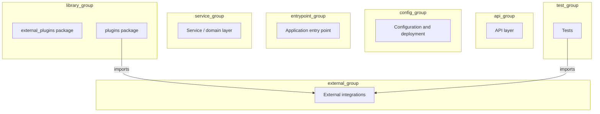

# Architecture report: anthropics/claude-plugins-official

> Automated static analysis. **Observed** = directly seen in files/imports/AST; **Inferred** = interpretation from that evidence. Repository code was not executed.

## 1. Repository at a glance

| Item | Value |
| --- | --- |
| Repository | anthropics/claude-plugins-official |
| Description | Official, Anthropic-managed directory of high quality Claude Code Plugins. |
| Language | Python |
| Stars | 47281 |
| Licence | Apache-2.0 |
| Analysed commit / branch | b5b01ac4f889fec0c4c6bb89f27ca7c8574473f6 / main |
| Framework(s) | None detected |
| Files analysed | 738 |
| Components | 8 |

## 2. Architecture in one minute

anthropics/claude-plugins-official - Official, Anthropic-managed directory of high quality Claude Code Plugins.. This repository was analysed statically from 738 file(s) (143 Python). Detected technologies (observed from imports/manifests): GitHub Actions, pytest, unittest. Files are grouped into 8 component(s): API layer, Configuration and deployment, Application entry point, External integrations, external_plugins package, plugins package, Service / domain layer, Tests. Observed entry point(s): .github/scripts/discover_bumps.py, plugins/claude-for-manufacturing/shared/scripts/plant_setup.py, plugins/claude-for-manufacturing/skills/morning-plant-pulse/scripts/pulse_compute.py. Findings below distinguish observed facts from inferred interpretation.

## 3. High-level block diagram

## 4. Main components

### API layer (`api_layer`)

- **Kind:** api
- **Status:** Observed
- **Confidence:** 0.85
- **Responsibility:** Groups 3 file(s) under api layer (observed from repository paths and static analysis).
- **Paths:** `plugins/code-modernization/hooks/views/deck.tsx`, `plugins/code-modernization/hooks/views/palette.ts`, `plugins/code-modernization/hooks/views/pane.tsx`
- **Evidence:** [plugins/code-modernization/hooks/views/deck.tsx](https://github.com/anthropics/claude-plugins-official/blob/b5b01ac4f889fec0c4c6bb89f27ca7c8574473f6/plugins/code-modernization/hooks/views/deck.tsx); [plugins/code-modernization/hooks/views/palette.ts](https://github.com/anthropics/claude-plugins-official/blob/b5b01ac4f889fec0c4c6bb89f27ca7c8574473f6/plugins/code-modernization/hooks/views/palette.ts); [plugins/code-modernization/hooks/views/pane.tsx](https://github.com/anthropics/claude-plugins-official/blob/b5b01ac4f889fec0c4c6bb89f27ca7c8574473f6/plugins/code-modernization/hooks/views/pane.tsx)

### Configuration and deployment (`config`)

- **Kind:** config
- **Status:** Observed
- **Confidence:** 0.85
- **Responsibility:** Groups 90 file(s) under configuration and deployment (observed from repository paths and static analysis).
- **Paths:** `external_plugins/asana/.claude-plugin/plugin.json`, `external_plugins/context7/.claude-plugin/plugin.json`, `external_plugins/context7/.mcp.json`, `external_plugins/discord/.claude-plugin/plugin.json`, `external_plugins/discord/.mcp.json`, `external_plugins/discord/package.json`, `external_plugins/fakechat/.claude-plugin/plugin.json`, `external_plugins/fakechat/.mcp.json`, `external_plugins/fakechat/package.json`, `external_plugins/firebase/.claude-plugin/plugin.json`, `external_plugins/firebase/.mcp.json`, `external_plugins/github/.claude-plugin/plugin.json`, `external_plugins/github/.mcp.json`, `external_plugins/gitlab/.claude-plugin/plugin.json`, `external_plugins/gitlab/.mcp.json`, `external_plugins/imessage/.claude-plugin/plugin.json`, `external_plugins/imessage/.mcp.json`, `external_plugins/imessage/package.json`, `external_plugins/laravel-boost/.claude-plugin/plugin.json`, `external_plugins/laravel-boost/.mcp.json`, `external_plugins/linear/.claude-plugin/plugin.json`, `external_plugins/linear/.mcp.json`, `external_plugins/playwright/.claude-plugin/plugin.json`, `external_plugins/playwright/.mcp.json`, `external_plugins/serena/.claude-plugin/plugin.json`, `external_plugins/serena/.mcp.json`, `external_plugins/telegram/.claude-plugin/plugin.json`, `external_plugins/telegram/.mcp.json`, `external_plugins/telegram/package.json`, `external_plugins/terraform/.claude-plugin/plugin.json`, `external_plugins/terraform/.mcp.json`, `plugins/agent-sdk-dev/.claude-plugin/plugin.json`, `plugins/champion-kit/.claude-plugin/plugin.json`, `plugins/clangd-lsp/.claude-plugin/plugin.json`, `plugins/claude-code-setup/.claude-plugin/plugin.json`, `plugins/claude-for-manufacturing/.claude-plugin/plugin.json`, `plugins/claude-for-manufacturing/.mcp.json`, `plugins/claude-md-management/.claude-plugin/plugin.json`, `plugins/claude-security/.claude-plugin/plugin.json`, `plugins/claude-security/hooks/hooks.json`, `plugins/claude-security/scripts/lib/cwe-categories.json`, `plugins/code-modernization/.claude-plugin/plugin.json`, `plugins/code-modernization/hooks/hooks.json`, `plugins/code-modernization/tsconfig.json`, `plugins/code-review/.claude-plugin/plugin.json`, `plugins/code-simplifier/.claude-plugin/plugin.json`, `plugins/commit-commands/.claude-plugin/plugin.json`, `plugins/csharp-lsp/.claude-plugin/plugin.json`, `plugins/cwc-makers/.claude-plugin/plugin.json`, `plugins/example-plugin/.claude-plugin/plugin.json`, `plugins/example-plugin/.mcp.json`, `plugins/explanatory-output-style/.claude-plugin/plugin.json`, `plugins/explanatory-output-style/hooks/hooks.json`, `plugins/feature-dev/.claude-plugin/plugin.json`, `plugins/frontend-design/.claude-plugin/plugin.json`, `plugins/gopls-lsp/.claude-plugin/plugin.json`, `plugins/hookify/.claude-plugin/plugin.json`, `plugins/hookify/hooks/hooks.json`, `plugins/jdtls-lsp/.claude-plugin/plugin.json`, `plugins/kotlin-lsp/.claude-plugin/plugin.json`, `plugins/learning-output-style/.claude-plugin/plugin.json`, `plugins/learning-output-style/hooks/hooks.json`, `plugins/lua-lsp/.claude-plugin/plugin.json`, `plugins/math-olympiad/.claude-plugin/plugin.json`, `plugins/math-olympiad/skills/math-olympiad/evals/trigger_eval.json`, `plugins/math-proof/.claude-plugin/plugin.json`, `plugins/mcp-server-dev/.claude-plugin/plugin.json`, `plugins/mcp-tunnels/.claude-plugin/plugin.json`, `plugins/php-lsp/.claude-plugin/plugin.json`, `plugins/playground/.claude-plugin/plugin.json`, `plugins/plugin-dev/.claude-plugin/plugin.json`, `plugins/plugin-dev/skills/mcp-integration/examples/http-server.json`, `plugins/plugin-dev/skills/mcp-integration/examples/sse-server.json`, `plugins/plugin-dev/skills/mcp-integration/examples/stdio-server.json`, `plugins/pr-review-toolkit/.claude-plugin/plugin.json`, `plugins/project-artifact/.claude-plugin/plugin.json`, `plugins/pyright-lsp/.claude-plugin/plugin.json`, `plugins/ralph-loop/.claude-plugin/plugin.json`, `plugins/ralph-loop/hooks/hooks.json`, `plugins/receipts/.claude-plugin/plugin.json`, `plugins/ruby-lsp/.claude-plugin/plugin.json`, `plugins/rust-analyzer-lsp/.claude-plugin/plugin.json`, `plugins/security-guidance/.claude-plugin/plugin.json`, `plugins/security-guidance/hooks/hooks.json`, `plugins/session-report/.claude-plugin/plugin.json`, `plugins/skill-creator/.claude-plugin/plugin.json`, `plugins/swift-lsp/.claude-plugin/plugin.json`, `plugins/theme-examples/.claude-plugin/plugin.json`, `plugins/theme-examples/hooks/hooks.json`, `plugins/typescript-lsp/.claude-plugin/plugin.json`
- **Evidence:** [external_plugins/asana/.claude-plugin/plugin.json](https://github.com/anthropics/claude-plugins-official/blob/b5b01ac4f889fec0c4c6bb89f27ca7c8574473f6/external_plugins/asana/.claude-plugin/plugin.json); [external_plugins/context7/.claude-plugin/plugin.json](https://github.com/anthropics/claude-plugins-official/blob/b5b01ac4f889fec0c4c6bb89f27ca7c8574473f6/external_plugins/context7/.claude-plugin/plugin.json); [external_plugins/context7/.mcp.json](https://github.com/anthropics/claude-plugins-official/blob/b5b01ac4f889fec0c4c6bb89f27ca7c8574473f6/external_plugins/context7/.mcp.json); [external_plugins/discord/.claude-plugin/plugin.json](https://github.com/anthropics/claude-plugins-official/blob/b5b01ac4f889fec0c4c6bb89f27ca7c8574473f6/external_plugins/discord/.claude-plugin/plugin.json); [external_plugins/discord/.mcp.json](https://github.com/anthropics/claude-plugins-official/blob/b5b01ac4f889fec0c4c6bb89f27ca7c8574473f6/external_plugins/discord/.mcp.json); [external_plugins/discord/package.json](https://github.com/anthropics/claude-plugins-official/blob/b5b01ac4f889fec0c4c6bb89f27ca7c8574473f6/external_plugins/discord/package.json); [external_plugins/fakechat/.claude-plugin/plugin.json](https://github.com/anthropics/claude-plugins-official/blob/b5b01ac4f889fec0c4c6bb89f27ca7c8574473f6/external_plugins/fakechat/.claude-plugin/plugin.json); [external_plugins/fakechat/.mcp.json](https://github.com/anthropics/claude-plugins-official/blob/b5b01ac4f889fec0c4c6bb89f27ca7c8574473f6/external_plugins/fakechat/.mcp.json)

### Application entry point (`entrypoint`)

- **Kind:** entrypoint
- **Status:** Observed
- **Confidence:** 0.85
- **Responsibility:** Groups 34 file(s) under application entry point (observed from repository paths and static analysis). Observed top-level classes: Args, AttackPath, Branch, CannotContinueError, Change, ChangedFiles. Observed top-level functions: _add_turn_commits, _agentic_review_with_race, _attached, _block, _block_re, _build_via_target.
- **Paths:** `plugins/claude-for-manufacturing/shared/scripts/plant_setup.py`, `plugins/claude-for-manufacturing/skills/morning-plant-pulse/scripts/pulse_compute.py`, `plugins/claude-for-manufacturing/skills/morning-plant-pulse/scripts/render_short.py`, `plugins/claude-security/hooks/hooks.py`, `plugins/claude-security/scripts/patch_artifacts.py`, `plugins/claude-security/scripts/render_report.py`, `plugins/claude-security/scripts/save_result.py`, `plugins/claude-security/scripts/write_scan_meta.py`, `plugins/code-modernization/scripts/baseline_diff.py`, `plugins/code-modernization/scripts/build_report.py`, `plugins/code-modernization/scripts/compare.py`, `plugins/code-modernization/scripts/make_shards.py`, `plugins/code-modernization/scripts/proof_pack.py`, `plugins/code-modernization/scripts/render_rules.py`, `plugins/code-modernization/scripts/telemetry.py`, `plugins/code-modernization/scripts/trace_rules.py`, `plugins/code-modernization/scripts/uplift_checks.py`, `plugins/hookify/core/config_loader.py`, `plugins/hookify/core/rule_engine.py`, `plugins/hookify/hooks/posttooluse.py`, `plugins/hookify/hooks/pretooluse.py`, `plugins/hookify/hooks/stop.py`, `plugins/hookify/hooks/userpromptsubmit.py`, `plugins/math-proof/skills/siege/scripts/ledger.py`, `plugins/security-guidance/hooks/ensure_agent_sdk.py`, `plugins/security-guidance/hooks/security_reminder_hook.py`, `plugins/skill-creator/skills/skill-creator/eval-viewer/generate_review.py`, `plugins/skill-creator/skills/skill-creator/scripts/aggregate_benchmark.py`, `plugins/skill-creator/skills/skill-creator/scripts/generate_report.py`, `plugins/skill-creator/skills/skill-creator/scripts/improve_description.py`, `plugins/skill-creator/skills/skill-creator/scripts/package_skill.py`, `plugins/skill-creator/skills/skill-creator/scripts/quick_validate.py`, `plugins/skill-creator/skills/skill-creator/scripts/run_eval.py`, `plugins/skill-creator/skills/skill-creator/scripts/run_loop.py`
- **Evidence:** [plugins/claude-for-manufacturing/shared/scripts/plant_setup.py:108](https://github.com/anthropics/claude-plugins-official/blob/b5b01ac4f889fec0c4c6bb89f27ca7c8574473f6/plugins/claude-for-manufacturing/shared/scripts/plant_setup.py#L108); [plugins/claude-for-manufacturing/skills/morning-plant-pulse/scripts/pulse_compute.py:56](https://github.com/anthropics/claude-plugins-official/blob/b5b01ac4f889fec0c4c6bb89f27ca7c8574473f6/plugins/claude-for-manufacturing/skills/morning-plant-pulse/scripts/pulse_compute.py#L56); [plugins/claude-for-manufacturing/skills/morning-plant-pulse/scripts/render_short.py:27](https://github.com/anthropics/claude-plugins-official/blob/b5b01ac4f889fec0c4c6bb89f27ca7c8574473f6/plugins/claude-for-manufacturing/skills/morning-plant-pulse/scripts/render_short.py#L27); [plugins/claude-security/hooks/hooks.py:87](https://github.com/anthropics/claude-plugins-official/blob/b5b01ac4f889fec0c4c6bb89f27ca7c8574473f6/plugins/claude-security/hooks/hooks.py#L87); [plugins/claude-security/scripts/patch_artifacts.py:68](https://github.com/anthropics/claude-plugins-official/blob/b5b01ac4f889fec0c4c6bb89f27ca7c8574473f6/plugins/claude-security/scripts/patch_artifacts.py#L68); [plugins/claude-security/scripts/render_report.py:65](https://github.com/anthropics/claude-plugins-official/blob/b5b01ac4f889fec0c4c6bb89f27ca7c8574473f6/plugins/claude-security/scripts/render_report.py#L65); [plugins/claude-security/scripts/save_result.py:64](https://github.com/anthropics/claude-plugins-official/blob/b5b01ac4f889fec0c4c6bb89f27ca7c8574473f6/plugins/claude-security/scripts/save_result.py#L64); [plugins/claude-security/scripts/write_scan_meta.py:60](https://github.com/anthropics/claude-plugins-official/blob/b5b01ac4f889fec0c4c6bb89f27ca7c8574473f6/plugins/claude-security/scripts/write_scan_meta.py#L60)

### External integrations (`external_integrations`)

- **Kind:** external
- **Status:** Observed
- **Confidence:** 0.85
- **Responsibility:** Groups 1 file(s) under external integrations (observed from repository paths and static analysis). Observed top-level functions: build_investigate_prompt, build_refute_prompt, cap_diff_for_prompt, filter_by_severity, format_findings, tag_diff_anchor.
- **Paths:** `plugins/security-guidance/hooks/review_api.py`
- **Evidence:** [plugins/security-guidance/hooks/review_api.py:31](https://github.com/anthropics/claude-plugins-official/blob/b5b01ac4f889fec0c4c6bb89f27ca7c8574473f6/plugins/security-guidance/hooks/review_api.py#L31)

### external_plugins package (`external_plugins`)

- **Kind:** library
- **Status:** Observed
- **Confidence:** 0.85
- **Responsibility:** Groups 4 file(s) under external_plugins package (observed from repository paths and static analysis).
- **Paths:** `external_plugins/discord/server.ts`, `external_plugins/fakechat/server.ts`, `external_plugins/imessage/server.ts`, `external_plugins/telegram/server.ts`
- **Evidence:** [external_plugins/discord/server.ts](https://github.com/anthropics/claude-plugins-official/blob/b5b01ac4f889fec0c4c6bb89f27ca7c8574473f6/external_plugins/discord/server.ts); [external_plugins/fakechat/server.ts](https://github.com/anthropics/claude-plugins-official/blob/b5b01ac4f889fec0c4c6bb89f27ca7c8574473f6/external_plugins/fakechat/server.ts); [external_plugins/imessage/server.ts](https://github.com/anthropics/claude-plugins-official/blob/b5b01ac4f889fec0c4c6bb89f27ca7c8574473f6/external_plugins/imessage/server.ts); [external_plugins/telegram/server.ts](https://github.com/anthropics/claude-plugins-official/blob/b5b01ac4f889fec0c4c6bb89f27ca7c8574473f6/external_plugins/telegram/server.ts)

### plugins package (`plugins`)

- **Kind:** library
- **Status:** Observed
- **Confidence:** 0.85
- **Responsibility:** Groups 101 file(s) under plugins package (observed from repository paths and static analysis). Observed top-level classes: Catalog, CatalogFile, Category, CategoryNames, Chain, Confidence. Observed top-level functions: _abs, _add_new_files, _again_if_refused, _agentic_commit_review_enabled, _agentic_context_dir, _agentic_review.
- **Paths:** `plugins/claude-security/hooks/hooks.sh`, `plugins/claude-security/scripts/keep-waiting.sh`, `plugins/claude-security/scripts/lib/__init__.py`, `plugins/claude-security/scripts/lib/absolute.py`, `plugins/claude-security/scripts/lib/chain.py`, `plugins/claude-security/scripts/lib/console.py`, `plugins/claude-security/scripts/lib/cwe.py`, `plugins/claude-security/scripts/lib/finding.py`, `plugins/claude-security/scripts/lib/git.py`, `plugins/claude-security/scripts/lib/link.py`, `plugins/claude-security/scripts/lib/plugin.py`, `plugins/claude-security/scripts/lib/revision.py`, `plugins/claude-security/scripts/lib/sarif.py`, `plugins/claude-security/scripts/lib/secret.py`, `plugins/claude-security/scripts/lib/source.py`, `plugins/claude-security/scripts/lib/strictjson.py`, `plugins/claude-security/workflows/scan.js`, `plugins/code-modernization/hooks/fleet/fleet.ts`, `plugins/code-modernization/hooks/host.ts`, `plugins/code-modernization/hooks/map/estate.ts`, `plugins/code-modernization/hooks/map/raster.ts`, `plugins/code-modernization/hooks/map/treemap.ts`, `plugins/code-modernization/hooks/paths.ts`, `plugins/code-modernization/hooks/reader/brief.ts`, `plugins/code-modernization/hooks/reader/discover.ts`, `plugins/code-modernization/hooks/reader/estate-model.ts`, `plugins/code-modernization/hooks/reader/fs.ts`, `plugins/code-modernization/hooks/reader/modernized.ts`, `plugins/code-modernization/hooks/reader/progress.ts`, `plugins/code-modernization/hooks/reader/rules.ts`, `plugins/code-modernization/hooks/reader/topology.ts`, `plugins/code-modernization/hooks/reader/tracks.ts`, `plugins/code-modernization/hooks/reader/uplift.ts`, `plugins/code-modernization/hooks/reader/verification.ts`, `plugins/code-modernization/hooks/register.ts`, `plugins/code-modernization/hooks/review/deck.ts`, `plugins/code-modernization/hooks/review/ledger.ts`, `plugins/code-modernization/hooks/sign.ts`, `plugins/code-modernization/hooks/state.ts`, `plugins/code-modernization/hooks/tests-run.ts`, `plugins/code-modernization/hooks/text.ts`, `plugins/code-modernization/hooks/xray/xray.ts`, `plugins/code-modernization/scripts/telemetry.sh`, `plugins/code-modernization/workflows/extract-rules.js`, `plugins/code-modernization/workflows/harden-scan.js`, `plugins/code-modernization/workflows/portfolio-assess.js`, `plugins/code-modernization/workflows/reimagine-scaffold.js`, `plugins/code-modernization/workflows/uplift-deltas.js`, `plugins/code-modernization/workflows/uplift-migrate.js`, `plugins/explanatory-output-style/hooks-handlers/session-start.sh`, `plugins/hookify/hooks/__init__.py`, `plugins/hookify/matchers/__init__.py`, `plugins/hookify/utils/__init__.py`, `plugins/learning-output-style/hooks-handlers/session-start.sh`, `plugins/math-olympiad/skills/math-olympiad/scripts/check_latex.sh`, `plugins/math-olympiad/skills/math-olympiad/scripts/compile_pdf.sh`, `plugins/plugin-dev/skills/agent-development/scripts/validate-agent.sh`, `plugins/plugin-dev/skills/hook-development/examples/load-context.sh`, `plugins/plugin-dev/skills/hook-development/examples/validate-bash.sh`, `plugins/plugin-dev/skills/hook-development/examples/validate-write.sh`, `plugins/plugin-dev/skills/hook-development/scripts/hook-linter.sh`, `plugins/plugin-dev/skills/hook-development/scripts/test-hook.sh`, `plugins/plugin-dev/skills/hook-development/scripts/validate-hook-schema.sh`, `plugins/plugin-dev/skills/plugin-settings/examples/read-settings-hook.sh`, `plugins/plugin-dev/skills/plugin-settings/scripts/parse-frontmatter.sh`, `plugins/plugin-dev/skills/plugin-settings/scripts/validate-settings.sh`, `plugins/ralph-loop/hooks/stop-hook.sh`, `plugins/ralph-loop/scripts/setup-ralph-loop.sh`, `plugins/receipts/assets/make-sample.mjs`, `plugins/receipts/skills/receipts/scripts/mine-transcripts.mjs`, `plugins/security-guidance/hooks/_base.py`, `plugins/security-guidance/hooks/diffstate.py`, `plugins/security-guidance/hooks/extensibility.py`, `plugins/security-guidance/hooks/gitutil.py`, `plugins/security-guidance/hooks/llm.py`, `plugins/security-guidance/hooks/patterns.py`, `plugins/security-guidance/hooks/reporesolve.py`, `plugins/security-guidance/hooks/session_state.py`, `plugins/security-guidance/hooks/sg-python.sh`, `plugins/session-report/skills/session-report/analyze-sessions.mjs`, `plugins/skill-creator/skills/skill-creator/scripts/__init__.py`, `plugins/skill-creator/skills/skill-creator/scripts/utils.py`, `plugins/theme-examples/hooks/fireworks.ts`, `plugins/theme-examples/hooks/project-key.ts`, `plugins/theme-examples/hooks/register.tsx`, `plugins/theme-examples/hooks/scenes/blueprint.ts`, `plugins/theme-examples/hooks/scenes/braille-stars.ts`, `plugins/theme-examples/hooks/scenes/classic.ts`, `plugins/theme-examples/hooks/scenes/departure-board.ts`, `plugins/theme-examples/hooks/scenes/dither-dunes.ts`, `plugins/theme-examples/hooks/scenes/halftone-dawn.ts`, `plugins/theme-examples/hooks/scenes/honu-lagoon.ts`, `plugins/theme-examples/hooks/scenes/koi-mosaic.ts`, `plugins/theme-examples/hooks/scenes/night-reef.ts`, `plugins/theme-examples/hooks/scenes/paper-garden.ts`, `plugins/theme-examples/hooks/scenes/plotter-tide.ts`, `plugins/theme-examples/hooks/scenes/snow-pines.ts`, `plugins/theme-examples/hooks/scenes/teletext-clouds.ts`, `plugins/theme-examples/hooks/scenes/vector-range.ts`, `plugins/theme-examples/hooks/themes.ts`, `plugins/theme-examples/types/index.d.ts`
- **Evidence:** [plugins/claude-security/hooks/hooks.sh](https://github.com/anthropics/claude-plugins-official/blob/b5b01ac4f889fec0c4c6bb89f27ca7c8574473f6/plugins/claude-security/hooks/hooks.sh); [plugins/claude-security/scripts/keep-waiting.sh](https://github.com/anthropics/claude-plugins-official/blob/b5b01ac4f889fec0c4c6bb89f27ca7c8574473f6/plugins/claude-security/scripts/keep-waiting.sh); [plugins/claude-security/scripts/lib/__init__.py](https://github.com/anthropics/claude-plugins-official/blob/b5b01ac4f889fec0c4c6bb89f27ca7c8574473f6/plugins/claude-security/scripts/lib/__init__.py); [plugins/claude-security/scripts/lib/absolute.py:10](https://github.com/anthropics/claude-plugins-official/blob/b5b01ac4f889fec0c4c6bb89f27ca7c8574473f6/plugins/claude-security/scripts/lib/absolute.py#L10); [plugins/claude-security/scripts/lib/chain.py:10](https://github.com/anthropics/claude-plugins-official/blob/b5b01ac4f889fec0c4c6bb89f27ca7c8574473f6/plugins/claude-security/scripts/lib/chain.py#L10); [plugins/claude-security/scripts/lib/console.py:9](https://github.com/anthropics/claude-plugins-official/blob/b5b01ac4f889fec0c4c6bb89f27ca7c8574473f6/plugins/claude-security/scripts/lib/console.py#L9); [plugins/claude-security/scripts/lib/cwe.py:14](https://github.com/anthropics/claude-plugins-official/blob/b5b01ac4f889fec0c4c6bb89f27ca7c8574473f6/plugins/claude-security/scripts/lib/cwe.py#L14); [plugins/claude-security/scripts/lib/finding.py:18](https://github.com/anthropics/claude-plugins-official/blob/b5b01ac4f889fec0c4c6bb89f27ca7c8574473f6/plugins/claude-security/scripts/lib/finding.py#L18)

### Service / domain layer (`service_layer`)

- **Kind:** service
- **Status:** Observed
- **Confidence:** 0.85
- **Responsibility:** Groups 1 file(s) under service / domain layer (observed from repository paths and static analysis).
- **Paths:** `plugins/hookify/core/__init__.py`
- **Evidence:** [plugins/hookify/core/__init__.py](https://github.com/anthropics/claude-plugins-official/blob/b5b01ac4f889fec0c4c6bb89f27ca7c8574473f6/plugins/hookify/core/__init__.py)

### Tests (`tests`)

- **Kind:** test
- **Status:** Observed
- **Confidence:** 0.85
- **Responsibility:** Groups 89 file(s) under tests (observed from repository paths and static analysis). Observed top-level classes: Base, BaselineDiff, BaselineEvidence, Box, BuildFacts, BuildReport. Observed top-level functions: _add, _add_nested_repo, _advance_clock, _alias, _appear_after_the_first_look, _assert_stays_out.
- **Paths:** `plugins/code-modernization/scripts/tests/test_compare_tolerance.py`, `plugins/code-modernization/scripts/tests/test_proof_rules_run.py`, `plugins/code-modernization/scripts/tests/test_proof_tools.py`, `plugins/code-modernization/scripts/tests/test_report_next.py`, `plugins/code-modernization/scripts/tests/test_report_tools.py`, `plugins/code-modernization/scripts/tests/test_rules_tools.py`, `plugins/code-modernization/scripts/tests/test_telemetry.py`, `plugins/code-modernization/tests/fixtures/inputs.ts`, `plugins/code-modernization/tests/fixtures/stacks.ts`, `plugins/code-modernization/tests/fixtures/workspace.ts`, `plugins/code-modernization/tests/fixtures/world.ts`, `plugins/code-modernization/tests/hostile.test.ts`, `plugins/code-modernization/tests/logic.test.ts`, `plugins/code-modernization/tests/mount.test.ts`, `plugins/code-modernization/tests/register.test.ts`, `plugins/code-modernization/tests/stacks.test.ts`, `plugins/code-modernization/tests/verification.test.ts`, `plugins/security-guidance/tests/conftest.py`, `plugins/security-guidance/tests/test_add_failure_metric.py`, `plugins/security-guidance/tests/test_agentic_auth_stop.py`, `plugins/security-guidance/tests/test_bare_repo_toplevel.py`, `plugins/security-guidance/tests/test_base_url.py`, `plugins/security-guidance/tests/test_baseline_lookup.py`, `plugins/security-guidance/tests/test_baseline_snapshot.py`, `plugins/security-guidance/tests/test_bootstrap_spawn_cwd.py`, `plugins/security-guidance/tests/test_call_argument_patterns.py`, `plugins/security-guidance/tests/test_chained_commit_push.py`, `plugins/security-guidance/tests/test_credential_routing.py`, `plugins/security-guidance/tests/test_custom_headers.py`, `plugins/security-guidance/tests/test_custom_regex_time_limit.py`, `plugins/security-guidance/tests/test_custom_rule_path_globs.py`, `plugins/security-guidance/tests/test_custom_rule_stats.py`, `plugins/security-guidance/tests/test_diff_parsing.py`, `plugins/security-guidance/tests/test_diff_prefix_config.py`, `plugins/security-guidance/tests/test_findings_delivery.py`, `plugins/security-guidance/tests/test_gateway_sign_in.py`, `plugins/security-guidance/tests/test_git_index_locks.py`, `plugins/security-guidance/tests/test_git_program.py`, `plugins/security-guidance/tests/test_inflight_reviews.py`, `plugins/security-guidance/tests/test_interp_reparse_metric.py`, `plugins/security-guidance/tests/test_launcher_alias_own_path.py`, `plugins/security-guidance/tests/test_launcher_newer_python.py`, `plugins/security-guidance/tests/test_launcher_probe_env.py`, `plugins/security-guidance/tests/test_launcher_probe_timing.py`, `plugins/security-guidance/tests/test_launcher_process_count.py`, `plugins/security-guidance/tests/test_launcher_unreadable_script.py`, `plugins/security-guidance/tests/test_nested_repos.py`, `plugins/security-guidance/tests/test_network_failure_class.py`, `plugins/security-guidance/tests/test_no_credentials_notice.py`, `plugins/security-guidance/tests/test_notebook_edit_patterns.py`, `plugins/security-guidance/tests/test_pattern_fired_metrics.py`, `plugins/security-guidance/tests/test_patterns_file_shape.py`, `plugins/security-guidance/tests/test_portable_output.py`, `plugins/security-guidance/tests/test_project_config_files.py`, `plugins/security-guidance/tests/test_project_rules_after_cd.py`, `plugins/security-guidance/tests/test_prompt_cache.py`, `plugins/security-guidance/tests/test_prompt_untracked_snapshot.py`, `plugins/security-guidance/tests/test_push_merge_base.py`, `plugins/security-guidance/tests/test_record_files.py`, `plugins/security-guidance/tests/test_repeated_diff_count.py`, `plugins/security-guidance/tests/test_repo_resolution.py`, `plugins/security-guidance/tests/test_review_model.py`, `plugins/security-guidance/tests/test_review_outcomes.py`, `plugins/security-guidance/tests/test_review_session_persistence.py`, `plugins/security-guidance/tests/test_review_usage_log.py`, `plugins/security-guidance/tests/test_reviewer_context_metrics.py`, `plugins/security-guidance/tests/test_reviewer_oauth_token.py`, `plugins/security-guidance/tests/test_reviewer_tools.py`, `plugins/security-guidance/tests/test_sdk_bootstrap_switches.py`, `plugins/security-guidance/tests/test_sdk_emptied_install.py`, `plugins/security-guidance/tests/test_sdk_install_timeout.py`, `plugins/security-guidance/tests/test_secret_named_metric.py`, `plugins/security-guidance/tests/test_secret_renames.py`, `plugins/security-guidance/tests/test_secret_shaped_paths.py`, `plugins/security-guidance/tests/test_slow_prompt_metrics.py`, `plugins/security-guidance/tests/test_state_dir_mode.py`, `plugins/security-guidance/tests/test_state_file.py`, `plugins/security-guidance/tests/test_stop_baseline_checkout.py`, `plugins/security-guidance/tests/test_stop_diff_memory.py`, `plugins/security-guidance/tests/test_stop_finding_no_edit_record.py`, `plugins/security-guidance/tests/test_stop_review_paths.py`, `plugins/security-guidance/tests/test_stop_scope_metrics.py`, `plugins/security-guidance/tests/test_temp_index_cleanup.py`, `plugins/security-guidance/tests/test_tls_store_unreadable_cert.py`, `plugins/security-guidance/tests/test_turn_commits_metric.py`, `plugins/security-guidance/tests/test_unmatched_bash_metric.py`, `plugins/security-guidance/tests/test_untracked_cap.py`, `plugins/security-guidance/tests/test_user_config_dir.py`, `plugins/security-guidance/tests/test_windows_cli_lookup.py`
- **Evidence:** [plugins/code-modernization/scripts/tests/test_compare_tolerance.py:21](https://github.com/anthropics/claude-plugins-official/blob/b5b01ac4f889fec0c4c6bb89f27ca7c8574473f6/plugins/code-modernization/scripts/tests/test_compare_tolerance.py#L21); [plugins/code-modernization/scripts/tests/test_proof_rules_run.py:39](https://github.com/anthropics/claude-plugins-official/blob/b5b01ac4f889fec0c4c6bb89f27ca7c8574473f6/plugins/code-modernization/scripts/tests/test_proof_rules_run.py#L39); [plugins/code-modernization/scripts/tests/test_proof_tools.py:33](https://github.com/anthropics/claude-plugins-official/blob/b5b01ac4f889fec0c4c6bb89f27ca7c8574473f6/plugins/code-modernization/scripts/tests/test_proof_tools.py#L33); [plugins/code-modernization/scripts/tests/test_report_next.py:13](https://github.com/anthropics/claude-plugins-official/blob/b5b01ac4f889fec0c4c6bb89f27ca7c8574473f6/plugins/code-modernization/scripts/tests/test_report_next.py#L13); [plugins/code-modernization/scripts/tests/test_report_tools.py:34](https://github.com/anthropics/claude-plugins-official/blob/b5b01ac4f889fec0c4c6bb89f27ca7c8574473f6/plugins/code-modernization/scripts/tests/test_report_tools.py#L34); [plugins/code-modernization/scripts/tests/test_rules_tools.py:13](https://github.com/anthropics/claude-plugins-official/blob/b5b01ac4f889fec0c4c6bb89f27ca7c8574473f6/plugins/code-modernization/scripts/tests/test_rules_tools.py#L13); [plugins/code-modernization/scripts/tests/test_telemetry.py:67](https://github.com/anthropics/claude-plugins-official/blob/b5b01ac4f889fec0c4c6bb89f27ca7c8574473f6/plugins/code-modernization/scripts/tests/test_telemetry.py#L67); [plugins/code-modernization/tests/fixtures/inputs.ts](https://github.com/anthropics/claude-plugins-official/blob/b5b01ac4f889fec0c4c6bb89f27ca7c8574473f6/plugins/code-modernization/tests/fixtures/inputs.ts)

## 5. Execution flow

**Observed** entry point(s):

- [.github/scripts/discover_bumps.py:228](https://github.com/anthropics/claude-plugins-official/blob/b5b01ac4f889fec0c4c6bb89f27ca7c8574473f6/.github/scripts/discover_bumps.py#L228)
- [plugins/claude-for-manufacturing/shared/scripts/plant_setup.py:1418](https://github.com/anthropics/claude-plugins-official/blob/b5b01ac4f889fec0c4c6bb89f27ca7c8574473f6/plugins/claude-for-manufacturing/shared/scripts/plant_setup.py#L1418)
- [plugins/claude-for-manufacturing/skills/morning-plant-pulse/scripts/pulse_compute.py:2272](https://github.com/anthropics/claude-plugins-official/blob/b5b01ac4f889fec0c4c6bb89f27ca7c8574473f6/plugins/claude-for-manufacturing/skills/morning-plant-pulse/scripts/pulse_compute.py#L2272)
- [plugins/claude-for-manufacturing/skills/morning-plant-pulse/scripts/render_short.py:805](https://github.com/anthropics/claude-plugins-official/blob/b5b01ac4f889fec0c4c6bb89f27ca7c8574473f6/plugins/claude-for-manufacturing/skills/morning-plant-pulse/scripts/render_short.py#L805)
- [plugins/claude-security/hooks/hooks.py:491](https://github.com/anthropics/claude-plugins-official/blob/b5b01ac4f889fec0c4c6bb89f27ca7c8574473f6/plugins/claude-security/hooks/hooks.py#L491)
- [plugins/claude-security/scripts/patch_artifacts.py:1281](https://github.com/anthropics/claude-plugins-official/blob/b5b01ac4f889fec0c4c6bb89f27ca7c8574473f6/plugins/claude-security/scripts/patch_artifacts.py#L1281)
- [plugins/claude-security/scripts/render_report.py:978](https://github.com/anthropics/claude-plugins-official/blob/b5b01ac4f889fec0c4c6bb89f27ca7c8574473f6/plugins/claude-security/scripts/render_report.py#L978)
- [plugins/claude-security/scripts/save_result.py:531](https://github.com/anthropics/claude-plugins-official/blob/b5b01ac4f889fec0c4c6bb89f27ca7c8574473f6/plugins/claude-security/scripts/save_result.py#L531)
- [plugins/claude-security/scripts/write_scan_meta.py:548](https://github.com/anthropics/claude-plugins-official/blob/b5b01ac4f889fec0c4c6bb89f27ca7c8574473f6/plugins/claude-security/scripts/write_scan_meta.py#L548)
- [plugins/code-modernization/scripts/baseline_diff.py:808](https://github.com/anthropics/claude-plugins-official/blob/b5b01ac4f889fec0c4c6bb89f27ca7c8574473f6/plugins/code-modernization/scripts/baseline_diff.py#L808)
- [plugins/code-modernization/scripts/build_report.py:724](https://github.com/anthropics/claude-plugins-official/blob/b5b01ac4f889fec0c4c6bb89f27ca7c8574473f6/plugins/code-modernization/scripts/build_report.py#L724)
- [plugins/code-modernization/scripts/compare.py:486](https://github.com/anthropics/claude-plugins-official/blob/b5b01ac4f889fec0c4c6bb89f27ca7c8574473f6/plugins/code-modernization/scripts/compare.py#L486)

Representative flow (derived from observed entry points and the import graph; steps beyond the entry point are **Inferred**):

1. Execution starts at an observed entry point listed above, if present.
2. `plugins` imports `external_integrations` (plugins package -> External integrations).
3. `tests` imports `external_integrations` (Tests -> External integrations).

## 6. Project structure

### `(root)`

- `.gitignore` - other (19 bytes)
- `LICENSE` - docs (11358 bytes)
- `README.md` - docs (4794 bytes)

### `.claude-plugin`

- `.claude-plugin/marketplace.json` - config (191699 bytes)

### `.github`

- `.github/bump-tracking.json` - config (327 bytes)
- `.github/policy/prompt.md` - docs (7977 bytes)
- `.github/policy/schema.json` - config (1972 bytes)
- `.github/scripts/discover_bumps.py` - source, Python (8360 bytes)
- `.github/scripts/plugin-dirs.sh` - source, Shell (285 bytes)
- `.github/scripts/validate-frontmatter.ts` - source, TypeScript (7545 bytes)
- `.github/scripts/validate-plugin-folders.ts` - source, TypeScript (7329 bytes)
- `.github/workflows/bump-plugin-shas.yml` - ci, YAML (5428 bytes)
- `.github/workflows/check-mcp-urls.yml` - ci, YAML (5761 bytes)
- `.github/workflows/close-external-prs.yml` - ci, YAML (3253 bytes)
- `.github/workflows/revert-failed-bumps.yml` - ci, YAML (14275 bytes)
- `.github/workflows/scan-plugins.yml` - ci, YAML (27032 bytes)
- `.github/workflows/validate-licenses.yml` - ci, YAML (1891 bytes)
- `.github/workflows/validate-plugins.yml` - ci, YAML (3684 bytes)

### `external_plugins`

- `external_plugins/asana/.claude-plugin/plugin.json` - config (374 bytes)
- `external_plugins/asana/README.md` - docs (3249 bytes)
- `external_plugins/asana/commands/asana-setup.md` - docs (1940 bytes)
- `external_plugins/context7/.claude-plugin/plugin.json` - config (427 bytes)
- `external_plugins/context7/.mcp.json` - config (142 bytes)
- `external_plugins/context7/README.md` - docs (1865 bytes)
- `external_plugins/discord/.claude-plugin/plugin.json` - config (290 bytes)
- `external_plugins/discord/.mcp.json` - config (165 bytes)
- `external_plugins/discord/ACCESS.md` - docs (6599 bytes)
- `external_plugins/discord/LICENSE` - docs (11344 bytes)
- `external_plugins/discord/README.md` - docs (4888 bytes)
- `external_plugins/discord/bun.lock` - other (23966 bytes)
- `external_plugins/discord/package.json` - manifest (306 bytes)
- `external_plugins/discord/server.ts` - source, TypeScript (33549 bytes)
- `external_plugins/discord/skills/access/SKILL.md` - docs (4357 bytes)
- `external_plugins/discord/skills/configure/SKILL.md` - docs (4324 bytes)
- `external_plugins/fakechat/.claude-plugin/plugin.json` - config (300 bytes)
- `external_plugins/fakechat/.mcp.json` - config (166 bytes)
- `external_plugins/fakechat/LICENSE` - docs (11344 bytes)
- `external_plugins/fakechat/README.md` - docs (1308 bytes)
- `external_plugins/fakechat/bun.lock` - other (19317 bytes)
- `external_plugins/fakechat/package.json` - manifest (333 bytes)
- `external_plugins/fakechat/server.ts` - source, TypeScript (10547 bytes)
- `external_plugins/firebase/.claude-plugin/plugin.json` - config (281 bytes)
- `external_plugins/firebase/.mcp.json` - config (97 bytes)
- `external_plugins/github/.claude-plugin/plugin.json` - config (271 bytes)
- `external_plugins/github/.mcp.json` - config (178 bytes)
- `external_plugins/gitlab/.claude-plugin/plugin.json` - config (254 bytes)
- `external_plugins/gitlab/.mcp.json` - config (85 bytes)
- `external_plugins/imessage/.claude-plugin/plugin.json` - config (319 bytes)
- `external_plugins/imessage/.mcp.json` - config (166 bytes)
- `external_plugins/imessage/ACCESS.md` - docs (6764 bytes)
- `external_plugins/imessage/LICENSE` - docs (11344 bytes)
- `external_plugins/imessage/README.md` - docs (4475 bytes)
- `external_plugins/imessage/bun.lock` - other (19345 bytes)
- `external_plugins/imessage/package.json` - manifest (355 bytes)
- `external_plugins/imessage/server.ts` - source, TypeScript (32567 bytes)
- `external_plugins/imessage/skills/access/SKILL.md` - docs (4754 bytes)
- `external_plugins/imessage/skills/configure/SKILL.md` - docs (3546 bytes)
- `external_plugins/laravel-boost/.claude-plugin/plugin.json` - config (295 bytes)
- `external_plugins/laravel-boost/.mcp.json` - config (88 bytes)
- `external_plugins/linear/.claude-plugin/plugin.json` - config (279 bytes)
- `external_plugins/linear/.mcp.json` - config (82 bytes)
- `external_plugins/playwright/.claude-plugin/plugin.json` - config (295 bytes)
- `external_plugins/playwright/.mcp.json` - config (87 bytes)
- `external_plugins/serena/.claude-plugin/plugin.json` - config (254 bytes)
- `external_plugins/serena/.mcp.json` - config (137 bytes)
- `external_plugins/telegram/.claude-plugin/plugin.json` - config (294 bytes)
- `external_plugins/telegram/.mcp.json` - config (166 bytes)
- `external_plugins/telegram/ACCESS.md` - docs (7075 bytes)
- `external_plugins/telegram/LICENSE` - docs (11344 bytes)
- `external_plugins/telegram/README.md` - docs (4478 bytes)
- `external_plugins/telegram/bun.lock` - other (20129 bytes)
- `external_plugins/telegram/package.json` - manifest (307 bytes)
- `external_plugins/telegram/server.ts` - source, TypeScript (40358 bytes)
- `external_plugins/telegram/skills/access/SKILL.md` - docs (4463 bytes)
- `external_plugins/telegram/skills/configure/SKILL.md` - docs (4308 bytes)
- `external_plugins/terraform/.claude-plugin/plugin.json` - config (274 bytes)
- `external_plugins/terraform/.mcp.json` - config (192 bytes)

### `plugins`

- `plugins/agent-sdk-dev/.claude-plugin/plugin.json` - config (189 bytes)
- `plugins/agent-sdk-dev/LICENSE` - docs (11358 bytes)
- `plugins/agent-sdk-dev/README.md` - docs (6397 bytes)
- `plugins/agent-sdk-dev/agents/agent-sdk-verifier-py.md` - docs (5206 bytes)
- `plugins/agent-sdk-dev/agents/agent-sdk-verifier-ts.md` - docs (5419 bytes)
- `plugins/agent-sdk-dev/commands/new-sdk-app.md` - docs (7846 bytes)
- `plugins/champion-kit/.claude-plugin/plugin.json` - config (487 bytes)
- `plugins/champion-kit/LICENSE` - docs (11358 bytes)
- `plugins/champion-kit/README.md` - docs (5137 bytes)
- `plugins/champion-kit/agents/repo-scout.md` - docs (3853 bytes)
- `plugins/champion-kit/skills/climb/SKILL.md` - docs (10811 bytes)
- `plugins/champion-kit/skills/faq/SKILL.md` - docs (5218 bytes)
- `plugins/champion-kit/skills/hackathon/SKILL.md` - docs (9858 bytes)
- `plugins/champion-kit/skills/maturity/SKILL.md` - docs (11135 bytes)
- `plugins/champion-kit/skills/maturity/report-template.html` - other (27028 bytes)
- `plugins/champion-kit/skills/office-hours/SKILL.md` - docs (5280 bytes)
- `plugins/champion-kit/skills/patterns/SKILL.md` - docs (8898 bytes)
- `plugins/champion-kit/skills/routines/SKILL.md` - docs (8501 bytes)
- `plugins/clangd-lsp/.claude-plugin/plugin.json` - config (561 bytes)
- `plugins/clangd-lsp/LICENSE` - docs (11358 bytes)
- `plugins/clangd-lsp/README.md` - docs (780 bytes)
- `plugins/claude-code-setup/.claude-plugin/plugin.json` - config (273 bytes)
- `plugins/claude-code-setup/LICENSE` - docs (11358 bytes)
- `plugins/claude-code-setup/README.md` - docs (1015 bytes)
- `plugins/claude-code-setup/skills/claude-automation-recommender/SKILL.md` - docs (10995 bytes)
- `plugins/claude-code-setup/skills/claude-automation-recommender/references/hooks-patterns.md` - docs (6316 bytes)
- `plugins/claude-code-setup/skills/claude-automation-recommender/references/mcp-servers.md` - docs (8292 bytes)
- `plugins/claude-code-setup/skills/claude-automation-recommender/references/plugins-reference.md` - docs (3016 bytes)
- `plugins/claude-code-setup/skills/claude-automation-recommender/references/skills-reference.md` - docs (9612 bytes)
- `plugins/claude-code-setup/skills/claude-automation-recommender/references/subagent-templates.md` - docs (5049 bytes)
- `plugins/claude-for-manufacturing/.claude-plugin/plugin.json` - config (946 bytes)
- `plugins/claude-for-manufacturing/.gitignore` - other (41 bytes)
- `plugins/claude-for-manufacturing/.mcp.json` - config (132 bytes)
- `plugins/claude-for-manufacturing/LICENSE` - docs (11358 bytes)
- `plugins/claude-for-manufacturing/README.md` - docs (18954 bytes)
- `plugins/claude-for-manufacturing/shared/absent-is-not-zero.md` - docs (7192 bytes)
- `plugins/claude-for-manufacturing/shared/approval-gates.md` - docs (8858 bytes)
- `plugins/claude-for-manufacturing/shared/artifact-style.md` - docs (12880 bytes)
- `plugins/claude-for-manufacturing/shared/command-center.md` - docs (6617 bytes)
- `plugins/claude-for-manufacturing/shared/computed-figures.md` - docs (4083 bytes)
- `plugins/claude-for-manufacturing/shared/contracts/README.md` - docs (6865 bytes)
- `plugins/claude-for-manufacturing/shared/contracts/consolidated-dataset.md` - docs (20340 bytes)
- `plugins/claude-for-manufacturing/shared/contracts/downtime-record.md` - docs (8401 bytes)
- `plugins/claude-for-manufacturing/shared/contracts/floor-layout.md` - docs (5713 bytes)
- `plugins/claude-for-manufacturing/shared/contracts/geometry-estimate.md` - docs (19637 bytes)
- `plugins/claude-for-manufacturing/shared/contracts/intake-form.md` - docs (23196 bytes)
- `plugins/claude-for-manufacturing/shared/contracts/ncr.md` - docs (15009 bytes)
- `plugins/claude-for-manufacturing/shared/contracts/pulse-day-record.md` - docs (8900 bytes)
- `plugins/claude-for-manufacturing/shared/contracts/quality-register-record.md` - docs (8446 bytes)
- `plugins/claude-for-manufacturing/shared/contracts/supplier-bid.md` - docs (15100 bytes)
- `plugins/claude-for-manufacturing/shared/contracts/supplier-caused-flag.md` - docs (10143 bytes)
- `plugins/claude-for-manufacturing/shared/contracts/variant-manifest.md` - docs (10455 bytes)
- `plugins/claude-for-manufacturing/shared/erp-connectors.md` - docs (8079 bytes)
- `plugins/claude-for-manufacturing/shared/live-dashboard.md` - docs (13701 bytes)
- `plugins/claude-for-manufacturing/shared/replies.md` - docs (14373 bytes)
- `plugins/claude-for-manufacturing/shared/scheduling.md` - docs (4684 bytes)
- `plugins/claude-for-manufacturing/shared/scripts/plant_setup.py` - source, Python (71404 bytes)
- `plugins/claude-for-manufacturing/shared/secret-config.md` - docs (15871 bytes)
- `plugins/claude-for-manufacturing/skills/breakdown-diagnosis/SKILL.md` - docs (17835 bytes)
- `plugins/claude-for-manufacturing/skills/breakdown-diagnosis/reference/bad-actor-mode.md` - docs (3891 bytes)
- `plugins/claude-for-manufacturing/skills/breakdown-diagnosis/reference/evidence-sources.md` - docs (6341 bytes)
- `plugins/claude-for-manufacturing/skills/breakdown-to-next-report/SKILL.md` - docs (10308 bytes)
- `plugins/claude-for-manufacturing/skills/custom-connector/SKILL.md` - docs (23142 bytes)
- `plugins/claude-for-manufacturing/skills/custom-connector/reference/access-ladder.md` - docs (11981 bytes)
- `plugins/claude-for-manufacturing/skills/custom-connector/reference/credentials-and-failure-modes.md` - docs (3070 bytes)
- `plugins/claude-for-manufacturing/skills/custom-connector/reference/known-systems.md` - docs (7520 bytes)
- `plugins/claude-for-manufacturing/skills/customer-inquiry-intake/SKILL.md` - docs (21236 bytes)
- `plugins/claude-for-manufacturing/skills/customer-inquiry-intake/reference/arrival-formats.md` - docs (2944 bytes)
- `plugins/claude-for-manufacturing/skills/customer-inquiry-intake/reference/bid-no-bid.md` - docs (7002 bytes)
- `plugins/claude-for-manufacturing/skills/customer-inquiry-intake/reference/registers.md` - docs (4072 bytes)
- `plugins/claude-for-manufacturing/skills/daily-production-report/SKILL.md` - docs (27653 bytes)
- `plugins/claude-for-manufacturing/skills/daily-production-report/reference/floor-schematic.md` - docs (13452 bytes)
- `plugins/claude-for-manufacturing/skills/daily-production-report/reference/oee.md` - docs (5965 bytes)
- `plugins/claude-for-manufacturing/skills/daily-production-report/reference/reschedule-scope.md` - docs (4412 bytes)
- `plugins/claude-for-manufacturing/skills/data-consolidate/SKILL.md` - docs (27373 bytes)
- `plugins/claude-for-manufacturing/skills/data-consolidate/reference/join-keys.md` - docs (11681 bytes)
- `plugins/claude-for-manufacturing/skills/data-consolidate/reference/mismatch-classes.md` - docs (8653 bytes)
- `plugins/claude-for-manufacturing/skills/design-space-explore/SKILL.md` - docs (11214 bytes)
- `plugins/claude-for-manufacturing/skills/design-space-explore/reference/adapt-prior-model.md` - docs (6733 bytes)
- `plugins/claude-for-manufacturing/skills/design-space-explore/reference/cad-adapter.md` - docs (10827 bytes)
- `plugins/claude-for-manufacturing/skills/design-space-explore/reference/parametric-check.md` - docs (3651 bytes)
- `plugins/claude-for-manufacturing/skills/design-space-explore/reference/variant-generation.md` - docs (5575 bytes)
- `plugins/claude-for-manufacturing/skills/inspection-to-capa/SKILL.md` - docs (9768 bytes)
- `plugins/claude-for-manufacturing/skills/morning-plant-pulse/SKILL.md` - docs (21480 bytes)
- `plugins/claude-for-manufacturing/skills/morning-plant-pulse/reference/compute-engine.md` - docs (7198 bytes)
- `plugins/claude-for-manufacturing/skills/morning-plant-pulse/reference/operations-dashboard.md` - docs (5002 bytes)
- `plugins/claude-for-manufacturing/skills/morning-plant-pulse/reference/short-page.md` - docs (3493 bytes)
- `plugins/claude-for-manufacturing/skills/morning-plant-pulse/scripts/pulse_compute.py` - source, Python (134216 bytes)
- `plugins/claude-for-manufacturing/skills/morning-plant-pulse/scripts/render_short.py` - source, Python (54428 bytes)
- `plugins/claude-for-manufacturing/skills/ncr-writeup/SKILL.md` - docs (21122 bytes)
- `plugins/claude-for-manufacturing/skills/ncr-writeup/reference/recurrence-and-escape.md` - docs (4131 bytes)
- `plugins/claude-for-manufacturing/skills/ncr-writeup/reference/requirement-citation.md` - docs (3862 bytes)
- `plugins/claude-for-manufacturing/skills/ncr-writeup/reference/scope-and-containment.md` - docs (4982 bytes)
- `plugins/claude-for-manufacturing/skills/onboarding/SKILL.md` - docs (27187 bytes)
- `plugins/claude-for-manufacturing/skills/onboarding/reference/config-profile.md` - docs (21165 bytes)
- `plugins/claude-for-manufacturing/skills/onboarding/reference/connector-options.md` - docs (2919 bytes)
- `plugins/claude-for-manufacturing/skills/onboarding/reference/document-intake.md` - docs (5761 bytes)
- `plugins/claude-for-manufacturing/skills/onboarding/reference/erp-scope.md` - docs (7266 bytes)
- `plugins/claude-for-manufacturing/skills/onboarding/reference/interview.md` - docs (17780 bytes)
- `plugins/claude-for-manufacturing/skills/onboarding/reference/time-config.md` - docs (6381 bytes)
- `plugins/claude-for-manufacturing/skills/quote-build/SKILL.md` - docs (28688 bytes)
- `plugins/claude-for-manufacturing/skills/quote-build/reference/cost-buildup.md` - docs (8752 bytes)
- `plugins/claude-for-manufacturing/skills/quote-build/reference/date-and-load.md` - docs (4050 bytes)
- `plugins/claude-for-manufacturing/skills/quote-build/reference/hours-ladder.md` - docs (13659 bytes)
- `plugins/claude-for-manufacturing/skills/quote-build/reference/revisions.md` - docs (4072 bytes)
- `plugins/claude-for-manufacturing/skills/rfq-to-quote/SKILL.md` - docs (19518 bytes)
- `plugins/claude-for-manufacturing/skills/rfq-to-quote/reference/design-step.md` - docs (15100 bytes)
- `plugins/claude-for-manufacturing/skills/root-cause-capa/SKILL.md` - docs (22705 bytes)
- `plugins/claude-for-manufacturing/skills/root-cause-capa/reference/8d-and-candidates.md` - docs (5673 bytes)
- `plugins/claude-for-manufacturing/skills/root-cause-capa/reference/pattern-checks.md` - docs (5025 bytes)
- `plugins/claude-for-manufacturing/skills/root-cause-capa/reference/redaction.md` - docs (4301 bytes)
- `plugins/claude-for-manufacturing/skills/root-cause-capa/reference/time-alignment.md` - docs (4226 bytes)
- `plugins/claude-for-manufacturing/skills/supplier-escape-to-alternate-source/SKILL.md` - docs (9962 bytes)
- `plugins/claude-for-manufacturing/skills/supplier-quote-request/SKILL.md` - docs (23056 bytes)
- `plugins/claude-for-manufacturing/skills/supplier-quote-request/reference/bid-comparability.md` - docs (4243 bytes)
- `plugins/claude-for-manufacturing/skills/supplier-quote-request/reference/bid-comparison.md` - docs (11407 bytes)
- `plugins/claude-for-manufacturing/skills/supplier-quote-request/reference/hard-stops.md` - docs (4378 bytes)
- `plugins/claude-for-manufacturing/skills/supplier-quote-request/reference/quality-clauses.md` - docs (4339 bytes)
- `plugins/claude-for-manufacturing/skills/supplier-quote-request/reference/supplier-loop.md` - docs (10564 bytes)
- `plugins/claude-for-manufacturing/skills/trade-study-report/SKILL.md` - docs (11964 bytes)
- `plugins/claude-for-manufacturing/skills/trade-study-report/reference/decision-memo.md` - docs (3953 bytes)
- `plugins/claude-for-manufacturing/skills/trade-study-report/reference/matrix-and-scoring.md` - docs (4519 bytes)
- `plugins/claude-for-manufacturing/skills/trade-study-report/reference/sensitivity-analysis.md` - docs (3668 bytes)
- `plugins/claude-md-management/.claude-plugin/plugin.json` - config (283 bytes)
- `plugins/claude-md-management/LICENSE` - docs (11358 bytes)
- `plugins/claude-md-management/README.md` - docs (1084 bytes)
- `plugins/claude-md-management/commands/revise-claude-md.md` - docs (1357 bytes)
- `plugins/claude-md-management/skills/claude-md-improver/SKILL.md` - docs (6028 bytes)
- `plugins/claude-md-management/skills/claude-md-improver/references/quality-criteria.md` - docs (2617 bytes)
- `plugins/claude-md-management/skills/claude-md-improver/references/templates.md` - docs (3687 bytes)
- `plugins/claude-md-management/skills/claude-md-improver/references/update-guidelines.md` - docs (3197 bytes)
- `plugins/claude-security/.claude-plugin/plugin.json` - config (750 bytes)
- `plugins/claude-security/.gitattributes` - other (178 bytes)
- `plugins/claude-security/LICENSE` - docs (1500 bytes)
- `plugins/claude-security/NOTICE.md` - docs (1037 bytes)
- `plugins/claude-security/README.md` - docs (11568 bytes)
- `plugins/claude-security/SECURITY.md` - docs (2015 bytes)
- `plugins/claude-security/agents/claude-security.md` - docs (4039 bytes)
- `plugins/claude-security/agents/explore.md` - docs (2516 bytes)
- `plugins/claude-security/agents/patch-generator.md` - docs (5697 bytes)
- `plugins/claude-security/agents/patch-verifier.md` - docs (9052 bytes)
- `plugins/claude-security/agents/scan-inventory.md` - docs (4589 bytes)
- `plugins/claude-security/agents/scan-loader.md` - docs (606 bytes)
- `plugins/claude-security/agents/scan-redactor.md` - docs (3114 bytes)
- `plugins/claude-security/agents/scan-researcher.md` - docs (7678 bytes)
- `plugins/claude-security/agents/scan-verifier.md` - docs (5713 bytes)
- `plugins/claude-security/hooks/hooks.json` - config (2108 bytes)
- `plugins/claude-security/hooks/hooks.py` - source, Python (20488 bytes)
- `plugins/claude-security/hooks/hooks.sh` - source, Shell (2080 bytes)
- `plugins/claude-security/scripts/keep-waiting.sh` - source, Shell (785 bytes)
- `plugins/claude-security/scripts/lib/__init__.py` - source, Python (58 bytes)
- `plugins/claude-security/scripts/lib/absolute.py` - source, Python (849 bytes)
- `plugins/claude-security/scripts/lib/chain.py` - source, Python (2126 bytes)
- `plugins/claude-security/scripts/lib/console.py` - source, Python (585 bytes)
- `plugins/claude-security/scripts/lib/cwe-categories.json` - config (30049 bytes)
- `plugins/claude-security/scripts/lib/cwe.py` - source, Python (2310 bytes)
- `plugins/claude-security/scripts/lib/finding.py` - source, Python (17346 bytes)
- `plugins/claude-security/scripts/lib/git.py` - source, Python (912 bytes)
- `plugins/claude-security/scripts/lib/link.py` - source, Python (693 bytes)
- `plugins/claude-security/scripts/lib/plugin.py` - source, Python (1944 bytes)
- `plugins/claude-security/scripts/lib/revision.py` - source, Python (892 bytes)
- `plugins/claude-security/scripts/lib/sarif.py` - source, Python (15374 bytes)
- `plugins/claude-security/scripts/lib/secret.py` - source, Python (1813 bytes)
- `plugins/claude-security/scripts/lib/source.py` - source, Python (3560 bytes)
- `plugins/claude-security/scripts/lib/strictjson.py` - source, Python (2976 bytes)
- `plugins/claude-security/scripts/patch_artifacts.py` - source, Python (52407 bytes)
- `plugins/claude-security/scripts/render_report.py` - source, Python (39202 bytes)
- `plugins/claude-security/scripts/save_result.py` - source, Python (22196 bytes)
- `plugins/claude-security/scripts/write_scan_meta.py` - source, Python (22359 bytes)
- `plugins/claude-security/skills/claude-security/SKILL.md` - docs (5569 bytes)
- `plugins/claude-security/skills/claude-security/jobs/scan-changes.md` - docs (32899 bytes)
- `plugins/claude-security/skills/claude-security/jobs/scan-codebase.md` - docs (28708 bytes)
- `plugins/claude-security/skills/claude-security/jobs/suggest-patches.md` - docs (32493 bytes)
- `plugins/claude-security/skills/claude-security/role.md` - docs (10630 bytes)
- `plugins/claude-security/skills/claude-security/specs/patch-spec.md` - docs (11437 bytes)
- `plugins/claude-security/skills/claude-security/specs/report-spec.md` - docs (14851 bytes)
- `plugins/claude-security/workflows/scan.js` - source, JavaScript (60537 bytes)
- `plugins/code-modernization/.claude-plugin/plugin.json` - config (2830 bytes)
- `plugins/code-modernization/CHANGELOG.md` - docs (2074 bytes)
- `plugins/code-modernization/LICENSE` - docs (11358 bytes)
- `plugins/code-modernization/README.md` - docs (30887 bytes)
- `plugins/code-modernization/agents/architecture-critic.md` - docs (3052 bytes)
- `plugins/code-modernization/agents/business-rules-extractor.md` - docs (3781 bytes)
- `plugins/code-modernization/agents/legacy-analyst.md` - docs (3707 bytes)
- `plugins/code-modernization/agents/scaffolder.md` - docs (1991 bytes)
- `plugins/code-modernization/agents/security-auditor.md` - docs (4916 bytes)
- `plugins/code-modernization/agents/test-engineer.md` - docs (4693 bytes)
- `plugins/code-modernization/agents/uplift-migrator.md` - docs (4889 bytes)
- `plugins/code-modernization/agents/version-delta-analyst.md` - docs (7796 bytes)
- `plugins/code-modernization/assets/report-template.html` - other (50074 bytes)
- `plugins/code-modernization/assets/topology-viewer.html` - other (81400 bytes)
- `plugins/code-modernization/commands/modernize-assess.md` - docs (8886 bytes)
- `plugins/code-modernization/commands/modernize-brief.md` - docs (8770 bytes)
- `plugins/code-modernization/commands/modernize-extract-rules.md` - docs (9419 bytes)
- `plugins/code-modernization/commands/modernize-harden.md` - docs (9007 bytes)
- `plugins/code-modernization/commands/modernize-map.md` - docs (10860 bytes)
- `plugins/code-modernization/commands/modernize-preflight.md` - docs (12945 bytes)
- `plugins/code-modernization/commands/modernize-reimagine.md` - docs (7174 bytes)
- `plugins/code-modernization/commands/modernize-review.md` - docs (3534 bytes)
- `plugins/code-modernization/commands/modernize-status.md` - docs (4159 bytes)
- `plugins/code-modernization/commands/modernize-transform.md` - docs (8605 bytes)
- `plugins/code-modernization/commands/modernize-uplift.md` - docs (20123 bytes)
- `plugins/code-modernization/commands/modernize-verify.md` - docs (13944 bytes)
- `plugins/code-modernization/commands/modernize.md` - docs (4362 bytes)
- `plugins/code-modernization/hooks/README.md` - docs (15546 bytes)
- `plugins/code-modernization/hooks/fleet/fleet.ts` - source, TypeScript (11222 bytes)
- `plugins/code-modernization/hooks/hooks.json` - config (1801 bytes)
- `plugins/code-modernization/hooks/host.ts` - source, TypeScript (1570 bytes)
- `plugins/code-modernization/hooks/map/estate.ts` - source, TypeScript (9204 bytes)
- `plugins/code-modernization/hooks/map/raster.ts` - source, TypeScript (3211 bytes)
- `plugins/code-modernization/hooks/map/treemap.ts` - source, TypeScript (4808 bytes)
- `plugins/code-modernization/hooks/paths.ts` - source, TypeScript (2586 bytes)
- `plugins/code-modernization/hooks/reader/brief.ts` - source, TypeScript (6632 bytes)
- `plugins/code-modernization/hooks/reader/discover.ts` - source, TypeScript (11057 bytes)
- `plugins/code-modernization/hooks/reader/estate-model.ts` - source, TypeScript (8508 bytes)
- `plugins/code-modernization/hooks/reader/fs.ts` - source, TypeScript (2409 bytes)
- `plugins/code-modernization/hooks/reader/modernized.ts` - source, TypeScript (12974 bytes)
- `plugins/code-modernization/hooks/reader/progress.ts` - source, TypeScript (36077 bytes)
- `plugins/code-modernization/hooks/reader/rules.ts` - source, TypeScript (13147 bytes)
- `plugins/code-modernization/hooks/reader/topology.ts` - source, TypeScript (5935 bytes)
- `plugins/code-modernization/hooks/reader/tracks.ts` - source, TypeScript (2865 bytes)
- `plugins/code-modernization/hooks/reader/uplift.ts` - source, TypeScript (9486 bytes)
- `plugins/code-modernization/hooks/reader/verification.ts` - source, TypeScript (6477 bytes)
- `plugins/code-modernization/hooks/register.ts` - source, TypeScript (42850 bytes)
- `plugins/code-modernization/hooks/review/deck.ts` - source, TypeScript (5073 bytes)
- `plugins/code-modernization/hooks/review/ledger.ts` - source, TypeScript (2973 bytes)
- `plugins/code-modernization/hooks/sign.ts` - source, TypeScript (2490 bytes)
- `plugins/code-modernization/hooks/state.ts` - source, TypeScript (5423 bytes)
- `plugins/code-modernization/hooks/tests-run.ts` - source, TypeScript (3703 bytes)
- `plugins/code-modernization/hooks/text.ts` - source, TypeScript (2121 bytes)
- `plugins/code-modernization/hooks/views/deck.tsx` - source, TypeScript (11738 bytes)
- `plugins/code-modernization/hooks/views/palette.ts` - source, TypeScript (551 bytes)
- `plugins/code-modernization/hooks/views/pane.tsx` - source, TypeScript (26900 bytes)
- `plugins/code-modernization/hooks/xray/xray.ts` - source, TypeScript (10431 bytes)
- `plugins/code-modernization/scripts/baseline_diff.py` - source, Python (44527 bytes)
- `plugins/code-modernization/scripts/build_report.py` - source, Python (45739 bytes)
- `plugins/code-modernization/scripts/compare.py` - source, Python (23095 bytes)
- `plugins/code-modernization/scripts/make_shards.py` - source, Python (12468 bytes)
- `plugins/code-modernization/scripts/proof_pack.py` - source, Python (73244 bytes)
- `plugins/code-modernization/scripts/render_rules.py` - source, Python (10121 bytes)
- `plugins/code-modernization/scripts/telemetry.py` - source, Python (36866 bytes)
- `plugins/code-modernization/scripts/telemetry.sh` - source, Shell (6031 bytes)
- `plugins/code-modernization/scripts/tests/test_compare_tolerance.py` - test, Python (9072 bytes)
- `plugins/code-modernization/scripts/tests/test_proof_rules_run.py` - test, Python (35902 bytes)
- `plugins/code-modernization/scripts/tests/test_proof_tools.py` - test, Python (135116 bytes)
- `plugins/code-modernization/scripts/tests/test_report_next.py` - test, Python (1982 bytes)
- `plugins/code-modernization/scripts/tests/test_report_tools.py` - test, Python (45754 bytes)
- `plugins/code-modernization/scripts/tests/test_rules_tools.py` - test, Python (12227 bytes)
- `plugins/code-modernization/scripts/tests/test_telemetry.py` - test, Python (48629 bytes)
- `plugins/code-modernization/scripts/trace_rules.py` - source, Python (28638 bytes)
- `plugins/code-modernization/scripts/uplift_checks.py` - source, Python (19104 bytes)
- `plugins/code-modernization/tests/fixtures/inputs.ts` - test, TypeScript (1538 bytes)
- `plugins/code-modernization/tests/fixtures/stacks.ts` - test, TypeScript (9128 bytes)
- `plugins/code-modernization/tests/fixtures/workspace.ts` - test, TypeScript (9627 bytes)
- `plugins/code-modernization/tests/fixtures/world.ts` - test, TypeScript (7909 bytes)
- `plugins/code-modernization/tests/hostile.test.ts` - test, TypeScript (3717 bytes)
- `plugins/code-modernization/tests/logic.test.ts` - test, TypeScript (35000 bytes)
- `plugins/code-modernization/tests/mount.test.ts` - test, TypeScript (3868 bytes)
- `plugins/code-modernization/tests/register.test.ts` - test, TypeScript (27343 bytes)
- `plugins/code-modernization/tests/stacks.test.ts` - test, TypeScript (28042 bytes)
- `plugins/code-modernization/tests/verification.test.ts` - test, TypeScript (20489 bytes)
- `plugins/code-modernization/tsconfig.json` - config (360 bytes)
- `plugins/code-modernization/workflows/extract-rules.js` - source, JavaScript (48621 bytes)
- `plugins/code-modernization/workflows/harden-scan.js` - source, JavaScript (14786 bytes)
- `plugins/code-modernization/workflows/portfolio-assess.js` - source, JavaScript (6516 bytes)
- `plugins/code-modernization/workflows/reimagine-scaffold.js` - source, JavaScript (5305 bytes)
- `plugins/code-modernization/workflows/uplift-deltas.js` - source, JavaScript (15101 bytes)
- `plugins/code-modernization/workflows/uplift-migrate.js` - source, JavaScript (22608 bytes)
- `plugins/code-review/.claude-plugin/plugin.json` - config (256 bytes)
- `plugins/code-review/LICENSE` - docs (11358 bytes)
- `plugins/code-review/README.md` - docs (7703 bytes)
- `plugins/code-review/commands/code-review.md` - docs (7329 bytes)
- `plugins/code-simplifier/.claude-plugin/plugin.json` - config (271 bytes)
- `plugins/code-simplifier/LICENSE` - docs (11358 bytes)
- `plugins/code-simplifier/agents/code-simplifier.md` - docs (3129 bytes)
- `plugins/commit-commands/.claude-plugin/plugin.json` - config (258 bytes)
- `plugins/commit-commands/LICENSE` - docs (11358 bytes)
- `plugins/commit-commands/README.md` - docs (5908 bytes)
- `plugins/commit-commands/commands/clean_gone.md` - docs (1865 bytes)
- `plugins/commit-commands/commands/commit-push-pr.md` - docs (796 bytes)
- `plugins/commit-commands/commands/commit.md` - docs (624 bytes)
- `plugins/csharp-lsp/.claude-plugin/plugin.json` - config (332 bytes)
- `plugins/csharp-lsp/LICENSE` - docs (11358 bytes)
- `plugins/csharp-lsp/README.md` - docs (486 bytes)
- `plugins/cwc-makers/.claude-plugin/plugin.json` - config (649 bytes)
- `plugins/cwc-makers/LICENSE` - docs (11358 bytes)
- `plugins/cwc-makers/README.md` - docs (1941 bytes)
- `plugins/cwc-makers/commands/maker-setup.md` - docs (1396 bytes)
- `plugins/cwc-makers/skills/cardputer-buddy/SKILL.md` - docs (1887 bytes)
- `plugins/cwc-makers/skills/m5-onboard/SKILL.md` - docs (23913 bytes)
- `plugins/example-plugin/.claude-plugin/plugin.json` - config (270 bytes)
- `plugins/example-plugin/.mcp.json` - config (91 bytes)
- `plugins/example-plugin/LICENSE` - docs (11358 bytes)
- `plugins/example-plugin/README.md` - docs (1881 bytes)
- `plugins/example-plugin/commands/example-command.md` - docs (1247 bytes)
- `plugins/example-plugin/skills/example-command/SKILL.md` - docs (1226 bytes)
- `plugins/example-plugin/skills/example-skill/SKILL.md` - docs (2725 bytes)
- `plugins/explanatory-output-style/.claude-plugin/plugin.json` - config (290 bytes)
- `plugins/explanatory-output-style/LICENSE` - docs (11358 bytes)
- `plugins/explanatory-output-style/README.md` - docs (2470 bytes)
- `plugins/explanatory-output-style/hooks-handlers/session-start.sh` - source, Shell (1468 bytes)
- `plugins/explanatory-output-style/hooks/hooks.json` - config (323 bytes)
- `plugins/feature-dev/.claude-plugin/plugin.json` - config (284 bytes)
- `plugins/feature-dev/LICENSE` - docs (11358 bytes)
- `plugins/feature-dev/README.md` - docs (11697 bytes)
- `plugins/feature-dev/agents/code-architect.md` - docs (2259 bytes)
- `plugins/feature-dev/agents/code-explorer.md` - docs (2115 bytes)
- `plugins/feature-dev/agents/code-reviewer.md` - docs (2994 bytes)
- `plugins/feature-dev/commands/feature-dev.md` - docs (5097 bytes)
- `plugins/frontend-design/.claude-plugin/plugin.json` - config (202 bytes)
- `plugins/frontend-design/LICENSE` - docs (11358 bytes)
- `plugins/frontend-design/README.md` - docs (977 bytes)
- `plugins/frontend-design/skills/frontend-design/LICENSE.txt` - docs (10174 bytes)
- `plugins/frontend-design/skills/frontend-design/SKILL.md` - docs (9390 bytes)
- `plugins/gopls-lsp/.claude-plugin/plugin.json` - config (335 bytes)
- `plugins/gopls-lsp/LICENSE` - docs (11358 bytes)
- `plugins/gopls-lsp/README.md` - docs (473 bytes)
- `plugins/hookify/.claude-plugin/plugin.json` - config (232 bytes)
- `plugins/hookify/.gitignore` - other (291 bytes)
- `plugins/hookify/LICENSE` - docs (11358 bytes)
- `plugins/hookify/README.md` - docs (7710 bytes)
- `plugins/hookify/agents/conversation-analyzer.md` - docs (5625 bytes)
- `plugins/hookify/commands/configure.md` - docs (2863 bytes)
- `plugins/hookify/commands/help.md` - docs (4624 bytes)
- `plugins/hookify/commands/hookify.md` - docs (7667 bytes)
- `plugins/hookify/commands/list.md` - docs (2020 bytes)
- `plugins/hookify/core/__init__.py` - source, Python (0 bytes)
- `plugins/hookify/core/config_loader.py` - source, Python (9690 bytes)
- `plugins/hookify/core/rule_engine.py` - source, Python (10711 bytes)
- `plugins/hookify/examples/console-log-warning.local.md` - docs (315 bytes)
- `plugins/hookify/examples/dangerous-rm.local.md` - docs (278 bytes)
- `plugins/hookify/examples/require-tests-stop.local.md` - docs (500 bytes)
- `plugins/hookify/examples/sensitive-files-warning.local.md` - docs (421 bytes)
- `plugins/hookify/hooks/__init__.py` - source, Python (0 bytes)
- `plugins/hookify/hooks/hooks.json` - config (1036 bytes)
- `plugins/hookify/hooks/posttooluse.py` - source, Python (1622 bytes)
- `plugins/hookify/hooks/pretooluse.py` - source, Python (1852 bytes)
- `plugins/hookify/hooks/stop.py` - source, Python (1403 bytes)
- `plugins/hookify/hooks/userpromptsubmit.py` - source, Python (1389 bytes)
- `plugins/hookify/matchers/__init__.py` - source, Python (0 bytes)
- `plugins/hookify/skills/writing-rules/SKILL.md` - docs (8423 bytes)
- `plugins/hookify/utils/__init__.py` - source, Python (0 bytes)
- `plugins/jdtls-lsp/.claude-plugin/plugin.json` - config (374 bytes)
- `plugins/jdtls-lsp/LICENSE` - docs (11358 bytes)
- `plugins/jdtls-lsp/README.md` - docs (811 bytes)
- `plugins/kotlin-lsp/.claude-plugin/plugin.json` - config (439 bytes)
- `plugins/kotlin-lsp/LICENSE` - docs (11358 bytes)
- `plugins/kotlin-lsp/README.md` - docs (485 bytes)
- `plugins/learning-output-style/.claude-plugin/plugin.json` - config (295 bytes)
- `plugins/learning-output-style/LICENSE` - docs (11358 bytes)
- `plugins/learning-output-style/README.md` - docs (4687 bytes)
- `plugins/learning-output-style/hooks-handlers/session-start.sh` - source, Shell (3564 bytes)
- `plugins/learning-output-style/hooks/hooks.json` - config (320 bytes)
- `plugins/lua-lsp/.claude-plugin/plugin.json` - config (332 bytes)
- `plugins/lua-lsp/LICENSE` - docs (11358 bytes)
- `plugins/lua-lsp/README.md` - docs (705 bytes)
- `plugins/math-olympiad/.claude-plugin/plugin.json` - config (356 bytes)
- `plugins/math-olympiad/LICENSE` - docs (11358 bytes)
- `plugins/math-olympiad/README.md` - docs (1192 bytes)
- `plugins/math-olympiad/skills/math-olympiad/SKILL.md` - docs (19961 bytes)
- `plugins/math-olympiad/skills/math-olympiad/evals/trigger_eval.json` - config (2008 bytes)
- `plugins/math-olympiad/skills/math-olympiad/references/adversarial_prompts.md` - docs (12571 bytes)
- `plugins/math-olympiad/skills/math-olympiad/references/attempt_agent.md` - docs (1961 bytes)
- `plugins/math-olympiad/skills/math-olympiad/references/known_constructions.md` - docs (2024 bytes)
- `plugins/math-olympiad/skills/math-olympiad/references/model_tier_defaults.md` - docs (2970 bytes)
- `plugins/math-olympiad/skills/math-olympiad/references/presentation_prompts.md` - docs (6150 bytes)
- `plugins/math-olympiad/skills/math-olympiad/references/solver_heuristics.md` - docs (5998 bytes)
- `plugins/math-olympiad/skills/math-olympiad/references/verifier_patterns.md` - docs (8284 bytes)
- `plugins/math-olympiad/skills/math-olympiad/scripts/check_latex.sh` - source, Shell (205 bytes)
- `plugins/math-olympiad/skills/math-olympiad/scripts/compile_pdf.sh` - source, Shell (1485 bytes)
- `plugins/math-proof/.claude-plugin/plugin.json` - config (423 bytes)
- `plugins/math-proof/LICENSE` - docs (11358 bytes)
- `plugins/math-proof/README.md` - docs (4769 bytes)
- `plugins/math-proof/agents/math-proof-judge.md` - docs (3664 bytes)
- `plugins/math-proof/agents/math-proof-worker-deep.md` - docs (3319 bytes)
- `plugins/math-proof/agents/math-proof-worker.md` - docs (3199 bytes)
- `plugins/math-proof/skills/siege/SKILL.md` - docs (75513 bytes)
- `plugins/math-proof/skills/siege/scripts/ledger.py` - source, Python (30939 bytes)
- `plugins/math-proof/skills/solo/SKILL.md` - docs (6202 bytes)
- `plugins/mcp-server-dev/.claude-plugin/plugin.json` - config (334 bytes)
- `plugins/mcp-server-dev/LICENSE` - docs (11358 bytes)
- `plugins/mcp-server-dev/README.md` - docs (1547 bytes)
- `plugins/mcp-server-dev/skills/build-mcp-app/SKILL.md` - docs (19391 bytes)
- `plugins/mcp-server-dev/skills/build-mcp-app/references/abuse-protection.md` - docs (2412 bytes)
- `plugins/mcp-server-dev/skills/build-mcp-app/references/apps-sdk-messages.md` - docs (8772 bytes)
- `plugins/mcp-server-dev/skills/build-mcp-app/references/directory-checklist.md` - docs (1552 bytes)
- `plugins/mcp-server-dev/skills/build-mcp-app/references/iframe-sandbox.md` - docs (5188 bytes)
- `plugins/mcp-server-dev/skills/build-mcp-app/references/payload-budgeting.md` - docs (2175 bytes)
- `plugins/mcp-server-dev/skills/build-mcp-app/references/widget-templates.md` - docs (8924 bytes)
- `plugins/mcp-server-dev/skills/build-mcp-server/SKILL.md` - docs (12084 bytes)
- `plugins/mcp-server-dev/skills/build-mcp-server/references/auth.md` - docs (5745 bytes)
- `plugins/mcp-server-dev/skills/build-mcp-server/references/deploy-cloudflare-workers.md` - docs (3639 bytes)
- `plugins/mcp-server-dev/skills/build-mcp-server/references/elicitation.md` - docs (4728 bytes)
- `plugins/mcp-server-dev/skills/build-mcp-server/references/remote-http-scaffold.md` - docs (7054 bytes)
- `plugins/mcp-server-dev/skills/build-mcp-server/references/resources-and-prompts.md` - docs (4090 bytes)
- `plugins/mcp-server-dev/skills/build-mcp-server/references/server-capabilities.md` - docs (4673 bytes)
- `plugins/mcp-server-dev/skills/build-mcp-server/references/tool-design.md` - docs (7054 bytes)
- `plugins/mcp-server-dev/skills/build-mcp-server/references/versions.md` - docs (1108 bytes)
- `plugins/mcp-server-dev/skills/build-mcpb/SKILL.md` - docs (7867 bytes)
- `plugins/mcp-server-dev/skills/build-mcpb/references/local-security.md` - docs (5384 bytes)
- `plugins/mcp-server-dev/skills/build-mcpb/references/manifest-schema.md` - docs (5359 bytes)
- `plugins/mcp-tunnels/.claude-plugin/plugin.json` - config (323 bytes)
- `plugins/mcp-tunnels/LICENSE` - docs (11358 bytes)
- `plugins/mcp-tunnels/README.md` - docs (4947 bytes)
- `plugins/mcp-tunnels/commands/create-docker-mcp-tunnel.md` - docs (16293 bytes)
- `plugins/php-lsp/.claude-plugin/plugin.json` - config (392 bytes)
- `plugins/php-lsp/LICENSE` - docs (11358 bytes)
- `plugins/php-lsp/README.md` - docs (600 bytes)
- `plugins/playground/.claude-plugin/plugin.json` - config (277 bytes)
- `plugins/playground/LICENSE` - docs (11358 bytes)
- `plugins/playground/README.md` - docs (1258 bytes)
- `plugins/playground/skills/playground/SKILL.md` - docs (3824 bytes)
- `plugins/playground/skills/playground/templates/code-map.md` - docs (6196 bytes)
- `plugins/playground/skills/playground/templates/concept-map.md` - docs (3644 bytes)
- `plugins/playground/skills/playground/templates/data-explorer.md` - docs (2817 bytes)
- `plugins/playground/skills/playground/templates/design-playground.md` - docs (2719 bytes)
- `plugins/playground/skills/playground/templates/diff-review.md` - docs (5733 bytes)
- `plugins/playground/skills/playground/templates/document-critique.md` - docs (5154 bytes)
- `plugins/plugin-dev/.claude-plugin/plugin.json` - config (289 bytes)
- `plugins/plugin-dev/LICENSE` - docs (11358 bytes)
- `plugins/plugin-dev/README.md` - docs (14676 bytes)
- `plugins/plugin-dev/agents/agent-creator.md` - docs (7488 bytes)
- `plugins/plugin-dev/agents/plugin-validator.md` - docs (6678 bytes)
- `plugins/plugin-dev/agents/skill-reviewer.md` - docs (6132 bytes)
- `plugins/plugin-dev/commands/create-plugin.md` - docs (15855 bytes)
- `plugins/plugin-dev/skills/agent-development/SKILL.md` - docs (11168 bytes)
- `plugins/plugin-dev/skills/agent-development/examples/agent-creation-prompt.md` - docs (9838 bytes)
- `plugins/plugin-dev/skills/agent-development/examples/complete-agent-examples.md` - docs (13916 bytes)
- `plugins/plugin-dev/skills/agent-development/references/agent-creation-system-prompt.md` - docs (9749 bytes)
- `plugins/plugin-dev/skills/agent-development/references/system-prompt-design.md` - docs (9998 bytes)
- `plugins/plugin-dev/skills/agent-development/references/triggering-examples.md` - docs (8868 bytes)
- `plugins/plugin-dev/skills/agent-development/scripts/validate-agent.sh` - source, Shell (5796 bytes)
- `plugins/plugin-dev/skills/command-development/README.md` - docs (7651 bytes)
- `plugins/plugin-dev/skills/command-development/SKILL.md` - docs (19233 bytes)
- `plugins/plugin-dev/skills/command-development/examples/plugin-commands.md` - docs (13989 bytes)
- `plugins/plugin-dev/skills/command-development/examples/simple-commands.md` - docs (8675 bytes)
- `plugins/plugin-dev/skills/command-development/references/advanced-workflows.md` - docs (13618 bytes)
- `plugins/plugin-dev/skills/command-development/references/documentation-patterns.md` - docs (14971 bytes)
- `plugins/plugin-dev/skills/command-development/references/frontmatter-reference.md` - docs (9162 bytes)
- `plugins/plugin-dev/skills/command-development/references/interactive-commands.md` - docs (20980 bytes)
- `plugins/plugin-dev/skills/command-development/references/marketplace-considerations.md` - docs (16437 bytes)
- `plugins/plugin-dev/skills/command-development/references/plugin-features-reference.md` - docs (14622 bytes)
- `plugins/plugin-dev/skills/command-development/references/testing-strategies.md` - docs (14803 bytes)
- `plugins/plugin-dev/skills/hook-development/SKILL.md` - docs (16246 bytes)
- `plugins/plugin-dev/skills/hook-development/examples/load-context.sh` - source, Shell (1690 bytes)
- `plugins/plugin-dev/skills/hook-development/examples/validate-bash.sh` - source, Shell (1304 bytes)
- `plugins/plugin-dev/skills/hook-development/examples/validate-write.sh` - source, Shell (1222 bytes)
- `plugins/plugin-dev/skills/hook-development/references/advanced.md` - docs (10148 bytes)
- `plugins/plugin-dev/skills/hook-development/references/migration.md` - docs (8299 bytes)
- `plugins/plugin-dev/skills/hook-development/references/patterns.md` - docs (7144 bytes)
- `plugins/plugin-dev/skills/hook-development/scripts/README.md` - docs (3677 bytes)
- `plugins/plugin-dev/skills/hook-development/scripts/hook-linter.sh` - source, Shell (4200 bytes)
- `plugins/plugin-dev/skills/hook-development/scripts/test-hook.sh` - source, Shell (5336 bytes)
- `plugins/plugin-dev/skills/hook-development/scripts/validate-hook-schema.sh` - source, Shell (5081 bytes)
- `plugins/plugin-dev/skills/mcp-integration/SKILL.md` - docs (12530 bytes)
- `plugins/plugin-dev/skills/mcp-integration/examples/http-server.json` - config (502 bytes)
- `plugins/plugin-dev/skills/mcp-integration/examples/sse-server.json` - config (337 bytes)
- `plugins/plugin-dev/skills/mcp-integration/examples/stdio-server.json` - config (686 bytes)
- `plugins/plugin-dev/skills/mcp-integration/references/authentication.md` - docs (10159 bytes)
- `plugins/plugin-dev/skills/mcp-integration/references/server-types.md` - docs (10824 bytes)
- `plugins/plugin-dev/skills/mcp-integration/references/tool-usage.md` - docs (11674 bytes)
- `plugins/plugin-dev/skills/plugin-settings/SKILL.md` - docs (12097 bytes)
- `plugins/plugin-dev/skills/plugin-settings/examples/create-settings-command.md` - docs (2177 bytes)
- `plugins/plugin-dev/skills/plugin-settings/examples/example-settings.md` - docs (2930 bytes)
- `plugins/plugin-dev/skills/plugin-settings/examples/read-settings-hook.sh` - source, Shell (2205 bytes)
- `plugins/plugin-dev/skills/plugin-settings/references/parsing-techniques.md` - docs (11513 bytes)
- `plugins/plugin-dev/skills/plugin-settings/references/real-world-examples.md` - docs (9492 bytes)
- `plugins/plugin-dev/skills/plugin-settings/scripts/parse-frontmatter.sh` - source, Shell (1269 bytes)
- `plugins/plugin-dev/skills/plugin-settings/scripts/validate-settings.sh` - source, Shell (2712 bytes)
- `plugins/plugin-dev/skills/plugin-structure/README.md` - docs (3210 bytes)
- `plugins/plugin-dev/skills/plugin-structure/SKILL.md` - docs (13796 bytes)
- `plugins/plugin-dev/skills/plugin-structure/examples/advanced-plugin.md` - docs (18746 bytes)
- `plugins/plugin-dev/skills/plugin-structure/examples/minimal-plugin.md` - docs (1731 bytes)
- `plugins/plugin-dev/skills/plugin-structure/examples/standard-plugin.md` - docs (13310 bytes)
- `plugins/plugin-dev/skills/plugin-structure/references/component-patterns.md` - docs (12086 bytes)
- `plugins/plugin-dev/skills/plugin-structure/references/manifest-reference.md` - docs (12061 bytes)
- `plugins/plugin-dev/skills/skill-development/SKILL.md` - docs (22825 bytes)
- `plugins/plugin-dev/skills/skill-development/references/skill-creator-original.md` - docs (11547 bytes)
- `plugins/pr-review-toolkit/.claude-plugin/plugin.json` - config (288 bytes)
- `plugins/pr-review-toolkit/LICENSE` - docs (11358 bytes)
- `plugins/pr-review-toolkit/README.md` - docs (7528 bytes)
- `plugins/pr-review-toolkit/agents/code-reviewer.md` - docs (3635 bytes)
- `plugins/pr-review-toolkit/agents/code-simplifier.md` - docs (5292 bytes)
- `plugins/pr-review-toolkit/agents/comment-analyzer.md` - docs (4925 bytes)
- `plugins/pr-review-toolkit/agents/pr-test-analyzer.md` - docs (4560 bytes)
- `plugins/pr-review-toolkit/agents/silent-failure-hunter.md` - docs (7807 bytes)
- `plugins/pr-review-toolkit/agents/type-design-analyzer.md` - docs (4999 bytes)
- `plugins/pr-review-toolkit/commands/review-pr.md` - docs (4997 bytes)
- `plugins/project-artifact/.claude-plugin/plugin.json` - config (784 bytes)
- `plugins/project-artifact/LICENSE` - docs (11358 bytes)
- `plugins/project-artifact/README.md` - docs (2170 bytes)
- `plugins/project-artifact/skills/project-artifact/SKILL.md` - docs (20425 bytes)
- `plugins/project-artifact/skills/project-artifact/swe.md` - docs (5511 bytes)
- `plugins/project-artifact/skills/project-artifact/template.html` - other (20788 bytes)
- `plugins/pyright-lsp/.claude-plugin/plugin.json` - config (441 bytes)
- `plugins/pyright-lsp/LICENSE` - docs (11358 bytes)
- `plugins/pyright-lsp/README.md` - docs (564 bytes)
- `plugins/ralph-loop/.claude-plugin/plugin.json` - config (343 bytes)
- `plugins/ralph-loop/LICENSE` - docs (11358 bytes)
- `plugins/ralph-loop/README.md` - docs (6054 bytes)
- `plugins/ralph-loop/commands/cancel-ralph.md` - docs (738 bytes)
- `plugins/ralph-loop/commands/help.md` - docs (3227 bytes)
- `plugins/ralph-loop/commands/ralph-loop.md` - docs (916 bytes)
- `plugins/ralph-loop/hooks/hooks.json` - config (291 bytes)
- `plugins/ralph-loop/hooks/stop-hook.sh` - source, Shell (7533 bytes)
- `plugins/ralph-loop/scripts/setup-ralph-loop.sh` - source, Shell (7044 bytes)
- `plugins/receipts/.claude-plugin/plugin.json` - config (570 bytes)
- `plugins/receipts/LICENSE` - docs (11358 bytes)
- `plugins/receipts/README.md` - docs (3648 bytes)
- `plugins/receipts/assets/make-sample.mjs` - source, JavaScript (7941 bytes)
- `plugins/receipts/skills/receipts/SKILL.md` - docs (17254 bytes)
- `plugins/receipts/skills/receipts/scripts/mine-transcripts.mjs` - source, JavaScript (66303 bytes)
- `plugins/ruby-lsp/.claude-plugin/plugin.json` - config (440 bytes)
- `plugins/ruby-lsp/LICENSE` - docs (11358 bytes)
- `plugins/ruby-lsp/README.md` - docs (535 bytes)
- `plugins/rust-analyzer-lsp/.claude-plugin/plugin.json` - config (360 bytes)
- `plugins/rust-analyzer-lsp/LICENSE` - docs (11358 bytes)
- `plugins/rust-analyzer-lsp/README.md` - docs (701 bytes)
- `plugins/security-guidance/.claude-plugin/plugin.json` - config (500 bytes)
- `plugins/security-guidance/LICENSE` - docs (11358 bytes)
- `plugins/security-guidance/README.md` - docs (15936 bytes)
- `plugins/security-guidance/hooks/_base.py` - source, Python (23981 bytes)
- `plugins/security-guidance/hooks/diffstate.py` - source, Python (64117 bytes)
- `plugins/security-guidance/hooks/ensure_agent_sdk.py` - source, Python (52831 bytes)
- `plugins/security-guidance/hooks/extensibility.py` - source, Python (29128 bytes)
- `plugins/security-guidance/hooks/gitutil.py` - source, Python (95245 bytes)
- `plugins/security-guidance/hooks/hooks.json` - config (4496 bytes)
- `plugins/security-guidance/hooks/llm.py` - source, Python (165919 bytes)
- `plugins/security-guidance/hooks/patterns.py` - source, Python (19483 bytes)
- `plugins/security-guidance/hooks/reporesolve.py` - source, Python (10683 bytes)
- `plugins/security-guidance/hooks/review_api.py` - source, Python (24763 bytes)
- `plugins/security-guidance/hooks/security_reminder_hook.py` - source, Python (168057 bytes)
- `plugins/security-guidance/hooks/session_state.py` - source, Python (9560 bytes)
- `plugins/security-guidance/hooks/sg-python.sh` - source, Shell (19387 bytes)
- `plugins/security-guidance/tests/conftest.py` - test, Python (11532 bytes)
- `plugins/security-guidance/tests/test_add_failure_metric.py` - test, Python (20839 bytes)
- `plugins/security-guidance/tests/test_agentic_auth_stop.py` - test, Python (5583 bytes)
- `plugins/security-guidance/tests/test_bare_repo_toplevel.py` - test, Python (5393 bytes)
- `plugins/security-guidance/tests/test_base_url.py` - test, Python (2969 bytes)
- `plugins/security-guidance/tests/test_baseline_lookup.py` - test, Python (6276 bytes)
- `plugins/security-guidance/tests/test_baseline_snapshot.py` - test, Python (10762 bytes)
- `plugins/security-guidance/tests/test_bootstrap_spawn_cwd.py` - test, Python (2911 bytes)
- `plugins/security-guidance/tests/test_call_argument_patterns.py` - test, Python (4485 bytes)
- `plugins/security-guidance/tests/test_chained_commit_push.py` - test, Python (3923 bytes)
- `plugins/security-guidance/tests/test_credential_routing.py` - test, Python (6282 bytes)
- `plugins/security-guidance/tests/test_custom_headers.py` - test, Python (4779 bytes)
- `plugins/security-guidance/tests/test_custom_regex_time_limit.py` - test, Python (4269 bytes)
- `plugins/security-guidance/tests/test_custom_rule_path_globs.py` - test, Python (5221 bytes)
- `plugins/security-guidance/tests/test_custom_rule_stats.py` - test, Python (8096 bytes)
- `plugins/security-guidance/tests/test_diff_parsing.py` - test, Python (3810 bytes)
- `plugins/security-guidance/tests/test_diff_prefix_config.py` - test, Python (2656 bytes)
- `plugins/security-guidance/tests/test_findings_delivery.py` - test, Python (3683 bytes)
- `plugins/security-guidance/tests/test_gateway_sign_in.py` - test, Python (20709 bytes)
- `plugins/security-guidance/tests/test_git_index_locks.py` - test, Python (13480 bytes)
- `plugins/security-guidance/tests/test_git_program.py` - test, Python (4175 bytes)
- `plugins/security-guidance/tests/test_inflight_reviews.py` - test, Python (20280 bytes)
- `plugins/security-guidance/tests/test_interp_reparse_metric.py` - test, Python (8364 bytes)
- `plugins/security-guidance/tests/test_launcher_alias_own_path.py` - test, Python (14404 bytes)
- `plugins/security-guidance/tests/test_launcher_newer_python.py` - test, Python (2065 bytes)
- `plugins/security-guidance/tests/test_launcher_probe_env.py` - test, Python (2569 bytes)
- `plugins/security-guidance/tests/test_launcher_probe_timing.py` - test, Python (7219 bytes)
- `plugins/security-guidance/tests/test_launcher_process_count.py` - test, Python (5859 bytes)
- `plugins/security-guidance/tests/test_launcher_unreadable_script.py` - test, Python (7245 bytes)
- `plugins/security-guidance/tests/test_nested_repos.py` - test, Python (17587 bytes)
- `plugins/security-guidance/tests/test_network_failure_class.py` - test, Python (21690 bytes)
- `plugins/security-guidance/tests/test_no_credentials_notice.py` - test, Python (8576 bytes)
- `plugins/security-guidance/tests/test_notebook_edit_patterns.py` - test, Python (7255 bytes)
- `plugins/security-guidance/tests/test_pattern_fired_metrics.py` - test, Python (3760 bytes)
- `plugins/security-guidance/tests/test_patterns_file_shape.py` - test, Python (4365 bytes)
- `plugins/security-guidance/tests/test_portable_output.py` - test, Python (7331 bytes)
- `plugins/security-guidance/tests/test_project_config_files.py` - test, Python (4144 bytes)
- `plugins/security-guidance/tests/test_project_rules_after_cd.py` - test, Python (8125 bytes)
- `plugins/security-guidance/tests/test_prompt_cache.py` - test, Python (2117 bytes)
- `plugins/security-guidance/tests/test_prompt_untracked_snapshot.py` - test, Python (6561 bytes)
- `plugins/security-guidance/tests/test_push_merge_base.py` - test, Python (9914 bytes)
- `plugins/security-guidance/tests/test_record_files.py` - test, Python (22043 bytes)
- `plugins/security-guidance/tests/test_repeated_diff_count.py` - test, Python (12550 bytes)
- `plugins/security-guidance/tests/test_repo_resolution.py` - test, Python (35012 bytes)
- `plugins/security-guidance/tests/test_review_model.py` - test, Python (22305 bytes)
- `plugins/security-guidance/tests/test_review_outcomes.py` - test, Python (14396 bytes)
- `plugins/security-guidance/tests/test_review_session_persistence.py` - test, Python (5342 bytes)
- `plugins/security-guidance/tests/test_review_usage_log.py` - test, Python (4450 bytes)
- `plugins/security-guidance/tests/test_reviewer_context_metrics.py` - test, Python (15949 bytes)
- `plugins/security-guidance/tests/test_reviewer_oauth_token.py` - test, Python (2680 bytes)
- `plugins/security-guidance/tests/test_reviewer_tools.py` - test, Python (11672 bytes)
- `plugins/security-guidance/tests/test_sdk_bootstrap_switches.py` - test, Python (7384 bytes)
- `plugins/security-guidance/tests/test_sdk_emptied_install.py` - test, Python (3716 bytes)
- `plugins/security-guidance/tests/test_sdk_install_timeout.py` - test, Python (10691 bytes)
- `plugins/security-guidance/tests/test_secret_named_metric.py` - test, Python (2856 bytes)
- `plugins/security-guidance/tests/test_secret_renames.py` - test, Python (6279 bytes)
- `plugins/security-guidance/tests/test_secret_shaped_paths.py` - test, Python (4089 bytes)
- `plugins/security-guidance/tests/test_slow_prompt_metrics.py` - test, Python (7000 bytes)
- `plugins/security-guidance/tests/test_state_dir_mode.py` - test, Python (3627 bytes)
- `plugins/security-guidance/tests/test_state_file.py` - test, Python (8091 bytes)
- `plugins/security-guidance/tests/test_stop_baseline_checkout.py` - test, Python (10434 bytes)
- `plugins/security-guidance/tests/test_stop_diff_memory.py` - test, Python (16914 bytes)
- `plugins/security-guidance/tests/test_stop_finding_no_edit_record.py` - test, Python (13634 bytes)
- `plugins/security-guidance/tests/test_stop_review_paths.py` - test, Python (16041 bytes)
- `plugins/security-guidance/tests/test_stop_scope_metrics.py` - test, Python (7982 bytes)
- `plugins/security-guidance/tests/test_temp_index_cleanup.py` - test, Python (19322 bytes)
- `plugins/security-guidance/tests/test_tls_store_unreadable_cert.py` - test, Python (16670 bytes)
- `plugins/security-guidance/tests/test_turn_commits_metric.py` - test, Python (17350 bytes)
- `plugins/security-guidance/tests/test_unmatched_bash_metric.py` - test, Python (6908 bytes)
- `plugins/security-guidance/tests/test_untracked_cap.py` - test, Python (3636 bytes)
- `plugins/security-guidance/tests/test_user_config_dir.py` - test, Python (3710 bytes)
- `plugins/security-guidance/tests/test_windows_cli_lookup.py` - test, Python (11059 bytes)
- `plugins/session-report/.claude-plugin/plugin.json` - config (427 bytes)
- `plugins/session-report/LICENSE` - docs (11358 bytes)
- `plugins/session-report/skills/session-report/SKILL.md` - docs (3149 bytes)
- `plugins/session-report/skills/session-report/analyze-sessions.mjs` - source, JavaScript (28225 bytes)
- `plugins/session-report/skills/session-report/template.html` - other (26382 bytes)
- `plugins/skill-creator/.claude-plugin/plugin.json` - config (378 bytes)
- `plugins/skill-creator/LICENSE` - docs (11358 bytes)
- `plugins/skill-creator/README.md` - docs (264 bytes)
- `plugins/skill-creator/skills/skill-creator/LICENSE.txt` - docs (11357 bytes)
- `plugins/skill-creator/skills/skill-creator/SKILL.md` - docs (33168 bytes)
- `plugins/skill-creator/skills/skill-creator/agents/analyzer.md` - docs (10376 bytes)
- `plugins/skill-creator/skills/skill-creator/agents/comparator.md` - docs (7287 bytes)
- `plugins/skill-creator/skills/skill-creator/agents/grader.md` - docs (9049 bytes)
- `plugins/skill-creator/skills/skill-creator/assets/eval_review.html` - other (7058 bytes)
- `plugins/skill-creator/skills/skill-creator/eval-viewer/generate_review.py` - source, Python (16365 bytes)
- `plugins/skill-creator/skills/skill-creator/eval-viewer/viewer.html` - other (44998 bytes)
- `plugins/skill-creator/skills/skill-creator/references/schemas.md` - docs (12061 bytes)
- `plugins/skill-creator/skills/skill-creator/scripts/__init__.py` - source, Python (0 bytes)
- `plugins/skill-creator/skills/skill-creator/scripts/aggregate_benchmark.py` - source, Python (14386 bytes)
- `plugins/skill-creator/skills/skill-creator/scripts/generate_report.py` - source, Python (12847 bytes)
- `plugins/skill-creator/skills/skill-creator/scripts/improve_description.py` - source, Python (11116 bytes)
- `plugins/skill-creator/skills/skill-creator/scripts/package_skill.py` - source, Python (4234 bytes)
- `plugins/skill-creator/skills/skill-creator/scripts/quick_validate.py` - source, Python (3972 bytes)
- `plugins/skill-creator/skills/skill-creator/scripts/run_eval.py` - source, Python (11464 bytes)
- `plugins/skill-creator/skills/skill-creator/scripts/run_loop.py` - source, Python (13605 bytes)
- `plugins/skill-creator/skills/skill-creator/scripts/utils.py` - source, Python (1661 bytes)
- `plugins/swift-lsp/.claude-plugin/plugin.json` - config (360 bytes)
- `plugins/swift-lsp/LICENSE` - docs (11358 bytes)
- `plugins/swift-lsp/README.md` - docs (602 bytes)
- `plugins/theme-examples/.claude-plugin/plugin.json` - config (505 bytes)
- `plugins/theme-examples/LICENSE` - docs (11357 bytes)
- `plugins/theme-examples/README.md` - docs (6946 bytes)
- `plugins/theme-examples/hooks/fireworks.ts` - source, TypeScript (6234 bytes)
- `plugins/theme-examples/hooks/hooks.json` - config (34 bytes)
- `plugins/theme-examples/hooks/project-key.ts` - source, TypeScript (7765 bytes)
- `plugins/theme-examples/hooks/register.tsx` - source, TypeScript (41605 bytes)
- `plugins/theme-examples/hooks/scenes/blueprint.ts` - source, TypeScript (17097 bytes)
- `plugins/theme-examples/hooks/scenes/braille-stars.ts` - source, TypeScript (25913 bytes)
- `plugins/theme-examples/hooks/scenes/classic.ts` - source, TypeScript (9788 bytes)
- `plugins/theme-examples/hooks/scenes/departure-board.ts` - source, TypeScript (13387 bytes)
- `plugins/theme-examples/hooks/scenes/dither-dunes.ts` - source, TypeScript (18372 bytes)
- `plugins/theme-examples/hooks/scenes/halftone-dawn.ts` - source, TypeScript (8037 bytes)
- `plugins/theme-examples/hooks/scenes/honu-lagoon.ts` - source, TypeScript (19219 bytes)
- `plugins/theme-examples/hooks/scenes/koi-mosaic.ts` - source, TypeScript (24096 bytes)
- `plugins/theme-examples/hooks/scenes/night-reef.ts` - source, TypeScript (24671 bytes)
- `plugins/theme-examples/hooks/scenes/paper-garden.ts` - source, TypeScript (22037 bytes)
- `plugins/theme-examples/hooks/scenes/plotter-tide.ts` - source, TypeScript (17129 bytes)
- `plugins/theme-examples/hooks/scenes/snow-pines.ts` - source, TypeScript (22016 bytes)
- `plugins/theme-examples/hooks/scenes/teletext-clouds.ts` - source, TypeScript (11763 bytes)
- `plugins/theme-examples/hooks/scenes/vector-range.ts` - source, TypeScript (18948 bytes)
- `plugins/theme-examples/hooks/themes.ts` - source, TypeScript (7245 bytes)
- `plugins/theme-examples/types/index.d.ts` - source, TypeScript (822 bytes)
- `plugins/typescript-lsp/.claude-plugin/plugin.json` - config (648 bytes)
- `plugins/typescript-lsp/LICENSE` - docs (11358 bytes)
- `plugins/typescript-lsp/README.md` - docs (692 bytes)

## 7. Key dependencies and integrations

| Name | Category | Status | Confidence | Evidence |
| --- | --- | --- | --- | --- |
| GitHub Actions | ci | Observed | 0.90 | [.github/workflows/bump-plugin-shas.yml](https://github.com/anthropics/claude-plugins-official/blob/b5b01ac4f889fec0c4c6bb89f27ca7c8574473f6/.github/workflows/bump-plugin-shas.yml); [.github/workflows/check-mcp-urls.yml](https://github.com/anthropics/claude-plugins-official/blob/b5b01ac4f889fec0c4c6bb89f27ca7c8574473f6/.github/workflows/check-mcp-urls.yml); [.github/workflows/close-external-prs.yml](https://github.com/anthropics/claude-plugins-official/blob/b5b01ac4f889fec0c4c6bb89f27ca7c8574473f6/.github/workflows/close-external-prs.yml); [.github/workflows/revert-failed-bumps.yml](https://github.com/anthropics/claude-plugins-official/blob/b5b01ac4f889fec0c4c6bb89f27ca7c8574473f6/.github/workflows/revert-failed-bumps.yml) |
| pytest | tooling | Observed | 0.95 | [plugins/security-guidance/tests/conftest.py:14](https://github.com/anthropics/claude-plugins-official/blob/b5b01ac4f889fec0c4c6bb89f27ca7c8574473f6/plugins/security-guidance/tests/conftest.py#L14); [plugins/security-guidance/tests/test_add_failure_metric.py:13](https://github.com/anthropics/claude-plugins-official/blob/b5b01ac4f889fec0c4c6bb89f27ca7c8574473f6/plugins/security-guidance/tests/test_add_failure_metric.py#L13); [plugins/security-guidance/tests/test_agentic_auth_stop.py:8](https://github.com/anthropics/claude-plugins-official/blob/b5b01ac4f889fec0c4c6bb89f27ca7c8574473f6/plugins/security-guidance/tests/test_agentic_auth_stop.py#L8); [plugins/security-guidance/tests/test_bare_repo_toplevel.py:5](https://github.com/anthropics/claude-plugins-official/blob/b5b01ac4f889fec0c4c6bb89f27ca7c8574473f6/plugins/security-guidance/tests/test_bare_repo_toplevel.py#L5) |
| unittest | tooling | Observed | 0.95 | [plugins/code-modernization/scripts/tests/test_compare_tolerance.py:10](https://github.com/anthropics/claude-plugins-official/blob/b5b01ac4f889fec0c4c6bb89f27ca7c8574473f6/plugins/code-modernization/scripts/tests/test_compare_tolerance.py#L10); [plugins/code-modernization/scripts/tests/test_compare_tolerance.py:11](https://github.com/anthropics/claude-plugins-official/blob/b5b01ac4f889fec0c4c6bb89f27ca7c8574473f6/plugins/code-modernization/scripts/tests/test_compare_tolerance.py#L11); [plugins/code-modernization/scripts/tests/test_proof_rules_run.py:13](https://github.com/anthropics/claude-plugins-official/blob/b5b01ac4f889fec0c4c6bb89f27ca7c8574473f6/plugins/code-modernization/scripts/tests/test_proof_rules_run.py#L13); [plugins/code-modernization/scripts/tests/test_proof_tools.py:16](https://github.com/anthropics/claude-plugins-official/blob/b5b01ac4f889fec0c4c6bb89f27ca7c8574473f6/plugins/code-modernization/scripts/tests/test_proof_tools.py#L16) |

## 8. Data and state

No database, cache, queue, or persistent-state usage was observed in the analysed files. State handling, if any, may be in-memory or in files that were not analysed.

## 9. Configuration and deployment clues

- `.claude-plugin/marketplace.json` (config)
- `.github/bump-tracking.json` (config)
- `.github/policy/schema.json` (config)
- `.github/workflows/bump-plugin-shas.yml` (ci)
- `.github/workflows/check-mcp-urls.yml` (ci)
- `.github/workflows/close-external-prs.yml` (ci)
- `.github/workflows/revert-failed-bumps.yml` (ci)
- `.github/workflows/scan-plugins.yml` (ci)
- `.github/workflows/validate-licenses.yml` (ci)
- `.github/workflows/validate-plugins.yml` (ci)
- `external_plugins/asana/.claude-plugin/plugin.json` (config)
- `external_plugins/context7/.claude-plugin/plugin.json` (config)
- `external_plugins/context7/.mcp.json` (config)
- `external_plugins/discord/.claude-plugin/plugin.json` (config)
- `external_plugins/discord/.mcp.json` (config)
- `external_plugins/discord/package.json` (manifest)
- `external_plugins/fakechat/.claude-plugin/plugin.json` (config)
- `external_plugins/fakechat/.mcp.json` (config)
- `external_plugins/fakechat/package.json` (manifest)
- `external_plugins/firebase/.claude-plugin/plugin.json` (config)
- `external_plugins/firebase/.mcp.json` (config)
- `external_plugins/github/.claude-plugin/plugin.json` (config)
- `external_plugins/github/.mcp.json` (config)
- `external_plugins/gitlab/.claude-plugin/plugin.json` (config)
- `external_plugins/gitlab/.mcp.json` (config)
- `external_plugins/imessage/.claude-plugin/plugin.json` (config)
- `external_plugins/imessage/.mcp.json` (config)
- `external_plugins/imessage/package.json` (manifest)
- `external_plugins/laravel-boost/.claude-plugin/plugin.json` (config)
- `external_plugins/laravel-boost/.mcp.json` (config)
- `external_plugins/linear/.claude-plugin/plugin.json` (config)
- `external_plugins/linear/.mcp.json` (config)
- `external_plugins/playwright/.claude-plugin/plugin.json` (config)
- `external_plugins/playwright/.mcp.json` (config)
- `external_plugins/serena/.claude-plugin/plugin.json` (config)
- `external_plugins/serena/.mcp.json` (config)
- `external_plugins/telegram/.claude-plugin/plugin.json` (config)
- `external_plugins/telegram/.mcp.json` (config)
- `external_plugins/telegram/package.json` (manifest)
- `external_plugins/terraform/.claude-plugin/plugin.json` (config)
- `external_plugins/terraform/.mcp.json` (config)
- `plugins/agent-sdk-dev/.claude-plugin/plugin.json` (config)
- `plugins/champion-kit/.claude-plugin/plugin.json` (config)
- `plugins/clangd-lsp/.claude-plugin/plugin.json` (config)
- `plugins/claude-code-setup/.claude-plugin/plugin.json` (config)
- `plugins/claude-for-manufacturing/.claude-plugin/plugin.json` (config)
- `plugins/claude-for-manufacturing/.mcp.json` (config)
- `plugins/claude-md-management/.claude-plugin/plugin.json` (config)
- `plugins/claude-security/.claude-plugin/plugin.json` (config)
- `plugins/claude-security/hooks/hooks.json` (config)
- `plugins/claude-security/scripts/lib/cwe-categories.json` (config)
- `plugins/code-modernization/.claude-plugin/plugin.json` (config)
- `plugins/code-modernization/hooks/hooks.json` (config)
- `plugins/code-modernization/tsconfig.json` (config)
- `plugins/code-review/.claude-plugin/plugin.json` (config)
- `plugins/code-simplifier/.claude-plugin/plugin.json` (config)
- `plugins/commit-commands/.claude-plugin/plugin.json` (config)
- `plugins/csharp-lsp/.claude-plugin/plugin.json` (config)
- `plugins/cwc-makers/.claude-plugin/plugin.json` (config)
- `plugins/example-plugin/.claude-plugin/plugin.json` (config)
- `plugins/example-plugin/.mcp.json` (config)
- `plugins/explanatory-output-style/.claude-plugin/plugin.json` (config)
- `plugins/explanatory-output-style/hooks/hooks.json` (config)
- `plugins/feature-dev/.claude-plugin/plugin.json` (config)
- `plugins/frontend-design/.claude-plugin/plugin.json` (config)
- `plugins/gopls-lsp/.claude-plugin/plugin.json` (config)
- `plugins/hookify/.claude-plugin/plugin.json` (config)
- `plugins/hookify/hooks/hooks.json` (config)
- `plugins/jdtls-lsp/.claude-plugin/plugin.json` (config)
- `plugins/kotlin-lsp/.claude-plugin/plugin.json` (config)
- `plugins/learning-output-style/.claude-plugin/plugin.json` (config)
- `plugins/learning-output-style/hooks/hooks.json` (config)
- `plugins/lua-lsp/.claude-plugin/plugin.json` (config)
- `plugins/math-olympiad/.claude-plugin/plugin.json` (config)
- `plugins/math-olympiad/skills/math-olympiad/evals/trigger_eval.json` (config)
- `plugins/math-proof/.claude-plugin/plugin.json` (config)
- `plugins/mcp-server-dev/.claude-plugin/plugin.json` (config)
- `plugins/mcp-tunnels/.claude-plugin/plugin.json` (config)
- `plugins/php-lsp/.claude-plugin/plugin.json` (config)
- `plugins/playground/.claude-plugin/plugin.json` (config)
- `plugins/plugin-dev/.claude-plugin/plugin.json` (config)
- `plugins/plugin-dev/skills/mcp-integration/examples/http-server.json` (config)
- `plugins/plugin-dev/skills/mcp-integration/examples/sse-server.json` (config)
- `plugins/plugin-dev/skills/mcp-integration/examples/stdio-server.json` (config)
- `plugins/pr-review-toolkit/.claude-plugin/plugin.json` (config)
- `plugins/project-artifact/.claude-plugin/plugin.json` (config)
- `plugins/pyright-lsp/.claude-plugin/plugin.json` (config)
- `plugins/ralph-loop/.claude-plugin/plugin.json` (config)
- `plugins/ralph-loop/hooks/hooks.json` (config)
- `plugins/receipts/.claude-plugin/plugin.json` (config)
- `plugins/ruby-lsp/.claude-plugin/plugin.json` (config)
- `plugins/rust-analyzer-lsp/.claude-plugin/plugin.json` (config)
- `plugins/security-guidance/.claude-plugin/plugin.json` (config)
- `plugins/security-guidance/hooks/hooks.json` (config)
- `plugins/session-report/.claude-plugin/plugin.json` (config)
- `plugins/skill-creator/.claude-plugin/plugin.json` (config)
- `plugins/swift-lsp/.claude-plugin/plugin.json` (config)
- `plugins/theme-examples/.claude-plugin/plugin.json` (config)
- `plugins/theme-examples/hooks/hooks.json` (config)
- `plugins/typescript-lsp/.claude-plugin/plugin.json` (config)

## 10. Design observations

- An entry/API layer is separated from other code (Inferred from paths and decorators).
- Service/domain code is distinct from entry and data code, suggesting layered separation (Inferred).
- Tests are present alongside source code (Observed from test file paths).
- External integrations appear isolated behind a boundary component (Inferred from imports/paths).

These observations are interpretations (**Inferred**) of the observed structure, not guarantees about runtime design.

## 11. Limitations and unknowns

- Static analysis only: repository code was not executed, installed, or imported at runtime.
- Components and relationships are inferred from file paths, imports, and AST structure; runtime behaviour, dynamic imports, and reflection may not be visible.
- 5 file(s) were skipped during inventory (4 x likely secret file excluded; 1 x vendored/generated directory excluded).
- Repository text was treated as untrusted data; no instructions found in repository files were followed, and likely secret values were redacted/excluded.

## 12. Source references

- [.github/scripts/discover_bumps.py:228](https://github.com/anthropics/claude-plugins-official/blob/b5b01ac4f889fec0c4c6bb89f27ca7c8574473f6/.github/scripts/discover_bumps.py#L228)
- [.github/workflows/bump-plugin-shas.yml](https://github.com/anthropics/claude-plugins-official/blob/b5b01ac4f889fec0c4c6bb89f27ca7c8574473f6/.github/workflows/bump-plugin-shas.yml)
- [.github/workflows/check-mcp-urls.yml](https://github.com/anthropics/claude-plugins-official/blob/b5b01ac4f889fec0c4c6bb89f27ca7c8574473f6/.github/workflows/check-mcp-urls.yml)
- [.github/workflows/close-external-prs.yml](https://github.com/anthropics/claude-plugins-official/blob/b5b01ac4f889fec0c4c6bb89f27ca7c8574473f6/.github/workflows/close-external-prs.yml)
- [.github/workflows/revert-failed-bumps.yml](https://github.com/anthropics/claude-plugins-official/blob/b5b01ac4f889fec0c4c6bb89f27ca7c8574473f6/.github/workflows/revert-failed-bumps.yml)
- [.github/workflows/scan-plugins.yml](https://github.com/anthropics/claude-plugins-official/blob/b5b01ac4f889fec0c4c6bb89f27ca7c8574473f6/.github/workflows/scan-plugins.yml)
- [.github/workflows/validate-licenses.yml](https://github.com/anthropics/claude-plugins-official/blob/b5b01ac4f889fec0c4c6bb89f27ca7c8574473f6/.github/workflows/validate-licenses.yml)
- [.github/workflows/validate-plugins.yml](https://github.com/anthropics/claude-plugins-official/blob/b5b01ac4f889fec0c4c6bb89f27ca7c8574473f6/.github/workflows/validate-plugins.yml)
- [external_plugins/asana/.claude-plugin/plugin.json](https://github.com/anthropics/claude-plugins-official/blob/b5b01ac4f889fec0c4c6bb89f27ca7c8574473f6/external_plugins/asana/.claude-plugin/plugin.json)
- [external_plugins/context7/.claude-plugin/plugin.json](https://github.com/anthropics/claude-plugins-official/blob/b5b01ac4f889fec0c4c6bb89f27ca7c8574473f6/external_plugins/context7/.claude-plugin/plugin.json)
- [external_plugins/context7/.mcp.json](https://github.com/anthropics/claude-plugins-official/blob/b5b01ac4f889fec0c4c6bb89f27ca7c8574473f6/external_plugins/context7/.mcp.json)
- [external_plugins/discord/.claude-plugin/plugin.json](https://github.com/anthropics/claude-plugins-official/blob/b5b01ac4f889fec0c4c6bb89f27ca7c8574473f6/external_plugins/discord/.claude-plugin/plugin.json)
- [external_plugins/discord/.mcp.json](https://github.com/anthropics/claude-plugins-official/blob/b5b01ac4f889fec0c4c6bb89f27ca7c8574473f6/external_plugins/discord/.mcp.json)
- [external_plugins/discord/package.json](https://github.com/anthropics/claude-plugins-official/blob/b5b01ac4f889fec0c4c6bb89f27ca7c8574473f6/external_plugins/discord/package.json)
- [external_plugins/discord/server.ts](https://github.com/anthropics/claude-plugins-official/blob/b5b01ac4f889fec0c4c6bb89f27ca7c8574473f6/external_plugins/discord/server.ts)
- [external_plugins/fakechat/.claude-plugin/plugin.json](https://github.com/anthropics/claude-plugins-official/blob/b5b01ac4f889fec0c4c6bb89f27ca7c8574473f6/external_plugins/fakechat/.claude-plugin/plugin.json)
- [external_plugins/fakechat/.mcp.json](https://github.com/anthropics/claude-plugins-official/blob/b5b01ac4f889fec0c4c6bb89f27ca7c8574473f6/external_plugins/fakechat/.mcp.json)
- [external_plugins/fakechat/server.ts](https://github.com/anthropics/claude-plugins-official/blob/b5b01ac4f889fec0c4c6bb89f27ca7c8574473f6/external_plugins/fakechat/server.ts)
- [external_plugins/imessage/server.ts](https://github.com/anthropics/claude-plugins-official/blob/b5b01ac4f889fec0c4c6bb89f27ca7c8574473f6/external_plugins/imessage/server.ts)
- [external_plugins/telegram/server.ts](https://github.com/anthropics/claude-plugins-official/blob/b5b01ac4f889fec0c4c6bb89f27ca7c8574473f6/external_plugins/telegram/server.ts)
- [plugins/claude-for-manufacturing/shared/scripts/plant_setup.py:108](https://github.com/anthropics/claude-plugins-official/blob/b5b01ac4f889fec0c4c6bb89f27ca7c8574473f6/plugins/claude-for-manufacturing/shared/scripts/plant_setup.py#L108)
- [plugins/claude-for-manufacturing/shared/scripts/plant_setup.py:1418](https://github.com/anthropics/claude-plugins-official/blob/b5b01ac4f889fec0c4c6bb89f27ca7c8574473f6/plugins/claude-for-manufacturing/shared/scripts/plant_setup.py#L1418)
- [plugins/claude-for-manufacturing/skills/morning-plant-pulse/scripts/pulse_compute.py:56](https://github.com/anthropics/claude-plugins-official/blob/b5b01ac4f889fec0c4c6bb89f27ca7c8574473f6/plugins/claude-for-manufacturing/skills/morning-plant-pulse/scripts/pulse_compute.py#L56)
- [plugins/claude-for-manufacturing/skills/morning-plant-pulse/scripts/pulse_compute.py:2272](https://github.com/anthropics/claude-plugins-official/blob/b5b01ac4f889fec0c4c6bb89f27ca7c8574473f6/plugins/claude-for-manufacturing/skills/morning-plant-pulse/scripts/pulse_compute.py#L2272)
- [plugins/claude-for-manufacturing/skills/morning-plant-pulse/scripts/render_short.py:27](https://github.com/anthropics/claude-plugins-official/blob/b5b01ac4f889fec0c4c6bb89f27ca7c8574473f6/plugins/claude-for-manufacturing/skills/morning-plant-pulse/scripts/render_short.py#L27)
- [plugins/claude-for-manufacturing/skills/morning-plant-pulse/scripts/render_short.py:805](https://github.com/anthropics/claude-plugins-official/blob/b5b01ac4f889fec0c4c6bb89f27ca7c8574473f6/plugins/claude-for-manufacturing/skills/morning-plant-pulse/scripts/render_short.py#L805)
- [plugins/claude-security/hooks/hooks.py:87](https://github.com/anthropics/claude-plugins-official/blob/b5b01ac4f889fec0c4c6bb89f27ca7c8574473f6/plugins/claude-security/hooks/hooks.py#L87)
- [plugins/claude-security/hooks/hooks.py:491](https://github.com/anthropics/claude-plugins-official/blob/b5b01ac4f889fec0c4c6bb89f27ca7c8574473f6/plugins/claude-security/hooks/hooks.py#L491)
- [plugins/claude-security/hooks/hooks.sh](https://github.com/anthropics/claude-plugins-official/blob/b5b01ac4f889fec0c4c6bb89f27ca7c8574473f6/plugins/claude-security/hooks/hooks.sh)
- [plugins/claude-security/scripts/keep-waiting.sh](https://github.com/anthropics/claude-plugins-official/blob/b5b01ac4f889fec0c4c6bb89f27ca7c8574473f6/plugins/claude-security/scripts/keep-waiting.sh)
- [plugins/claude-security/scripts/lib/__init__.py](https://github.com/anthropics/claude-plugins-official/blob/b5b01ac4f889fec0c4c6bb89f27ca7c8574473f6/plugins/claude-security/scripts/lib/__init__.py)
- [plugins/claude-security/scripts/lib/absolute.py:10](https://github.com/anthropics/claude-plugins-official/blob/b5b01ac4f889fec0c4c6bb89f27ca7c8574473f6/plugins/claude-security/scripts/lib/absolute.py#L10)
- [plugins/claude-security/scripts/lib/chain.py:10](https://github.com/anthropics/claude-plugins-official/blob/b5b01ac4f889fec0c4c6bb89f27ca7c8574473f6/plugins/claude-security/scripts/lib/chain.py#L10)
- [plugins/claude-security/scripts/lib/console.py:9](https://github.com/anthropics/claude-plugins-official/blob/b5b01ac4f889fec0c4c6bb89f27ca7c8574473f6/plugins/claude-security/scripts/lib/console.py#L9)
- [plugins/claude-security/scripts/lib/cwe.py:14](https://github.com/anthropics/claude-plugins-official/blob/b5b01ac4f889fec0c4c6bb89f27ca7c8574473f6/plugins/claude-security/scripts/lib/cwe.py#L14)
- [plugins/claude-security/scripts/lib/finding.py:18](https://github.com/anthropics/claude-plugins-official/blob/b5b01ac4f889fec0c4c6bb89f27ca7c8574473f6/plugins/claude-security/scripts/lib/finding.py#L18)
- [plugins/claude-security/scripts/patch_artifacts.py:68](https://github.com/anthropics/claude-plugins-official/blob/b5b01ac4f889fec0c4c6bb89f27ca7c8574473f6/plugins/claude-security/scripts/patch_artifacts.py#L68)
- [plugins/claude-security/scripts/patch_artifacts.py:1281](https://github.com/anthropics/claude-plugins-official/blob/b5b01ac4f889fec0c4c6bb89f27ca7c8574473f6/plugins/claude-security/scripts/patch_artifacts.py#L1281)
- [plugins/claude-security/scripts/render_report.py:65](https://github.com/anthropics/claude-plugins-official/blob/b5b01ac4f889fec0c4c6bb89f27ca7c8574473f6/plugins/claude-security/scripts/render_report.py#L65)
- [plugins/claude-security/scripts/render_report.py:978](https://github.com/anthropics/claude-plugins-official/blob/b5b01ac4f889fec0c4c6bb89f27ca7c8574473f6/plugins/claude-security/scripts/render_report.py#L978)
- [plugins/claude-security/scripts/save_result.py:64](https://github.com/anthropics/claude-plugins-official/blob/b5b01ac4f889fec0c4c6bb89f27ca7c8574473f6/plugins/claude-security/scripts/save_result.py#L64)
- [plugins/claude-security/scripts/save_result.py:531](https://github.com/anthropics/claude-plugins-official/blob/b5b01ac4f889fec0c4c6bb89f27ca7c8574473f6/plugins/claude-security/scripts/save_result.py#L531)
- [plugins/claude-security/scripts/write_scan_meta.py:60](https://github.com/anthropics/claude-plugins-official/blob/b5b01ac4f889fec0c4c6bb89f27ca7c8574473f6/plugins/claude-security/scripts/write_scan_meta.py#L60)
- [plugins/claude-security/scripts/write_scan_meta.py:548](https://github.com/anthropics/claude-plugins-official/blob/b5b01ac4f889fec0c4c6bb89f27ca7c8574473f6/plugins/claude-security/scripts/write_scan_meta.py#L548)
- [plugins/code-modernization/hooks/views/deck.tsx](https://github.com/anthropics/claude-plugins-official/blob/b5b01ac4f889fec0c4c6bb89f27ca7c8574473f6/plugins/code-modernization/hooks/views/deck.tsx)
- [plugins/code-modernization/hooks/views/palette.ts](https://github.com/anthropics/claude-plugins-official/blob/b5b01ac4f889fec0c4c6bb89f27ca7c8574473f6/plugins/code-modernization/hooks/views/palette.ts)
- [plugins/code-modernization/hooks/views/pane.tsx](https://github.com/anthropics/claude-plugins-official/blob/b5b01ac4f889fec0c4c6bb89f27ca7c8574473f6/plugins/code-modernization/hooks/views/pane.tsx)
- [plugins/code-modernization/scripts/baseline_diff.py:808](https://github.com/anthropics/claude-plugins-official/blob/b5b01ac4f889fec0c4c6bb89f27ca7c8574473f6/plugins/code-modernization/scripts/baseline_diff.py#L808)
- [plugins/code-modernization/scripts/build_report.py:724](https://github.com/anthropics/claude-plugins-official/blob/b5b01ac4f889fec0c4c6bb89f27ca7c8574473f6/plugins/code-modernization/scripts/build_report.py#L724)
- [plugins/code-modernization/scripts/compare.py:486](https://github.com/anthropics/claude-plugins-official/blob/b5b01ac4f889fec0c4c6bb89f27ca7c8574473f6/plugins/code-modernization/scripts/compare.py#L486)
- [plugins/code-modernization/scripts/tests/test_compare_tolerance.py:10](https://github.com/anthropics/claude-plugins-official/blob/b5b01ac4f889fec0c4c6bb89f27ca7c8574473f6/plugins/code-modernization/scripts/tests/test_compare_tolerance.py#L10)
- [plugins/code-modernization/scripts/tests/test_compare_tolerance.py:11](https://github.com/anthropics/claude-plugins-official/blob/b5b01ac4f889fec0c4c6bb89f27ca7c8574473f6/plugins/code-modernization/scripts/tests/test_compare_tolerance.py#L11)
- [plugins/code-modernization/scripts/tests/test_compare_tolerance.py:21](https://github.com/anthropics/claude-plugins-official/blob/b5b01ac4f889fec0c4c6bb89f27ca7c8574473f6/plugins/code-modernization/scripts/tests/test_compare_tolerance.py#L21)
- [plugins/code-modernization/scripts/tests/test_proof_rules_run.py:13](https://github.com/anthropics/claude-plugins-official/blob/b5b01ac4f889fec0c4c6bb89f27ca7c8574473f6/plugins/code-modernization/scripts/tests/test_proof_rules_run.py#L13)
- [plugins/code-modernization/scripts/tests/test_proof_rules_run.py:39](https://github.com/anthropics/claude-plugins-official/blob/b5b01ac4f889fec0c4c6bb89f27ca7c8574473f6/plugins/code-modernization/scripts/tests/test_proof_rules_run.py#L39)
- [plugins/code-modernization/scripts/tests/test_proof_tools.py:16](https://github.com/anthropics/claude-plugins-official/blob/b5b01ac4f889fec0c4c6bb89f27ca7c8574473f6/plugins/code-modernization/scripts/tests/test_proof_tools.py#L16)
- [plugins/code-modernization/scripts/tests/test_proof_tools.py:33](https://github.com/anthropics/claude-plugins-official/blob/b5b01ac4f889fec0c4c6bb89f27ca7c8574473f6/plugins/code-modernization/scripts/tests/test_proof_tools.py#L33)
- [plugins/code-modernization/scripts/tests/test_proof_tools.py:484](https://github.com/anthropics/claude-plugins-official/blob/b5b01ac4f889fec0c4c6bb89f27ca7c8574473f6/plugins/code-modernization/scripts/tests/test_proof_tools.py#L484)
- [plugins/code-modernization/scripts/tests/test_report_next.py:4](https://github.com/anthropics/claude-plugins-official/blob/b5b01ac4f889fec0c4c6bb89f27ca7c8574473f6/plugins/code-modernization/scripts/tests/test_report_next.py#L4)
- [plugins/code-modernization/scripts/tests/test_report_next.py:13](https://github.com/anthropics/claude-plugins-official/blob/b5b01ac4f889fec0c4c6bb89f27ca7c8574473f6/plugins/code-modernization/scripts/tests/test_report_next.py#L13)
- [plugins/code-modernization/scripts/tests/test_report_tools.py:18](https://github.com/anthropics/claude-plugins-official/blob/b5b01ac4f889fec0c4c6bb89f27ca7c8574473f6/plugins/code-modernization/scripts/tests/test_report_tools.py#L18)
- [plugins/code-modernization/scripts/tests/test_report_tools.py:20](https://github.com/anthropics/claude-plugins-official/blob/b5b01ac4f889fec0c4c6bb89f27ca7c8574473f6/plugins/code-modernization/scripts/tests/test_report_tools.py#L20)
- [plugins/code-modernization/scripts/tests/test_report_tools.py:34](https://github.com/anthropics/claude-plugins-official/blob/b5b01ac4f889fec0c4c6bb89f27ca7c8574473f6/plugins/code-modernization/scripts/tests/test_report_tools.py#L34)
- [plugins/code-modernization/scripts/tests/test_rules_tools.py:13](https://github.com/anthropics/claude-plugins-official/blob/b5b01ac4f889fec0c4c6bb89f27ca7c8574473f6/plugins/code-modernization/scripts/tests/test_rules_tools.py#L13)
- [plugins/code-modernization/scripts/tests/test_telemetry.py:67](https://github.com/anthropics/claude-plugins-official/blob/b5b01ac4f889fec0c4c6bb89f27ca7c8574473f6/plugins/code-modernization/scripts/tests/test_telemetry.py#L67)
- [plugins/code-modernization/tests/fixtures/inputs.ts](https://github.com/anthropics/claude-plugins-official/blob/b5b01ac4f889fec0c4c6bb89f27ca7c8574473f6/plugins/code-modernization/tests/fixtures/inputs.ts)
- [plugins/hookify/core/__init__.py](https://github.com/anthropics/claude-plugins-official/blob/b5b01ac4f889fec0c4c6bb89f27ca7c8574473f6/plugins/hookify/core/__init__.py)
- [plugins/security-guidance/hooks/review_api.py:31](https://github.com/anthropics/claude-plugins-official/blob/b5b01ac4f889fec0c4c6bb89f27ca7c8574473f6/plugins/security-guidance/hooks/review_api.py#L31)
- [plugins/security-guidance/tests/conftest.py:14](https://github.com/anthropics/claude-plugins-official/blob/b5b01ac4f889fec0c4c6bb89f27ca7c8574473f6/plugins/security-guidance/tests/conftest.py#L14)
- [plugins/security-guidance/tests/test_add_failure_metric.py:13](https://github.com/anthropics/claude-plugins-official/blob/b5b01ac4f889fec0c4c6bb89f27ca7c8574473f6/plugins/security-guidance/tests/test_add_failure_metric.py#L13)
- [plugins/security-guidance/tests/test_agentic_auth_stop.py:8](https://github.com/anthropics/claude-plugins-official/blob/b5b01ac4f889fec0c4c6bb89f27ca7c8574473f6/plugins/security-guidance/tests/test_agentic_auth_stop.py#L8)
- [plugins/security-guidance/tests/test_bare_repo_toplevel.py:5](https://github.com/anthropics/claude-plugins-official/blob/b5b01ac4f889fec0c4c6bb89f27ca7c8574473f6/plugins/security-guidance/tests/test_bare_repo_toplevel.py#L5)
- [plugins/security-guidance/tests/test_base_url.py:6](https://github.com/anthropics/claude-plugins-official/blob/b5b01ac4f889fec0c4c6bb89f27ca7c8574473f6/plugins/security-guidance/tests/test_base_url.py#L6)
- [plugins/security-guidance/tests/test_baseline_lookup.py:3](https://github.com/anthropics/claude-plugins-official/blob/b5b01ac4f889fec0c4c6bb89f27ca7c8574473f6/plugins/security-guidance/tests/test_baseline_lookup.py#L3)
- [plugins/security-guidance/tests/test_baseline_snapshot.py:6](https://github.com/anthropics/claude-plugins-official/blob/b5b01ac4f889fec0c4c6bb89f27ca7c8574473f6/plugins/security-guidance/tests/test_baseline_snapshot.py#L6)
- [plugins/security-guidance/tests/test_bootstrap_spawn_cwd.py:12](https://github.com/anthropics/claude-plugins-official/blob/b5b01ac4f889fec0c4c6bb89f27ca7c8574473f6/plugins/security-guidance/tests/test_bootstrap_spawn_cwd.py#L12)
