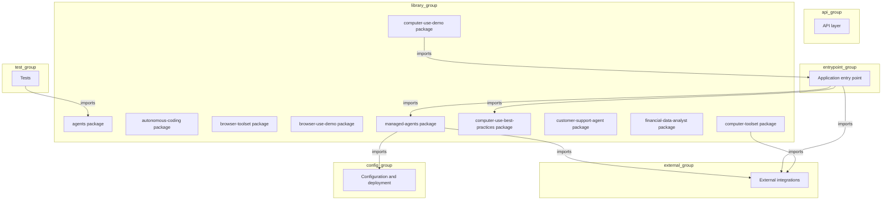

# Architecture report: anthropics/claude-quickstarts

> Automated static analysis. **Observed** = directly seen in files/imports/AST; **Inferred** = interpretation from that evidence. Repository code was not executed.

## 1. Repository at a glance

| Item | Value |
| --- | --- |
| Repository | anthropics/claude-quickstarts |
| Description | A collection of projects designed to help developers quickly get started with building deployable applications using the Claude API |
| Language | Python |
| Stars | 20959 |
| Licence | MIT |
| Analysed commit / branch | 4a4224bdf0e9cfb3332167b69c90457403813625 / main |
| Framework(s) | Express, FastAPI, Next.js, React, Starlette |
| Files analysed | 739 |
| Components | 15 |

## 2. Architecture in one minute

anthropics/claude-quickstarts - A collection of projects designed to help developers quickly get started with building deployable applications using the Claude API. This repository was analysed statically from 739 file(s) (166 Python). Detected technologies (observed from imports/manifests): GitHub Actions, Express, FastAPI, Next.js, React, Starlette. Files are grouped into 15 component(s): agents package, API layer, autonomous-coding package, browser-toolset package, browser-use-demo package, computer-toolset package, computer-use-best-practices package, computer-use-demo package. Observed entry point(s): agents/tools/calculator_mcp.py, autonomous-coding/autonomous_agent_demo.py, browser-toolset/python/exercise.py. Findings below distinguish observed facts from inferred interpretation.

## 3. High-level block diagram

## 4. Main components

### agents package (`agents`)

- **Kind:** library
- **Status:** Observed
- **Confidence:** 0.85
- **Responsibility:** Groups 13 file(s) under agents package (observed from repository paths and static analysis). Observed top-level classes: Agent, CodeExecutionServerTool, FileReadTool, FileWriteTool, MCPConnection, MCPConnectionSSE. Observed top-level functions: _execute_single_tool, create_mcp_connection, execute_tools, setup_mcp_connections.
- **Paths:** `agents/__init__.py`, `agents/agent.py`, `agents/tools/__init__.py`, `agents/tools/base.py`, `agents/tools/code_execution.py`, `agents/tools/file_tools.py`, `agents/tools/mcp_tool.py`, `agents/tools/think.py`, `agents/tools/web_search.py`, `agents/utils/__init__.py`, `agents/utils/connections.py`, `agents/utils/history_util.py`, `agents/utils/tool_util.py`
- **Evidence:** [agents/__init__.py](https://github.com/anthropics/claude-quickstarts/blob/4a4224bdf0e9cfb3332167b69c90457403813625/agents/__init__.py); [agents/agent.py:17](https://github.com/anthropics/claude-quickstarts/blob/4a4224bdf0e9cfb3332167b69c90457403813625/agents/agent.py#L17); [agents/tools/__init__.py](https://github.com/anthropics/claude-quickstarts/blob/4a4224bdf0e9cfb3332167b69c90457403813625/agents/tools/__init__.py); [agents/tools/base.py:8](https://github.com/anthropics/claude-quickstarts/blob/4a4224bdf0e9cfb3332167b69c90457403813625/agents/tools/base.py#L8); [agents/tools/code_execution.py:8](https://github.com/anthropics/claude-quickstarts/blob/4a4224bdf0e9cfb3332167b69c90457403813625/agents/tools/code_execution.py#L8); [agents/tools/file_tools.py:11](https://github.com/anthropics/claude-quickstarts/blob/4a4224bdf0e9cfb3332167b69c90457403813625/agents/tools/file_tools.py#L11); [agents/tools/mcp_tool.py:11](https://github.com/anthropics/claude-quickstarts/blob/4a4224bdf0e9cfb3332167b69c90457403813625/agents/tools/mcp_tool.py#L11); [agents/tools/think.py:6](https://github.com/anthropics/claude-quickstarts/blob/4a4224bdf0e9cfb3332167b69c90457403813625/agents/tools/think.py#L6)

### API layer (`api_layer`)

- **Kind:** api
- **Status:** Observed
- **Confidence:** 0.85
- **Responsibility:** Groups 18 file(s) under api layer (observed from repository paths and static analysis).
- **Paths:** `customer-support-agent/app/api/chat/route.ts`, `financial-data-analyst/app/api/finance/route.ts`, `managed-agents/assistant-ui/app/api/sessions/[id]/archive/route.ts`, `managed-agents/assistant-ui/app/api/sessions/[id]/confirm/route.ts`, `managed-agents/assistant-ui/app/api/sessions/[id]/events/route.ts`, `managed-agents/assistant-ui/app/api/sessions/[id]/files/[fileId]/download/route.ts`, `managed-agents/assistant-ui/app/api/sessions/[id]/files/route.ts`, `managed-agents/assistant-ui/app/api/sessions/[id]/interrupt/route.ts`, `managed-agents/assistant-ui/app/api/sessions/[id]/messages/route.ts`, `managed-agents/assistant-ui/app/api/sessions/[id]/route.ts`, `managed-agents/assistant-ui/app/api/sessions/[id]/stream/route.ts`, `managed-agents/assistant-ui/app/api/sessions/[id]/tool-results/route.ts`, `managed-agents/assistant-ui/app/api/sessions/route.ts`, `managed-agents/roadtrip-planner/src/app/api/chat/route.ts`, `managed-agents/roadtrip-planner/src/app/api/interrupt/route.ts`, `managed-agents/roadtrip-planner/src/app/api/session/route.ts`, `managed-agents/roadtrip-planner/src/app/api/stream/route.ts`, `managed-agents/self-hosted-sandboxes/vercel/api/webhook.ts`
- **Evidence:** [customer-support-agent/app/api/chat/route.ts](https://github.com/anthropics/claude-quickstarts/blob/4a4224bdf0e9cfb3332167b69c90457403813625/customer-support-agent/app/api/chat/route.ts); [financial-data-analyst/app/api/finance/route.ts](https://github.com/anthropics/claude-quickstarts/blob/4a4224bdf0e9cfb3332167b69c90457403813625/financial-data-analyst/app/api/finance/route.ts); [managed-agents/assistant-ui/app/api/sessions/[id]/archive/route.ts](https://github.com/anthropics/claude-quickstarts/blob/4a4224bdf0e9cfb3332167b69c90457403813625/managed-agents/assistant-ui/app/api/sessions/%5Bid%5D/archive/route.ts); [managed-agents/assistant-ui/app/api/sessions/[id]/confirm/route.ts](https://github.com/anthropics/claude-quickstarts/blob/4a4224bdf0e9cfb3332167b69c90457403813625/managed-agents/assistant-ui/app/api/sessions/%5Bid%5D/confirm/route.ts); [managed-agents/assistant-ui/app/api/sessions/[id]/events/route.ts](https://github.com/anthropics/claude-quickstarts/blob/4a4224bdf0e9cfb3332167b69c90457403813625/managed-agents/assistant-ui/app/api/sessions/%5Bid%5D/events/route.ts); [managed-agents/assistant-ui/app/api/sessions/[id]/files/[fileId]/download/route.ts](https://github.com/anthropics/claude-quickstarts/blob/4a4224bdf0e9cfb3332167b69c90457403813625/managed-agents/assistant-ui/app/api/sessions/%5Bid%5D/files/%5BfileId%5D/download/route.ts); [managed-agents/assistant-ui/app/api/sessions/[id]/files/route.ts](https://github.com/anthropics/claude-quickstarts/blob/4a4224bdf0e9cfb3332167b69c90457403813625/managed-agents/assistant-ui/app/api/sessions/%5Bid%5D/files/route.ts); [managed-agents/assistant-ui/app/api/sessions/[id]/interrupt/route.ts](https://github.com/anthropics/claude-quickstarts/blob/4a4224bdf0e9cfb3332167b69c90457403813625/managed-agents/assistant-ui/app/api/sessions/%5Bid%5D/interrupt/route.ts)

### autonomous-coding package (`autonomous_coding`)

- **Kind:** library
- **Status:** Observed
- **Confidence:** 0.85
- **Responsibility:** Groups 4 file(s) under autonomous-coding package (observed from repository paths and static analysis). Observed top-level functions: bash_security_hook, copy_spec_to_project, count_passing_tests, extract_commands, get_coding_prompt, get_command_for_validation.
- **Paths:** `autonomous-coding/agent.py`, `autonomous-coding/progress.py`, `autonomous-coding/prompts.py`, `autonomous-coding/security.py`
- **Evidence:** [autonomous-coding/agent.py:23](https://github.com/anthropics/claude-quickstarts/blob/4a4224bdf0e9cfb3332167b69c90457403813625/autonomous-coding/agent.py#L23); [autonomous-coding/progress.py:12](https://github.com/anthropics/claude-quickstarts/blob/4a4224bdf0e9cfb3332167b69c90457403813625/autonomous-coding/progress.py#L12); [autonomous-coding/prompts.py:15](https://github.com/anthropics/claude-quickstarts/blob/4a4224bdf0e9cfb3332167b69c90457403813625/autonomous-coding/prompts.py#L15); [autonomous-coding/security.py:47](https://github.com/anthropics/claude-quickstarts/blob/4a4224bdf0e9cfb3332167b69c90457403813625/autonomous-coding/security.py#L47)

### browser-toolset package (`browser_toolset`)

- **Kind:** library
- **Status:** Observed
- **Confidence:** 0.85
- **Responsibility:** Groups 4 file(s) under browser-toolset package (observed from repository paths and static analysis). Observed top-level classes: CdpBrowser. Observed top-level functions: find_chrome.
- **Paths:** `browser-toolset/python/cdp_browser.py`, `browser-toolset/typescript/cdp-browser.ts`, `browser-toolset/typescript/exercise.ts`, `browser-toolset/typescript/run.ts`
- **Evidence:** [browser-toolset/python/cdp_browser.py:50](https://github.com/anthropics/claude-quickstarts/blob/4a4224bdf0e9cfb3332167b69c90457403813625/browser-toolset/python/cdp_browser.py#L50); [browser-toolset/typescript/cdp-browser.ts](https://github.com/anthropics/claude-quickstarts/blob/4a4224bdf0e9cfb3332167b69c90457403813625/browser-toolset/typescript/cdp-browser.ts); [browser-toolset/typescript/exercise.ts](https://github.com/anthropics/claude-quickstarts/blob/4a4224bdf0e9cfb3332167b69c90457403813625/browser-toolset/typescript/exercise.ts); [browser-toolset/typescript/run.ts](https://github.com/anthropics/claude-quickstarts/blob/4a4224bdf0e9cfb3332167b69c90457403813625/browser-toolset/typescript/run.ts)

### browser-use-demo package (`browser_use_demo`)

- **Kind:** library
- **Status:** Observed
- **Confidence:** 0.85
- **Responsibility:** Groups 24 file(s) under browser-use-demo package (observed from repository paths and static analysis). Observed top-level classes: APIProvider, BaseAnthropicTool, BrowserOptions, BrowserTool, CLIResult, CoordinateScaler. Observed top-level functions: _maybe_filter_to_n_most_recent_images, sampling_loop.
- **Paths:** `browser-use-demo/browser_use_demo/__init__.py`, `browser-use-demo/browser_use_demo/browser_tool_utils/__init__.py`, `browser-use-demo/browser_use_demo/browser_tool_utils/browser_dom_script.js`, `browser-use-demo/browser_use_demo/browser_tool_utils/browser_element_script.js`, `browser-use-demo/browser_use_demo/browser_tool_utils/browser_form_input_script.js`, `browser-use-demo/browser_use_demo/browser_tool_utils/browser_key_map.py`, `browser-use-demo/browser_use_demo/browser_tool_utils/browser_text_script.js`, `browser-use-demo/browser_use_demo/display_constants.py`, `browser-use-demo/browser_use_demo/loop.py`, `browser-use-demo/browser_use_demo/message_handler.py`, `browser-use-demo/browser_use_demo/message_renderer.py`, `browser-use-demo/browser_use_demo/tools/__init__.py`, `browser-use-demo/browser_use_demo/tools/base.py`, `browser-use-demo/browser_use_demo/tools/browser.py`, `browser-use-demo/browser_use_demo/tools/collection.py`, `browser-use-demo/browser_use_demo/tools/coordinate_scaling.py`, `browser-use-demo/build.sh`, `browser-use-demo/image/entrypoint.sh`, `browser-use-demo/image/mutter_startup.sh`, `browser-use-demo/image/novnc_startup.sh`, `browser-use-demo/image/start_all.sh`, `browser-use-demo/image/tint2_startup.sh`, `browser-use-demo/image/x11vnc_startup.sh`, `browser-use-demo/image/xvfb_startup.sh`
- **Evidence:** [browser-use-demo/browser_use_demo/__init__.py](https://github.com/anthropics/claude-quickstarts/blob/4a4224bdf0e9cfb3332167b69c90457403813625/browser-use-demo/browser_use_demo/__init__.py); [browser-use-demo/browser_use_demo/browser_tool_utils/__init__.py](https://github.com/anthropics/claude-quickstarts/blob/4a4224bdf0e9cfb3332167b69c90457403813625/browser-use-demo/browser_use_demo/browser_tool_utils/__init__.py); [browser-use-demo/browser_use_demo/browser_tool_utils/browser_dom_script.js](https://github.com/anthropics/claude-quickstarts/blob/4a4224bdf0e9cfb3332167b69c90457403813625/browser-use-demo/browser_use_demo/browser_tool_utils/browser_dom_script.js); [browser-use-demo/browser_use_demo/browser_tool_utils/browser_element_script.js](https://github.com/anthropics/claude-quickstarts/blob/4a4224bdf0e9cfb3332167b69c90457403813625/browser-use-demo/browser_use_demo/browser_tool_utils/browser_element_script.js); [browser-use-demo/browser_use_demo/browser_tool_utils/browser_form_input_script.js](https://github.com/anthropics/claude-quickstarts/blob/4a4224bdf0e9cfb3332167b69c90457403813625/browser-use-demo/browser_use_demo/browser_tool_utils/browser_form_input_script.js); [browser-use-demo/browser_use_demo/browser_tool_utils/browser_key_map.py:6](https://github.com/anthropics/claude-quickstarts/blob/4a4224bdf0e9cfb3332167b69c90457403813625/browser-use-demo/browser_use_demo/browser_tool_utils/browser_key_map.py#L6); [browser-use-demo/browser_use_demo/browser_tool_utils/browser_text_script.js](https://github.com/anthropics/claude-quickstarts/blob/4a4224bdf0e9cfb3332167b69c90457403813625/browser-use-demo/browser_use_demo/browser_tool_utils/browser_text_script.js); [browser-use-demo/browser_use_demo/display_constants.py](https://github.com/anthropics/claude-quickstarts/blob/4a4224bdf0e9cfb3332167b69c90457403813625/browser-use-demo/browser_use_demo/display_constants.py)

### computer-toolset package (`computer_toolset`)

- **Kind:** library
- **Status:** Observed
- **Confidence:** 0.85
- **Responsibility:** Groups 4 file(s) under computer-toolset package (observed from repository paths and static analysis). Observed top-level classes: VncComputer. Observed top-level functions: keysym.
- **Paths:** `computer-toolset/python/vnc_computer.py`, `computer-toolset/typescript/exercise.ts`, `computer-toolset/typescript/run.ts`, `computer-toolset/typescript/vnc-computer.ts`
- **Evidence:** [computer-toolset/python/vnc_computer.py:63](https://github.com/anthropics/claude-quickstarts/blob/4a4224bdf0e9cfb3332167b69c90457403813625/computer-toolset/python/vnc_computer.py#L63); [computer-toolset/typescript/exercise.ts](https://github.com/anthropics/claude-quickstarts/blob/4a4224bdf0e9cfb3332167b69c90457403813625/computer-toolset/typescript/exercise.ts); [computer-toolset/typescript/run.ts](https://github.com/anthropics/claude-quickstarts/blob/4a4224bdf0e9cfb3332167b69c90457403813625/computer-toolset/typescript/run.ts); [computer-toolset/typescript/vnc-computer.ts](https://github.com/anthropics/claude-quickstarts/blob/4a4224bdf0e9cfb3332167b69c90457403813625/computer-toolset/typescript/vnc-computer.ts)

### computer-use-best-practices package (`computer_use_best_practices`)

- **Kind:** library
- **Status:** Observed
- **Confidence:** 0.85
- **Responsibility:** Groups 21 file(s) under computer-use-best-practices package (observed from repository paths and static analysis). Observed top-level classes: BashTool, BrowserBatchTool, BrowserTool, ComputerBatchTool, ComputerTool, Config. Observed top-level functions: _advisor_tool_param, _autocompaction_edit, _batch_description, _batch_schema, _call_with_retry, _coerce.
- **Paths:** `computer-use-best-practices/computer_use/__init__.py`, `computer-use-best-practices/computer_use/formatters.py`, `computer-use-best-practices/computer_use/image.py`, `computer-use-best-practices/computer_use/loop.py`, `computer-use-best-practices/computer_use/preflight.py`, `computer-use-best-practices/computer_use/render.py`, `computer-use-best-practices/computer_use/tools/__init__.py`, `computer-use-best-practices/computer_use/tools/base.py`, `computer-use-best-practices/computer_use/tools/batch.py`, `computer-use-best-practices/computer_use/tools/browser.py`, `computer-use-best-practices/computer_use/tools/computer.py`, `computer-use-best-practices/computer_use/tools/editor.py`, `computer-use-best-practices/computer_use/tools/open_app.py`, `computer-use-best-practices/computer_use/tools/result.py`, `computer-use-best-practices/computer_use/tools/shell.py`, `computer-use-best-practices/computer_use/trajectory.py`, `computer-use-best-practices/constants.py`, `computer-use-best-practices/dev_ui/__init__.py`, `computer-use-best-practices/dev_ui/localization_demo/__init__.py`, `computer-use-best-practices/dev_ui/tool_panel/__init__.py`, `computer-use-best-practices/dev_ui/trajectory_viewer/__init__.py`
- **Evidence:** [computer-use-best-practices/computer_use/__init__.py](https://github.com/anthropics/claude-quickstarts/blob/4a4224bdf0e9cfb3332167b69c90457403813625/computer-use-best-practices/computer_use/__init__.py); [computer-use-best-practices/computer_use/formatters.py:23](https://github.com/anthropics/claude-quickstarts/blob/4a4224bdf0e9cfb3332167b69c90457403813625/computer-use-best-practices/computer_use/formatters.py#L23); [computer-use-best-practices/computer_use/image.py:25](https://github.com/anthropics/claude-quickstarts/blob/4a4224bdf0e9cfb3332167b69c90457403813625/computer-use-best-practices/computer_use/image.py#L25); [computer-use-best-practices/computer_use/loop.py:68](https://github.com/anthropics/claude-quickstarts/blob/4a4224bdf0e9cfb3332167b69c90457403813625/computer-use-best-practices/computer_use/loop.py#L68); [computer-use-best-practices/computer_use/preflight.py:33](https://github.com/anthropics/claude-quickstarts/blob/4a4224bdf0e9cfb3332167b69c90457403813625/computer-use-best-practices/computer_use/preflight.py#L33); [computer-use-best-practices/computer_use/render.py:23](https://github.com/anthropics/claude-quickstarts/blob/4a4224bdf0e9cfb3332167b69c90457403813625/computer-use-best-practices/computer_use/render.py#L23); [computer-use-best-practices/computer_use/tools/__init__.py](https://github.com/anthropics/claude-quickstarts/blob/4a4224bdf0e9cfb3332167b69c90457403813625/computer-use-best-practices/computer_use/tools/__init__.py); [computer-use-best-practices/computer_use/tools/base.py:27](https://github.com/anthropics/claude-quickstarts/blob/4a4224bdf0e9cfb3332167b69c90457403813625/computer-use-best-practices/computer_use/tools/base.py#L27)

### computer-use-demo package (`computer_use_demo`)

- **Kind:** library
- **Status:** Observed
- **Confidence:** 0.85
- **Responsibility:** Groups 18 file(s) under computer-use-demo package (observed from repository paths and static analysis). Observed top-level classes: APIProvider, BaseAnthropicTool, BaseComputerTool, BashTool20241022, BashTool20250124, CLIResult. Observed top-level functions: _inject_prompt_caching, _make_api_tool_result, _maybe_filter_to_n_most_recent_images, _maybe_prepend_system_tool_result, _response_to_params, chunks.
- **Paths:** `computer-use-demo/ca-store/distrust_ca_roots.sh`, `computer-use-demo/computer_use_demo/__init__.py`, `computer-use-demo/computer_use_demo/loop.py`, `computer-use-demo/computer_use_demo/tools/__init__.py`, `computer-use-demo/computer_use_demo/tools/base.py`, `computer-use-demo/computer_use_demo/tools/bash.py`, `computer-use-demo/computer_use_demo/tools/collection.py`, `computer-use-demo/computer_use_demo/tools/computer.py`, `computer-use-demo/computer_use_demo/tools/edit.py`, `computer-use-demo/computer_use_demo/tools/groups.py`, `computer-use-demo/image/entrypoint.sh`, `computer-use-demo/image/mutter_startup.sh`, `computer-use-demo/image/novnc_startup.sh`, `computer-use-demo/image/start_all.sh`, `computer-use-demo/image/tint2_startup.sh`, `computer-use-demo/image/x11vnc_startup.sh`, `computer-use-demo/image/xvfb_startup.sh`, `computer-use-demo/setup.sh`
- **Evidence:** [computer-use-demo/ca-store/distrust_ca_roots.sh](https://github.com/anthropics/claude-quickstarts/blob/4a4224bdf0e9cfb3332167b69c90457403813625/computer-use-demo/ca-store/distrust_ca_roots.sh); [computer-use-demo/computer_use_demo/__init__.py](https://github.com/anthropics/claude-quickstarts/blob/4a4224bdf0e9cfb3332167b69c90457403813625/computer-use-demo/computer_use_demo/__init__.py); [computer-use-demo/computer_use_demo/loop.py:60](https://github.com/anthropics/claude-quickstarts/blob/4a4224bdf0e9cfb3332167b69c90457403813625/computer-use-demo/computer_use_demo/loop.py#L60); [computer-use-demo/computer_use_demo/tools/__init__.py](https://github.com/anthropics/claude-quickstarts/blob/4a4224bdf0e9cfb3332167b69c90457403813625/computer-use-demo/computer_use_demo/tools/__init__.py); [computer-use-demo/computer_use_demo/tools/base.py:8](https://github.com/anthropics/claude-quickstarts/blob/4a4224bdf0e9cfb3332167b69c90457403813625/computer-use-demo/computer_use_demo/tools/base.py#L8); [computer-use-demo/computer_use_demo/tools/bash.py:8](https://github.com/anthropics/claude-quickstarts/blob/4a4224bdf0e9cfb3332167b69c90457403813625/computer-use-demo/computer_use_demo/tools/bash.py#L8); [computer-use-demo/computer_use_demo/tools/collection.py:15](https://github.com/anthropics/claude-quickstarts/blob/4a4224bdf0e9cfb3332167b69c90457403813625/computer-use-demo/computer_use_demo/tools/collection.py#L15); [computer-use-demo/computer_use_demo/tools/computer.py:51](https://github.com/anthropics/claude-quickstarts/blob/4a4224bdf0e9cfb3332167b69c90457403813625/computer-use-demo/computer_use_demo/tools/computer.py#L51)

### Configuration and deployment (`config`)

- **Kind:** config
- **Status:** Observed
- **Confidence:** 0.85
- **Responsibility:** Groups 138 file(s) under configuration and deployment (observed from repository paths and static analysis). Observed top-level classes: BreakerSettings, ConfigMissing, GatewaySettings, ProfileSettings, ReviewSettings, Settings. Observed top-level functions: _merge_dataclass, load.
- **Paths:** `autonomous-coding/requirements.txt`, `browser-toolset/python/requirements.txt`, `browser-toolset/typescript/package.json`, `browser-toolset/typescript/tsconfig.json`, `browser-use-demo/.dockerignore`, `browser-use-demo/.env.example`, `browser-use-demo/Dockerfile`, `browser-use-demo/browser_use_demo/requirements.txt`, `browser-use-demo/docker-compose.yml`, `browser-use-demo/pytest.ini`, `browser-use-demo/setup.py`, `computer-toolset/python/requirements.txt`, `computer-toolset/typescript/package.json`, `computer-toolset/typescript/tsconfig.json`, `computer-use-best-practices/.env.example`, `computer-use-best-practices/.vscode/launch.json`, `computer-use-best-practices/.vscode/settings.json`, `computer-use-best-practices/config.example.toml`, `computer-use-best-practices/dev_ui/assets/streamlit_theme.toml`, `computer-use-best-practices/pyproject.toml`, `computer-use-best-practices/requirements.txt`, `computer-use-demo/.zed/settings.json`, `computer-use-demo/Dockerfile`, `computer-use-demo/computer_use_demo/requirements.txt`, `computer-use-demo/image/.streamlit/config.toml`, `computer-use-demo/pyproject.toml`, `computer-use-demo/ruff.toml`, `customer-support-agent/.eslintrc.json`, `customer-support-agent/amplify.yml`, `customer-support-agent/app/lib/customer_support_categories.json`, `customer-support-agent/components.json`, `customer-support-agent/package.json`, `customer-support-agent/tsconfig.json`, `financial-data-analyst/.eslintrc.json`, `financial-data-analyst/components.json`, `financial-data-analyst/package.json`, `financial-data-analyst/tsconfig.json`, `managed-agents/assistant-ui/.env.example`, `managed-agents/assistant-ui/components.json`, `managed-agents/assistant-ui/environments/spreadsheet-analyst.yaml`, `managed-agents/assistant-ui/package.json`, `managed-agents/assistant-ui/tsconfig.json`, `managed-agents/chat-sdk/.env.example`, `managed-agents/chat-sdk/package.json`, `managed-agents/chat-sdk/tsconfig.json`, `managed-agents/copilot-kit-ag-ui/.env.example`, `managed-agents/copilot-kit-ag-ui/environments/financial-assistant.yaml`, `managed-agents/copilot-kit-ag-ui/package.json`, `managed-agents/copilot-kit-ag-ui/server/package.json`, `managed-agents/copilot-kit-ag-ui/server/tsconfig.json`, `managed-agents/copilot-kit-ag-ui/web/package.json`, `managed-agents/copilot-kit-ag-ui/web/tsconfig.json`, `managed-agents/daily-brief/.env.example`, `managed-agents/daily-brief/agents/daily-brief/environment.yaml`, `managed-agents/daily-brief/agents/daily-brief/memory_store_preferences.yaml`, `managed-agents/daily-brief/agents/daily-brief/memory_store_state.yaml`, `managed-agents/daily-brief/agents/daily-brief/vault.yaml`, `managed-agents/daily-brief/slack/manifest.yaml`, `managed-agents/knowledge-wiki/manifest_core.json`, `managed-agents/knowledge-wiki/manifest_full.json`, `managed-agents/knowledge-wiki/manifest_mini.json`, `managed-agents/knowledge-wiki/manifest_quickstart.json`, `managed-agents/knowledge-wiki/manifest_standard.json`, `managed-agents/knowledge-wiki/requirements.txt`, `managed-agents/linear/.env.example`, `managed-agents/linear/environments/linear-assistant.yaml`, `managed-agents/linear/package.json`, `managed-agents/linear/tsconfig.json`, `managed-agents/mcp-server-typescript/.dockerignore`, `managed-agents/mcp-server-typescript/.env.example`, `managed-agents/mcp-server-typescript/Dockerfile`, `managed-agents/mcp-server-typescript/environment.yaml`, `managed-agents/mcp-server-typescript/package.json`, `managed-agents/mcp-server-typescript/tsconfig.json`, `managed-agents/roadtrip-planner/.env.example`, `managed-agents/roadtrip-planner/environments/roadtrip-planner.yaml`, `managed-agents/roadtrip-planner/package.json`, `managed-agents/roadtrip-planner/tsconfig.json`, `managed-agents/roadtrip-planner/vaults/roadtrip-planner.yaml`, `managed-agents/self-hosted-sandboxes/archil/.env.example`, `managed-agents/self-hosted-sandboxes/archil/environments/self-hosted.yaml`, `managed-agents/self-hosted-sandboxes/archil/requirements.txt`, `managed-agents/self-hosted-sandboxes/cloudflare-containers/container/Dockerfile`, `managed-agents/self-hosted-sandboxes/cloudflare-containers/package.json`, `managed-agents/self-hosted-sandboxes/cloudflare-containers/tsconfig.json`, `managed-agents/self-hosted-sandboxes/cloudflare-containers/wrangler.toml`, `managed-agents/self-hosted-sandboxes/cloudflare-worker/package.json`, `managed-agents/self-hosted-sandboxes/cloudflare-worker/tsconfig.json`, `managed-agents/self-hosted-sandboxes/cloudflare-worker/wrangler.toml`, `managed-agents/self-hosted-sandboxes/docker-memory/.env.example`, `managed-agents/self-hosted-sandboxes/docker-memory/Dockerfile`, `managed-agents/self-hosted-sandboxes/docker-memory/environments/self-hosted.yaml`, `managed-agents/self-hosted-sandboxes/docker-memory/memory_stores/user-preferences.yaml`, `managed-agents/self-hosted-sandboxes/docker/.env.example`, `managed-agents/self-hosted-sandboxes/docker/Dockerfile`, `managed-agents/self-hosted-sandboxes/docker/environments/self-hosted.yaml`, `managed-agents/self-hosted-sandboxes/openshell-policy/.env.example`, `managed-agents/self-hosted-sandboxes/openshell-policy/agentpolicy.yaml`, `managed-agents/self-hosted-sandboxes/openshell-policy/environments/reviewer.yaml`, `managed-agents/self-hosted-sandboxes/openshell-policy/environments/worker.yaml`, `managed-agents/self-hosted-sandboxes/openshell-policy/ops/Dockerfile`, `managed-agents/self-hosted-sandboxes/openshell-policy/ops/requirements.txt`, `managed-agents/self-hosted-sandboxes/openshell-policy/policy/base.yaml`, `managed-agents/self-hosted-sandboxes/openshell-policy/policy/profiles/hello/ceiling.yaml`, `managed-agents/self-hosted-sandboxes/openshell-policy/policy/profiles/hello/policy.yaml`, `managed-agents/self-hosted-sandboxes/openshell-policy/policy/signers.yaml`, `managed-agents/self-hosted-sandboxes/openshell-policy/pyproject.toml`, `managed-agents/self-hosted-sandboxes/openshell-policy/sandbox/Dockerfile`, `managed-agents/self-hosted-sandboxes/openshell-policy/src/agentpolicy/config.py`, `managed-agents/self-hosted-sandboxes/openshell-policy/stack/openshell/docker-compose.yml`, `managed-agents/self-hosted-sandboxes/openshell-policy/stack/openshell/gateway.toml`, `managed-agents/self-hosted-sandboxes/openshell/.env.example`, `managed-agents/self-hosted-sandboxes/openshell/Dockerfile`, `managed-agents/self-hosted-sandboxes/openshell/environments/self-hosted.yaml`, `managed-agents/self-hosted-sandboxes/openshell/policy.yaml`, `managed-agents/self-hosted-sandboxes/vercel/.env.example`, `managed-agents/self-hosted-sandboxes/vercel/package.json`, `managed-agents/self-hosted-sandboxes/vercel/tsconfig.json`, `managed-agents/self-hosted-sandboxes/vercel/vercel.json`, `managed-agents/self-hosted-sandboxes/webhook-demo/environments/webhook-demo.yaml`, `managed-agents/sentry-autofix/.claude/settings.json`, `managed-agents/sentry-autofix/.env.example`, `managed-agents/sentry-autofix/agents/issue-fixer/agent.yaml`, `managed-agents/sentry-autofix/agents/issue-fixer/environment.yaml`, `managed-agents/sentry-autofix/agents/issue-fixer/vault.yaml`, `managed-agents/sentry-autofix/demo-app/package.json`, `managed-agents/sentry-autofix/package.json`, `managed-agents/sentry-autofix/tsconfig.json`, `managed-agents/sentry/.claude/settings.json`, `managed-agents/sentry/.env.example`, `managed-agents/sentry/environments/sentry-triage.yaml`, `managed-agents/sentry/pyproject.toml`, `managed-agents/sentry/vaults/sentry-triage.yaml`, `managed-agents/slack/.env.example`, `managed-agents/slack/environments/slack-assistant.yaml`, `managed-agents/slack/package.json`, `managed-agents/slack/tsconfig.json`, `pyproject.toml`
- **Evidence:** [autonomous-coding/requirements.txt](https://github.com/anthropics/claude-quickstarts/blob/4a4224bdf0e9cfb3332167b69c90457403813625/autonomous-coding/requirements.txt); [browser-toolset/python/requirements.txt](https://github.com/anthropics/claude-quickstarts/blob/4a4224bdf0e9cfb3332167b69c90457403813625/browser-toolset/python/requirements.txt); [browser-toolset/typescript/package.json](https://github.com/anthropics/claude-quickstarts/blob/4a4224bdf0e9cfb3332167b69c90457403813625/browser-toolset/typescript/package.json); [browser-toolset/typescript/tsconfig.json](https://github.com/anthropics/claude-quickstarts/blob/4a4224bdf0e9cfb3332167b69c90457403813625/browser-toolset/typescript/tsconfig.json); [browser-use-demo/.dockerignore](https://github.com/anthropics/claude-quickstarts/blob/4a4224bdf0e9cfb3332167b69c90457403813625/browser-use-demo/.dockerignore); [browser-use-demo/.env.example](https://github.com/anthropics/claude-quickstarts/blob/4a4224bdf0e9cfb3332167b69c90457403813625/browser-use-demo/.env.example); [browser-use-demo/Dockerfile](https://github.com/anthropics/claude-quickstarts/blob/4a4224bdf0e9cfb3332167b69c90457403813625/browser-use-demo/Dockerfile); [browser-use-demo/browser_use_demo/requirements.txt](https://github.com/anthropics/claude-quickstarts/blob/4a4224bdf0e9cfb3332167b69c90457403813625/browser-use-demo/browser_use_demo/requirements.txt)

### customer-support-agent package (`customer_support_agent`)

- **Kind:** library
- **Status:** Observed
- **Confidence:** 0.85
- **Responsibility:** Groups 22 file(s) under customer-support-agent package (observed from repository paths and static analysis).
- **Paths:** `customer-support-agent/app/layout.tsx`, `customer-support-agent/app/lib/utils.ts`, `customer-support-agent/app/page.tsx`, `customer-support-agent/components/ChatArea.tsx`, `customer-support-agent/components/FullSourceModal.tsx`, `customer-support-agent/components/LeftSidebar.tsx`, `customer-support-agent/components/RightSidebar.tsx`, `customer-support-agent/components/TopNavBar.tsx`, `customer-support-agent/components/theme-provider.tsx`, `customer-support-agent/components/ui/avatar.tsx`, `customer-support-agent/components/ui/button.tsx`, `customer-support-agent/components/ui/card.tsx`, `customer-support-agent/components/ui/dialog.tsx`, `customer-support-agent/components/ui/dropdown-menu.tsx`, `customer-support-agent/components/ui/input.tsx`, `customer-support-agent/components/ui/textarea.tsx`, `customer-support-agent/config.ts`, `customer-support-agent/lib/utils.ts`, `customer-support-agent/next.config.mjs`, `customer-support-agent/postcss.config.mjs`, `customer-support-agent/styles/themes.js`, `customer-support-agent/tailwind.config.ts`
- **Evidence:** [customer-support-agent/app/layout.tsx](https://github.com/anthropics/claude-quickstarts/blob/4a4224bdf0e9cfb3332167b69c90457403813625/customer-support-agent/app/layout.tsx); [customer-support-agent/app/lib/utils.ts](https://github.com/anthropics/claude-quickstarts/blob/4a4224bdf0e9cfb3332167b69c90457403813625/customer-support-agent/app/lib/utils.ts); [customer-support-agent/app/page.tsx](https://github.com/anthropics/claude-quickstarts/blob/4a4224bdf0e9cfb3332167b69c90457403813625/customer-support-agent/app/page.tsx); [customer-support-agent/components/ChatArea.tsx](https://github.com/anthropics/claude-quickstarts/blob/4a4224bdf0e9cfb3332167b69c90457403813625/customer-support-agent/components/ChatArea.tsx); [customer-support-agent/components/FullSourceModal.tsx](https://github.com/anthropics/claude-quickstarts/blob/4a4224bdf0e9cfb3332167b69c90457403813625/customer-support-agent/components/FullSourceModal.tsx); [customer-support-agent/components/LeftSidebar.tsx](https://github.com/anthropics/claude-quickstarts/blob/4a4224bdf0e9cfb3332167b69c90457403813625/customer-support-agent/components/LeftSidebar.tsx); [customer-support-agent/components/RightSidebar.tsx](https://github.com/anthropics/claude-quickstarts/blob/4a4224bdf0e9cfb3332167b69c90457403813625/customer-support-agent/components/RightSidebar.tsx); [customer-support-agent/components/TopNavBar.tsx](https://github.com/anthropics/claude-quickstarts/blob/4a4224bdf0e9cfb3332167b69c90457403813625/customer-support-agent/components/TopNavBar.tsx)

### Application entry point (`entrypoint`)

- **Kind:** entrypoint
- **Status:** Observed
- **Confidence:** 0.85
- **Responsibility:** Groups 26 file(s) under application entry point (observed from repository paths and static analysis). Observed application object created via FastAPI. Observed routes: GET /, GET /meta, POST /localize, GET /, GET /tools. Observed top-level classes: CallbackHandler, HTTPServerV6, ImageExtractor, ModelConfig, PageHandler, RunRequest. Observed top-level functions: _api_key_if_any, _api_response_callback, _clean_text_extraction_markers, _client, _control_plane, _drain_work.
- **Paths:** `agents/tools/calculator_mcp.py`, `autonomous-coding/autonomous_agent_demo.py`, `browser-toolset/python/exercise.py`, `browser-toolset/python/run.py`, `browser-use-demo/browser_use_demo/streamlit.py`, `browser-use-demo/image/http_server.py`, `browser-use-demo/validate_env.py`, `computer-toolset/python/exercise.py`, `computer-toolset/python/run.py`, `computer-use-best-practices/computer_use/__main__.py`, `computer-use-best-practices/dev_ui/localization_demo/server.py`, `computer-use-best-practices/dev_ui/tool_panel/server.py`, `computer-use-best-practices/dev_ui/trajectory_viewer/app.py`, `computer-use-demo/computer_use_demo/streamlit.py`, `computer-use-demo/computer_use_demo/tools/run.py`, `computer-use-demo/image/http_server.py`, `managed-agents/knowledge-wiki/build_manifest.py`, `managed-agents/knowledge-wiki/fetch_data_room.py`, `managed-agents/knowledge-wiki/fetch_real_deck.py`, `managed-agents/knowledge-wiki/make_analyst_docx.py`, `managed-agents/self-hosted-sandboxes/daytona/daytona_webhook.py`, `managed-agents/self-hosted-sandboxes/daytona/sandbox_runner.py`, `managed-agents/self-hosted-sandboxes/docker-memory/worker.py`, `managed-agents/self-hosted-sandboxes/modal/sandbox_runner.py`, `managed-agents/self-hosted-sandboxes/openshell-policy/src/agentpolicy/cli.py`, `managed-agents/sentry/oauth_setup.py`
- **Evidence:** [agents/tools/calculator_mcp.py:13](https://github.com/anthropics/claude-quickstarts/blob/4a4224bdf0e9cfb3332167b69c90457403813625/agents/tools/calculator_mcp.py#L13); [autonomous-coding/autonomous_agent_demo.py:27](https://github.com/anthropics/claude-quickstarts/blob/4a4224bdf0e9cfb3332167b69c90457403813625/autonomous-coding/autonomous_agent_demo.py#L27); [browser-toolset/python/exercise.py:51](https://github.com/anthropics/claude-quickstarts/blob/4a4224bdf0e9cfb3332167b69c90457403813625/browser-toolset/python/exercise.py#L51); [browser-toolset/python/run.py:36](https://github.com/anthropics/claude-quickstarts/blob/4a4224bdf0e9cfb3332167b69c90457403813625/browser-toolset/python/run.py#L36); [browser-use-demo/browser_use_demo/streamlit.py:60](https://github.com/anthropics/claude-quickstarts/blob/4a4224bdf0e9cfb3332167b69c90457403813625/browser-use-demo/browser_use_demo/streamlit.py#L60); [browser-use-demo/image/http_server.py:6](https://github.com/anthropics/claude-quickstarts/blob/4a4224bdf0e9cfb3332167b69c90457403813625/browser-use-demo/image/http_server.py#L6); [browser-use-demo/validate_env.py:19](https://github.com/anthropics/claude-quickstarts/blob/4a4224bdf0e9cfb3332167b69c90457403813625/browser-use-demo/validate_env.py#L19); [computer-toolset/python/exercise.py:35](https://github.com/anthropics/claude-quickstarts/blob/4a4224bdf0e9cfb3332167b69c90457403813625/computer-toolset/python/exercise.py#L35)

### External integrations (`external_integrations`)

- **Kind:** external
- **Status:** Observed
- **Confidence:** 0.85
- **Responsibility:** Groups 1 file(s) under external integrations (observed from repository paths and static analysis). Observed top-level functions: create_client.
- **Paths:** `autonomous-coding/client.py`
- **Evidence:** [autonomous-coding/client.py:40](https://github.com/anthropics/claude-quickstarts/blob/4a4224bdf0e9cfb3332167b69c90457403813625/autonomous-coding/client.py#L40)

### financial-data-analyst package (`financial_data_analyst`)

- **Kind:** library
- **Status:** Observed
- **Confidence:** 0.85
- **Responsibility:** Groups 23 file(s) under financial-data-analyst package (observed from repository paths and static analysis).
- **Paths:** `financial-data-analyst/app/finance/page.tsx`, `financial-data-analyst/app/layout.tsx`, `financial-data-analyst/app/page.tsx`, `financial-data-analyst/components/ChartRenderer.tsx`, `financial-data-analyst/components/FilePreview.tsx`, `financial-data-analyst/components/TopNavBar.tsx`, `financial-data-analyst/components/theme-provider.tsx`, `financial-data-analyst/components/ui/avatar.tsx`, `financial-data-analyst/components/ui/badge.tsx`, `financial-data-analyst/components/ui/button.tsx`, `financial-data-analyst/components/ui/card.tsx`, `financial-data-analyst/components/ui/chart.tsx`, `financial-data-analyst/components/ui/dropdown-menu.tsx`, `financial-data-analyst/components/ui/textarea.tsx`, `financial-data-analyst/components/ui/toast.tsx`, `financial-data-analyst/components/ui/toaster.tsx`, `financial-data-analyst/hooks/use-toast.ts`, `financial-data-analyst/lib/utils.ts`, `financial-data-analyst/next.config.mjs`, `financial-data-analyst/postcss.config.mjs`, `financial-data-analyst/tailwind.config.ts`, `financial-data-analyst/types/chart.ts`, `financial-data-analyst/utils/fileHandling.ts`
- **Evidence:** [financial-data-analyst/app/finance/page.tsx](https://github.com/anthropics/claude-quickstarts/blob/4a4224bdf0e9cfb3332167b69c90457403813625/financial-data-analyst/app/finance/page.tsx); [financial-data-analyst/app/layout.tsx](https://github.com/anthropics/claude-quickstarts/blob/4a4224bdf0e9cfb3332167b69c90457403813625/financial-data-analyst/app/layout.tsx); [financial-data-analyst/app/page.tsx](https://github.com/anthropics/claude-quickstarts/blob/4a4224bdf0e9cfb3332167b69c90457403813625/financial-data-analyst/app/page.tsx); [financial-data-analyst/components/ChartRenderer.tsx](https://github.com/anthropics/claude-quickstarts/blob/4a4224bdf0e9cfb3332167b69c90457403813625/financial-data-analyst/components/ChartRenderer.tsx); [financial-data-analyst/components/FilePreview.tsx](https://github.com/anthropics/claude-quickstarts/blob/4a4224bdf0e9cfb3332167b69c90457403813625/financial-data-analyst/components/FilePreview.tsx); [financial-data-analyst/components/TopNavBar.tsx](https://github.com/anthropics/claude-quickstarts/blob/4a4224bdf0e9cfb3332167b69c90457403813625/financial-data-analyst/components/TopNavBar.tsx); [financial-data-analyst/components/theme-provider.tsx](https://github.com/anthropics/claude-quickstarts/blob/4a4224bdf0e9cfb3332167b69c90457403813625/financial-data-analyst/components/theme-provider.tsx); [financial-data-analyst/components/ui/avatar.tsx](https://github.com/anthropics/claude-quickstarts/blob/4a4224bdf0e9cfb3332167b69c90457403813625/financial-data-analyst/components/ui/avatar.tsx)

### managed-agents package (`managed_agents`)

- **Kind:** library
- **Status:** Observed
- **Confidence:** 0.85
- **Responsibility:** Groups 184 file(s) under managed-agents package (observed from repository paths and static analysis). Observed top-level classes: Bindings, CeilingError, Check, ClaudeReviewer, CliProver, Collector. Observed top-level functions: _atomic_write, _audit_gaps, _clean, _client, _create_sandbox, _drain_work.
- **Paths:** `managed-agents/assistant-ui/app/assistant.tsx`, `managed-agents/assistant-ui/app/layout.tsx`, `managed-agents/assistant-ui/app/page.tsx`, `managed-agents/assistant-ui/components/analyst-sidebar.tsx`, `managed-agents/assistant-ui/components/assistant-ui/attachment.tsx`, `managed-agents/assistant-ui/components/assistant-ui/badge.tsx`, `managed-agents/assistant-ui/components/assistant-ui/diff-viewer.tsx`, `managed-agents/assistant-ui/components/assistant-ui/file.tsx`, `managed-agents/assistant-ui/components/assistant-ui/follow-up-suggestions.tsx`, `managed-agents/assistant-ui/components/assistant-ui/image.tsx`, `managed-agents/assistant-ui/components/assistant-ui/markdown-text.tsx`, `managed-agents/assistant-ui/components/assistant-ui/message-timing.tsx`, `managed-agents/assistant-ui/components/assistant-ui/reasoning.tsx`, `managed-agents/assistant-ui/components/assistant-ui/shiki-highlighter.tsx`, `managed-agents/assistant-ui/components/assistant-ui/sources.tsx`, `managed-agents/assistant-ui/components/assistant-ui/thread-list.tsx`, `managed-agents/assistant-ui/components/assistant-ui/thread.tsx`, `managed-agents/assistant-ui/components/assistant-ui/tool-fallback.tsx`, `managed-agents/assistant-ui/components/assistant-ui/tool-group.tsx`, `managed-agents/assistant-ui/components/assistant-ui/tooltip-icon-button.tsx`, `managed-agents/assistant-ui/components/session-files.tsx`, `managed-agents/assistant-ui/components/tool-uis/approval-bar.tsx`, `managed-agents/assistant-ui/components/tool-uis/bash.tsx`, `managed-agents/assistant-ui/components/tool-uis/file-tools.tsx`, `managed-agents/assistant-ui/components/tool-uis/index.tsx`, `managed-agents/assistant-ui/components/tool-uis/show-chart.tsx`, `managed-agents/assistant-ui/components/tool-uis/web-tools.tsx`, `managed-agents/assistant-ui/components/ui/avatar.tsx`, `managed-agents/assistant-ui/components/ui/button.tsx`, `managed-agents/assistant-ui/components/ui/collapsible.tsx`, `managed-agents/assistant-ui/components/ui/dialog.tsx`, `managed-agents/assistant-ui/components/ui/input.tsx`, `managed-agents/assistant-ui/components/ui/separator.tsx`, `managed-agents/assistant-ui/components/ui/sheet.tsx`, `managed-agents/assistant-ui/components/ui/sidebar.tsx`, `managed-agents/assistant-ui/components/ui/skeleton.tsx`, `managed-agents/assistant-ui/components/ui/tooltip.tsx`, `managed-agents/assistant-ui/eslint.config.mjs`, `managed-agents/assistant-ui/hooks/use-mobile.ts`, `managed-agents/assistant-ui/lib/anthropic.ts`, `managed-agents/assistant-ui/lib/managed-agents/api.ts`, `managed-agents/assistant-ui/lib/managed-agents/attachments.ts`, `managed-agents/assistant-ui/lib/managed-agents/events.ts`, `managed-agents/assistant-ui/lib/managed-agents/reducer.test.ts`, `managed-agents/assistant-ui/lib/managed-agents/reducer.ts`, `managed-agents/assistant-ui/lib/managed-agents/runtime-provider.tsx`, `managed-agents/assistant-ui/lib/managed-agents/session-controller.ts`, `managed-agents/assistant-ui/lib/managed-agents/session-files.ts`, `managed-agents/assistant-ui/lib/managed-agents/session-list-adapter.ts`, `managed-agents/assistant-ui/lib/owned-session.ts`, `managed-agents/assistant-ui/lib/sse.ts`, `managed-agents/assistant-ui/lib/utils.ts`, `managed-agents/assistant-ui/next.config.ts`, `managed-agents/assistant-ui/postcss.config.mjs`, `managed-agents/chat-sdk/setup/agent-config.ts`, `managed-agents/chat-sdk/setup/create-agent.ts`, `managed-agents/chat-sdk/setup/update-agent.ts`, `managed-agents/chat-sdk/src/activity.ts`, `managed-agents/chat-sdk/src/app.ts`, `managed-agents/chat-sdk/src/bot.ts`, `managed-agents/chat-sdk/src/brief.ts`, `managed-agents/chat-sdk/src/card.tsx`, `managed-agents/chat-sdk/src/main.ts`, `managed-agents/chat-sdk/src/managed-agents.ts`, `managed-agents/chat-sdk/src/sessions.ts`, `managed-agents/chat-sdk/web/app.tsx`, `managed-agents/copilot-kit-ag-ui/server/src/index.ts`, `managed-agents/copilot-kit-ag-ui/server/src/resources.ts`, `managed-agents/copilot-kit-ag-ui/server/src/vizTools.ts`, `managed-agents/copilot-kit-ag-ui/web/src/App.tsx`, `managed-agents/copilot-kit-ag-ui/web/src/main.tsx`, `managed-agents/copilot-kit-ag-ui/web/src/vite-env.d.ts`, `managed-agents/copilot-kit-ag-ui/web/src/viz/BudgetBreakdown.tsx`, `managed-agents/copilot-kit-ag-ui/web/src/viz/Comparison.tsx`, `managed-agents/copilot-kit-ag-ui/web/src/viz/GrowthProjection.tsx`, `managed-agents/copilot-kit-ag-ui/web/src/viz/LineChart.tsx`, `managed-agents/copilot-kit-ag-ui/web/src/viz/PayoffTimeline.tsx`, `managed-agents/copilot-kit-ag-ui/web/src/viz/ToolActivity.tsx`, `managed-agents/copilot-kit-ag-ui/web/src/viz/finance.ts`, `managed-agents/copilot-kit-ag-ui/web/src/viz/renderers.tsx`, `managed-agents/copilot-kit-ag-ui/web/src/viz/theme.ts`, `managed-agents/copilot-kit-ag-ui/web/vite.config.ts`, `managed-agents/daily-brief/agents/setup.sh`, `managed-agents/daily-brief/scripts/reset-state.sh`, `managed-agents/daily-brief/scripts/run.sh`, `managed-agents/daily-brief/scripts/seed-preferences.sh`, `managed-agents/daily-brief/scripts/teardown.sh`, `managed-agents/knowledge-wiki/utilities.py`, `managed-agents/linear/src/agent.ts`, `managed-agents/linear/src/main.ts`, `managed-agents/linear/src/managed-agents-webhook.ts`, `managed-agents/linear/src/oauth.ts`, `managed-agents/linear/src/resources.ts`, `managed-agents/linear/src/route-signature.ts`, `managed-agents/mcp-server-typescript/src/managed-agents.ts`, `managed-agents/mcp-server-typescript/src/scope.ts`, `managed-agents/mcp-server-typescript/src/server-http.ts`, `managed-agents/mcp-server-typescript/src/server.ts`, `managed-agents/mcp-server-typescript/src/tools.ts`, `managed-agents/roadtrip-planner/agents/setup.sh`, `managed-agents/roadtrip-planner/agents/teardown.sh`, `managed-agents/roadtrip-planner/next.config.ts`, `managed-agents/roadtrip-planner/src/app/layout.tsx`, `managed-agents/roadtrip-planner/src/app/page.tsx`, `managed-agents/roadtrip-planner/src/components/mark.tsx`, `managed-agents/roadtrip-planner/src/components/markdown.tsx`, `managed-agents/roadtrip-planner/src/components/tool-rail.tsx`, `managed-agents/roadtrip-planner/src/lib/client.ts`, `managed-agents/roadtrip-planner/src/lib/models.ts`, `managed-agents/roadtrip-planner/src/lib/resources.ts`, `managed-agents/roadtrip-planner/src/lib/transcript.ts`, `managed-agents/roadtrip-planner/src/lib/use-managed-agent-session.ts`, `managed-agents/roadtrip-planner/src/proxy.ts`, `managed-agents/self-hosted-sandboxes/archil/fanout.sh`, `managed-agents/self-hosted-sandboxes/archil/on-work.py`, `managed-agents/self-hosted-sandboxes/archil/sandboxes.py`, `managed-agents/self-hosted-sandboxes/archil/seed.py`, `managed-agents/self-hosted-sandboxes/archil/start.sh`, `managed-agents/self-hosted-sandboxes/cloudflare-containers/src/container.ts`, `managed-agents/self-hosted-sandboxes/cloudflare-containers/src/index.ts`, `managed-agents/self-hosted-sandboxes/cloudflare-worker/src/index.ts`, `managed-agents/self-hosted-sandboxes/cloudflare-worker/src/runner.ts`, `managed-agents/self-hosted-sandboxes/cloudflare-worker/src/tools.ts`, `managed-agents/self-hosted-sandboxes/docker-memory/on-work.sh`, `managed-agents/self-hosted-sandboxes/docker-memory/start.sh`, `managed-agents/self-hosted-sandboxes/docker/on-work.sh`, `managed-agents/self-hosted-sandboxes/docker/start.sh`, `managed-agents/self-hosted-sandboxes/modal/modal_sandbox_webhook.py`, `managed-agents/self-hosted-sandboxes/openshell-policy/dispatcher/hook.sh`, `managed-agents/self-hosted-sandboxes/openshell-policy/examples/hello-world/run.sh`, `managed-agents/self-hosted-sandboxes/openshell-policy/scripts/demo-keys.sh`, `managed-agents/self-hosted-sandboxes/openshell-policy/scripts/enforce-check.sh`, `managed-agents/self-hosted-sandboxes/openshell-policy/scripts/gateway-register.sh`, `managed-agents/self-hosted-sandboxes/openshell-policy/scripts/gen-proto.sh`, `managed-agents/self-hosted-sandboxes/openshell-policy/src/agentpolicy/__init__.py`, `managed-agents/self-hosted-sandboxes/openshell-policy/src/agentpolicy/_proto/__init__.py`, `managed-agents/self-hosted-sandboxes/openshell-policy/src/agentpolicy/audit.py`, `managed-agents/self-hosted-sandboxes/openshell-policy/src/agentpolicy/claude_reviewer.py`, `managed-agents/self-hosted-sandboxes/openshell-policy/src/agentpolicy/convert.py`, `managed-agents/self-hosted-sandboxes/openshell-policy/src/agentpolicy/gateway.py`, `managed-agents/self-hosted-sandboxes/openshell-policy/src/agentpolicy/grow.py`, `managed-agents/self-hosted-sandboxes/openshell-policy/src/agentpolicy/managed_agents.py`, `managed-agents/self-hosted-sandboxes/openshell-policy/src/agentpolicy/ocsf.py`, `managed-agents/self-hosted-sandboxes/openshell-policy/src/agentpolicy/policyfile.py`, `managed-agents/self-hosted-sandboxes/openshell-policy/src/agentpolicy/profilecheck.py`, `managed-agents/self-hosted-sandboxes/openshell-policy/src/agentpolicy/promote.py`, `managed-agents/self-hosted-sandboxes/openshell-policy/src/agentpolicy/prover.py`, `managed-agents/self-hosted-sandboxes/openshell-policy/src/agentpolicy/review.py`, `managed-agents/self-hosted-sandboxes/openshell-policy/src/agentpolicy/shorthand.py`, `managed-agents/self-hosted-sandboxes/openshell-policy/src/agentpolicy/shrink.py`, `managed-agents/self-hosted-sandboxes/openshell-policy/src/agentpolicy/signing.py`, `managed-agents/self-hosted-sandboxes/openshell-policy/src/agentpolicy/stop.py`, `managed-agents/self-hosted-sandboxes/openshell-policy/src/agentpolicy/store.py`, `managed-agents/self-hosted-sandboxes/openshell-policy/stack/openshell-settings.sh`, `managed-agents/self-hosted-sandboxes/openshell-policy/start.sh`, `managed-agents/self-hosted-sandboxes/openshell/on-work.sh`, `managed-agents/self-hosted-sandboxes/openshell/start.sh`, `managed-agents/self-hosted-sandboxes/vercel/runner/runner.mjs`, `managed-agents/sentry-autofix/agents/setup.sh`, `managed-agents/sentry-autofix/demo-app/scripts/break.js`, `managed-agents/sentry-autofix/demo-app/src/checkout.js`, `managed-agents/sentry-autofix/demo-app/src/instrument.js`, `managed-agents/sentry-autofix/demo-app/src/server.js`, `managed-agents/sentry-autofix/src/app.ts`, `managed-agents/sentry-autofix/src/cli.ts`, `managed-agents/sentry-autofix/src/fixer.ts`, `managed-agents/sentry-autofix/src/github.ts`, `managed-agents/sentry-autofix/src/main.ts`, `managed-agents/sentry-autofix/src/sentry-login.ts`, `managed-agents/sentry-autofix/src/sentry.ts`, `managed-agents/sentry-autofix/start.sh`, `managed-agents/sentry/agents/setup.sh`, `managed-agents/sentry/deploy.py`, `managed-agents/sentry/managed_agents.py`, `managed-agents/sentry/run_now.py`, `managed-agents/sentry/runs.py`, `managed-agents/sentry/start.sh`, `managed-agents/sentry/teardown.py`, `managed-agents/slack/src/agent.ts`, `managed-agents/slack/src/main.ts`, `managed-agents/slack/src/managed-agents-webhook.ts`, `managed-agents/slack/src/resources.ts`, `managed-agents/slack/src/route-signature.ts`, `managed-agents/slack/src/slack-events.ts`
- **Evidence:** [managed-agents/assistant-ui/app/assistant.tsx](https://github.com/anthropics/claude-quickstarts/blob/4a4224bdf0e9cfb3332167b69c90457403813625/managed-agents/assistant-ui/app/assistant.tsx); [managed-agents/assistant-ui/app/layout.tsx](https://github.com/anthropics/claude-quickstarts/blob/4a4224bdf0e9cfb3332167b69c90457403813625/managed-agents/assistant-ui/app/layout.tsx); [managed-agents/assistant-ui/app/page.tsx](https://github.com/anthropics/claude-quickstarts/blob/4a4224bdf0e9cfb3332167b69c90457403813625/managed-agents/assistant-ui/app/page.tsx); [managed-agents/assistant-ui/components/analyst-sidebar.tsx](https://github.com/anthropics/claude-quickstarts/blob/4a4224bdf0e9cfb3332167b69c90457403813625/managed-agents/assistant-ui/components/analyst-sidebar.tsx); [managed-agents/assistant-ui/components/assistant-ui/attachment.tsx](https://github.com/anthropics/claude-quickstarts/blob/4a4224bdf0e9cfb3332167b69c90457403813625/managed-agents/assistant-ui/components/assistant-ui/attachment.tsx); [managed-agents/assistant-ui/components/assistant-ui/badge.tsx](https://github.com/anthropics/claude-quickstarts/blob/4a4224bdf0e9cfb3332167b69c90457403813625/managed-agents/assistant-ui/components/assistant-ui/badge.tsx); [managed-agents/assistant-ui/components/assistant-ui/diff-viewer.tsx](https://github.com/anthropics/claude-quickstarts/blob/4a4224bdf0e9cfb3332167b69c90457403813625/managed-agents/assistant-ui/components/assistant-ui/diff-viewer.tsx); [managed-agents/assistant-ui/components/assistant-ui/file.tsx](https://github.com/anthropics/claude-quickstarts/blob/4a4224bdf0e9cfb3332167b69c90457403813625/managed-agents/assistant-ui/components/assistant-ui/file.tsx)

### Tests (`tests`)

- **Kind:** test
- **Status:** Observed
- **Confidence:** 0.85
- **Responsibility:** Groups 51 file(s) under tests (observed from repository paths and static analysis). Observed routes: PATCH streamlit.session_state, PATCH streamlit.chat_message, PATCH streamlit.markdown, PATCH streamlit.write, PATCH streamlit.error. Observed top-level classes: BrokenSandboxGateway, CountingProver, FakeBatch, FakeClient, FakeGateway, FakeOpenShell. Observed top-level functions: _agentpolicy_bin, _atr, _check, _create_circular_reference, _endpoint_covered, _img.
- **Paths:** `agents/test_message_params.py`, `autonomous-coding/test_security.py`, `browser-use-demo/tests/README.md`, `browser-use-demo/tests/__init__.py`, `browser-use-demo/tests/conftest.py`, `browser-use-demo/tests/test_integration.py`, `browser-use-demo/tests/test_message_renderer.py`, `browser-use-demo/tests/test_sampling_loop.py`, `browser-use-demo/tests/test_streamlit_helpers.py`, `computer-use-best-practices/tests/__init__.py`, `computer-use-best-practices/tests/test_advisor.py`, `computer-use-best-practices/tests/test_base.py`, `computer-use-best-practices/tests/test_batch.py`, `computer-use-best-practices/tests/test_build_tools.py`, `computer-use-best-practices/tests/test_compaction.py`, `computer-use-best-practices/tests/test_computer.py`, `computer-use-best-practices/tests/test_config.py`, `computer-use-best-practices/tests/test_constants.py`, `computer-use-best-practices/tests/test_editor.py`, `computer-use-best-practices/tests/test_formatters.py`, `computer-use-best-practices/tests/test_image.py`, `computer-use-best-practices/tests/test_loop.py`, `computer-use-best-practices/tests/test_loop_hosted.py`, `computer-use-best-practices/tests/test_preflight.py`, `computer-use-best-practices/tests/test_result.py`, `computer-use-best-practices/tests/test_shell.py`, `computer-use-best-practices/tests/test_zoom.py`, `computer-use-demo/tests/conftest.py`, `computer-use-demo/tests/loop_test.py`, `computer-use-demo/tests/streamlit_test.py`, `computer-use-demo/tests/tools/bash_test.py`, `computer-use-demo/tests/tools/computer_test.py`, `computer-use-demo/tests/tools/edit_test.py`, `managed-agents/self-hosted-sandboxes/openshell-policy/tests/conftest.py`, `managed-agents/self-hosted-sandboxes/openshell-policy/tests/fakeprover.py`, `managed-agents/self-hosted-sandboxes/openshell-policy/tests/test_agents.py`, `managed-agents/self-hosted-sandboxes/openshell-policy/tests/test_audit.py`, `managed-agents/self-hosted-sandboxes/openshell-policy/tests/test_claude_reviewer.py`, `managed-agents/self-hosted-sandboxes/openshell-policy/tests/test_demo_keys.py`, `managed-agents/self-hosted-sandboxes/openshell-policy/tests/test_dispatcher.py`, `managed-agents/self-hosted-sandboxes/openshell-policy/tests/test_grpc_gateway.py`, `managed-agents/self-hosted-sandboxes/openshell-policy/tests/test_loop.py`, `managed-agents/self-hosted-sandboxes/openshell-policy/tests/test_policy.py`, `managed-agents/self-hosted-sandboxes/openshell-policy/tests/test_real_prover.py`, `managed-agents/self-hosted-sandboxes/openshell-policy/tests/test_review.py`, `managed-agents/self-hosted-sandboxes/openshell-policy/tests/test_review_fixes.py`, `managed-agents/self-hosted-sandboxes/openshell-policy/tests/test_stop.py`, `managed-agents/self-hosted-sandboxes/openshell-policy/tests/test_wire.py`, `managed-agents/sentry-autofix/demo-app/test/checkout.test.js`, `managed-agents/sentry-autofix/test/host.test.ts`, `managed-agents/sentry-autofix/test/webhook.test.ts`
- **Evidence:** [agents/test_message_params.py:17](https://github.com/anthropics/claude-quickstarts/blob/4a4224bdf0e9cfb3332167b69c90457403813625/agents/test_message_params.py#L17); [autonomous-coding/test_security.py:21](https://github.com/anthropics/claude-quickstarts/blob/4a4224bdf0e9cfb3332167b69c90457403813625/autonomous-coding/test_security.py#L21); [browser-use-demo/tests/README.md](https://github.com/anthropics/claude-quickstarts/blob/4a4224bdf0e9cfb3332167b69c90457403813625/browser-use-demo/tests/README.md); [browser-use-demo/tests/__init__.py](https://github.com/anthropics/claude-quickstarts/blob/4a4224bdf0e9cfb3332167b69c90457403813625/browser-use-demo/tests/__init__.py); [browser-use-demo/tests/conftest.py:17](https://github.com/anthropics/claude-quickstarts/blob/4a4224bdf0e9cfb3332167b69c90457403813625/browser-use-demo/tests/conftest.py#L17); [browser-use-demo/tests/test_integration.py:16](https://github.com/anthropics/claude-quickstarts/blob/4a4224bdf0e9cfb3332167b69c90457403813625/browser-use-demo/tests/test_integration.py#L16); [browser-use-demo/tests/test_message_renderer.py:10](https://github.com/anthropics/claude-quickstarts/blob/4a4224bdf0e9cfb3332167b69c90457403813625/browser-use-demo/tests/test_message_renderer.py#L10); [browser-use-demo/tests/test_sampling_loop.py:17](https://github.com/anthropics/claude-quickstarts/blob/4a4224bdf0e9cfb3332167b69c90457403813625/browser-use-demo/tests/test_sampling_loop.py#L17)

## 5. Execution flow

**Observed** entry point(s):

- [agents/tools/calculator_mcp.py:54](https://github.com/anthropics/claude-quickstarts/blob/4a4224bdf0e9cfb3332167b69c90457403813625/agents/tools/calculator_mcp.py#L54)
- [autonomous-coding/autonomous_agent_demo.py:115](https://github.com/anthropics/claude-quickstarts/blob/4a4224bdf0e9cfb3332167b69c90457403813625/autonomous-coding/autonomous_agent_demo.py#L115)
- [browser-toolset/python/exercise.py:142](https://github.com/anthropics/claude-quickstarts/blob/4a4224bdf0e9cfb3332167b69c90457403813625/browser-toolset/python/exercise.py#L142)
- [browser-toolset/python/run.py:92](https://github.com/anthropics/claude-quickstarts/blob/4a4224bdf0e9cfb3332167b69c90457403813625/browser-toolset/python/run.py#L92)
- [browser-use-demo/browser_use_demo/streamlit.py:739](https://github.com/anthropics/claude-quickstarts/blob/4a4224bdf0e9cfb3332167b69c90457403813625/browser-use-demo/browser_use_demo/streamlit.py#L739)
- [browser-use-demo/image/http_server.py:18](https://github.com/anthropics/claude-quickstarts/blob/4a4224bdf0e9cfb3332167b69c90457403813625/browser-use-demo/image/http_server.py#L18)
- [browser-use-demo/validate_env.py:52](https://github.com/anthropics/claude-quickstarts/blob/4a4224bdf0e9cfb3332167b69c90457403813625/browser-use-demo/validate_env.py#L52)
- [computer-toolset/python/exercise.py:126](https://github.com/anthropics/claude-quickstarts/blob/4a4224bdf0e9cfb3332167b69c90457403813625/computer-toolset/python/exercise.py#L126)
- [computer-toolset/python/run.py:67](https://github.com/anthropics/claude-quickstarts/blob/4a4224bdf0e9cfb3332167b69c90457403813625/computer-toolset/python/run.py#L67)
- [computer-use-best-practices/computer_use/__main__.py:105](https://github.com/anthropics/claude-quickstarts/blob/4a4224bdf0e9cfb3332167b69c90457403813625/computer-use-best-practices/computer_use/__main__.py#L105)
- [computer-use-best-practices/dev_ui/localization_demo/server.py:37](https://github.com/anthropics/claude-quickstarts/blob/4a4224bdf0e9cfb3332167b69c90457403813625/computer-use-best-practices/dev_ui/localization_demo/server.py#L37)
- [managed-agents/self-hosted-sandboxes/openshell-policy/src/agentpolicy/cli.py:678](https://github.com/anthropics/claude-quickstarts/blob/4a4224bdf0e9cfb3332167b69c90457403813625/managed-agents/self-hosted-sandboxes/openshell-policy/src/agentpolicy/cli.py#L678)

**Observed** routes (from decorators):

- `PATCH streamlit.session_state` -> `test_full_conversation_rendering` in `browser-use-demo/tests/test_integration.py:24`
- `PATCH streamlit.chat_message` -> `test_full_conversation_rendering` in `browser-use-demo/tests/test_integration.py:24`
- `PATCH streamlit.markdown` -> `test_full_conversation_rendering` in `browser-use-demo/tests/test_integration.py:24`
- `PATCH streamlit.write` -> `test_full_conversation_rendering` in `browser-use-demo/tests/test_integration.py:24`
- `PATCH streamlit.error` -> `test_full_conversation_rendering` in `browser-use-demo/tests/test_integration.py:24`
- `PATCH streamlit.session_state` -> `test_complete_state_initialization` in `browser-use-demo/tests/test_integration.py:81`
- `PATCH browser_use_demo.tools.BrowserTool` -> `test_complete_state_initialization` in `browser-use-demo/tests/test_integration.py:81`
- `PATCH streamlit.session_state` -> `test_state_persistence_across_renders` in `browser-use-demo/tests/test_integration.py:118`
- `PATCH streamlit.session_state` -> `test_concurrent_async_operations` in `browser-use-demo/tests/test_integration.py:176`
- `PATCH streamlit.session_state` -> `test_rendering_error_propagation` in `browser-use-demo/tests/test_integration.py:214`
- `PATCH streamlit.error` -> `test_rendering_error_propagation` in `browser-use-demo/tests/test_integration.py:214`
- `PATCH streamlit.session_state` -> `test_initialization_error_recovery` in `browser-use-demo/tests/test_integration.py:236`
- `PATCH streamlit.session_state` -> `test_complete_user_interaction_flow` in `browser-use-demo/tests/test_integration.py:266`
- `PATCH streamlit.chat_input` -> `test_complete_user_interaction_flow` in `browser-use-demo/tests/test_integration.py:266`
- `PATCH streamlit.chat_message` -> `test_complete_user_interaction_flow` in `browser-use-demo/tests/test_integration.py:266`
- `PATCH streamlit.markdown` -> `test_complete_user_interaction_flow` in `browser-use-demo/tests/test_integration.py:266`
- `PATCH browser_use_demo.tools.BrowserTool` -> `test_complete_user_interaction_flow` in `browser-use-demo/tests/test_integration.py:266`
- `PATCH browser_use_demo.streamlit.run_agent` -> `test_complete_user_interaction_flow` in `browser-use-demo/tests/test_integration.py:266`
- `PATCH streamlit.session_state` -> `test_large_conversation_history` in `browser-use-demo/tests/test_integration.py:320`
- `PATCH streamlit.chat_message` -> `test_large_conversation_history` in `browser-use-demo/tests/test_integration.py:320`
- `PATCH streamlit.markdown` -> `test_large_conversation_history` in `browser-use-demo/tests/test_integration.py:320`
- `PATCH streamlit.session_state` -> `test_deeply_nested_content_performance` in `browser-use-demo/tests/test_integration.py:344`
- `PATCH browser_use_demo.loop.Anthropic` -> `test_sampling_loop_preserves_text_with_tools` in `browser-use-demo/tests/test_sampling_loop.py:311`
- `PATCH browser_use_demo.loop.Anthropic` -> `test_sampling_loop_text_only_response` in `browser-use-demo/tests/test_sampling_loop.py:398`
- `PATCH browser_use_demo.loop.Anthropic` -> `test_sampling_loop_multiple_tools_with_text` in `browser-use-demo/tests/test_sampling_loop.py:435`
- `PATCH browser_use_demo.loop.Anthropic` -> `test_request_parameters` in `browser-use-demo/tests/test_sampling_loop.py:508`
- `PATCH streamlit.session_state` -> `test_setup_state_fresh_initialization` in `browser-use-demo/tests/test_streamlit_helpers.py:19`
- `PATCH streamlit.session_state` -> `test_setup_state_partial_initialization` in `browser-use-demo/tests/test_streamlit_helpers.py:38`
- `PATCH streamlit.session_state` -> `test_setup_state_missing_env_variables` in `browser-use-demo/tests/test_streamlit_helpers.py:60`
- `PATCH streamlit.session_state` -> `test_setup_state_lambda_evaluation` in `browser-use-demo/tests/test_streamlit_helpers.py:74`
- `PATCH streamlit.session_state` -> `test_setup_state_browser_tool_error` in `browser-use-demo/tests/test_streamlit_helpers.py:91`
- `PATCH streamlit.session_state` -> `test_create_new_loop_when_none` in `browser-use-demo/tests/test_streamlit_helpers.py:114`
- `PATCH asyncio.new_event_loop` -> `test_create_new_loop_when_none` in `browser-use-demo/tests/test_streamlit_helpers.py:114`
- `PATCH asyncio.set_event_loop` -> `test_create_new_loop_when_none` in `browser-use-demo/tests/test_streamlit_helpers.py:114`
- `PATCH streamlit.session_state` -> `test_create_new_loop_when_closed` in `browser-use-demo/tests/test_streamlit_helpers.py:131`
- `PATCH asyncio.new_event_loop` -> `test_create_new_loop_when_closed` in `browser-use-demo/tests/test_streamlit_helpers.py:131`
- `PATCH asyncio.set_event_loop` -> `test_create_new_loop_when_closed` in `browser-use-demo/tests/test_streamlit_helpers.py:131`
- `PATCH streamlit.session_state` -> `test_reuse_existing_open_loop` in `browser-use-demo/tests/test_streamlit_helpers.py:153`
- `PATCH asyncio.new_event_loop` -> `test_reuse_existing_open_loop` in `browser-use-demo/tests/test_streamlit_helpers.py:153`
- `PATCH asyncio.set_event_loop` -> `test_reuse_existing_open_loop` in `browser-use-demo/tests/test_streamlit_helpers.py:153`
- `PATCH streamlit.session_state` -> `test_event_loop_creation_error` in `browser-use-demo/tests/test_streamlit_helpers.py:168`
- `PATCH asyncio.new_event_loop` -> `test_event_loop_creation_error` in `browser-use-demo/tests/test_streamlit_helpers.py:168`
- `PATCH streamlit.session_state` -> `test_set_event_loop_error` in `browser-use-demo/tests/test_streamlit_helpers.py:179`
- `PATCH asyncio.set_event_loop` -> `test_set_event_loop_error` in `browser-use-demo/tests/test_streamlit_helpers.py:179`
- `PATCH streamlit.session_state` -> `test_authenticate_with_valid_key` in `browser-use-demo/tests/test_streamlit_helpers.py:195`
- `PATCH streamlit.error` -> `test_authenticate_with_valid_key` in `browser-use-demo/tests/test_streamlit_helpers.py:195`
- `PATCH streamlit.stop` -> `test_authenticate_with_valid_key` in `browser-use-demo/tests/test_streamlit_helpers.py:195`
- `PATCH streamlit.session_state` -> `test_authenticate_with_missing_key` in `browser-use-demo/tests/test_streamlit_helpers.py:212`
- `PATCH streamlit.error` -> `test_authenticate_with_missing_key` in `browser-use-demo/tests/test_streamlit_helpers.py:212`
- `PATCH streamlit.stop` -> `test_authenticate_with_missing_key` in `browser-use-demo/tests/test_streamlit_helpers.py:212`
- `PATCH streamlit.session_state` -> `test_authenticate_with_none_key` in `browser-use-demo/tests/test_streamlit_helpers.py:231`
- `PATCH streamlit.error` -> `test_authenticate_with_none_key` in `browser-use-demo/tests/test_streamlit_helpers.py:231`
- `PATCH streamlit.stop` -> `test_authenticate_with_none_key` in `browser-use-demo/tests/test_streamlit_helpers.py:231`
- `PATCH streamlit.session_state` -> `test_authenticate_non_anthropic_provider` in `browser-use-demo/tests/test_streamlit_helpers.py:245`
- `PATCH streamlit.session_state` -> `test_setup_state_with_corrupted_state` in `browser-use-demo/tests/test_streamlit_helpers.py:260`
- `PATCH streamlit.session_state` -> `test_concurrent_setup_state_calls` in `browser-use-demo/tests/test_streamlit_helpers.py:270`
- `PATCH streamlit.session_state` -> `test_get_or_create_with_running_loop` in `browser-use-demo/tests/test_streamlit_helpers.py:297`
- `PATCH asyncio.get_event_loop` -> `test_get_or_create_with_running_loop` in `browser-use-demo/tests/test_streamlit_helpers.py:297`
- `PATCH streamlit.session_state` -> `test_setup_state_with_readonly_state` in `browser-use-demo/tests/test_streamlit_helpers.py:316`
- `GET /` -> `index` in `computer-use-best-practices/dev_ui/localization_demo/server.py:82`
- `GET /meta` -> `meta` in `computer-use-best-practices/dev_ui/localization_demo/server.py:87`
- `POST /localize` -> `localize` in `computer-use-best-practices/dev_ui/localization_demo/server.py:99`
- `GET /` -> `index` in `computer-use-best-practices/dev_ui/tool_panel/server.py:39`
- `GET /tools` -> `list_tools` in `computer-use-best-practices/dev_ui/tool_panel/server.py:44`
- `GET /preflight` -> `preflight` in `computer-use-best-practices/dev_ui/tool_panel/server.py:49`
- `POST /run` -> `run` in `computer-use-best-practices/dev_ui/tool_panel/server.py:57`
- `POST /` -> `webhook` in `managed-agents/self-hosted-sandboxes/daytona/daytona_webhook.py:257`

Representative flow (derived from observed entry points and the import graph; steps beyond the entry point are **Inferred**):

1. Execution starts at an observed entry point listed above, if present.
2. `computer_toolset` imports `external_integrations` (computer-toolset package -> External integrations).
3. `computer_use_demo` imports `entrypoint` (computer-use-demo package -> Application entry point).
4. `entrypoint` imports `computer_use_best_practices` (Application entry point -> computer-use-best-practices package).
5. `entrypoint` imports `external_integrations` (Application entry point -> External integrations).
6. `entrypoint` imports `managed_agents` (Application entry point -> managed-agents package).
7. `managed_agents` imports `config` (managed-agents package -> Configuration and deployment).
8. `managed_agents` imports `external_integrations` (managed-agents package -> External integrations).
9. `tests` imports `agents` (Tests -> agents package).

## 6. Project structure

### `(root)`

- `.pre-commit-config.yaml` - config (678 bytes)
- `CLAUDE.md` - docs (3132 bytes)
- `LICENSE` - docs (1065 bytes)
- `README.md` - docs (10677 bytes)
- `pyproject.toml` - manifest (91 bytes)

### `.github`

- `.github/pull_request_template.md` - docs (613 bytes)
- `.github/workflows/build.yaml` - ci, YAML (2132 bytes)
- `.github/workflows/openshell-policy.yaml` - ci, YAML (2105 bytes)
- `.github/workflows/reusable_build_step.yaml` - ci, YAML (3414 bytes)
- `.github/workflows/tests.yaml` - ci, YAML (1737 bytes)

### `agents`

- `agents/.gitignore` - other (275 bytes)
- `agents/README.md` - docs (1935 bytes)
- `agents/__init__.py` - source, Python (146 bytes)
- `agents/agent.py` - source, Python (6196 bytes)
- `agents/agent_demo.ipynb` - other (47907 bytes)
- `agents/test_message_params.py` - test, Python (9434 bytes)
- `agents/tools/__init__.py` - source, Python (384 bytes)
- `agents/tools/base.py` - source, Python (697 bytes)
- `agents/tools/calculator_mcp.py` - source, Python (1563 bytes)
- `agents/tools/code_execution.py` - source, Python (508 bytes)
- `agents/tools/file_tools.py` - source, Python (9853 bytes)
- `agents/tools/mcp_tool.py` - source, Python (1237 bytes)
- `agents/tools/think.py` - source, Python (1047 bytes)
- `agents/tools/web_search.py` - source, Python (1242 bytes)
- `agents/utils/__init__.py` - source, Python (155 bytes)
- `agents/utils/connections.py` - source, Python (4762 bytes)
- `agents/utils/history_util.py` - source, Python (4084 bytes)
- `agents/utils/tool_util.py` - source, Python (1181 bytes)

### `autonomous-coding`

- `autonomous-coding/.gitignore` - other (69 bytes)
- `autonomous-coding/README.md` - docs (5788 bytes)
- `autonomous-coding/agent.py` - source, Python (7095 bytes)
- `autonomous-coding/autonomous_agent_demo.py` - source, Python (3460 bytes)
- `autonomous-coding/client.py` - source, Python (4008 bytes)
- `autonomous-coding/progress.py` - source, Python (1514 bytes)
- `autonomous-coding/prompts.py` - source, Python (994 bytes)
- `autonomous-coding/prompts/app_spec.txt` - docs (21944 bytes)
- `autonomous-coding/prompts/coding_prompt.md` - docs (5571 bytes)
- `autonomous-coding/prompts/initializer_prompt.md` - docs (3586 bytes)
- `autonomous-coding/requirements.txt` - manifest (24 bytes)
- `autonomous-coding/security.py` - source, Python (10331 bytes)
- `autonomous-coding/test_security.py` - test, Python (8598 bytes)

### `browser-toolset`

- `browser-toolset/.gitignore` - other (52 bytes)
- `browser-toolset/README.md` - docs (6114 bytes)
- `browser-toolset/python/cdp_browser.py` - source, Python (14578 bytes)
- `browser-toolset/python/exercise.py` - source, Python (6008 bytes)
- `browser-toolset/python/requirements.txt` - manifest (169 bytes)
- `browser-toolset/python/run.py` - source, Python (3974 bytes)
- `browser-toolset/typescript/cdp-browser.ts` - source, TypeScript (17482 bytes)
- `browser-toolset/typescript/exercise.ts` - source, TypeScript (5630 bytes)
- `browser-toolset/typescript/package.json` - manifest (489 bytes)
- `browser-toolset/typescript/run.ts` - source, TypeScript (3814 bytes)
- `browser-toolset/typescript/tsconfig.json` - config (514 bytes)

### `browser-use-demo`

- `browser-use-demo/.dockerignore` - container (137 bytes)
- `browser-use-demo/.env.example` - config (190 bytes)
- `browser-use-demo/.gitignore` - other (383 bytes)
- `browser-use-demo/CHANGELOG.md` - docs (3388 bytes)
- `browser-use-demo/Dockerfile` - container (3010 bytes)
- `browser-use-demo/NOTICE` - docs (291 bytes)
- `browser-use-demo/README.md` - docs (13613 bytes)
- `browser-use-demo/browser_use_demo/__init__.py` - source, Python (75 bytes)
- `browser-use-demo/browser_use_demo/browser_tool_utils/__init__.py` - source, Python (29 bytes)
- `browser-use-demo/browser_use_demo/browser_tool_utils/browser_dom_script.js` - source, JavaScript (14265 bytes)
- `browser-use-demo/browser_use_demo/browser_tool_utils/browser_element_script.js` - source, JavaScript (3395 bytes)
- `browser-use-demo/browser_use_demo/browser_tool_utils/browser_form_input_script.js` - source, JavaScript (8919 bytes)
- `browser-use-demo/browser_use_demo/browser_tool_utils/browser_key_map.py` - source, Python (7841 bytes)
- `browser-use-demo/browser_use_demo/browser_tool_utils/browser_text_script.js` - source, JavaScript (2254 bytes)
- `browser-use-demo/browser_use_demo/display_constants.py` - source, Python (394 bytes)
- `browser-use-demo/browser_use_demo/loop.py` - source, Python (7137 bytes)
- `browser-use-demo/browser_use_demo/message_handler.py` - source, Python (8533 bytes)
- `browser-use-demo/browser_use_demo/message_renderer.py` - source, Python (10776 bytes)
- `browser-use-demo/browser_use_demo/requirements.txt` - manifest (124 bytes)
- `browser-use-demo/browser_use_demo/streamlit.py` - source, Python (26347 bytes)
- `browser-use-demo/browser_use_demo/tools/__init__.py` - source, Python (247 bytes)
- `browser-use-demo/browser_use_demo/tools/base.py` - source, Python (2013 bytes)
- `browser-use-demo/browser_use_demo/tools/browser.py` - source, Python (51609 bytes)
- `browser-use-demo/browser_use_demo/tools/collection.py` - source, Python (492 bytes)
- `browser-use-demo/browser_use_demo/tools/coordinate_scaling.py` - source, Python (6894 bytes)
- `browser-use-demo/build.sh` - source, Shell (564 bytes)
- `browser-use-demo/docker-compose.yml` - container (791 bytes)
- `browser-use-demo/image/.config/tint2/applications/firefox-custom.desktop` - other (182 bytes)
- `browser-use-demo/image/.config/tint2/applications/gedit.desktop` - other (138 bytes)
- `browser-use-demo/image/.config/tint2/applications/terminal.desktop` - other (155 bytes)
- `browser-use-demo/image/.config/tint2/tint2rc` - other (2554 bytes)
- `browser-use-demo/image/entrypoint.sh` - source, Shell (568 bytes)
- `browser-use-demo/image/http_server.py` - source, Python (473 bytes)
- `browser-use-demo/image/index.html` - other (1108 bytes)
- `browser-use-demo/image/mutter_startup.sh` - source, Shell (446 bytes)
- `browser-use-demo/image/novnc_startup.sh` - source, Shell (415 bytes)
- `browser-use-demo/image/start_all.sh` - source, Shell (203 bytes)
- `browser-use-demo/image/static_content/index.html` - other (2458 bytes)
- `browser-use-demo/image/tint2_startup.sh` - source, Shell (544 bytes)
- `browser-use-demo/image/x11vnc_startup.sh` - source, Shell (957 bytes)
- `browser-use-demo/image/xvfb_startup.sh` - source, Shell (1554 bytes)
- `browser-use-demo/pytest.ini` - config (711 bytes)
- `browser-use-demo/setup.py` - manifest, Python (699 bytes)
- `browser-use-demo/test-requirements.txt` - docs (74 bytes)
- `browser-use-demo/tests/README.md` - test (4854 bytes)
- `browser-use-demo/tests/__init__.py` - test, Python (39 bytes)
- `browser-use-demo/tests/conftest.py` - test, Python (9516 bytes)
- `browser-use-demo/tests/test_integration.py` - test, Python (12940 bytes)
- `browser-use-demo/tests/test_message_renderer.py` - test, Python (16076 bytes)
- `browser-use-demo/tests/test_sampling_loop.py` - test, Python (19087 bytes)
- `browser-use-demo/tests/test_streamlit_helpers.py` - test, Python (11823 bytes)
- `browser-use-demo/validate_env.py` - source, Python (1760 bytes)

### `computer-toolset`

- `computer-toolset/.gitignore` - other (52 bytes)
- `computer-toolset/README.md` - docs (6368 bytes)
- `computer-toolset/python/exercise.py` - source, Python (5909 bytes)
- `computer-toolset/python/requirements.txt` - manifest (165 bytes)
- `computer-toolset/python/run.py` - source, Python (2954 bytes)
- `computer-toolset/python/vnc_computer.py` - source, Python (11053 bytes)
- `computer-toolset/typescript/exercise.ts` - source, TypeScript (5394 bytes)
- `computer-toolset/typescript/package.json` - manifest (494 bytes)
- `computer-toolset/typescript/run.ts` - source, TypeScript (3118 bytes)
- `computer-toolset/typescript/tsconfig.json` - config (514 bytes)
- `computer-toolset/typescript/vnc-computer.ts` - source, TypeScript (13189 bytes)

### `computer-use-best-practices`

- `computer-use-best-practices/.claude/skills/first-run/SKILL.md` - docs (3309 bytes)
- `computer-use-best-practices/.env.example` - config (1096 bytes)
- `computer-use-best-practices/.gitignore` - other (106 bytes)
- `computer-use-best-practices/.vscode/launch.json` - config (2927 bytes)
- `computer-use-best-practices/.vscode/settings.json` - config (258 bytes)
- `computer-use-best-practices/README.md` - docs (24412 bytes)
- `computer-use-best-practices/computer_use/__init__.py` - source, Python (0 bytes)
- `computer-use-best-practices/computer_use/__main__.py` - source, Python (3374 bytes)
- `computer-use-best-practices/computer_use/formatters.py` - source, Python (3804 bytes)
- `computer-use-best-practices/computer_use/image.py` - source, Python (3462 bytes)
- `computer-use-best-practices/computer_use/loop.py` - source, Python (22377 bytes)
- `computer-use-best-practices/computer_use/preflight.py` - source, Python (5536 bytes)
- `computer-use-best-practices/computer_use/render.py` - source, Python (4459 bytes)
- `computer-use-best-practices/computer_use/tools/__init__.py` - source, Python (122 bytes)
- `computer-use-best-practices/computer_use/tools/base.py` - source, Python (4908 bytes)
- `computer-use-best-practices/computer_use/tools/batch.py` - source, Python (3943 bytes)
- `computer-use-best-practices/computer_use/tools/browser.py` - source, Python (9504 bytes)
- `computer-use-best-practices/computer_use/tools/computer.py` - source, Python (19281 bytes)
- `computer-use-best-practices/computer_use/tools/editor.py` - source, Python (7439 bytes)
- `computer-use-best-practices/computer_use/tools/open_app.py` - source, Python (941 bytes)
- `computer-use-best-practices/computer_use/tools/result.py` - source, Python (2167 bytes)
- `computer-use-best-practices/computer_use/tools/shell.py` - source, Python (4825 bytes)
- `computer-use-best-practices/computer_use/trajectory.py` - source, Python (2343 bytes)
- `computer-use-best-practices/config.example.toml` - config (887 bytes)
- `computer-use-best-practices/constants.py` - source, Python (18983 bytes)
- `computer-use-best-practices/dev_ui/__init__.py` - source, Python (0 bytes)
- `computer-use-best-practices/dev_ui/assets/anthropic.css` - other (2077 bytes)
- `computer-use-best-practices/dev_ui/assets/streamlit_theme.toml` - config (140 bytes)
- `computer-use-best-practices/dev_ui/localization_demo/__init__.py` - source, Python (0 bytes)
- `computer-use-best-practices/dev_ui/localization_demo/server.py` - source, Python (5800 bytes)
- `computer-use-best-practices/dev_ui/localization_demo/static/index.html` - other (13094 bytes)
- `computer-use-best-practices/dev_ui/tool_panel/__init__.py` - source, Python (0 bytes)
- `computer-use-best-practices/dev_ui/tool_panel/server.py` - source, Python (1814 bytes)
- `computer-use-best-practices/dev_ui/tool_panel/static/index.html` - other (7232 bytes)
- `computer-use-best-practices/dev_ui/trajectory_viewer/__init__.py` - source, Python (0 bytes)
- `computer-use-best-practices/dev_ui/trajectory_viewer/app.py` - source, Python (3296 bytes)
- `computer-use-best-practices/pyproject.toml` - manifest (1237 bytes)
- `computer-use-best-practices/requirements.txt` - manifest (5625 bytes)
- `computer-use-best-practices/sandbox/default.sb` - other (1236 bytes)
- `computer-use-best-practices/tests/__init__.py` - test, Python (0 bytes)
- `computer-use-best-practices/tests/test_advisor.py` - test, Python (3116 bytes)
- `computer-use-best-practices/tests/test_base.py` - test, Python (6100 bytes)
- `computer-use-best-practices/tests/test_batch.py` - test, Python (2927 bytes)
- `computer-use-best-practices/tests/test_build_tools.py` - test, Python (1535 bytes)
- `computer-use-best-practices/tests/test_compaction.py` - test, Python (3296 bytes)
- `computer-use-best-practices/tests/test_computer.py` - test, Python (7605 bytes)
- `computer-use-best-practices/tests/test_config.py` - test, Python (3015 bytes)
- `computer-use-best-practices/tests/test_constants.py` - test, Python (1183 bytes)
- `computer-use-best-practices/tests/test_editor.py` - test, Python (4870 bytes)
- `computer-use-best-practices/tests/test_formatters.py` - test, Python (4482 bytes)
- `computer-use-best-practices/tests/test_image.py` - test, Python (1831 bytes)
- `computer-use-best-practices/tests/test_loop.py` - test, Python (7856 bytes)
- `computer-use-best-practices/tests/test_loop_hosted.py` - test, Python (6125 bytes)
- `computer-use-best-practices/tests/test_preflight.py` - test, Python (320 bytes)
- `computer-use-best-practices/tests/test_result.py` - test, Python (585 bytes)
- `computer-use-best-practices/tests/test_shell.py` - test, Python (1567 bytes)
- `computer-use-best-practices/tests/test_zoom.py` - test, Python (885 bytes)

### `computer-use-demo`

- `computer-use-demo/.claude/skills/verify/SKILL.md` - docs (6216 bytes)
- `computer-use-demo/.gitignore` - other (44 bytes)
- `computer-use-demo/.zed/settings.json` - config (193 bytes)
- `computer-use-demo/CONTRIBUTING.md` - docs (4114 bytes)
- `computer-use-demo/Dockerfile` - container (3242 bytes)
- `computer-use-demo/LICENSE` - docs (1055 bytes)
- `computer-use-demo/README.md` - docs (11646 bytes)
- `computer-use-demo/ca-store/distrust_ca_roots.sh` - source, Shell (2405 bytes)
- `computer-use-demo/computer_use_demo/__init__.py` - source, Python (0 bytes)
- `computer-use-demo/computer_use_demo/loop.py` - source, Python (16456 bytes)
- `computer-use-demo/computer_use_demo/requirements.txt` - manifest (106 bytes)
- `computer-use-demo/computer_use_demo/streamlit.py` - source, Python (25837 bytes)
- `computer-use-demo/computer_use_demo/tools/__init__.py` - source, Python (640 bytes)
- `computer-use-demo/computer_use_demo/tools/base.py` - source, Python (2013 bytes)
- `computer-use-demo/computer_use_demo/tools/bash.py` - source, Python (4857 bytes)
- `computer-use-demo/computer_use_demo/tools/collection.py` - source, Python (2210 bytes)
- `computer-use-demo/computer_use_demo/tools/computer.py` - source, Python (24660 bytes)
- `computer-use-demo/computer_use_demo/tools/edit.py` - source, Python (11264 bytes)
- `computer-use-demo/computer_use_demo/tools/groups.py` - source, Python (2038 bytes)
- `computer-use-demo/computer_use_demo/tools/run.py` - source, Python (1595 bytes)
- `computer-use-demo/dev-requirements.txt` - docs (105 bytes)
- `computer-use-demo/image/.config/tint2/applications/firefox-custom.desktop` - other (182 bytes)
- `computer-use-demo/image/.config/tint2/applications/gedit.desktop` - other (138 bytes)
- `computer-use-demo/image/.config/tint2/applications/terminal.desktop` - other (155 bytes)
- `computer-use-demo/image/.config/tint2/tint2rc` - other (2554 bytes)
- `computer-use-demo/image/.streamlit/config.toml` - config (87 bytes)
- `computer-use-demo/image/entrypoint.sh` - source, Shell (375 bytes)
- `computer-use-demo/image/http_server.py` - source, Python (473 bytes)
- `computer-use-demo/image/index.html` - other (1109 bytes)
- `computer-use-demo/image/mutter_startup.sh` - source, Shell (446 bytes)
- `computer-use-demo/image/novnc_startup.sh` - source, Shell (415 bytes)
- `computer-use-demo/image/start_all.sh` - source, Shell (129 bytes)
- `computer-use-demo/image/static_content/index.html` - other (2459 bytes)
- `computer-use-demo/image/tint2_startup.sh` - source, Shell (544 bytes)
- `computer-use-demo/image/x11vnc_startup.sh` - source, Shell (957 bytes)
- `computer-use-demo/image/xvfb_startup.sh` - source, Shell (1118 bytes)
- `computer-use-demo/pyproject.toml` - manifest (440 bytes)
- `computer-use-demo/ruff.toml` - config (271 bytes)
- `computer-use-demo/setup.sh` - source, Shell (862 bytes)
- `computer-use-demo/tests/conftest.py` - test, Python (235 bytes)
- `computer-use-demo/tests/loop_test.py` - test, Python (9086 bytes)
- `computer-use-demo/tests/streamlit_test.py` - test, Python (3641 bytes)
- `computer-use-demo/tests/tools/bash_test.py` - test, Python (2227 bytes)
- `computer-use-demo/tests/tools/computer_test.py` - test, Python (11827 bytes)
- `computer-use-demo/tests/tools/edit_test.py` - test, Python (11842 bytes)

### `customer-support-agent`

- `customer-support-agent/.eslintrc.json` - config (40 bytes)
- `customer-support-agent/.gitignore` - other (391 bytes)
- `customer-support-agent/README.md` - docs (10683 bytes)
- `customer-support-agent/amplify.yml` - config (573 bytes)
- `customer-support-agent/app/api/chat/route.ts` - source, TypeScript (10932 bytes)
- `customer-support-agent/app/globals.css` - other (1878 bytes)
- `customer-support-agent/app/layout.tsx` - source, TypeScript (827 bytes)
- `customer-support-agent/app/lib/customer_support_categories.json` - config (1654 bytes)
- `customer-support-agent/app/lib/utils.ts` - source, TypeScript (2638 bytes)
- `customer-support-agent/app/page.tsx` - source, TypeScript (720 bytes)
- `customer-support-agent/components.json` - config (343 bytes)
- `customer-support-agent/components/ChatArea.tsx` - source, TypeScript (22137 bytes)
- `customer-support-agent/components/FullSourceModal.tsx` - source, TypeScript (1257 bytes)
- `customer-support-agent/components/LeftSidebar.tsx` - source, TypeScript (6752 bytes)
- `customer-support-agent/components/RightSidebar.tsx` - source, TypeScript (6511 bytes)
- `customer-support-agent/components/TopNavBar.tsx` - source, TypeScript (4867 bytes)
- `customer-support-agent/components/theme-provider.tsx` - source, TypeScript (332 bytes)
- `customer-support-agent/components/ui/avatar.tsx` - source, TypeScript (1423 bytes)
- `customer-support-agent/components/ui/button.tsx` - source, TypeScript (1852 bytes)
- `customer-support-agent/components/ui/card.tsx` - source, TypeScript (1911 bytes)
- `customer-support-agent/components/ui/dialog.tsx` - source, TypeScript (3849 bytes)
- `customer-support-agent/components/ui/dropdown-menu.tsx` - source, TypeScript (7309 bytes)
- `customer-support-agent/components/ui/input.tsx` - source, TypeScript (828 bytes)
- `customer-support-agent/components/ui/textarea.tsx` - source, TypeScript (772 bytes)
- `customer-support-agent/config.ts` - source, TypeScript (295 bytes)
- `customer-support-agent/lib/utils.ts` - source, TypeScript (169 bytes)
- `customer-support-agent/next.config.mjs` - source, JavaScript (435 bytes)
- `customer-support-agent/package.json` - manifest (2001 bytes)
- `customer-support-agent/postcss.config.mjs` - source, JavaScript (135 bytes)
- `customer-support-agent/public/ant-logo.svg` - other (612 bytes)
- `customer-support-agent/public/claude-icon.svg` - other (6608 bytes)
- `customer-support-agent/public/next.svg` - other (1375 bytes)
- `customer-support-agent/public/vercel.svg` - other (629 bytes)
- `customer-support-agent/public/wordmark-dark.svg` - other (2253 bytes)
- `customer-support-agent/public/wordmark.svg` - other (2253 bytes)
- `customer-support-agent/styles/themes.js` - source, JavaScript (12404 bytes)
- `customer-support-agent/tailwind.config.ts` - source, TypeScript (2835 bytes)
- `customer-support-agent/tsconfig.json` - config (574 bytes)

### `financial-data-analyst`

- `financial-data-analyst/.eslintrc.json` - config (128 bytes)
- `financial-data-analyst/.gitignore` - other (391 bytes)
- `financial-data-analyst/README.md` - docs (3511 bytes)
- `financial-data-analyst/app/api/finance/route.ts` - source, TypeScript (13062 bytes)
- `financial-data-analyst/app/finance/page.tsx` - source, TypeScript (23707 bytes)
- `financial-data-analyst/app/globals.css` - other (2738 bytes)
- `financial-data-analyst/app/layout.tsx` - source, TypeScript (1080 bytes)
- `financial-data-analyst/app/page.tsx` - source, TypeScript (163 bytes)
- `financial-data-analyst/components.json` - config (415 bytes)
- `financial-data-analyst/components/ChartRenderer.tsx` - source, TypeScript (12451 bytes)
- `financial-data-analyst/components/FilePreview.tsx` - source, TypeScript (2478 bytes)
- `financial-data-analyst/components/TopNavBar.tsx` - source, TypeScript (2228 bytes)
- `financial-data-analyst/components/theme-provider.tsx` - source, TypeScript (365 bytes)
- `financial-data-analyst/components/ui/avatar.tsx` - source, TypeScript (1419 bytes)
- `financial-data-analyst/components/ui/badge.tsx` - source, TypeScript (1140 bytes)
- `financial-data-analyst/components/ui/button.tsx` - source, TypeScript (1836 bytes)
- `financial-data-analyst/components/ui/card.tsx` - source, TypeScript (1847 bytes)
- `financial-data-analyst/components/ui/chart.tsx` - source, TypeScript (10581 bytes)
- `financial-data-analyst/components/ui/dropdown-menu.tsx` - source, TypeScript (7366 bytes)
- `financial-data-analyst/components/ui/textarea.tsx` - source, TypeScript (732 bytes)
- `financial-data-analyst/components/ui/toast.tsx` - source, TypeScript (4859 bytes)
- `financial-data-analyst/components/ui/toaster.tsx` - source, TypeScript (786 bytes)
- `financial-data-analyst/hooks/use-toast.ts` - source, TypeScript (3948 bytes)
- `financial-data-analyst/lib/utils.ts` - source, TypeScript (166 bytes)
- `financial-data-analyst/next.config.mjs` - source, JavaScript (92 bytes)
- `financial-data-analyst/package.json` - manifest (1019 bytes)
- `financial-data-analyst/postcss.config.mjs` - source, JavaScript (135 bytes)
- `financial-data-analyst/public/ant-logo.svg` - other (612 bytes)
- `financial-data-analyst/public/wordmark-dark.svg` - other (2253 bytes)
- `financial-data-analyst/public/wordmark.svg` - other (2253 bytes)
- `financial-data-analyst/tailwind.config.ts` - source, TypeScript (1656 bytes)
- `financial-data-analyst/tsconfig.json` - config (574 bytes)
- `financial-data-analyst/types/chart.ts` - source, TypeScript (517 bytes)
- `financial-data-analyst/utils/fileHandling.ts` - source, TypeScript (2827 bytes)

### `managed-agents`

- `managed-agents/README.md` - docs (7900 bytes)
- `managed-agents/assistant-ui/.env.example` - config (682 bytes)
- `managed-agents/assistant-ui/.gitignore` - other (430 bytes)
- `managed-agents/assistant-ui/CLAUDE.md` - docs (3610 bytes)
- `managed-agents/assistant-ui/README.md` - docs (13059 bytes)
- `managed-agents/assistant-ui/agents/spreadsheet-analyst.md` - docs (3739 bytes)
- `managed-agents/assistant-ui/app/api/sessions/[id]/archive/route.ts` - source, TypeScript (1417 bytes)
- `managed-agents/assistant-ui/app/api/sessions/[id]/confirm/route.ts` - source, TypeScript (2665 bytes)
- `managed-agents/assistant-ui/app/api/sessions/[id]/events/route.ts` - source, TypeScript (1234 bytes)
- `managed-agents/assistant-ui/app/api/sessions/[id]/files/[fileId]/download/route.ts` - source, TypeScript (1621 bytes)
- `managed-agents/assistant-ui/app/api/sessions/[id]/files/route.ts` - source, TypeScript (1834 bytes)
- `managed-agents/assistant-ui/app/api/sessions/[id]/interrupt/route.ts` - source, TypeScript (724 bytes)
- `managed-agents/assistant-ui/app/api/sessions/[id]/messages/route.ts` - source, TypeScript (2783 bytes)
- `managed-agents/assistant-ui/app/api/sessions/[id]/route.ts` - source, TypeScript (2728 bytes)
- `managed-agents/assistant-ui/app/api/sessions/[id]/stream/route.ts` - source, TypeScript (3126 bytes)
- `managed-agents/assistant-ui/app/api/sessions/[id]/tool-results/route.ts` - source, TypeScript (1987 bytes)
- `managed-agents/assistant-ui/app/api/sessions/route.ts` - source, TypeScript (2770 bytes)
- `managed-agents/assistant-ui/app/assistant.tsx` - source, TypeScript (4712 bytes)
- `managed-agents/assistant-ui/app/globals.css` - other (4868 bytes)
- `managed-agents/assistant-ui/app/layout.tsx` - source, TypeScript (581 bytes)
- `managed-agents/assistant-ui/app/page.tsx` - source, TypeScript (101 bytes)
- `managed-agents/assistant-ui/components.json` - config (526 bytes)
- `managed-agents/assistant-ui/components/NOTICE.md` - docs (1612 bytes)
- `managed-agents/assistant-ui/components/analyst-sidebar.tsx` - source, TypeScript (2015 bytes)
- `managed-agents/assistant-ui/components/assistant-ui/attachment.tsx` - source, TypeScript (8349 bytes)
- `managed-agents/assistant-ui/components/assistant-ui/badge.tsx` - source, TypeScript (2063 bytes)
- `managed-agents/assistant-ui/components/assistant-ui/diff-viewer.tsx` - source, TypeScript (14530 bytes)
- `managed-agents/assistant-ui/components/assistant-ui/file.tsx` - source, TypeScript (5160 bytes)
- `managed-agents/assistant-ui/components/assistant-ui/follow-up-suggestions.tsx` - source, TypeScript (982 bytes)
- `managed-agents/assistant-ui/components/assistant-ui/image.tsx` - source, TypeScript (12397 bytes)
- `managed-agents/assistant-ui/components/assistant-ui/markdown-text.tsx` - source, TypeScript (6732 bytes)
- `managed-agents/assistant-ui/components/assistant-ui/message-timing.tsx` - source, TypeScript (3378 bytes)
- `managed-agents/assistant-ui/components/assistant-ui/reasoning.tsx` - source, TypeScript (10958 bytes)
- `managed-agents/assistant-ui/components/assistant-ui/shiki-highlighter.tsx` - source, TypeScript (3062 bytes)
- `managed-agents/assistant-ui/components/assistant-ui/sources.tsx` - source, TypeScript (3807 bytes)
- `managed-agents/assistant-ui/components/assistant-ui/thread-list.tsx` - source, TypeScript (10674 bytes)
- `managed-agents/assistant-ui/components/assistant-ui/thread.tsx` - source, TypeScript (22360 bytes)
- `managed-agents/assistant-ui/components/assistant-ui/tool-fallback.tsx` - source, TypeScript (17254 bytes)
- `managed-agents/assistant-ui/components/assistant-ui/tool-group.tsx` - source, TypeScript (7717 bytes)
- `managed-agents/assistant-ui/components/assistant-ui/tooltip-icon-button.tsx` - source, TypeScript (1305 bytes)
- `managed-agents/assistant-ui/components/session-files.tsx` - source, TypeScript (3175 bytes)
- `managed-agents/assistant-ui/components/tool-uis/approval-bar.tsx` - source, TypeScript (3400 bytes)
- `managed-agents/assistant-ui/components/tool-uis/bash.tsx` - source, TypeScript (3353 bytes)
- `managed-agents/assistant-ui/components/tool-uis/file-tools.tsx` - source, TypeScript (8408 bytes)
- `managed-agents/assistant-ui/components/tool-uis/index.tsx` - source, TypeScript (3082 bytes)
- `managed-agents/assistant-ui/components/tool-uis/show-chart.tsx` - source, TypeScript (6544 bytes)
- `managed-agents/assistant-ui/components/tool-uis/web-tools.tsx` - source, TypeScript (5260 bytes)
- `managed-agents/assistant-ui/components/ui/avatar.tsx` - source, TypeScript (2936 bytes)
- `managed-agents/assistant-ui/components/ui/button.tsx` - source, TypeScript (2407 bytes)
- `managed-agents/assistant-ui/components/ui/collapsible.tsx` - source, TypeScript (801 bytes)
- `managed-agents/assistant-ui/components/ui/dialog.tsx` - source, TypeScript (4354 bytes)
- `managed-agents/assistant-ui/components/ui/input.tsx` - source, TypeScript (972 bytes)
- `managed-agents/assistant-ui/components/ui/separator.tsx` - source, TypeScript (706 bytes)
- `managed-agents/assistant-ui/components/ui/sheet.tsx` - source, TypeScript (4210 bytes)
- `managed-agents/assistant-ui/components/ui/sidebar.tsx` - source, TypeScript (21995 bytes)
- `managed-agents/assistant-ui/components/ui/skeleton.tsx` - source, TypeScript (279 bytes)
- `managed-agents/assistant-ui/components/ui/tooltip.tsx` - source, TypeScript (1956 bytes)
- `managed-agents/assistant-ui/environments/spreadsheet-analyst.yaml` - config (450 bytes)
- `managed-agents/assistant-ui/eslint.config.mjs` - source, JavaScript (464 bytes)
- `managed-agents/assistant-ui/hooks/use-mobile.ts` - source, TypeScript (585 bytes)
- `managed-agents/assistant-ui/lib/anthropic.ts` - source, TypeScript (2011 bytes)
- `managed-agents/assistant-ui/lib/managed-agents/api.ts` - source, TypeScript (2822 bytes)
- `managed-agents/assistant-ui/lib/managed-agents/attachments.ts` - source, TypeScript (3407 bytes)
- `managed-agents/assistant-ui/lib/managed-agents/events.ts` - source, TypeScript (4064 bytes)
- `managed-agents/assistant-ui/lib/managed-agents/reducer.test.ts` - source, TypeScript (27938 bytes)
- `managed-agents/assistant-ui/lib/managed-agents/reducer.ts` - source, TypeScript (33712 bytes)
- `managed-agents/assistant-ui/lib/managed-agents/runtime-provider.tsx` - source, TypeScript (6066 bytes)
- `managed-agents/assistant-ui/lib/managed-agents/session-controller.ts` - source, TypeScript (22529 bytes)
- `managed-agents/assistant-ui/lib/managed-agents/session-files.ts` - source, TypeScript (4442 bytes)
- `managed-agents/assistant-ui/lib/managed-agents/session-list-adapter.ts` - source, TypeScript (2918 bytes)
- `managed-agents/assistant-ui/lib/owned-session.ts` - source, TypeScript (2894 bytes)
- `managed-agents/assistant-ui/lib/sse.ts` - source, TypeScript (2259 bytes)
- `managed-agents/assistant-ui/lib/utils.ts` - source, TypeScript (169 bytes)
- `managed-agents/assistant-ui/next.config.ts` - source, TypeScript (357 bytes)
- `managed-agents/assistant-ui/package.json` - manifest (1363 bytes)
- `managed-agents/assistant-ui/postcss.config.mjs` - source, JavaScript (81 bytes)
- `managed-agents/assistant-ui/sample_data/sales.csv` - data (16541 bytes)
- `managed-agents/assistant-ui/skill.md` - docs (11067 bytes)
- `managed-agents/assistant-ui/tsconfig.json` - config (698 bytes)
- `managed-agents/chat-sdk/.env.example` - config (743 bytes)
- `managed-agents/chat-sdk/.gitignore` - other (48 bytes)
- `managed-agents/chat-sdk/CLAUDE.md` - docs (5054 bytes)
- `managed-agents/chat-sdk/README.md` - docs (7230 bytes)
- `managed-agents/chat-sdk/package.json` - manifest (964 bytes)
- `managed-agents/chat-sdk/setup/agent-config.ts` - source, TypeScript (3287 bytes)
- `managed-agents/chat-sdk/setup/create-agent.ts` - source, TypeScript (2650 bytes)
- `managed-agents/chat-sdk/setup/update-agent.ts` - source, TypeScript (1070 bytes)
- `managed-agents/chat-sdk/skill.md` - docs (21548 bytes)
- `managed-agents/chat-sdk/src/activity.ts` - source, TypeScript (1480 bytes)
- `managed-agents/chat-sdk/src/app.ts` - source, TypeScript (5871 bytes)
- `managed-agents/chat-sdk/src/bot.ts` - source, TypeScript (4198 bytes)
- `managed-agents/chat-sdk/src/brief.ts` - source, TypeScript (2970 bytes)
- `managed-agents/chat-sdk/src/card.tsx` - source, TypeScript (1326 bytes)
- `managed-agents/chat-sdk/src/main.ts` - source, TypeScript (2522 bytes)
- `managed-agents/chat-sdk/src/managed-agents.ts` - source, TypeScript (20518 bytes)
- `managed-agents/chat-sdk/src/sessions.ts` - source, TypeScript (5994 bytes)
- `managed-agents/chat-sdk/tsconfig.json` - config (252 bytes)
- `managed-agents/chat-sdk/web/app.css` - other (4901 bytes)
- `managed-agents/chat-sdk/web/app.tsx` - source, TypeScript (13524 bytes)
- `managed-agents/chat-sdk/web/index.html` - other (342 bytes)
- `managed-agents/copilot-kit-ag-ui/.claude/skills/verify/SKILL.md` - docs (1968 bytes)
- `managed-agents/copilot-kit-ag-ui/.env.example` - config (1725 bytes)
- `managed-agents/copilot-kit-ag-ui/.gitignore` - other (350 bytes)
- `managed-agents/copilot-kit-ag-ui/CLAUDE.md` - docs (8814 bytes)
- `managed-agents/copilot-kit-ag-ui/README.md` - docs (6833 bytes)
- `managed-agents/copilot-kit-ag-ui/agents/financial-assistant.md` - docs (3614 bytes)
- `managed-agents/copilot-kit-ag-ui/environments/financial-assistant.yaml` - config (661 bytes)
- `managed-agents/copilot-kit-ag-ui/package.json` - manifest (560 bytes)
- `managed-agents/copilot-kit-ag-ui/server/package.json` - manifest (646 bytes)
- `managed-agents/copilot-kit-ag-ui/server/src/index.ts` - source, TypeScript (3153 bytes)
- `managed-agents/copilot-kit-ag-ui/server/src/resources.ts` - source, TypeScript (2918 bytes)
- `managed-agents/copilot-kit-ag-ui/server/src/vizTools.ts` - source, TypeScript (5330 bytes)
- `managed-agents/copilot-kit-ag-ui/server/tsconfig.json` - config (347 bytes)
- `managed-agents/copilot-kit-ag-ui/web/index.html` - other (338 bytes)
- `managed-agents/copilot-kit-ag-ui/web/package.json` - manifest (491 bytes)
- `managed-agents/copilot-kit-ag-ui/web/src/App.tsx` - source, TypeScript (1132 bytes)
- `managed-agents/copilot-kit-ag-ui/web/src/main.tsx` - source, TypeScript (283 bytes)
- `managed-agents/copilot-kit-ag-ui/web/src/styles.css` - other (4278 bytes)
- `managed-agents/copilot-kit-ag-ui/web/src/vite-env.d.ts` - source, TypeScript (226 bytes)
- `managed-agents/copilot-kit-ag-ui/web/src/viz/BudgetBreakdown.tsx` - source, TypeScript (2770 bytes)
- `managed-agents/copilot-kit-ag-ui/web/src/viz/Comparison.tsx` - source, TypeScript (1700 bytes)
- `managed-agents/copilot-kit-ag-ui/web/src/viz/GrowthProjection.tsx` - source, TypeScript (3085 bytes)
- `managed-agents/copilot-kit-ag-ui/web/src/viz/LineChart.tsx` - source, TypeScript (5196 bytes)
- `managed-agents/copilot-kit-ag-ui/web/src/viz/PayoffTimeline.tsx` - source, TypeScript (3340 bytes)
- `managed-agents/copilot-kit-ag-ui/web/src/viz/ToolActivity.tsx` - source, TypeScript (2508 bytes)
- `managed-agents/copilot-kit-ag-ui/web/src/viz/finance.ts` - source, TypeScript (2563 bytes)
- `managed-agents/copilot-kit-ag-ui/web/src/viz/renderers.tsx` - source, TypeScript (5110 bytes)
- `managed-agents/copilot-kit-ag-ui/web/src/viz/theme.ts` - source, TypeScript (1143 bytes)
- `managed-agents/copilot-kit-ag-ui/web/tsconfig.json` - config (368 bytes)
- `managed-agents/copilot-kit-ag-ui/web/vite.config.ts` - source, TypeScript (430 bytes)
- `managed-agents/daily-brief/.env.example` - config (774 bytes)
- `managed-agents/daily-brief/.gitignore` - other (259 bytes)
- `managed-agents/daily-brief/CLAUDE.md` - docs (3946 bytes)
- `managed-agents/daily-brief/README.md` - docs (9218 bytes)
- `managed-agents/daily-brief/agents/daily-brief/agent.md` - docs (7795 bytes)
- `managed-agents/daily-brief/agents/daily-brief/deployment.md` - docs (1366 bytes)
- `managed-agents/daily-brief/agents/daily-brief/environment.yaml` - config (670 bytes)
- `managed-agents/daily-brief/agents/daily-brief/memory_store_preferences.yaml` - config (335 bytes)
- `managed-agents/daily-brief/agents/daily-brief/memory_store_state.yaml` - config (416 bytes)
- `managed-agents/daily-brief/agents/daily-brief/vault.yaml` - config (585 bytes)
- `managed-agents/daily-brief/agents/setup.sh` - source, Shell (4051 bytes)
- `managed-agents/daily-brief/preferences.example.md` - docs (1379 bytes)
- `managed-agents/daily-brief/scripts/reset-state.sh` - source, Shell (1449 bytes)
- `managed-agents/daily-brief/scripts/run.sh` - source, Shell (2388 bytes)
- `managed-agents/daily-brief/scripts/seed-preferences.sh` - source, Shell (1361 bytes)
- `managed-agents/daily-brief/scripts/teardown.sh` - source, Shell (3012 bytes)
- `managed-agents/daily-brief/slack/manifest.yaml` - config (465 bytes)
- `managed-agents/knowledge-wiki/.gitignore` - other (72 bytes)
- `managed-agents/knowledge-wiki/CLAUDE.md` - docs (1041 bytes)
- `managed-agents/knowledge-wiki/README.md` - docs (7747 bytes)
- `managed-agents/knowledge-wiki/build_manifest.py` - source, Python (6221 bytes)
- `managed-agents/knowledge-wiki/distill_documents_into_knowledge_wiki.ipynb` - other (176806 bytes)
- `managed-agents/knowledge-wiki/example_data/analyst_note_synthetic.md` - docs (1160 bytes)
- `managed-agents/knowledge-wiki/example_data/data_provider_extract.csv` - data (787 bytes)
- `managed-agents/knowledge-wiki/fetch_data_room.py` - source, Python (6627 bytes)
- `managed-agents/knowledge-wiki/fetch_real_deck.py` - source, Python (1783 bytes)
- `managed-agents/knowledge-wiki/make_analyst_docx.py` - source, Python (2570 bytes)
- `managed-agents/knowledge-wiki/manifest_core.json` - config (2428 bytes)
- `managed-agents/knowledge-wiki/manifest_full.json` - config (11428 bytes)
- `managed-agents/knowledge-wiki/manifest_mini.json` - config (7083 bytes)
- `managed-agents/knowledge-wiki/manifest_quickstart.json` - config (2241 bytes)
- `managed-agents/knowledge-wiki/manifest_standard.json` - config (10095 bytes)
- `managed-agents/knowledge-wiki/prompts/analyzer_system.md` - docs (10735 bytes)
- `managed-agents/knowledge-wiki/prompts/baseline_system.md` - docs (982 bytes)
- `managed-agents/knowledge-wiki/prompts/lead_system.md` - docs (2385 bytes)
- `managed-agents/knowledge-wiki/prompts/organizer_system.md` - docs (5659 bytes)
- `managed-agents/knowledge-wiki/requirements.txt` - manifest (255 bytes)
- `managed-agents/knowledge-wiki/skill.md` - docs (6697 bytes)
- `managed-agents/knowledge-wiki/utilities.py` - source, Python (146196 bytes)
- `managed-agents/linear/.env.example` - config (1699 bytes)
- `managed-agents/linear/.gitignore` - other (309 bytes)
- `managed-agents/linear/CLAUDE.md` - docs (3246 bytes)
- `managed-agents/linear/README.md` - docs (3755 bytes)
- `managed-agents/linear/agents/linear-assistant.md` - docs (1464 bytes)
- `managed-agents/linear/environments/linear-assistant.yaml` - config (342 bytes)
- `managed-agents/linear/package.json` - manifest (371 bytes)
- `managed-agents/linear/skill.md` - docs (15535 bytes)
- `managed-agents/linear/src/agent.ts` - source, TypeScript (7403 bytes)
- `managed-agents/linear/src/main.ts` - source, TypeScript (2779 bytes)
- `managed-agents/linear/src/managed-agents-webhook.ts` - source, TypeScript (8700 bytes)
- `managed-agents/linear/src/oauth.ts` - source, TypeScript (10551 bytes)
- `managed-agents/linear/src/resources.ts` - source, TypeScript (1504 bytes)
- `managed-agents/linear/src/route-signature.ts` - source, TypeScript (2054 bytes)
- `managed-agents/linear/tsconfig.json` - config (187 bytes)
- `managed-agents/mcp-server-typescript/.dockerignore` - container (44 bytes)
- `managed-agents/mcp-server-typescript/.env.example` - config (1510 bytes)
- `managed-agents/mcp-server-typescript/.gitignore` - other (30 bytes)
- `managed-agents/mcp-server-typescript/CLAUDE.md` - docs (1750 bytes)
- `managed-agents/mcp-server-typescript/Dockerfile` - container (1087 bytes)
- `managed-agents/mcp-server-typescript/README.md` - docs (4962 bytes)
- `managed-agents/mcp-server-typescript/bun.lock` - other (22449 bytes)
- `managed-agents/mcp-server-typescript/environment.yaml` - config (670 bytes)
- `managed-agents/mcp-server-typescript/package.json` - manifest (492 bytes)
- `managed-agents/mcp-server-typescript/skill.md` - docs (12894 bytes)
- `managed-agents/mcp-server-typescript/src/managed-agents.ts` - source, TypeScript (9624 bytes)
- `managed-agents/mcp-server-typescript/src/scope.ts` - source, TypeScript (3180 bytes)
- `managed-agents/mcp-server-typescript/src/server-http.ts` - source, TypeScript (5102 bytes)
- `managed-agents/mcp-server-typescript/src/server.ts` - source, TypeScript (534 bytes)
- `managed-agents/mcp-server-typescript/src/tools.ts` - source, TypeScript (7029 bytes)
- `managed-agents/mcp-server-typescript/tsconfig.json` - config (187 bytes)
- `managed-agents/roadtrip-planner/.env.example` - config (1232 bytes)
- `managed-agents/roadtrip-planner/.gitignore` - other (378 bytes)
- `managed-agents/roadtrip-planner/CLAUDE.md` - docs (5096 bytes)
- `managed-agents/roadtrip-planner/README.md` - docs (19567 bytes)
- `managed-agents/roadtrip-planner/agents/plan-reviewer.md` - docs (1903 bytes)
- `managed-agents/roadtrip-planner/agents/roadtrip-planner.md` - docs (5499 bytes)
- `managed-agents/roadtrip-planner/agents/setup.sh` - source, Shell (4327 bytes)
- `managed-agents/roadtrip-planner/agents/teardown.sh` - source, Shell (5536 bytes)
- `managed-agents/roadtrip-planner/environments/roadtrip-planner.yaml` - config (764 bytes)
- `managed-agents/roadtrip-planner/next.config.ts` - source, TypeScript (578 bytes)
- `managed-agents/roadtrip-planner/package.json` - manifest (535 bytes)
- `managed-agents/roadtrip-planner/skill.md` - docs (8991 bytes)
- `managed-agents/roadtrip-planner/src/app/api/chat/route.ts` - source, TypeScript (1621 bytes)
- `managed-agents/roadtrip-planner/src/app/api/interrupt/route.ts` - source, TypeScript (823 bytes)
- `managed-agents/roadtrip-planner/src/app/api/session/route.ts` - source, TypeScript (4988 bytes)
- `managed-agents/roadtrip-planner/src/app/api/stream/route.ts` - source, TypeScript (2770 bytes)
- `managed-agents/roadtrip-planner/src/app/globals.css` - other (17494 bytes)
- `managed-agents/roadtrip-planner/src/app/layout.tsx` - source, TypeScript (518 bytes)
- `managed-agents/roadtrip-planner/src/app/page.tsx` - source, TypeScript (15245 bytes)
- `managed-agents/roadtrip-planner/src/components/mark.tsx` - source, TypeScript (513 bytes)
- `managed-agents/roadtrip-planner/src/components/markdown.tsx` - source, TypeScript (4837 bytes)
- `managed-agents/roadtrip-planner/src/components/tool-rail.tsx` - source, TypeScript (10912 bytes)
- `managed-agents/roadtrip-planner/src/lib/client.ts` - source, TypeScript (1766 bytes)
- `managed-agents/roadtrip-planner/src/lib/models.ts` - source, TypeScript (297 bytes)
- `managed-agents/roadtrip-planner/src/lib/resources.ts` - source, TypeScript (1539 bytes)
- `managed-agents/roadtrip-planner/src/lib/transcript.ts` - source, TypeScript (10314 bytes)
- `managed-agents/roadtrip-planner/src/lib/use-managed-agent-session.ts` - source, TypeScript (8340 bytes)
- `managed-agents/roadtrip-planner/src/proxy.ts` - source, TypeScript (2642 bytes)
- `managed-agents/roadtrip-planner/tsconfig.json` - config (703 bytes)
- `managed-agents/roadtrip-planner/vaults/roadtrip-planner.yaml` - config (581 bytes)
- `managed-agents/self-hosted-sandboxes/CLAUDE.md` - docs (24815 bytes)
- `managed-agents/self-hosted-sandboxes/README.md` - docs (5584 bytes)
- `managed-agents/self-hosted-sandboxes/archil/.env.example` - config (1257 bytes)
- `managed-agents/self-hosted-sandboxes/archil/.gitignore` - other (259 bytes)
- `managed-agents/self-hosted-sandboxes/archil/README.md` - docs (7284 bytes)
- `managed-agents/self-hosted-sandboxes/archil/agents/edgar-analyst.md` - docs (4744 bytes)
- `managed-agents/self-hosted-sandboxes/archil/environments/self-hosted.yaml` - config (573 bytes)
- `managed-agents/self-hosted-sandboxes/archil/fanout.sh` - source, Shell (1776 bytes)
- `managed-agents/self-hosted-sandboxes/archil/on-work.py` - source, Python (2933 bytes)
- `managed-agents/self-hosted-sandboxes/archil/requirements.txt` - manifest (15 bytes)
- `managed-agents/self-hosted-sandboxes/archil/sandboxes.py` - source, Python (3700 bytes)
- `managed-agents/self-hosted-sandboxes/archil/seed.py` - source, Python (4572 bytes)
- `managed-agents/self-hosted-sandboxes/archil/start.sh` - source, Shell (2287 bytes)
- `managed-agents/self-hosted-sandboxes/cloudflare-containers/.gitignore` - other (59 bytes)
- `managed-agents/self-hosted-sandboxes/cloudflare-containers/README.md` - docs (5566 bytes)
- `managed-agents/self-hosted-sandboxes/cloudflare-containers/container/Dockerfile` - container (1375 bytes)
- `managed-agents/self-hosted-sandboxes/cloudflare-containers/package.json` - manifest (445 bytes)
- `managed-agents/self-hosted-sandboxes/cloudflare-containers/src/container.ts` - source, TypeScript (3862 bytes)
- `managed-agents/self-hosted-sandboxes/cloudflare-containers/src/index.ts` - source, TypeScript (10930 bytes)
- `managed-agents/self-hosted-sandboxes/cloudflare-containers/tsconfig.json` - config (268 bytes)
- `managed-agents/self-hosted-sandboxes/cloudflare-containers/wrangler.toml` - config (1223 bytes)
- `managed-agents/self-hosted-sandboxes/cloudflare-worker/.gitignore` - other (59 bytes)
- `managed-agents/self-hosted-sandboxes/cloudflare-worker/README.md` - docs (4666 bytes)
- `managed-agents/self-hosted-sandboxes/cloudflare-worker/package.json` - manifest (421 bytes)
- `managed-agents/self-hosted-sandboxes/cloudflare-worker/src/index.ts` - source, TypeScript (9239 bytes)
- `managed-agents/self-hosted-sandboxes/cloudflare-worker/src/runner.ts` - source, TypeScript (5198 bytes)
- `managed-agents/self-hosted-sandboxes/cloudflare-worker/src/tools.ts` - source, TypeScript (4258 bytes)
- `managed-agents/self-hosted-sandboxes/cloudflare-worker/tsconfig.json` - config (268 bytes)
- `managed-agents/self-hosted-sandboxes/cloudflare-worker/wrangler.toml` - config (690 bytes)
- `managed-agents/self-hosted-sandboxes/daytona/.gitignore` - other (31 bytes)
- `managed-agents/self-hosted-sandboxes/daytona/README.md` - docs (5544 bytes)
- `managed-agents/self-hosted-sandboxes/daytona/daytona_webhook.py` - source, Python (12341 bytes)
- `managed-agents/self-hosted-sandboxes/daytona/sandbox_runner.py` - source, Python (4279 bytes)
- `managed-agents/self-hosted-sandboxes/docker-memory/.env.example` - config (697 bytes)
- `managed-agents/self-hosted-sandboxes/docker-memory/.gitignore` - other (231 bytes)
- `managed-agents/self-hosted-sandboxes/docker-memory/Dockerfile` - container (1109 bytes)
- `managed-agents/self-hosted-sandboxes/docker-memory/README.md` - docs (7672 bytes)
- `managed-agents/self-hosted-sandboxes/docker-memory/agents/memory-demo.md` - docs (1285 bytes)
- `managed-agents/self-hosted-sandboxes/docker-memory/environments/self-hosted.yaml` - config (582 bytes)
- `managed-agents/self-hosted-sandboxes/docker-memory/memory_stores/user-preferences.yaml` - config (653 bytes)
- `managed-agents/self-hosted-sandboxes/docker-memory/on-work.sh` - source, Shell (3088 bytes)
- `managed-agents/self-hosted-sandboxes/docker-memory/start.sh` - source, Shell (2789 bytes)
- `managed-agents/self-hosted-sandboxes/docker-memory/worker.py` - source, Python (3180 bytes)
- `managed-agents/self-hosted-sandboxes/docker/.env.example` - config (677 bytes)
- `managed-agents/self-hosted-sandboxes/docker/.gitignore` - other (231 bytes)
- `managed-agents/self-hosted-sandboxes/docker/Dockerfile` - container (1197 bytes)
- `managed-agents/self-hosted-sandboxes/docker/README.md` - docs (4768 bytes)
- `managed-agents/self-hosted-sandboxes/docker/agents/sandbox-demo.md` - docs (1165 bytes)
- `managed-agents/self-hosted-sandboxes/docker/environments/self-hosted.yaml` - config (576 bytes)
- `managed-agents/self-hosted-sandboxes/docker/on-work.sh` - source, Shell (2531 bytes)
- `managed-agents/self-hosted-sandboxes/docker/start.sh` - source, Shell (3019 bytes)
- `managed-agents/self-hosted-sandboxes/modal/.gitignore` - other (31 bytes)
- `managed-agents/self-hosted-sandboxes/modal/README.md` - docs (7554 bytes)
- `managed-agents/self-hosted-sandboxes/modal/modal_sandbox_webhook.py` - source, Python (14845 bytes)
- `managed-agents/self-hosted-sandboxes/modal/sandbox_runner.py` - source, Python (4279 bytes)
- `managed-agents/self-hosted-sandboxes/openshell-policy/.env.example` - config (718 bytes)
- `managed-agents/self-hosted-sandboxes/openshell-policy/.gitignore` - other (147 bytes)
- `managed-agents/self-hosted-sandboxes/openshell-policy/ARCHITECTURE.md` - docs (48890 bytes)
- `managed-agents/self-hosted-sandboxes/openshell-policy/ISSUES.md` - docs (10178 bytes)
- `managed-agents/self-hosted-sandboxes/openshell-policy/Makefile` - other (6084 bytes)
- `managed-agents/self-hosted-sandboxes/openshell-policy/NOTICE` - docs (826 bytes)
- `managed-agents/self-hosted-sandboxes/openshell-policy/README.md` - docs (34988 bytes)
- `managed-agents/self-hosted-sandboxes/openshell-policy/agentpolicy.yaml` - config (3618 bytes)
- `managed-agents/self-hosted-sandboxes/openshell-policy/agents/hello.md` - docs (2018 bytes)
- `managed-agents/self-hosted-sandboxes/openshell-policy/agents/reviewer.md` - docs (2899 bytes)
- `managed-agents/self-hosted-sandboxes/openshell-policy/dev-requirements.txt` - docs (291 bytes)
- `managed-agents/self-hosted-sandboxes/openshell-policy/dispatcher/hook.sh` - source, Shell (4155 bytes)
- `managed-agents/self-hosted-sandboxes/openshell-policy/environments/reviewer.yaml` - config (370 bytes)
- `managed-agents/self-hosted-sandboxes/openshell-policy/environments/worker.yaml` - config (458 bytes)
- `managed-agents/self-hosted-sandboxes/openshell-policy/examples/hello-world/run.sh` - source, Shell (2752 bytes)
- `managed-agents/self-hosted-sandboxes/openshell-policy/ops/Dockerfile` - container (3431 bytes)
- `managed-agents/self-hosted-sandboxes/openshell-policy/ops/agentpolicy` - other (247 bytes)
- `managed-agents/self-hosted-sandboxes/openshell-policy/ops/requirements.in` - other (554 bytes)
- `managed-agents/self-hosted-sandboxes/openshell-policy/ops/requirements.txt` - manifest (56480 bytes)
- `managed-agents/self-hosted-sandboxes/openshell-policy/policy/base.yaml` - config (3526 bytes)
- `managed-agents/self-hosted-sandboxes/openshell-policy/policy/profiles/hello/ceiling.yaml` - config (1726 bytes)
- `managed-agents/self-hosted-sandboxes/openshell-policy/policy/profiles/hello/policy.yaml` - config (582 bytes)
- `managed-agents/self-hosted-sandboxes/openshell-policy/policy/profiles/hello/revoked.txt` - docs (224 bytes)
- `managed-agents/self-hosted-sandboxes/openshell-policy/policy/profiles/hello/task.md` - docs (154 bytes)
- `managed-agents/self-hosted-sandboxes/openshell-policy/policy/signers.yaml` - config (270 bytes)
- `managed-agents/self-hosted-sandboxes/openshell-policy/pyproject.toml` - manifest (811 bytes)
- `managed-agents/self-hosted-sandboxes/openshell-policy/sandbox/Dockerfile` - container (729 bytes)
- `managed-agents/self-hosted-sandboxes/openshell-policy/sandbox/openshell-skills/LICENSE` - docs (11437 bytes)
- `managed-agents/self-hosted-sandboxes/openshell-policy/sandbox/openshell-skills/README.md` - docs (705 bytes)
- `managed-agents/self-hosted-sandboxes/openshell-policy/sandbox/openshell-skills/policy-advisor/SKILL.md` - docs (597 bytes)
- `managed-agents/self-hosted-sandboxes/openshell-policy/sandbox/openshell-skills/policy_advisor.md` - docs (10795 bytes)
- `managed-agents/self-hosted-sandboxes/openshell-policy/scripts/demo-keys.sh` - source, Shell (2858 bytes)
- `managed-agents/self-hosted-sandboxes/openshell-policy/scripts/enforce-check.sh` - source, Shell (3949 bytes)
- `managed-agents/self-hosted-sandboxes/openshell-policy/scripts/gateway-register.sh` - source, Shell (1152 bytes)
- `managed-agents/self-hosted-sandboxes/openshell-policy/scripts/gen-proto.sh` - source, Shell (492 bytes)
- `managed-agents/self-hosted-sandboxes/openshell-policy/scripts/ops` - other (2296 bytes)
- `managed-agents/self-hosted-sandboxes/openshell-policy/src/agentpolicy/__init__.py` - source, Python (621 bytes)
- `managed-agents/self-hosted-sandboxes/openshell-policy/src/agentpolicy/_proto/__init__.py` - source, Python (647 bytes)
- `managed-agents/self-hosted-sandboxes/openshell-policy/src/agentpolicy/audit.py` - source, Python (8675 bytes)
- `managed-agents/self-hosted-sandboxes/openshell-policy/src/agentpolicy/claude_reviewer.py` - source, Python (5076 bytes)
- `managed-agents/self-hosted-sandboxes/openshell-policy/src/agentpolicy/cli.py` - source, Python (29393 bytes)
- `managed-agents/self-hosted-sandboxes/openshell-policy/src/agentpolicy/config.py` - source, Python (8069 bytes)
- `managed-agents/self-hosted-sandboxes/openshell-policy/src/agentpolicy/convert.py` - source, Python (5728 bytes)
- `managed-agents/self-hosted-sandboxes/openshell-policy/src/agentpolicy/gateway.py` - source, Python (11394 bytes)
- `managed-agents/self-hosted-sandboxes/openshell-policy/src/agentpolicy/grow.py` - source, Python (11390 bytes)
- `managed-agents/self-hosted-sandboxes/openshell-policy/src/agentpolicy/managed_agents.py` - source, Python (8091 bytes)
- `managed-agents/self-hosted-sandboxes/openshell-policy/src/agentpolicy/ocsf.py` - source, Python (4364 bytes)
- `managed-agents/self-hosted-sandboxes/openshell-policy/src/agentpolicy/policyfile.py` - source, Python (9221 bytes)
- `managed-agents/self-hosted-sandboxes/openshell-policy/src/agentpolicy/profilecheck.py` - source, Python (1135 bytes)
- `managed-agents/self-hosted-sandboxes/openshell-policy/src/agentpolicy/promote.py` - source, Python (5905 bytes)
- `managed-agents/self-hosted-sandboxes/openshell-policy/src/agentpolicy/prover.py` - source, Python (6900 bytes)
- `managed-agents/self-hosted-sandboxes/openshell-policy/src/agentpolicy/review.py` - source, Python (8326 bytes)
- `managed-agents/self-hosted-sandboxes/openshell-policy/src/agentpolicy/shorthand.py` - source, Python (3611 bytes)
- `managed-agents/self-hosted-sandboxes/openshell-policy/src/agentpolicy/shrink.py` - source, Python (7174 bytes)
- `managed-agents/self-hosted-sandboxes/openshell-policy/src/agentpolicy/signing.py` - source, Python (2486 bytes)
- `managed-agents/self-hosted-sandboxes/openshell-policy/src/agentpolicy/stop.py` - source, Python (13698 bytes)
- `managed-agents/self-hosted-sandboxes/openshell-policy/src/agentpolicy/store.py` - source, Python (15364 bytes)
- `managed-agents/self-hosted-sandboxes/openshell-policy/stack/openshell-settings.sh` - source, Shell (1284 bytes)
- `managed-agents/self-hosted-sandboxes/openshell-policy/stack/openshell/docker-compose.yml` - container (1241 bytes)
- `managed-agents/self-hosted-sandboxes/openshell-policy/stack/openshell/gateway.toml` - config (1915 bytes)
- `managed-agents/self-hosted-sandboxes/openshell-policy/start.sh` - source, Shell (2978 bytes)
- `managed-agents/self-hosted-sandboxes/openshell-policy/tests/conftest.py` - test, Python (6473 bytes)
- `managed-agents/self-hosted-sandboxes/openshell-policy/tests/fakeprover.py` - test, Python (5969 bytes)
- `managed-agents/self-hosted-sandboxes/openshell-policy/tests/test_agents.py` - test, Python (1586 bytes)
- `managed-agents/self-hosted-sandboxes/openshell-policy/tests/test_audit.py` - test, Python (10003 bytes)
- `managed-agents/self-hosted-sandboxes/openshell-policy/tests/test_claude_reviewer.py` - test, Python (4443 bytes)
- `managed-agents/self-hosted-sandboxes/openshell-policy/tests/test_demo_keys.py` - test, Python (2923 bytes)
- `managed-agents/self-hosted-sandboxes/openshell-policy/tests/test_dispatcher.py` - test, Python (18412 bytes)
- `managed-agents/self-hosted-sandboxes/openshell-policy/tests/test_grpc_gateway.py` - test, Python (10684 bytes)
- `managed-agents/self-hosted-sandboxes/openshell-policy/tests/test_loop.py` - test, Python (13195 bytes)
- `managed-agents/self-hosted-sandboxes/openshell-policy/tests/test_policy.py` - test, Python (5603 bytes)
- `managed-agents/self-hosted-sandboxes/openshell-policy/tests/test_real_prover.py` - test, Python (5048 bytes)
- `managed-agents/self-hosted-sandboxes/openshell-policy/tests/test_review.py` - test, Python (9011 bytes)
- `managed-agents/self-hosted-sandboxes/openshell-policy/tests/test_review_fixes.py` - test, Python (7710 bytes)
- `managed-agents/self-hosted-sandboxes/openshell-policy/tests/test_stop.py` - test, Python (20786 bytes)
- `managed-agents/self-hosted-sandboxes/openshell-policy/tests/test_wire.py` - test, Python (11531 bytes)
- `managed-agents/self-hosted-sandboxes/openshell-policy/third_party/openshell/LICENSE` - docs (11437 bytes)
- `managed-agents/self-hosted-sandboxes/openshell-policy/third_party/openshell/README.md` - docs (415 bytes)
- `managed-agents/self-hosted-sandboxes/openshell-policy/third_party/openshell/proto/datamodel.proto` - other (4892 bytes)
- `managed-agents/self-hosted-sandboxes/openshell-policy/third_party/openshell/proto/openshell.proto` - other (139253 bytes)
- `managed-agents/self-hosted-sandboxes/openshell-policy/third_party/openshell/proto/options.proto` - other (1270 bytes)
- `managed-agents/self-hosted-sandboxes/openshell-policy/third_party/openshell/proto/sandbox.proto` - other (21135 bytes)
- `managed-agents/self-hosted-sandboxes/openshell/.env.example` - config (684 bytes)
- `managed-agents/self-hosted-sandboxes/openshell/.gitignore` - other (309 bytes)
- `managed-agents/self-hosted-sandboxes/openshell/Dockerfile` - container (2020 bytes)
- `managed-agents/self-hosted-sandboxes/openshell/README.md` - docs (20326 bytes)
- `managed-agents/self-hosted-sandboxes/openshell/agents/openshell-demo.md` - docs (1868 bytes)
- `managed-agents/self-hosted-sandboxes/openshell/environments/self-hosted.yaml` - config (586 bytes)
- `managed-agents/self-hosted-sandboxes/openshell/on-work.sh` - source, Shell (13812 bytes)
- `managed-agents/self-hosted-sandboxes/openshell/policy.yaml` - config (2923 bytes)
- `managed-agents/self-hosted-sandboxes/openshell/setup-skill.md` - docs (18255 bytes)
- `managed-agents/self-hosted-sandboxes/openshell/start.sh` - source, Shell (3284 bytes)
- `managed-agents/self-hosted-sandboxes/vercel/.env.example` - config (841 bytes)
- `managed-agents/self-hosted-sandboxes/vercel/.gitignore` - other (77 bytes)
- `managed-agents/self-hosted-sandboxes/vercel/README.md` - docs (7983 bytes)
- `managed-agents/self-hosted-sandboxes/vercel/api/webhook.ts` - source, TypeScript (18703 bytes)
- `managed-agents/self-hosted-sandboxes/vercel/package.json` - manifest (444 bytes)
- `managed-agents/self-hosted-sandboxes/vercel/runner/runner.mjs` - source, JavaScript (3876 bytes)
- `managed-agents/self-hosted-sandboxes/vercel/tsconfig.json` - config (278 bytes)
- `managed-agents/self-hosted-sandboxes/vercel/vercel.json` - config (168 bytes)
- `managed-agents/self-hosted-sandboxes/webhook-demo/.gitignore` - other (226 bytes)
- `managed-agents/self-hosted-sandboxes/webhook-demo/README.md` - docs (1865 bytes)
- `managed-agents/self-hosted-sandboxes/webhook-demo/agents/webhook-demo.md` - docs (1404 bytes)
- `managed-agents/self-hosted-sandboxes/webhook-demo/environments/webhook-demo.yaml` - config (863 bytes)
- `managed-agents/sentry-autofix/.claude/settings.json` - config (73 bytes)
- `managed-agents/sentry-autofix/.env.example` - config (1974 bytes)
- `managed-agents/sentry-autofix/.gitignore` - other (228 bytes)
- `managed-agents/sentry-autofix/CLAUDE.md` - docs (16292 bytes)
- `managed-agents/sentry-autofix/README.md` - docs (12525 bytes)
- `managed-agents/sentry-autofix/agents/issue-fixer/agent.yaml` - config (8201 bytes)
- `managed-agents/sentry-autofix/agents/issue-fixer/environment.yaml` - config (823 bytes)
- `managed-agents/sentry-autofix/agents/issue-fixer/vault.yaml` - config (612 bytes)
- `managed-agents/sentry-autofix/agents/setup.sh` - source, Shell (1730 bytes)
- `managed-agents/sentry-autofix/demo-app/.gitignore` - other (19 bytes)
- `managed-agents/sentry-autofix/demo-app/package.json` - manifest (382 bytes)
- `managed-agents/sentry-autofix/demo-app/scripts/break.js` - source, JavaScript (470 bytes)
- `managed-agents/sentry-autofix/demo-app/src/checkout.js` - source, JavaScript (471 bytes)
- `managed-agents/sentry-autofix/demo-app/src/instrument.js` - source, JavaScript (288 bytes)
- `managed-agents/sentry-autofix/demo-app/src/server.js` - source, JavaScript (608 bytes)
- `managed-agents/sentry-autofix/demo-app/test/checkout.test.js` - test, JavaScript (442 bytes)
- `managed-agents/sentry-autofix/package.json` - manifest (742 bytes)
- `managed-agents/sentry-autofix/src/app.ts` - source, TypeScript (1929 bytes)
- `managed-agents/sentry-autofix/src/cli.ts` - source, TypeScript (1036 bytes)
- `managed-agents/sentry-autofix/src/fixer.ts` - source, TypeScript (21793 bytes)
- `managed-agents/sentry-autofix/src/github.ts` - source, TypeScript (12143 bytes)
- `managed-agents/sentry-autofix/src/main.ts` - source, TypeScript (1539 bytes)
- `managed-agents/sentry-autofix/src/sentry-login.ts` - source, TypeScript (10888 bytes)
- `managed-agents/sentry-autofix/src/sentry.ts` - source, TypeScript (2484 bytes)
- `managed-agents/sentry-autofix/start.sh` - source, Shell (1065 bytes)
- `managed-agents/sentry-autofix/test/host.test.ts` - test, TypeScript (12622 bytes)
- `managed-agents/sentry-autofix/test/webhook.test.ts` - test, TypeScript (2467 bytes)
- `managed-agents/sentry-autofix/tsconfig.json` - config (252 bytes)
- `managed-agents/sentry/.claude/settings.json` - config (73 bytes)
- `managed-agents/sentry/.env.example` - config (801 bytes)
- `managed-agents/sentry/.gitignore` - other (293 bytes)
- `managed-agents/sentry/CLAUDE.md` - docs (3518 bytes)
- `managed-agents/sentry/README.md` - docs (10781 bytes)
- `managed-agents/sentry/agents/sentry-triage.md` - docs (4818 bytes)
- `managed-agents/sentry/agents/setup.sh` - source, Shell (3187 bytes)
- `managed-agents/sentry/deploy.py` - source, Python (2720 bytes)
- `managed-agents/sentry/environments/sentry-triage.yaml` - config (455 bytes)
- `managed-agents/sentry/managed_agents.py` - source, Python (4411 bytes)
- `managed-agents/sentry/oauth_setup.py` - source, Python (11759 bytes)
- `managed-agents/sentry/pyproject.toml` - manifest (265 bytes)
- `managed-agents/sentry/run_now.py` - source, Python (2422 bytes)
- `managed-agents/sentry/runs.py` - source, Python (971 bytes)
- `managed-agents/sentry/skill.md` - docs (12643 bytes)
- `managed-agents/sentry/start.sh` - source, Shell (1218 bytes)
- `managed-agents/sentry/teardown.py` - source, Python (2785 bytes)
- `managed-agents/sentry/vaults/sentry-triage.yaml` - config (381 bytes)
- `managed-agents/slack/.env.example` - config (1285 bytes)
- `managed-agents/slack/.gitignore` - other (265 bytes)
- `managed-agents/slack/CLAUDE.md` - docs (3210 bytes)
- `managed-agents/slack/README.md` - docs (3249 bytes)
- `managed-agents/slack/agents/slack-assistant.md` - docs (1451 bytes)
- `managed-agents/slack/environments/slack-assistant.yaml` - config (340 bytes)
- `managed-agents/slack/package.json` - manifest (373 bytes)
- `managed-agents/slack/skill.md` - docs (12986 bytes)
- `managed-agents/slack/src/agent.ts` - source, TypeScript (2504 bytes)
- `managed-agents/slack/src/main.ts` - source, TypeScript (1635 bytes)
- `managed-agents/slack/src/managed-agents-webhook.ts` - source, TypeScript (8427 bytes)
- `managed-agents/slack/src/resources.ts` - source, TypeScript (1502 bytes)
- `managed-agents/slack/src/route-signature.ts` - source, TypeScript (2054 bytes)
- `managed-agents/slack/src/slack-events.ts` - source, TypeScript (3188 bytes)
- `managed-agents/slack/tsconfig.json` - config (187 bytes)

## 7. Key dependencies and integrations

| Name | Category | Status | Confidence | Evidence |
| --- | --- | --- | --- | --- |
| GitHub Actions | ci | Observed | 0.90 | [.github/workflows/build.yaml](https://github.com/anthropics/claude-quickstarts/blob/4a4224bdf0e9cfb3332167b69c90457403813625/.github/workflows/build.yaml); [.github/workflows/openshell-policy.yaml](https://github.com/anthropics/claude-quickstarts/blob/4a4224bdf0e9cfb3332167b69c90457403813625/.github/workflows/openshell-policy.yaml); [.github/workflows/reusable_build_step.yaml](https://github.com/anthropics/claude-quickstarts/blob/4a4224bdf0e9cfb3332167b69c90457403813625/.github/workflows/reusable_build_step.yaml); [.github/workflows/tests.yaml](https://github.com/anthropics/claude-quickstarts/blob/4a4224bdf0e9cfb3332167b69c90457403813625/.github/workflows/tests.yaml) |
| Express | framework | Observed | 0.90 | [managed-agents/copilot-kit-ag-ui/server/package.json:17](https://github.com/anthropics/claude-quickstarts/blob/4a4224bdf0e9cfb3332167b69c90457403813625/managed-agents/copilot-kit-ag-ui/server/package.json#L17); [managed-agents/sentry-autofix/demo-app/package.json:16](https://github.com/anthropics/claude-quickstarts/blob/4a4224bdf0e9cfb3332167b69c90457403813625/managed-agents/sentry-autofix/demo-app/package.json#L16) |
| FastAPI | framework | Observed | 0.95 | [computer-use-best-practices/dev_ui/localization_demo/server.py:28](https://github.com/anthropics/claude-quickstarts/blob/4a4224bdf0e9cfb3332167b69c90457403813625/computer-use-best-practices/dev_ui/localization_demo/server.py#L28); [computer-use-best-practices/dev_ui/localization_demo/server.py:29](https://github.com/anthropics/claude-quickstarts/blob/4a4224bdf0e9cfb3332167b69c90457403813625/computer-use-best-practices/dev_ui/localization_demo/server.py#L29); [computer-use-best-practices/dev_ui/localization_demo/server.py:30](https://github.com/anthropics/claude-quickstarts/blob/4a4224bdf0e9cfb3332167b69c90457403813625/computer-use-best-practices/dev_ui/localization_demo/server.py#L30); [computer-use-best-practices/dev_ui/tool_panel/server.py:17](https://github.com/anthropics/claude-quickstarts/blob/4a4224bdf0e9cfb3332167b69c90457403813625/computer-use-best-practices/dev_ui/tool_panel/server.py#L17) |
| Next.js | framework | Observed | 0.90 | [customer-support-agent/package.json:9](https://github.com/anthropics/claude-quickstarts/blob/4a4224bdf0e9cfb3332167b69c90457403813625/customer-support-agent/package.json#L9); [financial-data-analyst/package.json:6](https://github.com/anthropics/claude-quickstarts/blob/4a4224bdf0e9cfb3332167b69c90457403813625/financial-data-analyst/package.json#L6); [managed-agents/assistant-ui/package.json:10](https://github.com/anthropics/claude-quickstarts/blob/4a4224bdf0e9cfb3332167b69c90457403813625/managed-agents/assistant-ui/package.json#L10); [managed-agents/roadtrip-planner/package.json:10](https://github.com/anthropics/claude-quickstarts/blob/4a4224bdf0e9cfb3332167b69c90457403813625/managed-agents/roadtrip-planner/package.json#L10) |
| React | framework | Observed | 0.90 | [customer-support-agent/package.json:25](https://github.com/anthropics/claude-quickstarts/blob/4a4224bdf0e9cfb3332167b69c90457403813625/customer-support-agent/package.json#L25); [customer-support-agent/package.json:35](https://github.com/anthropics/claude-quickstarts/blob/4a4224bdf0e9cfb3332167b69c90457403813625/customer-support-agent/package.json#L35); [financial-data-analyst/package.json:13](https://github.com/anthropics/claude-quickstarts/blob/4a4224bdf0e9cfb3332167b69c90457403813625/financial-data-analyst/package.json#L13); [financial-data-analyst/package.json:25](https://github.com/anthropics/claude-quickstarts/blob/4a4224bdf0e9cfb3332167b69c90457403813625/financial-data-analyst/package.json#L25) |
| Starlette | framework | Observed | 0.85 | [computer-use-best-practices/requirements.txt:15](https://github.com/anthropics/claude-quickstarts/blob/4a4224bdf0e9cfb3332167b69c90457403813625/computer-use-best-practices/requirements.txt#L15) |
| AWS (boto3) | library | Observed | 0.90 | [browser-use-demo/browser_use_demo/requirements.txt:4](https://github.com/anthropics/claude-quickstarts/blob/4a4224bdf0e9cfb3332167b69c90457403813625/browser-use-demo/browser_use_demo/requirements.txt#L4); [browser-use-demo/setup.py:12](https://github.com/anthropics/claude-quickstarts/blob/4a4224bdf0e9cfb3332167b69c90457403813625/browser-use-demo/setup.py#L12); [computer-use-demo/computer_use_demo/requirements.txt:4](https://github.com/anthropics/claude-quickstarts/blob/4a4224bdf0e9cfb3332167b69c90457403813625/computer-use-demo/computer_use_demo/requirements.txt#L4); [computer-use-demo/computer_use_demo/streamlit.py:508](https://github.com/anthropics/claude-quickstarts/blob/4a4224bdf0e9cfb3332167b69c90457403813625/computer-use-demo/computer_use_demo/streamlit.py#L508) |
| Click | library | Observed | 0.85 | [computer-use-best-practices/requirements.txt:28](https://github.com/anthropics/claude-quickstarts/blob/4a4224bdf0e9cfb3332167b69c90457403813625/computer-use-best-practices/requirements.txt#L28) |
| httpx | library | Observed | 0.95 | [managed-agents/self-hosted-sandboxes/openshell-policy/ops/requirements.txt:25](https://github.com/anthropics/claude-quickstarts/blob/4a4224bdf0e9cfb3332167b69c90457403813625/managed-agents/self-hosted-sandboxes/openshell-policy/ops/requirements.txt#L25); [managed-agents/self-hosted-sandboxes/openshell-policy/pyproject.toml:19](https://github.com/anthropics/claude-quickstarts/blob/4a4224bdf0e9cfb3332167b69c90457403813625/managed-agents/self-hosted-sandboxes/openshell-policy/pyproject.toml#L19); [managed-agents/self-hosted-sandboxes/openshell-policy/src/agentpolicy/cli.py:14](https://github.com/anthropics/claude-quickstarts/blob/4a4224bdf0e9cfb3332167b69c90457403813625/managed-agents/self-hosted-sandboxes/openshell-policy/src/agentpolicy/cli.py#L14); [managed-agents/self-hosted-sandboxes/openshell-policy/src/agentpolicy/managed_agents.py:22](https://github.com/anthropics/claude-quickstarts/blob/4a4224bdf0e9cfb3332167b69c90457403813625/managed-agents/self-hosted-sandboxes/openshell-policy/src/agentpolicy/managed_agents.py#L22) |
| NumPy | library | Observed | 0.85 | [computer-use-best-practices/requirements.txt:71](https://github.com/anthropics/claude-quickstarts/blob/4a4224bdf0e9cfb3332167b69c90457403813625/computer-use-best-practices/requirements.txt#L71) |
| pandas | library | Observed | 0.85 | [computer-use-best-practices/requirements.txt:73](https://github.com/anthropics/claude-quickstarts/blob/4a4224bdf0e9cfb3332167b69c90457403813625/computer-use-best-practices/requirements.txt#L73) |
| Pydantic | library | Observed | 0.90 | [computer-use-best-practices/dev_ui/tool_panel/server.py:20](https://github.com/anthropics/claude-quickstarts/blob/4a4224bdf0e9cfb3332167b69c90457403813625/computer-use-best-practices/dev_ui/tool_panel/server.py#L20); [computer-use-best-practices/requirements.txt:8](https://github.com/anthropics/claude-quickstarts/blob/4a4224bdf0e9cfb3332167b69c90457403813625/computer-use-best-practices/requirements.txt#L8); [managed-agents/self-hosted-sandboxes/openshell-policy/ops/requirements.txt:12](https://github.com/anthropics/claude-quickstarts/blob/4a4224bdf0e9cfb3332167b69c90457403813625/managed-agents/self-hosted-sandboxes/openshell-policy/ops/requirements.txt#L12) |
| requests | library | Observed | 0.85 | [computer-use-best-practices/requirements.txt:25](https://github.com/anthropics/claude-quickstarts/blob/4a4224bdf0e9cfb3332167b69c90457403813625/computer-use-best-practices/requirements.txt#L25) |
| Tailwind CSS | library | Observed | 0.90 | [customer-support-agent/package.json:40](https://github.com/anthropics/claude-quickstarts/blob/4a4224bdf0e9cfb3332167b69c90457403813625/customer-support-agent/package.json#L40); [financial-data-analyst/package.json:28](https://github.com/anthropics/claude-quickstarts/blob/4a4224bdf0e9cfb3332167b69c90457403813625/financial-data-analyst/package.json#L28); [managed-agents/assistant-ui/package.json:40](https://github.com/anthropics/claude-quickstarts/blob/4a4224bdf0e9cfb3332167b69c90457403813625/managed-agents/assistant-ui/package.json#L40) |
| Uvicorn | library | Observed | 0.90 | [computer-use-best-practices/pyproject.toml:16](https://github.com/anthropics/claude-quickstarts/blob/4a4224bdf0e9cfb3332167b69c90457403813625/computer-use-best-practices/pyproject.toml#L16); [computer-use-best-practices/requirements.txt:31](https://github.com/anthropics/claude-quickstarts/blob/4a4224bdf0e9cfb3332167b69c90457403813625/computer-use-best-practices/requirements.txt#L31) |
| Poetry | packaging | Observed | 0.90 | [computer-use-best-practices/pyproject.toml](https://github.com/anthropics/claude-quickstarts/blob/4a4224bdf0e9cfb3332167b69c90457403813625/computer-use-best-practices/pyproject.toml); [computer-use-demo/pyproject.toml](https://github.com/anthropics/claude-quickstarts/blob/4a4224bdf0e9cfb3332167b69c90457403813625/computer-use-demo/pyproject.toml); [managed-agents/self-hosted-sandboxes/openshell-policy/pyproject.toml](https://github.com/anthropics/claude-quickstarts/blob/4a4224bdf0e9cfb3332167b69c90457403813625/managed-agents/self-hosted-sandboxes/openshell-policy/pyproject.toml); [managed-agents/sentry/pyproject.toml](https://github.com/anthropics/claude-quickstarts/blob/4a4224bdf0e9cfb3332167b69c90457403813625/managed-agents/sentry/pyproject.toml) |
| setuptools | packaging | Observed | 0.90 | [browser-use-demo/setup.py:1](https://github.com/anthropics/claude-quickstarts/blob/4a4224bdf0e9cfb3332167b69c90457403813625/browser-use-demo/setup.py#L1); [managed-agents/self-hosted-sandboxes/openshell-policy/ops/requirements.txt:776](https://github.com/anthropics/claude-quickstarts/blob/4a4224bdf0e9cfb3332167b69c90457403813625/managed-agents/self-hosted-sandboxes/openshell-policy/ops/requirements.txt#L776) |
| Docker | tooling | Observed | 0.90 | [.github/workflows/build.yaml:49](https://github.com/anthropics/claude-quickstarts/blob/4a4224bdf0e9cfb3332167b69c90457403813625/.github/workflows/build.yaml#L49); [.github/workflows/openshell-policy.yaml:36](https://github.com/anthropics/claude-quickstarts/blob/4a4224bdf0e9cfb3332167b69c90457403813625/.github/workflows/openshell-policy.yaml#L36); [.github/workflows/reusable_build_step.yaml:28](https://github.com/anthropics/claude-quickstarts/blob/4a4224bdf0e9cfb3332167b69c90457403813625/.github/workflows/reusable_build_step.yaml#L28); [browser-use-demo/Dockerfile](https://github.com/anthropics/claude-quickstarts/blob/4a4224bdf0e9cfb3332167b69c90457403813625/browser-use-demo/Dockerfile) |
| Docker Compose | tooling | Observed | 0.90 | [browser-use-demo/docker-compose.yml](https://github.com/anthropics/claude-quickstarts/blob/4a4224bdf0e9cfb3332167b69c90457403813625/browser-use-demo/docker-compose.yml); [managed-agents/self-hosted-sandboxes/openshell-policy/stack/openshell/docker-compose.yml](https://github.com/anthropics/claude-quickstarts/blob/4a4224bdf0e9cfb3332167b69c90457403813625/managed-agents/self-hosted-sandboxes/openshell-policy/stack/openshell/docker-compose.yml) |
| pytest | tooling | Observed | 0.95 | [.github/workflows/openshell-policy.yaml:16](https://github.com/anthropics/claude-quickstarts/blob/4a4224bdf0e9cfb3332167b69c90457403813625/.github/workflows/openshell-policy.yaml#L16); [.github/workflows/tests.yaml:47](https://github.com/anthropics/claude-quickstarts/blob/4a4224bdf0e9cfb3332167b69c90457403813625/.github/workflows/tests.yaml#L47); [browser-use-demo/setup.py:18](https://github.com/anthropics/claude-quickstarts/blob/4a4224bdf0e9cfb3332167b69c90457403813625/browser-use-demo/setup.py#L18); [browser-use-demo/tests/conftest.py:8](https://github.com/anthropics/claude-quickstarts/blob/4a4224bdf0e9cfb3332167b69c90457403813625/browser-use-demo/tests/conftest.py#L8) |
| TypeScript | tooling | Observed | 0.90 | [browser-toolset/typescript/package.json:22](https://github.com/anthropics/claude-quickstarts/blob/4a4224bdf0e9cfb3332167b69c90457403813625/browser-toolset/typescript/package.json#L22); [computer-toolset/typescript/package.json:22](https://github.com/anthropics/claude-quickstarts/blob/4a4224bdf0e9cfb3332167b69c90457403813625/computer-toolset/typescript/package.json#L22); [customer-support-agent/package.json:51](https://github.com/anthropics/claude-quickstarts/blob/4a4224bdf0e9cfb3332167b69c90457403813625/customer-support-agent/package.json#L51); [financial-data-analyst/package.json:38](https://github.com/anthropics/claude-quickstarts/blob/4a4224bdf0e9cfb3332167b69c90457403813625/financial-data-analyst/package.json#L38) |
| unittest | tooling | Observed | 0.95 | [browser-use-demo/tests/conftest.py:6](https://github.com/anthropics/claude-quickstarts/blob/4a4224bdf0e9cfb3332167b69c90457403813625/browser-use-demo/tests/conftest.py#L6); [browser-use-demo/tests/conftest.py:231](https://github.com/anthropics/claude-quickstarts/blob/4a4224bdf0e9cfb3332167b69c90457403813625/browser-use-demo/tests/conftest.py#L231); [browser-use-demo/tests/test_integration.py:3](https://github.com/anthropics/claude-quickstarts/blob/4a4224bdf0e9cfb3332167b69c90457403813625/browser-use-demo/tests/test_integration.py#L3); [browser-use-demo/tests/test_message_renderer.py:3](https://github.com/anthropics/claude-quickstarts/blob/4a4224bdf0e9cfb3332167b69c90457403813625/browser-use-demo/tests/test_message_renderer.py#L3) |
| Vite | tooling | Observed | 0.85 | [managed-agents/copilot-kit-ag-ui/web/package.json:7](https://github.com/anthropics/claude-quickstarts/blob/4a4224bdf0e9cfb3332167b69c90457403813625/managed-agents/copilot-kit-ag-ui/web/package.json#L7) |

## 8. Data and state

No database, cache, queue, or persistent-state usage was observed in the analysed files. State handling, if any, may be in-memory or in files that were not analysed.

## 9. Configuration and deployment clues

- `.github/workflows/build.yaml` (ci)
- `.github/workflows/openshell-policy.yaml` (ci)
- `.github/workflows/reusable_build_step.yaml` (ci)
- `.github/workflows/tests.yaml` (ci)
- `.pre-commit-config.yaml` (config)
- `autonomous-coding/requirements.txt` (manifest)
- `browser-toolset/python/requirements.txt` (manifest)
- `browser-toolset/typescript/package.json` (manifest)
- `browser-toolset/typescript/tsconfig.json` (config)
- `browser-use-demo/.dockerignore` (container)
- `browser-use-demo/.env.example` (config)
- `browser-use-demo/Dockerfile` (container)
- `browser-use-demo/browser_use_demo/requirements.txt` (manifest)
- `browser-use-demo/docker-compose.yml` (container)
- `browser-use-demo/pytest.ini` (config)
- `browser-use-demo/setup.py` (manifest)
- `computer-toolset/python/requirements.txt` (manifest)
- `computer-toolset/typescript/package.json` (manifest)
- `computer-toolset/typescript/tsconfig.json` (config)
- `computer-use-best-practices/.env.example` (config)
- `computer-use-best-practices/.vscode/launch.json` (config)
- `computer-use-best-practices/.vscode/settings.json` (config)
- `computer-use-best-practices/config.example.toml` (config)
- `computer-use-best-practices/dev_ui/assets/streamlit_theme.toml` (config)
- `computer-use-best-practices/pyproject.toml` (manifest)
- `computer-use-best-practices/requirements.txt` (manifest)
- `computer-use-demo/.zed/settings.json` (config)
- `computer-use-demo/Dockerfile` (container)
- `computer-use-demo/computer_use_demo/requirements.txt` (manifest)
- `computer-use-demo/image/.streamlit/config.toml` (config)
- `computer-use-demo/pyproject.toml` (manifest)
- `computer-use-demo/ruff.toml` (config)
- `customer-support-agent/.eslintrc.json` (config)
- `customer-support-agent/amplify.yml` (config)
- `customer-support-agent/app/lib/customer_support_categories.json` (config)
- `customer-support-agent/components.json` (config)
- `customer-support-agent/package.json` (manifest)
- `customer-support-agent/tsconfig.json` (config)
- `financial-data-analyst/.eslintrc.json` (config)
- `financial-data-analyst/components.json` (config)
- `financial-data-analyst/package.json` (manifest)
- `financial-data-analyst/tsconfig.json` (config)
- `managed-agents/assistant-ui/.env.example` (config)
- `managed-agents/assistant-ui/components.json` (config)
- `managed-agents/assistant-ui/environments/spreadsheet-analyst.yaml` (config)
- `managed-agents/assistant-ui/package.json` (manifest)
- `managed-agents/assistant-ui/tsconfig.json` (config)
- `managed-agents/chat-sdk/.env.example` (config)
- `managed-agents/chat-sdk/package.json` (manifest)
- `managed-agents/chat-sdk/tsconfig.json` (config)
- `managed-agents/copilot-kit-ag-ui/.env.example` (config)
- `managed-agents/copilot-kit-ag-ui/environments/financial-assistant.yaml` (config)
- `managed-agents/copilot-kit-ag-ui/package.json` (manifest)
- `managed-agents/copilot-kit-ag-ui/server/package.json` (manifest)
- `managed-agents/copilot-kit-ag-ui/server/tsconfig.json` (config)
- `managed-agents/copilot-kit-ag-ui/web/package.json` (manifest)
- `managed-agents/copilot-kit-ag-ui/web/tsconfig.json` (config)
- `managed-agents/daily-brief/.env.example` (config)
- `managed-agents/daily-brief/agents/daily-brief/environment.yaml` (config)
- `managed-agents/daily-brief/agents/daily-brief/memory_store_preferences.yaml` (config)
- `managed-agents/daily-brief/agents/daily-brief/memory_store_state.yaml` (config)
- `managed-agents/daily-brief/agents/daily-brief/vault.yaml` (config)
- `managed-agents/daily-brief/slack/manifest.yaml` (config)
- `managed-agents/knowledge-wiki/manifest_core.json` (config)
- `managed-agents/knowledge-wiki/manifest_full.json` (config)
- `managed-agents/knowledge-wiki/manifest_mini.json` (config)
- `managed-agents/knowledge-wiki/manifest_quickstart.json` (config)
- `managed-agents/knowledge-wiki/manifest_standard.json` (config)
- `managed-agents/knowledge-wiki/requirements.txt` (manifest)
- `managed-agents/linear/.env.example` (config)
- `managed-agents/linear/environments/linear-assistant.yaml` (config)
- `managed-agents/linear/package.json` (manifest)
- `managed-agents/linear/tsconfig.json` (config)
- `managed-agents/mcp-server-typescript/.dockerignore` (container)
- `managed-agents/mcp-server-typescript/.env.example` (config)
- `managed-agents/mcp-server-typescript/Dockerfile` (container)
- `managed-agents/mcp-server-typescript/environment.yaml` (config)
- `managed-agents/mcp-server-typescript/package.json` (manifest)
- `managed-agents/mcp-server-typescript/tsconfig.json` (config)
- `managed-agents/roadtrip-planner/.env.example` (config)
- `managed-agents/roadtrip-planner/environments/roadtrip-planner.yaml` (config)
- `managed-agents/roadtrip-planner/package.json` (manifest)
- `managed-agents/roadtrip-planner/tsconfig.json` (config)
- `managed-agents/roadtrip-planner/vaults/roadtrip-planner.yaml` (config)
- `managed-agents/self-hosted-sandboxes/archil/.env.example` (config)
- `managed-agents/self-hosted-sandboxes/archil/environments/self-hosted.yaml` (config)
- `managed-agents/self-hosted-sandboxes/archil/requirements.txt` (manifest)
- `managed-agents/self-hosted-sandboxes/cloudflare-containers/container/Dockerfile` (container)
- `managed-agents/self-hosted-sandboxes/cloudflare-containers/package.json` (manifest)
- `managed-agents/self-hosted-sandboxes/cloudflare-containers/tsconfig.json` (config)
- `managed-agents/self-hosted-sandboxes/cloudflare-containers/wrangler.toml` (config)
- `managed-agents/self-hosted-sandboxes/cloudflare-worker/package.json` (manifest)
- `managed-agents/self-hosted-sandboxes/cloudflare-worker/tsconfig.json` (config)
- `managed-agents/self-hosted-sandboxes/cloudflare-worker/wrangler.toml` (config)
- `managed-agents/self-hosted-sandboxes/docker-memory/.env.example` (config)
- `managed-agents/self-hosted-sandboxes/docker-memory/Dockerfile` (container)
- `managed-agents/self-hosted-sandboxes/docker-memory/environments/self-hosted.yaml` (config)
- `managed-agents/self-hosted-sandboxes/docker-memory/memory_stores/user-preferences.yaml` (config)
- `managed-agents/self-hosted-sandboxes/docker/.env.example` (config)
- `managed-agents/self-hosted-sandboxes/docker/Dockerfile` (container)
- `managed-agents/self-hosted-sandboxes/docker/environments/self-hosted.yaml` (config)
- `managed-agents/self-hosted-sandboxes/openshell-policy/.env.example` (config)
- `managed-agents/self-hosted-sandboxes/openshell-policy/agentpolicy.yaml` (config)
- `managed-agents/self-hosted-sandboxes/openshell-policy/environments/reviewer.yaml` (config)
- `managed-agents/self-hosted-sandboxes/openshell-policy/environments/worker.yaml` (config)
- `managed-agents/self-hosted-sandboxes/openshell-policy/ops/Dockerfile` (container)
- `managed-agents/self-hosted-sandboxes/openshell-policy/ops/requirements.txt` (manifest)
- `managed-agents/self-hosted-sandboxes/openshell-policy/policy/base.yaml` (config)
- `managed-agents/self-hosted-sandboxes/openshell-policy/policy/profiles/hello/ceiling.yaml` (config)
- `managed-agents/self-hosted-sandboxes/openshell-policy/policy/profiles/hello/policy.yaml` (config)
- `managed-agents/self-hosted-sandboxes/openshell-policy/policy/signers.yaml` (config)
- `managed-agents/self-hosted-sandboxes/openshell-policy/pyproject.toml` (manifest)
- `managed-agents/self-hosted-sandboxes/openshell-policy/sandbox/Dockerfile` (container)
- `managed-agents/self-hosted-sandboxes/openshell-policy/stack/openshell/docker-compose.yml` (container)
- `managed-agents/self-hosted-sandboxes/openshell-policy/stack/openshell/gateway.toml` (config)
- `managed-agents/self-hosted-sandboxes/openshell/.env.example` (config)
- `managed-agents/self-hosted-sandboxes/openshell/Dockerfile` (container)
- `managed-agents/self-hosted-sandboxes/openshell/environments/self-hosted.yaml` (config)
- `managed-agents/self-hosted-sandboxes/openshell/policy.yaml` (config)
- `managed-agents/self-hosted-sandboxes/vercel/.env.example` (config)
- `managed-agents/self-hosted-sandboxes/vercel/package.json` (manifest)
- `managed-agents/self-hosted-sandboxes/vercel/tsconfig.json` (config)
- `managed-agents/self-hosted-sandboxes/vercel/vercel.json` (config)
- `managed-agents/self-hosted-sandboxes/webhook-demo/environments/webhook-demo.yaml` (config)
- `managed-agents/sentry-autofix/.claude/settings.json` (config)
- `managed-agents/sentry-autofix/.env.example` (config)
- `managed-agents/sentry-autofix/agents/issue-fixer/agent.yaml` (config)
- `managed-agents/sentry-autofix/agents/issue-fixer/environment.yaml` (config)
- `managed-agents/sentry-autofix/agents/issue-fixer/vault.yaml` (config)
- `managed-agents/sentry-autofix/demo-app/package.json` (manifest)
- `managed-agents/sentry-autofix/package.json` (manifest)
- `managed-agents/sentry-autofix/tsconfig.json` (config)
- `managed-agents/sentry/.claude/settings.json` (config)
- `managed-agents/sentry/.env.example` (config)
- `managed-agents/sentry/environments/sentry-triage.yaml` (config)
- `managed-agents/sentry/pyproject.toml` (manifest)
- `managed-agents/sentry/vaults/sentry-triage.yaml` (config)
- `managed-agents/slack/.env.example` (config)
- `managed-agents/slack/environments/slack-assistant.yaml` (config)
- `managed-agents/slack/package.json` (manifest)
- `managed-agents/slack/tsconfig.json` (config)
- `pyproject.toml` (manifest)

Environment variable *names* seen in example env files (values never recorded):

- `browser-use-demo/.env.example`: `ANTHROPIC_API_KEY`, `HTTP_PORT`, `NOVNC_PORT`, `STREAMLIT_PORT`, `VNC_PORT`
- `computer-use-best-practices/.env.example`: `ANTHROPIC_API_KEY`
- `managed-agents/assistant-ui/.env.example`: 
- `managed-agents/chat-sdk/.env.example`: `CLAUDE_AGENT_ID`, `CLAUDE_ENVIRONMENT_ID`, `PORT`
- `managed-agents/copilot-kit-ag-ui/.env.example`: 
- `managed-agents/daily-brief/.env.example`: `GITHUB_TOKEN`, `SLACK_BOT_TOKEN`
- `managed-agents/linear/.env.example`: `ANTHROPIC_WEBHOOK_SIGNING_KEY`, `BASE_URL`, `LINEAR_CLIENT_ID`, `LINEAR_CLIENT_SECRET`, `LINEAR_WEBHOOK_SIGNING_SECRET`, `PORT`
- `managed-agents/mcp-server-typescript/.env.example`: `MANAGED_AGENTS_MCP_TOKEN`, `PORT`
- `managed-agents/roadtrip-planner/.env.example`: `NATIONAL_PARK_SERVICE_API_KEY`, `WINDY_API_KEY`
- `managed-agents/self-hosted-sandboxes/archil/.env.example`: `ARCHIL_API_KEY`, `ARCHIL_DISK`, `ARCHIL_MOUNT_TOKEN`, `ARCHIL_REGION`, `EDGAR_FROM`, `SEC_USER_AGENT`
- `managed-agents/self-hosted-sandboxes/docker-memory/.env.example`: 
- `managed-agents/self-hosted-sandboxes/docker/.env.example`: 
- `managed-agents/self-hosted-sandboxes/openshell-policy/.env.example`: 
- `managed-agents/self-hosted-sandboxes/openshell/.env.example`: 
- `managed-agents/self-hosted-sandboxes/vercel/.env.example`: `ANTHROPIC_ENVIRONMENT_ID`, `ANTHROPIC_ENVIRONMENT_KEY`, `ANTHROPIC_WEBHOOK_SECRET`
- `managed-agents/sentry-autofix/.env.example`: `AUTOFIX_MAX_ACTIVE`, `AUTOFIX_MAX_USD`, `GITHUB_BASE_BRANCH`, `GITHUB_REPO_URL`, `GITHUB_TOKEN`, `PORT`, `SENTRY_CLIENT_SECRET`, `SENTRY_PROJECT`
- `managed-agents/sentry/.env.example`: 
- `managed-agents/slack/.env.example`: `ANTHROPIC_WEBHOOK_SIGNING_KEY`, `PORT`, `SLACK_BOT_TOKEN`, `SLACK_SIGNING_SECRET`

Console scripts declared in packaging metadata (**Observed**):

- `agentpolicy` -> `agentpolicy.cli:main`

## 10. Design observations

- An entry/API layer is separated from other code (Inferred from paths and decorators).
- Tests are present alongside source code (Observed from test file paths).
- External integrations appear isolated behind a boundary component (Inferred from imports/paths).

These observations are interpretations (**Inferred**) of the observed structure, not guarantees about runtime design.

## 11. Limitations and unknowns

- Static analysis only: repository code was not executed, installed, or imported at runtime.
- Components and relationships are inferred from file paths, imports, and AST structure; runtime behaviour, dynamic imports, and reflection may not be visible.
- 1 file(s) were skipped during inventory (1 x likely secret file excluded).
- Repository text was treated as untrusted data; no instructions found in repository files were followed, and likely secret values were redacted/excluded.

## 12. Source references

- [.github/workflows/build.yaml](https://github.com/anthropics/claude-quickstarts/blob/4a4224bdf0e9cfb3332167b69c90457403813625/.github/workflows/build.yaml)
- [.github/workflows/build.yaml:49](https://github.com/anthropics/claude-quickstarts/blob/4a4224bdf0e9cfb3332167b69c90457403813625/.github/workflows/build.yaml#L49)
- [.github/workflows/openshell-policy.yaml](https://github.com/anthropics/claude-quickstarts/blob/4a4224bdf0e9cfb3332167b69c90457403813625/.github/workflows/openshell-policy.yaml)
- [.github/workflows/openshell-policy.yaml:16](https://github.com/anthropics/claude-quickstarts/blob/4a4224bdf0e9cfb3332167b69c90457403813625/.github/workflows/openshell-policy.yaml#L16)
- [.github/workflows/openshell-policy.yaml:36](https://github.com/anthropics/claude-quickstarts/blob/4a4224bdf0e9cfb3332167b69c90457403813625/.github/workflows/openshell-policy.yaml#L36)
- [.github/workflows/reusable_build_step.yaml](https://github.com/anthropics/claude-quickstarts/blob/4a4224bdf0e9cfb3332167b69c90457403813625/.github/workflows/reusable_build_step.yaml)
- [.github/workflows/reusable_build_step.yaml:28](https://github.com/anthropics/claude-quickstarts/blob/4a4224bdf0e9cfb3332167b69c90457403813625/.github/workflows/reusable_build_step.yaml#L28)
- [.github/workflows/tests.yaml](https://github.com/anthropics/claude-quickstarts/blob/4a4224bdf0e9cfb3332167b69c90457403813625/.github/workflows/tests.yaml)
- [.github/workflows/tests.yaml:47](https://github.com/anthropics/claude-quickstarts/blob/4a4224bdf0e9cfb3332167b69c90457403813625/.github/workflows/tests.yaml#L47)
- [agents/__init__.py](https://github.com/anthropics/claude-quickstarts/blob/4a4224bdf0e9cfb3332167b69c90457403813625/agents/__init__.py)
- [agents/agent.py:17](https://github.com/anthropics/claude-quickstarts/blob/4a4224bdf0e9cfb3332167b69c90457403813625/agents/agent.py#L17)
- [agents/test_message_params.py:17](https://github.com/anthropics/claude-quickstarts/blob/4a4224bdf0e9cfb3332167b69c90457403813625/agents/test_message_params.py#L17)
- [agents/tools/__init__.py](https://github.com/anthropics/claude-quickstarts/blob/4a4224bdf0e9cfb3332167b69c90457403813625/agents/tools/__init__.py)
- [agents/tools/base.py:8](https://github.com/anthropics/claude-quickstarts/blob/4a4224bdf0e9cfb3332167b69c90457403813625/agents/tools/base.py#L8)
- [agents/tools/calculator_mcp.py:13](https://github.com/anthropics/claude-quickstarts/blob/4a4224bdf0e9cfb3332167b69c90457403813625/agents/tools/calculator_mcp.py#L13)
- [agents/tools/calculator_mcp.py:54](https://github.com/anthropics/claude-quickstarts/blob/4a4224bdf0e9cfb3332167b69c90457403813625/agents/tools/calculator_mcp.py#L54)
- [agents/tools/code_execution.py:8](https://github.com/anthropics/claude-quickstarts/blob/4a4224bdf0e9cfb3332167b69c90457403813625/agents/tools/code_execution.py#L8)
- [agents/tools/file_tools.py:11](https://github.com/anthropics/claude-quickstarts/blob/4a4224bdf0e9cfb3332167b69c90457403813625/agents/tools/file_tools.py#L11)
- [agents/tools/mcp_tool.py:11](https://github.com/anthropics/claude-quickstarts/blob/4a4224bdf0e9cfb3332167b69c90457403813625/agents/tools/mcp_tool.py#L11)
- [agents/tools/think.py:6](https://github.com/anthropics/claude-quickstarts/blob/4a4224bdf0e9cfb3332167b69c90457403813625/agents/tools/think.py#L6)
- [autonomous-coding/agent.py:23](https://github.com/anthropics/claude-quickstarts/blob/4a4224bdf0e9cfb3332167b69c90457403813625/autonomous-coding/agent.py#L23)
- [autonomous-coding/autonomous_agent_demo.py:27](https://github.com/anthropics/claude-quickstarts/blob/4a4224bdf0e9cfb3332167b69c90457403813625/autonomous-coding/autonomous_agent_demo.py#L27)
- [autonomous-coding/autonomous_agent_demo.py:115](https://github.com/anthropics/claude-quickstarts/blob/4a4224bdf0e9cfb3332167b69c90457403813625/autonomous-coding/autonomous_agent_demo.py#L115)
- [autonomous-coding/client.py:40](https://github.com/anthropics/claude-quickstarts/blob/4a4224bdf0e9cfb3332167b69c90457403813625/autonomous-coding/client.py#L40)
- [autonomous-coding/progress.py:12](https://github.com/anthropics/claude-quickstarts/blob/4a4224bdf0e9cfb3332167b69c90457403813625/autonomous-coding/progress.py#L12)
- [autonomous-coding/prompts.py:15](https://github.com/anthropics/claude-quickstarts/blob/4a4224bdf0e9cfb3332167b69c90457403813625/autonomous-coding/prompts.py#L15)
- [autonomous-coding/requirements.txt](https://github.com/anthropics/claude-quickstarts/blob/4a4224bdf0e9cfb3332167b69c90457403813625/autonomous-coding/requirements.txt)
- [autonomous-coding/security.py:47](https://github.com/anthropics/claude-quickstarts/blob/4a4224bdf0e9cfb3332167b69c90457403813625/autonomous-coding/security.py#L47)
- [autonomous-coding/test_security.py:21](https://github.com/anthropics/claude-quickstarts/blob/4a4224bdf0e9cfb3332167b69c90457403813625/autonomous-coding/test_security.py#L21)
- [browser-toolset/python/cdp_browser.py:50](https://github.com/anthropics/claude-quickstarts/blob/4a4224bdf0e9cfb3332167b69c90457403813625/browser-toolset/python/cdp_browser.py#L50)
- [browser-toolset/python/exercise.py:51](https://github.com/anthropics/claude-quickstarts/blob/4a4224bdf0e9cfb3332167b69c90457403813625/browser-toolset/python/exercise.py#L51)
- [browser-toolset/python/exercise.py:142](https://github.com/anthropics/claude-quickstarts/blob/4a4224bdf0e9cfb3332167b69c90457403813625/browser-toolset/python/exercise.py#L142)
- [browser-toolset/python/requirements.txt](https://github.com/anthropics/claude-quickstarts/blob/4a4224bdf0e9cfb3332167b69c90457403813625/browser-toolset/python/requirements.txt)
- [browser-toolset/python/run.py:36](https://github.com/anthropics/claude-quickstarts/blob/4a4224bdf0e9cfb3332167b69c90457403813625/browser-toolset/python/run.py#L36)
- [browser-toolset/python/run.py:92](https://github.com/anthropics/claude-quickstarts/blob/4a4224bdf0e9cfb3332167b69c90457403813625/browser-toolset/python/run.py#L92)
- [browser-toolset/typescript/cdp-browser.ts](https://github.com/anthropics/claude-quickstarts/blob/4a4224bdf0e9cfb3332167b69c90457403813625/browser-toolset/typescript/cdp-browser.ts)
- [browser-toolset/typescript/exercise.ts](https://github.com/anthropics/claude-quickstarts/blob/4a4224bdf0e9cfb3332167b69c90457403813625/browser-toolset/typescript/exercise.ts)
- [browser-toolset/typescript/package.json](https://github.com/anthropics/claude-quickstarts/blob/4a4224bdf0e9cfb3332167b69c90457403813625/browser-toolset/typescript/package.json)
- [browser-toolset/typescript/package.json:22](https://github.com/anthropics/claude-quickstarts/blob/4a4224bdf0e9cfb3332167b69c90457403813625/browser-toolset/typescript/package.json#L22)
- [browser-toolset/typescript/run.ts](https://github.com/anthropics/claude-quickstarts/blob/4a4224bdf0e9cfb3332167b69c90457403813625/browser-toolset/typescript/run.ts)
- [browser-toolset/typescript/tsconfig.json](https://github.com/anthropics/claude-quickstarts/blob/4a4224bdf0e9cfb3332167b69c90457403813625/browser-toolset/typescript/tsconfig.json)
- [browser-use-demo/.dockerignore](https://github.com/anthropics/claude-quickstarts/blob/4a4224bdf0e9cfb3332167b69c90457403813625/browser-use-demo/.dockerignore)
- [browser-use-demo/.env.example](https://github.com/anthropics/claude-quickstarts/blob/4a4224bdf0e9cfb3332167b69c90457403813625/browser-use-demo/.env.example)
- [browser-use-demo/Dockerfile](https://github.com/anthropics/claude-quickstarts/blob/4a4224bdf0e9cfb3332167b69c90457403813625/browser-use-demo/Dockerfile)
- [browser-use-demo/browser_use_demo/__init__.py](https://github.com/anthropics/claude-quickstarts/blob/4a4224bdf0e9cfb3332167b69c90457403813625/browser-use-demo/browser_use_demo/__init__.py)
- [browser-use-demo/browser_use_demo/browser_tool_utils/__init__.py](https://github.com/anthropics/claude-quickstarts/blob/4a4224bdf0e9cfb3332167b69c90457403813625/browser-use-demo/browser_use_demo/browser_tool_utils/__init__.py)
- [browser-use-demo/browser_use_demo/browser_tool_utils/browser_dom_script.js](https://github.com/anthropics/claude-quickstarts/blob/4a4224bdf0e9cfb3332167b69c90457403813625/browser-use-demo/browser_use_demo/browser_tool_utils/browser_dom_script.js)
- [browser-use-demo/browser_use_demo/browser_tool_utils/browser_element_script.js](https://github.com/anthropics/claude-quickstarts/blob/4a4224bdf0e9cfb3332167b69c90457403813625/browser-use-demo/browser_use_demo/browser_tool_utils/browser_element_script.js)
- [browser-use-demo/browser_use_demo/browser_tool_utils/browser_form_input_script.js](https://github.com/anthropics/claude-quickstarts/blob/4a4224bdf0e9cfb3332167b69c90457403813625/browser-use-demo/browser_use_demo/browser_tool_utils/browser_form_input_script.js)
- [browser-use-demo/browser_use_demo/browser_tool_utils/browser_key_map.py:6](https://github.com/anthropics/claude-quickstarts/blob/4a4224bdf0e9cfb3332167b69c90457403813625/browser-use-demo/browser_use_demo/browser_tool_utils/browser_key_map.py#L6)
- [browser-use-demo/browser_use_demo/browser_tool_utils/browser_text_script.js](https://github.com/anthropics/claude-quickstarts/blob/4a4224bdf0e9cfb3332167b69c90457403813625/browser-use-demo/browser_use_demo/browser_tool_utils/browser_text_script.js)
- [browser-use-demo/browser_use_demo/display_constants.py](https://github.com/anthropics/claude-quickstarts/blob/4a4224bdf0e9cfb3332167b69c90457403813625/browser-use-demo/browser_use_demo/display_constants.py)
- [browser-use-demo/browser_use_demo/requirements.txt](https://github.com/anthropics/claude-quickstarts/blob/4a4224bdf0e9cfb3332167b69c90457403813625/browser-use-demo/browser_use_demo/requirements.txt)
- [browser-use-demo/browser_use_demo/requirements.txt:4](https://github.com/anthropics/claude-quickstarts/blob/4a4224bdf0e9cfb3332167b69c90457403813625/browser-use-demo/browser_use_demo/requirements.txt#L4)
- [browser-use-demo/browser_use_demo/streamlit.py:60](https://github.com/anthropics/claude-quickstarts/blob/4a4224bdf0e9cfb3332167b69c90457403813625/browser-use-demo/browser_use_demo/streamlit.py#L60)
- [browser-use-demo/browser_use_demo/streamlit.py:739](https://github.com/anthropics/claude-quickstarts/blob/4a4224bdf0e9cfb3332167b69c90457403813625/browser-use-demo/browser_use_demo/streamlit.py#L739)
- [browser-use-demo/docker-compose.yml](https://github.com/anthropics/claude-quickstarts/blob/4a4224bdf0e9cfb3332167b69c90457403813625/browser-use-demo/docker-compose.yml)
- [browser-use-demo/image/http_server.py:6](https://github.com/anthropics/claude-quickstarts/blob/4a4224bdf0e9cfb3332167b69c90457403813625/browser-use-demo/image/http_server.py#L6)
- [browser-use-demo/image/http_server.py:18](https://github.com/anthropics/claude-quickstarts/blob/4a4224bdf0e9cfb3332167b69c90457403813625/browser-use-demo/image/http_server.py#L18)
- [browser-use-demo/setup.py:1](https://github.com/anthropics/claude-quickstarts/blob/4a4224bdf0e9cfb3332167b69c90457403813625/browser-use-demo/setup.py#L1)
- [browser-use-demo/setup.py:12](https://github.com/anthropics/claude-quickstarts/blob/4a4224bdf0e9cfb3332167b69c90457403813625/browser-use-demo/setup.py#L12)
- [browser-use-demo/setup.py:18](https://github.com/anthropics/claude-quickstarts/blob/4a4224bdf0e9cfb3332167b69c90457403813625/browser-use-demo/setup.py#L18)
- [browser-use-demo/tests/README.md](https://github.com/anthropics/claude-quickstarts/blob/4a4224bdf0e9cfb3332167b69c90457403813625/browser-use-demo/tests/README.md)
- [browser-use-demo/tests/__init__.py](https://github.com/anthropics/claude-quickstarts/blob/4a4224bdf0e9cfb3332167b69c90457403813625/browser-use-demo/tests/__init__.py)
- [browser-use-demo/tests/conftest.py:6](https://github.com/anthropics/claude-quickstarts/blob/4a4224bdf0e9cfb3332167b69c90457403813625/browser-use-demo/tests/conftest.py#L6)
- [browser-use-demo/tests/conftest.py:8](https://github.com/anthropics/claude-quickstarts/blob/4a4224bdf0e9cfb3332167b69c90457403813625/browser-use-demo/tests/conftest.py#L8)
- [browser-use-demo/tests/conftest.py:17](https://github.com/anthropics/claude-quickstarts/blob/4a4224bdf0e9cfb3332167b69c90457403813625/browser-use-demo/tests/conftest.py#L17)
- [browser-use-demo/tests/conftest.py:231](https://github.com/anthropics/claude-quickstarts/blob/4a4224bdf0e9cfb3332167b69c90457403813625/browser-use-demo/tests/conftest.py#L231)
- [browser-use-demo/tests/test_integration.py:3](https://github.com/anthropics/claude-quickstarts/blob/4a4224bdf0e9cfb3332167b69c90457403813625/browser-use-demo/tests/test_integration.py#L3)
- [browser-use-demo/tests/test_integration.py:5](https://github.com/anthropics/claude-quickstarts/blob/4a4224bdf0e9cfb3332167b69c90457403813625/browser-use-demo/tests/test_integration.py#L5)
- [browser-use-demo/tests/test_integration.py:16](https://github.com/anthropics/claude-quickstarts/blob/4a4224bdf0e9cfb3332167b69c90457403813625/browser-use-demo/tests/test_integration.py#L16)
- [browser-use-demo/tests/test_message_renderer.py:3](https://github.com/anthropics/claude-quickstarts/blob/4a4224bdf0e9cfb3332167b69c90457403813625/browser-use-demo/tests/test_message_renderer.py#L3)
- [browser-use-demo/tests/test_message_renderer.py:5](https://github.com/anthropics/claude-quickstarts/blob/4a4224bdf0e9cfb3332167b69c90457403813625/browser-use-demo/tests/test_message_renderer.py#L5)
- [browser-use-demo/tests/test_message_renderer.py:10](https://github.com/anthropics/claude-quickstarts/blob/4a4224bdf0e9cfb3332167b69c90457403813625/browser-use-demo/tests/test_message_renderer.py#L10)
- [browser-use-demo/tests/test_sampling_loop.py:6](https://github.com/anthropics/claude-quickstarts/blob/4a4224bdf0e9cfb3332167b69c90457403813625/browser-use-demo/tests/test_sampling_loop.py#L6)
- [browser-use-demo/tests/test_sampling_loop.py:8](https://github.com/anthropics/claude-quickstarts/blob/4a4224bdf0e9cfb3332167b69c90457403813625/browser-use-demo/tests/test_sampling_loop.py#L8)
- [browser-use-demo/tests/test_sampling_loop.py:17](https://github.com/anthropics/claude-quickstarts/blob/4a4224bdf0e9cfb3332167b69c90457403813625/browser-use-demo/tests/test_sampling_loop.py#L17)
- [browser-use-demo/tests/test_streamlit_helpers.py:4](https://github.com/anthropics/claude-quickstarts/blob/4a4224bdf0e9cfb3332167b69c90457403813625/browser-use-demo/tests/test_streamlit_helpers.py#L4)
- [browser-use-demo/tests/test_streamlit_helpers.py:6](https://github.com/anthropics/claude-quickstarts/blob/4a4224bdf0e9cfb3332167b69c90457403813625/browser-use-demo/tests/test_streamlit_helpers.py#L6)
- [browser-use-demo/validate_env.py:19](https://github.com/anthropics/claude-quickstarts/blob/4a4224bdf0e9cfb3332167b69c90457403813625/browser-use-demo/validate_env.py#L19)
- [browser-use-demo/validate_env.py:52](https://github.com/anthropics/claude-quickstarts/blob/4a4224bdf0e9cfb3332167b69c90457403813625/browser-use-demo/validate_env.py#L52)
- [computer-toolset/python/exercise.py:35](https://github.com/anthropics/claude-quickstarts/blob/4a4224bdf0e9cfb3332167b69c90457403813625/computer-toolset/python/exercise.py#L35)
- [computer-toolset/python/exercise.py:126](https://github.com/anthropics/claude-quickstarts/blob/4a4224bdf0e9cfb3332167b69c90457403813625/computer-toolset/python/exercise.py#L126)
- [computer-toolset/python/run.py:67](https://github.com/anthropics/claude-quickstarts/blob/4a4224bdf0e9cfb3332167b69c90457403813625/computer-toolset/python/run.py#L67)
- [computer-toolset/python/vnc_computer.py:63](https://github.com/anthropics/claude-quickstarts/blob/4a4224bdf0e9cfb3332167b69c90457403813625/computer-toolset/python/vnc_computer.py#L63)
- [computer-toolset/typescript/exercise.ts](https://github.com/anthropics/claude-quickstarts/blob/4a4224bdf0e9cfb3332167b69c90457403813625/computer-toolset/typescript/exercise.ts)
- [computer-toolset/typescript/package.json:22](https://github.com/anthropics/claude-quickstarts/blob/4a4224bdf0e9cfb3332167b69c90457403813625/computer-toolset/typescript/package.json#L22)
- [computer-toolset/typescript/run.ts](https://github.com/anthropics/claude-quickstarts/blob/4a4224bdf0e9cfb3332167b69c90457403813625/computer-toolset/typescript/run.ts)
- [computer-toolset/typescript/vnc-computer.ts](https://github.com/anthropics/claude-quickstarts/blob/4a4224bdf0e9cfb3332167b69c90457403813625/computer-toolset/typescript/vnc-computer.ts)
- [computer-use-best-practices/computer_use/__init__.py](https://github.com/anthropics/claude-quickstarts/blob/4a4224bdf0e9cfb3332167b69c90457403813625/computer-use-best-practices/computer_use/__init__.py)
- [computer-use-best-practices/computer_use/__main__.py:105](https://github.com/anthropics/claude-quickstarts/blob/4a4224bdf0e9cfb3332167b69c90457403813625/computer-use-best-practices/computer_use/__main__.py#L105)
- [computer-use-best-practices/computer_use/formatters.py:23](https://github.com/anthropics/claude-quickstarts/blob/4a4224bdf0e9cfb3332167b69c90457403813625/computer-use-best-practices/computer_use/formatters.py#L23)
- [computer-use-best-practices/computer_use/image.py:25](https://github.com/anthropics/claude-quickstarts/blob/4a4224bdf0e9cfb3332167b69c90457403813625/computer-use-best-practices/computer_use/image.py#L25)
- [computer-use-best-practices/computer_use/loop.py:68](https://github.com/anthropics/claude-quickstarts/blob/4a4224bdf0e9cfb3332167b69c90457403813625/computer-use-best-practices/computer_use/loop.py#L68)
- [computer-use-best-practices/computer_use/preflight.py:33](https://github.com/anthropics/claude-quickstarts/blob/4a4224bdf0e9cfb3332167b69c90457403813625/computer-use-best-practices/computer_use/preflight.py#L33)
- [computer-use-best-practices/computer_use/render.py:23](https://github.com/anthropics/claude-quickstarts/blob/4a4224bdf0e9cfb3332167b69c90457403813625/computer-use-best-practices/computer_use/render.py#L23)
- [computer-use-best-practices/computer_use/tools/__init__.py](https://github.com/anthropics/claude-quickstarts/blob/4a4224bdf0e9cfb3332167b69c90457403813625/computer-use-best-practices/computer_use/tools/__init__.py)
- [computer-use-best-practices/computer_use/tools/base.py:27](https://github.com/anthropics/claude-quickstarts/blob/4a4224bdf0e9cfb3332167b69c90457403813625/computer-use-best-practices/computer_use/tools/base.py#L27)
- [computer-use-best-practices/dev_ui/localization_demo/server.py:28](https://github.com/anthropics/claude-quickstarts/blob/4a4224bdf0e9cfb3332167b69c90457403813625/computer-use-best-practices/dev_ui/localization_demo/server.py#L28)
- [computer-use-best-practices/dev_ui/localization_demo/server.py:29](https://github.com/anthropics/claude-quickstarts/blob/4a4224bdf0e9cfb3332167b69c90457403813625/computer-use-best-practices/dev_ui/localization_demo/server.py#L29)
- [computer-use-best-practices/dev_ui/localization_demo/server.py:30](https://github.com/anthropics/claude-quickstarts/blob/4a4224bdf0e9cfb3332167b69c90457403813625/computer-use-best-practices/dev_ui/localization_demo/server.py#L30)
- [computer-use-best-practices/dev_ui/localization_demo/server.py:37](https://github.com/anthropics/claude-quickstarts/blob/4a4224bdf0e9cfb3332167b69c90457403813625/computer-use-best-practices/dev_ui/localization_demo/server.py#L37)
- [computer-use-best-practices/dev_ui/tool_panel/server.py:17](https://github.com/anthropics/claude-quickstarts/blob/4a4224bdf0e9cfb3332167b69c90457403813625/computer-use-best-practices/dev_ui/tool_panel/server.py#L17)
- [computer-use-best-practices/dev_ui/tool_panel/server.py:18](https://github.com/anthropics/claude-quickstarts/blob/4a4224bdf0e9cfb3332167b69c90457403813625/computer-use-best-practices/dev_ui/tool_panel/server.py#L18)
- [computer-use-best-practices/dev_ui/tool_panel/server.py:19](https://github.com/anthropics/claude-quickstarts/blob/4a4224bdf0e9cfb3332167b69c90457403813625/computer-use-best-practices/dev_ui/tool_panel/server.py#L19)
- [computer-use-best-practices/dev_ui/tool_panel/server.py:20](https://github.com/anthropics/claude-quickstarts/blob/4a4224bdf0e9cfb3332167b69c90457403813625/computer-use-best-practices/dev_ui/tool_panel/server.py#L20)
- [computer-use-best-practices/pyproject.toml](https://github.com/anthropics/claude-quickstarts/blob/4a4224bdf0e9cfb3332167b69c90457403813625/computer-use-best-practices/pyproject.toml)
- [computer-use-best-practices/pyproject.toml:10](https://github.com/anthropics/claude-quickstarts/blob/4a4224bdf0e9cfb3332167b69c90457403813625/computer-use-best-practices/pyproject.toml#L10)
- [computer-use-best-practices/pyproject.toml:16](https://github.com/anthropics/claude-quickstarts/blob/4a4224bdf0e9cfb3332167b69c90457403813625/computer-use-best-practices/pyproject.toml#L16)
- [computer-use-best-practices/requirements.txt:6](https://github.com/anthropics/claude-quickstarts/blob/4a4224bdf0e9cfb3332167b69c90457403813625/computer-use-best-practices/requirements.txt#L6)
- [computer-use-best-practices/requirements.txt:8](https://github.com/anthropics/claude-quickstarts/blob/4a4224bdf0e9cfb3332167b69c90457403813625/computer-use-best-practices/requirements.txt#L8)
- [computer-use-best-practices/requirements.txt:15](https://github.com/anthropics/claude-quickstarts/blob/4a4224bdf0e9cfb3332167b69c90457403813625/computer-use-best-practices/requirements.txt#L15)
- [computer-use-best-practices/requirements.txt:25](https://github.com/anthropics/claude-quickstarts/blob/4a4224bdf0e9cfb3332167b69c90457403813625/computer-use-best-practices/requirements.txt#L25)
- [computer-use-best-practices/requirements.txt:28](https://github.com/anthropics/claude-quickstarts/blob/4a4224bdf0e9cfb3332167b69c90457403813625/computer-use-best-practices/requirements.txt#L28)
- [computer-use-best-practices/requirements.txt:31](https://github.com/anthropics/claude-quickstarts/blob/4a4224bdf0e9cfb3332167b69c90457403813625/computer-use-best-practices/requirements.txt#L31)
- [computer-use-best-practices/requirements.txt:71](https://github.com/anthropics/claude-quickstarts/blob/4a4224bdf0e9cfb3332167b69c90457403813625/computer-use-best-practices/requirements.txt#L71)
- [computer-use-best-practices/requirements.txt:73](https://github.com/anthropics/claude-quickstarts/blob/4a4224bdf0e9cfb3332167b69c90457403813625/computer-use-best-practices/requirements.txt#L73)
- [computer-use-demo/Dockerfile](https://github.com/anthropics/claude-quickstarts/blob/4a4224bdf0e9cfb3332167b69c90457403813625/computer-use-demo/Dockerfile)
- [computer-use-demo/ca-store/distrust_ca_roots.sh](https://github.com/anthropics/claude-quickstarts/blob/4a4224bdf0e9cfb3332167b69c90457403813625/computer-use-demo/ca-store/distrust_ca_roots.sh)
- [computer-use-demo/computer_use_demo/__init__.py](https://github.com/anthropics/claude-quickstarts/blob/4a4224bdf0e9cfb3332167b69c90457403813625/computer-use-demo/computer_use_demo/__init__.py)
- [computer-use-demo/computer_use_demo/loop.py:60](https://github.com/anthropics/claude-quickstarts/blob/4a4224bdf0e9cfb3332167b69c90457403813625/computer-use-demo/computer_use_demo/loop.py#L60)
- [computer-use-demo/computer_use_demo/requirements.txt:4](https://github.com/anthropics/claude-quickstarts/blob/4a4224bdf0e9cfb3332167b69c90457403813625/computer-use-demo/computer_use_demo/requirements.txt#L4)
- [computer-use-demo/computer_use_demo/streamlit.py:508](https://github.com/anthropics/claude-quickstarts/blob/4a4224bdf0e9cfb3332167b69c90457403813625/computer-use-demo/computer_use_demo/streamlit.py#L508)
- [computer-use-demo/computer_use_demo/tools/__init__.py](https://github.com/anthropics/claude-quickstarts/blob/4a4224bdf0e9cfb3332167b69c90457403813625/computer-use-demo/computer_use_demo/tools/__init__.py)
- [computer-use-demo/computer_use_demo/tools/base.py:8](https://github.com/anthropics/claude-quickstarts/blob/4a4224bdf0e9cfb3332167b69c90457403813625/computer-use-demo/computer_use_demo/tools/base.py#L8)
- [computer-use-demo/computer_use_demo/tools/bash.py:8](https://github.com/anthropics/claude-quickstarts/blob/4a4224bdf0e9cfb3332167b69c90457403813625/computer-use-demo/computer_use_demo/tools/bash.py#L8)
- [computer-use-demo/computer_use_demo/tools/collection.py:15](https://github.com/anthropics/claude-quickstarts/blob/4a4224bdf0e9cfb3332167b69c90457403813625/computer-use-demo/computer_use_demo/tools/collection.py#L15)
- [computer-use-demo/computer_use_demo/tools/computer.py:51](https://github.com/anthropics/claude-quickstarts/blob/4a4224bdf0e9cfb3332167b69c90457403813625/computer-use-demo/computer_use_demo/tools/computer.py#L51)
- [computer-use-demo/pyproject.toml](https://github.com/anthropics/claude-quickstarts/blob/4a4224bdf0e9cfb3332167b69c90457403813625/computer-use-demo/pyproject.toml)
- [computer-use-demo/tests/conftest.py:2](https://github.com/anthropics/claude-quickstarts/blob/4a4224bdf0e9cfb3332167b69c90457403813625/computer-use-demo/tests/conftest.py#L2)
- [computer-use-demo/tests/loop_test.py:2](https://github.com/anthropics/claude-quickstarts/blob/4a4224bdf0e9cfb3332167b69c90457403813625/computer-use-demo/tests/loop_test.py#L2)
- [customer-support-agent/app/api/chat/route.ts](https://github.com/anthropics/claude-quickstarts/blob/4a4224bdf0e9cfb3332167b69c90457403813625/customer-support-agent/app/api/chat/route.ts)
- [customer-support-agent/app/layout.tsx](https://github.com/anthropics/claude-quickstarts/blob/4a4224bdf0e9cfb3332167b69c90457403813625/customer-support-agent/app/layout.tsx)
- [customer-support-agent/app/lib/utils.ts](https://github.com/anthropics/claude-quickstarts/blob/4a4224bdf0e9cfb3332167b69c90457403813625/customer-support-agent/app/lib/utils.ts)
- [customer-support-agent/app/page.tsx](https://github.com/anthropics/claude-quickstarts/blob/4a4224bdf0e9cfb3332167b69c90457403813625/customer-support-agent/app/page.tsx)
- [customer-support-agent/components/ChatArea.tsx](https://github.com/anthropics/claude-quickstarts/blob/4a4224bdf0e9cfb3332167b69c90457403813625/customer-support-agent/components/ChatArea.tsx)
- [customer-support-agent/components/FullSourceModal.tsx](https://github.com/anthropics/claude-quickstarts/blob/4a4224bdf0e9cfb3332167b69c90457403813625/customer-support-agent/components/FullSourceModal.tsx)
- [customer-support-agent/components/LeftSidebar.tsx](https://github.com/anthropics/claude-quickstarts/blob/4a4224bdf0e9cfb3332167b69c90457403813625/customer-support-agent/components/LeftSidebar.tsx)
- [customer-support-agent/components/RightSidebar.tsx](https://github.com/anthropics/claude-quickstarts/blob/4a4224bdf0e9cfb3332167b69c90457403813625/customer-support-agent/components/RightSidebar.tsx)
- [customer-support-agent/components/TopNavBar.tsx](https://github.com/anthropics/claude-quickstarts/blob/4a4224bdf0e9cfb3332167b69c90457403813625/customer-support-agent/components/TopNavBar.tsx)
- [customer-support-agent/package.json:9](https://github.com/anthropics/claude-quickstarts/blob/4a4224bdf0e9cfb3332167b69c90457403813625/customer-support-agent/package.json#L9)
- [customer-support-agent/package.json:25](https://github.com/anthropics/claude-quickstarts/blob/4a4224bdf0e9cfb3332167b69c90457403813625/customer-support-agent/package.json#L25)
- [customer-support-agent/package.json:35](https://github.com/anthropics/claude-quickstarts/blob/4a4224bdf0e9cfb3332167b69c90457403813625/customer-support-agent/package.json#L35)
- [customer-support-agent/package.json:40](https://github.com/anthropics/claude-quickstarts/blob/4a4224bdf0e9cfb3332167b69c90457403813625/customer-support-agent/package.json#L40)
- [customer-support-agent/package.json:51](https://github.com/anthropics/claude-quickstarts/blob/4a4224bdf0e9cfb3332167b69c90457403813625/customer-support-agent/package.json#L51)
- [financial-data-analyst/app/api/finance/route.ts](https://github.com/anthropics/claude-quickstarts/blob/4a4224bdf0e9cfb3332167b69c90457403813625/financial-data-analyst/app/api/finance/route.ts)
- [financial-data-analyst/app/finance/page.tsx](https://github.com/anthropics/claude-quickstarts/blob/4a4224bdf0e9cfb3332167b69c90457403813625/financial-data-analyst/app/finance/page.tsx)
- [financial-data-analyst/app/layout.tsx](https://github.com/anthropics/claude-quickstarts/blob/4a4224bdf0e9cfb3332167b69c90457403813625/financial-data-analyst/app/layout.tsx)
- [financial-data-analyst/app/page.tsx](https://github.com/anthropics/claude-quickstarts/blob/4a4224bdf0e9cfb3332167b69c90457403813625/financial-data-analyst/app/page.tsx)
- [financial-data-analyst/components/ChartRenderer.tsx](https://github.com/anthropics/claude-quickstarts/blob/4a4224bdf0e9cfb3332167b69c90457403813625/financial-data-analyst/components/ChartRenderer.tsx)
- [financial-data-analyst/components/FilePreview.tsx](https://github.com/anthropics/claude-quickstarts/blob/4a4224bdf0e9cfb3332167b69c90457403813625/financial-data-analyst/components/FilePreview.tsx)
- [financial-data-analyst/components/TopNavBar.tsx](https://github.com/anthropics/claude-quickstarts/blob/4a4224bdf0e9cfb3332167b69c90457403813625/financial-data-analyst/components/TopNavBar.tsx)
- [financial-data-analyst/components/theme-provider.tsx](https://github.com/anthropics/claude-quickstarts/blob/4a4224bdf0e9cfb3332167b69c90457403813625/financial-data-analyst/components/theme-provider.tsx)
- [financial-data-analyst/components/ui/avatar.tsx](https://github.com/anthropics/claude-quickstarts/blob/4a4224bdf0e9cfb3332167b69c90457403813625/financial-data-analyst/components/ui/avatar.tsx)
- [financial-data-analyst/package.json:6](https://github.com/anthropics/claude-quickstarts/blob/4a4224bdf0e9cfb3332167b69c90457403813625/financial-data-analyst/package.json#L6)
- [financial-data-analyst/package.json:13](https://github.com/anthropics/claude-quickstarts/blob/4a4224bdf0e9cfb3332167b69c90457403813625/financial-data-analyst/package.json#L13)
- [financial-data-analyst/package.json:25](https://github.com/anthropics/claude-quickstarts/blob/4a4224bdf0e9cfb3332167b69c90457403813625/financial-data-analyst/package.json#L25)
- [financial-data-analyst/package.json:28](https://github.com/anthropics/claude-quickstarts/blob/4a4224bdf0e9cfb3332167b69c90457403813625/financial-data-analyst/package.json#L28)
- [financial-data-analyst/package.json:38](https://github.com/anthropics/claude-quickstarts/blob/4a4224bdf0e9cfb3332167b69c90457403813625/financial-data-analyst/package.json#L38)
- [managed-agents/assistant-ui/app/api/sessions/[id]/archive/route.ts](https://github.com/anthropics/claude-quickstarts/blob/4a4224bdf0e9cfb3332167b69c90457403813625/managed-agents/assistant-ui/app/api/sessions/%5Bid%5D/archive/route.ts)
- [managed-agents/assistant-ui/app/api/sessions/[id]/confirm/route.ts](https://github.com/anthropics/claude-quickstarts/blob/4a4224bdf0e9cfb3332167b69c90457403813625/managed-agents/assistant-ui/app/api/sessions/%5Bid%5D/confirm/route.ts)
- [managed-agents/assistant-ui/app/api/sessions/[id]/events/route.ts](https://github.com/anthropics/claude-quickstarts/blob/4a4224bdf0e9cfb3332167b69c90457403813625/managed-agents/assistant-ui/app/api/sessions/%5Bid%5D/events/route.ts)
- [managed-agents/assistant-ui/app/api/sessions/[id]/files/[fileId]/download/route.ts](https://github.com/anthropics/claude-quickstarts/blob/4a4224bdf0e9cfb3332167b69c90457403813625/managed-agents/assistant-ui/app/api/sessions/%5Bid%5D/files/%5BfileId%5D/download/route.ts)
- [managed-agents/assistant-ui/app/api/sessions/[id]/files/route.ts](https://github.com/anthropics/claude-quickstarts/blob/4a4224bdf0e9cfb3332167b69c90457403813625/managed-agents/assistant-ui/app/api/sessions/%5Bid%5D/files/route.ts)
- [managed-agents/assistant-ui/app/api/sessions/[id]/interrupt/route.ts](https://github.com/anthropics/claude-quickstarts/blob/4a4224bdf0e9cfb3332167b69c90457403813625/managed-agents/assistant-ui/app/api/sessions/%5Bid%5D/interrupt/route.ts)
- [managed-agents/assistant-ui/app/assistant.tsx](https://github.com/anthropics/claude-quickstarts/blob/4a4224bdf0e9cfb3332167b69c90457403813625/managed-agents/assistant-ui/app/assistant.tsx)
- [managed-agents/assistant-ui/app/layout.tsx](https://github.com/anthropics/claude-quickstarts/blob/4a4224bdf0e9cfb3332167b69c90457403813625/managed-agents/assistant-ui/app/layout.tsx)
- [managed-agents/assistant-ui/app/page.tsx](https://github.com/anthropics/claude-quickstarts/blob/4a4224bdf0e9cfb3332167b69c90457403813625/managed-agents/assistant-ui/app/page.tsx)
- [managed-agents/assistant-ui/components/analyst-sidebar.tsx](https://github.com/anthropics/claude-quickstarts/blob/4a4224bdf0e9cfb3332167b69c90457403813625/managed-agents/assistant-ui/components/analyst-sidebar.tsx)
- [managed-agents/assistant-ui/components/assistant-ui/attachment.tsx](https://github.com/anthropics/claude-quickstarts/blob/4a4224bdf0e9cfb3332167b69c90457403813625/managed-agents/assistant-ui/components/assistant-ui/attachment.tsx)
- [managed-agents/assistant-ui/components/assistant-ui/badge.tsx](https://github.com/anthropics/claude-quickstarts/blob/4a4224bdf0e9cfb3332167b69c90457403813625/managed-agents/assistant-ui/components/assistant-ui/badge.tsx)
- [managed-agents/assistant-ui/components/assistant-ui/diff-viewer.tsx](https://github.com/anthropics/claude-quickstarts/blob/4a4224bdf0e9cfb3332167b69c90457403813625/managed-agents/assistant-ui/components/assistant-ui/diff-viewer.tsx)
- [managed-agents/assistant-ui/components/assistant-ui/file.tsx](https://github.com/anthropics/claude-quickstarts/blob/4a4224bdf0e9cfb3332167b69c90457403813625/managed-agents/assistant-ui/components/assistant-ui/file.tsx)
- [managed-agents/assistant-ui/package.json:10](https://github.com/anthropics/claude-quickstarts/blob/4a4224bdf0e9cfb3332167b69c90457403813625/managed-agents/assistant-ui/package.json#L10)
- [managed-agents/assistant-ui/package.json:19](https://github.com/anthropics/claude-quickstarts/blob/4a4224bdf0e9cfb3332167b69c90457403813625/managed-agents/assistant-ui/package.json#L19)
- [managed-agents/assistant-ui/package.json:31](https://github.com/anthropics/claude-quickstarts/blob/4a4224bdf0e9cfb3332167b69c90457403813625/managed-agents/assistant-ui/package.json#L31)
- [managed-agents/assistant-ui/package.json:40](https://github.com/anthropics/claude-quickstarts/blob/4a4224bdf0e9cfb3332167b69c90457403813625/managed-agents/assistant-ui/package.json#L40)
- [managed-agents/assistant-ui/package.json:48](https://github.com/anthropics/claude-quickstarts/blob/4a4224bdf0e9cfb3332167b69c90457403813625/managed-agents/assistant-ui/package.json#L48)
- [managed-agents/chat-sdk/package.json:16](https://github.com/anthropics/claude-quickstarts/blob/4a4224bdf0e9cfb3332167b69c90457403813625/managed-agents/chat-sdk/package.json#L16)
- [managed-agents/chat-sdk/package.json:26](https://github.com/anthropics/claude-quickstarts/blob/4a4224bdf0e9cfb3332167b69c90457403813625/managed-agents/chat-sdk/package.json#L26)
- [managed-agents/chat-sdk/package.json:34](https://github.com/anthropics/claude-quickstarts/blob/4a4224bdf0e9cfb3332167b69c90457403813625/managed-agents/chat-sdk/package.json#L34)
- [managed-agents/copilot-kit-ag-ui/server/package.json:17](https://github.com/anthropics/claude-quickstarts/blob/4a4224bdf0e9cfb3332167b69c90457403813625/managed-agents/copilot-kit-ag-ui/server/package.json#L17)
- [managed-agents/copilot-kit-ag-ui/server/package.json:24](https://github.com/anthropics/claude-quickstarts/blob/4a4224bdf0e9cfb3332167b69c90457403813625/managed-agents/copilot-kit-ag-ui/server/package.json#L24)
- [managed-agents/copilot-kit-ag-ui/web/package.json:7](https://github.com/anthropics/claude-quickstarts/blob/4a4224bdf0e9cfb3332167b69c90457403813625/managed-agents/copilot-kit-ag-ui/web/package.json#L7)
- [managed-agents/copilot-kit-ag-ui/web/package.json:21](https://github.com/anthropics/claude-quickstarts/blob/4a4224bdf0e9cfb3332167b69c90457403813625/managed-agents/copilot-kit-ag-ui/web/package.json#L21)
- [managed-agents/mcp-server-typescript/Dockerfile](https://github.com/anthropics/claude-quickstarts/blob/4a4224bdf0e9cfb3332167b69c90457403813625/managed-agents/mcp-server-typescript/Dockerfile)
- [managed-agents/roadtrip-planner/package.json:10](https://github.com/anthropics/claude-quickstarts/blob/4a4224bdf0e9cfb3332167b69c90457403813625/managed-agents/roadtrip-planner/package.json#L10)
- [managed-agents/self-hosted-sandboxes/cloudflare-containers/container/Dockerfile](https://github.com/anthropics/claude-quickstarts/blob/4a4224bdf0e9cfb3332167b69c90457403813625/managed-agents/self-hosted-sandboxes/cloudflare-containers/container/Dockerfile)
- [managed-agents/self-hosted-sandboxes/docker-memory/Dockerfile](https://github.com/anthropics/claude-quickstarts/blob/4a4224bdf0e9cfb3332167b69c90457403813625/managed-agents/self-hosted-sandboxes/docker-memory/Dockerfile)
- [managed-agents/self-hosted-sandboxes/openshell-policy/ops/requirements.txt:12](https://github.com/anthropics/claude-quickstarts/blob/4a4224bdf0e9cfb3332167b69c90457403813625/managed-agents/self-hosted-sandboxes/openshell-policy/ops/requirements.txt#L12)
- [managed-agents/self-hosted-sandboxes/openshell-policy/ops/requirements.txt:25](https://github.com/anthropics/claude-quickstarts/blob/4a4224bdf0e9cfb3332167b69c90457403813625/managed-agents/self-hosted-sandboxes/openshell-policy/ops/requirements.txt#L25)
- [managed-agents/self-hosted-sandboxes/openshell-policy/ops/requirements.txt:776](https://github.com/anthropics/claude-quickstarts/blob/4a4224bdf0e9cfb3332167b69c90457403813625/managed-agents/self-hosted-sandboxes/openshell-policy/ops/requirements.txt#L776)
- [managed-agents/self-hosted-sandboxes/openshell-policy/pyproject.toml](https://github.com/anthropics/claude-quickstarts/blob/4a4224bdf0e9cfb3332167b69c90457403813625/managed-agents/self-hosted-sandboxes/openshell-policy/pyproject.toml)
- [managed-agents/self-hosted-sandboxes/openshell-policy/pyproject.toml:19](https://github.com/anthropics/claude-quickstarts/blob/4a4224bdf0e9cfb3332167b69c90457403813625/managed-agents/self-hosted-sandboxes/openshell-policy/pyproject.toml#L19)
- [managed-agents/self-hosted-sandboxes/openshell-policy/src/agentpolicy/cli.py:14](https://github.com/anthropics/claude-quickstarts/blob/4a4224bdf0e9cfb3332167b69c90457403813625/managed-agents/self-hosted-sandboxes/openshell-policy/src/agentpolicy/cli.py#L14)
- [managed-agents/self-hosted-sandboxes/openshell-policy/src/agentpolicy/cli.py:678](https://github.com/anthropics/claude-quickstarts/blob/4a4224bdf0e9cfb3332167b69c90457403813625/managed-agents/self-hosted-sandboxes/openshell-policy/src/agentpolicy/cli.py#L678)
- [managed-agents/self-hosted-sandboxes/openshell-policy/src/agentpolicy/managed_agents.py:22](https://github.com/anthropics/claude-quickstarts/blob/4a4224bdf0e9cfb3332167b69c90457403813625/managed-agents/self-hosted-sandboxes/openshell-policy/src/agentpolicy/managed_agents.py#L22)
- [managed-agents/self-hosted-sandboxes/openshell-policy/stack/openshell/docker-compose.yml](https://github.com/anthropics/claude-quickstarts/blob/4a4224bdf0e9cfb3332167b69c90457403813625/managed-agents/self-hosted-sandboxes/openshell-policy/stack/openshell/docker-compose.yml)
- [managed-agents/sentry-autofix/demo-app/package.json:16](https://github.com/anthropics/claude-quickstarts/blob/4a4224bdf0e9cfb3332167b69c90457403813625/managed-agents/sentry-autofix/demo-app/package.json#L16)
- [managed-agents/sentry/pyproject.toml](https://github.com/anthropics/claude-quickstarts/blob/4a4224bdf0e9cfb3332167b69c90457403813625/managed-agents/sentry/pyproject.toml)
- [pyproject.toml](https://github.com/anthropics/claude-quickstarts/blob/4a4224bdf0e9cfb3332167b69c90457403813625/pyproject.toml)
