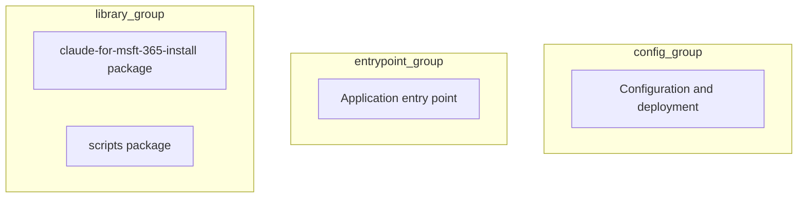

# Architecture report: anthropics/financial-services

> Automated static analysis. **Observed** = directly seen in files/imports/AST; **Inferred** = interpretation from that evidence. Repository code was not executed.

## 1. Repository at a glance

| Item | Value |
| --- | --- |
| Repository | anthropics/financial-services |
| Description | Not provided |
| Language | Python |
| Stars | 41287 |
| Licence | Apache-2.0 |
| Analysed commit / branch | 3e32c2287dcb637c184c01cc0ad82d6af7e9bb0f / main |
| Framework(s) | FastAPI |
| Files analysed | 362 |
| Components | 4 |

## 2. Architecture in one minute

anthropics/financial-services. This repository was analysed statically from 362 file(s) (17 Python). Detected technologies (observed from imports/manifests): GitHub Actions, FastAPI, requests, Uvicorn. Files are grouped into 4 component(s): claude-for-msft-365-install package, Configuration and deployment, Application entry point, scripts package. Observed entry point(s): plugins/agent-plugins/model-builder/skills/dcf-model/scripts/validate_dcf.py, plugins/agent-plugins/pitch-agent/skills/dcf-model/scripts/validate_dcf.py, plugins/agent-plugins/pitch-agent/skills/ib-check-deck/scripts/extract_numbers.py. Findings below distinguish observed facts from inferred interpretation.

## 3. High-level block diagram

## 4. Main components

### claude-for-msft-365-install package (`claude_for_msft_365_install`)

- **Kind:** library
- **Status:** Observed
- **Confidence:** 0.85
- **Responsibility:** Groups 5 file(s) under claude-for-msft-365-install package (observed from repository paths and static analysis). Observed top-level functions: b64u.
- **Paths:** `claude-for-msft-365-install/examples/python-bootstrap/mint_dev_token.py`, `claude-for-msft-365-install/scripts/build-manifest.mjs`, `claude-for-msft-365-install/scripts/clear-addin-cache.sh`, `claude-for-msft-365-install/scripts/export-addin-data.sh`, `claude-for-msft-365-install/scripts/sideload-addin.sh`
- **Evidence:** [claude-for-msft-365-install/examples/python-bootstrap/mint_dev_token.py:20](https://github.com/anthropics/financial-services/blob/3e32c2287dcb637c184c01cc0ad82d6af7e9bb0f/claude-for-msft-365-install/examples/python-bootstrap/mint_dev_token.py#L20); [claude-for-msft-365-install/scripts/build-manifest.mjs](https://github.com/anthropics/financial-services/blob/3e32c2287dcb637c184c01cc0ad82d6af7e9bb0f/claude-for-msft-365-install/scripts/build-manifest.mjs); [claude-for-msft-365-install/scripts/clear-addin-cache.sh](https://github.com/anthropics/financial-services/blob/3e32c2287dcb637c184c01cc0ad82d6af7e9bb0f/claude-for-msft-365-install/scripts/clear-addin-cache.sh); [claude-for-msft-365-install/scripts/export-addin-data.sh](https://github.com/anthropics/financial-services/blob/3e32c2287dcb637c184c01cc0ad82d6af7e9bb0f/claude-for-msft-365-install/scripts/export-addin-data.sh); [claude-for-msft-365-install/scripts/sideload-addin.sh](https://github.com/anthropics/financial-services/blob/3e32c2287dcb637c184c01cc0ad82d6af7e9bb0f/claude-for-msft-365-install/scripts/sideload-addin.sh)

### Configuration and deployment (`config`)

- **Kind:** config
- **Status:** Observed
- **Confidence:** 0.85
- **Responsibility:** Groups 83 file(s) under configuration and deployment (observed from repository paths and static analysis). Observed top-level functions: b64.
- **Paths:** `claude-for-msft-365-install/.claude-plugin/plugin.json`, `claude-for-msft-365-install/examples/python-bootstrap/config.py`, `claude-for-msft-365-install/examples/python-bootstrap/requirements.txt`, `managed-agent-cookbooks/earnings-reviewer/agent.yaml`, `managed-agent-cookbooks/earnings-reviewer/steering-examples.json`, `managed-agent-cookbooks/earnings-reviewer/subagents/model-updater.yaml`, `managed-agent-cookbooks/earnings-reviewer/subagents/note-writer.yaml`, `managed-agent-cookbooks/earnings-reviewer/subagents/transcript-reader.yaml`, `managed-agent-cookbooks/gl-reconciler/agent.yaml`, `managed-agent-cookbooks/gl-reconciler/steering-examples.json`, `managed-agent-cookbooks/gl-reconciler/subagents/critic.yaml`, `managed-agent-cookbooks/gl-reconciler/subagents/reader.yaml`, `managed-agent-cookbooks/gl-reconciler/subagents/resolver.yaml`, `managed-agent-cookbooks/kyc-screener/agent.yaml`, `managed-agent-cookbooks/kyc-screener/steering-examples.json`, `managed-agent-cookbooks/kyc-screener/subagents/doc-reader.yaml`, `managed-agent-cookbooks/kyc-screener/subagents/escalator.yaml`, `managed-agent-cookbooks/kyc-screener/subagents/rules-engine.yaml`, `managed-agent-cookbooks/market-researcher/agent.yaml`, `managed-agent-cookbooks/market-researcher/steering-examples.json`, `managed-agent-cookbooks/market-researcher/subagents/comps-spreader.yaml`, `managed-agent-cookbooks/market-researcher/subagents/note-writer.yaml`, `managed-agent-cookbooks/market-researcher/subagents/sector-reader.yaml`, `managed-agent-cookbooks/meeting-prep-agent/agent.yaml`, `managed-agent-cookbooks/meeting-prep-agent/steering-examples.json`, `managed-agent-cookbooks/meeting-prep-agent/subagents/news-reader.yaml`, `managed-agent-cookbooks/meeting-prep-agent/subagents/pack-writer.yaml`, `managed-agent-cookbooks/meeting-prep-agent/subagents/profiler.yaml`, `managed-agent-cookbooks/model-builder/agent.yaml`, `managed-agent-cookbooks/model-builder/steering-examples.json`, `managed-agent-cookbooks/model-builder/subagents/auditor.yaml`, `managed-agent-cookbooks/model-builder/subagents/builder.yaml`, `managed-agent-cookbooks/model-builder/subagents/data-puller.yaml`, `managed-agent-cookbooks/month-end-closer/agent.yaml`, `managed-agent-cookbooks/month-end-closer/steering-examples.json`, `managed-agent-cookbooks/month-end-closer/subagents/ledger-reader.yaml`, `managed-agent-cookbooks/month-end-closer/subagents/poster.yaml`, `managed-agent-cookbooks/month-end-closer/subagents/rollforward.yaml`, `managed-agent-cookbooks/pitch-agent/agent.yaml`, `managed-agent-cookbooks/pitch-agent/steering-examples.json`, `managed-agent-cookbooks/pitch-agent/subagents/deck-writer.yaml`, `managed-agent-cookbooks/pitch-agent/subagents/modeler.yaml`, `managed-agent-cookbooks/pitch-agent/subagents/researcher.yaml`, `managed-agent-cookbooks/statement-auditor/agent.yaml`, `managed-agent-cookbooks/statement-auditor/steering-examples.json`, `managed-agent-cookbooks/statement-auditor/subagents/flagger.yaml`, `managed-agent-cookbooks/statement-auditor/subagents/reconciler.yaml`, `managed-agent-cookbooks/statement-auditor/subagents/statement-reader.yaml`, `managed-agent-cookbooks/valuation-reviewer/agent.yaml`, `managed-agent-cookbooks/valuation-reviewer/steering-examples.json`, `managed-agent-cookbooks/valuation-reviewer/subagents/package-reader.yaml`, `managed-agent-cookbooks/valuation-reviewer/subagents/publisher.yaml`, `managed-agent-cookbooks/valuation-reviewer/subagents/valuation-runner.yaml`, `plugins/agent-plugins/earnings-reviewer/.claude-plugin/plugin.json`, `plugins/agent-plugins/gl-reconciler/.claude-plugin/plugin.json`, `plugins/agent-plugins/kyc-screener/.claude-plugin/plugin.json`, `plugins/agent-plugins/market-researcher/.claude-plugin/plugin.json`, `plugins/agent-plugins/meeting-prep-agent/.claude-plugin/plugin.json`, `plugins/agent-plugins/model-builder/.claude-plugin/plugin.json`, `plugins/agent-plugins/model-builder/skills/dcf-model/requirements.txt`, `plugins/agent-plugins/month-end-closer/.claude-plugin/plugin.json`, `plugins/agent-plugins/pitch-agent/.claude-plugin/plugin.json`, `plugins/agent-plugins/pitch-agent/skills/dcf-model/requirements.txt`, `plugins/agent-plugins/statement-auditor/.claude-plugin/plugin.json`, `plugins/agent-plugins/valuation-reviewer/.claude-plugin/plugin.json`, `plugins/partner-built/lseg/.claude-plugin/plugin.json`, `plugins/partner-built/lseg/.mcp.json`, `plugins/partner-built/spglobal/.claude-plugin/plugin.json`, `plugins/partner-built/spglobal/.mcp.json`, `plugins/vertical-plugins/equity-research/.claude-plugin/plugin.json`, `plugins/vertical-plugins/equity-research/hooks/hooks.json`, `plugins/vertical-plugins/financial-analysis/.claude-plugin/plugin.json`, `plugins/vertical-plugins/financial-analysis/.mcp.json`, `plugins/vertical-plugins/financial-analysis/hooks/hooks.json`, `plugins/vertical-plugins/financial-analysis/skills/dcf-model/requirements.txt`, `plugins/vertical-plugins/fund-admin/.claude-plugin/plugin.json`, `plugins/vertical-plugins/investment-banking/.claude-plugin/plugin.json`, `plugins/vertical-plugins/investment-banking/.mcp.json`, `plugins/vertical-plugins/investment-banking/hooks/hooks.json`, `plugins/vertical-plugins/operations/.claude-plugin/plugin.json`, `plugins/vertical-plugins/private-equity/.claude-plugin/plugin.json`, `plugins/vertical-plugins/private-equity/.mcp.json`, `plugins/vertical-plugins/private-equity/hooks/hooks.json`
- **Evidence:** [claude-for-msft-365-install/.claude-plugin/plugin.json](https://github.com/anthropics/financial-services/blob/3e32c2287dcb637c184c01cc0ad82d6af7e9bb0f/claude-for-msft-365-install/.claude-plugin/plugin.json); [claude-for-msft-365-install/examples/python-bootstrap/config.py:22](https://github.com/anthropics/financial-services/blob/3e32c2287dcb637c184c01cc0ad82d6af7e9bb0f/claude-for-msft-365-install/examples/python-bootstrap/config.py#L22); [claude-for-msft-365-install/examples/python-bootstrap/requirements.txt](https://github.com/anthropics/financial-services/blob/3e32c2287dcb637c184c01cc0ad82d6af7e9bb0f/claude-for-msft-365-install/examples/python-bootstrap/requirements.txt); [managed-agent-cookbooks/earnings-reviewer/agent.yaml](https://github.com/anthropics/financial-services/blob/3e32c2287dcb637c184c01cc0ad82d6af7e9bb0f/managed-agent-cookbooks/earnings-reviewer/agent.yaml); [managed-agent-cookbooks/earnings-reviewer/steering-examples.json](https://github.com/anthropics/financial-services/blob/3e32c2287dcb637c184c01cc0ad82d6af7e9bb0f/managed-agent-cookbooks/earnings-reviewer/steering-examples.json); [managed-agent-cookbooks/earnings-reviewer/subagents/model-updater.yaml](https://github.com/anthropics/financial-services/blob/3e32c2287dcb637c184c01cc0ad82d6af7e9bb0f/managed-agent-cookbooks/earnings-reviewer/subagents/model-updater.yaml); [managed-agent-cookbooks/earnings-reviewer/subagents/note-writer.yaml](https://github.com/anthropics/financial-services/blob/3e32c2287dcb637c184c01cc0ad82d6af7e9bb0f/managed-agent-cookbooks/earnings-reviewer/subagents/note-writer.yaml); [managed-agent-cookbooks/earnings-reviewer/subagents/transcript-reader.yaml](https://github.com/anthropics/financial-services/blob/3e32c2287dcb637c184c01cc0ad82d6af7e9bb0f/managed-agent-cookbooks/earnings-reviewer/subagents/transcript-reader.yaml)

### Application entry point (`entrypoint`)

- **Kind:** entrypoint
- **Status:** Observed
- **Confidence:** 0.85
- **Responsibility:** Groups 13 file(s) under application entry point (observed from repository paths and static analysis). Observed application object created via FastAPI. Observed routes: GET /bootstrap. Observed top-level classes: DCFModelValidator, NumberInstance. Observed top-level functions: _load, all_plugin_jsons, base_version, bootstrap, changed_plugins, cmd_apply.
- **Paths:** `claude-for-msft-365-install/examples/python-bootstrap/app.py`, `claude-for-msft-365-install/examples/python-bootstrap/get_tenant_id.py`, `plugins/agent-plugins/model-builder/skills/dcf-model/scripts/validate_dcf.py`, `plugins/agent-plugins/pitch-agent/skills/dcf-model/scripts/validate_dcf.py`, `plugins/agent-plugins/pitch-agent/skills/ib-check-deck/scripts/extract_numbers.py`, `plugins/vertical-plugins/financial-analysis/skills/dcf-model/scripts/validate_dcf.py`, `plugins/vertical-plugins/financial-analysis/skills/ib-check-deck/scripts/extract_numbers.py`, `plugins/vertical-plugins/financial-analysis/skills/skill-creator/scripts/init_skill.py`, `plugins/vertical-plugins/financial-analysis/skills/skill-creator/scripts/package_skill.py`, `plugins/vertical-plugins/financial-analysis/skills/skill-creator/scripts/quick_validate.py`, `scripts/orchestrate.py`, `scripts/validate.py`, `scripts/version_bump.py`
- **Evidence:** [claude-for-msft-365-install/examples/python-bootstrap/app.py:69](https://github.com/anthropics/financial-services/blob/3e32c2287dcb637c184c01cc0ad82d6af7e9bb0f/claude-for-msft-365-install/examples/python-bootstrap/app.py#L69); [claude-for-msft-365-install/examples/python-bootstrap/get_tenant_id.py:18](https://github.com/anthropics/financial-services/blob/3e32c2287dcb637c184c01cc0ad82d6af7e9bb0f/claude-for-msft-365-install/examples/python-bootstrap/get_tenant_id.py#L18); [plugins/agent-plugins/model-builder/skills/dcf-model/scripts/validate_dcf.py:13](https://github.com/anthropics/financial-services/blob/3e32c2287dcb637c184c01cc0ad82d6af7e9bb0f/plugins/agent-plugins/model-builder/skills/dcf-model/scripts/validate_dcf.py#L13); [plugins/agent-plugins/pitch-agent/skills/dcf-model/scripts/validate_dcf.py:13](https://github.com/anthropics/financial-services/blob/3e32c2287dcb637c184c01cc0ad82d6af7e9bb0f/plugins/agent-plugins/pitch-agent/skills/dcf-model/scripts/validate_dcf.py#L13); [plugins/agent-plugins/pitch-agent/skills/ib-check-deck/scripts/extract_numbers.py:24](https://github.com/anthropics/financial-services/blob/3e32c2287dcb637c184c01cc0ad82d6af7e9bb0f/plugins/agent-plugins/pitch-agent/skills/ib-check-deck/scripts/extract_numbers.py#L24); [plugins/vertical-plugins/financial-analysis/skills/dcf-model/scripts/validate_dcf.py:13](https://github.com/anthropics/financial-services/blob/3e32c2287dcb637c184c01cc0ad82d6af7e9bb0f/plugins/vertical-plugins/financial-analysis/skills/dcf-model/scripts/validate_dcf.py#L13); [plugins/vertical-plugins/financial-analysis/skills/ib-check-deck/scripts/extract_numbers.py:24](https://github.com/anthropics/financial-services/blob/3e32c2287dcb637c184c01cc0ad82d6af7e9bb0f/plugins/vertical-plugins/financial-analysis/skills/ib-check-deck/scripts/extract_numbers.py#L24); [plugins/vertical-plugins/financial-analysis/skills/skill-creator/scripts/init_skill.py:189](https://github.com/anthropics/financial-services/blob/3e32c2287dcb637c184c01cc0ad82d6af7e9bb0f/plugins/vertical-plugins/financial-analysis/skills/skill-creator/scripts/init_skill.py#L189)

### scripts package (`scripts`)

- **Kind:** library
- **Status:** Observed
- **Confidence:** 0.85
- **Responsibility:** Groups 4 file(s) under scripts package (observed from repository paths and static analysis). Observed top-level functions: check_refs, ensure_hooks_installed, err, rel.
- **Paths:** `scripts/check.py`, `scripts/deploy-managed-agent.sh`, `scripts/sync-agent-skills.py`, `scripts/test-cookbooks.sh`
- **Evidence:** [scripts/check.py:27](https://github.com/anthropics/financial-services/blob/3e32c2287dcb637c184c01cc0ad82d6af7e9bb0f/scripts/check.py#L27); [scripts/deploy-managed-agent.sh](https://github.com/anthropics/financial-services/blob/3e32c2287dcb637c184c01cc0ad82d6af7e9bb0f/scripts/deploy-managed-agent.sh); [scripts/sync-agent-skills.py](https://github.com/anthropics/financial-services/blob/3e32c2287dcb637c184c01cc0ad82d6af7e9bb0f/scripts/sync-agent-skills.py); [scripts/test-cookbooks.sh](https://github.com/anthropics/financial-services/blob/3e32c2287dcb637c184c01cc0ad82d6af7e9bb0f/scripts/test-cookbooks.sh)

## 5. Execution flow

**Observed** entry point(s):

- [plugins/agent-plugins/model-builder/skills/dcf-model/scripts/validate_dcf.py:291](https://github.com/anthropics/financial-services/blob/3e32c2287dcb637c184c01cc0ad82d6af7e9bb0f/plugins/agent-plugins/model-builder/skills/dcf-model/scripts/validate_dcf.py#L291)
- [plugins/agent-plugins/pitch-agent/skills/dcf-model/scripts/validate_dcf.py:291](https://github.com/anthropics/financial-services/blob/3e32c2287dcb637c184c01cc0ad82d6af7e9bb0f/plugins/agent-plugins/pitch-agent/skills/dcf-model/scripts/validate_dcf.py#L291)
- [plugins/agent-plugins/pitch-agent/skills/ib-check-deck/scripts/extract_numbers.py:304](https://github.com/anthropics/financial-services/blob/3e32c2287dcb637c184c01cc0ad82d6af7e9bb0f/plugins/agent-plugins/pitch-agent/skills/ib-check-deck/scripts/extract_numbers.py#L304)
- [plugins/vertical-plugins/financial-analysis/skills/dcf-model/scripts/validate_dcf.py:291](https://github.com/anthropics/financial-services/blob/3e32c2287dcb637c184c01cc0ad82d6af7e9bb0f/plugins/vertical-plugins/financial-analysis/skills/dcf-model/scripts/validate_dcf.py#L291)
- [plugins/vertical-plugins/financial-analysis/skills/ib-check-deck/scripts/extract_numbers.py:304](https://github.com/anthropics/financial-services/blob/3e32c2287dcb637c184c01cc0ad82d6af7e9bb0f/plugins/vertical-plugins/financial-analysis/skills/ib-check-deck/scripts/extract_numbers.py#L304)
- [plugins/vertical-plugins/financial-analysis/skills/skill-creator/scripts/init_skill.py:302](https://github.com/anthropics/financial-services/blob/3e32c2287dcb637c184c01cc0ad82d6af7e9bb0f/plugins/vertical-plugins/financial-analysis/skills/skill-creator/scripts/init_skill.py#L302)
- [plugins/vertical-plugins/financial-analysis/skills/skill-creator/scripts/package_skill.py:109](https://github.com/anthropics/financial-services/blob/3e32c2287dcb637c184c01cc0ad82d6af7e9bb0f/plugins/vertical-plugins/financial-analysis/skills/skill-creator/scripts/package_skill.py#L109)
- [plugins/vertical-plugins/financial-analysis/skills/skill-creator/scripts/quick_validate.py:88](https://github.com/anthropics/financial-services/blob/3e32c2287dcb637c184c01cc0ad82d6af7e9bb0f/plugins/vertical-plugins/financial-analysis/skills/skill-creator/scripts/quick_validate.py#L88)
- [scripts/orchestrate.py:85](https://github.com/anthropics/financial-services/blob/3e32c2287dcb637c184c01cc0ad82d6af7e9bb0f/scripts/orchestrate.py#L85)
- [scripts/validate.py:41](https://github.com/anthropics/financial-services/blob/3e32c2287dcb637c184c01cc0ad82d6af7e9bb0f/scripts/validate.py#L41)
- [scripts/version_bump.py:208](https://github.com/anthropics/financial-services/blob/3e32c2287dcb637c184c01cc0ad82d6af7e9bb0f/scripts/version_bump.py#L208)

**Observed** routes (from decorators):

- `GET /bootstrap` -> `bootstrap` in `claude-for-msft-365-install/examples/python-bootstrap/app.py:78`

Representative flow (derived from observed entry points and the import graph; steps beyond the entry point are **Inferred**):

1. Execution starts at an observed entry point listed above, if present.
2. No internal import relationships between components were observed.

## 6. Project structure

### `(root)`

- `.gitignore` - other (419 bytes)
- `CLAUDE.md` - docs (3712 bytes)
- `LICENSE` - docs (11358 bytes)
- `README.md` - docs (15894 bytes)

### `.claude-plugin`

- `.claude-plugin/marketplace.json` - config (5008 bytes)

### `.githooks`

- `.githooks/pre-commit` - other (602 bytes)

### `.github`

- `.github/workflows/plugin-validate.yml` - ci, YAML (2133 bytes)
- `.github/workflows/version-bump.yml` - ci, YAML (700 bytes)

### `claude-for-msft-365-install`

- `claude-for-msft-365-install/.claude-plugin/plugin.json` - config (429 bytes)
- `claude-for-msft-365-install/.claude/skills/verify/SKILL.md` - docs (4206 bytes)
- `claude-for-msft-365-install/README.md` - docs (3353 bytes)
- `claude-for-msft-365-install/commands/access-policies.md` - docs (13164 bytes)
- `claude-for-msft-365-install/commands/bootstrap.md` - docs (14134 bytes)
- `claude-for-msft-365-install/commands/consent.md` - docs (2757 bytes)
- `claude-for-msft-365-install/commands/debug.md` - docs (15721 bytes)
- `claude-for-msft-365-install/commands/entra-app.md` - docs (6707 bytes)
- `claude-for-msft-365-install/commands/export-data.md` - docs (11009 bytes)
- `claude-for-msft-365-install/commands/manifest.md` - docs (20623 bytes)
- `claude-for-msft-365-install/commands/setup.md` - docs (19490 bytes)
- `claude-for-msft-365-install/commands/update-user-attrs.md` - docs (5804 bytes)
- `claude-for-msft-365-install/examples/python-bootstrap/README.md` - docs (1954 bytes)
- `claude-for-msft-365-install/examples/python-bootstrap/app.py` - source, Python (3424 bytes)
- `claude-for-msft-365-install/examples/python-bootstrap/config.py` - source, Python (2938 bytes)
- `claude-for-msft-365-install/examples/python-bootstrap/get_tenant_id.py` - source, Python (1354 bytes)
- `claude-for-msft-365-install/examples/python-bootstrap/mint_dev_token.py` - source, Python (1769 bytes)
- `claude-for-msft-365-install/examples/python-bootstrap/requirements.txt` - manifest (30 bytes)
- `claude-for-msft-365-install/scripts/build-manifest.mjs` - source, JavaScript (15189 bytes)
- `claude-for-msft-365-install/scripts/clear-addin-cache.ps1` - other (5970 bytes)
- `claude-for-msft-365-install/scripts/clear-addin-cache.sh` - source, Shell (4316 bytes)
- `claude-for-msft-365-install/scripts/export-addin-data.ps1` - other (14300 bytes)
- `claude-for-msft-365-install/scripts/export-addin-data.sh` - source, Shell (8962 bytes)
- `claude-for-msft-365-install/scripts/sideload-addin.ps1` - other (1595 bytes)
- `claude-for-msft-365-install/scripts/sideload-addin.sh` - source, Shell (1705 bytes)

### `managed-agent-cookbooks`

- `managed-agent-cookbooks/README.md` - docs (4405 bytes)
- `managed-agent-cookbooks/earnings-reviewer/README.md` - docs (1386 bytes)
- `managed-agent-cookbooks/earnings-reviewer/agent.yaml` - config (1074 bytes)
- `managed-agent-cookbooks/earnings-reviewer/steering-examples.json` - config (384 bytes)
- `managed-agent-cookbooks/earnings-reviewer/subagents/model-updater.yaml` - config (864 bytes)
- `managed-agent-cookbooks/earnings-reviewer/subagents/note-writer.yaml` - config (688 bytes)
- `managed-agent-cookbooks/earnings-reviewer/subagents/transcript-reader.yaml` - config (992 bytes)
- `managed-agent-cookbooks/gl-reconciler/README.md` - docs (2111 bytes)
- `managed-agent-cookbooks/gl-reconciler/agent.yaml` - config (1466 bytes)
- `managed-agent-cookbooks/gl-reconciler/steering-examples.json` - config (513 bytes)
- `managed-agent-cookbooks/gl-reconciler/subagents/critic.yaml` - config (801 bytes)
- `managed-agent-cookbooks/gl-reconciler/subagents/reader.yaml` - config (2086 bytes)
- `managed-agent-cookbooks/gl-reconciler/subagents/resolver.yaml` - config (626 bytes)
- `managed-agent-cookbooks/kyc-screener/README.md` - docs (1114 bytes)
- `managed-agent-cookbooks/kyc-screener/agent.yaml` - config (898 bytes)
- `managed-agent-cookbooks/kyc-screener/steering-examples.json` - config (378 bytes)
- `managed-agent-cookbooks/kyc-screener/subagents/doc-reader.yaml` - config (1187 bytes)
- `managed-agent-cookbooks/kyc-screener/subagents/escalator.yaml` - config (590 bytes)
- `managed-agent-cookbooks/kyc-screener/subagents/rules-engine.yaml` - config (635 bytes)
- `managed-agent-cookbooks/market-researcher/README.md` - docs (1406 bytes)
- `managed-agent-cookbooks/market-researcher/agent.yaml` - config (1069 bytes)
- `managed-agent-cookbooks/market-researcher/steering-examples.json` - config (334 bytes)
- `managed-agent-cookbooks/market-researcher/subagents/comps-spreader.yaml` - config (805 bytes)
- `managed-agent-cookbooks/market-researcher/subagents/note-writer.yaml` - config (656 bytes)
- `managed-agent-cookbooks/market-researcher/subagents/sector-reader.yaml` - config (1038 bytes)
- `managed-agent-cookbooks/meeting-prep-agent/README.md` - docs (1153 bytes)
- `managed-agent-cookbooks/meeting-prep-agent/agent.yaml` - config (1054 bytes)
- `managed-agent-cookbooks/meeting-prep-agent/steering-examples.json` - config (417 bytes)
- `managed-agent-cookbooks/meeting-prep-agent/subagents/news-reader.yaml` - config (895 bytes)
- `managed-agent-cookbooks/meeting-prep-agent/subagents/pack-writer.yaml` - config (660 bytes)
- `managed-agent-cookbooks/meeting-prep-agent/subagents/profiler.yaml` - config (724 bytes)
- `managed-agent-cookbooks/model-builder/README.md` - docs (1166 bytes)
- `managed-agent-cookbooks/model-builder/agent.yaml` - config (1040 bytes)
- `managed-agent-cookbooks/model-builder/steering-examples.json` - config (399 bytes)
- `managed-agent-cookbooks/model-builder/subagents/auditor.yaml` - config (530 bytes)
- `managed-agent-cookbooks/model-builder/subagents/builder.yaml` - config (977 bytes)
- `managed-agent-cookbooks/model-builder/subagents/data-puller.yaml` - config (1038 bytes)
- `managed-agent-cookbooks/month-end-closer/README.md` - docs (1134 bytes)
- `managed-agent-cookbooks/month-end-closer/agent.yaml` - config (914 bytes)
- `managed-agent-cookbooks/month-end-closer/steering-examples.json` - config (373 bytes)
- `managed-agent-cookbooks/month-end-closer/subagents/ledger-reader.yaml` - config (1109 bytes)
- `managed-agent-cookbooks/month-end-closer/subagents/poster.yaml` - config (624 bytes)
- `managed-agent-cookbooks/month-end-closer/subagents/rollforward.yaml` - config (585 bytes)
- `managed-agent-cookbooks/pitch-agent/README.md` - docs (1337 bytes)
- `managed-agent-cookbooks/pitch-agent/agent.yaml` - config (1029 bytes)
- `managed-agent-cookbooks/pitch-agent/steering-examples.json` - config (446 bytes)
- `managed-agent-cookbooks/pitch-agent/subagents/deck-writer.yaml` - config (778 bytes)
- `managed-agent-cookbooks/pitch-agent/subagents/modeler.yaml` - config (966 bytes)
- `managed-agent-cookbooks/pitch-agent/subagents/researcher.yaml` - config (1659 bytes)
- `managed-agent-cookbooks/statement-auditor/README.md` - docs (1076 bytes)
- `managed-agent-cookbooks/statement-auditor/agent.yaml` - config (907 bytes)
- `managed-agent-cookbooks/statement-auditor/steering-examples.json` - config (262 bytes)
- `managed-agent-cookbooks/statement-auditor/subagents/flagger.yaml` - config (572 bytes)
- `managed-agent-cookbooks/statement-auditor/subagents/reconciler.yaml` - config (549 bytes)
- `managed-agent-cookbooks/statement-auditor/subagents/statement-reader.yaml` - config (975 bytes)
- `managed-agent-cookbooks/valuation-reviewer/README.md` - docs (1270 bytes)
- `managed-agent-cookbooks/valuation-reviewer/agent.yaml` - config (936 bytes)
- `managed-agent-cookbooks/valuation-reviewer/steering-examples.json` - config (398 bytes)
- `managed-agent-cookbooks/valuation-reviewer/subagents/package-reader.yaml` - config (1103 bytes)
- `managed-agent-cookbooks/valuation-reviewer/subagents/publisher.yaml` - config (573 bytes)
- `managed-agent-cookbooks/valuation-reviewer/subagents/valuation-runner.yaml` - config (670 bytes)

### `plugins`

- `plugins/agent-plugins/earnings-reviewer/.claude-plugin/plugin.json` - config (179 bytes)
- `plugins/agent-plugins/earnings-reviewer/agents/earnings-reviewer.md` - docs (2165 bytes)
- `plugins/agent-plugins/earnings-reviewer/skills/audit-xls/SKILL.md` - docs (6347 bytes)
- `plugins/agent-plugins/earnings-reviewer/skills/earnings-analysis/SKILL.md` - docs (8684 bytes)
- `plugins/agent-plugins/earnings-reviewer/skills/earnings-analysis/references/best-practices.md` - docs (9355 bytes)
- `plugins/agent-plugins/earnings-reviewer/skills/earnings-analysis/references/report-structure.md` - docs (11141 bytes)
- `plugins/agent-plugins/earnings-reviewer/skills/earnings-analysis/references/workflow.md` - docs (21406 bytes)
- `plugins/agent-plugins/earnings-reviewer/skills/earnings-preview/SKILL.md` - docs (2757 bytes)
- `plugins/agent-plugins/earnings-reviewer/skills/model-update/SKILL.md` - docs (3354 bytes)
- `plugins/agent-plugins/earnings-reviewer/skills/morning-note/SKILL.md` - docs (3037 bytes)
- `plugins/agent-plugins/earnings-reviewer/skills/xlsx-author/SKILL.md` - docs (1807 bytes)
- `plugins/agent-plugins/gl-reconciler/.claude-plugin/plugin.json` - config (172 bytes)
- `plugins/agent-plugins/gl-reconciler/agents/gl-reconciler.md` - docs (1883 bytes)
- `plugins/agent-plugins/gl-reconciler/skills/audit-xls/SKILL.md` - docs (6347 bytes)
- `plugins/agent-plugins/gl-reconciler/skills/break-trace/SKILL.md` - docs (1925 bytes)
- `plugins/agent-plugins/gl-reconciler/skills/gl-recon/SKILL.md` - docs (2714 bytes)
- `plugins/agent-plugins/gl-reconciler/skills/xlsx-author/SKILL.md` - docs (1807 bytes)
- `plugins/agent-plugins/kyc-screener/.claude-plugin/plugin.json` - config (176 bytes)
- `plugins/agent-plugins/kyc-screener/agents/kyc-screener.md` - docs (1649 bytes)
- `plugins/agent-plugins/kyc-screener/skills/kyc-doc-parse/SKILL.md` - docs (2389 bytes)
- `plugins/agent-plugins/kyc-screener/skills/kyc-rules/SKILL.md` - docs (2411 bytes)
- `plugins/agent-plugins/kyc-screener/skills/xlsx-author/SKILL.md` - docs (1807 bytes)
- `plugins/agent-plugins/market-researcher/.claude-plugin/plugin.json` - config (216 bytes)
- `plugins/agent-plugins/market-researcher/agents/market-researcher.md` - docs (2705 bytes)
- `plugins/agent-plugins/market-researcher/skills/competitive-analysis/SKILL.md` - docs (11478 bytes)
- `plugins/agent-plugins/market-researcher/skills/competitive-analysis/references/frameworks.md` - docs (492 bytes)
- `plugins/agent-plugins/market-researcher/skills/competitive-analysis/references/schemas.md` - docs (1790 bytes)
- `plugins/agent-plugins/market-researcher/skills/comps-analysis/SKILL.md` - docs (30783 bytes)
- `plugins/agent-plugins/market-researcher/skills/idea-generation/SKILL.md` - docs (3855 bytes)
- `plugins/agent-plugins/market-researcher/skills/pptx-author/SKILL.md` - docs (1825 bytes)
- `plugins/agent-plugins/market-researcher/skills/sector-overview/SKILL.md` - docs (3458 bytes)
- `plugins/agent-plugins/meeting-prep-agent/.claude-plugin/plugin.json` - config (166 bytes)
- `plugins/agent-plugins/meeting-prep-agent/agents/meeting-prep-agent.md` - docs (1549 bytes)
- `plugins/agent-plugins/meeting-prep-agent/skills/client-report/SKILL.md` - docs (3300 bytes)
- `plugins/agent-plugins/meeting-prep-agent/skills/client-review/SKILL.md` - docs (3188 bytes)
- `plugins/agent-plugins/meeting-prep-agent/skills/investment-proposal/SKILL.md` - docs (3584 bytes)
- `plugins/agent-plugins/meeting-prep-agent/skills/pptx-author/SKILL.md` - docs (1825 bytes)
- `plugins/agent-plugins/model-builder/.claude-plugin/plugin.json` - config (164 bytes)
- `plugins/agent-plugins/model-builder/agents/model-builder.md` - docs (1860 bytes)
- `plugins/agent-plugins/model-builder/skills/3-statement-model/SKILL.md` - docs (21155 bytes)
- `plugins/agent-plugins/model-builder/skills/3-statement-model/references/formatting.md` - docs (4270 bytes)
- `plugins/agent-plugins/model-builder/skills/3-statement-model/references/formulas.md` - docs (7874 bytes)
- `plugins/agent-plugins/model-builder/skills/3-statement-model/references/sec-filings.md` - docs (4598 bytes)
- `plugins/agent-plugins/model-builder/skills/audit-xls/SKILL.md` - docs (6347 bytes)
- `plugins/agent-plugins/model-builder/skills/comps-analysis/SKILL.md` - docs (30783 bytes)
- `plugins/agent-plugins/model-builder/skills/dcf-model/SKILL.md` - docs (49630 bytes)
- `plugins/agent-plugins/model-builder/skills/dcf-model/TROUBLESHOOTING.md` - docs (1495 bytes)
- `plugins/agent-plugins/model-builder/skills/dcf-model/requirements.txt` - manifest (115 bytes)
- `plugins/agent-plugins/model-builder/skills/dcf-model/scripts/validate_dcf.py` - source, Python (11623 bytes)
- `plugins/agent-plugins/model-builder/skills/lbo-model/SKILL.md` - docs (16577 bytes)
- `plugins/agent-plugins/model-builder/skills/xlsx-author/SKILL.md` - docs (1807 bytes)
- `plugins/agent-plugins/month-end-closer/.claude-plugin/plugin.json` - config (167 bytes)
- `plugins/agent-plugins/month-end-closer/agents/month-end-closer.md` - docs (1597 bytes)
- `plugins/agent-plugins/month-end-closer/skills/accrual-schedule/SKILL.md` - docs (1702 bytes)
- `plugins/agent-plugins/month-end-closer/skills/audit-xls/SKILL.md` - docs (6347 bytes)
- `plugins/agent-plugins/month-end-closer/skills/roll-forward/SKILL.md` - docs (1412 bytes)
- `plugins/agent-plugins/month-end-closer/skills/variance-commentary/SKILL.md` - docs (1560 bytes)
- `plugins/agent-plugins/month-end-closer/skills/xlsx-author/SKILL.md` - docs (1807 bytes)
- `plugins/agent-plugins/pitch-agent/.claude-plugin/plugin.json` - config (176 bytes)
- `plugins/agent-plugins/pitch-agent/agents/pitch-agent.md` - docs (3270 bytes)
- `plugins/agent-plugins/pitch-agent/skills/3-statement-model/SKILL.md` - docs (21155 bytes)
- `plugins/agent-plugins/pitch-agent/skills/3-statement-model/references/formatting.md` - docs (4270 bytes)
- `plugins/agent-plugins/pitch-agent/skills/3-statement-model/references/formulas.md` - docs (7874 bytes)
- `plugins/agent-plugins/pitch-agent/skills/3-statement-model/references/sec-filings.md` - docs (4598 bytes)
- `plugins/agent-plugins/pitch-agent/skills/audit-xls/SKILL.md` - docs (6347 bytes)
- `plugins/agent-plugins/pitch-agent/skills/comps-analysis/SKILL.md` - docs (30783 bytes)
- `plugins/agent-plugins/pitch-agent/skills/dcf-model/SKILL.md` - docs (49630 bytes)
- `plugins/agent-plugins/pitch-agent/skills/dcf-model/TROUBLESHOOTING.md` - docs (1495 bytes)
- `plugins/agent-plugins/pitch-agent/skills/dcf-model/requirements.txt` - manifest (115 bytes)
- `plugins/agent-plugins/pitch-agent/skills/dcf-model/scripts/validate_dcf.py` - source, Python (11623 bytes)
- `plugins/agent-plugins/pitch-agent/skills/deck-refresh/SKILL.md` - docs (6156 bytes)
- `plugins/agent-plugins/pitch-agent/skills/ib-check-deck/SKILL.md` - docs (4030 bytes)
- `plugins/agent-plugins/pitch-agent/skills/ib-check-deck/references/ib-terminology.md` - docs (2040 bytes)
- `plugins/agent-plugins/pitch-agent/skills/ib-check-deck/references/report-format.md` - docs (1431 bytes)
- `plugins/agent-plugins/pitch-agent/skills/ib-check-deck/scripts/extract_numbers.py` - source, Python (10305 bytes)
- `plugins/agent-plugins/pitch-agent/skills/lbo-model/SKILL.md` - docs (16577 bytes)
- `plugins/agent-plugins/pitch-agent/skills/pitch-deck/SKILL.md` - docs (19519 bytes)
- `plugins/agent-plugins/pitch-agent/skills/pitch-deck/reference/calculation-standards.md` - docs (5414 bytes)
- `plugins/agent-plugins/pitch-agent/skills/pitch-deck/reference/formatting-standards.md` - docs (8590 bytes)
- `plugins/agent-plugins/pitch-agent/skills/pitch-deck/reference/slide-templates.md` - docs (11240 bytes)
- `plugins/agent-plugins/pitch-agent/skills/pitch-deck/reference/xml-reference.md` - docs (11090 bytes)
- `plugins/agent-plugins/pitch-agent/skills/pptx-author/SKILL.md` - docs (1825 bytes)
- `plugins/agent-plugins/pitch-agent/skills/sector-overview/SKILL.md` - docs (3458 bytes)
- `plugins/agent-plugins/pitch-agent/skills/xlsx-author/SKILL.md` - docs (1807 bytes)
- `plugins/agent-plugins/statement-auditor/.claude-plugin/plugin.json` - config (178 bytes)
- `plugins/agent-plugins/statement-auditor/agents/statement-auditor.md` - docs (1369 bytes)
- `plugins/agent-plugins/statement-auditor/skills/audit-xls/SKILL.md` - docs (6347 bytes)
- `plugins/agent-plugins/statement-auditor/skills/nav-tieout/SKILL.md` - docs (1680 bytes)
- `plugins/agent-plugins/statement-auditor/skills/xlsx-author/SKILL.md` - docs (1807 bytes)
- `plugins/agent-plugins/valuation-reviewer/.claude-plugin/plugin.json` - config (190 bytes)
- `plugins/agent-plugins/valuation-reviewer/agents/valuation-reviewer.md` - docs (1455 bytes)
- `plugins/agent-plugins/valuation-reviewer/skills/ic-memo/SKILL.md` - docs (2973 bytes)
- `plugins/agent-plugins/valuation-reviewer/skills/portfolio-monitoring/SKILL.md` - docs (2312 bytes)
- `plugins/agent-plugins/valuation-reviewer/skills/returns-analysis/SKILL.md` - docs (3350 bytes)
- `plugins/agent-plugins/valuation-reviewer/skills/xlsx-author/SKILL.md` - docs (1807 bytes)
- `plugins/partner-built/lseg/.claude-plugin/plugin.json` - config (245 bytes)
- `plugins/partner-built/lseg/.mcp.json` - config (132 bytes)
- `plugins/partner-built/lseg/CONNECTORS.md` - docs (5181 bytes)
- `plugins/partner-built/lseg/README.md` - docs (3326 bytes)
- `plugins/partner-built/lseg/commands/analyze-bond-basis.md` - docs (2143 bytes)
- `plugins/partner-built/lseg/commands/analyze-bond-rv.md` - docs (1953 bytes)
- `plugins/partner-built/lseg/commands/analyze-fx-carry.md` - docs (2091 bytes)
- `plugins/partner-built/lseg/commands/analyze-option-vol.md` - docs (2155 bytes)
- `plugins/partner-built/lseg/commands/analyze-swap-curve.md` - docs (2012 bytes)
- `plugins/partner-built/lseg/commands/macro-rates.md` - docs (2400 bytes)
- `plugins/partner-built/lseg/commands/research-equity.md` - docs (2194 bytes)
- `plugins/partner-built/lseg/commands/review-fi-portfolio.md` - docs (2290 bytes)
- `plugins/partner-built/lseg/skills/bond-futures-basis/SKILL.md` - docs (3651 bytes)
- `plugins/partner-built/lseg/skills/bond-relative-value/SKILL.md` - docs (3642 bytes)
- `plugins/partner-built/lseg/skills/equity-research/SKILL.md` - docs (3737 bytes)
- `plugins/partner-built/lseg/skills/fixed-income-portfolio/SKILL.md` - docs (3789 bytes)
- `plugins/partner-built/lseg/skills/fx-carry-trade/SKILL.md` - docs (3772 bytes)
- `plugins/partner-built/lseg/skills/macro-rates-monitor/SKILL.md` - docs (4477 bytes)
- `plugins/partner-built/lseg/skills/option-vol-analysis/SKILL.md` - docs (4015 bytes)
- `plugins/partner-built/lseg/skills/swap-curve-strategy/SKILL.md` - docs (4111 bytes)
- `plugins/partner-built/spglobal/.claude-plugin/plugin.json` - config (681 bytes)
- `plugins/partner-built/spglobal/.mcp.json` - config (131 bytes)
- `plugins/partner-built/spglobal/LICENSE` - docs (11363 bytes)
- `plugins/partner-built/spglobal/README.md` - docs (6584 bytes)
- `plugins/partner-built/spglobal/skills/earnings-preview-beta/LICENSE` - docs (11363 bytes)
- `plugins/partner-built/spglobal/skills/earnings-preview-beta/SKILL.md` - docs (37508 bytes)
- `plugins/partner-built/spglobal/skills/earnings-preview-beta/report-template.md` - docs (45686 bytes)
- `plugins/partner-built/spglobal/skills/funding-digest/LICENSE` - docs (11363 bytes)
- `plugins/partner-built/spglobal/skills/funding-digest/SKILL.md` - docs (30381 bytes)
- `plugins/partner-built/spglobal/skills/funding-digest/references/sector-seeds.md` - docs (4889 bytes)
- `plugins/partner-built/spglobal/skills/tear-sheet/LICENSE` - docs (11363 bytes)
- `plugins/partner-built/spglobal/skills/tear-sheet/SKILL.md` - docs (31226 bytes)
- `plugins/partner-built/spglobal/skills/tear-sheet/references/corp-dev.md` - docs (14320 bytes)
- `plugins/partner-built/spglobal/skills/tear-sheet/references/equity-research.md` - docs (9726 bytes)
- `plugins/partner-built/spglobal/skills/tear-sheet/references/ib-ma.md` - docs (11724 bytes)
- `plugins/partner-built/spglobal/skills/tear-sheet/references/sales-bd.md` - docs (9770 bytes)
- `plugins/vertical-plugins/equity-research/.claude-plugin/plugin.json` - config (215 bytes)
- `plugins/vertical-plugins/equity-research/commands/catalysts.md` - docs (288 bytes)
- `plugins/vertical-plugins/equity-research/commands/earnings-preview.md` - docs (331 bytes)
- `plugins/vertical-plugins/equity-research/commands/earnings.md` - docs (5414 bytes)
- `plugins/vertical-plugins/equity-research/commands/initiate.md` - docs (301 bytes)
- `plugins/vertical-plugins/equity-research/commands/model-update.md` - docs (282 bytes)
- `plugins/vertical-plugins/equity-research/commands/morning-note.md` - docs (231 bytes)
- `plugins/vertical-plugins/equity-research/commands/screen.md` - docs (372 bytes)
- `plugins/vertical-plugins/equity-research/commands/sector.md` - docs (322 bytes)
- `plugins/vertical-plugins/equity-research/commands/thesis.md` - docs (280 bytes)
- `plugins/vertical-plugins/equity-research/hooks/hooks.json` - config (18 bytes)
- `plugins/vertical-plugins/equity-research/skills/catalyst-calendar/SKILL.md` - docs (3111 bytes)
- `plugins/vertical-plugins/equity-research/skills/earnings-analysis/SKILL.md` - docs (8684 bytes)
- `plugins/vertical-plugins/equity-research/skills/earnings-analysis/references/best-practices.md` - docs (9355 bytes)
- `plugins/vertical-plugins/equity-research/skills/earnings-analysis/references/report-structure.md` - docs (11141 bytes)
- `plugins/vertical-plugins/equity-research/skills/earnings-analysis/references/workflow.md` - docs (21406 bytes)
- `plugins/vertical-plugins/equity-research/skills/earnings-preview/SKILL.md` - docs (2757 bytes)
- `plugins/vertical-plugins/equity-research/skills/idea-generation/SKILL.md` - docs (3855 bytes)
- `plugins/vertical-plugins/equity-research/skills/initiating-coverage/SKILL.md` - docs (29772 bytes)
- `plugins/vertical-plugins/equity-research/skills/initiating-coverage/assets/quality-checklist.md` - docs (9664 bytes)
- `plugins/vertical-plugins/equity-research/skills/initiating-coverage/assets/report-template.md` - docs (29164 bytes)
- `plugins/vertical-plugins/equity-research/skills/initiating-coverage/references/task1-company-research.md` - docs (12068 bytes)
- `plugins/vertical-plugins/equity-research/skills/initiating-coverage/references/task2-financial-modeling.md` - docs (27815 bytes)
- `plugins/vertical-plugins/equity-research/skills/initiating-coverage/references/task3-valuation.md` - docs (22708 bytes)
- `plugins/vertical-plugins/equity-research/skills/initiating-coverage/references/task4-chart-generation.md` - docs (32906 bytes)
- `plugins/vertical-plugins/equity-research/skills/initiating-coverage/references/task5-report-assembly.md` - docs (52035 bytes)
- `plugins/vertical-plugins/equity-research/skills/initiating-coverage/references/valuation-methodologies.md` - docs (14111 bytes)
- `plugins/vertical-plugins/equity-research/skills/model-update/SKILL.md` - docs (3354 bytes)
- `plugins/vertical-plugins/equity-research/skills/morning-note/SKILL.md` - docs (3037 bytes)
- `plugins/vertical-plugins/equity-research/skills/sector-overview/SKILL.md` - docs (3458 bytes)
- `plugins/vertical-plugins/equity-research/skills/thesis-tracker/SKILL.md` - docs (2736 bytes)
- `plugins/vertical-plugins/financial-analysis/.claude-plugin/plugin.json` - config (239 bytes)
- `plugins/vertical-plugins/financial-analysis/.mcp.json` - config (1179 bytes)
- `plugins/vertical-plugins/financial-analysis/commands/3-statement-model.md` - docs (347 bytes)
- `plugins/vertical-plugins/financial-analysis/commands/competitive-analysis.md` - docs (330 bytes)
- `plugins/vertical-plugins/financial-analysis/commands/comps.md` - docs (5639 bytes)
- `plugins/vertical-plugins/financial-analysis/commands/dcf.md` - docs (3267 bytes)
- `plugins/vertical-plugins/financial-analysis/commands/debug-model.md` - docs (505 bytes)
- `plugins/vertical-plugins/financial-analysis/commands/lbo.md` - docs (329 bytes)
- `plugins/vertical-plugins/financial-analysis/commands/ppt-template.md` - docs (1190 bytes)
- `plugins/vertical-plugins/financial-analysis/hooks/hooks.json` - config (18 bytes)
- `plugins/vertical-plugins/financial-analysis/skills/3-statement-model/SKILL.md` - docs (21155 bytes)
- `plugins/vertical-plugins/financial-analysis/skills/3-statement-model/references/formatting.md` - docs (4270 bytes)
- `plugins/vertical-plugins/financial-analysis/skills/3-statement-model/references/formulas.md` - docs (7874 bytes)
- `plugins/vertical-plugins/financial-analysis/skills/3-statement-model/references/sec-filings.md` - docs (4598 bytes)
- `plugins/vertical-plugins/financial-analysis/skills/audit-xls/SKILL.md` - docs (6347 bytes)
- `plugins/vertical-plugins/financial-analysis/skills/clean-data-xls/SKILL.md` - docs (2862 bytes)
- `plugins/vertical-plugins/financial-analysis/skills/competitive-analysis/SKILL.md` - docs (11478 bytes)
- `plugins/vertical-plugins/financial-analysis/skills/competitive-analysis/references/frameworks.md` - docs (492 bytes)
- `plugins/vertical-plugins/financial-analysis/skills/competitive-analysis/references/schemas.md` - docs (1790 bytes)
- `plugins/vertical-plugins/financial-analysis/skills/comps-analysis/SKILL.md` - docs (30783 bytes)
- `plugins/vertical-plugins/financial-analysis/skills/dcf-model/SKILL.md` - docs (49630 bytes)
- `plugins/vertical-plugins/financial-analysis/skills/dcf-model/TROUBLESHOOTING.md` - docs (1495 bytes)
- `plugins/vertical-plugins/financial-analysis/skills/dcf-model/requirements.txt` - manifest (115 bytes)
- `plugins/vertical-plugins/financial-analysis/skills/dcf-model/scripts/validate_dcf.py` - source, Python (11623 bytes)
- `plugins/vertical-plugins/financial-analysis/skills/deck-refresh/SKILL.md` - docs (6156 bytes)
- `plugins/vertical-plugins/financial-analysis/skills/ib-check-deck/SKILL.md` - docs (4030 bytes)
- `plugins/vertical-plugins/financial-analysis/skills/ib-check-deck/references/ib-terminology.md` - docs (2040 bytes)
- `plugins/vertical-plugins/financial-analysis/skills/ib-check-deck/references/report-format.md` - docs (1431 bytes)
- `plugins/vertical-plugins/financial-analysis/skills/ib-check-deck/scripts/extract_numbers.py` - source, Python (10305 bytes)
- `plugins/vertical-plugins/financial-analysis/skills/lbo-model/SKILL.md` - docs (16577 bytes)
- `plugins/vertical-plugins/financial-analysis/skills/ppt-template-creator/SKILL.md` - docs (8957 bytes)
- `plugins/vertical-plugins/financial-analysis/skills/pptx-author/SKILL.md` - docs (1825 bytes)
- `plugins/vertical-plugins/financial-analysis/skills/skill-creator/LICENSE.txt` - docs (11357 bytes)
- `plugins/vertical-plugins/financial-analysis/skills/skill-creator/SKILL.md` - docs (17837 bytes)
- `plugins/vertical-plugins/financial-analysis/skills/skill-creator/references/output-patterns.md` - docs (1813 bytes)
- `plugins/vertical-plugins/financial-analysis/skills/skill-creator/references/workflows.md` - docs (818 bytes)
- `plugins/vertical-plugins/financial-analysis/skills/skill-creator/scripts/init_skill.py` - source, Python (10863 bytes)
- `plugins/vertical-plugins/financial-analysis/skills/skill-creator/scripts/package_skill.py` - source, Python (3288 bytes)
- `plugins/vertical-plugins/financial-analysis/skills/skill-creator/scripts/quick_validate.py` - source, Python (3523 bytes)
- `plugins/vertical-plugins/financial-analysis/skills/xlsx-author/SKILL.md` - docs (1807 bytes)
- `plugins/vertical-plugins/fund-admin/.claude-plugin/plugin.json` - config (252 bytes)
- `plugins/vertical-plugins/fund-admin/skills/accrual-schedule/SKILL.md` - docs (1702 bytes)
- `plugins/vertical-plugins/fund-admin/skills/break-trace/SKILL.md` - docs (1925 bytes)
- `plugins/vertical-plugins/fund-admin/skills/gl-recon/SKILL.md` - docs (2714 bytes)
- `plugins/vertical-plugins/fund-admin/skills/nav-tieout/SKILL.md` - docs (1680 bytes)
- `plugins/vertical-plugins/fund-admin/skills/roll-forward/SKILL.md` - docs (1412 bytes)
- `plugins/vertical-plugins/fund-admin/skills/variance-commentary/SKILL.md` - docs (1560 bytes)
- `plugins/vertical-plugins/investment-banking/.claude-plugin/plugin.json` - config (249 bytes)
- `plugins/vertical-plugins/investment-banking/.claude/investment-banking.local.md.example` - other (1838 bytes)
- `plugins/vertical-plugins/investment-banking/.gitignore` - other (44 bytes)
- `plugins/vertical-plugins/investment-banking/.mcp.json` - config (23 bytes)
- `plugins/vertical-plugins/investment-banking/README.md` - docs (2435 bytes)
- `plugins/vertical-plugins/investment-banking/commands/buyer-list.md` - docs (303 bytes)
- `plugins/vertical-plugins/investment-banking/commands/cim.md` - docs (292 bytes)
- `plugins/vertical-plugins/investment-banking/commands/deal-tracker.md` - docs (191 bytes)
- `plugins/vertical-plugins/investment-banking/commands/merger-model.md` - docs (271 bytes)
- `plugins/vertical-plugins/investment-banking/commands/one-pager.md` - docs (4897 bytes)
- `plugins/vertical-plugins/investment-banking/commands/process-letter.md` - docs (304 bytes)
- `plugins/vertical-plugins/investment-banking/commands/teaser.md` - docs (267 bytes)
- `plugins/vertical-plugins/investment-banking/hooks/hooks.json` - config (18 bytes)
- `plugins/vertical-plugins/investment-banking/skills/buyer-list/SKILL.md` - docs (3950 bytes)
- `plugins/vertical-plugins/investment-banking/skills/cim-builder/SKILL.md` - docs (4053 bytes)
- `plugins/vertical-plugins/investment-banking/skills/datapack-builder/SKILL.md` - docs (24041 bytes)
- `plugins/vertical-plugins/investment-banking/skills/deal-tracker/SKILL.md` - docs (3256 bytes)
- `plugins/vertical-plugins/investment-banking/skills/merger-model/SKILL.md` - docs (3564 bytes)
- `plugins/vertical-plugins/investment-banking/skills/pitch-deck/SKILL.md` - docs (19519 bytes)
- `plugins/vertical-plugins/investment-banking/skills/pitch-deck/reference/calculation-standards.md` - docs (5414 bytes)
- `plugins/vertical-plugins/investment-banking/skills/pitch-deck/reference/formatting-standards.md` - docs (8590 bytes)
- `plugins/vertical-plugins/investment-banking/skills/pitch-deck/reference/slide-templates.md` - docs (11240 bytes)
- `plugins/vertical-plugins/investment-banking/skills/pitch-deck/reference/xml-reference.md` - docs (11090 bytes)
- `plugins/vertical-plugins/investment-banking/skills/process-letter/SKILL.md` - docs (3631 bytes)
- `plugins/vertical-plugins/investment-banking/skills/strip-profile/SKILL.md` - docs (16948 bytes)
- `plugins/vertical-plugins/investment-banking/skills/teaser/SKILL.md` - docs (2901 bytes)
- `plugins/vertical-plugins/operations/.claude-plugin/plugin.json` - config (186 bytes)
- `plugins/vertical-plugins/operations/skills/kyc-doc-parse/SKILL.md` - docs (2389 bytes)
- `plugins/vertical-plugins/operations/skills/kyc-rules/SKILL.md` - docs (2411 bytes)
- `plugins/vertical-plugins/private-equity/.claude-plugin/plugin.json` - config (226 bytes)
- `plugins/vertical-plugins/private-equity/.mcp.json` - config (23 bytes)
- `plugins/vertical-plugins/private-equity/commands/ai-readiness.md` - docs (502 bytes)
- `plugins/vertical-plugins/private-equity/commands/dd-checklist.md` - docs (315 bytes)
- `plugins/vertical-plugins/private-equity/commands/dd-prep.md` - docs (372 bytes)
- `plugins/vertical-plugins/private-equity/commands/ic-memo.md` - docs (321 bytes)
- `plugins/vertical-plugins/private-equity/commands/portfolio.md` - docs (370 bytes)
- `plugins/vertical-plugins/private-equity/commands/returns.md` - docs (367 bytes)
- `plugins/vertical-plugins/private-equity/commands/screen-deal.md` - docs (312 bytes)
- `plugins/vertical-plugins/private-equity/commands/source.md` - docs (453 bytes)
- `plugins/vertical-plugins/private-equity/commands/unit-economics.md` - docs (341 bytes)
- `plugins/vertical-plugins/private-equity/commands/value-creation.md` - docs (323 bytes)
- `plugins/vertical-plugins/private-equity/hooks/hooks.json` - config (18 bytes)
- `plugins/vertical-plugins/private-equity/skills/ai-readiness/SKILL.md` - docs (6105 bytes)
- `plugins/vertical-plugins/private-equity/skills/dd-checklist/SKILL.md` - docs (4296 bytes)
- `plugins/vertical-plugins/private-equity/skills/dd-meeting-prep/SKILL.md` - docs (4331 bytes)
- `plugins/vertical-plugins/private-equity/skills/deal-screening/SKILL.md` - docs (2215 bytes)
- `plugins/vertical-plugins/private-equity/skills/deal-sourcing/SKILL.md` - docs (3778 bytes)
- `plugins/vertical-plugins/private-equity/skills/ic-memo/SKILL.md` - docs (2973 bytes)
- `plugins/vertical-plugins/private-equity/skills/portfolio-monitoring/SKILL.md` - docs (2312 bytes)
- `plugins/vertical-plugins/private-equity/skills/returns-analysis/SKILL.md` - docs (3350 bytes)
- `plugins/vertical-plugins/private-equity/skills/unit-economics/SKILL.md` - docs (4230 bytes)
- `plugins/vertical-plugins/private-equity/skills/value-creation-plan/SKILL.md` - docs (4806 bytes)

### `scripts`

- `scripts/check.py` - source, Python (8444 bytes)
- `scripts/deploy-managed-agent.sh` - source, Shell (7224 bytes)
- `scripts/orchestrate.py` - source, Python (3147 bytes)
- `scripts/sync-agent-skills.py` - source, Python (1356 bytes)
- `scripts/test-cookbooks.sh` - source, Shell (1032 bytes)
- `scripts/validate.py` - source, Python (1178 bytes)
- `scripts/version_bump.py` - source, Python (7082 bytes)

## 7. Key dependencies and integrations

| Name | Category | Status | Confidence | Evidence |
| --- | --- | --- | --- | --- |
| GitHub Actions | ci | Observed | 0.90 | [.github/workflows/plugin-validate.yml](https://github.com/anthropics/financial-services/blob/3e32c2287dcb637c184c01cc0ad82d6af7e9bb0f/.github/workflows/plugin-validate.yml); [.github/workflows/version-bump.yml](https://github.com/anthropics/financial-services/blob/3e32c2287dcb637c184c01cc0ad82d6af7e9bb0f/.github/workflows/version-bump.yml) |
| FastAPI | framework | Observed | 0.95 | [claude-for-msft-365-install/examples/python-bootstrap/app.py:25](https://github.com/anthropics/financial-services/blob/3e32c2287dcb637c184c01cc0ad82d6af7e9bb0f/claude-for-msft-365-install/examples/python-bootstrap/app.py#L25); [claude-for-msft-365-install/examples/python-bootstrap/app.py:26](https://github.com/anthropics/financial-services/blob/3e32c2287dcb637c184c01cc0ad82d6af7e9bb0f/claude-for-msft-365-install/examples/python-bootstrap/app.py#L26); [claude-for-msft-365-install/examples/python-bootstrap/requirements.txt:1](https://github.com/anthropics/financial-services/blob/3e32c2287dcb637c184c01cc0ad82d6af7e9bb0f/claude-for-msft-365-install/examples/python-bootstrap/requirements.txt#L1) |
| requests | library | Observed | 0.90 | [plugins/agent-plugins/model-builder/skills/dcf-model/requirements.txt:6](https://github.com/anthropics/financial-services/blob/3e32c2287dcb637c184c01cc0ad82d6af7e9bb0f/plugins/agent-plugins/model-builder/skills/dcf-model/requirements.txt#L6); [plugins/agent-plugins/pitch-agent/skills/dcf-model/requirements.txt:6](https://github.com/anthropics/financial-services/blob/3e32c2287dcb637c184c01cc0ad82d6af7e9bb0f/plugins/agent-plugins/pitch-agent/skills/dcf-model/requirements.txt#L6); [plugins/vertical-plugins/financial-analysis/skills/dcf-model/requirements.txt:6](https://github.com/anthropics/financial-services/blob/3e32c2287dcb637c184c01cc0ad82d6af7e9bb0f/plugins/vertical-plugins/financial-analysis/skills/dcf-model/requirements.txt#L6) |
| Uvicorn | library | Observed | 0.90 | [claude-for-msft-365-install/examples/python-bootstrap/app.py:93](https://github.com/anthropics/financial-services/blob/3e32c2287dcb637c184c01cc0ad82d6af7e9bb0f/claude-for-msft-365-install/examples/python-bootstrap/app.py#L93); [claude-for-msft-365-install/examples/python-bootstrap/requirements.txt:2](https://github.com/anthropics/financial-services/blob/3e32c2287dcb637c184c01cc0ad82d6af7e9bb0f/claude-for-msft-365-install/examples/python-bootstrap/requirements.txt#L2) |

## 8. Data and state

No database, cache, queue, or persistent-state usage was observed in the analysed files. State handling, if any, may be in-memory or in files that were not analysed.

## 9. Configuration and deployment clues

- `.claude-plugin/marketplace.json` (config)
- `.github/workflows/plugin-validate.yml` (ci)
- `.github/workflows/version-bump.yml` (ci)
- `claude-for-msft-365-install/.claude-plugin/plugin.json` (config)
- `claude-for-msft-365-install/examples/python-bootstrap/requirements.txt` (manifest)
- `managed-agent-cookbooks/earnings-reviewer/agent.yaml` (config)
- `managed-agent-cookbooks/earnings-reviewer/steering-examples.json` (config)
- `managed-agent-cookbooks/earnings-reviewer/subagents/model-updater.yaml` (config)
- `managed-agent-cookbooks/earnings-reviewer/subagents/note-writer.yaml` (config)
- `managed-agent-cookbooks/earnings-reviewer/subagents/transcript-reader.yaml` (config)
- `managed-agent-cookbooks/gl-reconciler/agent.yaml` (config)
- `managed-agent-cookbooks/gl-reconciler/steering-examples.json` (config)
- `managed-agent-cookbooks/gl-reconciler/subagents/critic.yaml` (config)
- `managed-agent-cookbooks/gl-reconciler/subagents/reader.yaml` (config)
- `managed-agent-cookbooks/gl-reconciler/subagents/resolver.yaml` (config)
- `managed-agent-cookbooks/kyc-screener/agent.yaml` (config)
- `managed-agent-cookbooks/kyc-screener/steering-examples.json` (config)
- `managed-agent-cookbooks/kyc-screener/subagents/doc-reader.yaml` (config)
- `managed-agent-cookbooks/kyc-screener/subagents/escalator.yaml` (config)
- `managed-agent-cookbooks/kyc-screener/subagents/rules-engine.yaml` (config)
- `managed-agent-cookbooks/market-researcher/agent.yaml` (config)
- `managed-agent-cookbooks/market-researcher/steering-examples.json` (config)
- `managed-agent-cookbooks/market-researcher/subagents/comps-spreader.yaml` (config)
- `managed-agent-cookbooks/market-researcher/subagents/note-writer.yaml` (config)
- `managed-agent-cookbooks/market-researcher/subagents/sector-reader.yaml` (config)
- `managed-agent-cookbooks/meeting-prep-agent/agent.yaml` (config)
- `managed-agent-cookbooks/meeting-prep-agent/steering-examples.json` (config)
- `managed-agent-cookbooks/meeting-prep-agent/subagents/news-reader.yaml` (config)
- `managed-agent-cookbooks/meeting-prep-agent/subagents/pack-writer.yaml` (config)
- `managed-agent-cookbooks/meeting-prep-agent/subagents/profiler.yaml` (config)
- `managed-agent-cookbooks/model-builder/agent.yaml` (config)
- `managed-agent-cookbooks/model-builder/steering-examples.json` (config)
- `managed-agent-cookbooks/model-builder/subagents/auditor.yaml` (config)
- `managed-agent-cookbooks/model-builder/subagents/builder.yaml` (config)
- `managed-agent-cookbooks/model-builder/subagents/data-puller.yaml` (config)
- `managed-agent-cookbooks/month-end-closer/agent.yaml` (config)
- `managed-agent-cookbooks/month-end-closer/steering-examples.json` (config)
- `managed-agent-cookbooks/month-end-closer/subagents/ledger-reader.yaml` (config)
- `managed-agent-cookbooks/month-end-closer/subagents/poster.yaml` (config)
- `managed-agent-cookbooks/month-end-closer/subagents/rollforward.yaml` (config)
- `managed-agent-cookbooks/pitch-agent/agent.yaml` (config)
- `managed-agent-cookbooks/pitch-agent/steering-examples.json` (config)
- `managed-agent-cookbooks/pitch-agent/subagents/deck-writer.yaml` (config)
- `managed-agent-cookbooks/pitch-agent/subagents/modeler.yaml` (config)
- `managed-agent-cookbooks/pitch-agent/subagents/researcher.yaml` (config)
- `managed-agent-cookbooks/statement-auditor/agent.yaml` (config)
- `managed-agent-cookbooks/statement-auditor/steering-examples.json` (config)
- `managed-agent-cookbooks/statement-auditor/subagents/flagger.yaml` (config)
- `managed-agent-cookbooks/statement-auditor/subagents/reconciler.yaml` (config)
- `managed-agent-cookbooks/statement-auditor/subagents/statement-reader.yaml` (config)
- `managed-agent-cookbooks/valuation-reviewer/agent.yaml` (config)
- `managed-agent-cookbooks/valuation-reviewer/steering-examples.json` (config)
- `managed-agent-cookbooks/valuation-reviewer/subagents/package-reader.yaml` (config)
- `managed-agent-cookbooks/valuation-reviewer/subagents/publisher.yaml` (config)
- `managed-agent-cookbooks/valuation-reviewer/subagents/valuation-runner.yaml` (config)
- `plugins/agent-plugins/earnings-reviewer/.claude-plugin/plugin.json` (config)
- `plugins/agent-plugins/gl-reconciler/.claude-plugin/plugin.json` (config)
- `plugins/agent-plugins/kyc-screener/.claude-plugin/plugin.json` (config)
- `plugins/agent-plugins/market-researcher/.claude-plugin/plugin.json` (config)
- `plugins/agent-plugins/meeting-prep-agent/.claude-plugin/plugin.json` (config)
- `plugins/agent-plugins/model-builder/.claude-plugin/plugin.json` (config)
- `plugins/agent-plugins/model-builder/skills/dcf-model/requirements.txt` (manifest)
- `plugins/agent-plugins/month-end-closer/.claude-plugin/plugin.json` (config)
- `plugins/agent-plugins/pitch-agent/.claude-plugin/plugin.json` (config)
- `plugins/agent-plugins/pitch-agent/skills/dcf-model/requirements.txt` (manifest)
- `plugins/agent-plugins/statement-auditor/.claude-plugin/plugin.json` (config)
- `plugins/agent-plugins/valuation-reviewer/.claude-plugin/plugin.json` (config)
- `plugins/partner-built/lseg/.claude-plugin/plugin.json` (config)
- `plugins/partner-built/lseg/.mcp.json` (config)
- `plugins/partner-built/spglobal/.claude-plugin/plugin.json` (config)
- `plugins/partner-built/spglobal/.mcp.json` (config)
- `plugins/vertical-plugins/equity-research/.claude-plugin/plugin.json` (config)
- `plugins/vertical-plugins/equity-research/hooks/hooks.json` (config)
- `plugins/vertical-plugins/financial-analysis/.claude-plugin/plugin.json` (config)
- `plugins/vertical-plugins/financial-analysis/.mcp.json` (config)
- `plugins/vertical-plugins/financial-analysis/hooks/hooks.json` (config)
- `plugins/vertical-plugins/financial-analysis/skills/dcf-model/requirements.txt` (manifest)
- `plugins/vertical-plugins/fund-admin/.claude-plugin/plugin.json` (config)
- `plugins/vertical-plugins/investment-banking/.claude-plugin/plugin.json` (config)
- `plugins/vertical-plugins/investment-banking/.mcp.json` (config)
- `plugins/vertical-plugins/investment-banking/hooks/hooks.json` (config)
- `plugins/vertical-plugins/operations/.claude-plugin/plugin.json` (config)
- `plugins/vertical-plugins/private-equity/.claude-plugin/plugin.json` (config)
- `plugins/vertical-plugins/private-equity/.mcp.json` (config)
- `plugins/vertical-plugins/private-equity/hooks/hooks.json` (config)

## 10. Design observations

- An entry/API layer is separated from other code (Inferred from paths and decorators).

These observations are interpretations (**Inferred**) of the observed structure, not guarantees about runtime design.

## 11. Limitations and unknowns

- Static analysis only: repository code was not executed, installed, or imported at runtime.
- Components and relationships are inferred from file paths, imports, and AST structure; runtime behaviour, dynamic imports, and reflection may not be visible.
- 1 file(s) were skipped during inventory (1 x likely secret file excluded).
- Repository text was treated as untrusted data; no instructions found in repository files were followed, and likely secret values were redacted/excluded.

## 12. Source references

- [.github/workflows/plugin-validate.yml](https://github.com/anthropics/financial-services/blob/3e32c2287dcb637c184c01cc0ad82d6af7e9bb0f/.github/workflows/plugin-validate.yml)
- [.github/workflows/version-bump.yml](https://github.com/anthropics/financial-services/blob/3e32c2287dcb637c184c01cc0ad82d6af7e9bb0f/.github/workflows/version-bump.yml)
- [claude-for-msft-365-install/.claude-plugin/plugin.json](https://github.com/anthropics/financial-services/blob/3e32c2287dcb637c184c01cc0ad82d6af7e9bb0f/claude-for-msft-365-install/.claude-plugin/plugin.json)
- [claude-for-msft-365-install/examples/python-bootstrap/app.py:25](https://github.com/anthropics/financial-services/blob/3e32c2287dcb637c184c01cc0ad82d6af7e9bb0f/claude-for-msft-365-install/examples/python-bootstrap/app.py#L25)
- [claude-for-msft-365-install/examples/python-bootstrap/app.py:26](https://github.com/anthropics/financial-services/blob/3e32c2287dcb637c184c01cc0ad82d6af7e9bb0f/claude-for-msft-365-install/examples/python-bootstrap/app.py#L26)
- [claude-for-msft-365-install/examples/python-bootstrap/app.py:69](https://github.com/anthropics/financial-services/blob/3e32c2287dcb637c184c01cc0ad82d6af7e9bb0f/claude-for-msft-365-install/examples/python-bootstrap/app.py#L69)
- [claude-for-msft-365-install/examples/python-bootstrap/app.py:93](https://github.com/anthropics/financial-services/blob/3e32c2287dcb637c184c01cc0ad82d6af7e9bb0f/claude-for-msft-365-install/examples/python-bootstrap/app.py#L93)
- [claude-for-msft-365-install/examples/python-bootstrap/config.py:22](https://github.com/anthropics/financial-services/blob/3e32c2287dcb637c184c01cc0ad82d6af7e9bb0f/claude-for-msft-365-install/examples/python-bootstrap/config.py#L22)
- [claude-for-msft-365-install/examples/python-bootstrap/get_tenant_id.py:18](https://github.com/anthropics/financial-services/blob/3e32c2287dcb637c184c01cc0ad82d6af7e9bb0f/claude-for-msft-365-install/examples/python-bootstrap/get_tenant_id.py#L18)
- [claude-for-msft-365-install/examples/python-bootstrap/mint_dev_token.py:20](https://github.com/anthropics/financial-services/blob/3e32c2287dcb637c184c01cc0ad82d6af7e9bb0f/claude-for-msft-365-install/examples/python-bootstrap/mint_dev_token.py#L20)
- [claude-for-msft-365-install/examples/python-bootstrap/requirements.txt](https://github.com/anthropics/financial-services/blob/3e32c2287dcb637c184c01cc0ad82d6af7e9bb0f/claude-for-msft-365-install/examples/python-bootstrap/requirements.txt)
- [claude-for-msft-365-install/examples/python-bootstrap/requirements.txt:1](https://github.com/anthropics/financial-services/blob/3e32c2287dcb637c184c01cc0ad82d6af7e9bb0f/claude-for-msft-365-install/examples/python-bootstrap/requirements.txt#L1)
- [claude-for-msft-365-install/examples/python-bootstrap/requirements.txt:2](https://github.com/anthropics/financial-services/blob/3e32c2287dcb637c184c01cc0ad82d6af7e9bb0f/claude-for-msft-365-install/examples/python-bootstrap/requirements.txt#L2)
- [claude-for-msft-365-install/scripts/build-manifest.mjs](https://github.com/anthropics/financial-services/blob/3e32c2287dcb637c184c01cc0ad82d6af7e9bb0f/claude-for-msft-365-install/scripts/build-manifest.mjs)
- [claude-for-msft-365-install/scripts/clear-addin-cache.sh](https://github.com/anthropics/financial-services/blob/3e32c2287dcb637c184c01cc0ad82d6af7e9bb0f/claude-for-msft-365-install/scripts/clear-addin-cache.sh)
- [claude-for-msft-365-install/scripts/export-addin-data.sh](https://github.com/anthropics/financial-services/blob/3e32c2287dcb637c184c01cc0ad82d6af7e9bb0f/claude-for-msft-365-install/scripts/export-addin-data.sh)
- [claude-for-msft-365-install/scripts/sideload-addin.sh](https://github.com/anthropics/financial-services/blob/3e32c2287dcb637c184c01cc0ad82d6af7e9bb0f/claude-for-msft-365-install/scripts/sideload-addin.sh)
- [managed-agent-cookbooks/earnings-reviewer/agent.yaml](https://github.com/anthropics/financial-services/blob/3e32c2287dcb637c184c01cc0ad82d6af7e9bb0f/managed-agent-cookbooks/earnings-reviewer/agent.yaml)
- [managed-agent-cookbooks/earnings-reviewer/steering-examples.json](https://github.com/anthropics/financial-services/blob/3e32c2287dcb637c184c01cc0ad82d6af7e9bb0f/managed-agent-cookbooks/earnings-reviewer/steering-examples.json)
- [managed-agent-cookbooks/earnings-reviewer/subagents/model-updater.yaml](https://github.com/anthropics/financial-services/blob/3e32c2287dcb637c184c01cc0ad82d6af7e9bb0f/managed-agent-cookbooks/earnings-reviewer/subagents/model-updater.yaml)
- [managed-agent-cookbooks/earnings-reviewer/subagents/note-writer.yaml](https://github.com/anthropics/financial-services/blob/3e32c2287dcb637c184c01cc0ad82d6af7e9bb0f/managed-agent-cookbooks/earnings-reviewer/subagents/note-writer.yaml)
- [managed-agent-cookbooks/earnings-reviewer/subagents/transcript-reader.yaml](https://github.com/anthropics/financial-services/blob/3e32c2287dcb637c184c01cc0ad82d6af7e9bb0f/managed-agent-cookbooks/earnings-reviewer/subagents/transcript-reader.yaml)
- [plugins/agent-plugins/model-builder/skills/dcf-model/requirements.txt:6](https://github.com/anthropics/financial-services/blob/3e32c2287dcb637c184c01cc0ad82d6af7e9bb0f/plugins/agent-plugins/model-builder/skills/dcf-model/requirements.txt#L6)
- [plugins/agent-plugins/model-builder/skills/dcf-model/scripts/validate_dcf.py:13](https://github.com/anthropics/financial-services/blob/3e32c2287dcb637c184c01cc0ad82d6af7e9bb0f/plugins/agent-plugins/model-builder/skills/dcf-model/scripts/validate_dcf.py#L13)
- [plugins/agent-plugins/model-builder/skills/dcf-model/scripts/validate_dcf.py:291](https://github.com/anthropics/financial-services/blob/3e32c2287dcb637c184c01cc0ad82d6af7e9bb0f/plugins/agent-plugins/model-builder/skills/dcf-model/scripts/validate_dcf.py#L291)
- [plugins/agent-plugins/pitch-agent/skills/dcf-model/requirements.txt:6](https://github.com/anthropics/financial-services/blob/3e32c2287dcb637c184c01cc0ad82d6af7e9bb0f/plugins/agent-plugins/pitch-agent/skills/dcf-model/requirements.txt#L6)
- [plugins/agent-plugins/pitch-agent/skills/dcf-model/scripts/validate_dcf.py:13](https://github.com/anthropics/financial-services/blob/3e32c2287dcb637c184c01cc0ad82d6af7e9bb0f/plugins/agent-plugins/pitch-agent/skills/dcf-model/scripts/validate_dcf.py#L13)
- [plugins/agent-plugins/pitch-agent/skills/dcf-model/scripts/validate_dcf.py:291](https://github.com/anthropics/financial-services/blob/3e32c2287dcb637c184c01cc0ad82d6af7e9bb0f/plugins/agent-plugins/pitch-agent/skills/dcf-model/scripts/validate_dcf.py#L291)
- [plugins/agent-plugins/pitch-agent/skills/ib-check-deck/scripts/extract_numbers.py:24](https://github.com/anthropics/financial-services/blob/3e32c2287dcb637c184c01cc0ad82d6af7e9bb0f/plugins/agent-plugins/pitch-agent/skills/ib-check-deck/scripts/extract_numbers.py#L24)
- [plugins/agent-plugins/pitch-agent/skills/ib-check-deck/scripts/extract_numbers.py:304](https://github.com/anthropics/financial-services/blob/3e32c2287dcb637c184c01cc0ad82d6af7e9bb0f/plugins/agent-plugins/pitch-agent/skills/ib-check-deck/scripts/extract_numbers.py#L304)
- [plugins/vertical-plugins/financial-analysis/skills/dcf-model/requirements.txt:6](https://github.com/anthropics/financial-services/blob/3e32c2287dcb637c184c01cc0ad82d6af7e9bb0f/plugins/vertical-plugins/financial-analysis/skills/dcf-model/requirements.txt#L6)
- [plugins/vertical-plugins/financial-analysis/skills/dcf-model/scripts/validate_dcf.py:13](https://github.com/anthropics/financial-services/blob/3e32c2287dcb637c184c01cc0ad82d6af7e9bb0f/plugins/vertical-plugins/financial-analysis/skills/dcf-model/scripts/validate_dcf.py#L13)
- [plugins/vertical-plugins/financial-analysis/skills/dcf-model/scripts/validate_dcf.py:291](https://github.com/anthropics/financial-services/blob/3e32c2287dcb637c184c01cc0ad82d6af7e9bb0f/plugins/vertical-plugins/financial-analysis/skills/dcf-model/scripts/validate_dcf.py#L291)
- [plugins/vertical-plugins/financial-analysis/skills/ib-check-deck/scripts/extract_numbers.py:24](https://github.com/anthropics/financial-services/blob/3e32c2287dcb637c184c01cc0ad82d6af7e9bb0f/plugins/vertical-plugins/financial-analysis/skills/ib-check-deck/scripts/extract_numbers.py#L24)
- [plugins/vertical-plugins/financial-analysis/skills/ib-check-deck/scripts/extract_numbers.py:304](https://github.com/anthropics/financial-services/blob/3e32c2287dcb637c184c01cc0ad82d6af7e9bb0f/plugins/vertical-plugins/financial-analysis/skills/ib-check-deck/scripts/extract_numbers.py#L304)
- [plugins/vertical-plugins/financial-analysis/skills/skill-creator/scripts/init_skill.py:189](https://github.com/anthropics/financial-services/blob/3e32c2287dcb637c184c01cc0ad82d6af7e9bb0f/plugins/vertical-plugins/financial-analysis/skills/skill-creator/scripts/init_skill.py#L189)
- [plugins/vertical-plugins/financial-analysis/skills/skill-creator/scripts/init_skill.py:302](https://github.com/anthropics/financial-services/blob/3e32c2287dcb637c184c01cc0ad82d6af7e9bb0f/plugins/vertical-plugins/financial-analysis/skills/skill-creator/scripts/init_skill.py#L302)
- [plugins/vertical-plugins/financial-analysis/skills/skill-creator/scripts/package_skill.py:109](https://github.com/anthropics/financial-services/blob/3e32c2287dcb637c184c01cc0ad82d6af7e9bb0f/plugins/vertical-plugins/financial-analysis/skills/skill-creator/scripts/package_skill.py#L109)
- [plugins/vertical-plugins/financial-analysis/skills/skill-creator/scripts/quick_validate.py:88](https://github.com/anthropics/financial-services/blob/3e32c2287dcb637c184c01cc0ad82d6af7e9bb0f/plugins/vertical-plugins/financial-analysis/skills/skill-creator/scripts/quick_validate.py#L88)
- [scripts/check.py:27](https://github.com/anthropics/financial-services/blob/3e32c2287dcb637c184c01cc0ad82d6af7e9bb0f/scripts/check.py#L27)
- [scripts/deploy-managed-agent.sh](https://github.com/anthropics/financial-services/blob/3e32c2287dcb637c184c01cc0ad82d6af7e9bb0f/scripts/deploy-managed-agent.sh)
- [scripts/orchestrate.py:85](https://github.com/anthropics/financial-services/blob/3e32c2287dcb637c184c01cc0ad82d6af7e9bb0f/scripts/orchestrate.py#L85)
- [scripts/sync-agent-skills.py](https://github.com/anthropics/financial-services/blob/3e32c2287dcb637c184c01cc0ad82d6af7e9bb0f/scripts/sync-agent-skills.py)
- [scripts/test-cookbooks.sh](https://github.com/anthropics/financial-services/blob/3e32c2287dcb637c184c01cc0ad82d6af7e9bb0f/scripts/test-cookbooks.sh)
- [scripts/validate.py:41](https://github.com/anthropics/financial-services/blob/3e32c2287dcb637c184c01cc0ad82d6af7e9bb0f/scripts/validate.py#L41)
- [scripts/version_bump.py:208](https://github.com/anthropics/financial-services/blob/3e32c2287dcb637c184c01cc0ad82d6af7e9bb0f/scripts/version_bump.py#L208)
