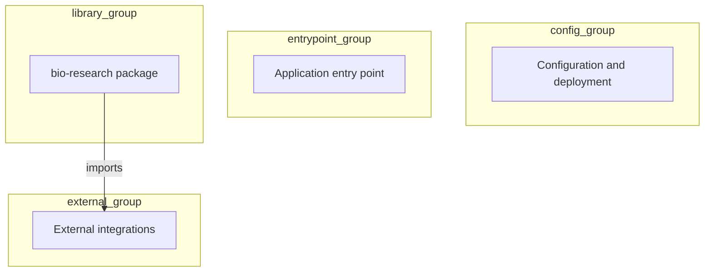

# Architecture report: anthropics/knowledge-work-plugins

> Automated static analysis. **Observed** = directly seen in files/imports/AST; **Inferred** = interpretation from that evidence. Repository code was not executed.

## 1. Repository at a glance

| Item | Value |
| --- | --- |
| Repository | anthropics/knowledge-work-plugins |
| Description | Open source repository of plugins primarily intended for knowledge workers to use in Claude Cowork |
| Language | Python |
| Stars | 35776 |
| Licence | Apache-2.0 |
| Analysed commit / branch | e91a134584eb798bac7fb0379358006a2b63b965 / main |
| Framework(s) | None detected |
| Files analysed | 800 |
| Components | 4 |

## 2. Architecture in one minute

anthropics/knowledge-work-plugins - Open source repository of plugins primarily intended for knowledge workers to use in Claude Cowork. This repository was analysed statically from 800 file(s) (26 Python). Detected technologies (observed from imports/manifests): GitHub Actions, NumPy, pandas, requests. Files are grouped into 4 component(s): bio-research package, Configuration and deployment, Application entry point, External integrations. Observed entry point(s): bio-research/skills/instrument-data-to-allotrope/scripts/convert_to_asm.py, bio-research/skills/instrument-data-to-allotrope/scripts/export_parser.py, bio-research/skills/instrument-data-to-allotrope/scripts/flatten_asm.py. Findings below distinguish observed facts from inferred interpretation.

## 3. High-level block diagram

## 4. Main components

### bio-research package (`bio_research`)

- **Kind:** library
- **Status:** Observed
- **Confidence:** 0.85
- **Responsibility:** Groups 8 file(s) under bio-research package (observed from repository paths and static analysis). Observed top-level classes: FileInfo, ValidationResult. Observed top-level functions: _format_gsm_range, _get_pattern_score, _get_sample_key, _parse_csv_line, _rate_limit_ncbi, _validate_atacseq_specific.
- **Paths:** `bio-research/skills/nextflow-development/scripts/utils/__init__.py`, `bio-research/skills/nextflow-development/scripts/utils/file_discovery.py`, `bio-research/skills/nextflow-development/scripts/utils/ncbi_utils.py`, `bio-research/skills/nextflow-development/scripts/utils/sample_inference.py`, `bio-research/skills/nextflow-development/scripts/utils/validators.py`, `bio-research/skills/single-cell-rna-qc/scripts/qc_analysis.py`, `bio-research/skills/single-cell-rna-qc/scripts/qc_core.py`, `bio-research/skills/single-cell-rna-qc/scripts/qc_plotting.py`
- **Evidence:** [bio-research/skills/nextflow-development/scripts/utils/__init__.py](https://github.com/anthropics/knowledge-work-plugins/blob/e91a134584eb798bac7fb0379358006a2b63b965/bio-research/skills/nextflow-development/scripts/utils/__init__.py); [bio-research/skills/nextflow-development/scripts/utils/file_discovery.py:15](https://github.com/anthropics/knowledge-work-plugins/blob/e91a134584eb798bac7fb0379358006a2b63b965/bio-research/skills/nextflow-development/scripts/utils/file_discovery.py#L15); [bio-research/skills/nextflow-development/scripts/utils/ncbi_utils.py:30](https://github.com/anthropics/knowledge-work-plugins/blob/e91a134584eb798bac7fb0379358006a2b63b965/bio-research/skills/nextflow-development/scripts/utils/ncbi_utils.py#L30); [bio-research/skills/nextflow-development/scripts/utils/sample_inference.py:78](https://github.com/anthropics/knowledge-work-plugins/blob/e91a134584eb798bac7fb0379358006a2b63b965/bio-research/skills/nextflow-development/scripts/utils/sample_inference.py#L78); [bio-research/skills/nextflow-development/scripts/utils/validators.py:16](https://github.com/anthropics/knowledge-work-plugins/blob/e91a134584eb798bac7fb0379358006a2b63b965/bio-research/skills/nextflow-development/scripts/utils/validators.py#L16); [bio-research/skills/single-cell-rna-qc/scripts/qc_analysis.py](https://github.com/anthropics/knowledge-work-plugins/blob/e91a134584eb798bac7fb0379358006a2b63b965/bio-research/skills/single-cell-rna-qc/scripts/qc_analysis.py); [bio-research/skills/single-cell-rna-qc/scripts/qc_core.py:16](https://github.com/anthropics/knowledge-work-plugins/blob/e91a134584eb798bac7fb0379358006a2b63b965/bio-research/skills/single-cell-rna-qc/scripts/qc_core.py#L16); [bio-research/skills/single-cell-rna-qc/scripts/qc_plotting.py:13](https://github.com/anthropics/knowledge-work-plugins/blob/e91a134584eb798bac7fb0379358006a2b63b965/bio-research/skills/single-cell-rna-qc/scripts/qc_plotting.py#L13)

### Configuration and deployment (`config`)

- **Kind:** config
- **Status:** Observed
- **Confidence:** 0.85
- **Responsibility:** Groups 40 file(s) under configuration and deployment (observed from repository paths and static analysis).
- **Paths:** `bio-research/.claude-plugin/plugin.json`, `bio-research/.mcp.json`, `bio-research/skills/instrument-data-to-allotrope/requirements.txt`, `bio-research/skills/nextflow-development/scripts/config/genomes.yaml`, `bio-research/skills/nextflow-development/scripts/config/pipelines/atacseq.yaml`, `bio-research/skills/nextflow-development/scripts/config/pipelines/rnaseq.yaml`, `bio-research/skills/nextflow-development/scripts/config/pipelines/sarek.yaml`, `cowork-plugin-management/.claude-plugin/plugin.json`, `cowork-plugin-management/skills/cowork-plugin-customizer/examples/customized-mcp.json`, `customer-support/.claude-plugin/plugin.json`, `customer-support/.mcp.json`, `data/.claude-plugin/plugin.json`, `data/.mcp.json`, `design/.claude-plugin/plugin.json`, `design/.mcp.json`, `engineering/.claude-plugin/plugin.json`, `engineering/.mcp.json`, `enterprise-search/.claude-plugin/plugin.json`, `enterprise-search/.mcp.json`, `finance/.claude-plugin/plugin.json`, `finance/.mcp.json`, `human-resources/.claude-plugin/plugin.json`, `human-resources/.mcp.json`, `legal/.claude-plugin/plugin.json`, `legal/.mcp.json`, `marketing/.claude-plugin/plugin.json`, `marketing/.mcp.json`, `operations/.claude-plugin/plugin.json`, `operations/.mcp.json`, `partner-built/apollo/.claude-plugin/plugin.json`, `partner-built/apollo/.mcp.json`, `partner-built/brand-voice/.claude-plugin/marketplace.json`, `partner-built/brand-voice/.claude-plugin/plugin.json`, `partner-built/brand-voice/.mcp.json`, `partner-built/common-room/.claude-plugin/plugin.json`, `partner-built/common-room/.mcp.json`, `partner-built/slack/.claude-plugin/plugin.json`, `partner-built/slack/.mcp.json`, `partner-built/zoom-plugin/.claude-plugin/plugin.json`, `partner-built/zoom-plugin/.mcp.json`
- **Evidence:** [bio-research/.claude-plugin/plugin.json](https://github.com/anthropics/knowledge-work-plugins/blob/e91a134584eb798bac7fb0379358006a2b63b965/bio-research/.claude-plugin/plugin.json); [bio-research/.mcp.json](https://github.com/anthropics/knowledge-work-plugins/blob/e91a134584eb798bac7fb0379358006a2b63b965/bio-research/.mcp.json); [bio-research/skills/instrument-data-to-allotrope/requirements.txt](https://github.com/anthropics/knowledge-work-plugins/blob/e91a134584eb798bac7fb0379358006a2b63b965/bio-research/skills/instrument-data-to-allotrope/requirements.txt); [bio-research/skills/nextflow-development/scripts/config/genomes.yaml](https://github.com/anthropics/knowledge-work-plugins/blob/e91a134584eb798bac7fb0379358006a2b63b965/bio-research/skills/nextflow-development/scripts/config/genomes.yaml); [bio-research/skills/nextflow-development/scripts/config/pipelines/atacseq.yaml](https://github.com/anthropics/knowledge-work-plugins/blob/e91a134584eb798bac7fb0379358006a2b63b965/bio-research/skills/nextflow-development/scripts/config/pipelines/atacseq.yaml); [bio-research/skills/nextflow-development/scripts/config/pipelines/rnaseq.yaml](https://github.com/anthropics/knowledge-work-plugins/blob/e91a134584eb798bac7fb0379358006a2b63b965/bio-research/skills/nextflow-development/scripts/config/pipelines/rnaseq.yaml); [bio-research/skills/nextflow-development/scripts/config/pipelines/sarek.yaml](https://github.com/anthropics/knowledge-work-plugins/blob/e91a134584eb798bac7fb0379358006a2b63b965/bio-research/skills/nextflow-development/scripts/config/pipelines/sarek.yaml); [cowork-plugin-management/.claude-plugin/plugin.json](https://github.com/anthropics/knowledge-work-plugins/blob/e91a134584eb798bac7fb0379358006a2b63b965/cowork-plugin-management/.claude-plugin/plugin.json)

### Application entry point (`entrypoint`)

- **Kind:** entrypoint
- **Status:** Observed
- **Confidence:** 0.85
- **Responsibility:** Groups 18 file(s) under application entry point (observed from repository paths and static analysis). Observed top-level classes: CheckResult, EnvironmentReport, StudyInfo, ValidationResult. Observed top-level functions: _print_preview, _process_alignment_files, _process_atacseq_samples, _process_fastq_files, _process_sarek_samples, _write_samplesheet.
- **Paths:** `bio-research/skills/instrument-data-to-allotrope/scripts/convert_to_asm.py`, `bio-research/skills/instrument-data-to-allotrope/scripts/export_parser.py`, `bio-research/skills/instrument-data-to-allotrope/scripts/flatten_asm.py`, `bio-research/skills/instrument-data-to-allotrope/scripts/validate_asm.py`, `bio-research/skills/nextflow-development/scripts/check_environment.py`, `bio-research/skills/nextflow-development/scripts/detect_data_type.py`, `bio-research/skills/nextflow-development/scripts/generate_samplesheet.py`, `bio-research/skills/nextflow-development/scripts/manage_genomes.py`, `bio-research/skills/nextflow-development/scripts/sra_geo_fetch.py`, `bio-research/skills/scvi-tools/scripts/cluster_embed.py`, `bio-research/skills/scvi-tools/scripts/differential_expression.py`, `bio-research/skills/scvi-tools/scripts/integrate_datasets.py`, `bio-research/skills/scvi-tools/scripts/model_utils.py`, `bio-research/skills/scvi-tools/scripts/prepare_data.py`, `bio-research/skills/scvi-tools/scripts/train_model.py`, `bio-research/skills/scvi-tools/scripts/transfer_labels.py`, `bio-research/skills/scvi-tools/scripts/validate_adata.py`, `data/skills/data-context-extractor/scripts/package_data_skill.py`
- **Evidence:** [bio-research/skills/instrument-data-to-allotrope/scripts/convert_to_asm.py:23](https://github.com/anthropics/knowledge-work-plugins/blob/e91a134584eb798bac7fb0379358006a2b63b965/bio-research/skills/instrument-data-to-allotrope/scripts/convert_to_asm.py#L23); [bio-research/skills/instrument-data-to-allotrope/scripts/export_parser.py:394](https://github.com/anthropics/knowledge-work-plugins/blob/e91a134584eb798bac7fb0379358006a2b63b965/bio-research/skills/instrument-data-to-allotrope/scripts/export_parser.py#L394); [bio-research/skills/instrument-data-to-allotrope/scripts/flatten_asm.py:27](https://github.com/anthropics/knowledge-work-plugins/blob/e91a134584eb798bac7fb0379358006a2b63b965/bio-research/skills/instrument-data-to-allotrope/scripts/flatten_asm.py#L27); [bio-research/skills/instrument-data-to-allotrope/scripts/validate_asm.py:353](https://github.com/anthropics/knowledge-work-plugins/blob/e91a134584eb798bac7fb0379358006a2b63b965/bio-research/skills/instrument-data-to-allotrope/scripts/validate_asm.py#L353); [bio-research/skills/nextflow-development/scripts/check_environment.py:23](https://github.com/anthropics/knowledge-work-plugins/blob/e91a134584eb798bac7fb0379358006a2b63b965/bio-research/skills/nextflow-development/scripts/check_environment.py#L23); [bio-research/skills/nextflow-development/scripts/detect_data_type.py:23](https://github.com/anthropics/knowledge-work-plugins/blob/e91a134584eb798bac7fb0379358006a2b63b965/bio-research/skills/nextflow-development/scripts/detect_data_type.py#L23); [bio-research/skills/nextflow-development/scripts/generate_samplesheet.py:39](https://github.com/anthropics/knowledge-work-plugins/blob/e91a134584eb798bac7fb0379358006a2b63b965/bio-research/skills/nextflow-development/scripts/generate_samplesheet.py#L39); [bio-research/skills/nextflow-development/scripts/manage_genomes.py:198](https://github.com/anthropics/knowledge-work-plugins/blob/e91a134584eb798bac7fb0379358006a2b63b965/bio-research/skills/nextflow-development/scripts/manage_genomes.py#L198)

### External integrations (`external_integrations`)

- **Kind:** external
- **Status:** Inferred
- **Confidence:** 0.70
- **Responsibility:** Groups 0 file(s) under external integrations (observed from repository paths and static analysis).
- **Evidence:** [bio-research/skills/nextflow-development/scripts/utils/ncbi_utils.py:42](https://github.com/anthropics/knowledge-work-plugins/blob/e91a134584eb798bac7fb0379358006a2b63b965/bio-research/skills/nextflow-development/scripts/utils/ncbi_utils.py#L42)

## 5. Execution flow

**Observed** entry point(s):

- [bio-research/skills/instrument-data-to-allotrope/scripts/convert_to_asm.py:542](https://github.com/anthropics/knowledge-work-plugins/blob/e91a134584eb798bac7fb0379358006a2b63b965/bio-research/skills/instrument-data-to-allotrope/scripts/convert_to_asm.py#L542)
- [bio-research/skills/instrument-data-to-allotrope/scripts/export_parser.py:480](https://github.com/anthropics/knowledge-work-plugins/blob/e91a134584eb798bac7fb0379358006a2b63b965/bio-research/skills/instrument-data-to-allotrope/scripts/export_parser.py#L480)
- [bio-research/skills/instrument-data-to-allotrope/scripts/flatten_asm.py:253](https://github.com/anthropics/knowledge-work-plugins/blob/e91a134584eb798bac7fb0379358006a2b63b965/bio-research/skills/instrument-data-to-allotrope/scripts/flatten_asm.py#L253)
- [bio-research/skills/instrument-data-to-allotrope/scripts/validate_asm.py:1101](https://github.com/anthropics/knowledge-work-plugins/blob/e91a134584eb798bac7fb0379358006a2b63b965/bio-research/skills/instrument-data-to-allotrope/scripts/validate_asm.py#L1101)
- [bio-research/skills/nextflow-development/scripts/check_environment.py:451](https://github.com/anthropics/knowledge-work-plugins/blob/e91a134584eb798bac7fb0379358006a2b63b965/bio-research/skills/nextflow-development/scripts/check_environment.py#L451)
- [bio-research/skills/nextflow-development/scripts/detect_data_type.py:299](https://github.com/anthropics/knowledge-work-plugins/blob/e91a134584eb798bac7fb0379358006a2b63b965/bio-research/skills/nextflow-development/scripts/detect_data_type.py#L299)
- [bio-research/skills/nextflow-development/scripts/generate_samplesheet.py:454](https://github.com/anthropics/knowledge-work-plugins/blob/e91a134584eb798bac7fb0379358006a2b63b965/bio-research/skills/nextflow-development/scripts/generate_samplesheet.py#L454)
- [bio-research/skills/nextflow-development/scripts/manage_genomes.py:520](https://github.com/anthropics/knowledge-work-plugins/blob/e91a134584eb798bac7fb0379358006a2b63b965/bio-research/skills/nextflow-development/scripts/manage_genomes.py#L520)
- [bio-research/skills/nextflow-development/scripts/sra_geo_fetch.py:731](https://github.com/anthropics/knowledge-work-plugins/blob/e91a134584eb798bac7fb0379358006a2b63b965/bio-research/skills/nextflow-development/scripts/sra_geo_fetch.py#L731)
- [bio-research/skills/scvi-tools/scripts/cluster_embed.py:211](https://github.com/anthropics/knowledge-work-plugins/blob/e91a134584eb798bac7fb0379358006a2b63b965/bio-research/skills/scvi-tools/scripts/cluster_embed.py#L211)
- [bio-research/skills/scvi-tools/scripts/differential_expression.py:219](https://github.com/anthropics/knowledge-work-plugins/blob/e91a134584eb798bac7fb0379358006a2b63b965/bio-research/skills/scvi-tools/scripts/differential_expression.py#L219)
- [bio-research/skills/scvi-tools/scripts/integrate_datasets.py:236](https://github.com/anthropics/knowledge-work-plugins/blob/e91a134584eb798bac7fb0379358006a2b63b965/bio-research/skills/scvi-tools/scripts/integrate_datasets.py#L236)

Representative flow (derived from observed entry points and the import graph; steps beyond the entry point are **Inferred**):

1. Execution starts at an observed entry point listed above, if present.
2. `bio_research` imports `external_integrations` (bio-research package -> External integrations).

## 6. Project structure

### `(root)`

- `LICENSE` - docs (11607 bytes)
- `README.md` - docs (6109 bytes)

### `.claude-plugin`

- `.claude-plugin/marketplace.json` - config (68192 bytes)

### `.github`

- `.github/policy/prompt.md` - docs (7977 bytes)
- `.github/policy/schema.json` - config (1972 bytes)
- `.github/workflows/bump-plugin-shas.yml` - ci, YAML (6047 bytes)
- `.github/workflows/check-mcp-urls.yml` - ci, YAML (6492 bytes)
- `.github/workflows/close-external-prs.yml` - ci, YAML (2880 bytes)
- `.github/workflows/revert-failed-bumps.yml` - ci, YAML (14275 bytes)
- `.github/workflows/scan-plugins.yml` - ci, YAML (19195 bytes)

### `bio-research`

- `bio-research/.claude-plugin/plugin.json` - config (272 bytes)
- `bio-research/.mcp.json` - config (1060 bytes)
- `bio-research/CONNECTORS.md` - docs (1400 bytes)
- `bio-research/LICENSE` - docs (11358 bytes)
- `bio-research/README.md` - docs (4295 bytes)
- `bio-research/skills/instrument-data-to-allotrope/LICENSE.txt` - docs (10254 bytes)
- `bio-research/skills/instrument-data-to-allotrope/SKILL.md` - docs (10726 bytes)
- `bio-research/skills/instrument-data-to-allotrope/references/asm_schema_overview.md` - docs (6110 bytes)
- `bio-research/skills/instrument-data-to-allotrope/references/field_classification_guide.md` - docs (17665 bytes)
- `bio-research/skills/instrument-data-to-allotrope/references/flattening_guide.md` - docs (7500 bytes)
- `bio-research/skills/instrument-data-to-allotrope/references/supported_instruments.md` - docs (5304 bytes)
- `bio-research/skills/instrument-data-to-allotrope/requirements.txt` - manifest (811 bytes)
- `bio-research/skills/instrument-data-to-allotrope/scripts/convert_to_asm.py` - source, Python (17278 bytes)
- `bio-research/skills/instrument-data-to-allotrope/scripts/export_parser.py` - source, Python (13847 bytes)
- `bio-research/skills/instrument-data-to-allotrope/scripts/flatten_asm.py` - source, Python (7339 bytes)
- `bio-research/skills/instrument-data-to-allotrope/scripts/validate_asm.py` - source, Python (36719 bytes)
- `bio-research/skills/nextflow-development/LICENSE.txt` - docs (10254 bytes)
- `bio-research/skills/nextflow-development/SKILL.md` - docs (8828 bytes)
- `bio-research/skills/nextflow-development/references/geo-sra-acquisition.md` - docs (14122 bytes)
- `bio-research/skills/nextflow-development/references/installation.md` - docs (1816 bytes)
- `bio-research/skills/nextflow-development/references/pipelines/atacseq.md` - docs (4181 bytes)
- `bio-research/skills/nextflow-development/references/pipelines/rnaseq.md` - docs (3614 bytes)
- `bio-research/skills/nextflow-development/references/pipelines/sarek.md` - docs (4018 bytes)
- `bio-research/skills/nextflow-development/references/troubleshooting.md` - docs (3368 bytes)
- `bio-research/skills/nextflow-development/scripts/check_environment.py` - source, Python (14111 bytes)
- `bio-research/skills/nextflow-development/scripts/config/genomes.yaml` - config (3520 bytes)
- `bio-research/skills/nextflow-development/scripts/config/pipelines/atacseq.yaml` - config (5158 bytes)
- `bio-research/skills/nextflow-development/scripts/config/pipelines/rnaseq.yaml` - config (4173 bytes)
- `bio-research/skills/nextflow-development/scripts/config/pipelines/sarek.yaml` - config (6278 bytes)
- `bio-research/skills/nextflow-development/scripts/detect_data_type.py` - source, Python (9953 bytes)
- `bio-research/skills/nextflow-development/scripts/generate_samplesheet.py` - source, Python (15440 bytes)
- `bio-research/skills/nextflow-development/scripts/manage_genomes.py` - source, Python (16718 bytes)
- `bio-research/skills/nextflow-development/scripts/sra_geo_fetch.py` - source, Python (24982 bytes)
- `bio-research/skills/nextflow-development/scripts/utils/__init__.py` - source, Python (1788 bytes)
- `bio-research/skills/nextflow-development/scripts/utils/file_discovery.py` - source, Python (5169 bytes)
- `bio-research/skills/nextflow-development/scripts/utils/ncbi_utils.py` - source, Python (28480 bytes)
- `bio-research/skills/nextflow-development/scripts/utils/sample_inference.py` - source, Python (7848 bytes)
- `bio-research/skills/nextflow-development/scripts/utils/validators.py` - source, Python (8419 bytes)
- `bio-research/skills/scientific-problem-selection/LICENSE.txt` - docs (10254 bytes)
- `bio-research/skills/scientific-problem-selection/SKILL.md` - docs (11184 bytes)
- `bio-research/skills/scientific-problem-selection/references/01-intuition-pumps.md` - docs (12495 bytes)
- `bio-research/skills/scientific-problem-selection/references/02-risk-assessment.md` - docs (13177 bytes)
- `bio-research/skills/scientific-problem-selection/references/03-optimization-function.md` - docs (18167 bytes)
- `bio-research/skills/scientific-problem-selection/references/04-parameter-strategy.md` - docs (14423 bytes)
- `bio-research/skills/scientific-problem-selection/references/05-decision-tree.md` - docs (3295 bytes)
- `bio-research/skills/scientific-problem-selection/references/06-adversity-planning.md` - docs (4734 bytes)
- `bio-research/skills/scientific-problem-selection/references/07-problem-inversion.md` - docs (5671 bytes)
- `bio-research/skills/scientific-problem-selection/references/08-integration-synthesis.md` - docs (5416 bytes)
- `bio-research/skills/scientific-problem-selection/references/09-meta-framework.md` - docs (16539 bytes)
- `bio-research/skills/scvi-tools/LICENSE.txt` - docs (10254 bytes)
- `bio-research/skills/scvi-tools/SKILL.md` - docs (7423 bytes)
- `bio-research/skills/scvi-tools/references/atac_peakvi.md` - docs (9498 bytes)
- `bio-research/skills/scvi-tools/references/batch_correction_sysvi.md` - docs (10456 bytes)
- `bio-research/skills/scvi-tools/references/citeseq_totalvi.md` - docs (10341 bytes)
- `bio-research/skills/scvi-tools/references/data_preparation.md` - docs (6335 bytes)
- `bio-research/skills/scvi-tools/references/environment_setup.md` - docs (6473 bytes)
- `bio-research/skills/scvi-tools/references/label_transfer.md` - docs (10431 bytes)
- `bio-research/skills/scvi-tools/references/multiome_multivi.md` - docs (9145 bytes)
- `bio-research/skills/scvi-tools/references/rna_velocity_velovi.md` - docs (8824 bytes)
- `bio-research/skills/scvi-tools/references/scarches_mapping.md` - docs (11090 bytes)
- `bio-research/skills/scvi-tools/references/scrna_integration.md` - docs (9877 bytes)
- `bio-research/skills/scvi-tools/references/spatial_deconvolution.md` - docs (11428 bytes)
- `bio-research/skills/scvi-tools/references/troubleshooting.md` - docs (11010 bytes)
- `bio-research/skills/scvi-tools/scripts/cluster_embed.py` - source, Python (6416 bytes)
- `bio-research/skills/scvi-tools/scripts/differential_expression.py` - source, Python (6821 bytes)
- `bio-research/skills/scvi-tools/scripts/integrate_datasets.py` - source, Python (7027 bytes)
- `bio-research/skills/scvi-tools/scripts/model_utils.py` - source, Python (17434 bytes)
- `bio-research/skills/scvi-tools/scripts/prepare_data.py` - source, Python (5218 bytes)
- `bio-research/skills/scvi-tools/scripts/train_model.py` - source, Python (11604 bytes)
- `bio-research/skills/scvi-tools/scripts/transfer_labels.py` - source, Python (7354 bytes)
- `bio-research/skills/scvi-tools/scripts/validate_adata.py` - source, Python (12211 bytes)
- `bio-research/skills/single-cell-rna-qc/LICENSE.txt` - docs (10254 bytes)
- `bio-research/skills/single-cell-rna-qc/SKILL.md` - docs (7980 bytes)
- `bio-research/skills/single-cell-rna-qc/references/scverse_qc_guidelines.md` - docs (7587 bytes)
- `bio-research/skills/single-cell-rna-qc/scripts/qc_analysis.py` - source, Python (9533 bytes)
- `bio-research/skills/single-cell-rna-qc/scripts/qc_core.py` - source, Python (6675 bytes)
- `bio-research/skills/single-cell-rna-qc/scripts/qc_plotting.py` - source, Python (8501 bytes)
- `bio-research/skills/start/SKILL.md` - docs (3526 bytes)

### `cowork-plugin-management`

- `cowork-plugin-management/.claude-plugin/plugin.json` - config (314 bytes)
- `cowork-plugin-management/LICENSE` - docs (11358 bytes)
- `cowork-plugin-management/skills/cowork-plugin-customizer/LICENSE.txt` - docs (11357 bytes)
- `cowork-plugin-management/skills/cowork-plugin-customizer/SKILL.md` - docs (9702 bytes)
- `cowork-plugin-management/skills/cowork-plugin-customizer/examples/customized-mcp.json` - config (853 bytes)
- `cowork-plugin-management/skills/cowork-plugin-customizer/references/mcp-servers.md` - docs (3224 bytes)
- `cowork-plugin-management/skills/cowork-plugin-customizer/references/search-strategies.md` - docs (1629 bytes)
- `cowork-plugin-management/skills/create-cowork-plugin/SKILL.md` - docs (13354 bytes)
- `cowork-plugin-management/skills/create-cowork-plugin/references/component-schemas.md` - docs (11674 bytes)
- `cowork-plugin-management/skills/create-cowork-plugin/references/example-plugins.md` - docs (8272 bytes)

### `customer-support`

- `customer-support/.claude-plugin/plugin.json` - config (277 bytes)
- `customer-support/.mcp.json` - config (805 bytes)
- `customer-support/CONNECTORS.md` - docs (1121 bytes)
- `customer-support/LICENSE` - docs (11358 bytes)
- `customer-support/README.md` - docs (5592 bytes)
- `customer-support/skills/customer-escalation/SKILL.md` - docs (11205 bytes)
- `customer-support/skills/customer-research/SKILL.md` - docs (10232 bytes)
- `customer-support/skills/draft-response/SKILL.md` - docs (14581 bytes)
- `customer-support/skills/kb-article/SKILL.md` - docs (12274 bytes)
- `customer-support/skills/ticket-triage/SKILL.md` - docs (11276 bytes)

### `data`

- `data/.claude-plugin/plugin.json` - config (257 bytes)
- `data/.mcp.json` - config (721 bytes)
- `data/CONNECTORS.md` - docs (1061 bytes)
- `data/LICENSE` - docs (11358 bytes)
- `data/README.md` - docs (5067 bytes)
- `data/skills/analyze/SKILL.md` - docs (4432 bytes)
- `data/skills/build-dashboard/SKILL.md` - docs (26002 bytes)
- `data/skills/create-viz/SKILL.md` - docs (5151 bytes)
- `data/skills/data-context-extractor/SKILL.md` - docs (7233 bytes)
- `data/skills/data-context-extractor/references/domain-template.md` - docs (3490 bytes)
- `data/skills/data-context-extractor/references/example-output.md` - docs (6247 bytes)
- `data/skills/data-context-extractor/references/skill-template.md` - docs (3820 bytes)
- `data/skills/data-context-extractor/references/sql-dialects.md` - docs (4557 bytes)
- `data/skills/data-context-extractor/scripts/package_data_skill.py` - source, Python (3765 bytes)
- `data/skills/data-visualization/SKILL.md` - docs (11051 bytes)
- `data/skills/explore-data/SKILL.md` - docs (11520 bytes)
- `data/skills/sql-queries/SKILL.md` - docs (11126 bytes)
- `data/skills/statistical-analysis/SKILL.md` - docs (10434 bytes)
- `data/skills/validate-data/SKILL.md` - docs (14916 bytes)
- `data/skills/write-query/SKILL.md` - docs (4753 bytes)

### `design`

- `design/.claude-plugin/plugin.json` - config (288 bytes)
- `design/.mcp.json` - config (880 bytes)
- `design/CONNECTORS.md` - docs (1139 bytes)
- `design/README.md` - docs (4743 bytes)
- `design/skills/accessibility-review/SKILL.md` - docs (4278 bytes)
- `design/skills/design-critique/SKILL.md` - docs (3923 bytes)
- `design/skills/design-handoff/SKILL.md` - docs (3953 bytes)
- `design/skills/design-system/SKILL.md` - docs (5600 bytes)
- `design/skills/research-synthesis/SKILL.md` - docs (3014 bytes)
- `design/skills/user-research/SKILL.md` - docs (1751 bytes)
- `design/skills/ux-copy/SKILL.md` - docs (3436 bytes)

### `engineering`

- `engineering/.claude-plugin/plugin.json` - config (291 bytes)
- `engineering/.mcp.json` - config (1007 bytes)
- `engineering/CONNECTORS.md` - docs (1187 bytes)
- `engineering/README.md` - docs (5291 bytes)
- `engineering/skills/architecture/SKILL.md` - docs (2410 bytes)
- `engineering/skills/code-review/SKILL.md` - docs (4285 bytes)
- `engineering/skills/debug/SKILL.md` - docs (4074 bytes)
- `engineering/skills/deploy-checklist/SKILL.md` - docs (2389 bytes)
- `engineering/skills/documentation/SKILL.md` - docs (1507 bytes)
- `engineering/skills/incident-response/SKILL.md` - docs (5669 bytes)
- `engineering/skills/standup/SKILL.md` - docs (3315 bytes)
- `engineering/skills/system-design/SKILL.md` - docs (1310 bytes)
- `engineering/skills/tech-debt/SKILL.md` - docs (1458 bytes)
- `engineering/skills/testing-strategy/SKILL.md` - docs (1279 bytes)

### `enterprise-search`

- `enterprise-search/.claude-plugin/plugin.json` - config (262 bytes)
- `enterprise-search/.mcp.json` - config (707 bytes)
- `enterprise-search/CONNECTORS.md` - docs (1345 bytes)
- `enterprise-search/LICENSE` - docs (11358 bytes)
- `enterprise-search/README.md` - docs (5695 bytes)
- `enterprise-search/skills/digest/SKILL.md` - docs (5587 bytes)
- `enterprise-search/skills/knowledge-synthesis/SKILL.md` - docs (8526 bytes)
- `enterprise-search/skills/search-strategy/SKILL.md` - docs (7198 bytes)
- `enterprise-search/skills/search/SKILL.md` - docs (6581 bytes)
- `enterprise-search/skills/source-management/SKILL.md` - docs (5734 bytes)

### `finance`

- `finance/.claude-plugin/plugin.json` - config (309 bytes)
- `finance/.mcp.json` - config (573 bytes)
- `finance/CONNECTORS.md` - docs (1159 bytes)
- `finance/LICENSE` - docs (11358 bytes)
- `finance/README.md` - docs (5248 bytes)
- `finance/skills/audit-support/SKILL.md` - docs (16801 bytes)
- `finance/skills/close-management/SKILL.md` - docs (10278 bytes)
- `finance/skills/financial-statements/SKILL.md` - docs (14699 bytes)
- `finance/skills/journal-entry-prep/SKILL.md` - docs (7841 bytes)
- `finance/skills/journal-entry/SKILL.md` - docs (5144 bytes)
- `finance/skills/reconciliation/SKILL.md` - docs (8144 bytes)
- `finance/skills/sox-testing/SKILL.md` - docs (9306 bytes)
- `finance/skills/variance-analysis/SKILL.md` - docs (11232 bytes)

### `human-resources`

- `human-resources/.claude-plugin/plugin.json` - config (296 bytes)
- `human-resources/.mcp.json` - config (529 bytes)
- `human-resources/CONNECTORS.md` - docs (1072 bytes)
- `human-resources/README.md` - docs (5257 bytes)
- `human-resources/skills/comp-analysis/SKILL.md` - docs (3263 bytes)
- `human-resources/skills/draft-offer/SKILL.md` - docs (2359 bytes)
- `human-resources/skills/interview-prep/SKILL.md` - docs (1436 bytes)
- `human-resources/skills/onboarding/SKILL.md` - docs (3195 bytes)
- `human-resources/skills/org-planning/SKILL.md` - docs (1227 bytes)
- `human-resources/skills/people-report/SKILL.md` - docs (2782 bytes)
- `human-resources/skills/performance-review/SKILL.md` - docs (4910 bytes)
- `human-resources/skills/policy-lookup/SKILL.md` - docs (4199 bytes)
- `human-resources/skills/recruiting-pipeline/SKILL.md` - docs (1213 bytes)

### `legal`

- `legal/.claude-plugin/plugin.json` - config (281 bytes)
- `legal/.mcp.json` - config (704 bytes)
- `legal/CONNECTORS.md` - docs (1204 bytes)
- `legal/LICENSE` - docs (11358 bytes)
- `legal/README.md` - docs (9773 bytes)
- `legal/skills/brief/SKILL.md` - docs (7014 bytes)
- `legal/skills/compliance-check/SKILL.md` - docs (14694 bytes)
- `legal/skills/legal-response/SKILL.md` - docs (16174 bytes)
- `legal/skills/legal-risk-assessment/SKILL.md` - docs (12581 bytes)
- `legal/skills/meeting-briefing/SKILL.md` - docs (8990 bytes)
- `legal/skills/review-contract/SKILL.md` - docs (16708 bytes)
- `legal/skills/signature-request/SKILL.md` - docs (3421 bytes)
- `legal/skills/triage-nda/SKILL.md` - docs (14583 bytes)
- `legal/skills/vendor-check/SKILL.md` - docs (5595 bytes)

### `marketing`

- `marketing/.claude-plugin/plugin.json` - config (277 bytes)
- `marketing/.mcp.json` - config (1260 bytes)
- `marketing/CONNECTORS.md` - docs (1260 bytes)
- `marketing/LICENSE` - docs (11358 bytes)
- `marketing/README.md` - docs (4531 bytes)
- `marketing/skills/brand-review/SKILL.md` - docs (12936 bytes)
- `marketing/skills/campaign-plan/SKILL.md` - docs (14153 bytes)
- `marketing/skills/competitive-brief/SKILL.md` - docs (13150 bytes)
- `marketing/skills/content-creation/SKILL.md` - docs (8830 bytes)
- `marketing/skills/draft-content/SKILL.md` - docs (4612 bytes)
- `marketing/skills/email-sequence/SKILL.md` - docs (10627 bytes)
- `marketing/skills/performance-report/SKILL.md` - docs (19213 bytes)
- `marketing/skills/seo-audit/SKILL.md` - docs (9526 bytes)

### `operations`

- `operations/.claude-plugin/plugin.json` - config (294 bytes)
- `operations/.mcp.json` - config (617 bytes)
- `operations/CONNECTORS.md` - docs (1225 bytes)
- `operations/README.md` - docs (5377 bytes)
- `operations/skills/capacity-plan/SKILL.md` - docs (3487 bytes)
- `operations/skills/change-request/SKILL.md` - docs (3764 bytes)
- `operations/skills/compliance-tracking/SKILL.md` - docs (1592 bytes)
- `operations/skills/process-doc/SKILL.md` - docs (2503 bytes)
- `operations/skills/process-optimization/SKILL.md` - docs (1288 bytes)
- `operations/skills/risk-assessment/SKILL.md` - docs (1630 bytes)
- `operations/skills/runbook/SKILL.md` - docs (2519 bytes)
- `operations/skills/status-report/SKILL.md` - docs (2571 bytes)
- `operations/skills/vendor-review/SKILL.md` - docs (3170 bytes)

### `partner-built`

- `partner-built/apollo/.claude-plugin/plugin.json` - config (668 bytes)
- `partner-built/apollo/.mcp.json` - config (110 bytes)
- `partner-built/apollo/LICENSE` - docs (1066 bytes)
- `partner-built/apollo/README.md` - docs (3217 bytes)
- `partner-built/apollo/skills/enrich-lead/SKILL.md` - docs (2924 bytes)
- `partner-built/apollo/skills/prospect/SKILL.md` - docs (3606 bytes)
- `partner-built/apollo/skills/sequence-load/SKILL.md` - docs (4057 bytes)
- `partner-built/brand-voice/.claude-plugin/marketplace.json` - config (652 bytes)
- `partner-built/brand-voice/.claude-plugin/plugin.json` - config (624 bytes)
- `partner-built/brand-voice/.mcp.json` - config (540 bytes)
- `partner-built/brand-voice/LICENSE` - docs (1065 bytes)
- `partner-built/brand-voice/README.md` - docs (8712 bytes)
- `partner-built/brand-voice/agents/content-generation.md` - docs (3429 bytes)
- `partner-built/brand-voice/agents/conversation-analysis.md` - docs (4013 bytes)
- `partner-built/brand-voice/agents/discover-brand.md` - docs (8680 bytes)
- `partner-built/brand-voice/agents/document-analysis.md` - docs (3211 bytes)
- `partner-built/brand-voice/agents/quality-assurance.md` - docs (3555 bytes)
- `partner-built/brand-voice/commands/discover-brand.md` - docs (2648 bytes)
- `partner-built/brand-voice/commands/enforce-voice.md` - docs (2059 bytes)
- `partner-built/brand-voice/commands/generate-guidelines.md` - docs (2503 bytes)
- `partner-built/brand-voice/settings/brand-voice.local.md.example` - other (1193 bytes)
- `partner-built/brand-voice/skills/brand-voice-enforcement/SKILL.md` - docs (5452 bytes)
- `partner-built/brand-voice/skills/brand-voice-enforcement/references/before-after-examples.md` - docs (7498 bytes)
- `partner-built/brand-voice/skills/brand-voice-enforcement/references/voice-constant-tone-flexes.md` - docs (5835 bytes)
- `partner-built/brand-voice/skills/discover-brand/SKILL.md` - docs (6891 bytes)
- `partner-built/brand-voice/skills/discover-brand/references/search-strategies.md` - docs (9185 bytes)
- `partner-built/brand-voice/skills/discover-brand/references/source-ranking.md` - docs (9231 bytes)
- `partner-built/brand-voice/skills/guideline-generation/SKILL.md` - docs (7022 bytes)
- `partner-built/brand-voice/skills/guideline-generation/references/confidence-scoring.md` - docs (4980 bytes)
- `partner-built/brand-voice/skills/guideline-generation/references/guideline-template.md` - docs (7122 bytes)
- `partner-built/common-room/.claude-plugin/plugin.json` - config (680 bytes)
- `partner-built/common-room/.mcp.json` - config (120 bytes)
- `partner-built/common-room/CONNECTORS.md` - docs (1329 bytes)
- `partner-built/common-room/LICENSE` - docs (11358 bytes)
- `partner-built/common-room/README.md` - docs (4266 bytes)
- `partner-built/common-room/commands/generate-account-plan.md` - docs (3135 bytes)
- `partner-built/common-room/commands/weekly-brief.md` - docs (914 bytes)
- `partner-built/common-room/references/me-context.md` - docs (2103 bytes)
- `partner-built/common-room/references/my-company-context.md` - docs (1604 bytes)
- `partner-built/common-room/skills/account-research/SKILL.md` - docs (6113 bytes)
- `partner-built/common-room/skills/account-research/references/signals-guide.md` - docs (2576 bytes)
- `partner-built/common-room/skills/call-prep/SKILL.md` - docs (5917 bytes)
- `partner-built/common-room/skills/call-prep/references/call-types-guide.md` - docs (2224 bytes)
- `partner-built/common-room/skills/compose-outreach/SKILL.md` - docs (5501 bytes)
- `partner-built/common-room/skills/compose-outreach/references/outreach-formats-guide.md` - docs (2745 bytes)
- `partner-built/common-room/skills/contact-research/SKILL.md` - docs (5388 bytes)
- `partner-built/common-room/skills/contact-research/references/contact-signals-guide.md` - docs (2396 bytes)
- `partner-built/common-room/skills/prospect/SKILL.md` - docs (6187 bytes)
- `partner-built/common-room/skills/prospect/references/prospect-guide.md` - docs (1963 bytes)
- `partner-built/common-room/skills/weekly-prep-brief/SKILL.md` - docs (5406 bytes)
- `partner-built/common-room/skills/weekly-prep-brief/references/briefing-guide.md` - docs (1889 bytes)
- `partner-built/slack/.claude-plugin/plugin.json` - config (400 bytes)
- `partner-built/slack/.mcp.json` - config (216 bytes)
- `partner-built/slack/CLAUDE.md` - docs (865 bytes)
- `partner-built/slack/LICENSE` - docs (1091 bytes)
- `partner-built/slack/README.md` - docs (3900 bytes)
- `partner-built/slack/commands/channel-digest.md` - docs (1161 bytes)
- `partner-built/slack/commands/draft-announcement.md` - docs (1499 bytes)
- `partner-built/slack/commands/find-discussions.md` - docs (1015 bytes)
- `partner-built/slack/commands/standup.md` - docs (1225 bytes)
- `partner-built/slack/commands/summarize-channel.md` - docs (1071 bytes)
- `partner-built/slack/skills/slack-messaging/SKILL.md` - docs (3139 bytes)
- `partner-built/slack/skills/slack-search/SKILL.md` - docs (3998 bytes)
- `partner-built/zoom-plugin/.claude-plugin/plugin.json` - config (551 bytes)
- `partner-built/zoom-plugin/.mcp.json` - config (636 bytes)
- `partner-built/zoom-plugin/AGENTS.md` - docs (1772 bytes)
- `partner-built/zoom-plugin/CHANGELOG.md` - docs (587 bytes)
- `partner-built/zoom-plugin/CONNECTORS.md` - docs (2353 bytes)
- `partner-built/zoom-plugin/CONTRIBUTING.md` - docs (6297 bytes)
- `partner-built/zoom-plugin/LICENSE` - docs (1088 bytes)
- `partner-built/zoom-plugin/README.md` - docs (5425 bytes)
- `partner-built/zoom-plugin/skills/build-zoom-bot/SKILL.md` - docs (1250 bytes)
- `partner-built/zoom-plugin/skills/build-zoom-meeting-app/SKILL.md` - docs (1317 bytes)
- `partner-built/zoom-plugin/skills/choose-zoom-approach/SKILL.md` - docs (1861 bytes)
- `partner-built/zoom-plugin/skills/cobrowse-sdk/RUNBOOK.md` - docs (2769 bytes)
- `partner-built/zoom-plugin/skills/cobrowse-sdk/SKILL.md` - docs (33256 bytes)
- `partner-built/zoom-plugin/skills/cobrowse-sdk/concepts/distribution-methods.md` - docs (348 bytes)
- `partner-built/zoom-plugin/skills/cobrowse-sdk/concepts/jwt-authentication.md` - docs (362 bytes)
- `partner-built/zoom-plugin/skills/cobrowse-sdk/concepts/session-lifecycle.md` - docs (360 bytes)
- `partner-built/zoom-plugin/skills/cobrowse-sdk/concepts/two-roles-pattern.md` - docs (1389 bytes)
- `partner-built/zoom-plugin/skills/cobrowse-sdk/examples/agent-integration.md` - docs (217 bytes)
- `partner-built/zoom-plugin/skills/cobrowse-sdk/examples/annotations.md` - docs (224 bytes)
- `partner-built/zoom-plugin/skills/cobrowse-sdk/examples/auto-reconnection.md` - docs (213 bytes)
- `partner-built/zoom-plugin/skills/cobrowse-sdk/examples/byop-custom-pin.md` - docs (223 bytes)
- `partner-built/zoom-plugin/skills/cobrowse-sdk/examples/customer-integration.md` - docs (222 bytes)
- `partner-built/zoom-plugin/skills/cobrowse-sdk/examples/multi-tab-persistence.md` - docs (228 bytes)
- `partner-built/zoom-plugin/skills/cobrowse-sdk/examples/privacy-masking.md` - docs (218 bytes)
- `partner-built/zoom-plugin/skills/cobrowse-sdk/examples/remote-assist.md` - docs (231 bytes)
- `partner-built/zoom-plugin/skills/cobrowse-sdk/examples/session-events.md` - docs (220 bytes)
- `partner-built/zoom-plugin/skills/cobrowse-sdk/get-started.md` - docs (14944 bytes)
- `partner-built/zoom-plugin/skills/cobrowse-sdk/references/api-official.md` - docs (1676 bytes)
- `partner-built/zoom-plugin/skills/cobrowse-sdk/references/api-reference.md` - docs (117 bytes)
- `partner-built/zoom-plugin/skills/cobrowse-sdk/references/api.md` - docs (74 bytes)
- `partner-built/zoom-plugin/skills/cobrowse-sdk/references/authorization-official.md` - docs (2001 bytes)
- `partner-built/zoom-plugin/skills/cobrowse-sdk/references/authorization.md` - docs (104 bytes)
- `partner-built/zoom-plugin/skills/cobrowse-sdk/references/environment-variables.md` - docs (778 bytes)
- `partner-built/zoom-plugin/skills/cobrowse-sdk/references/error-codes.md` - docs (190 bytes)
- `partner-built/zoom-plugin/skills/cobrowse-sdk/references/features-official.md` - docs (1925 bytes)
- `partner-built/zoom-plugin/skills/cobrowse-sdk/references/features.md` - docs (89 bytes)
- `partner-built/zoom-plugin/skills/cobrowse-sdk/references/get-started-official.md` - docs (2003 bytes)
- `partner-built/zoom-plugin/skills/cobrowse-sdk/references/get-started.md` - docs (98 bytes)
- `partner-built/zoom-plugin/skills/cobrowse-sdk/references/session-events.md` - docs (150 bytes)
- `partner-built/zoom-plugin/skills/cobrowse-sdk/references/settings-reference.md` - docs (193 bytes)
- `partner-built/zoom-plugin/skills/cobrowse-sdk/troubleshooting/browser-compatibility.md` - docs (227 bytes)
- `partner-built/zoom-plugin/skills/cobrowse-sdk/troubleshooting/common-issues.md` - docs (2538 bytes)
- `partner-built/zoom-plugin/skills/cobrowse-sdk/troubleshooting/cors-csp.md` - docs (283 bytes)
- `partner-built/zoom-plugin/skills/cobrowse-sdk/troubleshooting/error-codes.md` - docs (216 bytes)
- `partner-built/zoom-plugin/skills/contact-center/RUNBOOK.md` - docs (3043 bytes)
- `partner-built/zoom-plugin/skills/contact-center/SKILL.md` - docs (5070 bytes)
- `partner-built/zoom-plugin/skills/contact-center/android/RUNBOOK.md` - docs (2324 bytes)
- `partner-built/zoom-plugin/skills/contact-center/android/SKILL.md` - docs (1693 bytes)
- `partner-built/zoom-plugin/skills/contact-center/android/concepts/sdk-lifecycle.md` - docs (1019 bytes)
- `partner-built/zoom-plugin/skills/contact-center/android/examples/service-patterns.md` - docs (1766 bytes)
- `partner-built/zoom-plugin/skills/contact-center/android/references/android-reference-map.md` - docs (1035 bytes)
- `partner-built/zoom-plugin/skills/contact-center/android/troubleshooting/common-issues.md` - docs (834 bytes)
- `partner-built/zoom-plugin/skills/contact-center/concepts/architecture-and-lifecycle.md` - docs (1962 bytes)
- `partner-built/zoom-plugin/skills/contact-center/ios/RUNBOOK.md` - docs (2300 bytes)
- `partner-built/zoom-plugin/skills/contact-center/ios/SKILL.md` - docs (1623 bytes)
- `partner-built/zoom-plugin/skills/contact-center/ios/concepts/sdk-lifecycle.md` - docs (1240 bytes)
- `partner-built/zoom-plugin/skills/contact-center/ios/examples/service-patterns.md` - docs (1680 bytes)
- `partner-built/zoom-plugin/skills/contact-center/ios/references/ios-reference-map.md` - docs (884 bytes)
- `partner-built/zoom-plugin/skills/contact-center/ios/troubleshooting/common-issues.md` - docs (980 bytes)
- `partner-built/zoom-plugin/skills/contact-center/references/environment-variables.md` - docs (1721 bytes)
- `partner-built/zoom-plugin/skills/contact-center/references/forum-top-questions.md` - docs (3300 bytes)
- `partner-built/zoom-plugin/skills/contact-center/references/samples-validation.md` - docs (1721 bytes)
- `partner-built/zoom-plugin/skills/contact-center/references/versioning-and-compatibility.md` - docs (1236 bytes)
- `partner-built/zoom-plugin/skills/contact-center/scenarios/high-level-scenarios.md` - docs (1770 bytes)
- `partner-built/zoom-plugin/skills/contact-center/troubleshooting/common-drift-and-breaks.md` - docs (1626 bytes)
- `partner-built/zoom-plugin/skills/contact-center/web/RUNBOOK.md` - docs (2251 bytes)
- `partner-built/zoom-plugin/skills/contact-center/web/SKILL.md` - docs (1770 bytes)
- `partner-built/zoom-plugin/skills/contact-center/web/concepts/lifecycle-and-events.md` - docs (1036 bytes)
- `partner-built/zoom-plugin/skills/contact-center/web/examples/app-context-and-state.md` - docs (1557 bytes)
- `partner-built/zoom-plugin/skills/contact-center/web/references/web-reference-map.md` - docs (1214 bytes)
- `partner-built/zoom-plugin/skills/contact-center/web/troubleshooting/common-issues.md` - docs (862 bytes)
- `partner-built/zoom-plugin/skills/debug-zoom-integration/SKILL.md` - docs (1124 bytes)
- `partner-built/zoom-plugin/skills/debug-zoom/SKILL.md` - docs (1341 bytes)
- `partner-built/zoom-plugin/skills/design-mcp-workflow/SKILL.md` - docs (1212 bytes)
- `partner-built/zoom-plugin/skills/general/RUNBOOK.md` - docs (2443 bytes)
- `partner-built/zoom-plugin/skills/general/SKILL.md` - docs (25858 bytes)
- `partner-built/zoom-plugin/skills/general/references/app-types.md` - docs (2673 bytes)
- `partner-built/zoom-plugin/skills/general/references/authentication.md` - docs (2083 bytes)
- `partner-built/zoom-plugin/skills/general/references/authorization-patterns.md` - docs (21776 bytes)
- `partner-built/zoom-plugin/skills/general/references/automatic-skill-chaining-rest-webhooks.md` - docs (5628 bytes)
- `partner-built/zoom-plugin/skills/general/references/community-repos.md` - docs (9472 bytes)
- `partner-built/zoom-plugin/skills/general/references/distributed-meeting-fallback-architecture.md` - docs (14338 bytes)
- `partner-built/zoom-plugin/skills/general/references/environment-variables.md` - docs (3032 bytes)
- `partner-built/zoom-plugin/skills/general/references/interview-answer-routing.md` - docs (797 bytes)
- `partner-built/zoom-plugin/skills/general/references/known-limitations.md` - docs (2564 bytes)
- `partner-built/zoom-plugin/skills/general/references/marketplace.md` - docs (1601 bytes)
- `partner-built/zoom-plugin/skills/general/references/meeting-webhooks-oauth-refresh-orchestration.md` - docs (5418 bytes)
- `partner-built/zoom-plugin/skills/general/references/query-routing-playbook.md` - docs (2799 bytes)
- `partner-built/zoom-plugin/skills/general/references/routing-implementation.md` - docs (8864 bytes)
- `partner-built/zoom-plugin/skills/general/references/scopes.md` - docs (3527 bytes)
- `partner-built/zoom-plugin/skills/general/references/sdk-logs-troubleshooting.md` - docs (5824 bytes)
- `partner-built/zoom-plugin/skills/general/references/sdk-upgrade-guide.md` - docs (4230 bytes)
- `partner-built/zoom-plugin/skills/general/references/sdk-upgrade-workflow.md` - docs (3605 bytes)
- `partner-built/zoom-plugin/skills/general/use-cases/ai-companion-integration.md` - docs (10272 bytes)
- `partner-built/zoom-plugin/skills/general/use-cases/ai-integration.md` - docs (7423 bytes)
- `partner-built/zoom-plugin/skills/general/use-cases/apis-vs-mcp-routing.md` - docs (3615 bytes)
- `partner-built/zoom-plugin/skills/general/use-cases/backend-automation-s2s-oauth.md` - docs (5093 bytes)
- `partner-built/zoom-plugin/skills/general/use-cases/collaborative-apps.md` - docs (2613 bytes)
- `partner-built/zoom-plugin/skills/general/use-cases/contact-center-app-lifecycle-and-context-switching.md` - docs (1253 bytes)
- `partner-built/zoom-plugin/skills/general/use-cases/contact-center-integration.md` - docs (1153 bytes)
- `partner-built/zoom-plugin/skills/general/use-cases/custom-meeting-ui-web.md` - docs (2901 bytes)
- `partner-built/zoom-plugin/skills/general/use-cases/custom-video.md` - docs (5736 bytes)
- `partner-built/zoom-plugin/skills/general/use-cases/customer-support-cobrowsing.md` - docs (12907 bytes)
- `partner-built/zoom-plugin/skills/general/use-cases/electron-meeting-embed.md` - docs (1020 bytes)
- `partner-built/zoom-plugin/skills/general/use-cases/embed-meetings.md` - docs (4973 bytes)
- `partner-built/zoom-plugin/skills/general/use-cases/enterprise-app-deployment.md` - docs (1038 bytes)
- `partner-built/zoom-plugin/skills/general/use-cases/flutter-video-sessions.md` - docs (910 bytes)
- `partner-built/zoom-plugin/skills/general/use-cases/form-completion-assistant.md` - docs (15748 bytes)
- `partner-built/zoom-plugin/skills/general/use-cases/hd-video-resolution.md` - docs (8980 bytes)
- `partner-built/zoom-plugin/skills/general/use-cases/high-volume-meeting-platform.md` - docs (1910 bytes)
- `partner-built/zoom-plugin/skills/general/use-cases/immersive-experiences.md` - docs (2977 bytes)
- `partner-built/zoom-plugin/skills/general/use-cases/in-meeting-apps.md` - docs (7636 bytes)
- `partner-built/zoom-plugin/skills/general/use-cases/marketplace-publishing.md` - docs (9446 bytes)
- `partner-built/zoom-plugin/skills/general/use-cases/meeting-automation.md` - docs (6424 bytes)
- `partner-built/zoom-plugin/skills/general/use-cases/meeting-bots.md` - docs (10903 bytes)
- `partner-built/zoom-plugin/skills/general/use-cases/meeting-details-with-events.md` - docs (21427 bytes)
- `partner-built/zoom-plugin/skills/general/use-cases/meeting-links-vs-embedding.md` - docs (989 bytes)
- `partner-built/zoom-plugin/skills/general/use-cases/minutes-calculation.md` - docs (23190 bytes)
- `partner-built/zoom-plugin/skills/general/use-cases/native-meeting-sdk-multi-platform.md` - docs (1581 bytes)
- `partner-built/zoom-plugin/skills/general/use-cases/native-video-sdk-multi-platform.md` - docs (1279 bytes)
- `partner-built/zoom-plugin/skills/general/use-cases/prebuilt-video-ui.md` - docs (12694 bytes)
- `partner-built/zoom-plugin/skills/general/use-cases/probe-sdk-preflight-readiness-gate.md` - docs (1199 bytes)
- `partner-built/zoom-plugin/skills/general/use-cases/qss-monitoring.md` - docs (2800 bytes)
- `partner-built/zoom-plugin/skills/general/use-cases/raw-recording.md` - docs (5255 bytes)
- `partner-built/zoom-plugin/skills/general/use-cases/react-native-meeting-embed.md` - docs (1060 bytes)
- `partner-built/zoom-plugin/skills/general/use-cases/react-native-video-sessions.md` - docs (953 bytes)
- `partner-built/zoom-plugin/skills/general/use-cases/real-time-media-streams.md` - docs (5588 bytes)
- `partner-built/zoom-plugin/skills/general/use-cases/recording-download-pipeline.md` - docs (8996 bytes)
- `partner-built/zoom-plugin/skills/general/use-cases/recording-transcription.md` - docs (7778 bytes)
- `partner-built/zoom-plugin/skills/general/use-cases/retrieve-meeting-and-subscribe-events.md` - docs (33936 bytes)
- `partner-built/zoom-plugin/skills/general/use-cases/rivet-event-driven-api-orchestrator.md` - docs (1362 bytes)
- `partner-built/zoom-plugin/skills/general/use-cases/saas-app-oauth-integration.md` - docs (4911 bytes)
- `partner-built/zoom-plugin/skills/general/use-cases/scribe-transcription-pipeline.md` - docs (1845 bytes)
- `partner-built/zoom-plugin/skills/general/use-cases/sdk-size-optimization.md` - docs (5151 bytes)
- `partner-built/zoom-plugin/skills/general/use-cases/sdk-wrappers-gui.md` - docs (19047 bytes)
- `partner-built/zoom-plugin/skills/general/use-cases/server-to-server-oauth-with-webhooks.md` - docs (1701 bytes)
- `partner-built/zoom-plugin/skills/general/use-cases/team-chat-llm-bot.md` - docs (7059 bytes)
- `partner-built/zoom-plugin/skills/general/use-cases/testing-development.md` - docs (7346 bytes)
- `partner-built/zoom-plugin/skills/general/use-cases/token-and-scope-troubleshooting.md` - docs (2488 bytes)
- `partner-built/zoom-plugin/skills/general/use-cases/transcription-bot-linux.md` - docs (14897 bytes)
- `partner-built/zoom-plugin/skills/general/use-cases/usage-reporting-analytics.md` - docs (8769 bytes)
- `partner-built/zoom-plugin/skills/general/use-cases/user-and-meeting-creation.md` - docs (17452 bytes)
- `partner-built/zoom-plugin/skills/general/use-cases/video-sdk-bring-your-own-storage.md` - docs (7084 bytes)
- `partner-built/zoom-plugin/skills/general/use-cases/virtual-agent-campaign-web-mobile-wrapper.md` - docs (1463 bytes)
- `partner-built/zoom-plugin/skills/general/use-cases/virtual-agent-knowledge-base-sync-pipeline.md` - docs (1120 bytes)
- `partner-built/zoom-plugin/skills/general/use-cases/web-sdk-embedding.md` - docs (4645 bytes)
- `partner-built/zoom-plugin/skills/general/use-cases/zoom-phone-smart-embed-crm.md` - docs (876 bytes)
- `partner-built/zoom-plugin/skills/meeting-sdk/RUNBOOK.md` - docs (2686 bytes)
- `partner-built/zoom-plugin/skills/meeting-sdk/SKILL.md` - docs (11215 bytes)
- `partner-built/zoom-plugin/skills/meeting-sdk/android/RUNBOOK.md` - docs (2372 bytes)
- `partner-built/zoom-plugin/skills/meeting-sdk/android/SKILL.md` - docs (1803 bytes)
- `partner-built/zoom-plugin/skills/meeting-sdk/android/android.md` - docs (856 bytes)
- `partner-built/zoom-plugin/skills/meeting-sdk/android/concepts/architecture.md` - docs (781 bytes)
- `partner-built/zoom-plugin/skills/meeting-sdk/android/concepts/lifecycle-workflow.md` - docs (724 bytes)
- `partner-built/zoom-plugin/skills/meeting-sdk/android/examples/join-start-pattern.md` - docs (709 bytes)
- `partner-built/zoom-plugin/skills/meeting-sdk/android/references/android-reference-map.md` - docs (834 bytes)
- `partner-built/zoom-plugin/skills/meeting-sdk/android/references/environment-variables.md` - docs (833 bytes)
- `partner-built/zoom-plugin/skills/meeting-sdk/android/references/versioning-and-compatibility.md` - docs (666 bytes)
- `partner-built/zoom-plugin/skills/meeting-sdk/android/scenarios/high-level-scenarios.md` - docs (663 bytes)
- `partner-built/zoom-plugin/skills/meeting-sdk/android/troubleshooting/common-issues.md` - docs (823 bytes)
- `partner-built/zoom-plugin/skills/meeting-sdk/electron/RUNBOOK.md` - docs (2311 bytes)
- `partner-built/zoom-plugin/skills/meeting-sdk/electron/SKILL.md` - docs (3000 bytes)
- `partner-built/zoom-plugin/skills/meeting-sdk/electron/concepts/high-level-scenarios.md` - docs (818 bytes)
- `partner-built/zoom-plugin/skills/meeting-sdk/electron/concepts/lifecycle-workflow.md` - docs (937 bytes)
- `partner-built/zoom-plugin/skills/meeting-sdk/electron/concepts/sdk-architecture-pattern.md` - docs (726 bytes)
- `partner-built/zoom-plugin/skills/meeting-sdk/electron/examples/authentication-pattern.md` - docs (485 bytes)
- `partner-built/zoom-plugin/skills/meeting-sdk/electron/examples/join-meeting-pattern.md` - docs (509 bytes)
- `partner-built/zoom-plugin/skills/meeting-sdk/electron/examples/raw-data-pattern.md` - docs (561 bytes)
- `partner-built/zoom-plugin/skills/meeting-sdk/electron/examples/setup-guide.md` - docs (771 bytes)
- `partner-built/zoom-plugin/skills/meeting-sdk/electron/references/electron-reference.md` - docs (541 bytes)
- `partner-built/zoom-plugin/skills/meeting-sdk/electron/references/module-map.md` - docs (765 bytes)
- `partner-built/zoom-plugin/skills/meeting-sdk/electron/troubleshooting/common-issues.md` - docs (823 bytes)
- `partner-built/zoom-plugin/skills/meeting-sdk/electron/troubleshooting/deprecated-and-contradictions.md` - docs (1184 bytes)
- `partner-built/zoom-plugin/skills/meeting-sdk/electron/troubleshooting/version-drift.md` - docs (467 bytes)
- `partner-built/zoom-plugin/skills/meeting-sdk/ios/RUNBOOK.md` - docs (2352 bytes)
- `partner-built/zoom-plugin/skills/meeting-sdk/ios/SKILL.md` - docs (1414 bytes)
- `partner-built/zoom-plugin/skills/meeting-sdk/ios/concepts/architecture.md` - docs (660 bytes)
- `partner-built/zoom-plugin/skills/meeting-sdk/ios/concepts/lifecycle-workflow.md` - docs (591 bytes)
- `partner-built/zoom-plugin/skills/meeting-sdk/ios/examples/join-start-pattern.md` - docs (610 bytes)
- `partner-built/zoom-plugin/skills/meeting-sdk/ios/ios.md` - docs (737 bytes)
- `partner-built/zoom-plugin/skills/meeting-sdk/ios/references/environment-variables.md` - docs (813 bytes)
- `partner-built/zoom-plugin/skills/meeting-sdk/ios/references/ios-reference-map.md` - docs (712 bytes)
- `partner-built/zoom-plugin/skills/meeting-sdk/ios/references/versioning-and-compatibility.md` - docs (597 bytes)
- `partner-built/zoom-plugin/skills/meeting-sdk/ios/scenarios/high-level-scenarios.md` - docs (655 bytes)
- `partner-built/zoom-plugin/skills/meeting-sdk/ios/troubleshooting/common-issues.md` - docs (661 bytes)
- `partner-built/zoom-plugin/skills/meeting-sdk/linux/RUNBOOK.md` - docs (2350 bytes)
- `partner-built/zoom-plugin/skills/meeting-sdk/linux/SKILL.md` - docs (15605 bytes)
- `partner-built/zoom-plugin/skills/meeting-sdk/linux/concepts/high-level-scenarios.md` - docs (15179 bytes)
- `partner-built/zoom-plugin/skills/meeting-sdk/linux/linux.md` - docs (11275 bytes)
- `partner-built/zoom-plugin/skills/meeting-sdk/linux/meeting-sdk-bot.md` - docs (30524 bytes)
- `partner-built/zoom-plugin/skills/meeting-sdk/linux/references/linux-reference.md` - docs (21151 bytes)
- `partner-built/zoom-plugin/skills/meeting-sdk/macos/RUNBOOK.md` - docs (2364 bytes)
- `partner-built/zoom-plugin/skills/meeting-sdk/macos/SKILL.md` - docs (1454 bytes)
- `partner-built/zoom-plugin/skills/meeting-sdk/macos/concepts/architecture.md` - docs (719 bytes)
- `partner-built/zoom-plugin/skills/meeting-sdk/macos/concepts/lifecycle-workflow.md` - docs (489 bytes)
- `partner-built/zoom-plugin/skills/meeting-sdk/macos/examples/join-start-pattern.md` - docs (584 bytes)
- `partner-built/zoom-plugin/skills/meeting-sdk/macos/macos.md` - docs (708 bytes)
- `partner-built/zoom-plugin/skills/meeting-sdk/macos/references/environment-variables.md` - docs (827 bytes)
- `partner-built/zoom-plugin/skills/meeting-sdk/macos/references/macos-reference-map.md` - docs (790 bytes)
- `partner-built/zoom-plugin/skills/meeting-sdk/macos/references/versioning-and-compatibility.md` - docs (710 bytes)
- `partner-built/zoom-plugin/skills/meeting-sdk/macos/scenarios/high-level-scenarios.md` - docs (624 bytes)
- `partner-built/zoom-plugin/skills/meeting-sdk/macos/troubleshooting/common-issues.md` - docs (726 bytes)
- `partner-built/zoom-plugin/skills/meeting-sdk/react-native/RUNBOOK.md` - docs (2402 bytes)
- `partner-built/zoom-plugin/skills/meeting-sdk/react-native/SKILL.md` - docs (3883 bytes)
- `partner-built/zoom-plugin/skills/meeting-sdk/react-native/concepts/architecture.md` - docs (581 bytes)
- `partner-built/zoom-plugin/skills/meeting-sdk/react-native/concepts/auth-and-token-model.md` - docs (514 bytes)
- `partner-built/zoom-plugin/skills/meeting-sdk/react-native/concepts/high-level-scenarios.md` - docs (932 bytes)
- `partner-built/zoom-plugin/skills/meeting-sdk/react-native/concepts/lifecycle-workflow.md` - docs (615 bytes)
- `partner-built/zoom-plugin/skills/meeting-sdk/react-native/examples/join-meeting-pattern.md` - docs (415 bytes)
- `partner-built/zoom-plugin/skills/meeting-sdk/react-native/examples/provider-hook-pattern.md` - docs (332 bytes)
- `partner-built/zoom-plugin/skills/meeting-sdk/react-native/examples/setup-guide.md` - docs (1150 bytes)
- `partner-built/zoom-plugin/skills/meeting-sdk/react-native/examples/start-meeting-pattern.md` - docs (368 bytes)
- `partner-built/zoom-plugin/skills/meeting-sdk/react-native/references/android-setup.md` - docs (434 bytes)
- `partner-built/zoom-plugin/skills/meeting-sdk/react-native/references/ios-setup.md` - docs (394 bytes)
- `partner-built/zoom-plugin/skills/meeting-sdk/react-native/references/native-bridge-notes.md` - docs (621 bytes)
- `partner-built/zoom-plugin/skills/meeting-sdk/react-native/references/official-sources.md` - docs (703 bytes)
- `partner-built/zoom-plugin/skills/meeting-sdk/react-native/references/wrapper-api.md` - docs (802 bytes)
- `partner-built/zoom-plugin/skills/meeting-sdk/react-native/troubleshooting/common-issues.md` - docs (691 bytes)
- `partner-built/zoom-plugin/skills/meeting-sdk/react-native/troubleshooting/deprecated-and-contradictions.md` - docs (1439 bytes)
- `partner-built/zoom-plugin/skills/meeting-sdk/react-native/troubleshooting/version-drift.md` - docs (758 bytes)
- `partner-built/zoom-plugin/skills/meeting-sdk/references/ai-companion.md` - docs (6582 bytes)
- `partner-built/zoom-plugin/skills/meeting-sdk/references/android.md` - docs (754 bytes)
- `partner-built/zoom-plugin/skills/meeting-sdk/references/authorization.md` - docs (2381 bytes)
- `partner-built/zoom-plugin/skills/meeting-sdk/references/bot-authentication.md` - docs (10724 bytes)
- `partner-built/zoom-plugin/skills/meeting-sdk/references/breakout-rooms.md` - docs (12132 bytes)
- `partner-built/zoom-plugin/skills/meeting-sdk/references/environment-variables.md` - docs (1448 bytes)
- `partner-built/zoom-plugin/skills/meeting-sdk/references/forum-top-questions.md` - docs (3985 bytes)
- `partner-built/zoom-plugin/skills/meeting-sdk/references/ios.md` - docs (919 bytes)
- `partner-built/zoom-plugin/skills/meeting-sdk/references/macos.md` - docs (599 bytes)
- `partner-built/zoom-plugin/skills/meeting-sdk/references/multiple-meetings.md` - docs (965 bytes)
- `partner-built/zoom-plugin/skills/meeting-sdk/references/signature-playbook.md` - docs (1427 bytes)
- `partner-built/zoom-plugin/skills/meeting-sdk/references/triage-intake.md` - docs (1925 bytes)
- `partner-built/zoom-plugin/skills/meeting-sdk/references/troubleshooting.md` - docs (4217 bytes)
- `partner-built/zoom-plugin/skills/meeting-sdk/references/unreal.md` - docs (732 bytes)
- `partner-built/zoom-plugin/skills/meeting-sdk/references/webinars.md` - docs (8059 bytes)
- `partner-built/zoom-plugin/skills/meeting-sdk/unreal/RUNBOOK.md` - docs (2387 bytes)
- `partner-built/zoom-plugin/skills/meeting-sdk/unreal/SKILL.md` - docs (1459 bytes)
- `partner-built/zoom-plugin/skills/meeting-sdk/unreal/concepts/architecture.md` - docs (673 bytes)
- `partner-built/zoom-plugin/skills/meeting-sdk/unreal/concepts/lifecycle-workflow.md` - docs (468 bytes)
- `partner-built/zoom-plugin/skills/meeting-sdk/unreal/examples/join-start-pattern.md` - docs (525 bytes)
- `partner-built/zoom-plugin/skills/meeting-sdk/unreal/references/environment-variables.md` - docs (839 bytes)
- `partner-built/zoom-plugin/skills/meeting-sdk/unreal/references/unreal-reference-map.md` - docs (812 bytes)
- `partner-built/zoom-plugin/skills/meeting-sdk/unreal/references/versioning-and-compatibility.md` - docs (882 bytes)
- `partner-built/zoom-plugin/skills/meeting-sdk/unreal/scenarios/high-level-scenarios.md` - docs (652 bytes)
- `partner-built/zoom-plugin/skills/meeting-sdk/unreal/troubleshooting/common-issues.md` - docs (666 bytes)
- `partner-built/zoom-plugin/skills/meeting-sdk/unreal/unreal.md` - docs (702 bytes)
- `partner-built/zoom-plugin/skills/meeting-sdk/web/RUNBOOK.md` - docs (2507 bytes)
- `partner-built/zoom-plugin/skills/meeting-sdk/web/SKILL.md` - docs (34906 bytes)
- `partner-built/zoom-plugin/skills/meeting-sdk/web/client-view/RUNBOOK.md` - docs (2396 bytes)
- `partner-built/zoom-plugin/skills/meeting-sdk/web/client-view/SKILL.md` - docs (16778 bytes)
- `partner-built/zoom-plugin/skills/meeting-sdk/web/client-view/references/README.md` - docs (457 bytes)
- `partner-built/zoom-plugin/skills/meeting-sdk/web/component-view/RUNBOOK.md` - docs (2419 bytes)
- `partner-built/zoom-plugin/skills/meeting-sdk/web/component-view/SKILL.md` - docs (14428 bytes)
- `partner-built/zoom-plugin/skills/meeting-sdk/web/component-view/references/README.md` - docs (477 bytes)
- `partner-built/zoom-plugin/skills/meeting-sdk/web/concepts/browser-support.md` - docs (7792 bytes)
- `partner-built/zoom-plugin/skills/meeting-sdk/web/concepts/sharedarraybuffer.md` - docs (8436 bytes)
- `partner-built/zoom-plugin/skills/meeting-sdk/web/examples/client-view-basic.md` - docs (389 bytes)
- `partner-built/zoom-plugin/skills/meeting-sdk/web/examples/component-view-react.md` - docs (404 bytes)
- `partner-built/zoom-plugin/skills/meeting-sdk/web/references/component-view-breakout-rooms.md` - docs (1298 bytes)
- `partner-built/zoom-plugin/skills/meeting-sdk/web/references/component-view-ui-customization.md` - docs (2026 bytes)
- `partner-built/zoom-plugin/skills/meeting-sdk/web/references/sharedarraybuffer-gallery-view.md` - docs (1119 bytes)
- `partner-built/zoom-plugin/skills/meeting-sdk/web/references/web-performance-cpu.md` - docs (966 bytes)
- `partner-built/zoom-plugin/skills/meeting-sdk/web/references/web-timeout-browser-restriction.md` - docs (1118 bytes)
- `partner-built/zoom-plugin/skills/meeting-sdk/web/references/web-tracking-id.md` - docs (1130 bytes)
- `partner-built/zoom-plugin/skills/meeting-sdk/web/references/web.md` - docs (8070 bytes)
- `partner-built/zoom-plugin/skills/meeting-sdk/web/troubleshooting/common-issues.md` - docs (10173 bytes)
- `partner-built/zoom-plugin/skills/meeting-sdk/web/troubleshooting/error-codes.md` - docs (9799 bytes)
- `partner-built/zoom-plugin/skills/meeting-sdk/windows/RUNBOOK.md` - docs (2376 bytes)
- `partner-built/zoom-plugin/skills/meeting-sdk/windows/SKILL.md` - docs (45436 bytes)
- `partner-built/zoom-plugin/skills/meeting-sdk/windows/concepts/custom-ui-architecture.md` - docs (8966 bytes)
- `partner-built/zoom-plugin/skills/meeting-sdk/windows/concepts/custom-ui-vs-raw-data.md` - docs (6256 bytes)
- `partner-built/zoom-plugin/skills/meeting-sdk/windows/concepts/sdk-architecture-pattern.md` - docs (20605 bytes)
- `partner-built/zoom-plugin/skills/meeting-sdk/windows/concepts/singleton-hierarchy.md` - docs (20647 bytes)
- `partner-built/zoom-plugin/skills/meeting-sdk/windows/examples/ai-companion.md` - docs (16847 bytes)
- `partner-built/zoom-plugin/skills/meeting-sdk/windows/examples/authentication-pattern.md` - docs (21161 bytes)
- `partner-built/zoom-plugin/skills/meeting-sdk/windows/examples/breakout-rooms.md` - docs (17267 bytes)
- `partner-built/zoom-plugin/skills/meeting-sdk/windows/examples/captions-transcription.md` - docs (18617 bytes)
- `partner-built/zoom-plugin/skills/meeting-sdk/windows/examples/chat.md` - docs (13108 bytes)
- `partner-built/zoom-plugin/skills/meeting-sdk/windows/examples/custom-ui-video-rendering.md` - docs (8083 bytes)
- `partner-built/zoom-plugin/skills/meeting-sdk/windows/examples/local-recording.md` - docs (17967 bytes)
- `partner-built/zoom-plugin/skills/meeting-sdk/windows/examples/raw-video-capture.md` - docs (24139 bytes)
- `partner-built/zoom-plugin/skills/meeting-sdk/windows/examples/send-raw-data.md` - docs (13525 bytes)
- `partner-built/zoom-plugin/skills/meeting-sdk/windows/examples/service-quality.md` - docs (8300 bytes)
- `partner-built/zoom-plugin/skills/meeting-sdk/windows/examples/share-raw-data-capture.md` - docs (16395 bytes)
- `partner-built/zoom-plugin/skills/meeting-sdk/windows/examples/video-advanced.md` - docs (10511 bytes)
- `partner-built/zoom-plugin/skills/meeting-sdk/windows/references/deployment.md` - docs (7357 bytes)
- `partner-built/zoom-plugin/skills/meeting-sdk/windows/references/interface-methods.md` - docs (16047 bytes)
- `partner-built/zoom-plugin/skills/meeting-sdk/windows/references/windows-reference.md` - docs (23157 bytes)
- `partner-built/zoom-plugin/skills/meeting-sdk/windows/troubleshooting/build-errors.md` - docs (11110 bytes)
- `partner-built/zoom-plugin/skills/meeting-sdk/windows/troubleshooting/common-issues.md` - docs (22630 bytes)
- `partner-built/zoom-plugin/skills/meeting-sdk/windows/troubleshooting/windows-message-loop.md` - docs (9926 bytes)
- `partner-built/zoom-plugin/skills/oauth/RUNBOOK.md` - docs (3381 bytes)
- `partner-built/zoom-plugin/skills/oauth/SKILL.md` - docs (32976 bytes)
- `partner-built/zoom-plugin/skills/oauth/concepts/oauth-flows.md` - docs (22724 bytes)
- `partner-built/zoom-plugin/skills/oauth/concepts/pkce.md` - docs (14170 bytes)
- `partner-built/zoom-plugin/skills/oauth/concepts/scopes-architecture.md` - docs (6906 bytes)
- `partner-built/zoom-plugin/skills/oauth/concepts/state-parameter.md` - docs (8313 bytes)
- `partner-built/zoom-plugin/skills/oauth/concepts/token-lifecycle.md` - docs (15507 bytes)
- `partner-built/zoom-plugin/skills/oauth/examples/device-flow.md` - docs (371 bytes)
- `partner-built/zoom-plugin/skills/oauth/examples/pkce-implementation.md` - docs (379 bytes)
- `partner-built/zoom-plugin/skills/oauth/examples/s2s-oauth-basic.md` - docs (375 bytes)
- `partner-built/zoom-plugin/skills/oauth/examples/s2s-oauth-redis.md` - docs (6778 bytes)
- `partner-built/zoom-plugin/skills/oauth/examples/token-refresh.md` - docs (373 bytes)
- `partner-built/zoom-plugin/skills/oauth/examples/user-oauth-basic.md` - docs (376 bytes)
- `partner-built/zoom-plugin/skills/oauth/examples/user-oauth-mysql.md` - docs (376 bytes)
- `partner-built/zoom-plugin/skills/oauth/references/environment-variables.md` - docs (863 bytes)
- `partner-built/zoom-plugin/skills/oauth/references/oauth-errors.md` - docs (4915 bytes)
- `partner-built/zoom-plugin/skills/oauth/troubleshooting/common-errors.md` - docs (458 bytes)
- `partner-built/zoom-plugin/skills/oauth/troubleshooting/redirect-uri-issues.md` - docs (229 bytes)
- `partner-built/zoom-plugin/skills/oauth/troubleshooting/scope-issues.md` - docs (222 bytes)
- `partner-built/zoom-plugin/skills/oauth/troubleshooting/token-issues.md` - docs (222 bytes)
- `partner-built/zoom-plugin/skills/phone/RUNBOOK.md` - docs (1671 bytes)
- `partner-built/zoom-plugin/skills/phone/SKILL.md` - docs (4280 bytes)
- `partner-built/zoom-plugin/skills/phone/concepts/architecture-and-lifecycle.md` - docs (1448 bytes)
- `partner-built/zoom-plugin/skills/phone/examples/phone-api-service-pattern.md` - docs (1323 bytes)
- `partner-built/zoom-plugin/skills/phone/examples/smart-embed-postmessage-bridge.md` - docs (1247 bytes)
- `partner-built/zoom-plugin/skills/phone/references/call-handling-patterns.md` - docs (961 bytes)
- `partner-built/zoom-plugin/skills/phone/references/crm-sample-validation.md` - docs (1416 bytes)
- `partner-built/zoom-plugin/skills/phone/references/deprecations-and-migrations.md` - docs (1192 bytes)
- `partner-built/zoom-plugin/skills/phone/references/environment-variables.md` - docs (1363 bytes)
- `partner-built/zoom-plugin/skills/phone/references/forum-top-questions.md` - docs (3793 bytes)
- `partner-built/zoom-plugin/skills/phone/references/smart-embed-event-contract.md` - docs (1025 bytes)
- `partner-built/zoom-plugin/skills/phone/references/source-map.md` - docs (888 bytes)
- `partner-built/zoom-plugin/skills/phone/scenarios/high-level-scenarios.md` - docs (1205 bytes)
- `partner-built/zoom-plugin/skills/phone/troubleshooting/common-issues.md` - docs (1239 bytes)
- `partner-built/zoom-plugin/skills/plan-zoom-integration/SKILL.md` - docs (1457 bytes)
- `partner-built/zoom-plugin/skills/plan-zoom-product/SKILL.md` - docs (1581 bytes)
- `partner-built/zoom-plugin/skills/probe-sdk/RUNBOOK.md` - docs (2430 bytes)
- `partner-built/zoom-plugin/skills/probe-sdk/SKILL.md` - docs (3595 bytes)
- `partner-built/zoom-plugin/skills/probe-sdk/concepts/architecture-and-lifecycle.md` - docs (1909 bytes)
- `partner-built/zoom-plugin/skills/probe-sdk/examples/comprehensive-network-pattern.md` - docs (904 bytes)
- `partner-built/zoom-plugin/skills/probe-sdk/examples/diagnostic-page-pattern.md` - docs (1397 bytes)
- `partner-built/zoom-plugin/skills/probe-sdk/probe-sdk.md` - docs (698 bytes)
- `partner-built/zoom-plugin/skills/probe-sdk/references/environment-variables.md` - docs (1317 bytes)
- `partner-built/zoom-plugin/skills/probe-sdk/references/probe-reference-map.md` - docs (967 bytes)
- `partner-built/zoom-plugin/skills/probe-sdk/references/samples-validation.md` - docs (1005 bytes)
- `partner-built/zoom-plugin/skills/probe-sdk/references/source-map.md` - docs (502 bytes)
- `partner-built/zoom-plugin/skills/probe-sdk/references/versioning-and-compatibility.md` - docs (1107 bytes)
- `partner-built/zoom-plugin/skills/probe-sdk/scenarios/high-level-scenarios.md` - docs (1207 bytes)
- `partner-built/zoom-plugin/skills/probe-sdk/troubleshooting/common-issues.md` - docs (1925 bytes)
- `partner-built/zoom-plugin/skills/rest-api/RUNBOOK.md` - docs (3224 bytes)
- `partner-built/zoom-plugin/skills/rest-api/SKILL.md` - docs (26477 bytes)
- `partner-built/zoom-plugin/skills/rest-api/concepts/api-architecture.md` - docs (9081 bytes)
- `partner-built/zoom-plugin/skills/rest-api/concepts/authentication-flows.md` - docs (9317 bytes)
- `partner-built/zoom-plugin/skills/rest-api/concepts/meeting-urls-and-sdk-joining.md` - docs (1195 bytes)
- `partner-built/zoom-plugin/skills/rest-api/concepts/rate-limiting-strategy.md` - docs (9786 bytes)
- `partner-built/zoom-plugin/skills/rest-api/examples/graphql-queries.md` - docs (466 bytes)
- `partner-built/zoom-plugin/skills/rest-api/examples/meeting-lifecycle.md` - docs (14915 bytes)
- `partner-built/zoom-plugin/skills/rest-api/examples/recording-pipeline.md` - docs (662 bytes)
- `partner-built/zoom-plugin/skills/rest-api/examples/user-management.md` - docs (510 bytes)
- `partner-built/zoom-plugin/skills/rest-api/examples/webhook-server.md` - docs (14712 bytes)
- `partner-built/zoom-plugin/skills/rest-api/references/accounts.md` - docs (7657 bytes)
- `partner-built/zoom-plugin/skills/rest-api/references/ai-companion.md` - docs (1222 bytes)
- `partner-built/zoom-plugin/skills/rest-api/references/ai-services.md` - docs (1564 bytes)
- `partner-built/zoom-plugin/skills/rest-api/references/authentication.md` - docs (11320 bytes)
- `partner-built/zoom-plugin/skills/rest-api/references/auto-dialer.md` - docs (2706 bytes)
- `partner-built/zoom-plugin/skills/rest-api/references/calendar.md` - docs (5002 bytes)
- `partner-built/zoom-plugin/skills/rest-api/references/chatbot.md` - docs (1451 bytes)
- `partner-built/zoom-plugin/skills/rest-api/references/clips.md` - docs (2936 bytes)
- `partner-built/zoom-plugin/skills/rest-api/references/cobrowse-sdk-api.md` - docs (1438 bytes)
- `partner-built/zoom-plugin/skills/rest-api/references/commerce.md` - docs (5980 bytes)
- `partner-built/zoom-plugin/skills/rest-api/references/contact-center.md` - docs (33905 bytes)
- `partner-built/zoom-plugin/skills/rest-api/references/crc.md` - docs (3602 bytes)
- `partner-built/zoom-plugin/skills/rest-api/references/environment-variables.md` - docs (976 bytes)
- `partner-built/zoom-plugin/skills/rest-api/references/events.md` - docs (13337 bytes)
- `partner-built/zoom-plugin/skills/rest-api/references/graphql.md` - docs (9126 bytes)
- `partner-built/zoom-plugin/skills/rest-api/references/healthcare.md` - docs (1358 bytes)
- `partner-built/zoom-plugin/skills/rest-api/references/mail.md` - docs (7020 bytes)
- `partner-built/zoom-plugin/skills/rest-api/references/marketplace-apps.md` - docs (4090 bytes)
- `partner-built/zoom-plugin/skills/rest-api/references/meetings.md` - docs (21768 bytes)
- `partner-built/zoom-plugin/skills/rest-api/references/number-management.md` - docs (4872 bytes)
- `partner-built/zoom-plugin/skills/rest-api/references/openapi.md` - docs (4534 bytes)
- `partner-built/zoom-plugin/skills/rest-api/references/phone.md` - docs (47047 bytes)
- `partner-built/zoom-plugin/skills/rest-api/references/qss.md` - docs (1642 bytes)
- `partner-built/zoom-plugin/skills/rest-api/references/quality-management.md` - docs (1739 bytes)
- `partner-built/zoom-plugin/skills/rest-api/references/rate-limits.md` - docs (10160 bytes)
- `partner-built/zoom-plugin/skills/rest-api/references/recordings.md` - docs (1397 bytes)
- `partner-built/zoom-plugin/skills/rest-api/references/reports.md` - docs (1261 bytes)
- `partner-built/zoom-plugin/skills/rest-api/references/revenue-accelerator.md` - docs (9575 bytes)
- `partner-built/zoom-plugin/skills/rest-api/references/rooms.md` - docs (15712 bytes)
- `partner-built/zoom-plugin/skills/rest-api/references/scheduler.md` - docs (3920 bytes)
- `partner-built/zoom-plugin/skills/rest-api/references/scim2.md` - docs (1939 bytes)
- `partner-built/zoom-plugin/skills/rest-api/references/tasks.md` - docs (2682 bytes)
- `partner-built/zoom-plugin/skills/rest-api/references/team-chat.md` - docs (13864 bytes)
- `partner-built/zoom-plugin/skills/rest-api/references/users.md` - docs (7486 bytes)
- `partner-built/zoom-plugin/skills/rest-api/references/video-management.md` - docs (4104 bytes)
- `partner-built/zoom-plugin/skills/rest-api/references/video-sdk-api.md` - docs (5475 bytes)
- `partner-built/zoom-plugin/skills/rest-api/references/virtual-agent.md` - docs (2258 bytes)
- `partner-built/zoom-plugin/skills/rest-api/references/webinars.md` - docs (1191 bytes)
- `partner-built/zoom-plugin/skills/rest-api/references/whiteboard.md` - docs (5446 bytes)
- `partner-built/zoom-plugin/skills/rest-api/references/workforce-management.md` - docs (3195 bytes)
- `partner-built/zoom-plugin/skills/rest-api/references/zoom-docs.md` - docs (3316 bytes)
- `partner-built/zoom-plugin/skills/rest-api/troubleshooting/common-errors.md` - docs (11979 bytes)
- `partner-built/zoom-plugin/skills/rest-api/troubleshooting/common-issues.md` - docs (651 bytes)
- `partner-built/zoom-plugin/skills/rest-api/troubleshooting/forum-top-questions.md` - docs (1756 bytes)
- `partner-built/zoom-plugin/skills/rest-api/troubleshooting/token-scope-playbook.md` - docs (1503 bytes)
- `partner-built/zoom-plugin/skills/rivet-sdk/RUNBOOK.md` - docs (2739 bytes)
- `partner-built/zoom-plugin/skills/rivet-sdk/SKILL.md` - docs (4604 bytes)
- `partner-built/zoom-plugin/skills/rivet-sdk/concepts/architecture-and-lifecycle.md` - docs (3416 bytes)
- `partner-built/zoom-plugin/skills/rivet-sdk/examples/getting-started-pattern.md` - docs (1291 bytes)
- `partner-built/zoom-plugin/skills/rivet-sdk/examples/multi-client-pattern.md` - docs (1779 bytes)
- `partner-built/zoom-plugin/skills/rivet-sdk/references/environment-variables.md` - docs (2217 bytes)
- `partner-built/zoom-plugin/skills/rivet-sdk/references/rivet-reference-map.md` - docs (1136 bytes)
- `partner-built/zoom-plugin/skills/rivet-sdk/references/samples-validation.md` - docs (1712 bytes)
- `partner-built/zoom-plugin/skills/rivet-sdk/references/source-map.md` - docs (893 bytes)
- `partner-built/zoom-plugin/skills/rivet-sdk/references/versioning-and-compatibility.md` - docs (1178 bytes)
- `partner-built/zoom-plugin/skills/rivet-sdk/rivet-sdk.md` - docs (614 bytes)
- `partner-built/zoom-plugin/skills/rivet-sdk/scenarios/high-level-scenarios.md` - docs (2026 bytes)
- `partner-built/zoom-plugin/skills/rivet-sdk/troubleshooting/common-issues.md` - docs (1471 bytes)
- `partner-built/zoom-plugin/skills/rtms/RUNBOOK.md` - docs (2677 bytes)
- `partner-built/zoom-plugin/skills/rtms/SKILL.md` - docs (23952 bytes)
- `partner-built/zoom-plugin/skills/rtms/concepts/connection-architecture.md` - docs (9285 bytes)
- `partner-built/zoom-plugin/skills/rtms/concepts/lifecycle-flow.md` - docs (13789 bytes)
- `partner-built/zoom-plugin/skills/rtms/examples/ai-integration.md` - docs (11681 bytes)
- `partner-built/zoom-plugin/skills/rtms/examples/manual-websocket.md` - docs (17335 bytes)
- `partner-built/zoom-plugin/skills/rtms/examples/rtms-bot.md` - docs (26904 bytes)
- `partner-built/zoom-plugin/skills/rtms/examples/sdk-quickstart.md` - docs (9538 bytes)
- `partner-built/zoom-plugin/skills/rtms/references/connection.md` - docs (8226 bytes)
- `partner-built/zoom-plugin/skills/rtms/references/data-types.md` - docs (13981 bytes)
- `partner-built/zoom-plugin/skills/rtms/references/environment-variables.md` - docs (1303 bytes)
- `partner-built/zoom-plugin/skills/rtms/references/media-types.md` - docs (6103 bytes)
- `partner-built/zoom-plugin/skills/rtms/references/quickstart.md` - docs (6734 bytes)
- `partner-built/zoom-plugin/skills/rtms/references/webhooks.md` - docs (7624 bytes)
- `partner-built/zoom-plugin/skills/rtms/troubleshooting/common-issues.md` - docs (10655 bytes)
- `partner-built/zoom-plugin/skills/scribe/RUNBOOK.md` - docs (4312 bytes)
- `partner-built/zoom-plugin/skills/scribe/SKILL.md` - docs (5940 bytes)
- `partner-built/zoom-plugin/skills/scribe/concepts/auth-and-processing-modes.md` - docs (3235 bytes)
- `partner-built/zoom-plugin/skills/scribe/examples/batch-webhook-pipeline.md` - docs (1593 bytes)
- `partner-built/zoom-plugin/skills/scribe/examples/fast-mode-node.md` - docs (1844 bytes)
- `partner-built/zoom-plugin/skills/scribe/references/api-reference.md` - docs (2688 bytes)
- `partner-built/zoom-plugin/skills/scribe/references/environment-variables.md` - docs (1577 bytes)
- `partner-built/zoom-plugin/skills/scribe/references/samples-validation.md` - docs (2073 bytes)
- `partner-built/zoom-plugin/skills/scribe/references/versioning-and-drift.md` - docs (2084 bytes)
- `partner-built/zoom-plugin/skills/scribe/scenarios/high-level-scenarios.md` - docs (3130 bytes)
- `partner-built/zoom-plugin/skills/scribe/troubleshooting/common-drift-and-breaks.md` - docs (4743 bytes)
- `partner-built/zoom-plugin/skills/setup-zoom-mcp/SKILL.md` - docs (1263 bytes)
- `partner-built/zoom-plugin/skills/setup-zoom-oauth/SKILL.md` - docs (1275 bytes)
- `partner-built/zoom-plugin/skills/start/SKILL.md` - docs (1959 bytes)
- `partner-built/zoom-plugin/skills/team-chat/RUNBOOK.md` - docs (2777 bytes)
- `partner-built/zoom-plugin/skills/team-chat/SKILL.md` - docs (23778 bytes)
- `partner-built/zoom-plugin/skills/team-chat/concepts/api-selection.md` - docs (7466 bytes)
- `partner-built/zoom-plugin/skills/team-chat/concepts/authentication.md` - docs (1472 bytes)
- `partner-built/zoom-plugin/skills/team-chat/concepts/deployment.md` - docs (719 bytes)
- `partner-built/zoom-plugin/skills/team-chat/concepts/environment-setup.md` - docs (9031 bytes)
- `partner-built/zoom-plugin/skills/team-chat/concepts/message-structure.md` - docs (676 bytes)
- `partner-built/zoom-plugin/skills/team-chat/concepts/security.md` - docs (479 bytes)
- `partner-built/zoom-plugin/skills/team-chat/concepts/webhooks.md` - docs (12150 bytes)
- `partner-built/zoom-plugin/skills/team-chat/examples/button-actions.md` - docs (394 bytes)
- `partner-built/zoom-plugin/skills/team-chat/examples/channel-management.md` - docs (321 bytes)
- `partner-built/zoom-plugin/skills/team-chat/examples/chatbot-setup.md` - docs (12533 bytes)
- `partner-built/zoom-plugin/skills/team-chat/examples/database-integration.md` - docs (313 bytes)
- `partner-built/zoom-plugin/skills/team-chat/examples/dropdown-selects.md` - docs (305 bytes)
- `partner-built/zoom-plugin/skills/team-chat/examples/form-submissions.md` - docs (386 bytes)
- `partner-built/zoom-plugin/skills/team-chat/examples/llm-integration.md` - docs (532 bytes)
- `partner-built/zoom-plugin/skills/team-chat/examples/multi-step-workflows.md` - docs (301 bytes)
- `partner-built/zoom-plugin/skills/team-chat/examples/oauth-setup.md` - docs (1596 bytes)
- `partner-built/zoom-plugin/skills/team-chat/examples/scheduled-alerts.md` - docs (353 bytes)
- `partner-built/zoom-plugin/skills/team-chat/examples/send-message.md` - docs (418 bytes)
- `partner-built/zoom-plugin/skills/team-chat/examples/slash-commands.md` - docs (510 bytes)
- `partner-built/zoom-plugin/skills/team-chat/examples/token-management.md` - docs (443 bytes)
- `partner-built/zoom-plugin/skills/team-chat/get-started.md` - docs (1678 bytes)
- `partner-built/zoom-plugin/skills/team-chat/references/api-reference.md` - docs (539 bytes)
- `partner-built/zoom-plugin/skills/team-chat/references/environment-variables.md` - docs (1006 bytes)
- `partner-built/zoom-plugin/skills/team-chat/references/error-codes.md` - docs (449 bytes)
- `partner-built/zoom-plugin/skills/team-chat/references/jid-formats.md` - docs (248 bytes)
- `partner-built/zoom-plugin/skills/team-chat/references/message-cards.md` - docs (6744 bytes)
- `partner-built/zoom-plugin/skills/team-chat/references/rate-limits.md` - docs (206 bytes)
- `partner-built/zoom-plugin/skills/team-chat/references/sample-comparison.md` - docs (1143 bytes)
- `partner-built/zoom-plugin/skills/team-chat/references/samples.md` - docs (14725 bytes)
- `partner-built/zoom-plugin/skills/team-chat/references/scopes.md` - docs (341 bytes)
- `partner-built/zoom-plugin/skills/team-chat/references/webhook-events.md` - docs (565 bytes)
- `partner-built/zoom-plugin/skills/team-chat/troubleshooting/common-issues.md` - docs (9968 bytes)
- `partner-built/zoom-plugin/skills/team-chat/troubleshooting/deployment-issues.md` - docs (641 bytes)
- `partner-built/zoom-plugin/skills/team-chat/troubleshooting/message-issues.md` - docs (318 bytes)
- `partner-built/zoom-plugin/skills/team-chat/troubleshooting/oauth-issues.md` - docs (882 bytes)
- `partner-built/zoom-plugin/skills/team-chat/troubleshooting/webhook-issues.md` - docs (365 bytes)
- `partner-built/zoom-plugin/skills/ui-toolkit/RUNBOOK.md` - docs (1973 bytes)
- `partner-built/zoom-plugin/skills/ui-toolkit/SKILL.md` - docs (17750 bytes)
- `partner-built/zoom-plugin/skills/ui-toolkit/references/environment-variables.md` - docs (738 bytes)
- `partner-built/zoom-plugin/skills/ui-toolkit/troubleshooting/common-issues.md` - docs (1224 bytes)
- `partner-built/zoom-plugin/skills/video-sdk/RUNBOOK.md` - docs (2506 bytes)
- `partner-built/zoom-plugin/skills/video-sdk/SKILL.md` - docs (13941 bytes)
- `partner-built/zoom-plugin/skills/video-sdk/android/RUNBOOK.md` - docs (2342 bytes)
- `partner-built/zoom-plugin/skills/video-sdk/android/SKILL.md` - docs (1408 bytes)
- `partner-built/zoom-plugin/skills/video-sdk/android/android.md` - docs (1235 bytes)
- `partner-built/zoom-plugin/skills/video-sdk/android/concepts/architecture.md` - docs (590 bytes)
- `partner-built/zoom-plugin/skills/video-sdk/android/concepts/lifecycle-workflow.md` - docs (689 bytes)
- `partner-built/zoom-plugin/skills/video-sdk/android/examples/session-join-pattern.md` - docs (660 bytes)
- `partner-built/zoom-plugin/skills/video-sdk/android/references/android-reference-map.md` - docs (496 bytes)
- `partner-built/zoom-plugin/skills/video-sdk/android/references/environment-variables.md` - docs (728 bytes)
- `partner-built/zoom-plugin/skills/video-sdk/android/references/versioning-and-compatibility.md` - docs (680 bytes)
- `partner-built/zoom-plugin/skills/video-sdk/android/scenarios/high-level-scenarios.md` - docs (770 bytes)
- `partner-built/zoom-plugin/skills/video-sdk/android/troubleshooting/common-issues.md` - docs (630 bytes)
- `partner-built/zoom-plugin/skills/video-sdk/flutter/RUNBOOK.md` - docs (2304 bytes)
- `partner-built/zoom-plugin/skills/video-sdk/flutter/SKILL.md` - docs (3084 bytes)
- `partner-built/zoom-plugin/skills/video-sdk/flutter/concepts/high-level-scenarios.md` - docs (641 bytes)
- `partner-built/zoom-plugin/skills/video-sdk/flutter/concepts/lifecycle-workflow.md` - docs (599 bytes)
- `partner-built/zoom-plugin/skills/video-sdk/flutter/concepts/sdk-architecture-pattern.md` - docs (715 bytes)
- `partner-built/zoom-plugin/skills/video-sdk/flutter/examples/event-handling-pattern.md` - docs (1108 bytes)
- `partner-built/zoom-plugin/skills/video-sdk/flutter/examples/session-join-pattern.md` - docs (466 bytes)
- `partner-built/zoom-plugin/skills/video-sdk/flutter/examples/setup-guide.md` - docs (2277 bytes)
- `partner-built/zoom-plugin/skills/video-sdk/flutter/references/flutter-reference.md` - docs (415 bytes)
- `partner-built/zoom-plugin/skills/video-sdk/flutter/references/module-map.md` - docs (515 bytes)
- `partner-built/zoom-plugin/skills/video-sdk/flutter/references/official-sources.md` - docs (508 bytes)
- `partner-built/zoom-plugin/skills/video-sdk/flutter/troubleshooting/common-issues.md` - docs (1940 bytes)
- `partner-built/zoom-plugin/skills/video-sdk/flutter/troubleshooting/deprecated-and-contradictions.md` - docs (1058 bytes)
- `partner-built/zoom-plugin/skills/video-sdk/flutter/troubleshooting/version-drift.md` - docs (435 bytes)
- `partner-built/zoom-plugin/skills/video-sdk/ios/RUNBOOK.md` - docs (2322 bytes)

## 7. Key dependencies and integrations

| Name | Category | Status | Confidence | Evidence |
| --- | --- | --- | --- | --- |
| GitHub Actions | ci | Observed | 0.90 | [.github/workflows/bump-plugin-shas.yml](https://github.com/anthropics/knowledge-work-plugins/blob/e91a134584eb798bac7fb0379358006a2b63b965/.github/workflows/bump-plugin-shas.yml); [.github/workflows/check-mcp-urls.yml](https://github.com/anthropics/knowledge-work-plugins/blob/e91a134584eb798bac7fb0379358006a2b63b965/.github/workflows/check-mcp-urls.yml); [.github/workflows/close-external-prs.yml](https://github.com/anthropics/knowledge-work-plugins/blob/e91a134584eb798bac7fb0379358006a2b63b965/.github/workflows/close-external-prs.yml); [.github/workflows/revert-failed-bumps.yml](https://github.com/anthropics/knowledge-work-plugins/blob/e91a134584eb798bac7fb0379358006a2b63b965/.github/workflows/revert-failed-bumps.yml) |
| NumPy | library | Observed | 0.95 | [bio-research/skills/scvi-tools/scripts/differential_expression.py:103](https://github.com/anthropics/knowledge-work-plugins/blob/e91a134584eb798bac7fb0379358006a2b63b965/bio-research/skills/scvi-tools/scripts/differential_expression.py#L103); [bio-research/skills/scvi-tools/scripts/integrate_datasets.py:49](https://github.com/anthropics/knowledge-work-plugins/blob/e91a134584eb798bac7fb0379358006a2b63b965/bio-research/skills/scvi-tools/scripts/integrate_datasets.py#L49); [bio-research/skills/scvi-tools/scripts/model_utils.py:9](https://github.com/anthropics/knowledge-work-plugins/blob/e91a134584eb798bac7fb0379358006a2b63b965/bio-research/skills/scvi-tools/scripts/model_utils.py#L9); [bio-research/skills/scvi-tools/scripts/prepare_data.py:54](https://github.com/anthropics/knowledge-work-plugins/blob/e91a134584eb798bac7fb0379358006a2b63b965/bio-research/skills/scvi-tools/scripts/prepare_data.py#L54) |
| pandas | library | Observed | 0.95 | [bio-research/skills/instrument-data-to-allotrope/requirements.txt:16](https://github.com/anthropics/knowledge-work-plugins/blob/e91a134584eb798bac7fb0379358006a2b63b965/bio-research/skills/instrument-data-to-allotrope/requirements.txt#L16); [bio-research/skills/instrument-data-to-allotrope/scripts/convert_to_asm.py:35](https://github.com/anthropics/knowledge-work-plugins/blob/e91a134584eb798bac7fb0379358006a2b63b965/bio-research/skills/instrument-data-to-allotrope/scripts/convert_to_asm.py#L35); [bio-research/skills/instrument-data-to-allotrope/scripts/flatten_asm.py:20](https://github.com/anthropics/knowledge-work-plugins/blob/e91a134584eb798bac7fb0379358006a2b63b965/bio-research/skills/instrument-data-to-allotrope/scripts/flatten_asm.py#L20); [bio-research/skills/scvi-tools/scripts/differential_expression.py:48](https://github.com/anthropics/knowledge-work-plugins/blob/e91a134584eb798bac7fb0379358006a2b63b965/bio-research/skills/scvi-tools/scripts/differential_expression.py#L48) |
| requests | library | Observed | 0.90 | [bio-research/skills/nextflow-development/scripts/utils/ncbi_utils.py:42](https://github.com/anthropics/knowledge-work-plugins/blob/e91a134584eb798bac7fb0379358006a2b63b965/bio-research/skills/nextflow-development/scripts/utils/ncbi_utils.py#L42) |

## 8. Data and state

No database, cache, queue, or persistent-state usage was observed in the analysed files. State handling, if any, may be in-memory or in files that were not analysed.

## 9. Configuration and deployment clues

- `.claude-plugin/marketplace.json` (config)
- `.github/policy/schema.json` (config)
- `.github/workflows/bump-plugin-shas.yml` (ci)
- `.github/workflows/check-mcp-urls.yml` (ci)
- `.github/workflows/close-external-prs.yml` (ci)
- `.github/workflows/revert-failed-bumps.yml` (ci)
- `.github/workflows/scan-plugins.yml` (ci)
- `bio-research/.claude-plugin/plugin.json` (config)
- `bio-research/.mcp.json` (config)
- `bio-research/skills/instrument-data-to-allotrope/requirements.txt` (manifest)
- `bio-research/skills/nextflow-development/scripts/config/genomes.yaml` (config)
- `bio-research/skills/nextflow-development/scripts/config/pipelines/atacseq.yaml` (config)
- `bio-research/skills/nextflow-development/scripts/config/pipelines/rnaseq.yaml` (config)
- `bio-research/skills/nextflow-development/scripts/config/pipelines/sarek.yaml` (config)
- `cowork-plugin-management/.claude-plugin/plugin.json` (config)
- `cowork-plugin-management/skills/cowork-plugin-customizer/examples/customized-mcp.json` (config)
- `customer-support/.claude-plugin/plugin.json` (config)
- `customer-support/.mcp.json` (config)
- `data/.claude-plugin/plugin.json` (config)
- `data/.mcp.json` (config)
- `design/.claude-plugin/plugin.json` (config)
- `design/.mcp.json` (config)
- `engineering/.claude-plugin/plugin.json` (config)
- `engineering/.mcp.json` (config)
- `enterprise-search/.claude-plugin/plugin.json` (config)
- `enterprise-search/.mcp.json` (config)
- `finance/.claude-plugin/plugin.json` (config)
- `finance/.mcp.json` (config)
- `human-resources/.claude-plugin/plugin.json` (config)
- `human-resources/.mcp.json` (config)
- `legal/.claude-plugin/plugin.json` (config)
- `legal/.mcp.json` (config)
- `marketing/.claude-plugin/plugin.json` (config)
- `marketing/.mcp.json` (config)
- `operations/.claude-plugin/plugin.json` (config)
- `operations/.mcp.json` (config)
- `partner-built/apollo/.claude-plugin/plugin.json` (config)
- `partner-built/apollo/.mcp.json` (config)
- `partner-built/brand-voice/.claude-plugin/marketplace.json` (config)
- `partner-built/brand-voice/.claude-plugin/plugin.json` (config)
- `partner-built/brand-voice/.mcp.json` (config)
- `partner-built/common-room/.claude-plugin/plugin.json` (config)
- `partner-built/common-room/.mcp.json` (config)
- `partner-built/slack/.claude-plugin/plugin.json` (config)
- `partner-built/slack/.mcp.json` (config)
- `partner-built/zoom-plugin/.claude-plugin/plugin.json` (config)
- `partner-built/zoom-plugin/.mcp.json` (config)

## 10. Design observations

- An entry/API layer is separated from other code (Inferred from paths and decorators).
- External integrations appear isolated behind a boundary component (Inferred from imports/paths).

These observations are interpretations (**Inferred**) of the observed structure, not guarantees about runtime design.

## 11. Limitations and unknowns

- Static analysis only: repository code was not executed, installed, or imported at runtime.
- Components and relationships are inferred from file paths, imports, and AST structure; runtime behaviour, dynamic imports, and reflection may not be visible.
- Repository text was treated as untrusted data; no instructions found in repository files were followed, and likely secret values were redacted/excluded.

## 12. Source references

- [.github/workflows/bump-plugin-shas.yml](https://github.com/anthropics/knowledge-work-plugins/blob/e91a134584eb798bac7fb0379358006a2b63b965/.github/workflows/bump-plugin-shas.yml)
- [.github/workflows/check-mcp-urls.yml](https://github.com/anthropics/knowledge-work-plugins/blob/e91a134584eb798bac7fb0379358006a2b63b965/.github/workflows/check-mcp-urls.yml)
- [.github/workflows/close-external-prs.yml](https://github.com/anthropics/knowledge-work-plugins/blob/e91a134584eb798bac7fb0379358006a2b63b965/.github/workflows/close-external-prs.yml)
- [.github/workflows/revert-failed-bumps.yml](https://github.com/anthropics/knowledge-work-plugins/blob/e91a134584eb798bac7fb0379358006a2b63b965/.github/workflows/revert-failed-bumps.yml)
- [.github/workflows/scan-plugins.yml](https://github.com/anthropics/knowledge-work-plugins/blob/e91a134584eb798bac7fb0379358006a2b63b965/.github/workflows/scan-plugins.yml)
- [bio-research/.claude-plugin/plugin.json](https://github.com/anthropics/knowledge-work-plugins/blob/e91a134584eb798bac7fb0379358006a2b63b965/bio-research/.claude-plugin/plugin.json)
- [bio-research/.mcp.json](https://github.com/anthropics/knowledge-work-plugins/blob/e91a134584eb798bac7fb0379358006a2b63b965/bio-research/.mcp.json)
- [bio-research/skills/instrument-data-to-allotrope/requirements.txt](https://github.com/anthropics/knowledge-work-plugins/blob/e91a134584eb798bac7fb0379358006a2b63b965/bio-research/skills/instrument-data-to-allotrope/requirements.txt)
- [bio-research/skills/instrument-data-to-allotrope/requirements.txt:16](https://github.com/anthropics/knowledge-work-plugins/blob/e91a134584eb798bac7fb0379358006a2b63b965/bio-research/skills/instrument-data-to-allotrope/requirements.txt#L16)
- [bio-research/skills/instrument-data-to-allotrope/scripts/convert_to_asm.py:23](https://github.com/anthropics/knowledge-work-plugins/blob/e91a134584eb798bac7fb0379358006a2b63b965/bio-research/skills/instrument-data-to-allotrope/scripts/convert_to_asm.py#L23)
- [bio-research/skills/instrument-data-to-allotrope/scripts/convert_to_asm.py:35](https://github.com/anthropics/knowledge-work-plugins/blob/e91a134584eb798bac7fb0379358006a2b63b965/bio-research/skills/instrument-data-to-allotrope/scripts/convert_to_asm.py#L35)
- [bio-research/skills/instrument-data-to-allotrope/scripts/convert_to_asm.py:542](https://github.com/anthropics/knowledge-work-plugins/blob/e91a134584eb798bac7fb0379358006a2b63b965/bio-research/skills/instrument-data-to-allotrope/scripts/convert_to_asm.py#L542)
- [bio-research/skills/instrument-data-to-allotrope/scripts/export_parser.py:394](https://github.com/anthropics/knowledge-work-plugins/blob/e91a134584eb798bac7fb0379358006a2b63b965/bio-research/skills/instrument-data-to-allotrope/scripts/export_parser.py#L394)
- [bio-research/skills/instrument-data-to-allotrope/scripts/export_parser.py:480](https://github.com/anthropics/knowledge-work-plugins/blob/e91a134584eb798bac7fb0379358006a2b63b965/bio-research/skills/instrument-data-to-allotrope/scripts/export_parser.py#L480)
- [bio-research/skills/instrument-data-to-allotrope/scripts/flatten_asm.py:20](https://github.com/anthropics/knowledge-work-plugins/blob/e91a134584eb798bac7fb0379358006a2b63b965/bio-research/skills/instrument-data-to-allotrope/scripts/flatten_asm.py#L20)
- [bio-research/skills/instrument-data-to-allotrope/scripts/flatten_asm.py:27](https://github.com/anthropics/knowledge-work-plugins/blob/e91a134584eb798bac7fb0379358006a2b63b965/bio-research/skills/instrument-data-to-allotrope/scripts/flatten_asm.py#L27)
- [bio-research/skills/instrument-data-to-allotrope/scripts/flatten_asm.py:253](https://github.com/anthropics/knowledge-work-plugins/blob/e91a134584eb798bac7fb0379358006a2b63b965/bio-research/skills/instrument-data-to-allotrope/scripts/flatten_asm.py#L253)
- [bio-research/skills/instrument-data-to-allotrope/scripts/validate_asm.py:353](https://github.com/anthropics/knowledge-work-plugins/blob/e91a134584eb798bac7fb0379358006a2b63b965/bio-research/skills/instrument-data-to-allotrope/scripts/validate_asm.py#L353)
- [bio-research/skills/instrument-data-to-allotrope/scripts/validate_asm.py:1101](https://github.com/anthropics/knowledge-work-plugins/blob/e91a134584eb798bac7fb0379358006a2b63b965/bio-research/skills/instrument-data-to-allotrope/scripts/validate_asm.py#L1101)
- [bio-research/skills/nextflow-development/scripts/check_environment.py:23](https://github.com/anthropics/knowledge-work-plugins/blob/e91a134584eb798bac7fb0379358006a2b63b965/bio-research/skills/nextflow-development/scripts/check_environment.py#L23)
- [bio-research/skills/nextflow-development/scripts/check_environment.py:451](https://github.com/anthropics/knowledge-work-plugins/blob/e91a134584eb798bac7fb0379358006a2b63b965/bio-research/skills/nextflow-development/scripts/check_environment.py#L451)
- [bio-research/skills/nextflow-development/scripts/config/genomes.yaml](https://github.com/anthropics/knowledge-work-plugins/blob/e91a134584eb798bac7fb0379358006a2b63b965/bio-research/skills/nextflow-development/scripts/config/genomes.yaml)
- [bio-research/skills/nextflow-development/scripts/config/pipelines/atacseq.yaml](https://github.com/anthropics/knowledge-work-plugins/blob/e91a134584eb798bac7fb0379358006a2b63b965/bio-research/skills/nextflow-development/scripts/config/pipelines/atacseq.yaml)
- [bio-research/skills/nextflow-development/scripts/config/pipelines/rnaseq.yaml](https://github.com/anthropics/knowledge-work-plugins/blob/e91a134584eb798bac7fb0379358006a2b63b965/bio-research/skills/nextflow-development/scripts/config/pipelines/rnaseq.yaml)
- [bio-research/skills/nextflow-development/scripts/config/pipelines/sarek.yaml](https://github.com/anthropics/knowledge-work-plugins/blob/e91a134584eb798bac7fb0379358006a2b63b965/bio-research/skills/nextflow-development/scripts/config/pipelines/sarek.yaml)
- [bio-research/skills/nextflow-development/scripts/detect_data_type.py:23](https://github.com/anthropics/knowledge-work-plugins/blob/e91a134584eb798bac7fb0379358006a2b63b965/bio-research/skills/nextflow-development/scripts/detect_data_type.py#L23)
- [bio-research/skills/nextflow-development/scripts/detect_data_type.py:299](https://github.com/anthropics/knowledge-work-plugins/blob/e91a134584eb798bac7fb0379358006a2b63b965/bio-research/skills/nextflow-development/scripts/detect_data_type.py#L299)
- [bio-research/skills/nextflow-development/scripts/generate_samplesheet.py:39](https://github.com/anthropics/knowledge-work-plugins/blob/e91a134584eb798bac7fb0379358006a2b63b965/bio-research/skills/nextflow-development/scripts/generate_samplesheet.py#L39)
- [bio-research/skills/nextflow-development/scripts/generate_samplesheet.py:454](https://github.com/anthropics/knowledge-work-plugins/blob/e91a134584eb798bac7fb0379358006a2b63b965/bio-research/skills/nextflow-development/scripts/generate_samplesheet.py#L454)
- [bio-research/skills/nextflow-development/scripts/manage_genomes.py:198](https://github.com/anthropics/knowledge-work-plugins/blob/e91a134584eb798bac7fb0379358006a2b63b965/bio-research/skills/nextflow-development/scripts/manage_genomes.py#L198)
- [bio-research/skills/nextflow-development/scripts/manage_genomes.py:520](https://github.com/anthropics/knowledge-work-plugins/blob/e91a134584eb798bac7fb0379358006a2b63b965/bio-research/skills/nextflow-development/scripts/manage_genomes.py#L520)
- [bio-research/skills/nextflow-development/scripts/sra_geo_fetch.py:731](https://github.com/anthropics/knowledge-work-plugins/blob/e91a134584eb798bac7fb0379358006a2b63b965/bio-research/skills/nextflow-development/scripts/sra_geo_fetch.py#L731)
- [bio-research/skills/nextflow-development/scripts/utils/__init__.py](https://github.com/anthropics/knowledge-work-plugins/blob/e91a134584eb798bac7fb0379358006a2b63b965/bio-research/skills/nextflow-development/scripts/utils/__init__.py)
- [bio-research/skills/nextflow-development/scripts/utils/file_discovery.py:15](https://github.com/anthropics/knowledge-work-plugins/blob/e91a134584eb798bac7fb0379358006a2b63b965/bio-research/skills/nextflow-development/scripts/utils/file_discovery.py#L15)
- [bio-research/skills/nextflow-development/scripts/utils/ncbi_utils.py:30](https://github.com/anthropics/knowledge-work-plugins/blob/e91a134584eb798bac7fb0379358006a2b63b965/bio-research/skills/nextflow-development/scripts/utils/ncbi_utils.py#L30)
- [bio-research/skills/nextflow-development/scripts/utils/ncbi_utils.py:42](https://github.com/anthropics/knowledge-work-plugins/blob/e91a134584eb798bac7fb0379358006a2b63b965/bio-research/skills/nextflow-development/scripts/utils/ncbi_utils.py#L42)
- [bio-research/skills/nextflow-development/scripts/utils/sample_inference.py:78](https://github.com/anthropics/knowledge-work-plugins/blob/e91a134584eb798bac7fb0379358006a2b63b965/bio-research/skills/nextflow-development/scripts/utils/sample_inference.py#L78)
- [bio-research/skills/nextflow-development/scripts/utils/validators.py:16](https://github.com/anthropics/knowledge-work-plugins/blob/e91a134584eb798bac7fb0379358006a2b63b965/bio-research/skills/nextflow-development/scripts/utils/validators.py#L16)
- [bio-research/skills/scvi-tools/scripts/cluster_embed.py:211](https://github.com/anthropics/knowledge-work-plugins/blob/e91a134584eb798bac7fb0379358006a2b63b965/bio-research/skills/scvi-tools/scripts/cluster_embed.py#L211)
- [bio-research/skills/scvi-tools/scripts/differential_expression.py:48](https://github.com/anthropics/knowledge-work-plugins/blob/e91a134584eb798bac7fb0379358006a2b63b965/bio-research/skills/scvi-tools/scripts/differential_expression.py#L48)
- [bio-research/skills/scvi-tools/scripts/differential_expression.py:103](https://github.com/anthropics/knowledge-work-plugins/blob/e91a134584eb798bac7fb0379358006a2b63b965/bio-research/skills/scvi-tools/scripts/differential_expression.py#L103)
- [bio-research/skills/scvi-tools/scripts/differential_expression.py:219](https://github.com/anthropics/knowledge-work-plugins/blob/e91a134584eb798bac7fb0379358006a2b63b965/bio-research/skills/scvi-tools/scripts/differential_expression.py#L219)
- [bio-research/skills/scvi-tools/scripts/integrate_datasets.py:49](https://github.com/anthropics/knowledge-work-plugins/blob/e91a134584eb798bac7fb0379358006a2b63b965/bio-research/skills/scvi-tools/scripts/integrate_datasets.py#L49)
- [bio-research/skills/scvi-tools/scripts/integrate_datasets.py:236](https://github.com/anthropics/knowledge-work-plugins/blob/e91a134584eb798bac7fb0379358006a2b63b965/bio-research/skills/scvi-tools/scripts/integrate_datasets.py#L236)
- [bio-research/skills/scvi-tools/scripts/model_utils.py:9](https://github.com/anthropics/knowledge-work-plugins/blob/e91a134584eb798bac7fb0379358006a2b63b965/bio-research/skills/scvi-tools/scripts/model_utils.py#L9)
- [bio-research/skills/scvi-tools/scripts/prepare_data.py:54](https://github.com/anthropics/knowledge-work-plugins/blob/e91a134584eb798bac7fb0379358006a2b63b965/bio-research/skills/scvi-tools/scripts/prepare_data.py#L54)
- [bio-research/skills/scvi-tools/scripts/train_model.py:79](https://github.com/anthropics/knowledge-work-plugins/blob/e91a134584eb798bac7fb0379358006a2b63b965/bio-research/skills/scvi-tools/scripts/train_model.py#L79)
- [bio-research/skills/scvi-tools/scripts/train_model.py:110](https://github.com/anthropics/knowledge-work-plugins/blob/e91a134584eb798bac7fb0379358006a2b63b965/bio-research/skills/scvi-tools/scripts/train_model.py#L110)
- [bio-research/skills/scvi-tools/scripts/train_model.py:185](https://github.com/anthropics/knowledge-work-plugins/blob/e91a134584eb798bac7fb0379358006a2b63b965/bio-research/skills/scvi-tools/scripts/train_model.py#L185)
- [bio-research/skills/scvi-tools/scripts/transfer_labels.py:42](https://github.com/anthropics/knowledge-work-plugins/blob/e91a134584eb798bac7fb0379358006a2b63b965/bio-research/skills/scvi-tools/scripts/transfer_labels.py#L42)
- [bio-research/skills/single-cell-rna-qc/scripts/qc_analysis.py](https://github.com/anthropics/knowledge-work-plugins/blob/e91a134584eb798bac7fb0379358006a2b63b965/bio-research/skills/single-cell-rna-qc/scripts/qc_analysis.py)
- [bio-research/skills/single-cell-rna-qc/scripts/qc_core.py:16](https://github.com/anthropics/knowledge-work-plugins/blob/e91a134584eb798bac7fb0379358006a2b63b965/bio-research/skills/single-cell-rna-qc/scripts/qc_core.py#L16)
- [bio-research/skills/single-cell-rna-qc/scripts/qc_plotting.py:13](https://github.com/anthropics/knowledge-work-plugins/blob/e91a134584eb798bac7fb0379358006a2b63b965/bio-research/skills/single-cell-rna-qc/scripts/qc_plotting.py#L13)
- [cowork-plugin-management/.claude-plugin/plugin.json](https://github.com/anthropics/knowledge-work-plugins/blob/e91a134584eb798bac7fb0379358006a2b63b965/cowork-plugin-management/.claude-plugin/plugin.json)
