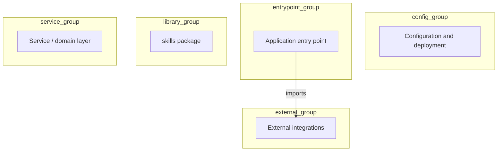

# Architecture report: anthropics/skills

> Automated static analysis. **Observed** = directly seen in files/imports/AST; **Inferred** = interpretation from that evidence. Repository code was not executed.

## 1. Repository at a glance

| Item | Value |
| --- | --- |
| Repository | anthropics/skills |
| Description | Public repository for Agent Skills |
| Language | Python |
| Stars | 194526 |
| Licence | Not detected |
| Analysed commit / branch | 1780c5e5a552fd4d1c9d6a7b0cab26b0c2bef064 / main |
| Framework(s) | None detected |
| Files analysed | 388 |
| Components | 5 |

## 2. Architecture in one minute

anthropics/skills - Public repository for Agent Skills. This repository was analysed statically from 388 file(s) (73 Python). Detected technologies (observed from imports/manifests): NumPy. Files are grouped into 5 component(s): Configuration and deployment, Application entry point, External integrations, Service / domain layer, skills package. Observed entry point(s): skills/claude-api/shared/preserved-thinking-migration/drop_block_probe.py, skills/claude-api/shared/preserved-thinking-migration/prefix_diff.py, skills/docx/scripts/accept_changes.py. Findings below distinguish observed facts from inferred interpretation.

## 3. High-level block diagram

## 4. Main components

### Configuration and deployment (`config`)

- **Kind:** config
- **Status:** Observed
- **Confidence:** 0.85
- **Responsibility:** Groups 2 file(s) under configuration and deployment (observed from repository paths and static analysis).
- **Paths:** `skills/mcp-builder/scripts/requirements.txt`, `skills/slack-gif-creator/requirements.txt`
- **Evidence:** [skills/mcp-builder/scripts/requirements.txt](https://github.com/anthropics/skills/blob/1780c5e5a552fd4d1c9d6a7b0cab26b0c2bef064/skills/mcp-builder/scripts/requirements.txt); [skills/slack-gif-creator/requirements.txt](https://github.com/anthropics/skills/blob/1780c5e5a552fd4d1c9d6a7b0cab26b0c2bef064/skills/slack-gif-creator/requirements.txt)

### Application entry point (`entrypoint`)

- **Kind:** entrypoint
- **Status:** Observed
- **Confidence:** 0.85
- **Responsibility:** Groups 45 file(s) under application entry point (observed from repository paths and static analysis). Observed top-level classes: BaseSchemaValidator, DOCXSchemaValidator, PPTXSchemaValidator, RectAndField, RedliningValidator, RefusedToClean. Observed top-level functions: _add_slide_title, _add_to_content_types, _add_to_presentation_rels, _append_xml, _array_cells, _as_argument.
- **Paths:** `skills/claude-api/shared/preserved-thinking-migration/drop_block_probe.py`, `skills/claude-api/shared/preserved-thinking-migration/prefix_diff.py`, `skills/docx/scripts/accept_changes.py`, `skills/docx/scripts/comment.py`, `skills/docx/scripts/merge_runs.py`, `skills/docx/scripts/office/soffice.py`, `skills/docx/scripts/office/validate.py`, `skills/docx/scripts/office/validators/base.py`, `skills/docx/scripts/office/validators/docx.py`, `skills/docx/scripts/office/validators/pptx.py`, `skills/docx/scripts/office/validators/redlining.py`, `skills/mcp-builder/scripts/evaluation.py`, `skills/pdf/scripts/check_bounding_boxes.py`, `skills/pdf/scripts/convert_pdf_to_images.py`, `skills/pdf/scripts/create_validation_image.py`, `skills/pdf/scripts/extract_form_field_info.py`, `skills/pdf/scripts/extract_form_structure.py`, `skills/pdf/scripts/fill_fillable_fields.py`, `skills/pdf/scripts/fill_pdf_form_with_annotations.py`, `skills/pptx/scripts/add_slide.py`, `skills/pptx/scripts/clean.py`, `skills/pptx/scripts/office/soffice.py`, `skills/pptx/scripts/office/validate.py`, `skills/pptx/scripts/office/validators/base.py`, `skills/pptx/scripts/office/validators/docx.py`, `skills/pptx/scripts/office/validators/pptx.py`, `skills/pptx/scripts/office/validators/redlining.py`, `skills/pptx/scripts/slide_text.py`, `skills/pptx/scripts/thumbnail.py`, `skills/skill-creator/eval-viewer/generate_review.py`, `skills/skill-creator/scripts/aggregate_benchmark.py`, `skills/skill-creator/scripts/generate_report.py`, `skills/skill-creator/scripts/improve_description.py`, `skills/skill-creator/scripts/package_skill.py`, `skills/skill-creator/scripts/quick_validate.py`, `skills/skill-creator/scripts/run_eval.py`, `skills/skill-creator/scripts/run_loop.py`, `skills/webapp-testing/scripts/with_server.py`, `skills/xlsx/scripts/office/soffice.py`, `skills/xlsx/scripts/office/validate.py`, `skills/xlsx/scripts/office/validators/base.py`, `skills/xlsx/scripts/office/validators/docx.py`, `skills/xlsx/scripts/office/validators/pptx.py`, `skills/xlsx/scripts/office/validators/redlining.py`, `skills/xlsx/scripts/recalc.py`
- **Evidence:** [skills/claude-api/shared/preserved-thinking-migration/drop_block_probe.py:146](https://github.com/anthropics/skills/blob/1780c5e5a552fd4d1c9d6a7b0cab26b0c2bef064/skills/claude-api/shared/preserved-thinking-migration/drop_block_probe.py#L146); [skills/claude-api/shared/preserved-thinking-migration/prefix_diff.py:86](https://github.com/anthropics/skills/blob/1780c5e5a552fd4d1c9d6a7b0cab26b0c2bef064/skills/claude-api/shared/preserved-thinking-migration/prefix_diff.py#L86); [skills/docx/scripts/accept_changes.py:36](https://github.com/anthropics/skills/blob/1780c5e5a552fd4d1c9d6a7b0cab26b0c2bef064/skills/docx/scripts/accept_changes.py#L36); [skills/docx/scripts/comment.py:90](https://github.com/anthropics/skills/blob/1780c5e5a552fd4d1c9d6a7b0cab26b0c2bef064/skills/docx/scripts/comment.py#L90); [skills/docx/scripts/merge_runs.py:40](https://github.com/anthropics/skills/blob/1780c5e5a552fd4d1c9d6a7b0cab26b0c2bef064/skills/docx/scripts/merge_runs.py#L40); [skills/docx/scripts/office/soffice.py:27](https://github.com/anthropics/skills/blob/1780c5e5a552fd4d1c9d6a7b0cab26b0c2bef064/skills/docx/scripts/office/soffice.py#L27); [skills/docx/scripts/office/validate.py:32](https://github.com/anthropics/skills/blob/1780c5e5a552fd4d1c9d6a7b0cab26b0c2bef064/skills/docx/scripts/office/validate.py#L32); [skills/docx/scripts/office/validators/base.py:18](https://github.com/anthropics/skills/blob/1780c5e5a552fd4d1c9d6a7b0cab26b0c2bef064/skills/docx/scripts/office/validators/base.py#L18)

### External integrations (`external_integrations`)

- **Kind:** external
- **Status:** Inferred
- **Confidence:** 0.70
- **Responsibility:** Groups 0 file(s) under external integrations (observed from repository paths and static analysis).
- **Evidence:** [skills/claude-api/shared/preserved-thinking-migration/drop_block_probe.py:100](https://github.com/anthropics/skills/blob/1780c5e5a552fd4d1c9d6a7b0cab26b0c2bef064/skills/claude-api/shared/preserved-thinking-migration/drop_block_probe.py#L100); [skills/docx/scripts/office/soffice.py:20](https://github.com/anthropics/skills/blob/1780c5e5a552fd4d1c9d6a7b0cab26b0c2bef064/skills/docx/scripts/office/soffice.py#L20); [skills/pptx/scripts/office/soffice.py:20](https://github.com/anthropics/skills/blob/1780c5e5a552fd4d1c9d6a7b0cab26b0c2bef064/skills/pptx/scripts/office/soffice.py#L20); [skills/webapp-testing/scripts/with_server.py:18](https://github.com/anthropics/skills/blob/1780c5e5a552fd4d1c9d6a7b0cab26b0c2bef064/skills/webapp-testing/scripts/with_server.py#L18); [skills/xlsx/scripts/office/soffice.py:20](https://github.com/anthropics/skills/blob/1780c5e5a552fd4d1c9d6a7b0cab26b0c2bef064/skills/xlsx/scripts/office/soffice.py#L20)

### Service / domain layer (`service_layer`)

- **Kind:** service
- **Status:** Observed
- **Confidence:** 0.85
- **Responsibility:** Groups 4 file(s) under service / domain layer (observed from repository paths and static analysis). Observed top-level classes: GIFBuilder. Observed top-level functions: apply_squash_stretch, calculate_arc_motion, create_blank_frame, create_gradient_background, draw_circle, draw_star.
- **Paths:** `skills/slack-gif-creator/core/easing.py`, `skills/slack-gif-creator/core/frame_composer.py`, `skills/slack-gif-creator/core/gif_builder.py`, `skills/slack-gif-creator/core/validators.py`
- **Evidence:** [skills/slack-gif-creator/core/easing.py:12](https://github.com/anthropics/skills/blob/1780c5e5a552fd4d1c9d6a7b0cab26b0c2bef064/skills/slack-gif-creator/core/easing.py#L12); [skills/slack-gif-creator/core/frame_composer.py:15](https://github.com/anthropics/skills/blob/1780c5e5a552fd4d1c9d6a7b0cab26b0c2bef064/skills/slack-gif-creator/core/frame_composer.py#L15); [skills/slack-gif-creator/core/gif_builder.py:17](https://github.com/anthropics/skills/blob/1780c5e5a552fd4d1c9d6a7b0cab26b0c2bef064/skills/slack-gif-creator/core/gif_builder.py#L17); [skills/slack-gif-creator/core/validators.py:11](https://github.com/anthropics/skills/blob/1780c5e5a552fd4d1c9d6a7b0cab26b0c2bef064/skills/slack-gif-creator/core/validators.py#L11)

### skills package (`skills`)

- **Kind:** library
- **Status:** Observed
- **Confidence:** 0.85
- **Responsibility:** Groups 30 file(s) under skills package (observed from repository paths and static analysis). Observed top-level classes: MCPConnection, MCPConnectionHTTP, MCPConnectionSSE, MCPConnectionStdio. Observed top-level functions: _canonical_ids, _check_chart_axis_references, _check_decimal_settings, _check_preset_dashes, _check_series_order, _check_stacked_label_positions.
- **Paths:** `skills/algorithmic-art/templates/generator_template.js`, `skills/claude-api/shared/evals/report/build-report-lite.mjs`, `skills/claude-api/shared/evals/report/runner-scaffold.mjs`, `skills/docx/scripts/__init__.py`, `skills/docx/scripts/office/helpers/__init__.py`, `skills/docx/scripts/office/helpers/pptx_chart.py`, `skills/docx/scripts/office/helpers/pptx_slide.py`, `skills/docx/scripts/office/helpers/pptx_theme.py`, `skills/docx/scripts/office/validators/__init__.py`, `skills/mcp-builder/scripts/connections.py`, `skills/pdf/scripts/check_fillable_fields.py`, `skills/pptx/scripts/__init__.py`, `skills/pptx/scripts/apply_theme.js`, `skills/pptx/scripts/office/helpers/__init__.py`, `skills/pptx/scripts/office/helpers/pptx_chart.py`, `skills/pptx/scripts/office/helpers/pptx_slide.py`, `skills/pptx/scripts/office/helpers/pptx_theme.py`, `skills/pptx/scripts/office/validators/__init__.py`, `skills/skill-creator/scripts/__init__.py`, `skills/skill-creator/scripts/utils.py`, `skills/web-artifacts-builder/scripts/bundle-artifact.sh`, `skills/web-artifacts-builder/scripts/init-artifact.sh`, `skills/webapp-testing/examples/console_logging.py`, `skills/webapp-testing/examples/element_discovery.py`, `skills/webapp-testing/examples/static_html_automation.py`, `skills/xlsx/scripts/office/helpers/__init__.py`, `skills/xlsx/scripts/office/helpers/pptx_chart.py`, `skills/xlsx/scripts/office/helpers/pptx_slide.py`, `skills/xlsx/scripts/office/helpers/pptx_theme.py`, `skills/xlsx/scripts/office/validators/__init__.py`
- **Evidence:** [skills/algorithmic-art/templates/generator_template.js](https://github.com/anthropics/skills/blob/1780c5e5a552fd4d1c9d6a7b0cab26b0c2bef064/skills/algorithmic-art/templates/generator_template.js); [skills/claude-api/shared/evals/report/build-report-lite.mjs](https://github.com/anthropics/skills/blob/1780c5e5a552fd4d1c9d6a7b0cab26b0c2bef064/skills/claude-api/shared/evals/report/build-report-lite.mjs); [skills/claude-api/shared/evals/report/runner-scaffold.mjs](https://github.com/anthropics/skills/blob/1780c5e5a552fd4d1c9d6a7b0cab26b0c2bef064/skills/claude-api/shared/evals/report/runner-scaffold.mjs); [skills/docx/scripts/__init__.py](https://github.com/anthropics/skills/blob/1780c5e5a552fd4d1c9d6a7b0cab26b0c2bef064/skills/docx/scripts/__init__.py); [skills/docx/scripts/office/helpers/__init__.py:24](https://github.com/anthropics/skills/blob/1780c5e5a552fd4d1c9d6a7b0cab26b0c2bef064/skills/docx/scripts/office/helpers/__init__.py#L24); [skills/docx/scripts/office/helpers/pptx_chart.py:26](https://github.com/anthropics/skills/blob/1780c5e5a552fd4d1c9d6a7b0cab26b0c2bef064/skills/docx/scripts/office/helpers/pptx_chart.py#L26); [skills/docx/scripts/office/helpers/pptx_slide.py:58](https://github.com/anthropics/skills/blob/1780c5e5a552fd4d1c9d6a7b0cab26b0c2bef064/skills/docx/scripts/office/helpers/pptx_slide.py#L58); [skills/docx/scripts/office/helpers/pptx_theme.py:29](https://github.com/anthropics/skills/blob/1780c5e5a552fd4d1c9d6a7b0cab26b0c2bef064/skills/docx/scripts/office/helpers/pptx_theme.py#L29)

## 5. Execution flow

**Observed** entry point(s):

- [skills/claude-api/shared/preserved-thinking-migration/drop_block_probe.py:1065](https://github.com/anthropics/skills/blob/1780c5e5a552fd4d1c9d6a7b0cab26b0c2bef064/skills/claude-api/shared/preserved-thinking-migration/drop_block_probe.py#L1065)
- [skills/claude-api/shared/preserved-thinking-migration/prefix_diff.py:1531](https://github.com/anthropics/skills/blob/1780c5e5a552fd4d1c9d6a7b0cab26b0c2bef064/skills/claude-api/shared/preserved-thinking-migration/prefix_diff.py#L1531)
- [skills/docx/scripts/accept_changes.py:121](https://github.com/anthropics/skills/blob/1780c5e5a552fd4d1c9d6a7b0cab26b0c2bef064/skills/docx/scripts/accept_changes.py#L121)
- [skills/docx/scripts/comment.py:367](https://github.com/anthropics/skills/blob/1780c5e5a552fd4d1c9d6a7b0cab26b0c2bef064/skills/docx/scripts/comment.py#L367)
- [skills/docx/scripts/merge_runs.py:309](https://github.com/anthropics/skills/blob/1780c5e5a552fd4d1c9d6a7b0cab26b0c2bef064/skills/docx/scripts/merge_runs.py#L309)
- [skills/docx/scripts/office/soffice.py:189](https://github.com/anthropics/skills/blob/1780c5e5a552fd4d1c9d6a7b0cab26b0c2bef064/skills/docx/scripts/office/soffice.py#L189)
- [skills/docx/scripts/office/validate.py:209](https://github.com/anthropics/skills/blob/1780c5e5a552fd4d1c9d6a7b0cab26b0c2bef064/skills/docx/scripts/office/validate.py#L209)
- [skills/docx/scripts/office/validators/base.py:886](https://github.com/anthropics/skills/blob/1780c5e5a552fd4d1c9d6a7b0cab26b0c2bef064/skills/docx/scripts/office/validators/base.py#L886)
- [skills/docx/scripts/office/validators/docx.py:518](https://github.com/anthropics/skills/blob/1780c5e5a552fd4d1c9d6a7b0cab26b0c2bef064/skills/docx/scripts/office/validators/docx.py#L518)
- [skills/docx/scripts/office/validators/pptx.py:548](https://github.com/anthropics/skills/blob/1780c5e5a552fd4d1c9d6a7b0cab26b0c2bef064/skills/docx/scripts/office/validators/pptx.py#L548)
- [skills/docx/scripts/office/validators/redlining.py:477](https://github.com/anthropics/skills/blob/1780c5e5a552fd4d1c9d6a7b0cab26b0c2bef064/skills/docx/scripts/office/validators/redlining.py#L477)
- [skills/mcp-builder/scripts/evaluation.py:372](https://github.com/anthropics/skills/blob/1780c5e5a552fd4d1c9d6a7b0cab26b0c2bef064/skills/mcp-builder/scripts/evaluation.py#L372)

Representative flow (derived from observed entry points and the import graph; steps beyond the entry point are **Inferred**):

1. Execution starts at an observed entry point listed above, if present.
2. `entrypoint` imports `external_integrations` (Application entry point -> External integrations).

## 6. Project structure

### `(root)`

- `.gitignore` - other (40 bytes)
- `README.md` - docs (5547 bytes)
- `THIRD_PARTY_NOTICES.md` - docs (46162 bytes)

### `.claude-plugin`

- `.claude-plugin/marketplace.json` - config (2213 bytes)

### `skills`

- `skills/academy-guide/LICENSE.txt` - docs (11345 bytes)
- `skills/academy-guide/SKILL.md` - docs (7755 bytes)
- `skills/algorithmic-art/LICENSE.txt` - docs (11345 bytes)
- `skills/algorithmic-art/SKILL.md` - docs (19769 bytes)
- `skills/algorithmic-art/templates/generator_template.js` - source, JavaScript (7826 bytes)
- `skills/algorithmic-art/templates/viewer.html` - other (20844 bytes)
- `skills/brand-guidelines/LICENSE.txt` - docs (11345 bytes)
- `skills/brand-guidelines/SKILL.md` - docs (2235 bytes)
- `skills/canvas-design/LICENSE.txt` - docs (11345 bytes)
- `skills/canvas-design/SKILL.md` - docs (11939 bytes)
- `skills/canvas-design/canvas-fonts/ArsenalSC-OFL.txt` - docs (4373 bytes)
- `skills/canvas-design/canvas-fonts/BigShoulders-OFL.txt` - docs (4397 bytes)
- `skills/canvas-design/canvas-fonts/Boldonse-OFL.txt` - docs (4390 bytes)
- `skills/canvas-design/canvas-fonts/BricolageGrotesque-OFL.txt` - docs (4403 bytes)
- `skills/canvas-design/canvas-fonts/CrimsonPro-OFL.txt` - docs (4394 bytes)
- `skills/canvas-design/canvas-fonts/DMMono-OFL.txt` - docs (4392 bytes)
- `skills/canvas-design/canvas-fonts/EricaOne-OFL.txt` - docs (4410 bytes)
- `skills/canvas-design/canvas-fonts/GeistMono-OFL.txt` - docs (4388 bytes)
- `skills/canvas-design/canvas-fonts/Gloock-OFL.txt` - docs (4381 bytes)
- `skills/canvas-design/canvas-fonts/IBMPlexMono-OFL.txt` - docs (4363 bytes)
- `skills/canvas-design/canvas-fonts/InstrumentSans-OFL.txt` - docs (4403 bytes)
- `skills/canvas-design/canvas-fonts/Italiana-OFL.txt` - docs (4394 bytes)
- `skills/canvas-design/canvas-fonts/JetBrainsMono-OFL.txt` - docs (4399 bytes)
- `skills/canvas-design/canvas-fonts/Jura-OFL.txt` - docs (4380 bytes)
- `skills/canvas-design/canvas-fonts/LibreBaskerville-OFL.txt` - docs (4449 bytes)
- `skills/canvas-design/canvas-fonts/Lora-OFL.txt` - docs (4423 bytes)
- `skills/canvas-design/canvas-fonts/NationalPark-OFL.txt` - docs (4399 bytes)
- `skills/canvas-design/canvas-fonts/NothingYouCouldDo-OFL.txt` - docs (4363 bytes)
- `skills/canvas-design/canvas-fonts/Outfit-OFL.txt` - docs (4389 bytes)
- `skills/canvas-design/canvas-fonts/PixelifySans-OFL.txt` - docs (4395 bytes)
- `skills/canvas-design/canvas-fonts/PoiretOne-OFL.txt` - docs (4366 bytes)
- `skills/canvas-design/canvas-fonts/RedHatMono-OFL.txt` - docs (4394 bytes)
- `skills/canvas-design/canvas-fonts/Silkscreen-OFL.txt` - docs (4394 bytes)
- `skills/canvas-design/canvas-fonts/SmoochSans-OFL.txt` - docs (4396 bytes)
- `skills/canvas-design/canvas-fonts/Tektur-OFL.txt` - docs (4385 bytes)
- `skills/canvas-design/canvas-fonts/WorkSans-OFL.txt` - docs (4397 bytes)
- `skills/canvas-design/canvas-fonts/YoungSerif-OFL.txt` - docs (4398 bytes)
- `skills/claude-api/LICENSE.txt` - docs (11345 bytes)
- `skills/claude-api/SKILL.md` - docs (105146 bytes)
- `skills/claude-api/csharp/claude-api/README.md` - docs (18933 bytes)
- `skills/claude-api/csharp/claude-api/batches.md` - docs (413 bytes)
- `skills/claude-api/csharp/claude-api/files-api.md` - docs (900 bytes)
- `skills/claude-api/csharp/claude-api/streaming.md` - docs (787 bytes)
- `skills/claude-api/csharp/claude-api/tool-use.md` - docs (7623 bytes)
- `skills/claude-api/curl/examples.md` - docs (9714 bytes)
- `skills/claude-api/curl/managed-agents.md` - docs (10788 bytes)
- `skills/claude-api/go/claude-api/README.md` - docs (8477 bytes)
- `skills/claude-api/go/claude-api/files-api.md` - docs (936 bytes)
- `skills/claude-api/go/claude-api/streaming.md` - docs (1026 bytes)
- `skills/claude-api/go/claude-api/tool-use.md` - docs (10018 bytes)
- `skills/claude-api/go/managed-agents/README.md` - docs (22460 bytes)
- `skills/claude-api/java/claude-api/README.md` - docs (11946 bytes)
- `skills/claude-api/java/claude-api/files-api.md` - docs (1198 bytes)
- `skills/claude-api/java/claude-api/streaming.md` - docs (655 bytes)
- `skills/claude-api/java/claude-api/tool-use.md` - docs (11134 bytes)
- `skills/claude-api/java/managed-agents/README.md` - docs (20465 bytes)
- `skills/claude-api/php/claude-api/README.md` - docs (6554 bytes)
- `skills/claude-api/php/claude-api/batches.md` - docs (447 bytes)
- `skills/claude-api/php/claude-api/files-api.md` - docs (476 bytes)
- `skills/claude-api/php/claude-api/streaming.md` - docs (682 bytes)
- `skills/claude-api/php/claude-api/tool-use.md` - docs (9722 bytes)
- `skills/claude-api/php/managed-agents/README.md` - docs (16555 bytes)
- `skills/claude-api/python/claude-api/README.md` - docs (20623 bytes)
- `skills/claude-api/python/claude-api/batches.md` - docs (5723 bytes)
- `skills/claude-api/python/claude-api/files-api.md` - docs (4499 bytes)
- `skills/claude-api/python/claude-api/sdk-upgrade.md` - docs (28760 bytes)
- `skills/claude-api/python/claude-api/streaming.md` - docs (11940 bytes)
- `skills/claude-api/python/claude-api/tool-use.md` - docs (21411 bytes)
- `skills/claude-api/python/managed-agents/README.md` - docs (14823 bytes)
- `skills/claude-api/ruby/claude-api/README.md` - docs (4843 bytes)
- `skills/claude-api/ruby/claude-api/streaming.md` - docs (235 bytes)
- `skills/claude-api/ruby/claude-api/tool-use.md` - docs (2688 bytes)
- `skills/claude-api/ruby/managed-agents/README.md` - docs (12201 bytes)
- `skills/claude-api/shared/admin-api.md` - docs (11606 bytes)
- `skills/claude-api/shared/agent-design.md` - docs (8736 bytes)
- `skills/claude-api/shared/anthropic-cli.md` - docs (23999 bytes)
- `skills/claude-api/shared/claude-platform-on-aws.md` - docs (4420 bytes)
- `skills/claude-api/shared/cost-optimization.md` - docs (58448 bytes)
- `skills/claude-api/shared/error-codes.md` - docs (20796 bytes)
- `skills/claude-api/shared/evals/build-eval.md` - docs (54835 bytes)
- `skills/claude-api/shared/evals/cost-hillclimb.md` - docs (31711 bytes)
- `skills/claude-api/shared/evals/eval-audit.md` - docs (27892 bytes)
- `skills/claude-api/shared/evals/eval-hillclimb.md` - docs (69153 bytes)
- `skills/claude-api/shared/evals/report/SCHEMA.md` - docs (16121 bytes)
- `skills/claude-api/shared/evals/report/build-report-lite.mjs` - source, JavaScript (27329 bytes)
- `skills/claude-api/shared/evals/report/runner-scaffold.mjs` - source, JavaScript (33142 bytes)
- `skills/claude-api/shared/live-sources.md` - docs (17732 bytes)
- `skills/claude-api/shared/managed-agents-api-reference.md` - docs (35296 bytes)
- `skills/claude-api/shared/managed-agents-client-patterns.md` - docs (12095 bytes)
- `skills/claude-api/shared/managed-agents-core.md` - docs (33515 bytes)
- `skills/claude-api/shared/managed-agents-environments.md` - docs (14234 bytes)
- `skills/claude-api/shared/managed-agents-events.md` - docs (26015 bytes)
- `skills/claude-api/shared/managed-agents-memory.md` - docs (11362 bytes)
- `skills/claude-api/shared/managed-agents-multiagent.md` - docs (66616 bytes)
- `skills/claude-api/shared/managed-agents-onboarding-from-quickstart.md` - docs (19798 bytes)
- `skills/claude-api/shared/managed-agents-onboarding-from-url.md` - docs (32707 bytes)
- `skills/claude-api/shared/managed-agents-onboarding.md` - docs (16787 bytes)
- `skills/claude-api/shared/managed-agents-outcomes.md` - docs (8960 bytes)
- `skills/claude-api/shared/managed-agents-overview.md` - docs (14571 bytes)
- `skills/claude-api/shared/managed-agents-quickstarts/bug-hunter.md` - docs (8096 bytes)
- `skills/claude-api/shared/managed-agents-quickstarts/contract-tracker.md` - docs (1806 bytes)
- `skills/claude-api/shared/managed-agents-quickstarts/data-analyst.md` - docs (1561 bytes)
- `skills/claude-api/shared/managed-agents-quickstarts/deep-researcher.md` - docs (2430 bytes)
- `skills/claude-api/shared/managed-agents-quickstarts/explainer-video-maker.md` - docs (4886 bytes)
- `skills/claude-api/shared/managed-agents-quickstarts/field-monitor.md` - docs (2105 bytes)
- `skills/claude-api/shared/managed-agents-quickstarts/incident-commander.md` - docs (1723 bytes)
- `skills/claude-api/shared/managed-agents-quickstarts/performance-tuner.md` - docs (11394 bytes)
- `skills/claude-api/shared/managed-agents-quickstarts/sprint-retro-facilitator.md` - docs (2091 bytes)
- `skills/claude-api/shared/managed-agents-quickstarts/structured-extractor.md` - docs (1541 bytes)
- `skills/claude-api/shared/managed-agents-quickstarts/support-agent.md` - docs (1481 bytes)
- `skills/claude-api/shared/managed-agents-quickstarts/support-to-eng-escalator.md` - docs (1842 bytes)
- `skills/claude-api/shared/managed-agents-quickstarts/watchlist-scanner.md` - docs (5642 bytes)
- `skills/claude-api/shared/managed-agents-scheduled-deployments.md` - docs (9561 bytes)
- `skills/claude-api/shared/managed-agents-self-hosted-sandboxes.md` - docs (27926 bytes)
- `skills/claude-api/shared/managed-agents-tools.md` - docs (37869 bytes)
- `skills/claude-api/shared/managed-agents-webhooks.md` - docs (11321 bytes)
- `skills/claude-api/shared/models.md` - docs (17502 bytes)
- `skills/claude-api/shared/platform-availability.md` - docs (7415 bytes)
- `skills/claude-api/shared/preserved-thinking-migration.md` - docs (64049 bytes)
- `skills/claude-api/shared/preserved-thinking-migration/causes.md` - docs (39705 bytes)
- `skills/claude-api/shared/preserved-thinking-migration/drop_block_probe.py` - source, Python (66582 bytes)
- `skills/claude-api/shared/preserved-thinking-migration/prefix_diff.py` - source, Python (94008 bytes)
- `skills/claude-api/shared/prompt-audit.md` - docs (49344 bytes)
- `skills/claude-api/shared/prompt-caching.md` - docs (33116 bytes)
- `skills/claude-api/shared/token-counting.md` - docs (1603 bytes)
- `skills/claude-api/shared/tool-use-concepts.md` - docs (44359 bytes)
- `skills/claude-api/typescript/claude-api/README.md` - docs (15833 bytes)
- `skills/claude-api/typescript/claude-api/batches.md` - docs (2594 bytes)
- `skills/claude-api/typescript/claude-api/files-api.md` - docs (2384 bytes)
- `skills/claude-api/typescript/claude-api/streaming.md` - docs (9514 bytes)
- `skills/claude-api/typescript/claude-api/tool-use.md` - docs (24295 bytes)
- `skills/claude-api/typescript/managed-agents/README.md` - docs (14013 bytes)
- `skills/discernment-nudge/LICENSE.txt` - docs (11345 bytes)
- `skills/discernment-nudge/SKILL.md` - docs (10592 bytes)
- `skills/doc-coauthoring/SKILL.md` - docs (15815 bytes)
- `skills/docx/LICENSE.txt` - docs (11357 bytes)
- `skills/docx/SKILL.md` - docs (7442 bytes)
- `skills/docx/scripts/__init__.py` - source, Python (1 bytes)
- `skills/docx/scripts/accept_changes.py` - source, Python (4051 bytes)
- `skills/docx/scripts/comment.py` - source, Python (14054 bytes)
- `skills/docx/scripts/merge_runs.py` - source, Python (9398 bytes)
- `skills/docx/scripts/office/helpers/__init__.py` - source, Python (4042 bytes)
- `skills/docx/scripts/office/helpers/pptx_chart.py` - source, Python (9938 bytes)
- `skills/docx/scripts/office/helpers/pptx_slide.py` - source, Python (3352 bytes)
- `skills/docx/scripts/office/helpers/pptx_theme.py` - source, Python (3510 bytes)
- `skills/docx/scripts/office/schemas/ISO-IEC29500-4_2016/dml-chart.xsd` - other (74984 bytes)
- `skills/docx/scripts/office/schemas/ISO-IEC29500-4_2016/dml-chartDrawing.xsd` - other (6956 bytes)
- `skills/docx/scripts/office/schemas/ISO-IEC29500-4_2016/dml-diagram.xsd` - other (51302 bytes)
- `skills/docx/scripts/office/schemas/ISO-IEC29500-4_2016/dml-lockedCanvas.xsd` - other (624 bytes)
- `skills/docx/scripts/office/schemas/ISO-IEC29500-4_2016/dml-main.xsd` - other (152039 bytes)
- `skills/docx/scripts/office/schemas/ISO-IEC29500-4_2016/dml-picture.xsd` - other (1231 bytes)
- `skills/docx/scripts/office/schemas/ISO-IEC29500-4_2016/dml-spreadsheetDrawing.xsd` - other (8862 bytes)
- `skills/docx/scripts/office/schemas/ISO-IEC29500-4_2016/dml-wordprocessingDrawing.xsd` - other (14795 bytes)
- `skills/docx/scripts/office/schemas/ISO-IEC29500-4_2016/pml.xsd` - other (83612 bytes)
- `skills/docx/scripts/office/schemas/ISO-IEC29500-4_2016/shared-additionalCharacteristics.xsd` - other (1269 bytes)
- `skills/docx/scripts/office/schemas/ISO-IEC29500-4_2016/shared-bibliography.xsd` - other (7328 bytes)
- `skills/docx/scripts/office/schemas/ISO-IEC29500-4_2016/shared-commonSimpleTypes.xsd` - other (6382 bytes)
- `skills/docx/scripts/office/schemas/ISO-IEC29500-4_2016/shared-customXmlDataProperties.xsd` - other (1248 bytes)
- `skills/docx/scripts/office/schemas/ISO-IEC29500-4_2016/shared-customXmlSchemaProperties.xsd` - other (880 bytes)
- `skills/docx/scripts/office/schemas/ISO-IEC29500-4_2016/shared-documentPropertiesCustom.xsd` - other (2608 bytes)
- `skills/docx/scripts/office/schemas/ISO-IEC29500-4_2016/shared-documentPropertiesExtended.xsd` - other (3507 bytes)
- `skills/docx/scripts/office/schemas/ISO-IEC29500-4_2016/shared-documentPropertiesVariantTypes.xsd` - other (7507 bytes)
- `skills/docx/scripts/office/schemas/ISO-IEC29500-4_2016/shared-math.xsd` - other (23313 bytes)
- `skills/docx/scripts/office/schemas/ISO-IEC29500-4_2016/shared-relationshipReference.xsd` - other (1367 bytes)
- `skills/docx/scripts/office/schemas/ISO-IEC29500-4_2016/vml-main.xsd` - other (26148 bytes)
- `skills/docx/scripts/office/schemas/ISO-IEC29500-4_2016/vml-officeDrawing.xsd` - other (25279 bytes)
- `skills/docx/scripts/office/schemas/ISO-IEC29500-4_2016/vml-presentationDrawing.xsd` - other (535 bytes)
- `skills/docx/scripts/office/schemas/ISO-IEC29500-4_2016/vml-spreadsheetDrawing.xsd` - other (5712 bytes)
- `skills/docx/scripts/office/schemas/ISO-IEC29500-4_2016/vml-wordprocessingDrawing.xsd` - other (4010 bytes)
- `skills/docx/scripts/office/schemas/ISO-IEC29500-4_2016/wml.xsd` - other (171367 bytes)
- `skills/docx/scripts/office/schemas/ISO-IEC29500-4_2016/xml.xsd` - other (4646 bytes)
- `skills/docx/scripts/office/schemas/ecma/fouth-edition/opc-contentTypes.xsd` - other (1963 bytes)
- `skills/docx/scripts/office/schemas/ecma/fouth-edition/opc-coreProperties.xsd` - other (2515 bytes)
- `skills/docx/scripts/office/schemas/ecma/fouth-edition/opc-digSig.xsd` - other (2856 bytes)
- `skills/docx/scripts/office/schemas/ecma/fouth-edition/opc-relationships.xsd` - other (1344 bytes)
- `skills/docx/scripts/office/schemas/mce/mc.xsd` - other (3127 bytes)
- `skills/docx/scripts/office/schemas/microsoft/wml-2010.xsd` - other (26549 bytes)
- `skills/docx/scripts/office/schemas/microsoft/wml-2012.xsd` - other (3745 bytes)
- `skills/docx/scripts/office/schemas/microsoft/wml-2018.xsd` - other (901 bytes)
- `skills/docx/scripts/office/schemas/microsoft/wml-cex-2018.xsd` - other (1778 bytes)
- `skills/docx/scripts/office/schemas/microsoft/wml-cid-2016.xsd` - other (1002 bytes)
- `skills/docx/scripts/office/schemas/microsoft/wml-sdtdatahash-2020.xsd` - other (600 bytes)
- `skills/docx/scripts/office/schemas/microsoft/wml-symex-2015.xsd` - other (745 bytes)
- `skills/docx/scripts/office/soffice.py` - source, Python (5945 bytes)
- `skills/docx/scripts/office/validate.py` - source, Python (7677 bytes)
- `skills/docx/scripts/office/validators/__init__.py` - source, Python (336 bytes)
- `skills/docx/scripts/office/validators/base.py` - source, Python (34369 bytes)
- `skills/docx/scripts/office/validators/docx.py` - source, Python (19745 bytes)
- `skills/docx/scripts/office/validators/pptx.py` - source, Python (21058 bytes)
- `skills/docx/scripts/office/validators/redlining.py` - source, Python (18983 bytes)
- `skills/docx/scripts/templates/comments.xml` - other (2603 bytes)
- `skills/docx/scripts/templates/commentsExtended.xml` - other (2611 bytes)
- `skills/docx/scripts/templates/commentsExtensible.xml` - other (2707 bytes)
- `skills/docx/scripts/templates/commentsIds.xml` - other (2619 bytes)
- `skills/docx/scripts/templates/people.xml` - other (115 bytes)
- `skills/frontend-design/LICENSE.txt` - docs (10174 bytes)
- `skills/frontend-design/SKILL.md` - docs (9390 bytes)
- `skills/internal-comms/LICENSE.txt` - docs (11345 bytes)
- `skills/internal-comms/SKILL.md` - docs (1511 bytes)
- `skills/internal-comms/examples/3p-updates.md` - docs (3274 bytes)
- `skills/internal-comms/examples/company-newsletter.md` - docs (3295 bytes)
- `skills/internal-comms/examples/faq-answers.md` - docs (2366 bytes)
- `skills/internal-comms/examples/general-comms.md` - docs (602 bytes)
- `skills/mcp-builder/LICENSE.txt` - docs (11345 bytes)
- `skills/mcp-builder/SKILL.md` - docs (11129 bytes)
- `skills/mcp-builder/reference/evaluation.md` - docs (21663 bytes)
- `skills/mcp-builder/reference/mcp_best_practices.md` - docs (7330 bytes)
- `skills/mcp-builder/reference/node_mcp_server.md` - docs (28745 bytes)
- `skills/mcp-builder/reference/node_mcp_server_v2.md` - docs (35171 bytes)
- `skills/mcp-builder/reference/python_mcp_server.md` - docs (25099 bytes)
- `skills/mcp-builder/scripts/connections.py` - source, Python (4875 bytes)
- `skills/mcp-builder/scripts/evaluation.py` - source, Python (12579 bytes)
- `skills/mcp-builder/scripts/example_evaluation.xml` - other (1194 bytes)
- `skills/mcp-builder/scripts/requirements.txt` - manifest (29 bytes)
- `skills/pdf/FORMS.md` - docs (11857 bytes)
- `skills/pdf/LICENSE.txt` - docs (11357 bytes)
- `skills/pdf/REFERENCE.md` - docs (16724 bytes)
- `skills/pdf/SKILL.md` - docs (8058 bytes)
- `skills/pdf/scripts/check_bounding_boxes.py` - source, Python (2774 bytes)
- `skills/pdf/scripts/check_fillable_fields.py` - source, Python (268 bytes)
- `skills/pdf/scripts/convert_pdf_to_images.py` - source, Python (1008 bytes)
- `skills/pdf/scripts/create_validation_image.py` - source, Python (1258 bytes)
- `skills/pdf/scripts/extract_form_field_info.py` - source, Python (4300 bytes)
- `skills/pdf/scripts/extract_form_structure.py` - source, Python (3945 bytes)
- `skills/pdf/scripts/fill_fillable_fields.py` - source, Python (3819 bytes)
- `skills/pdf/scripts/fill_pdf_form_with_annotations.py` - source, Python (3235 bytes)
- `skills/pptx/LICENSE.txt` - docs (11357 bytes)
- `skills/pptx/SKILL.md` - docs (28364 bytes)
- `skills/pptx/scripts/__init__.py` - source, Python (0 bytes)
- `skills/pptx/scripts/add_slide.py` - source, Python (18831 bytes)
- `skills/pptx/scripts/apply_theme.js` - source, JavaScript (7291 bytes)
- `skills/pptx/scripts/clean.py` - source, Python (10415 bytes)
- `skills/pptx/scripts/office/helpers/__init__.py` - source, Python (4042 bytes)
- `skills/pptx/scripts/office/helpers/pptx_chart.py` - source, Python (9938 bytes)
- `skills/pptx/scripts/office/helpers/pptx_slide.py` - source, Python (3352 bytes)
- `skills/pptx/scripts/office/helpers/pptx_theme.py` - source, Python (3510 bytes)
- `skills/pptx/scripts/office/schemas/ISO-IEC29500-4_2016/dml-chart.xsd` - other (74984 bytes)
- `skills/pptx/scripts/office/schemas/ISO-IEC29500-4_2016/dml-chartDrawing.xsd` - other (6956 bytes)
- `skills/pptx/scripts/office/schemas/ISO-IEC29500-4_2016/dml-diagram.xsd` - other (51302 bytes)
- `skills/pptx/scripts/office/schemas/ISO-IEC29500-4_2016/dml-lockedCanvas.xsd` - other (624 bytes)
- `skills/pptx/scripts/office/schemas/ISO-IEC29500-4_2016/dml-main.xsd` - other (152039 bytes)
- `skills/pptx/scripts/office/schemas/ISO-IEC29500-4_2016/dml-picture.xsd` - other (1231 bytes)
- `skills/pptx/scripts/office/schemas/ISO-IEC29500-4_2016/dml-spreadsheetDrawing.xsd` - other (8862 bytes)
- `skills/pptx/scripts/office/schemas/ISO-IEC29500-4_2016/dml-wordprocessingDrawing.xsd` - other (14795 bytes)
- `skills/pptx/scripts/office/schemas/ISO-IEC29500-4_2016/pml.xsd` - other (83612 bytes)
- `skills/pptx/scripts/office/schemas/ISO-IEC29500-4_2016/shared-additionalCharacteristics.xsd` - other (1269 bytes)
- `skills/pptx/scripts/office/schemas/ISO-IEC29500-4_2016/shared-bibliography.xsd` - other (7328 bytes)
- `skills/pptx/scripts/office/schemas/ISO-IEC29500-4_2016/shared-commonSimpleTypes.xsd` - other (6382 bytes)
- `skills/pptx/scripts/office/schemas/ISO-IEC29500-4_2016/shared-customXmlDataProperties.xsd` - other (1248 bytes)
- `skills/pptx/scripts/office/schemas/ISO-IEC29500-4_2016/shared-customXmlSchemaProperties.xsd` - other (880 bytes)
- `skills/pptx/scripts/office/schemas/ISO-IEC29500-4_2016/shared-documentPropertiesCustom.xsd` - other (2608 bytes)
- `skills/pptx/scripts/office/schemas/ISO-IEC29500-4_2016/shared-documentPropertiesExtended.xsd` - other (3507 bytes)
- `skills/pptx/scripts/office/schemas/ISO-IEC29500-4_2016/shared-documentPropertiesVariantTypes.xsd` - other (7507 bytes)
- `skills/pptx/scripts/office/schemas/ISO-IEC29500-4_2016/shared-math.xsd` - other (23313 bytes)
- `skills/pptx/scripts/office/schemas/ISO-IEC29500-4_2016/shared-relationshipReference.xsd` - other (1367 bytes)
- `skills/pptx/scripts/office/schemas/ISO-IEC29500-4_2016/vml-main.xsd` - other (26148 bytes)
- `skills/pptx/scripts/office/schemas/ISO-IEC29500-4_2016/vml-officeDrawing.xsd` - other (25279 bytes)
- `skills/pptx/scripts/office/schemas/ISO-IEC29500-4_2016/vml-presentationDrawing.xsd` - other (535 bytes)
- `skills/pptx/scripts/office/schemas/ISO-IEC29500-4_2016/vml-spreadsheetDrawing.xsd` - other (5712 bytes)
- `skills/pptx/scripts/office/schemas/ISO-IEC29500-4_2016/vml-wordprocessingDrawing.xsd` - other (4010 bytes)
- `skills/pptx/scripts/office/schemas/ISO-IEC29500-4_2016/wml.xsd` - other (171367 bytes)
- `skills/pptx/scripts/office/schemas/ISO-IEC29500-4_2016/xml.xsd` - other (4646 bytes)
- `skills/pptx/scripts/office/schemas/ecma/fouth-edition/opc-contentTypes.xsd` - other (1963 bytes)
- `skills/pptx/scripts/office/schemas/ecma/fouth-edition/opc-coreProperties.xsd` - other (2515 bytes)
- `skills/pptx/scripts/office/schemas/ecma/fouth-edition/opc-digSig.xsd` - other (2856 bytes)
- `skills/pptx/scripts/office/schemas/ecma/fouth-edition/opc-relationships.xsd` - other (1344 bytes)
- `skills/pptx/scripts/office/schemas/mce/mc.xsd` - other (3127 bytes)
- `skills/pptx/scripts/office/schemas/microsoft/wml-2010.xsd` - other (26549 bytes)
- `skills/pptx/scripts/office/schemas/microsoft/wml-2012.xsd` - other (3745 bytes)
- `skills/pptx/scripts/office/schemas/microsoft/wml-2018.xsd` - other (901 bytes)
- `skills/pptx/scripts/office/schemas/microsoft/wml-cex-2018.xsd` - other (1778 bytes)
- `skills/pptx/scripts/office/schemas/microsoft/wml-cid-2016.xsd` - other (1002 bytes)
- `skills/pptx/scripts/office/schemas/microsoft/wml-sdtdatahash-2020.xsd` - other (600 bytes)
- `skills/pptx/scripts/office/schemas/microsoft/wml-symex-2015.xsd` - other (745 bytes)
- `skills/pptx/scripts/office/soffice.py` - source, Python (5945 bytes)
- `skills/pptx/scripts/office/validate.py` - source, Python (7677 bytes)
- `skills/pptx/scripts/office/validators/__init__.py` - source, Python (336 bytes)
- `skills/pptx/scripts/office/validators/base.py` - source, Python (34369 bytes)
- `skills/pptx/scripts/office/validators/docx.py` - source, Python (19745 bytes)
- `skills/pptx/scripts/office/validators/pptx.py` - source, Python (21058 bytes)
- `skills/pptx/scripts/office/validators/redlining.py` - source, Python (18983 bytes)
- `skills/pptx/scripts/slide_text.py` - source, Python (4446 bytes)
- `skills/pptx/scripts/thumbnail.py` - source, Python (9802 bytes)
- `skills/skill-creator/LICENSE.txt` - docs (11345 bytes)
- `skills/skill-creator/SKILL.md` - docs (33168 bytes)
- `skills/skill-creator/agents/analyzer.md` - docs (10376 bytes)
- `skills/skill-creator/agents/comparator.md` - docs (7287 bytes)
- `skills/skill-creator/agents/grader.md` - docs (9049 bytes)
- `skills/skill-creator/assets/eval_review.html` - other (7058 bytes)
- `skills/skill-creator/eval-viewer/generate_review.py` - source, Python (16365 bytes)
- `skills/skill-creator/eval-viewer/viewer.html` - other (44998 bytes)
- `skills/skill-creator/references/schemas.md` - docs (12061 bytes)
- `skills/skill-creator/scripts/__init__.py` - source, Python (0 bytes)
- `skills/skill-creator/scripts/aggregate_benchmark.py` - source, Python (14386 bytes)
- `skills/skill-creator/scripts/generate_report.py` - source, Python (12847 bytes)
- `skills/skill-creator/scripts/improve_description.py` - source, Python (11116 bytes)
- `skills/skill-creator/scripts/package_skill.py` - source, Python (4234 bytes)
- `skills/skill-creator/scripts/quick_validate.py` - source, Python (3972 bytes)
- `skills/skill-creator/scripts/run_eval.py` - source, Python (11464 bytes)
- `skills/skill-creator/scripts/run_loop.py` - source, Python (13605 bytes)
- `skills/skill-creator/scripts/utils.py` - source, Python (1661 bytes)
- `skills/slack-gif-creator/LICENSE.txt` - docs (11345 bytes)
- `skills/slack-gif-creator/SKILL.md` - docs (7841 bytes)
- `skills/slack-gif-creator/core/easing.py` - source, Python (6265 bytes)
- `skills/slack-gif-creator/core/frame_composer.py` - source, Python (4548 bytes)
- `skills/slack-gif-creator/core/gif_builder.py` - source, Python (9847 bytes)
- `skills/slack-gif-creator/core/validators.py` - source, Python (3785 bytes)
- `skills/slack-gif-creator/requirements.txt` - manifest (66 bytes)
- `skills/theme-factory/LICENSE.txt` - docs (11345 bytes)
- `skills/theme-factory/SKILL.md` - docs (3124 bytes)
- `skills/theme-factory/themes/arctic-frost.md` - docs (544 bytes)
- `skills/theme-factory/themes/botanical-garden.md` - docs (519 bytes)
- `skills/theme-factory/themes/desert-rose.md` - docs (496 bytes)
- `skills/theme-factory/themes/forest-canopy.md` - docs (506 bytes)
- `skills/theme-factory/themes/golden-hour.md` - docs (528 bytes)
- `skills/theme-factory/themes/midnight-galaxy.md` - docs (513 bytes)
- `skills/theme-factory/themes/modern-minimalist.md` - docs (549 bytes)
- `skills/theme-factory/themes/ocean-depths.md` - docs (555 bytes)
- `skills/theme-factory/themes/sunset-boulevard.md` - docs (558 bytes)
- `skills/theme-factory/themes/tech-innovation.md` - docs (547 bytes)
- `skills/web-artifacts-builder/LICENSE.txt` - docs (11345 bytes)
- `skills/web-artifacts-builder/SKILL.md` - docs (3087 bytes)
- `skills/web-artifacts-builder/scripts/bundle-artifact.sh` - source, Shell (1517 bytes)
- `skills/web-artifacts-builder/scripts/init-artifact.sh` - source, Shell (9924 bytes)
- `skills/webapp-testing/LICENSE.txt` - docs (11345 bytes)
- `skills/webapp-testing/SKILL.md` - docs (3913 bytes)
- `skills/webapp-testing/examples/console_logging.py` - source, Python (1027 bytes)
- `skills/webapp-testing/examples/element_discovery.py` - source, Python (1463 bytes)
- `skills/webapp-testing/examples/static_html_automation.py` - source, Python (953 bytes)
- `skills/webapp-testing/scripts/with_server.py` - source, Python (3693 bytes)
- `skills/xlsx/LICENSE.txt` - docs (11357 bytes)
- `skills/xlsx/SKILL.md` - docs (9770 bytes)
- `skills/xlsx/scripts/office/helpers/__init__.py` - source, Python (4042 bytes)
- `skills/xlsx/scripts/office/helpers/pptx_chart.py` - source, Python (9938 bytes)
- `skills/xlsx/scripts/office/helpers/pptx_slide.py` - source, Python (3352 bytes)
- `skills/xlsx/scripts/office/helpers/pptx_theme.py` - source, Python (3510 bytes)
- `skills/xlsx/scripts/office/schemas/ISO-IEC29500-4_2016/dml-chart.xsd` - other (74984 bytes)
- `skills/xlsx/scripts/office/schemas/ISO-IEC29500-4_2016/dml-chartDrawing.xsd` - other (6956 bytes)
- `skills/xlsx/scripts/office/schemas/ISO-IEC29500-4_2016/dml-diagram.xsd` - other (51302 bytes)
- `skills/xlsx/scripts/office/schemas/ISO-IEC29500-4_2016/dml-lockedCanvas.xsd` - other (624 bytes)
- `skills/xlsx/scripts/office/schemas/ISO-IEC29500-4_2016/dml-main.xsd` - other (152039 bytes)
- `skills/xlsx/scripts/office/schemas/ISO-IEC29500-4_2016/dml-picture.xsd` - other (1231 bytes)
- `skills/xlsx/scripts/office/schemas/ISO-IEC29500-4_2016/dml-spreadsheetDrawing.xsd` - other (8862 bytes)
- `skills/xlsx/scripts/office/schemas/ISO-IEC29500-4_2016/dml-wordprocessingDrawing.xsd` - other (14795 bytes)
- `skills/xlsx/scripts/office/schemas/ISO-IEC29500-4_2016/pml.xsd` - other (83612 bytes)
- `skills/xlsx/scripts/office/schemas/ISO-IEC29500-4_2016/shared-additionalCharacteristics.xsd` - other (1269 bytes)
- `skills/xlsx/scripts/office/schemas/ISO-IEC29500-4_2016/shared-bibliography.xsd` - other (7328 bytes)
- `skills/xlsx/scripts/office/schemas/ISO-IEC29500-4_2016/shared-commonSimpleTypes.xsd` - other (6382 bytes)
- `skills/xlsx/scripts/office/schemas/ISO-IEC29500-4_2016/shared-customXmlDataProperties.xsd` - other (1248 bytes)
- `skills/xlsx/scripts/office/schemas/ISO-IEC29500-4_2016/shared-customXmlSchemaProperties.xsd` - other (880 bytes)
- `skills/xlsx/scripts/office/schemas/ISO-IEC29500-4_2016/shared-documentPropertiesCustom.xsd` - other (2608 bytes)
- `skills/xlsx/scripts/office/schemas/ISO-IEC29500-4_2016/shared-documentPropertiesExtended.xsd` - other (3507 bytes)
- `skills/xlsx/scripts/office/schemas/ISO-IEC29500-4_2016/shared-documentPropertiesVariantTypes.xsd` - other (7507 bytes)
- `skills/xlsx/scripts/office/schemas/ISO-IEC29500-4_2016/shared-math.xsd` - other (23313 bytes)
- `skills/xlsx/scripts/office/schemas/ISO-IEC29500-4_2016/shared-relationshipReference.xsd` - other (1367 bytes)
- `skills/xlsx/scripts/office/schemas/ISO-IEC29500-4_2016/vml-main.xsd` - other (26148 bytes)
- `skills/xlsx/scripts/office/schemas/ISO-IEC29500-4_2016/vml-officeDrawing.xsd` - other (25279 bytes)
- `skills/xlsx/scripts/office/schemas/ISO-IEC29500-4_2016/vml-presentationDrawing.xsd` - other (535 bytes)
- `skills/xlsx/scripts/office/schemas/ISO-IEC29500-4_2016/vml-spreadsheetDrawing.xsd` - other (5712 bytes)
- `skills/xlsx/scripts/office/schemas/ISO-IEC29500-4_2016/vml-wordprocessingDrawing.xsd` - other (4010 bytes)
- `skills/xlsx/scripts/office/schemas/ISO-IEC29500-4_2016/wml.xsd` - other (171367 bytes)
- `skills/xlsx/scripts/office/schemas/ISO-IEC29500-4_2016/xml.xsd` - other (4646 bytes)
- `skills/xlsx/scripts/office/schemas/ecma/fouth-edition/opc-contentTypes.xsd` - other (1963 bytes)
- `skills/xlsx/scripts/office/schemas/ecma/fouth-edition/opc-coreProperties.xsd` - other (2515 bytes)
- `skills/xlsx/scripts/office/schemas/ecma/fouth-edition/opc-digSig.xsd` - other (2856 bytes)
- `skills/xlsx/scripts/office/schemas/ecma/fouth-edition/opc-relationships.xsd` - other (1344 bytes)
- `skills/xlsx/scripts/office/schemas/mce/mc.xsd` - other (3127 bytes)
- `skills/xlsx/scripts/office/schemas/microsoft/wml-2010.xsd` - other (26549 bytes)
- `skills/xlsx/scripts/office/schemas/microsoft/wml-2012.xsd` - other (3745 bytes)
- `skills/xlsx/scripts/office/schemas/microsoft/wml-2018.xsd` - other (901 bytes)
- `skills/xlsx/scripts/office/schemas/microsoft/wml-cex-2018.xsd` - other (1778 bytes)
- `skills/xlsx/scripts/office/schemas/microsoft/wml-cid-2016.xsd` - other (1002 bytes)
- `skills/xlsx/scripts/office/schemas/microsoft/wml-sdtdatahash-2020.xsd` - other (600 bytes)
- `skills/xlsx/scripts/office/schemas/microsoft/wml-symex-2015.xsd` - other (745 bytes)
- `skills/xlsx/scripts/office/soffice.py` - source, Python (5945 bytes)
- `skills/xlsx/scripts/office/validate.py` - source, Python (7677 bytes)
- `skills/xlsx/scripts/office/validators/__init__.py` - source, Python (336 bytes)
- `skills/xlsx/scripts/office/validators/base.py` - source, Python (34369 bytes)
- `skills/xlsx/scripts/office/validators/docx.py` - source, Python (19745 bytes)
- `skills/xlsx/scripts/office/validators/pptx.py` - source, Python (21058 bytes)
- `skills/xlsx/scripts/office/validators/redlining.py` - source, Python (18983 bytes)
- `skills/xlsx/scripts/recalc.py` - source, Python (34340 bytes)

### `spec`

- `spec/agent-skills-spec.md` - docs (87 bytes)

### `template`

- `template/SKILL.md` - docs (140 bytes)

## 7. Key dependencies and integrations

| Name | Category | Status | Confidence | Evidence |
| --- | --- | --- | --- | --- |
| NumPy | library | Observed | 0.95 | [skills/slack-gif-creator/core/frame_composer.py:11](https://github.com/anthropics/skills/blob/1780c5e5a552fd4d1c9d6a7b0cab26b0c2bef064/skills/slack-gif-creator/core/frame_composer.py#L11); [skills/slack-gif-creator/core/gif_builder.py:13](https://github.com/anthropics/skills/blob/1780c5e5a552fd4d1c9d6a7b0cab26b0c2bef064/skills/slack-gif-creator/core/gif_builder.py#L13); [skills/slack-gif-creator/requirements.txt:4](https://github.com/anthropics/skills/blob/1780c5e5a552fd4d1c9d6a7b0cab26b0c2bef064/skills/slack-gif-creator/requirements.txt#L4) |

## 8. Data and state

No database, cache, queue, or persistent-state usage was observed in the analysed files. State handling, if any, may be in-memory or in files that were not analysed.

## 9. Configuration and deployment clues

- `.claude-plugin/marketplace.json` (config)
- `skills/mcp-builder/scripts/requirements.txt` (manifest)
- `skills/slack-gif-creator/requirements.txt` (manifest)

## 10. Design observations

- An entry/API layer is separated from other code (Inferred from paths and decorators).
- Service/domain code is distinct from entry and data code, suggesting layered separation (Inferred).
- External integrations appear isolated behind a boundary component (Inferred from imports/paths).

These observations are interpretations (**Inferred**) of the observed structure, not guarantees about runtime design.

## 11. Limitations and unknowns

- Static analysis only: repository code was not executed, installed, or imported at runtime.
- Components and relationships are inferred from file paths, imports, and AST structure; runtime behaviour, dynamic imports, and reflection may not be visible.
- Repository text was treated as untrusted data; no instructions found in repository files were followed, and likely secret values were redacted/excluded.

## 12. Source references

- [skills/algorithmic-art/templates/generator_template.js](https://github.com/anthropics/skills/blob/1780c5e5a552fd4d1c9d6a7b0cab26b0c2bef064/skills/algorithmic-art/templates/generator_template.js)
- [skills/claude-api/shared/evals/report/build-report-lite.mjs](https://github.com/anthropics/skills/blob/1780c5e5a552fd4d1c9d6a7b0cab26b0c2bef064/skills/claude-api/shared/evals/report/build-report-lite.mjs)
- [skills/claude-api/shared/evals/report/runner-scaffold.mjs](https://github.com/anthropics/skills/blob/1780c5e5a552fd4d1c9d6a7b0cab26b0c2bef064/skills/claude-api/shared/evals/report/runner-scaffold.mjs)
- [skills/claude-api/shared/preserved-thinking-migration/drop_block_probe.py:100](https://github.com/anthropics/skills/blob/1780c5e5a552fd4d1c9d6a7b0cab26b0c2bef064/skills/claude-api/shared/preserved-thinking-migration/drop_block_probe.py#L100)
- [skills/claude-api/shared/preserved-thinking-migration/drop_block_probe.py:146](https://github.com/anthropics/skills/blob/1780c5e5a552fd4d1c9d6a7b0cab26b0c2bef064/skills/claude-api/shared/preserved-thinking-migration/drop_block_probe.py#L146)
- [skills/claude-api/shared/preserved-thinking-migration/drop_block_probe.py:1065](https://github.com/anthropics/skills/blob/1780c5e5a552fd4d1c9d6a7b0cab26b0c2bef064/skills/claude-api/shared/preserved-thinking-migration/drop_block_probe.py#L1065)
- [skills/claude-api/shared/preserved-thinking-migration/prefix_diff.py:86](https://github.com/anthropics/skills/blob/1780c5e5a552fd4d1c9d6a7b0cab26b0c2bef064/skills/claude-api/shared/preserved-thinking-migration/prefix_diff.py#L86)
- [skills/claude-api/shared/preserved-thinking-migration/prefix_diff.py:1531](https://github.com/anthropics/skills/blob/1780c5e5a552fd4d1c9d6a7b0cab26b0c2bef064/skills/claude-api/shared/preserved-thinking-migration/prefix_diff.py#L1531)
- [skills/docx/scripts/__init__.py](https://github.com/anthropics/skills/blob/1780c5e5a552fd4d1c9d6a7b0cab26b0c2bef064/skills/docx/scripts/__init__.py)
- [skills/docx/scripts/accept_changes.py:36](https://github.com/anthropics/skills/blob/1780c5e5a552fd4d1c9d6a7b0cab26b0c2bef064/skills/docx/scripts/accept_changes.py#L36)
- [skills/docx/scripts/accept_changes.py:121](https://github.com/anthropics/skills/blob/1780c5e5a552fd4d1c9d6a7b0cab26b0c2bef064/skills/docx/scripts/accept_changes.py#L121)
- [skills/docx/scripts/comment.py:90](https://github.com/anthropics/skills/blob/1780c5e5a552fd4d1c9d6a7b0cab26b0c2bef064/skills/docx/scripts/comment.py#L90)
- [skills/docx/scripts/comment.py:367](https://github.com/anthropics/skills/blob/1780c5e5a552fd4d1c9d6a7b0cab26b0c2bef064/skills/docx/scripts/comment.py#L367)
- [skills/docx/scripts/merge_runs.py:40](https://github.com/anthropics/skills/blob/1780c5e5a552fd4d1c9d6a7b0cab26b0c2bef064/skills/docx/scripts/merge_runs.py#L40)
- [skills/docx/scripts/merge_runs.py:309](https://github.com/anthropics/skills/blob/1780c5e5a552fd4d1c9d6a7b0cab26b0c2bef064/skills/docx/scripts/merge_runs.py#L309)
- [skills/docx/scripts/office/helpers/__init__.py:24](https://github.com/anthropics/skills/blob/1780c5e5a552fd4d1c9d6a7b0cab26b0c2bef064/skills/docx/scripts/office/helpers/__init__.py#L24)
- [skills/docx/scripts/office/helpers/pptx_chart.py:26](https://github.com/anthropics/skills/blob/1780c5e5a552fd4d1c9d6a7b0cab26b0c2bef064/skills/docx/scripts/office/helpers/pptx_chart.py#L26)
- [skills/docx/scripts/office/helpers/pptx_slide.py:58](https://github.com/anthropics/skills/blob/1780c5e5a552fd4d1c9d6a7b0cab26b0c2bef064/skills/docx/scripts/office/helpers/pptx_slide.py#L58)
- [skills/docx/scripts/office/helpers/pptx_theme.py:29](https://github.com/anthropics/skills/blob/1780c5e5a552fd4d1c9d6a7b0cab26b0c2bef064/skills/docx/scripts/office/helpers/pptx_theme.py#L29)
- [skills/docx/scripts/office/soffice.py:20](https://github.com/anthropics/skills/blob/1780c5e5a552fd4d1c9d6a7b0cab26b0c2bef064/skills/docx/scripts/office/soffice.py#L20)
- [skills/docx/scripts/office/soffice.py:27](https://github.com/anthropics/skills/blob/1780c5e5a552fd4d1c9d6a7b0cab26b0c2bef064/skills/docx/scripts/office/soffice.py#L27)
- [skills/docx/scripts/office/soffice.py:189](https://github.com/anthropics/skills/blob/1780c5e5a552fd4d1c9d6a7b0cab26b0c2bef064/skills/docx/scripts/office/soffice.py#L189)
- [skills/docx/scripts/office/validate.py:32](https://github.com/anthropics/skills/blob/1780c5e5a552fd4d1c9d6a7b0cab26b0c2bef064/skills/docx/scripts/office/validate.py#L32)
- [skills/docx/scripts/office/validate.py:209](https://github.com/anthropics/skills/blob/1780c5e5a552fd4d1c9d6a7b0cab26b0c2bef064/skills/docx/scripts/office/validate.py#L209)
- [skills/docx/scripts/office/validators/base.py:18](https://github.com/anthropics/skills/blob/1780c5e5a552fd4d1c9d6a7b0cab26b0c2bef064/skills/docx/scripts/office/validators/base.py#L18)
- [skills/docx/scripts/office/validators/base.py:886](https://github.com/anthropics/skills/blob/1780c5e5a552fd4d1c9d6a7b0cab26b0c2bef064/skills/docx/scripts/office/validators/base.py#L886)
- [skills/docx/scripts/office/validators/docx.py:518](https://github.com/anthropics/skills/blob/1780c5e5a552fd4d1c9d6a7b0cab26b0c2bef064/skills/docx/scripts/office/validators/docx.py#L518)
- [skills/docx/scripts/office/validators/pptx.py:548](https://github.com/anthropics/skills/blob/1780c5e5a552fd4d1c9d6a7b0cab26b0c2bef064/skills/docx/scripts/office/validators/pptx.py#L548)
- [skills/docx/scripts/office/validators/redlining.py:477](https://github.com/anthropics/skills/blob/1780c5e5a552fd4d1c9d6a7b0cab26b0c2bef064/skills/docx/scripts/office/validators/redlining.py#L477)
- [skills/mcp-builder/scripts/evaluation.py:372](https://github.com/anthropics/skills/blob/1780c5e5a552fd4d1c9d6a7b0cab26b0c2bef064/skills/mcp-builder/scripts/evaluation.py#L372)
- [skills/mcp-builder/scripts/requirements.txt](https://github.com/anthropics/skills/blob/1780c5e5a552fd4d1c9d6a7b0cab26b0c2bef064/skills/mcp-builder/scripts/requirements.txt)
- [skills/pptx/scripts/office/soffice.py:20](https://github.com/anthropics/skills/blob/1780c5e5a552fd4d1c9d6a7b0cab26b0c2bef064/skills/pptx/scripts/office/soffice.py#L20)
- [skills/slack-gif-creator/core/easing.py:12](https://github.com/anthropics/skills/blob/1780c5e5a552fd4d1c9d6a7b0cab26b0c2bef064/skills/slack-gif-creator/core/easing.py#L12)
- [skills/slack-gif-creator/core/frame_composer.py:11](https://github.com/anthropics/skills/blob/1780c5e5a552fd4d1c9d6a7b0cab26b0c2bef064/skills/slack-gif-creator/core/frame_composer.py#L11)
- [skills/slack-gif-creator/core/frame_composer.py:15](https://github.com/anthropics/skills/blob/1780c5e5a552fd4d1c9d6a7b0cab26b0c2bef064/skills/slack-gif-creator/core/frame_composer.py#L15)
- [skills/slack-gif-creator/core/gif_builder.py:13](https://github.com/anthropics/skills/blob/1780c5e5a552fd4d1c9d6a7b0cab26b0c2bef064/skills/slack-gif-creator/core/gif_builder.py#L13)
- [skills/slack-gif-creator/core/gif_builder.py:17](https://github.com/anthropics/skills/blob/1780c5e5a552fd4d1c9d6a7b0cab26b0c2bef064/skills/slack-gif-creator/core/gif_builder.py#L17)
- [skills/slack-gif-creator/core/validators.py:11](https://github.com/anthropics/skills/blob/1780c5e5a552fd4d1c9d6a7b0cab26b0c2bef064/skills/slack-gif-creator/core/validators.py#L11)
- [skills/slack-gif-creator/requirements.txt](https://github.com/anthropics/skills/blob/1780c5e5a552fd4d1c9d6a7b0cab26b0c2bef064/skills/slack-gif-creator/requirements.txt)
- [skills/slack-gif-creator/requirements.txt:4](https://github.com/anthropics/skills/blob/1780c5e5a552fd4d1c9d6a7b0cab26b0c2bef064/skills/slack-gif-creator/requirements.txt#L4)
- [skills/webapp-testing/scripts/with_server.py:18](https://github.com/anthropics/skills/blob/1780c5e5a552fd4d1c9d6a7b0cab26b0c2bef064/skills/webapp-testing/scripts/with_server.py#L18)
- [skills/xlsx/scripts/office/soffice.py:20](https://github.com/anthropics/skills/blob/1780c5e5a552fd4d1c9d6a7b0cab26b0c2bef064/skills/xlsx/scripts/office/soffice.py#L20)
