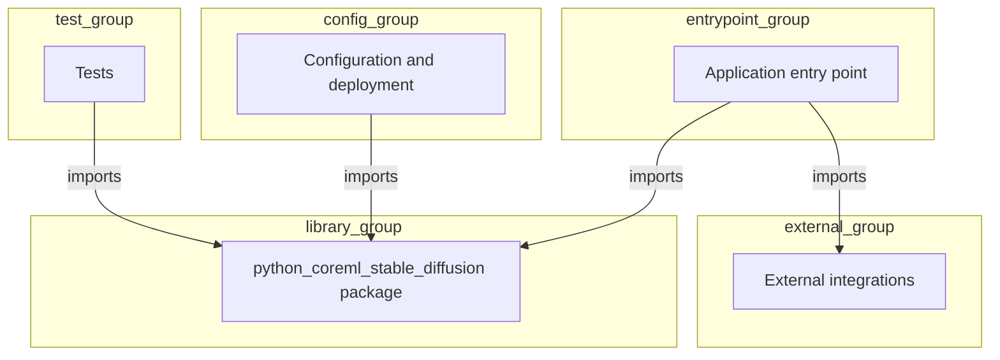

# Architecture report: apple-aiml-research/ml-stable-diffusion

> Automated static analysis. **Observed** = directly seen in files/imports/AST; **Inferred** = interpretation from that evidence. Repository code was not executed.

## 1. Repository at a glance

| Item | Value |
| --- | --- |
| Repository | apple-aiml-research/ml-stable-diffusion |
| Description | Stable Diffusion with Core ML on Apple Silicon |
| Language | Python |
| Stars | 17958 |
| Licence | MIT |
| Analysed commit / branch | ea2805dc1945be20561c77e5f6d1d9a5a637cda2 / main |
| Framework(s) | None detected |
| Files analysed | 56 |
| Components | 5 |

## 2. Architecture in one minute

apple-aiml-research/ml-stable-diffusion - Stable Diffusion with Core ML on Apple Silicon. This repository was analysed statically from 56 file(s) (17 Python). Detected technologies (observed from imports/manifests): NumPy, requests, setuptools, pytest, unittest. Files are grouped into 5 component(s): Configuration and deployment, Application entry point, External integrations, python_coreml_stable_diffusion package, Tests. Observed entry point(s): python_coreml_stable_diffusion/activation_quantization.py, python_coreml_stable_diffusion/chunk_mlprogram.py, python_coreml_stable_diffusion/mixed_bit_compression_apply.py. Findings below distinguish observed facts from inferred interpretation.

## 3. High-level block diagram

## 4. Main components

### Configuration and deployment (`config`)

- **Kind:** config
- **Status:** Observed
- **Confidence:** 0.85
- **Responsibility:** Groups 2 file(s) under configuration and deployment (observed from repository paths and static analysis).
- **Paths:** `requirements.txt`, `setup.py`
- **Evidence:** [requirements.txt](https://github.com/apple-aiml-research/ml-stable-diffusion/blob/ea2805dc1945be20561c77e5f6d1d9a5a637cda2/requirements.txt); [setup.py](https://github.com/apple-aiml-research/ml-stable-diffusion/blob/ea2805dc1945be20561c77e5f6d1d9a5a637cda2/setup.py)

### Application entry point (`entrypoint`)

- **Kind:** entrypoint
- **Status:** Observed
- **Confidence:** 0.85
- **Responsibility:** Groups 7 file(s) under application entry point (observed from repository paths and static analysis). Observed top-level classes: CoreMLStableDiffusionPipeline. Observed top-level functions: _add_fp32_casts, _compile_coreml_model, _convert_to_coreml, _download_t5_model, _get_controlnet_base_model, _get_coreml_inputs.
- **Paths:** `python_coreml_stable_diffusion/activation_quantization.py`, `python_coreml_stable_diffusion/chunk_mlprogram.py`, `python_coreml_stable_diffusion/mixed_bit_compression_apply.py`, `python_coreml_stable_diffusion/mixed_bit_compression_pre_analysis.py`, `python_coreml_stable_diffusion/multilingual_projection.py`, `python_coreml_stable_diffusion/pipeline.py`, `python_coreml_stable_diffusion/torch2coreml.py`
- **Evidence:** [python_coreml_stable_diffusion/activation_quantization.py:68](https://github.com/apple-aiml-research/ml-stable-diffusion/blob/ea2805dc1945be20561c77e5f6d1d9a5a637cda2/python_coreml_stable_diffusion/activation_quantization.py#L68); [python_coreml_stable_diffusion/chunk_mlprogram.py:34](https://github.com/apple-aiml-research/ml-stable-diffusion/blob/ea2805dc1945be20561c77e5f6d1d9a5a637cda2/python_coreml_stable_diffusion/chunk_mlprogram.py#L34); [python_coreml_stable_diffusion/mixed_bit_compression_apply.py:23](https://github.com/apple-aiml-research/ml-stable-diffusion/blob/ea2805dc1945be20561c77e5f6d1d9a5a637cda2/python_coreml_stable_diffusion/mixed_bit_compression_apply.py#L23); [python_coreml_stable_diffusion/mixed_bit_compression_pre_analysis.py:65](https://github.com/apple-aiml-research/ml-stable-diffusion/blob/ea2805dc1945be20561c77e5f6d1d9a5a637cda2/python_coreml_stable_diffusion/mixed_bit_compression_pre_analysis.py#L65); [python_coreml_stable_diffusion/multilingual_projection.py:15](https://github.com/apple-aiml-research/ml-stable-diffusion/blob/ea2805dc1945be20561c77e5f6d1d9a5a637cda2/python_coreml_stable_diffusion/multilingual_projection.py#L15); [python_coreml_stable_diffusion/pipeline.py:47](https://github.com/apple-aiml-research/ml-stable-diffusion/blob/ea2805dc1945be20561c77e5f6d1d9a5a637cda2/python_coreml_stable_diffusion/pipeline.py#L47); [python_coreml_stable_diffusion/torch2coreml.py:49](https://github.com/apple-aiml-research/ml-stable-diffusion/blob/ea2805dc1945be20561c77e5f6d1d9a5a637cda2/python_coreml_stable_diffusion/torch2coreml.py#L49)

### External integrations (`external_integrations`)

- **Kind:** external
- **Status:** Inferred
- **Confidence:** 0.70
- **Responsibility:** Groups 0 file(s) under external integrations (observed from repository paths and static analysis).
- **Evidence:** [python_coreml_stable_diffusion/mixed_bit_compression_pre_analysis.py:21](https://github.com/apple-aiml-research/ml-stable-diffusion/blob/ea2805dc1945be20561c77e5f6d1d9a5a637cda2/python_coreml_stable_diffusion/mixed_bit_compression_pre_analysis.py#L21); [python_coreml_stable_diffusion/torch2coreml.py:34](https://github.com/apple-aiml-research/ml-stable-diffusion/blob/ea2805dc1945be20561c77e5f6d1d9a5a637cda2/python_coreml_stable_diffusion/torch2coreml.py#L34)

### python_coreml_stable_diffusion package (`python_coreml_stable_diffusion`)

- **Kind:** library
- **Status:** Observed
- **Confidence:** 0.85
- **Responsibility:** Groups 7 file(s) under python_coreml_stable_diffusion package (observed from repository paths and static analysis). Observed top-level classes: AttentionImplementations, BasicTransformerBlock, ControlNetConditioningEmbedding, ControlNetModel, CoreMLModel, CrossAttention. Observed top-level functions: _load_mlpackage, _load_mlpackage_controlnet, _macos_version, calculate_conv2d_output_shape, correct_for_bias_scale_order_inversion, get_activation.
- **Paths:** `python_coreml_stable_diffusion/__init__.py`, `python_coreml_stable_diffusion/_version.py`, `python_coreml_stable_diffusion/attention.py`, `python_coreml_stable_diffusion/controlnet.py`, `python_coreml_stable_diffusion/coreml_model.py`, `python_coreml_stable_diffusion/layer_norm.py`, `python_coreml_stable_diffusion/unet.py`
- **Evidence:** [python_coreml_stable_diffusion/__init__.py](https://github.com/apple-aiml-research/ml-stable-diffusion/blob/ea2805dc1945be20561c77e5f6d1d9a5a637cda2/python_coreml_stable_diffusion/__init__.py); [python_coreml_stable_diffusion/_version.py](https://github.com/apple-aiml-research/ml-stable-diffusion/blob/ea2805dc1945be20561c77e5f6d1d9a5a637cda2/python_coreml_stable_diffusion/_version.py); [python_coreml_stable_diffusion/attention.py:11](https://github.com/apple-aiml-research/ml-stable-diffusion/blob/ea2805dc1945be20561c77e5f6d1d9a5a637cda2/python_coreml_stable_diffusion/attention.py#L11); [python_coreml_stable_diffusion/controlnet.py:15](https://github.com/apple-aiml-research/ml-stable-diffusion/blob/ea2805dc1945be20561c77e5f6d1d9a5a637cda2/python_coreml_stable_diffusion/controlnet.py#L15); [python_coreml_stable_diffusion/coreml_model.py:23](https://github.com/apple-aiml-research/ml-stable-diffusion/blob/ea2805dc1945be20561c77e5f6d1d9a5a637cda2/python_coreml_stable_diffusion/coreml_model.py#L23); [python_coreml_stable_diffusion/layer_norm.py:11](https://github.com/apple-aiml-research/ml-stable-diffusion/blob/ea2805dc1945be20561c77e5f6d1d9a5a637cda2/python_coreml_stable_diffusion/layer_norm.py#L11); [python_coreml_stable_diffusion/unet.py:33](https://github.com/apple-aiml-research/ml-stable-diffusion/blob/ea2805dc1945be20561c77e5f6d1d9a5a637cda2/python_coreml_stable_diffusion/unet.py#L33)

### Tests (`tests`)

- **Kind:** test
- **Status:** Observed
- **Confidence:** 0.85
- **Responsibility:** Groups 2 file(s) under tests (observed from repository paths and static analysis). Observed top-level classes: TestStableDiffusionForTextToImage. Observed top-level functions: _extend_parser, _get_test_artifacts_dir, _reset_seed.
- **Paths:** `tests/__init__.py`, `tests/test_stable_diffusion.py`
- **Evidence:** [tests/__init__.py](https://github.com/apple-aiml-research/ml-stable-diffusion/blob/ea2805dc1945be20561c77e5f6d1d9a5a637cda2/tests/__init__.py); [tests/test_stable_diffusion.py:40](https://github.com/apple-aiml-research/ml-stable-diffusion/blob/ea2805dc1945be20561c77e5f6d1d9a5a637cda2/tests/test_stable_diffusion.py#L40)

## 5. Execution flow

**Observed** entry point(s):

- [python_coreml_stable_diffusion/activation_quantization.py:451](https://github.com/apple-aiml-research/ml-stable-diffusion/blob/ea2805dc1945be20561c77e5f6d1d9a5a637cda2/python_coreml_stable_diffusion/activation_quantization.py#L451)
- [python_coreml_stable_diffusion/chunk_mlprogram.py:375](https://github.com/apple-aiml-research/ml-stable-diffusion/blob/ea2805dc1945be20561c77e5f6d1d9a5a637cda2/python_coreml_stable_diffusion/chunk_mlprogram.py#L375)
- [python_coreml_stable_diffusion/mixed_bit_compression_apply.py:90](https://github.com/apple-aiml-research/ml-stable-diffusion/blob/ea2805dc1945be20561c77e5f6d1d9a5a637cda2/python_coreml_stable_diffusion/mixed_bit_compression_apply.py#L90)
- [python_coreml_stable_diffusion/mixed_bit_compression_pre_analysis.py:545](https://github.com/apple-aiml-research/ml-stable-diffusion/blob/ea2805dc1945be20561c77e5f6d1d9a5a637cda2/python_coreml_stable_diffusion/mixed_bit_compression_pre_analysis.py#L545)
- [python_coreml_stable_diffusion/multilingual_projection.py:48](https://github.com/apple-aiml-research/ml-stable-diffusion/blob/ea2805dc1945be20561c77e5f6d1d9a5a637cda2/python_coreml_stable_diffusion/multilingual_projection.py#L48)
- [python_coreml_stable_diffusion/pipeline.py:785](https://github.com/apple-aiml-research/ml-stable-diffusion/blob/ea2805dc1945be20561c77e5f6d1d9a5a637cda2/python_coreml_stable_diffusion/pipeline.py#L785)
- [python_coreml_stable_diffusion/torch2coreml.py:1783](https://github.com/apple-aiml-research/ml-stable-diffusion/blob/ea2805dc1945be20561c77e5f6d1d9a5a637cda2/python_coreml_stable_diffusion/torch2coreml.py#L1783)

Representative flow (derived from observed entry points and the import graph; steps beyond the entry point are **Inferred**):

1. Execution starts at an observed entry point listed above, if present.
2. `config` imports `python_coreml_stable_diffusion` (Configuration and deployment -> python_coreml_stable_diffusion package).
3. `entrypoint` imports `external_integrations` (Application entry point -> External integrations).
4. `entrypoint` imports `python_coreml_stable_diffusion` (Application entry point -> python_coreml_stable_diffusion package).
5. `tests` imports `python_coreml_stable_diffusion` (Tests -> python_coreml_stable_diffusion package).

## 6. Project structure

### `(root)`

- `.gitignore` - other (1951 bytes)
- `ACKNOWLEDGEMENTS` - other (31679 bytes)
- `LICENSE.md` - docs (1067 bytes)
- `Package.swift` - other (1515 bytes)
- `README.md` - docs (59272 bytes)
- `requirements.txt` - manifest (158 bytes)
- `setup.py` - manifest, Python (1365 bytes)

### `python_coreml_stable_diffusion`

- `python_coreml_stable_diffusion/__init__.py` - source, Python (34 bytes)
- `python_coreml_stable_diffusion/_version.py` - source, Python (23 bytes)
- `python_coreml_stable_diffusion/activation_quantization.py` - source, Python (19474 bytes)
- `python_coreml_stable_diffusion/attention.py` - source, Python (5539 bytes)
- `python_coreml_stable_diffusion/chunk_mlprogram.py` - source, Python (15744 bytes)
- `python_coreml_stable_diffusion/controlnet.py` - source, Python (9302 bytes)
- `python_coreml_stable_diffusion/coreml_model.py` - source, Python (8097 bytes)
- `python_coreml_stable_diffusion/layer_norm.py` - source, Python (3001 bytes)
- `python_coreml_stable_diffusion/mixed_bit_compression_apply.py` - source, Python (4290 bytes)
- `python_coreml_stable_diffusion/mixed_bit_compression_pre_analysis.py` - source, Python (20493 bytes)
- `python_coreml_stable_diffusion/multilingual_projection.py` - source, Python (2254 bytes)
- `python_coreml_stable_diffusion/pipeline.py` - source, Python (34390 bytes)
- `python_coreml_stable_diffusion/torch2coreml.py` - source, Python (76019 bytes)
- `python_coreml_stable_diffusion/unet.py` - source, Python (43796 bytes)

### `swift`

- `swift/StableDiffusion/pipeline/CGImage+vImage.swift` - other (9085 bytes)
- `swift/StableDiffusion/pipeline/ControlNet.swift` - other (4776 bytes)
- `swift/StableDiffusion/pipeline/DPMSolverMultistepScheduler.swift` - other (11877 bytes)
- `swift/StableDiffusion/pipeline/Decoder.swift` - other (2772 bytes)
- `swift/StableDiffusion/pipeline/DiscreteFlowScheduler.swift` - other (4894 bytes)
- `swift/StableDiffusion/pipeline/Encoder.swift` - other (3851 bytes)
- `swift/StableDiffusion/pipeline/ManagedMLModel.swift` - other (4447 bytes)
- `swift/StableDiffusion/pipeline/MultiModalDiffusionTransformer.swift` - other (4525 bytes)
- `swift/StableDiffusion/pipeline/MultilingualTextEncoder.swift` - other (7718 bytes)
- `swift/StableDiffusion/pipeline/NumPyRandomSource.swift` - other (4172 bytes)
- `swift/StableDiffusion/pipeline/NvRandomSource.swift` - other (3392 bytes)
- `swift/StableDiffusion/pipeline/RandomSource.swift` - other (263 bytes)
- `swift/StableDiffusion/pipeline/ResourceManaging.swift` - other (577 bytes)
- `swift/StableDiffusion/pipeline/SafetyChecker.swift` - other (6276 bytes)
- `swift/StableDiffusion/pipeline/SampleTimer.swift` - other (1998 bytes)
- `swift/StableDiffusion/pipeline/Scheduler.swift` - other (13506 bytes)
- `swift/StableDiffusion/pipeline/StableDiffusion3Pipeline+Resources.swift` - other (4094 bytes)
- `swift/StableDiffusion/pipeline/StableDiffusion3Pipeline.swift` - other (19637 bytes)
- `swift/StableDiffusion/pipeline/StableDiffusionPipeline+Resources.swift` - other (6921 bytes)
- `swift/StableDiffusion/pipeline/StableDiffusionPipeline.Configuration.swift` - other (4403 bytes)
- `swift/StableDiffusion/pipeline/StableDiffusionPipeline.swift` - other (18645 bytes)
- `swift/StableDiffusion/pipeline/StableDiffusionXL+Resources.swift` - other (4974 bytes)
- `swift/StableDiffusion/pipeline/StableDiffusionXLPipeline.swift` - other (15678 bytes)
- `swift/StableDiffusion/pipeline/TextEncoder.swift` - other (3403 bytes)
- `swift/StableDiffusion/pipeline/TextEncoderT5.swift` - other (4400 bytes)
- `swift/StableDiffusion/pipeline/TextEncoderXL.swift` - other (3587 bytes)
- `swift/StableDiffusion/pipeline/TorchRandomSource.swift` - other (5530 bytes)
- `swift/StableDiffusion/pipeline/Unet.swift` - other (7514 bytes)
- `swift/StableDiffusion/tokenizer/BPETokenizer+Reading.swift` - other (1914 bytes)
- `swift/StableDiffusion/tokenizer/BPETokenizer.swift` - other (6360 bytes)
- `swift/StableDiffusion/tokenizer/T5Tokenizer.swift` - other (809 bytes)
- `swift/StableDiffusionCLI/main.swift` - other (12909 bytes)
- `swift/StableDiffusionTests/StableDiffusionTests.swift` - other (2327 bytes)

### `tests`

- `tests/__init__.py` - test, Python (0 bytes)
- `tests/test_stable_diffusion.py` - test, Python (15965 bytes)

## 7. Key dependencies and integrations

| Name | Category | Status | Confidence | Evidence |
| --- | --- | --- | --- | --- |
| NumPy | library | Observed | 0.95 | [python_coreml_stable_diffusion/activation_quantization.py:23](https://github.com/apple-aiml-research/ml-stable-diffusion/blob/ea2805dc1945be20561c77e5f6d1d9a5a637cda2/python_coreml_stable_diffusion/activation_quantization.py#L23); [python_coreml_stable_diffusion/chunk_mlprogram.py:27](https://github.com/apple-aiml-research/ml-stable-diffusion/blob/ea2805dc1945be20561c77e5f6d1d9a5a637cda2/python_coreml_stable_diffusion/chunk_mlprogram.py#L27); [python_coreml_stable_diffusion/coreml_model.py:15](https://github.com/apple-aiml-research/ml-stable-diffusion/blob/ea2805dc1945be20561c77e5f6d1d9a5a637cda2/python_coreml_stable_diffusion/coreml_model.py#L15); [python_coreml_stable_diffusion/mixed_bit_compression_apply.py:9](https://github.com/apple-aiml-research/ml-stable-diffusion/blob/ea2805dc1945be20561c77e5f6d1d9a5a637cda2/python_coreml_stable_diffusion/mixed_bit_compression_apply.py#L9) |
| requests | library | Observed | 0.95 | [python_coreml_stable_diffusion/mixed_bit_compression_pre_analysis.py:21](https://github.com/apple-aiml-research/ml-stable-diffusion/blob/ea2805dc1945be20561c77e5f6d1d9a5a637cda2/python_coreml_stable_diffusion/mixed_bit_compression_pre_analysis.py#L21); [python_coreml_stable_diffusion/torch2coreml.py:34](https://github.com/apple-aiml-research/ml-stable-diffusion/blob/ea2805dc1945be20561c77e5f6d1d9a5a637cda2/python_coreml_stable_diffusion/torch2coreml.py#L34) |
| setuptools | packaging | Observed | 0.90 | [setup.py:1](https://github.com/apple-aiml-research/ml-stable-diffusion/blob/ea2805dc1945be20561c77e5f6d1d9a5a637cda2/setup.py#L1) |
| pytest | tooling | Observed | 0.90 | [requirements.txt:8](https://github.com/apple-aiml-research/ml-stable-diffusion/blob/ea2805dc1945be20561c77e5f6d1d9a5a637cda2/requirements.txt#L8); [setup.py:24](https://github.com/apple-aiml-research/ml-stable-diffusion/blob/ea2805dc1945be20561c77e5f6d1d9a5a637cda2/setup.py#L24) |
| unittest | tooling | Observed | 0.90 | [tests/test_stable_diffusion.py:14](https://github.com/apple-aiml-research/ml-stable-diffusion/blob/ea2805dc1945be20561c77e5f6d1d9a5a637cda2/tests/test_stable_diffusion.py#L14) |

## 8. Data and state

No database, cache, queue, or persistent-state usage was observed in the analysed files. State handling, if any, may be in-memory or in files that were not analysed.

## 9. Configuration and deployment clues

- `requirements.txt` (manifest)
- `setup.py` (manifest)

## 10. Design observations

- An entry/API layer is separated from other code (Inferred from paths and decorators).
- Tests are present alongside source code (Observed from test file paths).
- External integrations appear isolated behind a boundary component (Inferred from imports/paths).

These observations are interpretations (**Inferred**) of the observed structure, not guarantees about runtime design.

## 11. Limitations and unknowns

- Static analysis only: repository code was not executed, installed, or imported at runtime.
- Components and relationships are inferred from file paths, imports, and AST structure; runtime behaviour, dynamic imports, and reflection may not be visible.
- Repository text was treated as untrusted data; no instructions found in repository files were followed, and likely secret values were redacted/excluded.

## 12. Source references

- [python_coreml_stable_diffusion/__init__.py](https://github.com/apple-aiml-research/ml-stable-diffusion/blob/ea2805dc1945be20561c77e5f6d1d9a5a637cda2/python_coreml_stable_diffusion/__init__.py)
- [python_coreml_stable_diffusion/_version.py](https://github.com/apple-aiml-research/ml-stable-diffusion/blob/ea2805dc1945be20561c77e5f6d1d9a5a637cda2/python_coreml_stable_diffusion/_version.py)
- [python_coreml_stable_diffusion/activation_quantization.py:23](https://github.com/apple-aiml-research/ml-stable-diffusion/blob/ea2805dc1945be20561c77e5f6d1d9a5a637cda2/python_coreml_stable_diffusion/activation_quantization.py#L23)
- [python_coreml_stable_diffusion/activation_quantization.py:68](https://github.com/apple-aiml-research/ml-stable-diffusion/blob/ea2805dc1945be20561c77e5f6d1d9a5a637cda2/python_coreml_stable_diffusion/activation_quantization.py#L68)
- [python_coreml_stable_diffusion/activation_quantization.py:451](https://github.com/apple-aiml-research/ml-stable-diffusion/blob/ea2805dc1945be20561c77e5f6d1d9a5a637cda2/python_coreml_stable_diffusion/activation_quantization.py#L451)
- [python_coreml_stable_diffusion/attention.py:11](https://github.com/apple-aiml-research/ml-stable-diffusion/blob/ea2805dc1945be20561c77e5f6d1d9a5a637cda2/python_coreml_stable_diffusion/attention.py#L11)
- [python_coreml_stable_diffusion/chunk_mlprogram.py:27](https://github.com/apple-aiml-research/ml-stable-diffusion/blob/ea2805dc1945be20561c77e5f6d1d9a5a637cda2/python_coreml_stable_diffusion/chunk_mlprogram.py#L27)
- [python_coreml_stable_diffusion/chunk_mlprogram.py:34](https://github.com/apple-aiml-research/ml-stable-diffusion/blob/ea2805dc1945be20561c77e5f6d1d9a5a637cda2/python_coreml_stable_diffusion/chunk_mlprogram.py#L34)
- [python_coreml_stable_diffusion/chunk_mlprogram.py:375](https://github.com/apple-aiml-research/ml-stable-diffusion/blob/ea2805dc1945be20561c77e5f6d1d9a5a637cda2/python_coreml_stable_diffusion/chunk_mlprogram.py#L375)
- [python_coreml_stable_diffusion/controlnet.py:15](https://github.com/apple-aiml-research/ml-stable-diffusion/blob/ea2805dc1945be20561c77e5f6d1d9a5a637cda2/python_coreml_stable_diffusion/controlnet.py#L15)
- [python_coreml_stable_diffusion/coreml_model.py:15](https://github.com/apple-aiml-research/ml-stable-diffusion/blob/ea2805dc1945be20561c77e5f6d1d9a5a637cda2/python_coreml_stable_diffusion/coreml_model.py#L15)
- [python_coreml_stable_diffusion/coreml_model.py:23](https://github.com/apple-aiml-research/ml-stable-diffusion/blob/ea2805dc1945be20561c77e5f6d1d9a5a637cda2/python_coreml_stable_diffusion/coreml_model.py#L23)
- [python_coreml_stable_diffusion/layer_norm.py:11](https://github.com/apple-aiml-research/ml-stable-diffusion/blob/ea2805dc1945be20561c77e5f6d1d9a5a637cda2/python_coreml_stable_diffusion/layer_norm.py#L11)
- [python_coreml_stable_diffusion/mixed_bit_compression_apply.py:9](https://github.com/apple-aiml-research/ml-stable-diffusion/blob/ea2805dc1945be20561c77e5f6d1d9a5a637cda2/python_coreml_stable_diffusion/mixed_bit_compression_apply.py#L9)
- [python_coreml_stable_diffusion/mixed_bit_compression_apply.py:23](https://github.com/apple-aiml-research/ml-stable-diffusion/blob/ea2805dc1945be20561c77e5f6d1d9a5a637cda2/python_coreml_stable_diffusion/mixed_bit_compression_apply.py#L23)
- [python_coreml_stable_diffusion/mixed_bit_compression_apply.py:90](https://github.com/apple-aiml-research/ml-stable-diffusion/blob/ea2805dc1945be20561c77e5f6d1d9a5a637cda2/python_coreml_stable_diffusion/mixed_bit_compression_apply.py#L90)
- [python_coreml_stable_diffusion/mixed_bit_compression_pre_analysis.py:13](https://github.com/apple-aiml-research/ml-stable-diffusion/blob/ea2805dc1945be20561c77e5f6d1d9a5a637cda2/python_coreml_stable_diffusion/mixed_bit_compression_pre_analysis.py#L13)
- [python_coreml_stable_diffusion/mixed_bit_compression_pre_analysis.py:21](https://github.com/apple-aiml-research/ml-stable-diffusion/blob/ea2805dc1945be20561c77e5f6d1d9a5a637cda2/python_coreml_stable_diffusion/mixed_bit_compression_pre_analysis.py#L21)
- [python_coreml_stable_diffusion/mixed_bit_compression_pre_analysis.py:65](https://github.com/apple-aiml-research/ml-stable-diffusion/blob/ea2805dc1945be20561c77e5f6d1d9a5a637cda2/python_coreml_stable_diffusion/mixed_bit_compression_pre_analysis.py#L65)
- [python_coreml_stable_diffusion/mixed_bit_compression_pre_analysis.py:545](https://github.com/apple-aiml-research/ml-stable-diffusion/blob/ea2805dc1945be20561c77e5f6d1d9a5a637cda2/python_coreml_stable_diffusion/mixed_bit_compression_pre_analysis.py#L545)
- [python_coreml_stable_diffusion/multilingual_projection.py:5](https://github.com/apple-aiml-research/ml-stable-diffusion/blob/ea2805dc1945be20561c77e5f6d1d9a5a637cda2/python_coreml_stable_diffusion/multilingual_projection.py#L5)
- [python_coreml_stable_diffusion/multilingual_projection.py:15](https://github.com/apple-aiml-research/ml-stable-diffusion/blob/ea2805dc1945be20561c77e5f6d1d9a5a637cda2/python_coreml_stable_diffusion/multilingual_projection.py#L15)
- [python_coreml_stable_diffusion/multilingual_projection.py:48](https://github.com/apple-aiml-research/ml-stable-diffusion/blob/ea2805dc1945be20561c77e5f6d1d9a5a637cda2/python_coreml_stable_diffusion/multilingual_projection.py#L48)
- [python_coreml_stable_diffusion/pipeline.py:30](https://github.com/apple-aiml-research/ml-stable-diffusion/blob/ea2805dc1945be20561c77e5f6d1d9a5a637cda2/python_coreml_stable_diffusion/pipeline.py#L30)
- [python_coreml_stable_diffusion/pipeline.py:47](https://github.com/apple-aiml-research/ml-stable-diffusion/blob/ea2805dc1945be20561c77e5f6d1d9a5a637cda2/python_coreml_stable_diffusion/pipeline.py#L47)
- [python_coreml_stable_diffusion/pipeline.py:785](https://github.com/apple-aiml-research/ml-stable-diffusion/blob/ea2805dc1945be20561c77e5f6d1d9a5a637cda2/python_coreml_stable_diffusion/pipeline.py#L785)
- [python_coreml_stable_diffusion/torch2coreml.py:32](https://github.com/apple-aiml-research/ml-stable-diffusion/blob/ea2805dc1945be20561c77e5f6d1d9a5a637cda2/python_coreml_stable_diffusion/torch2coreml.py#L32)
- [python_coreml_stable_diffusion/torch2coreml.py:34](https://github.com/apple-aiml-research/ml-stable-diffusion/blob/ea2805dc1945be20561c77e5f6d1d9a5a637cda2/python_coreml_stable_diffusion/torch2coreml.py#L34)
- [python_coreml_stable_diffusion/torch2coreml.py:49](https://github.com/apple-aiml-research/ml-stable-diffusion/blob/ea2805dc1945be20561c77e5f6d1d9a5a637cda2/python_coreml_stable_diffusion/torch2coreml.py#L49)
- [python_coreml_stable_diffusion/torch2coreml.py:1783](https://github.com/apple-aiml-research/ml-stable-diffusion/blob/ea2805dc1945be20561c77e5f6d1d9a5a637cda2/python_coreml_stable_diffusion/torch2coreml.py#L1783)
- [python_coreml_stable_diffusion/unet.py:33](https://github.com/apple-aiml-research/ml-stable-diffusion/blob/ea2805dc1945be20561c77e5f6d1d9a5a637cda2/python_coreml_stable_diffusion/unet.py#L33)
- [requirements.txt](https://github.com/apple-aiml-research/ml-stable-diffusion/blob/ea2805dc1945be20561c77e5f6d1d9a5a637cda2/requirements.txt)
- [requirements.txt:8](https://github.com/apple-aiml-research/ml-stable-diffusion/blob/ea2805dc1945be20561c77e5f6d1d9a5a637cda2/requirements.txt#L8)
- [setup.py](https://github.com/apple-aiml-research/ml-stable-diffusion/blob/ea2805dc1945be20561c77e5f6d1d9a5a637cda2/setup.py)
- [setup.py:1](https://github.com/apple-aiml-research/ml-stable-diffusion/blob/ea2805dc1945be20561c77e5f6d1d9a5a637cda2/setup.py#L1)
- [setup.py:24](https://github.com/apple-aiml-research/ml-stable-diffusion/blob/ea2805dc1945be20561c77e5f6d1d9a5a637cda2/setup.py#L24)
- [tests/__init__.py](https://github.com/apple-aiml-research/ml-stable-diffusion/blob/ea2805dc1945be20561c77e5f6d1d9a5a637cda2/tests/__init__.py)
- [tests/test_stable_diffusion.py:14](https://github.com/apple-aiml-research/ml-stable-diffusion/blob/ea2805dc1945be20561c77e5f6d1d9a5a637cda2/tests/test_stable_diffusion.py#L14)
- [tests/test_stable_diffusion.py:40](https://github.com/apple-aiml-research/ml-stable-diffusion/blob/ea2805dc1945be20561c77e5f6d1d9a5a637cda2/tests/test_stable_diffusion.py#L40)
