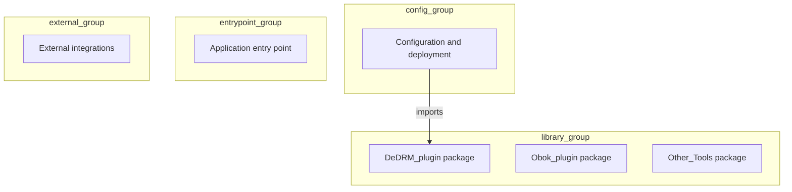

# Architecture report: apprenticeharper/DeDRM_tools

> Automated static analysis. **Observed** = directly seen in files/imports/AST; **Inferred** = interpretation from that evidence. Repository code was not executed.

## 1. Repository at a glance

| Item | Value |
| --- | --- |
| Repository | apprenticeharper/DeDRM_tools |
| Description | DeDRM tools for ebooks |
| Language | Python |
| Stars | 15404 |
| Licence | Not detected |
| Analysed commit / branch | 776f146ca00d11b24575f4fd6e8202df30a2b7ea / master |
| Framework(s) | None detected |
| Files analysed | 103 |
| Components | 6 |

## 2. Architecture in one minute

apprenticeharper/DeDRM_tools - DeDRM tools for ebooks. This repository was analysed statically from 103 file(s) (54 Python). Detected technologies (observed from imports/manifests): GitHub Actions, SQLite. Files are grouped into 6 component(s): Configuration and deployment, DeDRM_plugin package, Application entry point, External integrations, Obok_plugin package, Other_Tools package. Observed entry point(s): DeDRM_plugin/adobekey.py, DeDRM_plugin/androidkindlekey.py, DeDRM_plugin/convert2xml.py. Findings below distinguish observed facts from inferred interpretation.

## 3. High-level block diagram

## 4. Main components

### Configuration and deployment (`config`)

- **Kind:** config
- **Status:** Observed
- **Confidence:** 0.85
- **Responsibility:** Groups 2 file(s) under configuration and deployment (observed from repository paths and static analysis). Observed top-level classes: AddAdeptDialog, AddAndroidDialog, AddBandNKeyDialog, AddEReaderDialog, AddKindleDialog, AddPIDDialog.
- **Paths:** `DeDRM_plugin/config.py`, `Obok_plugin/config.py`
- **Evidence:** [DeDRM_plugin/config.py:32](https://github.com/apprenticeharper/DeDRM_tools/blob/776f146ca00d11b24575f4fd6e8202df30a2b7ea/DeDRM_plugin/config.py#L32); [Obok_plugin/config.py:26](https://github.com/apprenticeharper/DeDRM_tools/blob/776f146ca00d11b24575f4fd6e8202df30a2b7ea/Obok_plugin/config.py#L26)

### DeDRM_plugin package (`dedrm_plugin`)

- **Kind:** library
- **Status:** Observed
- **Confidence:** 0.85
- **Responsibility:** Groups 22 file(s) under dedrm_plugin package (observed from repository paths and static analysis). Observed top-level classes: AES, AES_CBC, ActivityBar, BROWSEINFO, BadKeySizeError, BinaryIonParser. Observed top-level functions: AddRoundKey, AskFolder, CenterWindow, GetWindowRect, InvMixColumns, InvShiftRows.
- **Paths:** `DeDRM_plugin/__init__.py`, `DeDRM_plugin/activitybar.py`, `DeDRM_plugin/aescbc.py`, `DeDRM_plugin/alfcrypto.py`, `DeDRM_plugin/argv_utils.py`, `DeDRM_plugin/askfolder_ed.py`, `DeDRM_plugin/flatxml2html.py`, `DeDRM_plugin/flatxml2svg.py`, `DeDRM_plugin/ion.py`, `DeDRM_plugin/kfxdedrm.py`, `DeDRM_plugin/kgenpids.py`, `DeDRM_plugin/openssl_des.py`, `DeDRM_plugin/prefs.py`, `DeDRM_plugin/pycrypto_des.py`, `DeDRM_plugin/python_des.py`, `DeDRM_plugin/scriptinterface.py`, `DeDRM_plugin/scrolltextwidget.py`, `DeDRM_plugin/simpleprefs.py`, `DeDRM_plugin/stylexml2css.py`, `DeDRM_plugin/subasyncio.py`, `DeDRM_plugin/utilities.py`, `DeDRM_plugin/wineutils.py`
- **Evidence:** [DeDRM_plugin/__init__.py:98](https://github.com/apprenticeharper/DeDRM_tools/blob/776f146ca00d11b24575f4fd6e8202df30a2b7ea/DeDRM_plugin/__init__.py#L98); [DeDRM_plugin/activitybar.py:5](https://github.com/apprenticeharper/DeDRM_tools/blob/776f146ca00d11b24575f4fd6e8202df30a2b7ea/DeDRM_plugin/activitybar.py#L5); [DeDRM_plugin/aescbc.py:21](https://github.com/apprenticeharper/DeDRM_tools/blob/776f146ca00d11b24575f4fd6e8202df30a2b7ea/DeDRM_plugin/aescbc.py#L21); [DeDRM_plugin/alfcrypto.py:17](https://github.com/apprenticeharper/DeDRM_tools/blob/776f146ca00d11b24575f4fd6e8202df30a2b7ea/DeDRM_plugin/alfcrypto.py#L17); [DeDRM_plugin/argv_utils.py:10](https://github.com/apprenticeharper/DeDRM_tools/blob/776f146ca00d11b24575f4fd6e8202df30a2b7ea/DeDRM_plugin/argv_utils.py#L10); [DeDRM_plugin/askfolder_ed.py:113](https://github.com/apprenticeharper/DeDRM_tools/blob/776f146ca00d11b24575f4fd6e8202df30a2b7ea/DeDRM_plugin/askfolder_ed.py#L113); [DeDRM_plugin/flatxml2html.py:15](https://github.com/apprenticeharper/DeDRM_tools/blob/776f146ca00d11b24575f4fd6e8202df30a2b7ea/DeDRM_plugin/flatxml2html.py#L15); [DeDRM_plugin/flatxml2svg.py:12](https://github.com/apprenticeharper/DeDRM_tools/blob/776f146ca00d11b24575f4fd6e8202df30a2b7ea/DeDRM_plugin/flatxml2svg.py#L12)

### Application entry point (`entrypoint`)

- **Kind:** entrypoint
- **Status:** Observed
- **Confidence:** 0.85
- **Responsibility:** Groups 23 file(s) under application entry point (observed from repository paths and static analysis). Observed top-level classes: ADEPTError, AndroidObfuscation, AndroidObfuscationV2, BadZipfile, Decryptor, Dictionary. Observed top-level functions: GetDecryptedBook, MD5, PC1, SHA1, SHA256, _EndRecData.
- **Paths:** `DeDRM_plugin/adobekey.py`, `DeDRM_plugin/androidkindlekey.py`, `DeDRM_plugin/convert2xml.py`, `DeDRM_plugin/epubtest.py`, `DeDRM_plugin/erdr2pml.py`, `DeDRM_plugin/genbook.py`, `DeDRM_plugin/ignobleepub.py`, `DeDRM_plugin/ignoblekey.py`, `DeDRM_plugin/ignoblekeyfetch.py`, `DeDRM_plugin/ignoblekeygen.py`, `DeDRM_plugin/ignoblepdf.py`, `DeDRM_plugin/ineptepub.py`, `DeDRM_plugin/ineptpdf.py`, `DeDRM_plugin/k4mobidedrm.py`, `DeDRM_plugin/kindlekey.py`, `DeDRM_plugin/kindlepid.py`, `DeDRM_plugin/mobidedrm.py`, `DeDRM_plugin/topazextract.py`, `DeDRM_plugin/zipfilerugged.py`, `DeDRM_plugin/zipfix.py`, `Obok_plugin/obok/obok.py`, `Other_Tools/Kobo/obok.py`, `make_release.py`
- **Evidence:** [DeDRM_plugin/adobekey.py:47](https://github.com/apprenticeharper/DeDRM_tools/blob/776f146ca00d11b24575f4fd6e8202df30a2b7ea/DeDRM_plugin/adobekey.py#L47); [DeDRM_plugin/androidkindlekey.py:41](https://github.com/apprenticeharper/DeDRM_tools/blob/776f146ca00d11b24575f4fd6e8202df30a2b7ea/DeDRM_plugin/androidkindlekey.py#L41); [DeDRM_plugin/convert2xml.py:11](https://github.com/apprenticeharper/DeDRM_tools/blob/776f146ca00d11b24575f4fd6e8202df30a2b7ea/DeDRM_plugin/convert2xml.py#L11); [DeDRM_plugin/epubtest.py:62](https://github.com/apprenticeharper/DeDRM_tools/blob/776f146ca00d11b24575f4fd6e8202df30a2b7ea/DeDRM_plugin/epubtest.py#L62); [DeDRM_plugin/erdr2pml.py:81](https://github.com/apprenticeharper/DeDRM_tools/blob/776f146ca00d11b24575f4fd6e8202df30a2b7ea/DeDRM_plugin/erdr2pml.py#L81); [DeDRM_plugin/genbook.py:10](https://github.com/apprenticeharper/DeDRM_tools/blob/776f146ca00d11b24575f4fd6e8202df30a2b7ea/DeDRM_plugin/genbook.py#L10); [DeDRM_plugin/ignobleepub.py:48](https://github.com/apprenticeharper/DeDRM_tools/blob/776f146ca00d11b24575f4fd6e8202df30a2b7ea/DeDRM_plugin/ignobleepub.py#L48); [DeDRM_plugin/ignoblekey.py:33](https://github.com/apprenticeharper/DeDRM_tools/blob/776f146ca00d11b24575f4fd6e8202df30a2b7ea/DeDRM_plugin/ignoblekey.py#L33)

### External integrations (`external_integrations`)

- **Kind:** external
- **Status:** Inferred
- **Confidence:** 0.70
- **Responsibility:** Groups 0 file(s) under external integrations (observed from repository paths and static analysis).
- **Evidence:** [DeDRM_plugin/androidkindlekey.py:215](https://github.com/apprenticeharper/DeDRM_tools/blob/776f146ca00d11b24575f4fd6e8202df30a2b7ea/DeDRM_plugin/androidkindlekey.py#L215); [Obok_plugin/obok/obok.py:167](https://github.com/apprenticeharper/DeDRM_tools/blob/776f146ca00d11b24575f4fd6e8202df30a2b7ea/Obok_plugin/obok/obok.py#L167); [Other_Tools/Kobo/obok.py:161](https://github.com/apprenticeharper/DeDRM_tools/blob/776f146ca00d11b24575f4fd6e8202df30a2b7ea/Other_Tools/Kobo/obok.py#L161)

### Obok_plugin package (`obok_plugin`)

- **Kind:** library
- **Status:** Observed
- **Confidence:** 0.85
- **Responsibility:** Groups 7 file(s) under obok_plugin package (observed from repository paths and static analysis). Observed top-level classes: AddEpubFormatsProgressDialog, AuthorTableWidgetItem, BookListTableWidget, CheckableTableWidgetItem, CustomColumnComboBox, DateDelegate. Observed top-level functions: convert_kobo_date, create_menu_action_unique, create_menu_item, debug_print, format_plural, get_icon.
- **Paths:** `Obok_plugin/__init__.py`, `Obok_plugin/action.py`, `Obok_plugin/common_utils.py`, `Obok_plugin/dialogs.py`, `Obok_plugin/obok/__init__.py`, `Obok_plugin/obok/legacy_obok.py`, `Obok_plugin/utilities.py`
- **Evidence:** [Obok_plugin/__init__.py:29](https://github.com/apprenticeharper/DeDRM_tools/blob/776f146ca00d11b24575f4fd6e8202df30a2b7ea/Obok_plugin/__init__.py#L29); [Obok_plugin/action.py:47](https://github.com/apprenticeharper/DeDRM_tools/blob/776f146ca00d11b24575f4fd6e8202df30a2b7ea/Obok_plugin/action.py#L47); [Obok_plugin/common_utils.py:31](https://github.com/apprenticeharper/DeDRM_tools/blob/776f146ca00d11b24575f4fd6e8202df30a2b7ea/Obok_plugin/common_utils.py#L31); [Obok_plugin/dialogs.py:43](https://github.com/apprenticeharper/DeDRM_tools/blob/776f146ca00d11b24575f4fd6e8202df30a2b7ea/Obok_plugin/dialogs.py#L43); [Obok_plugin/obok/__init__.py](https://github.com/apprenticeharper/DeDRM_tools/blob/776f146ca00d11b24575f4fd6e8202df30a2b7ea/Obok_plugin/obok/__init__.py); [Obok_plugin/obok/legacy_obok.py:9](https://github.com/apprenticeharper/DeDRM_tools/blob/776f146ca00d11b24575f4fd6e8202df30a2b7ea/Obok_plugin/obok/legacy_obok.py#L9); [Obok_plugin/utilities.py:48](https://github.com/apprenticeharper/DeDRM_tools/blob/776f146ca00d11b24575f4fd6e8202df30a2b7ea/Obok_plugin/utilities.py#L48)

### Other_Tools package (`other_tools`)

- **Kind:** library
- **Status:** Observed
- **Confidence:** 0.85
- **Responsibility:** Groups 1 file(s) under other_tools package (observed from repository paths and static analysis).
- **Paths:** `Other_Tools/B_and_N_Download_Helper/BN-Dload.user.js`
- **Evidence:** [Other_Tools/B_and_N_Download_Helper/BN-Dload.user.js](https://github.com/apprenticeharper/DeDRM_tools/blob/776f146ca00d11b24575f4fd6e8202df30a2b7ea/Other_Tools/B_and_N_Download_Helper/BN-Dload.user.js)

## 5. Execution flow

**Observed** entry point(s):

- [DeDRM_plugin/adobekey.py:584](https://github.com/apprenticeharper/DeDRM_tools/blob/776f146ca00d11b24575f4fd6e8202df30a2b7ea/DeDRM_plugin/adobekey.py#L584)
- [DeDRM_plugin/androidkindlekey.py:463](https://github.com/apprenticeharper/DeDRM_tools/blob/776f146ca00d11b24575f4fd6e8202df30a2b7ea/DeDRM_plugin/androidkindlekey.py#L463)
- [DeDRM_plugin/convert2xml.py:895](https://github.com/apprenticeharper/DeDRM_tools/blob/776f146ca00d11b24575f4fd6e8202df30a2b7ea/DeDRM_plugin/convert2xml.py#L895)
- [DeDRM_plugin/epubtest.py:207](https://github.com/apprenticeharper/DeDRM_tools/blob/776f146ca00d11b24575f4fd6e8202df30a2b7ea/DeDRM_plugin/epubtest.py#L207)
- [DeDRM_plugin/erdr2pml.py:587](https://github.com/apprenticeharper/DeDRM_tools/blob/776f146ca00d11b24575f4fd6e8202df30a2b7ea/DeDRM_plugin/erdr2pml.py#L587)
- [DeDRM_plugin/genbook.py:732](https://github.com/apprenticeharper/DeDRM_tools/blob/776f146ca00d11b24575f4fd6e8202df30a2b7ea/DeDRM_plugin/genbook.py#L732)
- [DeDRM_plugin/ignobleepub.py:438](https://github.com/apprenticeharper/DeDRM_tools/blob/776f146ca00d11b24575f4fd6e8202df30a2b7ea/DeDRM_plugin/ignobleepub.py#L438)
- [DeDRM_plugin/ignoblekey.py:331](https://github.com/apprenticeharper/DeDRM_tools/blob/776f146ca00d11b24575f4fd6e8202df30a2b7ea/DeDRM_plugin/ignoblekey.py#L331)
- [DeDRM_plugin/ignoblekeyfetch.py:251](https://github.com/apprenticeharper/DeDRM_tools/blob/776f146ca00d11b24575f4fd6e8202df30a2b7ea/DeDRM_plugin/ignoblekeyfetch.py#L251)
- [DeDRM_plugin/ignoblekeygen.py:327](https://github.com/apprenticeharper/DeDRM_tools/blob/776f146ca00d11b24575f4fd6e8202df30a2b7ea/DeDRM_plugin/ignoblekeygen.py#L327)
- [DeDRM_plugin/ignoblepdf.py:2161](https://github.com/apprenticeharper/DeDRM_tools/blob/776f146ca00d11b24575f4fd6e8202df30a2b7ea/DeDRM_plugin/ignoblepdf.py#L2161)
- [DeDRM_plugin/ineptepub.py:597](https://github.com/apprenticeharper/DeDRM_tools/blob/776f146ca00d11b24575f4fd6e8202df30a2b7ea/DeDRM_plugin/ineptepub.py#L597)

Representative flow (derived from observed entry points and the import graph; steps beyond the entry point are **Inferred**):

1. Execution starts at an observed entry point listed above, if present.
2. `config` imports `dedrm_plugin` (Configuration and deployment -> DeDRM_plugin package).

## 6. Project structure

### `(root)`

- `.gitignore` - other (10 bytes)
- `CALIBRE_CLI_INSTRUCTIONS.md` - docs (1556 bytes)
- `DeDRM_plugin_ReadMe.txt` - docs (2198 bytes)
- `FAQs.md` - docs (22457 bytes)
- `README.md` - docs (2322 bytes)
- `ReadMe_Overview.txt` - docs (4323 bytes)
- `make_release.py` - source, Python (1306 bytes)
- `obok_plugin_ReadMe.txt` - docs (2220 bytes)

### `.github`

- `.github/ISSUE_TEMPLATE/QUESTION.md` - docs (680 bytes)
- `.github/workflows/Format.yaml` - ci, YAML (1333 bytes)
- `.github/workflows/Lint.yaml` - ci, YAML (743 bytes)

### `DeDRM_plugin`

- `DeDRM_plugin/DeDRM_Adobe Digital Editions Key_Help.htm` - other (3721 bytes)
- `DeDRM_plugin/DeDRM_Barnes and Noble Key_Help.htm` - other (4809 bytes)
- `DeDRM_plugin/DeDRM_EInk Kindle Serial Number_Help.htm` - other (2233 bytes)
- `DeDRM_plugin/DeDRM_Help.htm` - other (5620 bytes)
- `DeDRM_plugin/DeDRM_Kindle for Android Key_Help.htm` - other (4086 bytes)
- `DeDRM_plugin/DeDRM_Kindle for Mac and PC Key_Help.htm` - other (3663 bytes)
- `DeDRM_plugin/DeDRM_Mobipocket PID_Help.htm` - other (1753 bytes)
- `DeDRM_plugin/DeDRM_eReader Key_Help.htm` - other (3742 bytes)
- `DeDRM_plugin/__init__.py` - source, Python (34567 bytes)
- `DeDRM_plugin/activitybar.py` - source, Python (2968 bytes)
- `DeDRM_plugin/adobekey.py` - source, Python (21662 bytes)
- `DeDRM_plugin/aescbc.py` - source, Python (25394 bytes)
- `DeDRM_plugin/alfcrypto.py` - source, Python (9991 bytes)
- `DeDRM_plugin/androidkindlekey.py` - source, Python (15665 bytes)
- `DeDRM_plugin/argv_utils.py` - source, Python (2448 bytes)
- `DeDRM_plugin/askfolder_ed.py` - source, Python (6509 bytes)
- `DeDRM_plugin/config.py` - source, Python (47807 bytes)
- `DeDRM_plugin/convert2xml.py` - source, Python (31634 bytes)
- `DeDRM_plugin/epubtest.py` - source, Python (7548 bytes)
- `DeDRM_plugin/erdr2pml.py` - source, Python (24306 bytes)
- `DeDRM_plugin/flatxml2html.py` - source, Python (30165 bytes)
- `DeDRM_plugin/flatxml2svg.py` - source, Python (10735 bytes)
- `DeDRM_plugin/genbook.py` - source, Python (26031 bytes)
- `DeDRM_plugin/ignobleepub.py` - source, Python (17191 bytes)
- `DeDRM_plugin/ignoblekey.py` - source, Python (11908 bytes)
- `DeDRM_plugin/ignoblekeyfetch.py` - source, Python (9293 bytes)
- `DeDRM_plugin/ignoblekeygen.py` - source, Python (11724 bytes)
- `DeDRM_plugin/ignoblepdf.py` - source, Python (71332 bytes)
- `DeDRM_plugin/ineptepub.py` - source, Python (23158 bytes)
- `DeDRM_plugin/ineptpdf.py` - source, Python (78230 bytes)
- `DeDRM_plugin/ion.py` - source, Python (37448 bytes)
- `DeDRM_plugin/k4mobidedrm.py` - source, Python (13049 bytes)
- `DeDRM_plugin/kfxdedrm.py` - source, Python (3918 bytes)
- `DeDRM_plugin/kgenpids.py` - source, Python (9443 bytes)
- `DeDRM_plugin/kindlekey.py` - source, Python (79092 bytes)
- `DeDRM_plugin/kindlepid.py` - source, Python (4597 bytes)
- `DeDRM_plugin/mobidedrm.py` - source, Python (22749 bytes)
- `DeDRM_plugin/openssl_des.py` - source, Python (3084 bytes)
- `DeDRM_plugin/plugin-import-name-dedrm.txt` - docs (0 bytes)
- `DeDRM_plugin/prefs.py` - source, Python (13441 bytes)
- `DeDRM_plugin/pycrypto_des.py` - source, Python (858 bytes)
- `DeDRM_plugin/python_des.py` - source, Python (9590 bytes)
- `DeDRM_plugin/scriptinterface.py` - source, Python (6810 bytes)
- `DeDRM_plugin/scrolltextwidget.py` - source, Python (1156 bytes)
- `DeDRM_plugin/simpleprefs.py` - source, Python (2982 bytes)
- `DeDRM_plugin/stylexml2css.py` - source, Python (10833 bytes)
- `DeDRM_plugin/subasyncio.py` - source, Python (4968 bytes)
- `DeDRM_plugin/topazextract.py` - source, Python (18666 bytes)
- `DeDRM_plugin/utilities.py` - source, Python (1567 bytes)
- `DeDRM_plugin/wineutils.py` - source, Python (4144 bytes)
- `DeDRM_plugin/zipfilerugged.py` - source, Python (52229 bytes)
- `DeDRM_plugin/zipfix.py` - source, Python (6425 bytes)

### `Obok_plugin`

- `Obok_plugin/__init__.py` - source, Python (2947 bytes)
- `Obok_plugin/action.py` - source, Python (23896 bytes)
- `Obok_plugin/common_utils.py` - source, Python (21279 bytes)
- `Obok_plugin/config.py` - source, Python (9164 bytes)
- `Obok_plugin/dialogs.py` - source, Python (19168 bytes)
- `Obok_plugin/obok/__init__.py` - source, Python (115 bytes)
- `Obok_plugin/obok/legacy_obok.py` - source, Python (2893 bytes)
- `Obok_plugin/obok/obok.py` - source, Python (30777 bytes)
- `Obok_plugin/obok_dedrm_Help.htm` - other (1010 bytes)
- `Obok_plugin/plugin-import-name-obok_dedrm.txt` - docs (0 bytes)
- `Obok_plugin/translations/ar.po` - other (12301 bytes)
- `Obok_plugin/translations/de.po` - other (2530 bytes)
- `Obok_plugin/translations/default.po` - other (11654 bytes)
- `Obok_plugin/translations/es.po` - other (16353 bytes)
- `Obok_plugin/translations/nl.po` - other (2572 bytes)
- `Obok_plugin/translations/pt.po` - other (15001 bytes)
- `Obok_plugin/translations/sv.po` - other (15150 bytes)
- `Obok_plugin/utilities.py` - source, Python (7512 bytes)

### `Other_Tools`

- `Other_Tools/B_and_N_Download_Helper/BN-Dload.user.js` - source, JavaScript (940 bytes)
- `Other_Tools/B_and_N_Download_Helper/BN-Dload.user_ReadMe.txt` - docs (1388 bytes)
- `Other_Tools/DRM_Key_Scripts/Adobe_Digital_Editions/adobekey.pyw` - other (22456 bytes)
- `Other_Tools/DRM_Key_Scripts/Barnes_and_Noble_ePubs/ignoblekey.pyw` - other (11913 bytes)
- `Other_Tools/DRM_Key_Scripts/Barnes_and_Noble_ePubs/ignoblekeyfetch.pyw` - other (9319 bytes)
- `Other_Tools/DRM_Key_Scripts/Barnes_and_Noble_ePubs/ignoblekeygen.pyw` - other (11709 bytes)
- `Other_Tools/DRM_Key_Scripts/Kindle_for_Android/androidkindlekey.pyw` - other (15616 bytes)
- `Other_Tools/DRM_Key_Scripts/Kindle_for_Mac_and_PC/kindlekey.pyw` - other (74211 bytes)
- `Other_Tools/DRM_Key_Scripts/Kindle_for_iOS/kindleiospidgen.pyw` - other (8740 bytes)
- `Other_Tools/Kindle_for_Android_Patches/A_Patching_Experience.txt` - docs (6736 bytes)
- `Other_Tools/Kindle_for_Android_Patches/kindle_version_3.0.1.70/ReadMe_K4Android.txt` - docs (3081 bytes)
- `Other_Tools/Kindle_for_Android_Patches/kindle_version_3.0.1.70/kindle3.0.1.70.patch` - other (3942 bytes)
- `Other_Tools/Kindle_for_Android_Patches/kindle_version_3.7.0.108/ReadMe_K4Android.txt` - docs (4548 bytes)
- `Other_Tools/Kindle_for_Android_Patches/kindle_version_3.7.0.108/kindle3.7.0.108.patch` - other (5573 bytes)
- `Other_Tools/Kindle_for_Android_Patches/kindle_version_4.0.2.1/kindle4.0.2.1.patch` - other (8136 bytes)
- `Other_Tools/Kindle_for_Android_Patches/kindle_version_4.8.1.10/Notes on the Patch.txt` - docs (586 bytes)
- `Other_Tools/Kindle_for_Android_Patches/kindle_version_4.8.1.10/kindle4.8.1.10.patch` - other (5289 bytes)
- `Other_Tools/Kobo/obok.py` - source, Python (28908 bytes)
- `Other_Tools/Rocket_ebooks/rebhack_ReadMe.txt` - docs (230 bytes)
- `Other_Tools/Scuolabook_DRM/Scuolabook_ReadMe.txt` - docs (123 bytes)
- `Other_Tools/Tetrachroma_FileOpen_ineptpdf/ineptpdf_8.4.51.pyw` - other (117695 bytes)
- `Other_Tools/Tetrachroma_FileOpen_ineptpdf/ineptpdf_8.4.51_ReadMe.txt` - docs (265 bytes)

## 7. Key dependencies and integrations

| Name | Category | Status | Confidence | Evidence |
| --- | --- | --- | --- | --- |
| GitHub Actions | ci | Observed | 0.90 | [.github/workflows/Format.yaml](https://github.com/apprenticeharper/DeDRM_tools/blob/776f146ca00d11b24575f4fd6e8202df30a2b7ea/.github/workflows/Format.yaml); [.github/workflows/Lint.yaml](https://github.com/apprenticeharper/DeDRM_tools/blob/776f146ca00d11b24575f4fd6e8202df30a2b7ea/.github/workflows/Lint.yaml) |
| SQLite | database | Observed | 0.95 | [DeDRM_plugin/androidkindlekey.py:215](https://github.com/apprenticeharper/DeDRM_tools/blob/776f146ca00d11b24575f4fd6e8202df30a2b7ea/DeDRM_plugin/androidkindlekey.py#L215); [Obok_plugin/obok/obok.py:167](https://github.com/apprenticeharper/DeDRM_tools/blob/776f146ca00d11b24575f4fd6e8202df30a2b7ea/Obok_plugin/obok/obok.py#L167); [Other_Tools/Kobo/obok.py:161](https://github.com/apprenticeharper/DeDRM_tools/blob/776f146ca00d11b24575f4fd6e8202df30a2b7ea/Other_Tools/Kobo/obok.py#L161) |

## 8. Data and state

- **SQLite** (Observed, confidence 0.95) - evidence: [DeDRM_plugin/androidkindlekey.py:215](https://github.com/apprenticeharper/DeDRM_tools/blob/776f146ca00d11b24575f4fd6e8202df30a2b7ea/DeDRM_plugin/androidkindlekey.py#L215); [Obok_plugin/obok/obok.py:167](https://github.com/apprenticeharper/DeDRM_tools/blob/776f146ca00d11b24575f4fd6e8202df30a2b7ea/Obok_plugin/obok/obok.py#L167); [Other_Tools/Kobo/obok.py:161](https://github.com/apprenticeharper/DeDRM_tools/blob/776f146ca00d11b24575f4fd6e8202df30a2b7ea/Other_Tools/Kobo/obok.py#L161)

## 9. Configuration and deployment clues

- `.github/workflows/Format.yaml` (ci)
- `.github/workflows/Lint.yaml` (ci)

## 10. Design observations

- An entry/API layer is separated from other code (Inferred from paths and decorators).
- External integrations appear isolated behind a boundary component (Inferred from imports/paths).

These observations are interpretations (**Inferred**) of the observed structure, not guarantees about runtime design.

## 11. Limitations and unknowns

- Static analysis only: repository code was not executed, installed, or imported at runtime.
- Components and relationships are inferred from file paths, imports, and AST structure; runtime behaviour, dynamic imports, and reflection may not be visible.
- Repository text was treated as untrusted data; no instructions found in repository files were followed, and likely secret values were redacted/excluded.

## 12. Source references

- [.github/workflows/Format.yaml](https://github.com/apprenticeharper/DeDRM_tools/blob/776f146ca00d11b24575f4fd6e8202df30a2b7ea/.github/workflows/Format.yaml)
- [.github/workflows/Lint.yaml](https://github.com/apprenticeharper/DeDRM_tools/blob/776f146ca00d11b24575f4fd6e8202df30a2b7ea/.github/workflows/Lint.yaml)
- [DeDRM_plugin/__init__.py:98](https://github.com/apprenticeharper/DeDRM_tools/blob/776f146ca00d11b24575f4fd6e8202df30a2b7ea/DeDRM_plugin/__init__.py#L98)
- [DeDRM_plugin/activitybar.py:5](https://github.com/apprenticeharper/DeDRM_tools/blob/776f146ca00d11b24575f4fd6e8202df30a2b7ea/DeDRM_plugin/activitybar.py#L5)
- [DeDRM_plugin/adobekey.py:47](https://github.com/apprenticeharper/DeDRM_tools/blob/776f146ca00d11b24575f4fd6e8202df30a2b7ea/DeDRM_plugin/adobekey.py#L47)
- [DeDRM_plugin/adobekey.py:584](https://github.com/apprenticeharper/DeDRM_tools/blob/776f146ca00d11b24575f4fd6e8202df30a2b7ea/DeDRM_plugin/adobekey.py#L584)
- [DeDRM_plugin/aescbc.py:21](https://github.com/apprenticeharper/DeDRM_tools/blob/776f146ca00d11b24575f4fd6e8202df30a2b7ea/DeDRM_plugin/aescbc.py#L21)
- [DeDRM_plugin/alfcrypto.py:17](https://github.com/apprenticeharper/DeDRM_tools/blob/776f146ca00d11b24575f4fd6e8202df30a2b7ea/DeDRM_plugin/alfcrypto.py#L17)
- [DeDRM_plugin/androidkindlekey.py:41](https://github.com/apprenticeharper/DeDRM_tools/blob/776f146ca00d11b24575f4fd6e8202df30a2b7ea/DeDRM_plugin/androidkindlekey.py#L41)
- [DeDRM_plugin/androidkindlekey.py:215](https://github.com/apprenticeharper/DeDRM_tools/blob/776f146ca00d11b24575f4fd6e8202df30a2b7ea/DeDRM_plugin/androidkindlekey.py#L215)
- [DeDRM_plugin/androidkindlekey.py:463](https://github.com/apprenticeharper/DeDRM_tools/blob/776f146ca00d11b24575f4fd6e8202df30a2b7ea/DeDRM_plugin/androidkindlekey.py#L463)
- [DeDRM_plugin/argv_utils.py:10](https://github.com/apprenticeharper/DeDRM_tools/blob/776f146ca00d11b24575f4fd6e8202df30a2b7ea/DeDRM_plugin/argv_utils.py#L10)
- [DeDRM_plugin/askfolder_ed.py:113](https://github.com/apprenticeharper/DeDRM_tools/blob/776f146ca00d11b24575f4fd6e8202df30a2b7ea/DeDRM_plugin/askfolder_ed.py#L113)
- [DeDRM_plugin/config.py:32](https://github.com/apprenticeharper/DeDRM_tools/blob/776f146ca00d11b24575f4fd6e8202df30a2b7ea/DeDRM_plugin/config.py#L32)
- [DeDRM_plugin/convert2xml.py:11](https://github.com/apprenticeharper/DeDRM_tools/blob/776f146ca00d11b24575f4fd6e8202df30a2b7ea/DeDRM_plugin/convert2xml.py#L11)
- [DeDRM_plugin/convert2xml.py:895](https://github.com/apprenticeharper/DeDRM_tools/blob/776f146ca00d11b24575f4fd6e8202df30a2b7ea/DeDRM_plugin/convert2xml.py#L895)
- [DeDRM_plugin/epubtest.py:62](https://github.com/apprenticeharper/DeDRM_tools/blob/776f146ca00d11b24575f4fd6e8202df30a2b7ea/DeDRM_plugin/epubtest.py#L62)
- [DeDRM_plugin/epubtest.py:207](https://github.com/apprenticeharper/DeDRM_tools/blob/776f146ca00d11b24575f4fd6e8202df30a2b7ea/DeDRM_plugin/epubtest.py#L207)
- [DeDRM_plugin/erdr2pml.py:81](https://github.com/apprenticeharper/DeDRM_tools/blob/776f146ca00d11b24575f4fd6e8202df30a2b7ea/DeDRM_plugin/erdr2pml.py#L81)
- [DeDRM_plugin/erdr2pml.py:587](https://github.com/apprenticeharper/DeDRM_tools/blob/776f146ca00d11b24575f4fd6e8202df30a2b7ea/DeDRM_plugin/erdr2pml.py#L587)
- [DeDRM_plugin/flatxml2html.py:15](https://github.com/apprenticeharper/DeDRM_tools/blob/776f146ca00d11b24575f4fd6e8202df30a2b7ea/DeDRM_plugin/flatxml2html.py#L15)
- [DeDRM_plugin/flatxml2svg.py:12](https://github.com/apprenticeharper/DeDRM_tools/blob/776f146ca00d11b24575f4fd6e8202df30a2b7ea/DeDRM_plugin/flatxml2svg.py#L12)
- [DeDRM_plugin/genbook.py:10](https://github.com/apprenticeharper/DeDRM_tools/blob/776f146ca00d11b24575f4fd6e8202df30a2b7ea/DeDRM_plugin/genbook.py#L10)
- [DeDRM_plugin/genbook.py:732](https://github.com/apprenticeharper/DeDRM_tools/blob/776f146ca00d11b24575f4fd6e8202df30a2b7ea/DeDRM_plugin/genbook.py#L732)
- [DeDRM_plugin/ignobleepub.py:48](https://github.com/apprenticeharper/DeDRM_tools/blob/776f146ca00d11b24575f4fd6e8202df30a2b7ea/DeDRM_plugin/ignobleepub.py#L48)
- [DeDRM_plugin/ignobleepub.py:438](https://github.com/apprenticeharper/DeDRM_tools/blob/776f146ca00d11b24575f4fd6e8202df30a2b7ea/DeDRM_plugin/ignobleepub.py#L438)
- [DeDRM_plugin/ignoblekey.py:33](https://github.com/apprenticeharper/DeDRM_tools/blob/776f146ca00d11b24575f4fd6e8202df30a2b7ea/DeDRM_plugin/ignoblekey.py#L33)
- [DeDRM_plugin/ignoblekey.py:331](https://github.com/apprenticeharper/DeDRM_tools/blob/776f146ca00d11b24575f4fd6e8202df30a2b7ea/DeDRM_plugin/ignoblekey.py#L331)
- [DeDRM_plugin/ignoblekeyfetch.py:251](https://github.com/apprenticeharper/DeDRM_tools/blob/776f146ca00d11b24575f4fd6e8202df30a2b7ea/DeDRM_plugin/ignoblekeyfetch.py#L251)
- [DeDRM_plugin/ignoblekeygen.py:327](https://github.com/apprenticeharper/DeDRM_tools/blob/776f146ca00d11b24575f4fd6e8202df30a2b7ea/DeDRM_plugin/ignoblekeygen.py#L327)
- [DeDRM_plugin/ignoblepdf.py:2161](https://github.com/apprenticeharper/DeDRM_tools/blob/776f146ca00d11b24575f4fd6e8202df30a2b7ea/DeDRM_plugin/ignoblepdf.py#L2161)
- [DeDRM_plugin/ineptepub.py:597](https://github.com/apprenticeharper/DeDRM_tools/blob/776f146ca00d11b24575f4fd6e8202df30a2b7ea/DeDRM_plugin/ineptepub.py#L597)
- [Obok_plugin/__init__.py:29](https://github.com/apprenticeharper/DeDRM_tools/blob/776f146ca00d11b24575f4fd6e8202df30a2b7ea/Obok_plugin/__init__.py#L29)
- [Obok_plugin/action.py:47](https://github.com/apprenticeharper/DeDRM_tools/blob/776f146ca00d11b24575f4fd6e8202df30a2b7ea/Obok_plugin/action.py#L47)
- [Obok_plugin/common_utils.py:31](https://github.com/apprenticeharper/DeDRM_tools/blob/776f146ca00d11b24575f4fd6e8202df30a2b7ea/Obok_plugin/common_utils.py#L31)
- [Obok_plugin/config.py:26](https://github.com/apprenticeharper/DeDRM_tools/blob/776f146ca00d11b24575f4fd6e8202df30a2b7ea/Obok_plugin/config.py#L26)
- [Obok_plugin/dialogs.py:43](https://github.com/apprenticeharper/DeDRM_tools/blob/776f146ca00d11b24575f4fd6e8202df30a2b7ea/Obok_plugin/dialogs.py#L43)
- [Obok_plugin/obok/__init__.py](https://github.com/apprenticeharper/DeDRM_tools/blob/776f146ca00d11b24575f4fd6e8202df30a2b7ea/Obok_plugin/obok/__init__.py)
- [Obok_plugin/obok/legacy_obok.py:9](https://github.com/apprenticeharper/DeDRM_tools/blob/776f146ca00d11b24575f4fd6e8202df30a2b7ea/Obok_plugin/obok/legacy_obok.py#L9)
- [Obok_plugin/obok/obok.py:167](https://github.com/apprenticeharper/DeDRM_tools/blob/776f146ca00d11b24575f4fd6e8202df30a2b7ea/Obok_plugin/obok/obok.py#L167)
- [Obok_plugin/utilities.py:48](https://github.com/apprenticeharper/DeDRM_tools/blob/776f146ca00d11b24575f4fd6e8202df30a2b7ea/Obok_plugin/utilities.py#L48)
- [Other_Tools/B_and_N_Download_Helper/BN-Dload.user.js](https://github.com/apprenticeharper/DeDRM_tools/blob/776f146ca00d11b24575f4fd6e8202df30a2b7ea/Other_Tools/B_and_N_Download_Helper/BN-Dload.user.js)
- [Other_Tools/Kobo/obok.py:161](https://github.com/apprenticeharper/DeDRM_tools/blob/776f146ca00d11b24575f4fd6e8202df30a2b7ea/Other_Tools/Kobo/obok.py#L161)
