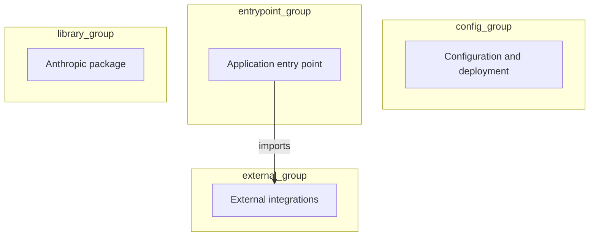

# Architecture report: asgeirtj/system_prompts_leaks

> Automated static analysis. **Observed** = directly seen in files/imports/AST; **Inferred** = interpretation from that evidence. Repository code was not executed.

## 1. Repository at a glance

| Item | Value |
| --- | --- |
| Repository | asgeirtj/system_prompts_leaks |
| Description | Leaked system prompts of ChatGPT, Claude, Gemini and more. The hidden system prompt of every popular chatbot, in full, every version since May 2025. Also Anthropic Claude Code, OpenAI Codex, Google Antigravity, xAI Grok, Meta Muse, Moonshot Kimi, Alibaba Qwen, Z.ai GLM ZCode, MiniMax, Cursor, Perpl… |
| Language | Python |
| Stars | 71410 |
| Licence | CC0-1.0 |
| Analysed commit / branch | bb4c9c5a8bcbe281e2fbe3fd1fa961e514c0a93f / main |
| Framework(s) | None detected |
| Files analysed | 547 |
| Components | 4 |

## 2. Architecture in one minute

asgeirtj/system_prompts_leaks - Leaked system prompts of ChatGPT, Claude, Gemini and more. The hidden system prompt of every popular chatbot, in full, every version since May 2025. Also Anthropic Claude Code, OpenAI Codex, Google A…. This repository was analysed statically from 547 file(s) (67 Python). Detected technologies (observed from imports/manifests): no known frameworks/libraries. Files are grouped into 4 component(s): Anthropic package, Configuration and deployment, Application entry point, External integrations. Observed entry point(s): Anthropic/claude-code/skills/claude-api/shared/latency-optimization/latency_probe.py, Anthropic/claude-code/skills/claude-api/shared/preserved-thinking-migration/drop_block_probe.py, Anthropic/claude-code/skills/claude-api/shared/preserved-thinking-migration/prefix_diff.py. Findings below distinguish observed facts from inferred interpretation.

## 3. High-level block diagram

## 4. Main components

### Anthropic package (`anthropic`)

- **Kind:** library
- **Status:** Observed
- **Confidence:** 0.85
- **Responsibility:** Groups 72 file(s) under anthropic package (observed from repository paths and static analysis). Observed top-level functions: _canonical_ids, _check_chart_axis_references, _check_decimal_settings, _check_preset_dashes, _check_series_order, _check_stacked_label_positions.
- **Paths:** `Anthropic/claude-code/skills/artifact-capabilities/0.2.96/artifact.d.ts`, `Anthropic/claude-code/skills/artifact-capabilities/0.2.96/assets.d.ts`, `Anthropic/claude-code/skills/artifact-capabilities/0.2.96/claude.d.ts`, `Anthropic/claude-code/skills/artifact-capabilities/0.2.96/comments.d.ts`, `Anthropic/claude-code/skills/artifact-capabilities/0.2.96/db.d.ts`, `Anthropic/claude-code/skills/artifact-capabilities/0.2.96/dictation.d.ts`, `Anthropic/claude-code/skills/artifact-capabilities/0.2.96/downloads.d.ts`, `Anthropic/claude-code/skills/artifact-capabilities/0.2.96/files.d.ts`, `Anthropic/claude-code/skills/artifact-capabilities/0.2.96/mcp.d.ts`, `Anthropic/claude-code/skills/artifact-capabilities/0.2.96/permissions.d.ts`, `Anthropic/claude-code/skills/artifact-capabilities/0.2.96/room.d.ts`, `Anthropic/claude-code/skills/artifact-capabilities/0.2.96/sample.d.ts`, `Anthropic/claude-code/skills/artifact-capabilities/0.2.96/self.d.ts`, `Anthropic/claude-code/skills/artifact-capabilities/0.2.96/tts.d.ts`, `Anthropic/claude-code/skills/artifact-capabilities/0.2.96/user.d.ts`, `Anthropic/claude-code/skills/claude-api/shared/evals/report/build-report-lite.mjs`, `Anthropic/claude-code/skills/claude-api/shared/evals/report/runner-scaffold.mjs`, `Anthropic/claude-code/skills/dataviz/scripts/validate_palette.js`, `Anthropic/claude-code/skills/deep-research/scripts/workflow-script.js`, `Anthropic/claude-code/skills/design-sync/lib/bundle.mjs`, `Anthropic/claude-code/skills/design-sync/lib/common.mjs`, `Anthropic/claude-code/skills/design-sync/lib/css-fallback.mjs`, `Anthropic/claude-code/skills/design-sync/lib/css.mjs`, `Anthropic/claude-code/skills/design-sync/lib/detect.mjs`, `Anthropic/claude-code/skills/design-sync/lib/docs.mjs`, `Anthropic/claude-code/skills/design-sync/lib/dts.mjs`, `Anthropic/claude-code/skills/design-sync/lib/emit.mjs`, `Anthropic/claude-code/skills/design-sync/lib/preview-gen-storybook.mjs`, `Anthropic/claude-code/skills/design-sync/lib/preview-rebuild.mjs`, `Anthropic/claude-code/skills/design-sync/lib/previews.mjs`, `Anthropic/claude-code/skills/design-sync/lib/remote-diff.mjs`, `Anthropic/claude-code/skills/design-sync/lib/source-kit.mjs`, `Anthropic/claude-code/skills/design-sync/lib/source-storybook.mjs`, `Anthropic/claude-code/skills/design-sync/lib/story-imports.mjs`, `Anthropic/claude-code/skills/design-sync/lib/sync-hashes.mjs`, `Anthropic/claude-code/skills/design-sync/package-build.mjs`, `Anthropic/claude-code/skills/design-sync/package-capture.mjs`, `Anthropic/claude-code/skills/design-sync/package-validate.mjs`, `Anthropic/claude-code/skills/design-sync/resync.mjs`, `Anthropic/claude-code/skills/design-sync/storybook/compare.mjs`, `Anthropic/claude-code/skills/design-sync/storybook/http-serve.mjs`, `Anthropic/claude-code/skills/design-sync/storybook/probe.mjs`, `Anthropic/claude-code/skills/docx/scripts/__init__.py`, `Anthropic/claude-code/skills/docx/scripts/office/helpers/__init__.py`, `Anthropic/claude-code/skills/docx/scripts/office/helpers/pptx_chart.py`, `Anthropic/claude-code/skills/docx/scripts/office/helpers/pptx_slide.py`, `Anthropic/claude-code/skills/docx/scripts/office/helpers/pptx_theme.py`, `Anthropic/claude-code/skills/docx/scripts/office/validators/__init__.py`, `Anthropic/claude-code/skills/pdf/scripts/check_fillable_fields.py`, `Anthropic/claude-code/skills/plugin-authoring/examples/band-state.d.ts`, `Anthropic/claude-code/skills/plugin-authoring/examples/band.tsx`, `Anthropic/claude-code/skills/plugin-authoring/examples/look.ts`, `Anthropic/claude-code/skills/plugin-authoring/examples/pane-state.d.ts`, `Anthropic/claude-code/skills/plugin-authoring/examples/pane.test.tsx`, `Anthropic/claude-code/skills/plugin-authoring/examples/pane.tsx`, `Anthropic/claude-code/skills/plugin-authoring/examples/tool-call.ts`, `Anthropic/claude-code/skills/plugin-authoring/make-colors.d.ts`, `Anthropic/claude-code/skills/plugin-authoring/make-colors.js`, `Anthropic/claude-code/skills/pptx/scripts/__init__.py`, `Anthropic/claude-code/skills/pptx/scripts/apply_theme.js`, `Anthropic/claude-code/skills/pptx/scripts/office/helpers/__init__.py`, `Anthropic/claude-code/skills/pptx/scripts/office/helpers/pptx_chart.py`, `Anthropic/claude-code/skills/pptx/scripts/office/helpers/pptx_slide.py`, `Anthropic/claude-code/skills/pptx/scripts/office/helpers/pptx_theme.py`, `Anthropic/claude-code/skills/pptx/scripts/office/validators/__init__.py`, `Anthropic/claude-code/skills/skill-creator/scripts/__init__.py`, `Anthropic/claude-code/skills/skill-creator/scripts/utils.py`, `Anthropic/claude-code/skills/xlsx/scripts/office/helpers/__init__.py`, `Anthropic/claude-code/skills/xlsx/scripts/office/helpers/pptx_chart.py`, `Anthropic/claude-code/skills/xlsx/scripts/office/helpers/pptx_slide.py`, `Anthropic/claude-code/skills/xlsx/scripts/office/helpers/pptx_theme.py`, `Anthropic/claude-code/skills/xlsx/scripts/office/validators/__init__.py`
- **Evidence:** [Anthropic/claude-code/skills/artifact-capabilities/0.2.96/artifact.d.ts](https://github.com/asgeirtj/system_prompts_leaks/blob/bb4c9c5a8bcbe281e2fbe3fd1fa961e514c0a93f/Anthropic/claude-code/skills/artifact-capabilities/0.2.96/artifact.d.ts); [Anthropic/claude-code/skills/artifact-capabilities/0.2.96/assets.d.ts](https://github.com/asgeirtj/system_prompts_leaks/blob/bb4c9c5a8bcbe281e2fbe3fd1fa961e514c0a93f/Anthropic/claude-code/skills/artifact-capabilities/0.2.96/assets.d.ts); [Anthropic/claude-code/skills/artifact-capabilities/0.2.96/claude.d.ts](https://github.com/asgeirtj/system_prompts_leaks/blob/bb4c9c5a8bcbe281e2fbe3fd1fa961e514c0a93f/Anthropic/claude-code/skills/artifact-capabilities/0.2.96/claude.d.ts); [Anthropic/claude-code/skills/artifact-capabilities/0.2.96/comments.d.ts](https://github.com/asgeirtj/system_prompts_leaks/blob/bb4c9c5a8bcbe281e2fbe3fd1fa961e514c0a93f/Anthropic/claude-code/skills/artifact-capabilities/0.2.96/comments.d.ts); [Anthropic/claude-code/skills/artifact-capabilities/0.2.96/db.d.ts](https://github.com/asgeirtj/system_prompts_leaks/blob/bb4c9c5a8bcbe281e2fbe3fd1fa961e514c0a93f/Anthropic/claude-code/skills/artifact-capabilities/0.2.96/db.d.ts); [Anthropic/claude-code/skills/artifact-capabilities/0.2.96/dictation.d.ts](https://github.com/asgeirtj/system_prompts_leaks/blob/bb4c9c5a8bcbe281e2fbe3fd1fa961e514c0a93f/Anthropic/claude-code/skills/artifact-capabilities/0.2.96/dictation.d.ts); [Anthropic/claude-code/skills/artifact-capabilities/0.2.96/downloads.d.ts](https://github.com/asgeirtj/system_prompts_leaks/blob/bb4c9c5a8bcbe281e2fbe3fd1fa961e514c0a93f/Anthropic/claude-code/skills/artifact-capabilities/0.2.96/downloads.d.ts); [Anthropic/claude-code/skills/artifact-capabilities/0.2.96/files.d.ts](https://github.com/asgeirtj/system_prompts_leaks/blob/bb4c9c5a8bcbe281e2fbe3fd1fa961e514c0a93f/Anthropic/claude-code/skills/artifact-capabilities/0.2.96/files.d.ts)

### Configuration and deployment (`config`)

- **Kind:** config
- **Status:** Observed
- **Confidence:** 0.85
- **Responsibility:** Groups 5 file(s) under configuration and deployment (observed from repository paths and static analysis).
- **Paths:** `Anthropic/artifact-types/design-system/artifact-type/reference/sample-seazar-tokens.json`, `Anthropic/artifact-types/design/artifact-type/reference/google-fonts-families.json`, `Anthropic/artifact-types/design/artifact-type/reference/google-fonts-reserved.json`, `Anthropic/artifact-types/slides/artifact-type/reference/google-fonts-families.json`, `Anthropic/artifact-types/slides/artifact-type/reference/google-fonts-reserved.json`
- **Evidence:** [Anthropic/artifact-types/design-system/artifact-type/reference/sample-seazar-tokens.json](https://github.com/asgeirtj/system_prompts_leaks/blob/bb4c9c5a8bcbe281e2fbe3fd1fa961e514c0a93f/Anthropic/artifact-types/design-system/artifact-type/reference/sample-seazar-tokens.json); [Anthropic/artifact-types/design/artifact-type/reference/google-fonts-families.json](https://github.com/asgeirtj/system_prompts_leaks/blob/bb4c9c5a8bcbe281e2fbe3fd1fa961e514c0a93f/Anthropic/artifact-types/design/artifact-type/reference/google-fonts-families.json); [Anthropic/artifact-types/design/artifact-type/reference/google-fonts-reserved.json](https://github.com/asgeirtj/system_prompts_leaks/blob/bb4c9c5a8bcbe281e2fbe3fd1fa961e514c0a93f/Anthropic/artifact-types/design/artifact-type/reference/google-fonts-reserved.json); [Anthropic/artifact-types/slides/artifact-type/reference/google-fonts-families.json](https://github.com/asgeirtj/system_prompts_leaks/blob/bb4c9c5a8bcbe281e2fbe3fd1fa961e514c0a93f/Anthropic/artifact-types/slides/artifact-type/reference/google-fonts-families.json); [Anthropic/artifact-types/slides/artifact-type/reference/google-fonts-reserved.json](https://github.com/asgeirtj/system_prompts_leaks/blob/bb4c9c5a8bcbe281e2fbe3fd1fa961e514c0a93f/Anthropic/artifact-types/slides/artifact-type/reference/google-fonts-reserved.json)

### Application entry point (`entrypoint`)

- **Kind:** entrypoint
- **Status:** Observed
- **Confidence:** 0.85
- **Responsibility:** Groups 47 file(s) under application entry point (observed from repository paths and static analysis). Observed top-level classes: BaseSchemaValidator, Connection, DOCXSchemaValidator, PPTXSchemaValidator, RectAndField, RedliningValidator. Observed top-level functions: _add_slide_title, _add_to_content_types, _add_to_presentation_rels, _apca_y, _append_xml, _as_argument.
- **Paths:** `Anthropic/claude-code/skills/claude-api/shared/latency-optimization/latency_probe.py`, `Anthropic/claude-code/skills/claude-api/shared/preserved-thinking-migration/drop_block_probe.py`, `Anthropic/claude-code/skills/claude-api/shared/preserved-thinking-migration/prefix_diff.py`, `Anthropic/claude-code/skills/dataviz/scripts/validate_palette.py`, `Anthropic/claude-code/skills/docx/scripts/accept_changes.py`, `Anthropic/claude-code/skills/docx/scripts/comment.py`, `Anthropic/claude-code/skills/docx/scripts/merge_runs.py`, `Anthropic/claude-code/skills/docx/scripts/office/soffice.py`, `Anthropic/claude-code/skills/docx/scripts/office/validate.py`, `Anthropic/claude-code/skills/docx/scripts/office/validators/base.py`, `Anthropic/claude-code/skills/docx/scripts/office/validators/docx.py`, `Anthropic/claude-code/skills/docx/scripts/office/validators/pptx.py`, `Anthropic/claude-code/skills/docx/scripts/office/validators/redlining.py`, `Anthropic/claude-code/skills/google-workspace/scripts/docs_index.py`, `Anthropic/claude-code/skills/google-workspace/scripts/render_export.py`, `Anthropic/claude-code/skills/google-workspace/scripts/sheets_helper.py`, `Anthropic/claude-code/skills/google-workspace/scripts/slides_helper.py`, `Anthropic/claude-code/skills/pdf/scripts/check_bounding_boxes.py`, `Anthropic/claude-code/skills/pdf/scripts/convert_pdf_to_images.py`, `Anthropic/claude-code/skills/pdf/scripts/create_validation_image.py`, `Anthropic/claude-code/skills/pdf/scripts/extract_form_field_info.py`, `Anthropic/claude-code/skills/pdf/scripts/extract_form_structure.py`, `Anthropic/claude-code/skills/pdf/scripts/fill_fillable_fields.py`, `Anthropic/claude-code/skills/pdf/scripts/fill_pdf_form_with_annotations.py`, `Anthropic/claude-code/skills/pptx/scripts/add_slide.py`, `Anthropic/claude-code/skills/pptx/scripts/clean.py`, `Anthropic/claude-code/skills/pptx/scripts/office/soffice.py`, `Anthropic/claude-code/skills/pptx/scripts/office/validate.py`, `Anthropic/claude-code/skills/pptx/scripts/office/validators/base.py`, `Anthropic/claude-code/skills/pptx/scripts/office/validators/docx.py`, `Anthropic/claude-code/skills/pptx/scripts/office/validators/pptx.py`, `Anthropic/claude-code/skills/pptx/scripts/office/validators/redlining.py`, `Anthropic/claude-code/skills/pptx/scripts/slide_text.py`, `Anthropic/claude-code/skills/pptx/scripts/thumbnail.py`, `Anthropic/claude-code/skills/skill-creator/eval-viewer/generate_review.py`, `Anthropic/claude-code/skills/skill-creator/scripts/aggregate_benchmark.py`, `Anthropic/claude-code/skills/skill-creator/scripts/generate_report.py`, `Anthropic/claude-code/skills/skill-creator/scripts/improve_description.py`, `Anthropic/claude-code/skills/skill-creator/scripts/package_skill.py`, `Anthropic/claude-code/skills/skill-creator/scripts/quick_validate.py`, `Anthropic/claude-code/skills/skill-creator/scripts/run_eval.py`, `Anthropic/claude-code/skills/skill-creator/scripts/run_loop.py`, `Anthropic/claude-code/skills/xlsx/scripts/office/soffice.py`, `Anthropic/claude-code/skills/xlsx/scripts/office/validate.py`, `Anthropic/claude-code/skills/xlsx/scripts/office/validators/base.py`, `Anthropic/claude-code/skills/xlsx/scripts/office/validators/docx.py`, `Anthropic/claude-code/skills/xlsx/scripts/office/validators/redlining.py`
- **Evidence:** [Anthropic/claude-code/skills/claude-api/shared/latency-optimization/latency_probe.py:204](https://github.com/asgeirtj/system_prompts_leaks/blob/bb4c9c5a8bcbe281e2fbe3fd1fa961e514c0a93f/Anthropic/claude-code/skills/claude-api/shared/latency-optimization/latency_probe.py#L204); [Anthropic/claude-code/skills/claude-api/shared/preserved-thinking-migration/drop_block_probe.py:148](https://github.com/asgeirtj/system_prompts_leaks/blob/bb4c9c5a8bcbe281e2fbe3fd1fa961e514c0a93f/Anthropic/claude-code/skills/claude-api/shared/preserved-thinking-migration/drop_block_probe.py#L148); [Anthropic/claude-code/skills/claude-api/shared/preserved-thinking-migration/prefix_diff.py:86](https://github.com/asgeirtj/system_prompts_leaks/blob/bb4c9c5a8bcbe281e2fbe3fd1fa961e514c0a93f/Anthropic/claude-code/skills/claude-api/shared/preserved-thinking-migration/prefix_diff.py#L86); [Anthropic/claude-code/skills/dataviz/scripts/validate_palette.py:59](https://github.com/asgeirtj/system_prompts_leaks/blob/bb4c9c5a8bcbe281e2fbe3fd1fa961e514c0a93f/Anthropic/claude-code/skills/dataviz/scripts/validate_palette.py#L59); [Anthropic/claude-code/skills/docx/scripts/accept_changes.py:36](https://github.com/asgeirtj/system_prompts_leaks/blob/bb4c9c5a8bcbe281e2fbe3fd1fa961e514c0a93f/Anthropic/claude-code/skills/docx/scripts/accept_changes.py#L36); [Anthropic/claude-code/skills/docx/scripts/comment.py:90](https://github.com/asgeirtj/system_prompts_leaks/blob/bb4c9c5a8bcbe281e2fbe3fd1fa961e514c0a93f/Anthropic/claude-code/skills/docx/scripts/comment.py#L90); [Anthropic/claude-code/skills/docx/scripts/merge_runs.py:40](https://github.com/asgeirtj/system_prompts_leaks/blob/bb4c9c5a8bcbe281e2fbe3fd1fa961e514c0a93f/Anthropic/claude-code/skills/docx/scripts/merge_runs.py#L40); [Anthropic/claude-code/skills/docx/scripts/office/soffice.py:27](https://github.com/asgeirtj/system_prompts_leaks/blob/bb4c9c5a8bcbe281e2fbe3fd1fa961e514c0a93f/Anthropic/claude-code/skills/docx/scripts/office/soffice.py#L27)

### External integrations (`external_integrations`)

- **Kind:** external
- **Status:** Inferred
- **Confidence:** 0.70
- **Responsibility:** Groups 0 file(s) under external integrations (observed from repository paths and static analysis).
- **Evidence:** [Anthropic/claude-code/skills/claude-api/shared/latency-optimization/latency_probe.py:171](https://github.com/asgeirtj/system_prompts_leaks/blob/bb4c9c5a8bcbe281e2fbe3fd1fa961e514c0a93f/Anthropic/claude-code/skills/claude-api/shared/latency-optimization/latency_probe.py#L171); [Anthropic/claude-code/skills/claude-api/shared/preserved-thinking-migration/drop_block_probe.py:102](https://github.com/asgeirtj/system_prompts_leaks/blob/bb4c9c5a8bcbe281e2fbe3fd1fa961e514c0a93f/Anthropic/claude-code/skills/claude-api/shared/preserved-thinking-migration/drop_block_probe.py#L102); [Anthropic/claude-code/skills/docx/scripts/office/soffice.py:20](https://github.com/asgeirtj/system_prompts_leaks/blob/bb4c9c5a8bcbe281e2fbe3fd1fa961e514c0a93f/Anthropic/claude-code/skills/docx/scripts/office/soffice.py#L20); [Anthropic/claude-code/skills/pptx/scripts/office/soffice.py:20](https://github.com/asgeirtj/system_prompts_leaks/blob/bb4c9c5a8bcbe281e2fbe3fd1fa961e514c0a93f/Anthropic/claude-code/skills/pptx/scripts/office/soffice.py#L20); [Anthropic/claude-code/skills/xlsx/scripts/office/soffice.py:20](https://github.com/asgeirtj/system_prompts_leaks/blob/bb4c9c5a8bcbe281e2fbe3fd1fa961e514c0a93f/Anthropic/claude-code/skills/xlsx/scripts/office/soffice.py#L20)

## 5. Execution flow

**Observed** entry point(s):

- [Anthropic/claude-code/skills/claude-api/shared/latency-optimization/latency_probe.py:1041](https://github.com/asgeirtj/system_prompts_leaks/blob/bb4c9c5a8bcbe281e2fbe3fd1fa961e514c0a93f/Anthropic/claude-code/skills/claude-api/shared/latency-optimization/latency_probe.py#L1041)
- [Anthropic/claude-code/skills/claude-api/shared/preserved-thinking-migration/drop_block_probe.py:1074](https://github.com/asgeirtj/system_prompts_leaks/blob/bb4c9c5a8bcbe281e2fbe3fd1fa961e514c0a93f/Anthropic/claude-code/skills/claude-api/shared/preserved-thinking-migration/drop_block_probe.py#L1074)
- [Anthropic/claude-code/skills/claude-api/shared/preserved-thinking-migration/prefix_diff.py:1531](https://github.com/asgeirtj/system_prompts_leaks/blob/bb4c9c5a8bcbe281e2fbe3fd1fa961e514c0a93f/Anthropic/claude-code/skills/claude-api/shared/preserved-thinking-migration/prefix_diff.py#L1531)
- [Anthropic/claude-code/skills/dataviz/scripts/validate_palette.py:342](https://github.com/asgeirtj/system_prompts_leaks/blob/bb4c9c5a8bcbe281e2fbe3fd1fa961e514c0a93f/Anthropic/claude-code/skills/dataviz/scripts/validate_palette.py#L342)
- [Anthropic/claude-code/skills/docx/scripts/accept_changes.py:121](https://github.com/asgeirtj/system_prompts_leaks/blob/bb4c9c5a8bcbe281e2fbe3fd1fa961e514c0a93f/Anthropic/claude-code/skills/docx/scripts/accept_changes.py#L121)
- [Anthropic/claude-code/skills/docx/scripts/comment.py:367](https://github.com/asgeirtj/system_prompts_leaks/blob/bb4c9c5a8bcbe281e2fbe3fd1fa961e514c0a93f/Anthropic/claude-code/skills/docx/scripts/comment.py#L367)
- [Anthropic/claude-code/skills/docx/scripts/merge_runs.py:309](https://github.com/asgeirtj/system_prompts_leaks/blob/bb4c9c5a8bcbe281e2fbe3fd1fa961e514c0a93f/Anthropic/claude-code/skills/docx/scripts/merge_runs.py#L309)
- [Anthropic/claude-code/skills/docx/scripts/office/soffice.py:189](https://github.com/asgeirtj/system_prompts_leaks/blob/bb4c9c5a8bcbe281e2fbe3fd1fa961e514c0a93f/Anthropic/claude-code/skills/docx/scripts/office/soffice.py#L189)
- [Anthropic/claude-code/skills/docx/scripts/office/validate.py:209](https://github.com/asgeirtj/system_prompts_leaks/blob/bb4c9c5a8bcbe281e2fbe3fd1fa961e514c0a93f/Anthropic/claude-code/skills/docx/scripts/office/validate.py#L209)
- [Anthropic/claude-code/skills/docx/scripts/office/validators/base.py:886](https://github.com/asgeirtj/system_prompts_leaks/blob/bb4c9c5a8bcbe281e2fbe3fd1fa961e514c0a93f/Anthropic/claude-code/skills/docx/scripts/office/validators/base.py#L886)
- [Anthropic/claude-code/skills/docx/scripts/office/validators/docx.py:518](https://github.com/asgeirtj/system_prompts_leaks/blob/bb4c9c5a8bcbe281e2fbe3fd1fa961e514c0a93f/Anthropic/claude-code/skills/docx/scripts/office/validators/docx.py#L518)
- [Anthropic/claude-code/skills/docx/scripts/office/validators/pptx.py:548](https://github.com/asgeirtj/system_prompts_leaks/blob/bb4c9c5a8bcbe281e2fbe3fd1fa961e514c0a93f/Anthropic/claude-code/skills/docx/scripts/office/validators/pptx.py#L548)

Representative flow (derived from observed entry points and the import graph; steps beyond the entry point are **Inferred**):

1. Execution starts at an observed entry point listed above, if present.
2. `entrypoint` imports `external_integrations` (Application entry point -> External integrations).

## 6. Project structure

### `(root)`

- `.editorconfig` - config (62 bytes)
- `.gitattributes` - other (352 bytes)

### `.github`

- `.github/FUNDING.yml` - config (64 bytes)

### `Anthropic`

- `Anthropic/anthropic-interviewer.md` - docs (11711 bytes)
- `Anthropic/anthropic_reminders.md` - docs (10597 bytes)
- `Anthropic/artifact-types/dashboard/SKILL.md` - docs (20246 bytes)
- `Anthropic/artifact-types/dashboard/artifact-type/reference/admin-setup.md` - docs (6752 bytes)
- `Anthropic/artifact-types/dashboard/artifact-type/reference/dependent-calls.md` - docs (3128 bytes)
- `Anthropic/artifact-types/dashboard/artifact-type/reference/design-defaults.md` - docs (8341 bytes)
- `Anthropic/artifact-types/dashboard/artifact-type/reference/design-system.md` - docs (8134 bytes)
- `Anthropic/artifact-types/dashboard/artifact-type/reference/exporting.md` - docs (2787 bytes)
- `Anthropic/artifact-types/dashboard/artifact-type/reference/features.md` - docs (8374 bytes)
- `Anthropic/artifact-types/dashboard/artifact-type/reference/looks.md` - docs (2991 bytes)
- `Anthropic/artifact-types/dashboard/artifact-type/reference/one-writer.md` - docs (5660 bytes)
- `Anthropic/artifact-types/dashboard/artifact-type/reference/questions.md` - docs (6085 bytes)
- `Anthropic/artifact-types/dashboard/artifact-type/reference/read-aloud.md` - docs (8686 bytes)
- `Anthropic/artifact-types/dashboard/artifact-type/reference/remix.md` - docs (5460 bytes)
- `Anthropic/artifact-types/dashboard/artifact-type/reference/scheduled-refresh-routine.md` - docs (719 bytes)
- `Anthropic/artifact-types/dashboard/artifact-type/reference/sources.md` - docs (16494 bytes)
- `Anthropic/artifact-types/dashboard/artifact-type/reference/visual-short-script.md` - docs (12431 bytes)
- `Anthropic/artifact-types/dashboard/artifact-type/reference/visual-short-skeleton.md` - docs (12984 bytes)
- `Anthropic/artifact-types/dashboard/artifact-type/reference/visual-short.md` - docs (9548 bytes)
- `Anthropic/artifact-types/design-system/SKILL.md` - docs (16063 bytes)
- `Anthropic/artifact-types/design-system/artifact-type/reference/cover.md` - docs (6710 bytes)
- `Anthropic/artifact-types/design-system/artifact-type/reference/craft.md` - docs (11076 bytes)
- `Anthropic/artifact-types/design-system/artifact-type/reference/format.md` - docs (16237 bytes)
- `Anthropic/artifact-types/design-system/artifact-type/reference/from-code.md` - docs (13350 bytes)
- `Anthropic/artifact-types/design-system/artifact-type/reference/from-design-tool.md` - docs (16132 bytes)
- `Anthropic/artifact-types/design-system/artifact-type/reference/sample-seazar-tokens.json` - config (11291 bytes)
- `Anthropic/artifact-types/design/SKILL.md` - docs (16918 bytes)
- `Anthropic/artifact-types/design/artifact-type/reference/brand-colors.md` - docs (2248 bytes)
- `Anthropic/artifact-types/design/artifact-type/reference/brand-typography.md` - docs (1544 bytes)
- `Anthropic/artifact-types/design/artifact-type/reference/craft.md` - docs (16110 bytes)
- `Anthropic/artifact-types/design/artifact-type/reference/design-system-components.md` - docs (12368 bytes)
- `Anthropic/artifact-types/design/artifact-type/reference/diagrams.md` - docs (10627 bytes)
- `Anthropic/artifact-types/design/artifact-type/reference/format.md` - docs (11311 bytes)
- `Anthropic/artifact-types/design/artifact-type/reference/google-fonts-families.json` - config (26440 bytes)
- `Anthropic/artifact-types/design/artifact-type/reference/google-fonts-reserved.json` - config (7403 bytes)
- `Anthropic/artifact-types/design/artifact-type/reference/make-from-this.md` - docs (2014 bytes)
- `Anthropic/artifact-types/design/artifact-type/reference/print.md` - docs (5837 bytes)
- `Anthropic/artifact-types/design/artifact-type/reference/questions.md` - docs (4421 bytes)
- `Anthropic/artifact-types/design/artifact-type/reference/shaders.md` - docs (15999 bytes)
- `Anthropic/artifact-types/design/artifact-type/reference/view-state.md` - docs (8937 bytes)
- `Anthropic/artifact-types/docs/SKILL.md` - docs (13131 bytes)
- `Anthropic/artifact-types/motion/SKILL.md` - docs (16064 bytes)
- `Anthropic/artifact-types/motion/artifact-type/reference/film-api.md` - docs (16029 bytes)
- `Anthropic/artifact-types/motion/artifact-type/reference/finalize.md` - docs (15954 bytes)
- `Anthropic/artifact-types/motion/artifact-type/reference/motion.md` - docs (16106 bytes)
- `Anthropic/artifact-types/motion/artifact-type/reference/plan.md` - docs (13861 bytes)
- `Anthropic/artifact-types/motion/artifact-type/reference/questions.md` - docs (16008 bytes)
- `Anthropic/artifact-types/motion/artifact-type/reference/recreate-ui.md` - docs (8367 bytes)
- `Anthropic/artifact-types/motion/artifact-type/reference/render-offline.md` - docs (14363 bytes)
- `Anthropic/artifact-types/motion/artifact-type/reference/rough-cut.md` - docs (15991 bytes)
- `Anthropic/artifact-types/motion/artifact-type/reference/sound.md` - docs (6772 bytes)
- `Anthropic/artifact-types/motion/artifact-type/reference/styles.md` - docs (14897 bytes)
- `Anthropic/artifact-types/motion/artifact-type/reference/walkthrough.md` - docs (4653 bytes)
- `Anthropic/artifact-types/sheets/SKILL.md` - docs (23750 bytes)
- `Anthropic/artifact-types/slides/SKILL.md` - docs (20918 bytes)
- `Anthropic/artifact-types/slides/artifact-type/reference/craft.md` - docs (11619 bytes)
- `Anthropic/artifact-types/slides/artifact-type/reference/deck-files.md` - docs (15951 bytes)
- `Anthropic/artifact-types/slides/artifact-type/reference/diagram-recipes.md` - docs (14285 bytes)
- `Anthropic/artifact-types/slides/artifact-type/reference/diagrams.md` - docs (15963 bytes)
- `Anthropic/artifact-types/slides/artifact-type/reference/fonts.md` - docs (13570 bytes)
- `Anthropic/artifact-types/slides/artifact-type/reference/format.md` - docs (15832 bytes)
- `Anthropic/artifact-types/slides/artifact-type/reference/google-fonts-families.json` - config (26440 bytes)
- `Anthropic/artifact-types/slides/artifact-type/reference/google-fonts-reserved.json` - config (7403 bytes)
- `Anthropic/artifact-types/slides/artifact-type/reference/images.md` - docs (8563 bytes)
- `Anthropic/artifact-types/slides/artifact-type/reference/layout.md` - docs (11198 bytes)
- `Anthropic/artifact-types/slides/artifact-type/reference/photo-library.md` - docs (3412 bytes)
- `Anthropic/artifact-types/slides/artifact-type/reference/questions.md` - docs (4271 bytes)
- `Anthropic/artifact-types/slides/artifact-type/reference/styles.md` - docs (7164 bytes)
- `Anthropic/artifact-types/slides/artifact-type/reference/view-state.md` - docs (9925 bytes)
- `Anthropic/artifact-types/slides/artifact-type/reference/viewer.md` - docs (3845 bytes)
- `Anthropic/artifact-types/types-listing.md` - docs (3126 bytes)
- `Anthropic/artifact-types/whiteboard/SKILL.md` - docs (21489 bytes)
- `Anthropic/artifact-types/whiteboard/artifact-type/reference/ideas.md` - docs (6143 bytes)
- `Anthropic/artifact-types/whiteboard/artifact-type/reference/pictures.md` - docs (9407 bytes)
- `Anthropic/claude-code/agents/Explore.md` - docs (3200 bytes)
- `Anthropic/claude-code/agents/Plan.md` - docs (2702 bytes)
- `Anthropic/claude-code/agents/claude-code-guide.md` - docs (41998 bytes)
- `Anthropic/claude-code/agents/claude.md` - docs (2016 bytes)
- `Anthropic/claude-code/agents/fork.md` - docs (1232 bytes)
- `Anthropic/claude-code/agents/general-purpose.md` - docs (1763 bytes)
- `Anthropic/claude-code/agents/shared-notes.md` - docs (1242 bytes)
- `Anthropic/claude-code/agents/statusline-setup.md` - docs (12985 bytes)
- `Anthropic/claude-code/agents/web-fetch.md` - docs (5046 bytes)
- `Anthropic/claude-code/claude-code-docs-assistant.md` - docs (18587 bytes)
- `Anthropic/claude-code/output-styles/concise.md` - docs (1621 bytes)
- `Anthropic/claude-code/output-styles/explanatory.md` - docs (1343 bytes)
- `Anthropic/claude-code/output-styles/learning.md` - docs (4484 bytes)
- `Anthropic/claude-code/output-styles/proactive.md` - docs (1868 bytes)
- `Anthropic/claude-code/prompts/advisor-tool.md` - docs (7839 bytes)
- `Anthropic/claude-code/prompts/auto-mode-classifier.md` - docs (141909 bytes)
- `Anthropic/claude-code/prompts/btw.md` - docs (1349 bytes)
- `Anthropic/claude-code/prompts/compact.md` - docs (6410 bytes)
- `Anthropic/claude-code/prompts/plan-mode.md` - docs (4911 bytes)
- `Anthropic/claude-code/prompts/prompt-suggestion.md` - docs (1378 bytes)
- `Anthropic/claude-code/prompts/session-recap.md` - docs (254 bytes)
- `Anthropic/claude-code/prompts/session-rename.md` - docs (474 bytes)
- `Anthropic/claude-code/prompts/session-title.md` - docs (3309 bytes)
- `Anthropic/claude-code/prompts/you-should-know.md` - docs (32902 bytes)
- `Anthropic/claude-code/skills/anthropic-skills/deep-research/SKILL.md` - docs (13174 bytes)
- `Anthropic/claude-code/skills/anthropic-skills/deep-research/references/report-writer.md` - docs (6170 bytes)
- `Anthropic/claude-code/skills/anthropic-skills/deep-research/references/researcher.md` - docs (4224 bytes)
- `Anthropic/claude-code/skills/artifact-capabilities/0.2.96/artifact.d.ts` - source, TypeScript (33001 bytes)
- `Anthropic/claude-code/skills/artifact-capabilities/0.2.96/assets.d.ts` - source, TypeScript (18016 bytes)
- `Anthropic/claude-code/skills/artifact-capabilities/0.2.96/claude.d.ts` - source, TypeScript (3017 bytes)
- `Anthropic/claude-code/skills/artifact-capabilities/0.2.96/comments.d.ts` - source, TypeScript (37909 bytes)
- `Anthropic/claude-code/skills/artifact-capabilities/0.2.96/db.d.ts` - source, TypeScript (29777 bytes)
- `Anthropic/claude-code/skills/artifact-capabilities/0.2.96/dictation.d.ts` - source, TypeScript (6903 bytes)
- `Anthropic/claude-code/skills/artifact-capabilities/0.2.96/downloads.d.ts` - source, TypeScript (6055 bytes)
- `Anthropic/claude-code/skills/artifact-capabilities/0.2.96/files.d.ts` - source, TypeScript (6823 bytes)
- `Anthropic/claude-code/skills/artifact-capabilities/0.2.96/mcp.d.ts` - source, TypeScript (40824 bytes)
- `Anthropic/claude-code/skills/artifact-capabilities/0.2.96/permissions.d.ts` - source, TypeScript (4320 bytes)
- `Anthropic/claude-code/skills/artifact-capabilities/0.2.96/room.d.ts` - source, TypeScript (34952 bytes)
- `Anthropic/claude-code/skills/artifact-capabilities/0.2.96/sample.d.ts` - source, TypeScript (40081 bytes)
- `Anthropic/claude-code/skills/artifact-capabilities/0.2.96/self.d.ts` - source, TypeScript (644 bytes)
- `Anthropic/claude-code/skills/artifact-capabilities/0.2.96/tts.d.ts` - source, TypeScript (16524 bytes)
- `Anthropic/claude-code/skills/artifact-capabilities/0.2.96/user.d.ts` - source, TypeScript (15236 bytes)
- `Anthropic/claude-code/skills/artifact-capabilities/SKILL.md` - docs (26347 bytes)
- `Anthropic/claude-code/skills/artifact-design/SKILL.md` - docs (39040 bytes)
- `Anthropic/claude-code/skills/artifact-diagramming/SKILL.md` - docs (4057 bytes)
- `Anthropic/claude-code/skills/batch/SKILL.md` - docs (5354 bytes)
- `Anthropic/claude-code/skills/built-in-browser/LICENSE.txt` - docs (1467 bytes)
- `Anthropic/claude-code/skills/built-in-browser/SKILL.md` - docs (7061 bytes)
- `Anthropic/claude-code/skills/chrome-browser/LICENSE.txt` - docs (1467 bytes)
- `Anthropic/claude-code/skills/chrome-browser/SKILL.md` - docs (5881 bytes)
- `Anthropic/claude-code/skills/claude-api/SKILL.md` - docs (113769 bytes)
- `Anthropic/claude-code/skills/claude-api/csharp/claude-api/README.md` - docs (19073 bytes)
- `Anthropic/claude-code/skills/claude-api/csharp/claude-api/batches.md` - docs (413 bytes)
- `Anthropic/claude-code/skills/claude-api/csharp/claude-api/files-api.md` - docs (900 bytes)
- `Anthropic/claude-code/skills/claude-api/csharp/claude-api/opentelemetry.md` - docs (2537 bytes)
- `Anthropic/claude-code/skills/claude-api/csharp/claude-api/streaming.md` - docs (784 bytes)
- `Anthropic/claude-code/skills/claude-api/csharp/claude-api/tool-use.md` - docs (7610 bytes)
- `Anthropic/claude-code/skills/claude-api/curl/examples.md` - docs (9723 bytes)
- `Anthropic/claude-code/skills/claude-api/curl/managed-agents.md` - docs (11008 bytes)
- `Anthropic/claude-code/skills/claude-api/go/claude-api/README.md` - docs (8602 bytes)
- `Anthropic/claude-code/skills/claude-api/go/claude-api/files-api.md` - docs (936 bytes)
- `Anthropic/claude-code/skills/claude-api/go/claude-api/opentelemetry.md` - docs (2129 bytes)
- `Anthropic/claude-code/skills/claude-api/go/claude-api/streaming.md` - docs (1026 bytes)
- `Anthropic/claude-code/skills/claude-api/go/claude-api/tool-use.md` - docs (10023 bytes)
- `Anthropic/claude-code/skills/claude-api/go/managed-agents/README.md` - docs (20833 bytes)
- `Anthropic/claude-code/skills/claude-api/java/claude-api/README.md` - docs (12053 bytes)
- `Anthropic/claude-code/skills/claude-api/java/claude-api/files-api.md` - docs (1163 bytes)
- `Anthropic/claude-code/skills/claude-api/java/claude-api/opentelemetry.md` - docs (2692 bytes)
- `Anthropic/claude-code/skills/claude-api/java/claude-api/streaming.md` - docs (655 bytes)
- `Anthropic/claude-code/skills/claude-api/java/claude-api/tool-use.md` - docs (11052 bytes)
- `Anthropic/claude-code/skills/claude-api/java/managed-agents/README.md` - docs (19620 bytes)
- `Anthropic/claude-code/skills/claude-api/php/claude-api/README.md` - docs (6881 bytes)
- `Anthropic/claude-code/skills/claude-api/php/claude-api/batches.md` - docs (447 bytes)
- `Anthropic/claude-code/skills/claude-api/php/claude-api/files-api.md` - docs (476 bytes)
- `Anthropic/claude-code/skills/claude-api/php/claude-api/opentelemetry.md` - docs (2666 bytes)
- `Anthropic/claude-code/skills/claude-api/php/claude-api/streaming.md` - docs (677 bytes)
- `Anthropic/claude-code/skills/claude-api/php/claude-api/tool-use.md` - docs (9718 bytes)
- `Anthropic/claude-code/skills/claude-api/php/managed-agents/README.md` - docs (16586 bytes)
- `Anthropic/claude-code/skills/claude-api/python/claude-api/README.md` - docs (20730 bytes)
- `Anthropic/claude-code/skills/claude-api/python/claude-api/batches.md` - docs (5801 bytes)
- `Anthropic/claude-code/skills/claude-api/python/claude-api/files-api.md` - docs (4499 bytes)
- `Anthropic/claude-code/skills/claude-api/python/claude-api/opentelemetry.md` - docs (2683 bytes)
- `Anthropic/claude-code/skills/claude-api/python/claude-api/sdk-upgrade.md` - docs (29311 bytes)
- `Anthropic/claude-code/skills/claude-api/python/claude-api/streaming.md` - docs (12058 bytes)
- `Anthropic/claude-code/skills/claude-api/python/claude-api/tool-use.md` - docs (20084 bytes)
- `Anthropic/claude-code/skills/claude-api/python/managed-agents/README.md` - docs (15040 bytes)
- `Anthropic/claude-code/skills/claude-api/ruby/claude-api/README.md` - docs (4880 bytes)
- `Anthropic/claude-code/skills/claude-api/ruby/claude-api/opentelemetry.md` - docs (1832 bytes)
- `Anthropic/claude-code/skills/claude-api/ruby/claude-api/streaming.md` - docs (235 bytes)
- `Anthropic/claude-code/skills/claude-api/ruby/claude-api/tool-use.md` - docs (2684 bytes)
- `Anthropic/claude-code/skills/claude-api/ruby/managed-agents/README.md` - docs (12397 bytes)
- `Anthropic/claude-code/skills/claude-api/shared/admin-api.md` - docs (21311 bytes)
- `Anthropic/claude-code/skills/claude-api/shared/agent-design.md` - docs (8736 bytes)
- `Anthropic/claude-code/skills/claude-api/shared/anthropic-cli.md` - docs (25712 bytes)
- `Anthropic/claude-code/skills/claude-api/shared/api-sign-in.md` - docs (8757 bytes)
- `Anthropic/claude-code/skills/claude-api/shared/api-version-migration.md` - docs (36794 bytes)
- `Anthropic/claude-code/skills/claude-api/shared/claude-platform-on-aws.md` - docs (4692 bytes)
- `Anthropic/claude-code/skills/claude-api/shared/cost-optimization.md` - docs (61263 bytes)
- `Anthropic/claude-code/skills/claude-api/shared/error-codes.md` - docs (21998 bytes)
- `Anthropic/claude-code/skills/claude-api/shared/evals/build-eval.md` - docs (55533 bytes)
- `Anthropic/claude-code/skills/claude-api/shared/evals/cost-hillclimb.md` - docs (31905 bytes)
- `Anthropic/claude-code/skills/claude-api/shared/evals/eval-audit.md` - docs (28037 bytes)
- `Anthropic/claude-code/skills/claude-api/shared/evals/eval-hillclimb.md` - docs (70986 bytes)
- `Anthropic/claude-code/skills/claude-api/shared/evals/report/SCHEMA.md` - docs (16134 bytes)
- `Anthropic/claude-code/skills/claude-api/shared/evals/report/build-report-lite.mjs` - source, JavaScript (27329 bytes)
- `Anthropic/claude-code/skills/claude-api/shared/evals/report/runner-scaffold.mjs` - source, JavaScript (33142 bytes)
- `Anthropic/claude-code/skills/claude-api/shared/google-cloud-anthropic-managed.md` - docs (9568 bytes)
- `Anthropic/claude-code/skills/claude-api/shared/latency-optimization.md` - docs (35586 bytes)
- `Anthropic/claude-code/skills/claude-api/shared/latency-optimization/latency_probe.py` - source, Python (60790 bytes)
- `Anthropic/claude-code/skills/claude-api/shared/latency-optimization/levers.md` - docs (25570 bytes)
- `Anthropic/claude-code/skills/claude-api/shared/latency-optimization/measuring.md` - docs (20794 bytes)
- `Anthropic/claude-code/skills/claude-api/shared/latency-optimization/search.md` - docs (16896 bytes)
- `Anthropic/claude-code/skills/claude-api/shared/live-sources.md` - docs (24838 bytes)
- `Anthropic/claude-code/skills/claude-api/shared/managed-agents-api-reference.md` - docs (35456 bytes)
- `Anthropic/claude-code/skills/claude-api/shared/managed-agents-client-patterns.md` - docs (12478 bytes)
- `Anthropic/claude-code/skills/claude-api/shared/managed-agents-core.md` - docs (33808 bytes)
- `Anthropic/claude-code/skills/claude-api/shared/managed-agents-environments.md` - docs (14387 bytes)
- `Anthropic/claude-code/skills/claude-api/shared/managed-agents-events.md` - docs (26061 bytes)
- `Anthropic/claude-code/skills/claude-api/shared/managed-agents-memory.md` - docs (11412 bytes)
- `Anthropic/claude-code/skills/claude-api/shared/managed-agents-multiagent.md` - docs (75737 bytes)
- `Anthropic/claude-code/skills/claude-api/shared/managed-agents-onboarding-from-quickstart.md` - docs (19837 bytes)
- `Anthropic/claude-code/skills/claude-api/shared/managed-agents-onboarding-from-url.md` - docs (37391 bytes)
- `Anthropic/claude-code/skills/claude-api/shared/managed-agents-onboarding.md` - docs (17290 bytes)
- `Anthropic/claude-code/skills/claude-api/shared/managed-agents-outcomes.md` - docs (8957 bytes)
- `Anthropic/claude-code/skills/claude-api/shared/managed-agents-overview.md` - docs (14814 bytes)
- `Anthropic/claude-code/skills/claude-api/shared/managed-agents-quickstarts/bug-hunter.md` - docs (7931 bytes)
- `Anthropic/claude-code/skills/claude-api/shared/managed-agents-quickstarts/contract-tracker.md` - docs (1917 bytes)
- `Anthropic/claude-code/skills/claude-api/shared/managed-agents-quickstarts/data-analyst.md` - docs (1561 bytes)
- `Anthropic/claude-code/skills/claude-api/shared/managed-agents-quickstarts/deep-researcher.md` - docs (2430 bytes)
- `Anthropic/claude-code/skills/claude-api/shared/managed-agents-quickstarts/field-monitor.md` - docs (2105 bytes)
- `Anthropic/claude-code/skills/claude-api/shared/managed-agents-quickstarts/incident-commander.md` - docs (1831 bytes)
- `Anthropic/claude-code/skills/claude-api/shared/managed-agents-quickstarts/sprint-retro-facilitator.md` - docs (2199 bytes)
- `Anthropic/claude-code/skills/claude-api/shared/managed-agents-quickstarts/stock-watchlist-scanner.md` - docs (5447 bytes)
- `Anthropic/claude-code/skills/claude-api/shared/managed-agents-quickstarts/structured-extractor.md` - docs (1649 bytes)
- `Anthropic/claude-code/skills/claude-api/shared/managed-agents-quickstarts/support-agent.md` - docs (1589 bytes)
- `Anthropic/claude-code/skills/claude-api/shared/managed-agents-quickstarts/support-to-eng-escalator.md` - docs (1842 bytes)
- `Anthropic/claude-code/skills/claude-api/shared/managed-agents-quickstarts/video-explainer-maker.md` - docs (4736 bytes)
- `Anthropic/claude-code/skills/claude-api/shared/managed-agents-scheduled-deployments.md` - docs (9561 bytes)
- `Anthropic/claude-code/skills/claude-api/shared/managed-agents-secure.md` - docs (29074 bytes)
- `Anthropic/claude-code/skills/claude-api/shared/managed-agents-self-hosted-sandboxes.md` - docs (29401 bytes)
- `Anthropic/claude-code/skills/claude-api/shared/managed-agents-tools.md` - docs (39078 bytes)
- `Anthropic/claude-code/skills/claude-api/shared/managed-agents-webhooks.md` - docs (11321 bytes)
- `Anthropic/claude-code/skills/claude-api/shared/message-threads.md` - docs (17849 bytes)
- `Anthropic/claude-code/skills/claude-api/shared/models.md` - docs (20549 bytes)
- `Anthropic/claude-code/skills/claude-api/shared/opentelemetry.md` - docs (52210 bytes)
- `Anthropic/claude-code/skills/claude-api/shared/platform-availability.md` - docs (12720 bytes)
- `Anthropic/claude-code/skills/claude-api/shared/preserved-thinking-migration.md` - docs (64799 bytes)
- `Anthropic/claude-code/skills/claude-api/shared/preserved-thinking-migration/causes.md` - docs (48566 bytes)
- `Anthropic/claude-code/skills/claude-api/shared/preserved-thinking-migration/drop_block_probe.py` - source, Python (67570 bytes)
- `Anthropic/claude-code/skills/claude-api/shared/preserved-thinking-migration/prefix_diff.py` - source, Python (93951 bytes)
- `Anthropic/claude-code/skills/claude-api/shared/prompt-audit.md` - docs (52474 bytes)
- `Anthropic/claude-code/skills/claude-api/shared/prompt-caching.md` - docs (34006 bytes)
- `Anthropic/claude-code/skills/claude-api/shared/token-counting.md` - docs (1605 bytes)
- `Anthropic/claude-code/skills/claude-api/shared/tool-use-concepts.md` - docs (48150 bytes)
- `Anthropic/claude-code/skills/claude-api/typescript/claude-api/README.md` - docs (15940 bytes)
- `Anthropic/claude-code/skills/claude-api/typescript/claude-api/batches.md` - docs (2672 bytes)
- `Anthropic/claude-code/skills/claude-api/typescript/claude-api/files-api.md` - docs (2384 bytes)
- `Anthropic/claude-code/skills/claude-api/typescript/claude-api/opentelemetry.md` - docs (2454 bytes)
- `Anthropic/claude-code/skills/claude-api/typescript/claude-api/streaming.md` - docs (9630 bytes)
- `Anthropic/claude-code/skills/claude-api/typescript/claude-api/tool-use.md` - docs (23357 bytes)
- `Anthropic/claude-code/skills/claude-api/typescript/managed-agents/README.md` - docs (14229 bytes)
- `Anthropic/claude-code/skills/claude-in-chrome/SKILL.md` - docs (4696 bytes)
- `Anthropic/claude-code/skills/code-review/SKILL.md` - docs (6947 bytes)
- `Anthropic/claude-code/skills/code-review/high.md` - docs (5658 bytes)
- `Anthropic/claude-code/skills/code-review/low.md` - docs (1271 bytes)
- `Anthropic/claude-code/skills/code-review/max.md` - docs (7713 bytes)
- `Anthropic/claude-code/skills/code-review/medium.md` - docs (1590 bytes)
- `Anthropic/claude-code/skills/code-review/report-findings-tool.md` - docs (3031 bytes)
- `Anthropic/claude-code/skills/code-review/xhigh.md` - docs (7163 bytes)
- `Anthropic/claude-code/skills/computer-use/LICENSE.txt` - docs (1467 bytes)
- `Anthropic/claude-code/skills/computer-use/SKILL.md` - docs (12857 bytes)
- `Anthropic/claude-code/skills/dataviz/SKILL.md` - docs (8778 bytes)
- `Anthropic/claude-code/skills/dataviz/references/anti-patterns.md` - docs (6363 bytes)
- `Anthropic/claude-code/skills/dataviz/references/choosing-a-form.md` - docs (5087 bytes)
- `Anthropic/claude-code/skills/dataviz/references/color-formula.md` - docs (8570 bytes)
- `Anthropic/claude-code/skills/dataviz/references/components.md` - docs (2305 bytes)
- `Anthropic/claude-code/skills/dataviz/references/interaction.md` - docs (3741 bytes)
- `Anthropic/claude-code/skills/dataviz/references/marks-and-anatomy.md` - docs (7320 bytes)
- `Anthropic/claude-code/skills/dataviz/references/palette.md` - docs (9794 bytes)
- `Anthropic/claude-code/skills/dataviz/scripts/validate_palette.js` - source, JavaScript (19958 bytes)
- `Anthropic/claude-code/skills/dataviz/scripts/validate_palette.py` - source, Python (17684 bytes)
- `Anthropic/claude-code/skills/debug/SKILL.md` - docs (1755 bytes)
- `Anthropic/claude-code/skills/deep-research/SKILL.md` - docs (1565 bytes)
- `Anthropic/claude-code/skills/deep-research/scripts/workflow-script.js` - source, JavaScript (23387 bytes)
- `Anthropic/claude-code/skills/design-sync/SKILL.md` - docs (30736 bytes)
- `Anthropic/claude-code/skills/design-sync/lib/bundle.mjs` - source, JavaScript (15686 bytes)
- `Anthropic/claude-code/skills/design-sync/lib/common.mjs` - source, JavaScript (12029 bytes)
- `Anthropic/claude-code/skills/design-sync/lib/css-fallback.mjs` - source, JavaScript (5462 bytes)
- `Anthropic/claude-code/skills/design-sync/lib/css.mjs` - source, JavaScript (8432 bytes)
- `Anthropic/claude-code/skills/design-sync/lib/detect.mjs` - source, JavaScript (1471 bytes)
- `Anthropic/claude-code/skills/design-sync/lib/docs.mjs` - source, JavaScript (13432 bytes)
- `Anthropic/claude-code/skills/design-sync/lib/dts.mjs` - source, JavaScript (30120 bytes)
- `Anthropic/claude-code/skills/design-sync/lib/emit.mjs` - source, JavaScript (37817 bytes)
- `Anthropic/claude-code/skills/design-sync/lib/preview-gen-storybook.mjs` - source, JavaScript (6916 bytes)
- `Anthropic/claude-code/skills/design-sync/lib/preview-rebuild.mjs` - source, JavaScript (16294 bytes)
- `Anthropic/claude-code/skills/design-sync/lib/previews.mjs` - source, JavaScript (9596 bytes)
- `Anthropic/claude-code/skills/design-sync/lib/remote-diff.mjs` - source, JavaScript (13764 bytes)
- `Anthropic/claude-code/skills/design-sync/lib/source-kit.mjs` - source, JavaScript (7500 bytes)
- `Anthropic/claude-code/skills/design-sync/lib/source-storybook.mjs` - source, JavaScript (18663 bytes)
- `Anthropic/claude-code/skills/design-sync/lib/story-imports.mjs` - source, JavaScript (15829 bytes)
- `Anthropic/claude-code/skills/design-sync/lib/sync-hashes.mjs` - source, JavaScript (10800 bytes)
- `Anthropic/claude-code/skills/design-sync/non-storybook/SKILL.md` - docs (59218 bytes)
- `Anthropic/claude-code/skills/design-sync/package-build.mjs` - source, JavaScript (55699 bytes)
- `Anthropic/claude-code/skills/design-sync/package-capture.mjs` - source, JavaScript (15723 bytes)
- `Anthropic/claude-code/skills/design-sync/package-validate.mjs` - source, JavaScript (51938 bytes)
- `Anthropic/claude-code/skills/design-sync/resync.mjs` - source, JavaScript (23240 bytes)
- `Anthropic/claude-code/skills/design-sync/storybook/SKILL.md` - docs (69676 bytes)
- `Anthropic/claude-code/skills/design-sync/storybook/compare.mjs` - source, JavaScript (46123 bytes)
- `Anthropic/claude-code/skills/design-sync/storybook/http-serve.mjs` - source, JavaScript (2054 bytes)
- `Anthropic/claude-code/skills/design-sync/storybook/probe.mjs` - source, JavaScript (7074 bytes)
- `Anthropic/claude-code/skills/design/SKILL.md` - docs (740 bytes)
- `Anthropic/claude-code/skills/docs/SKILL.md` - docs (1249 bytes)
- `Anthropic/claude-code/skills/doctor/SKILL.md` - docs (47570 bytes)
- `Anthropic/claude-code/skills/docx/LICENSE.txt` - docs (11357 bytes)
- `Anthropic/claude-code/skills/docx/SKILL.md` - docs (8168 bytes)
- `Anthropic/claude-code/skills/docx/scripts/__init__.py` - source, Python (1 bytes)
- `Anthropic/claude-code/skills/docx/scripts/accept_changes.py` - source, Python (4051 bytes)
- `Anthropic/claude-code/skills/docx/scripts/comment.py` - source, Python (14054 bytes)
- `Anthropic/claude-code/skills/docx/scripts/merge_runs.py` - source, Python (9398 bytes)
- `Anthropic/claude-code/skills/docx/scripts/office/helpers/__init__.py` - source, Python (4042 bytes)
- `Anthropic/claude-code/skills/docx/scripts/office/helpers/pptx_chart.py` - source, Python (9938 bytes)
- `Anthropic/claude-code/skills/docx/scripts/office/helpers/pptx_slide.py` - source, Python (3352 bytes)
- `Anthropic/claude-code/skills/docx/scripts/office/helpers/pptx_theme.py` - source, Python (3510 bytes)
- `Anthropic/claude-code/skills/docx/scripts/office/schemas/ISO-IEC29500-4_2016/dml-chart.xsd` - other (74984 bytes)
- `Anthropic/claude-code/skills/docx/scripts/office/schemas/ISO-IEC29500-4_2016/dml-chartDrawing.xsd` - other (6956 bytes)
- `Anthropic/claude-code/skills/docx/scripts/office/schemas/ISO-IEC29500-4_2016/dml-diagram.xsd` - other (51302 bytes)
- `Anthropic/claude-code/skills/docx/scripts/office/schemas/ISO-IEC29500-4_2016/dml-lockedCanvas.xsd` - other (624 bytes)
- `Anthropic/claude-code/skills/docx/scripts/office/schemas/ISO-IEC29500-4_2016/dml-main.xsd` - other (152039 bytes)
- `Anthropic/claude-code/skills/docx/scripts/office/schemas/ISO-IEC29500-4_2016/dml-picture.xsd` - other (1231 bytes)
- `Anthropic/claude-code/skills/docx/scripts/office/schemas/ISO-IEC29500-4_2016/dml-spreadsheetDrawing.xsd` - other (8862 bytes)
- `Anthropic/claude-code/skills/docx/scripts/office/schemas/ISO-IEC29500-4_2016/dml-wordprocessingDrawing.xsd` - other (14795 bytes)
- `Anthropic/claude-code/skills/docx/scripts/office/schemas/ISO-IEC29500-4_2016/pml.xsd` - other (83612 bytes)
- `Anthropic/claude-code/skills/docx/scripts/office/schemas/ISO-IEC29500-4_2016/shared-additionalCharacteristics.xsd` - other (1269 bytes)
- `Anthropic/claude-code/skills/docx/scripts/office/schemas/ISO-IEC29500-4_2016/shared-bibliography.xsd` - other (7328 bytes)
- `Anthropic/claude-code/skills/docx/scripts/office/schemas/ISO-IEC29500-4_2016/shared-commonSimpleTypes.xsd` - other (6382 bytes)
- `Anthropic/claude-code/skills/docx/scripts/office/schemas/ISO-IEC29500-4_2016/shared-customXmlDataProperties.xsd` - other (1248 bytes)
- `Anthropic/claude-code/skills/docx/scripts/office/schemas/ISO-IEC29500-4_2016/shared-customXmlSchemaProperties.xsd` - other (880 bytes)
- `Anthropic/claude-code/skills/docx/scripts/office/schemas/ISO-IEC29500-4_2016/shared-documentPropertiesCustom.xsd` - other (2608 bytes)
- `Anthropic/claude-code/skills/docx/scripts/office/schemas/ISO-IEC29500-4_2016/shared-documentPropertiesExtended.xsd` - other (3507 bytes)
- `Anthropic/claude-code/skills/docx/scripts/office/schemas/ISO-IEC29500-4_2016/shared-documentPropertiesVariantTypes.xsd` - other (7507 bytes)
- `Anthropic/claude-code/skills/docx/scripts/office/schemas/ISO-IEC29500-4_2016/shared-math.xsd` - other (23313 bytes)
- `Anthropic/claude-code/skills/docx/scripts/office/schemas/ISO-IEC29500-4_2016/shared-relationshipReference.xsd` - other (1367 bytes)
- `Anthropic/claude-code/skills/docx/scripts/office/schemas/ISO-IEC29500-4_2016/vml-main.xsd` - other (26148 bytes)
- `Anthropic/claude-code/skills/docx/scripts/office/schemas/ISO-IEC29500-4_2016/vml-officeDrawing.xsd` - other (25279 bytes)
- `Anthropic/claude-code/skills/docx/scripts/office/schemas/ISO-IEC29500-4_2016/vml-presentationDrawing.xsd` - other (535 bytes)
- `Anthropic/claude-code/skills/docx/scripts/office/schemas/ISO-IEC29500-4_2016/vml-spreadsheetDrawing.xsd` - other (5712 bytes)
- `Anthropic/claude-code/skills/docx/scripts/office/schemas/ISO-IEC29500-4_2016/vml-wordprocessingDrawing.xsd` - other (4010 bytes)
- `Anthropic/claude-code/skills/docx/scripts/office/schemas/ISO-IEC29500-4_2016/wml.xsd` - other (171367 bytes)
- `Anthropic/claude-code/skills/docx/scripts/office/schemas/ISO-IEC29500-4_2016/xml.xsd` - other (4646 bytes)
- `Anthropic/claude-code/skills/docx/scripts/office/schemas/ecma/fouth-edition/opc-contentTypes.xsd` - other (1963 bytes)
- `Anthropic/claude-code/skills/docx/scripts/office/schemas/ecma/fouth-edition/opc-coreProperties.xsd` - other (2515 bytes)
- `Anthropic/claude-code/skills/docx/scripts/office/schemas/ecma/fouth-edition/opc-digSig.xsd` - other (2856 bytes)
- `Anthropic/claude-code/skills/docx/scripts/office/schemas/ecma/fouth-edition/opc-relationships.xsd` - other (1344 bytes)
- `Anthropic/claude-code/skills/docx/scripts/office/schemas/mce/mc.xsd` - other (3127 bytes)
- `Anthropic/claude-code/skills/docx/scripts/office/schemas/microsoft/wml-2010.xsd` - other (26549 bytes)
- `Anthropic/claude-code/skills/docx/scripts/office/schemas/microsoft/wml-2012.xsd` - other (3745 bytes)
- `Anthropic/claude-code/skills/docx/scripts/office/schemas/microsoft/wml-2018.xsd` - other (901 bytes)
- `Anthropic/claude-code/skills/docx/scripts/office/schemas/microsoft/wml-cex-2018.xsd` - other (1778 bytes)
- `Anthropic/claude-code/skills/docx/scripts/office/schemas/microsoft/wml-cid-2016.xsd` - other (1002 bytes)
- `Anthropic/claude-code/skills/docx/scripts/office/schemas/microsoft/wml-sdtdatahash-2020.xsd` - other (600 bytes)
- `Anthropic/claude-code/skills/docx/scripts/office/schemas/microsoft/wml-symex-2015.xsd` - other (745 bytes)
- `Anthropic/claude-code/skills/docx/scripts/office/soffice.py` - source, Python (5945 bytes)
- `Anthropic/claude-code/skills/docx/scripts/office/validate.py` - source, Python (7677 bytes)
- `Anthropic/claude-code/skills/docx/scripts/office/validators/__init__.py` - source, Python (336 bytes)
- `Anthropic/claude-code/skills/docx/scripts/office/validators/base.py` - source, Python (34369 bytes)
- `Anthropic/claude-code/skills/docx/scripts/office/validators/docx.py` - source, Python (19745 bytes)
- `Anthropic/claude-code/skills/docx/scripts/office/validators/pptx.py` - source, Python (21058 bytes)
- `Anthropic/claude-code/skills/docx/scripts/office/validators/redlining.py` - source, Python (18983 bytes)
- `Anthropic/claude-code/skills/docx/scripts/templates/comments.xml` - other (2603 bytes)
- `Anthropic/claude-code/skills/docx/scripts/templates/commentsExtended.xml` - other (2611 bytes)
- `Anthropic/claude-code/skills/docx/scripts/templates/commentsExtensible.xml` - other (2707 bytes)
- `Anthropic/claude-code/skills/docx/scripts/templates/commentsIds.xml` - other (2619 bytes)
- `Anthropic/claude-code/skills/docx/scripts/templates/people.xml` - other (115 bytes)
- `Anthropic/claude-code/skills/fewer-permission-prompts/SKILL.md` - docs (8011 bytes)
- `Anthropic/claude-code/skills/google-workspace/SKILL.md` - docs (15362 bytes)
- `Anthropic/claude-code/skills/google-workspace/references/charts.md` - docs (15586 bytes)
- `Anthropic/claude-code/skills/google-workspace/references/docs.md` - docs (40889 bytes)
- `Anthropic/claude-code/skills/google-workspace/references/sheets.md` - docs (38818 bytes)
- `Anthropic/claude-code/skills/google-workspace/references/slides.md` - docs (47213 bytes)
- `Anthropic/claude-code/skills/google-workspace/scripts/docs_index.py` - source, Python (17951 bytes)
- `Anthropic/claude-code/skills/google-workspace/scripts/render_export.py` - source, Python (6308 bytes)
- `Anthropic/claude-code/skills/google-workspace/scripts/sheets_helper.py` - source, Python (16118 bytes)
- `Anthropic/claude-code/skills/google-workspace/scripts/slides_helper.py` - source, Python (22731 bytes)
- `Anthropic/claude-code/skills/import-memory/SKILL.md` - docs (10689 bytes)
- `Anthropic/claude-code/skills/init-new/SKILL.md` - docs (22187 bytes)
- `Anthropic/claude-code/skills/init/SKILL.md` - docs (2410 bytes)
- `Anthropic/claude-code/skills/insights/SKILL.md` - docs (3274 bytes)
- `Anthropic/claude-code/skills/keybindings-help/SKILL.md` - docs (15565 bytes)
- `Anthropic/claude-code/skills/loop/SKILL.md` - docs (8656 bytes)
- `Anthropic/claude-code/skills/loop/autonomous-interval.md` - docs (6407 bytes)
- `Anthropic/claude-code/skills/loop/autonomous.md` - docs (8353 bytes)
- `Anthropic/claude-code/skills/morning/SKILL.md` - docs (18163 bytes)
- `Anthropic/claude-code/skills/morning/assets/fonts/Fraunces-OFL.txt` - docs (4483 bytes)
- `Anthropic/claude-code/skills/pdf/FORMS.md` - docs (11878 bytes)
- `Anthropic/claude-code/skills/pdf/LICENSE.txt` - docs (11357 bytes)
- `Anthropic/claude-code/skills/pdf/REFERENCE.md` - docs (16605 bytes)
- `Anthropic/claude-code/skills/pdf/SKILL.md` - docs (8058 bytes)
- `Anthropic/claude-code/skills/pdf/scripts/check_bounding_boxes.py` - source, Python (2774 bytes)
- `Anthropic/claude-code/skills/pdf/scripts/check_fillable_fields.py` - source, Python (268 bytes)
- `Anthropic/claude-code/skills/pdf/scripts/convert_pdf_to_images.py` - source, Python (1008 bytes)
- `Anthropic/claude-code/skills/pdf/scripts/create_validation_image.py` - source, Python (1258 bytes)
- `Anthropic/claude-code/skills/pdf/scripts/extract_form_field_info.py` - source, Python (4300 bytes)
- `Anthropic/claude-code/skills/pdf/scripts/extract_form_structure.py` - source, Python (3945 bytes)
- `Anthropic/claude-code/skills/pdf/scripts/fill_fillable_fields.py` - source, Python (3819 bytes)
- `Anthropic/claude-code/skills/pdf/scripts/fill_pdf_form_with_annotations.py` - source, Python (3235 bytes)
- `Anthropic/claude-code/skills/plugin-authoring/SKILL.md` - docs (10941 bytes)
- `Anthropic/claude-code/skills/plugin-authoring/examples/band-state.d.ts` - source, TypeScript (176 bytes)
- `Anthropic/claude-code/skills/plugin-authoring/examples/band.tsx` - source, TypeScript (1447 bytes)
- `Anthropic/claude-code/skills/plugin-authoring/examples/look.ts` - source, TypeScript (1383 bytes)
- `Anthropic/claude-code/skills/plugin-authoring/examples/pane-state.d.ts` - source, TypeScript (181 bytes)
- `Anthropic/claude-code/skills/plugin-authoring/examples/pane.test.tsx` - source, TypeScript (2128 bytes)
- `Anthropic/claude-code/skills/plugin-authoring/examples/pane.tsx` - source, TypeScript (1732 bytes)
- `Anthropic/claude-code/skills/plugin-authoring/examples/tool-call.ts` - source, TypeScript (701 bytes)
- `Anthropic/claude-code/skills/plugin-authoring/look.md` - docs (7669 bytes)
- `Anthropic/claude-code/skills/plugin-authoring/make-colors.d.ts` - source, TypeScript (1069 bytes)
- `Anthropic/claude-code/skills/plugin-authoring/make-colors.js` - source, JavaScript (51396 bytes)
- `Anthropic/claude-code/skills/plugin-authoring/reference.md` - docs (93483 bytes)
- `Anthropic/claude-code/skills/pptx/LICENSE.txt` - docs (11357 bytes)
- `Anthropic/claude-code/skills/pptx/SKILL.md` - docs (29203 bytes)
- `Anthropic/claude-code/skills/pptx/scripts/__init__.py` - source, Python (0 bytes)
- `Anthropic/claude-code/skills/pptx/scripts/add_slide.py` - source, Python (18831 bytes)
- `Anthropic/claude-code/skills/pptx/scripts/apply_theme.js` - source, JavaScript (7291 bytes)
- `Anthropic/claude-code/skills/pptx/scripts/clean.py` - source, Python (10415 bytes)
- `Anthropic/claude-code/skills/pptx/scripts/office/helpers/__init__.py` - source, Python (4042 bytes)
- `Anthropic/claude-code/skills/pptx/scripts/office/helpers/pptx_chart.py` - source, Python (9938 bytes)
- `Anthropic/claude-code/skills/pptx/scripts/office/helpers/pptx_slide.py` - source, Python (3352 bytes)
- `Anthropic/claude-code/skills/pptx/scripts/office/helpers/pptx_theme.py` - source, Python (3510 bytes)
- `Anthropic/claude-code/skills/pptx/scripts/office/schemas/ISO-IEC29500-4_2016/dml-chart.xsd` - other (74984 bytes)
- `Anthropic/claude-code/skills/pptx/scripts/office/schemas/ISO-IEC29500-4_2016/dml-chartDrawing.xsd` - other (6956 bytes)
- `Anthropic/claude-code/skills/pptx/scripts/office/schemas/ISO-IEC29500-4_2016/dml-diagram.xsd` - other (51302 bytes)
- `Anthropic/claude-code/skills/pptx/scripts/office/schemas/ISO-IEC29500-4_2016/dml-lockedCanvas.xsd` - other (624 bytes)
- `Anthropic/claude-code/skills/pptx/scripts/office/schemas/ISO-IEC29500-4_2016/dml-main.xsd` - other (152039 bytes)
- `Anthropic/claude-code/skills/pptx/scripts/office/schemas/ISO-IEC29500-4_2016/dml-picture.xsd` - other (1231 bytes)
- `Anthropic/claude-code/skills/pptx/scripts/office/schemas/ISO-IEC29500-4_2016/dml-spreadsheetDrawing.xsd` - other (8862 bytes)
- `Anthropic/claude-code/skills/pptx/scripts/office/schemas/ISO-IEC29500-4_2016/dml-wordprocessingDrawing.xsd` - other (14795 bytes)
- `Anthropic/claude-code/skills/pptx/scripts/office/schemas/ISO-IEC29500-4_2016/pml.xsd` - other (83612 bytes)
- `Anthropic/claude-code/skills/pptx/scripts/office/schemas/ISO-IEC29500-4_2016/shared-additionalCharacteristics.xsd` - other (1269 bytes)
- `Anthropic/claude-code/skills/pptx/scripts/office/schemas/ISO-IEC29500-4_2016/shared-bibliography.xsd` - other (7328 bytes)
- `Anthropic/claude-code/skills/pptx/scripts/office/schemas/ISO-IEC29500-4_2016/shared-commonSimpleTypes.xsd` - other (6382 bytes)
- `Anthropic/claude-code/skills/pptx/scripts/office/schemas/ISO-IEC29500-4_2016/shared-customXmlDataProperties.xsd` - other (1248 bytes)
- `Anthropic/claude-code/skills/pptx/scripts/office/schemas/ISO-IEC29500-4_2016/shared-customXmlSchemaProperties.xsd` - other (880 bytes)
- `Anthropic/claude-code/skills/pptx/scripts/office/schemas/ISO-IEC29500-4_2016/shared-documentPropertiesCustom.xsd` - other (2608 bytes)
- `Anthropic/claude-code/skills/pptx/scripts/office/schemas/ISO-IEC29500-4_2016/shared-documentPropertiesExtended.xsd` - other (3507 bytes)
- `Anthropic/claude-code/skills/pptx/scripts/office/schemas/ISO-IEC29500-4_2016/shared-documentPropertiesVariantTypes.xsd` - other (7507 bytes)
- `Anthropic/claude-code/skills/pptx/scripts/office/schemas/ISO-IEC29500-4_2016/shared-math.xsd` - other (23313 bytes)
- `Anthropic/claude-code/skills/pptx/scripts/office/schemas/ISO-IEC29500-4_2016/shared-relationshipReference.xsd` - other (1367 bytes)
- `Anthropic/claude-code/skills/pptx/scripts/office/schemas/ISO-IEC29500-4_2016/vml-main.xsd` - other (26148 bytes)
- `Anthropic/claude-code/skills/pptx/scripts/office/schemas/ISO-IEC29500-4_2016/vml-officeDrawing.xsd` - other (25279 bytes)
- `Anthropic/claude-code/skills/pptx/scripts/office/schemas/ISO-IEC29500-4_2016/vml-presentationDrawing.xsd` - other (535 bytes)
- `Anthropic/claude-code/skills/pptx/scripts/office/schemas/ISO-IEC29500-4_2016/vml-spreadsheetDrawing.xsd` - other (5712 bytes)
- `Anthropic/claude-code/skills/pptx/scripts/office/schemas/ISO-IEC29500-4_2016/vml-wordprocessingDrawing.xsd` - other (4010 bytes)
- `Anthropic/claude-code/skills/pptx/scripts/office/schemas/ISO-IEC29500-4_2016/wml.xsd` - other (171367 bytes)
- `Anthropic/claude-code/skills/pptx/scripts/office/schemas/ISO-IEC29500-4_2016/xml.xsd` - other (4646 bytes)
- `Anthropic/claude-code/skills/pptx/scripts/office/schemas/ecma/fouth-edition/opc-contentTypes.xsd` - other (1963 bytes)
- `Anthropic/claude-code/skills/pptx/scripts/office/schemas/ecma/fouth-edition/opc-coreProperties.xsd` - other (2515 bytes)
- `Anthropic/claude-code/skills/pptx/scripts/office/schemas/ecma/fouth-edition/opc-digSig.xsd` - other (2856 bytes)
- `Anthropic/claude-code/skills/pptx/scripts/office/schemas/ecma/fouth-edition/opc-relationships.xsd` - other (1344 bytes)
- `Anthropic/claude-code/skills/pptx/scripts/office/schemas/mce/mc.xsd` - other (3127 bytes)
- `Anthropic/claude-code/skills/pptx/scripts/office/schemas/microsoft/wml-2010.xsd` - other (26549 bytes)
- `Anthropic/claude-code/skills/pptx/scripts/office/schemas/microsoft/wml-2012.xsd` - other (3745 bytes)
- `Anthropic/claude-code/skills/pptx/scripts/office/schemas/microsoft/wml-2018.xsd` - other (901 bytes)
- `Anthropic/claude-code/skills/pptx/scripts/office/schemas/microsoft/wml-cex-2018.xsd` - other (1778 bytes)
- `Anthropic/claude-code/skills/pptx/scripts/office/schemas/microsoft/wml-cid-2016.xsd` - other (1002 bytes)
- `Anthropic/claude-code/skills/pptx/scripts/office/schemas/microsoft/wml-sdtdatahash-2020.xsd` - other (600 bytes)
- `Anthropic/claude-code/skills/pptx/scripts/office/schemas/microsoft/wml-symex-2015.xsd` - other (745 bytes)
- `Anthropic/claude-code/skills/pptx/scripts/office/soffice.py` - source, Python (5945 bytes)
- `Anthropic/claude-code/skills/pptx/scripts/office/validate.py` - source, Python (7677 bytes)
- `Anthropic/claude-code/skills/pptx/scripts/office/validators/__init__.py` - source, Python (336 bytes)
- `Anthropic/claude-code/skills/pptx/scripts/office/validators/base.py` - source, Python (34369 bytes)
- `Anthropic/claude-code/skills/pptx/scripts/office/validators/docx.py` - source, Python (19745 bytes)
- `Anthropic/claude-code/skills/pptx/scripts/office/validators/pptx.py` - source, Python (21058 bytes)
- `Anthropic/claude-code/skills/pptx/scripts/office/validators/redlining.py` - source, Python (18983 bytes)
- `Anthropic/claude-code/skills/pptx/scripts/slide_text.py` - source, Python (4446 bytes)
- `Anthropic/claude-code/skills/pptx/scripts/thumbnail.py` - source, Python (9802 bytes)
- `Anthropic/claude-code/skills/run-skill-generator/SKILL.md` - docs (16752 bytes)
- `Anthropic/claude-code/skills/run-skill-generator/examples/cli.md` - docs (1542 bytes)
- `Anthropic/claude-code/skills/run-skill-generator/examples/electron.md` - docs (14357 bytes)
- `Anthropic/claude-code/skills/run-skill-generator/examples/library.md` - docs (2032 bytes)
- `Anthropic/claude-code/skills/run-skill-generator/examples/playwright.md` - docs (3534 bytes)
- `Anthropic/claude-code/skills/run-skill-generator/examples/server.md` - docs (3316 bytes)
- `Anthropic/claude-code/skills/run-skill-generator/examples/tui.md` - docs (3021 bytes)
- `Anthropic/claude-code/skills/run-skill-generator/template.md` - docs (4138 bytes)
- `Anthropic/claude-code/skills/run/SKILL.md` - docs (3591 bytes)
- `Anthropic/claude-code/skills/run/examples/cli.md` - docs (1542 bytes)
- `Anthropic/claude-code/skills/run/examples/electron.md` - docs (14357 bytes)
- `Anthropic/claude-code/skills/run/examples/library.md` - docs (2032 bytes)
- `Anthropic/claude-code/skills/run/examples/playwright.md` - docs (3534 bytes)
- `Anthropic/claude-code/skills/run/examples/server.md` - docs (3316 bytes)
- `Anthropic/claude-code/skills/run/examples/tui.md` - docs (3021 bytes)
- `Anthropic/claude-code/skills/schedule/SKILL.md` - docs (12704 bytes)
- `Anthropic/claude-code/skills/security-review/SKILL.md` - docs (10928 bytes)
- `Anthropic/claude-code/skills/send-to-project/SKILL.md` - docs (2047 bytes)
- `Anthropic/claude-code/skills/session-start-hook/SKILL.md` - docs (8153 bytes)
- `Anthropic/claude-code/skills/simplify/SKILL.md` - docs (3060 bytes)
- `Anthropic/claude-code/skills/skill-creator/LICENSE.txt` - docs (11358 bytes)
- `Anthropic/claude-code/skills/skill-creator/SKILL.md` - docs (36443 bytes)
- `Anthropic/claude-code/skills/skill-creator/agents/analyzer.md` - docs (10528 bytes)
- `Anthropic/claude-code/skills/skill-creator/agents/comparator.md` - docs (7287 bytes)
- `Anthropic/claude-code/skills/skill-creator/agents/grader.md` - docs (9030 bytes)
- `Anthropic/claude-code/skills/skill-creator/assets/eval_review.html` - other (7058 bytes)
- `Anthropic/claude-code/skills/skill-creator/eval-viewer/generate_review.py` - source, Python (21963 bytes)
- `Anthropic/claude-code/skills/skill-creator/eval-viewer/viewer.html` - other (45675 bytes)
- `Anthropic/claude-code/skills/skill-creator/references/schemas.md` - docs (17977 bytes)
- `Anthropic/claude-code/skills/skill-creator/scripts/__init__.py` - source, Python (0 bytes)
- `Anthropic/claude-code/skills/skill-creator/scripts/aggregate_benchmark.py` - source, Python (20776 bytes)
- `Anthropic/claude-code/skills/skill-creator/scripts/generate_report.py` - source, Python (12847 bytes)
- `Anthropic/claude-code/skills/skill-creator/scripts/improve_description.py` - source, Python (11116 bytes)
- `Anthropic/claude-code/skills/skill-creator/scripts/package_skill.py` - source, Python (4234 bytes)
- `Anthropic/claude-code/skills/skill-creator/scripts/quick_validate.py` - source, Python (6021 bytes)
- `Anthropic/claude-code/skills/skill-creator/scripts/run_eval.py` - source, Python (11464 bytes)
- `Anthropic/claude-code/skills/skill-creator/scripts/run_loop.py` - source, Python (13605 bytes)
- `Anthropic/claude-code/skills/skill-creator/scripts/utils.py` - source, Python (1661 bytes)
- `Anthropic/claude-code/skills/slides/SKILL.md` - docs (749 bytes)
- `Anthropic/claude-code/skills/statusline/SKILL.md` - docs (233 bytes)
- `Anthropic/claude-code/skills/team-onboarding/SKILL.md` - docs (7050 bytes)
- `Anthropic/claude-code/skills/verify/SKILL.md` - docs (12339 bytes)
- `Anthropic/claude-code/skills/verify/examples/cli.md` - docs (1939 bytes)
- `Anthropic/claude-code/skills/verify/examples/server.md` - docs (1971 bytes)
- `Anthropic/claude-code/skills/workflow-authoring/SKILL.md` - docs (17462 bytes)
- `Anthropic/claude-code/skills/xlsx/LICENSE.txt` - docs (11357 bytes)
- `Anthropic/claude-code/skills/xlsx/SKILL.md` - docs (9770 bytes)
- `Anthropic/claude-code/skills/xlsx/scripts/office/helpers/__init__.py` - source, Python (4042 bytes)
- `Anthropic/claude-code/skills/xlsx/scripts/office/helpers/pptx_chart.py` - source, Python (9938 bytes)
- `Anthropic/claude-code/skills/xlsx/scripts/office/helpers/pptx_slide.py` - source, Python (3352 bytes)
- `Anthropic/claude-code/skills/xlsx/scripts/office/helpers/pptx_theme.py` - source, Python (3510 bytes)
- `Anthropic/claude-code/skills/xlsx/scripts/office/schemas/ISO-IEC29500-4_2016/dml-chart.xsd` - other (74984 bytes)
- `Anthropic/claude-code/skills/xlsx/scripts/office/schemas/ISO-IEC29500-4_2016/dml-chartDrawing.xsd` - other (6956 bytes)
- `Anthropic/claude-code/skills/xlsx/scripts/office/schemas/ISO-IEC29500-4_2016/dml-diagram.xsd` - other (51302 bytes)
- `Anthropic/claude-code/skills/xlsx/scripts/office/schemas/ISO-IEC29500-4_2016/dml-lockedCanvas.xsd` - other (624 bytes)
- `Anthropic/claude-code/skills/xlsx/scripts/office/schemas/ISO-IEC29500-4_2016/dml-main.xsd` - other (152039 bytes)
- `Anthropic/claude-code/skills/xlsx/scripts/office/schemas/ISO-IEC29500-4_2016/dml-picture.xsd` - other (1231 bytes)
- `Anthropic/claude-code/skills/xlsx/scripts/office/schemas/ISO-IEC29500-4_2016/dml-spreadsheetDrawing.xsd` - other (8862 bytes)
- `Anthropic/claude-code/skills/xlsx/scripts/office/schemas/ISO-IEC29500-4_2016/dml-wordprocessingDrawing.xsd` - other (14795 bytes)
- `Anthropic/claude-code/skills/xlsx/scripts/office/schemas/ISO-IEC29500-4_2016/pml.xsd` - other (83612 bytes)
- `Anthropic/claude-code/skills/xlsx/scripts/office/schemas/ISO-IEC29500-4_2016/shared-additionalCharacteristics.xsd` - other (1269 bytes)
- `Anthropic/claude-code/skills/xlsx/scripts/office/schemas/ISO-IEC29500-4_2016/shared-bibliography.xsd` - other (7328 bytes)
- `Anthropic/claude-code/skills/xlsx/scripts/office/schemas/ISO-IEC29500-4_2016/shared-commonSimpleTypes.xsd` - other (6382 bytes)
- `Anthropic/claude-code/skills/xlsx/scripts/office/schemas/ISO-IEC29500-4_2016/shared-customXmlDataProperties.xsd` - other (1248 bytes)
- `Anthropic/claude-code/skills/xlsx/scripts/office/schemas/ISO-IEC29500-4_2016/shared-customXmlSchemaProperties.xsd` - other (880 bytes)
- `Anthropic/claude-code/skills/xlsx/scripts/office/schemas/ISO-IEC29500-4_2016/shared-documentPropertiesCustom.xsd` - other (2608 bytes)
- `Anthropic/claude-code/skills/xlsx/scripts/office/schemas/ISO-IEC29500-4_2016/shared-documentPropertiesExtended.xsd` - other (3507 bytes)
- `Anthropic/claude-code/skills/xlsx/scripts/office/schemas/ISO-IEC29500-4_2016/shared-documentPropertiesVariantTypes.xsd` - other (7507 bytes)
- `Anthropic/claude-code/skills/xlsx/scripts/office/schemas/ISO-IEC29500-4_2016/shared-math.xsd` - other (23313 bytes)
- `Anthropic/claude-code/skills/xlsx/scripts/office/schemas/ISO-IEC29500-4_2016/shared-relationshipReference.xsd` - other (1367 bytes)
- `Anthropic/claude-code/skills/xlsx/scripts/office/schemas/ISO-IEC29500-4_2016/vml-main.xsd` - other (26148 bytes)
- `Anthropic/claude-code/skills/xlsx/scripts/office/schemas/ISO-IEC29500-4_2016/vml-officeDrawing.xsd` - other (25279 bytes)
- `Anthropic/claude-code/skills/xlsx/scripts/office/schemas/ISO-IEC29500-4_2016/vml-presentationDrawing.xsd` - other (535 bytes)
- `Anthropic/claude-code/skills/xlsx/scripts/office/schemas/ISO-IEC29500-4_2016/vml-spreadsheetDrawing.xsd` - other (5712 bytes)
- `Anthropic/claude-code/skills/xlsx/scripts/office/schemas/ISO-IEC29500-4_2016/vml-wordprocessingDrawing.xsd` - other (4010 bytes)
- `Anthropic/claude-code/skills/xlsx/scripts/office/schemas/ISO-IEC29500-4_2016/xml.xsd` - other (4646 bytes)
- `Anthropic/claude-code/skills/xlsx/scripts/office/schemas/ecma/fouth-edition/opc-contentTypes.xsd` - other (1963 bytes)
- `Anthropic/claude-code/skills/xlsx/scripts/office/schemas/ecma/fouth-edition/opc-coreProperties.xsd` - other (2515 bytes)
- `Anthropic/claude-code/skills/xlsx/scripts/office/schemas/ecma/fouth-edition/opc-digSig.xsd` - other (2856 bytes)
- `Anthropic/claude-code/skills/xlsx/scripts/office/schemas/ecma/fouth-edition/opc-relationships.xsd` - other (1344 bytes)
- `Anthropic/claude-code/skills/xlsx/scripts/office/schemas/mce/mc.xsd` - other (3127 bytes)
- `Anthropic/claude-code/skills/xlsx/scripts/office/schemas/microsoft/wml-2010.xsd` - other (26549 bytes)
- `Anthropic/claude-code/skills/xlsx/scripts/office/schemas/microsoft/wml-2012.xsd` - other (3745 bytes)
- `Anthropic/claude-code/skills/xlsx/scripts/office/schemas/microsoft/wml-2018.xsd` - other (901 bytes)
- `Anthropic/claude-code/skills/xlsx/scripts/office/schemas/microsoft/wml-cex-2018.xsd` - other (1778 bytes)
- `Anthropic/claude-code/skills/xlsx/scripts/office/schemas/microsoft/wml-cid-2016.xsd` - other (1002 bytes)
- `Anthropic/claude-code/skills/xlsx/scripts/office/schemas/microsoft/wml-sdtdatahash-2020.xsd` - other (600 bytes)
- `Anthropic/claude-code/skills/xlsx/scripts/office/schemas/microsoft/wml-symex-2015.xsd` - other (745 bytes)
- `Anthropic/claude-code/skills/xlsx/scripts/office/soffice.py` - source, Python (5945 bytes)
- `Anthropic/claude-code/skills/xlsx/scripts/office/validate.py` - source, Python (7677 bytes)
- `Anthropic/claude-code/skills/xlsx/scripts/office/validators/__init__.py` - source, Python (336 bytes)
- `Anthropic/claude-code/skills/xlsx/scripts/office/validators/base.py` - source, Python (34369 bytes)
- `Anthropic/claude-code/skills/xlsx/scripts/office/validators/docx.py` - source, Python (19745 bytes)
- `Anthropic/claude-code/skills/xlsx/scripts/office/validators/redlining.py` - source, Python (18983 bytes)
- `Anthropic/claude-design/skills/interactive-prototype/SKILL.md` - docs (445 bytes)
- `Anthropic/claude-design/skills/make-tweakable/SKILL.md` - docs (391 bytes)

## 7. Key dependencies and integrations

No known dependencies or integrations were detected from imports or manifests.

## 8. Data and state

No database, cache, queue, or persistent-state usage was observed in the analysed files. State handling, if any, may be in-memory or in files that were not analysed.

## 9. Configuration and deployment clues

- `.editorconfig` (config)
- `.github/FUNDING.yml` (config)
- `Anthropic/artifact-types/design-system/artifact-type/reference/sample-seazar-tokens.json` (config)
- `Anthropic/artifact-types/design/artifact-type/reference/google-fonts-families.json` (config)
- `Anthropic/artifact-types/design/artifact-type/reference/google-fonts-reserved.json` (config)
- `Anthropic/artifact-types/slides/artifact-type/reference/google-fonts-families.json` (config)
- `Anthropic/artifact-types/slides/artifact-type/reference/google-fonts-reserved.json` (config)

## 10. Design observations

- An entry/API layer is separated from other code (Inferred from paths and decorators).
- External integrations appear isolated behind a boundary component (Inferred from imports/paths).

These observations are interpretations (**Inferred**) of the observed structure, not guarantees about runtime design.

## 11. Limitations and unknowns

- Static analysis only: repository code was not executed, installed, or imported at runtime.
- Components and relationships are inferred from file paths, imports, and AST structure; runtime behaviour, dynamic imports, and reflection may not be visible.
- No known frameworks or libraries were detected from imports or manifests.
- Repository text was treated as untrusted data; no instructions found in repository files were followed, and likely secret values were redacted/excluded.

## 12. Source references

- [Anthropic/artifact-types/design-system/artifact-type/reference/sample-seazar-tokens.json](https://github.com/asgeirtj/system_prompts_leaks/blob/bb4c9c5a8bcbe281e2fbe3fd1fa961e514c0a93f/Anthropic/artifact-types/design-system/artifact-type/reference/sample-seazar-tokens.json)
- [Anthropic/artifact-types/design/artifact-type/reference/google-fonts-families.json](https://github.com/asgeirtj/system_prompts_leaks/blob/bb4c9c5a8bcbe281e2fbe3fd1fa961e514c0a93f/Anthropic/artifact-types/design/artifact-type/reference/google-fonts-families.json)
- [Anthropic/artifact-types/design/artifact-type/reference/google-fonts-reserved.json](https://github.com/asgeirtj/system_prompts_leaks/blob/bb4c9c5a8bcbe281e2fbe3fd1fa961e514c0a93f/Anthropic/artifact-types/design/artifact-type/reference/google-fonts-reserved.json)
- [Anthropic/artifact-types/slides/artifact-type/reference/google-fonts-families.json](https://github.com/asgeirtj/system_prompts_leaks/blob/bb4c9c5a8bcbe281e2fbe3fd1fa961e514c0a93f/Anthropic/artifact-types/slides/artifact-type/reference/google-fonts-families.json)
- [Anthropic/artifact-types/slides/artifact-type/reference/google-fonts-reserved.json](https://github.com/asgeirtj/system_prompts_leaks/blob/bb4c9c5a8bcbe281e2fbe3fd1fa961e514c0a93f/Anthropic/artifact-types/slides/artifact-type/reference/google-fonts-reserved.json)
- [Anthropic/claude-code/skills/artifact-capabilities/0.2.96/artifact.d.ts](https://github.com/asgeirtj/system_prompts_leaks/blob/bb4c9c5a8bcbe281e2fbe3fd1fa961e514c0a93f/Anthropic/claude-code/skills/artifact-capabilities/0.2.96/artifact.d.ts)
- [Anthropic/claude-code/skills/artifact-capabilities/0.2.96/assets.d.ts](https://github.com/asgeirtj/system_prompts_leaks/blob/bb4c9c5a8bcbe281e2fbe3fd1fa961e514c0a93f/Anthropic/claude-code/skills/artifact-capabilities/0.2.96/assets.d.ts)
- [Anthropic/claude-code/skills/artifact-capabilities/0.2.96/claude.d.ts](https://github.com/asgeirtj/system_prompts_leaks/blob/bb4c9c5a8bcbe281e2fbe3fd1fa961e514c0a93f/Anthropic/claude-code/skills/artifact-capabilities/0.2.96/claude.d.ts)
- [Anthropic/claude-code/skills/artifact-capabilities/0.2.96/comments.d.ts](https://github.com/asgeirtj/system_prompts_leaks/blob/bb4c9c5a8bcbe281e2fbe3fd1fa961e514c0a93f/Anthropic/claude-code/skills/artifact-capabilities/0.2.96/comments.d.ts)
- [Anthropic/claude-code/skills/artifact-capabilities/0.2.96/db.d.ts](https://github.com/asgeirtj/system_prompts_leaks/blob/bb4c9c5a8bcbe281e2fbe3fd1fa961e514c0a93f/Anthropic/claude-code/skills/artifact-capabilities/0.2.96/db.d.ts)
- [Anthropic/claude-code/skills/artifact-capabilities/0.2.96/dictation.d.ts](https://github.com/asgeirtj/system_prompts_leaks/blob/bb4c9c5a8bcbe281e2fbe3fd1fa961e514c0a93f/Anthropic/claude-code/skills/artifact-capabilities/0.2.96/dictation.d.ts)
- [Anthropic/claude-code/skills/artifact-capabilities/0.2.96/downloads.d.ts](https://github.com/asgeirtj/system_prompts_leaks/blob/bb4c9c5a8bcbe281e2fbe3fd1fa961e514c0a93f/Anthropic/claude-code/skills/artifact-capabilities/0.2.96/downloads.d.ts)
- [Anthropic/claude-code/skills/artifact-capabilities/0.2.96/files.d.ts](https://github.com/asgeirtj/system_prompts_leaks/blob/bb4c9c5a8bcbe281e2fbe3fd1fa961e514c0a93f/Anthropic/claude-code/skills/artifact-capabilities/0.2.96/files.d.ts)
- [Anthropic/claude-code/skills/claude-api/shared/latency-optimization/latency_probe.py:171](https://github.com/asgeirtj/system_prompts_leaks/blob/bb4c9c5a8bcbe281e2fbe3fd1fa961e514c0a93f/Anthropic/claude-code/skills/claude-api/shared/latency-optimization/latency_probe.py#L171)
- [Anthropic/claude-code/skills/claude-api/shared/latency-optimization/latency_probe.py:204](https://github.com/asgeirtj/system_prompts_leaks/blob/bb4c9c5a8bcbe281e2fbe3fd1fa961e514c0a93f/Anthropic/claude-code/skills/claude-api/shared/latency-optimization/latency_probe.py#L204)
- [Anthropic/claude-code/skills/claude-api/shared/latency-optimization/latency_probe.py:1041](https://github.com/asgeirtj/system_prompts_leaks/blob/bb4c9c5a8bcbe281e2fbe3fd1fa961e514c0a93f/Anthropic/claude-code/skills/claude-api/shared/latency-optimization/latency_probe.py#L1041)
- [Anthropic/claude-code/skills/claude-api/shared/preserved-thinking-migration/drop_block_probe.py:102](https://github.com/asgeirtj/system_prompts_leaks/blob/bb4c9c5a8bcbe281e2fbe3fd1fa961e514c0a93f/Anthropic/claude-code/skills/claude-api/shared/preserved-thinking-migration/drop_block_probe.py#L102)
- [Anthropic/claude-code/skills/claude-api/shared/preserved-thinking-migration/drop_block_probe.py:148](https://github.com/asgeirtj/system_prompts_leaks/blob/bb4c9c5a8bcbe281e2fbe3fd1fa961e514c0a93f/Anthropic/claude-code/skills/claude-api/shared/preserved-thinking-migration/drop_block_probe.py#L148)
- [Anthropic/claude-code/skills/claude-api/shared/preserved-thinking-migration/drop_block_probe.py:1074](https://github.com/asgeirtj/system_prompts_leaks/blob/bb4c9c5a8bcbe281e2fbe3fd1fa961e514c0a93f/Anthropic/claude-code/skills/claude-api/shared/preserved-thinking-migration/drop_block_probe.py#L1074)
- [Anthropic/claude-code/skills/claude-api/shared/preserved-thinking-migration/prefix_diff.py:86](https://github.com/asgeirtj/system_prompts_leaks/blob/bb4c9c5a8bcbe281e2fbe3fd1fa961e514c0a93f/Anthropic/claude-code/skills/claude-api/shared/preserved-thinking-migration/prefix_diff.py#L86)
- [Anthropic/claude-code/skills/claude-api/shared/preserved-thinking-migration/prefix_diff.py:1531](https://github.com/asgeirtj/system_prompts_leaks/blob/bb4c9c5a8bcbe281e2fbe3fd1fa961e514c0a93f/Anthropic/claude-code/skills/claude-api/shared/preserved-thinking-migration/prefix_diff.py#L1531)
- [Anthropic/claude-code/skills/dataviz/scripts/validate_palette.py:59](https://github.com/asgeirtj/system_prompts_leaks/blob/bb4c9c5a8bcbe281e2fbe3fd1fa961e514c0a93f/Anthropic/claude-code/skills/dataviz/scripts/validate_palette.py#L59)
- [Anthropic/claude-code/skills/dataviz/scripts/validate_palette.py:342](https://github.com/asgeirtj/system_prompts_leaks/blob/bb4c9c5a8bcbe281e2fbe3fd1fa961e514c0a93f/Anthropic/claude-code/skills/dataviz/scripts/validate_palette.py#L342)
- [Anthropic/claude-code/skills/docx/scripts/accept_changes.py:36](https://github.com/asgeirtj/system_prompts_leaks/blob/bb4c9c5a8bcbe281e2fbe3fd1fa961e514c0a93f/Anthropic/claude-code/skills/docx/scripts/accept_changes.py#L36)
- [Anthropic/claude-code/skills/docx/scripts/accept_changes.py:121](https://github.com/asgeirtj/system_prompts_leaks/blob/bb4c9c5a8bcbe281e2fbe3fd1fa961e514c0a93f/Anthropic/claude-code/skills/docx/scripts/accept_changes.py#L121)
- [Anthropic/claude-code/skills/docx/scripts/comment.py:90](https://github.com/asgeirtj/system_prompts_leaks/blob/bb4c9c5a8bcbe281e2fbe3fd1fa961e514c0a93f/Anthropic/claude-code/skills/docx/scripts/comment.py#L90)
- [Anthropic/claude-code/skills/docx/scripts/comment.py:367](https://github.com/asgeirtj/system_prompts_leaks/blob/bb4c9c5a8bcbe281e2fbe3fd1fa961e514c0a93f/Anthropic/claude-code/skills/docx/scripts/comment.py#L367)
- [Anthropic/claude-code/skills/docx/scripts/merge_runs.py:40](https://github.com/asgeirtj/system_prompts_leaks/blob/bb4c9c5a8bcbe281e2fbe3fd1fa961e514c0a93f/Anthropic/claude-code/skills/docx/scripts/merge_runs.py#L40)
- [Anthropic/claude-code/skills/docx/scripts/merge_runs.py:309](https://github.com/asgeirtj/system_prompts_leaks/blob/bb4c9c5a8bcbe281e2fbe3fd1fa961e514c0a93f/Anthropic/claude-code/skills/docx/scripts/merge_runs.py#L309)
- [Anthropic/claude-code/skills/docx/scripts/office/soffice.py:20](https://github.com/asgeirtj/system_prompts_leaks/blob/bb4c9c5a8bcbe281e2fbe3fd1fa961e514c0a93f/Anthropic/claude-code/skills/docx/scripts/office/soffice.py#L20)
- [Anthropic/claude-code/skills/docx/scripts/office/soffice.py:27](https://github.com/asgeirtj/system_prompts_leaks/blob/bb4c9c5a8bcbe281e2fbe3fd1fa961e514c0a93f/Anthropic/claude-code/skills/docx/scripts/office/soffice.py#L27)
- [Anthropic/claude-code/skills/docx/scripts/office/soffice.py:189](https://github.com/asgeirtj/system_prompts_leaks/blob/bb4c9c5a8bcbe281e2fbe3fd1fa961e514c0a93f/Anthropic/claude-code/skills/docx/scripts/office/soffice.py#L189)
- [Anthropic/claude-code/skills/docx/scripts/office/validate.py:209](https://github.com/asgeirtj/system_prompts_leaks/blob/bb4c9c5a8bcbe281e2fbe3fd1fa961e514c0a93f/Anthropic/claude-code/skills/docx/scripts/office/validate.py#L209)
- [Anthropic/claude-code/skills/docx/scripts/office/validators/base.py:886](https://github.com/asgeirtj/system_prompts_leaks/blob/bb4c9c5a8bcbe281e2fbe3fd1fa961e514c0a93f/Anthropic/claude-code/skills/docx/scripts/office/validators/base.py#L886)
- [Anthropic/claude-code/skills/docx/scripts/office/validators/docx.py:518](https://github.com/asgeirtj/system_prompts_leaks/blob/bb4c9c5a8bcbe281e2fbe3fd1fa961e514c0a93f/Anthropic/claude-code/skills/docx/scripts/office/validators/docx.py#L518)
- [Anthropic/claude-code/skills/docx/scripts/office/validators/pptx.py:548](https://github.com/asgeirtj/system_prompts_leaks/blob/bb4c9c5a8bcbe281e2fbe3fd1fa961e514c0a93f/Anthropic/claude-code/skills/docx/scripts/office/validators/pptx.py#L548)
- [Anthropic/claude-code/skills/pptx/scripts/office/soffice.py:20](https://github.com/asgeirtj/system_prompts_leaks/blob/bb4c9c5a8bcbe281e2fbe3fd1fa961e514c0a93f/Anthropic/claude-code/skills/pptx/scripts/office/soffice.py#L20)
- [Anthropic/claude-code/skills/xlsx/scripts/office/soffice.py:20](https://github.com/asgeirtj/system_prompts_leaks/blob/bb4c9c5a8bcbe281e2fbe3fd1fa961e514c0a93f/Anthropic/claude-code/skills/xlsx/scripts/office/soffice.py#L20)
