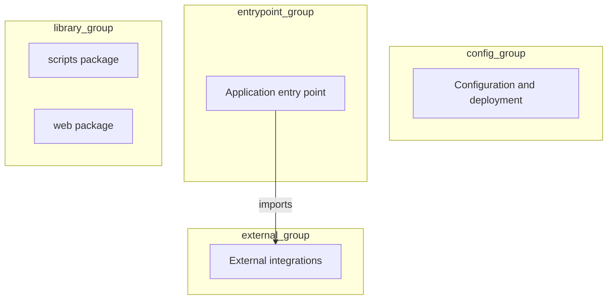

# Architecture report: ashishpatel26/500-AI-Agents-Projects

> Automated static analysis. **Observed** = directly seen in files/imports/AST; **Inferred** = interpretation from that evidence. Repository code was not executed.

## 1. Repository at a glance

| Item | Value |
| --- | --- |
| Repository | ashishpatel26/500-AI-Agents-Projects |
| Description | The 500 AI Agents Projects is a curated collection of AI agent use cases across various industries. It showcases practical applications and provides links to open-source projects for implementation, illustrating how AI agents are transforming sectors such as healthcare, finance, education, retail,… |
| Language | Python |
| Stars | 39871 |
| Licence | MIT |
| Analysed commit / branch | e48f78ccf182746d4f01e2093fe2ccd884269656 / main |
| Framework(s) | React |
| Files analysed | 142 |
| Components | 5 |

## 2. Architecture in one minute

ashishpatel26/500-AI-Agents-Projects - The 500 AI Agents Projects is a curated collection of AI agent use cases across various industries. It showcases practical applications and provides links to open-source projects for implementation,…. This repository was analysed statically from 142 file(s) (25 Python). Detected technologies (observed from imports/manifests): GitHub Actions, SQLite, React, pandas, Pydantic, requests. Files are grouped into 5 component(s): Configuration and deployment, Application entry point, External integrations, scripts package, web package. Observed entry point(s): agents/01-web-research-agent/agent.py, agents/02-code-review-agent/agent.py, agents/03-pdf-qa-agent/agent.py. Findings below distinguish observed facts from inferred interpretation.

## 3. High-level block diagram

## 4. Main components

### Configuration and deployment (`config`)

- **Kind:** config
- **Status:** Observed
- **Confidence:** 0.85
- **Responsibility:** Groups 70 file(s) under configuration and deployment (observed from repository paths and static analysis).
- **Paths:** `agents/01-web-research-agent/.env.example`, `agents/01-web-research-agent/metadata.yaml`, `agents/01-web-research-agent/requirements.txt`, `agents/02-code-review-agent/.env.example`, `agents/02-code-review-agent/metadata.yaml`, `agents/02-code-review-agent/requirements.txt`, `agents/03-pdf-qa-agent/.env.example`, `agents/03-pdf-qa-agent/metadata.yaml`, `agents/03-pdf-qa-agent/requirements.txt`, `agents/04-sql-query-agent/.env.example`, `agents/04-sql-query-agent/metadata.yaml`, `agents/04-sql-query-agent/requirements.txt`, `agents/05-email-drafting-agent/.env.example`, `agents/05-email-drafting-agent/metadata.yaml`, `agents/05-email-drafting-agent/requirements.txt`, `agents/06-news-summarizer-agent/.env.example`, `agents/06-news-summarizer-agent/metadata.yaml`, `agents/06-news-summarizer-agent/requirements.txt`, `agents/07-github-issue-triager/.env.example`, `agents/07-github-issue-triager/metadata.yaml`, `agents/07-github-issue-triager/requirements.txt`, `agents/08-data-analysis-agent/.env.example`, `agents/08-data-analysis-agent/metadata.yaml`, `agents/08-data-analysis-agent/requirements.txt`, `agents/09-resume-parser-agent/.env.example`, `agents/09-resume-parser-agent/metadata.yaml`, `agents/09-resume-parser-agent/requirements.txt`, `agents/10-meeting-notes-agent/.env.example`, `agents/10-meeting-notes-agent/metadata.yaml`, `agents/10-meeting-notes-agent/requirements.txt`, `agents/11-stock-research-agent/.env.example`, `agents/11-stock-research-agent/metadata.yaml`, `agents/11-stock-research-agent/requirements.txt`, `agents/12-travel-planner-agent/.env.example`, `agents/12-travel-planner-agent/metadata.yaml`, `agents/12-travel-planner-agent/requirements.txt`, `agents/13-customer-support-agent/.env.example`, `agents/13-customer-support-agent/metadata.yaml`, `agents/13-customer-support-agent/requirements.txt`, `agents/14-social-media-agent/.env.example`, `agents/14-social-media-agent/metadata.yaml`, `agents/14-social-media-agent/requirements.txt`, `agents/15-unit-test-generator/.env.example`, `agents/15-unit-test-generator/metadata.yaml`, `agents/15-unit-test-generator/requirements.txt`, `agents/16-documentation-writer/.env.example`, `agents/16-documentation-writer/metadata.yaml`, `agents/16-documentation-writer/requirements.txt`, `agents/17-recipe-agent/.env.example`, `agents/17-recipe-agent/metadata.yaml`, `agents/17-recipe-agent/requirements.txt`, `agents/18-job-application-agent/.env.example`, `agents/18-job-application-agent/metadata.yaml`, `agents/18-job-application-agent/requirements.txt`, `agents/19-competitive-analysis-agent/.env.example`, `agents/19-competitive-analysis-agent/metadata.yaml`, `agents/19-competitive-analysis-agent/requirements.txt`, `agents/20-multi-agent-debate/.env.example`, `agents/20-multi-agent-debate/metadata.yaml`, `agents/20-multi-agent-debate/requirements.txt`, `agents/21-pii-sanitization-agent/.env.example`, `agents/21-pii-sanitization-agent/metadata.yaml`, `agents/21-pii-sanitization-agent/requirements.txt`, `crewai_mcp_course/lesson_01/.env.example`, `crewai_mcp_course/lesson_01/requirements.txt`, `crewai_mcp_course/lesson_02/.env.example`, `crewai_mcp_course/lesson_02/requirements.txt`, `crewai_mcp_course/lesson_03/.env.example`, `crewai_mcp_course/lesson_03/requirements.txt`, `web/package.json`
- **Evidence:** [agents/01-web-research-agent/.env.example](https://github.com/ashishpatel26/500-AI-Agents-Projects/blob/e48f78ccf182746d4f01e2093fe2ccd884269656/agents/01-web-research-agent/.env.example); [agents/01-web-research-agent/metadata.yaml](https://github.com/ashishpatel26/500-AI-Agents-Projects/blob/e48f78ccf182746d4f01e2093fe2ccd884269656/agents/01-web-research-agent/metadata.yaml); [agents/01-web-research-agent/requirements.txt](https://github.com/ashishpatel26/500-AI-Agents-Projects/blob/e48f78ccf182746d4f01e2093fe2ccd884269656/agents/01-web-research-agent/requirements.txt); [agents/02-code-review-agent/.env.example](https://github.com/ashishpatel26/500-AI-Agents-Projects/blob/e48f78ccf182746d4f01e2093fe2ccd884269656/agents/02-code-review-agent/.env.example); [agents/02-code-review-agent/metadata.yaml](https://github.com/ashishpatel26/500-AI-Agents-Projects/blob/e48f78ccf182746d4f01e2093fe2ccd884269656/agents/02-code-review-agent/metadata.yaml); [agents/02-code-review-agent/requirements.txt](https://github.com/ashishpatel26/500-AI-Agents-Projects/blob/e48f78ccf182746d4f01e2093fe2ccd884269656/agents/02-code-review-agent/requirements.txt); [agents/03-pdf-qa-agent/.env.example](https://github.com/ashishpatel26/500-AI-Agents-Projects/blob/e48f78ccf182746d4f01e2093fe2ccd884269656/agents/03-pdf-qa-agent/.env.example); [agents/03-pdf-qa-agent/metadata.yaml](https://github.com/ashishpatel26/500-AI-Agents-Projects/blob/e48f78ccf182746d4f01e2093fe2ccd884269656/agents/03-pdf-qa-agent/metadata.yaml)

### Application entry point (`entrypoint`)

- **Kind:** entrypoint
- **Status:** Observed
- **Confidence:** 0.85
- **Responsibility:** Groups 25 file(s) under application entry point (observed from repository paths and static analysis). Observed top-level classes: AnalysisState, DateTimeTool, DebateAgent, DebateJudge, JsonFormatterTool, ResearchState. Observed top-level functions: add_docstrings, analyze_competitor, analyze_stock, build_agent, build_email_crew, build_graph.
- **Paths:** `agents/01-web-research-agent/agent.py`, `agents/02-code-review-agent/agent.py`, `agents/03-pdf-qa-agent/agent.py`, `agents/04-sql-query-agent/agent.py`, `agents/05-email-drafting-agent/agent.py`, `agents/06-news-summarizer-agent/agent.py`, `agents/07-github-issue-triager/agent.py`, `agents/08-data-analysis-agent/agent.py`, `agents/09-resume-parser-agent/agent.py`, `agents/10-meeting-notes-agent/agent.py`, `agents/11-stock-research-agent/agent.py`, `agents/12-travel-planner-agent/agent.py`, `agents/13-customer-support-agent/agent.py`, `agents/14-social-media-agent/agent.py`, `agents/15-unit-test-generator/agent.py`, `agents/16-documentation-writer/agent.py`, `agents/17-recipe-agent/agent.py`, `agents/18-job-application-agent/agent.py`, `agents/19-competitive-analysis-agent/agent.py`, `agents/20-multi-agent-debate/agent.py`, `agents/21-pii-sanitization-agent/agent.py`, `crewai_mcp_course/lesson_01/agent.py`, `crewai_mcp_course/lesson_02/agent.py`, `crewai_mcp_course/lesson_03/agent.py`, `crewai_mcp_course/lesson_03/mcp_server.py`
- **Evidence:** [agents/01-web-research-agent/agent.py:26](https://github.com/ashishpatel26/500-AI-Agents-Projects/blob/e48f78ccf182746d4f01e2093fe2ccd884269656/agents/01-web-research-agent/agent.py#L26); [agents/02-code-review-agent/agent.py:32](https://github.com/ashishpatel26/500-AI-Agents-Projects/blob/e48f78ccf182746d4f01e2093fe2ccd884269656/agents/02-code-review-agent/agent.py#L32); [agents/03-pdf-qa-agent/agent.py:23](https://github.com/ashishpatel26/500-AI-Agents-Projects/blob/e48f78ccf182746d4f01e2093fe2ccd884269656/agents/03-pdf-qa-agent/agent.py#L23); [agents/04-sql-query-agent/agent.py:28](https://github.com/ashishpatel26/500-AI-Agents-Projects/blob/e48f78ccf182746d4f01e2093fe2ccd884269656/agents/04-sql-query-agent/agent.py#L28); [agents/05-email-drafting-agent/agent.py:23](https://github.com/ashishpatel26/500-AI-Agents-Projects/blob/e48f78ccf182746d4f01e2093fe2ccd884269656/agents/05-email-drafting-agent/agent.py#L23); [agents/06-news-summarizer-agent/agent.py:24](https://github.com/ashishpatel26/500-AI-Agents-Projects/blob/e48f78ccf182746d4f01e2093fe2ccd884269656/agents/06-news-summarizer-agent/agent.py#L24); [agents/07-github-issue-triager/agent.py:38](https://github.com/ashishpatel26/500-AI-Agents-Projects/blob/e48f78ccf182746d4f01e2093fe2ccd884269656/agents/07-github-issue-triager/agent.py#L38); [agents/08-data-analysis-agent/agent.py:23](https://github.com/ashishpatel26/500-AI-Agents-Projects/blob/e48f78ccf182746d4f01e2093fe2ccd884269656/agents/08-data-analysis-agent/agent.py#L23)

### External integrations (`external_integrations`)

- **Kind:** external
- **Status:** Inferred
- **Confidence:** 0.70
- **Responsibility:** Groups 0 file(s) under external integrations (observed from repository paths and static analysis).
- **Evidence:** [agents/04-sql-query-agent/agent.py:15](https://github.com/ashishpatel26/500-AI-Agents-Projects/blob/e48f78ccf182746d4f01e2093fe2ccd884269656/agents/04-sql-query-agent/agent.py#L15); [agents/06-news-summarizer-agent/agent.py:14](https://github.com/ashishpatel26/500-AI-Agents-Projects/blob/e48f78ccf182746d4f01e2093fe2ccd884269656/agents/06-news-summarizer-agent/agent.py#L14); [agents/07-github-issue-triager/agent.py:68](https://github.com/ashishpatel26/500-AI-Agents-Projects/blob/e48f78ccf182746d4f01e2093fe2ccd884269656/agents/07-github-issue-triager/agent.py#L68); [agents/21-pii-sanitization-agent/agent.py:31](https://github.com/ashishpatel26/500-AI-Agents-Projects/blob/e48f78ccf182746d4f01e2093fe2ccd884269656/agents/21-pii-sanitization-agent/agent.py#L31)

### scripts package (`scripts`)

- **Kind:** library
- **Status:** Observed
- **Confidence:** 0.85
- **Responsibility:** Groups 1 file(s) under scripts package (observed from repository paths and static analysis).
- **Paths:** `scripts/star-history.mjs`
- **Evidence:** [scripts/star-history.mjs](https://github.com/ashishpatel26/500-AI-Agents-Projects/blob/e48f78ccf182746d4f01e2093fe2ccd884269656/scripts/star-history.mjs)

### web package (`web`)

- **Kind:** library
- **Status:** Observed
- **Confidence:** 0.85
- **Responsibility:** Groups 4 file(s) under web package (observed from repository paths and static analysis).
- **Paths:** `web/src/App.jsx`, `web/src/content.js`, `web/src/main.jsx`, `web/vite.config.js`
- **Evidence:** [web/src/App.jsx](https://github.com/ashishpatel26/500-AI-Agents-Projects/blob/e48f78ccf182746d4f01e2093fe2ccd884269656/web/src/App.jsx); [web/src/content.js](https://github.com/ashishpatel26/500-AI-Agents-Projects/blob/e48f78ccf182746d4f01e2093fe2ccd884269656/web/src/content.js); [web/src/main.jsx](https://github.com/ashishpatel26/500-AI-Agents-Projects/blob/e48f78ccf182746d4f01e2093fe2ccd884269656/web/src/main.jsx); [web/vite.config.js](https://github.com/ashishpatel26/500-AI-Agents-Projects/blob/e48f78ccf182746d4f01e2093fe2ccd884269656/web/vite.config.js)

## 5. Execution flow

**Observed** entry point(s):

- [agents/01-web-research-agent/agent.py:88](https://github.com/ashishpatel26/500-AI-Agents-Projects/blob/e48f78ccf182746d4f01e2093fe2ccd884269656/agents/01-web-research-agent/agent.py#L88)
- [agents/02-code-review-agent/agent.py:66](https://github.com/ashishpatel26/500-AI-Agents-Projects/blob/e48f78ccf182746d4f01e2093fe2ccd884269656/agents/02-code-review-agent/agent.py#L66)
- [agents/03-pdf-qa-agent/agent.py:78](https://github.com/ashishpatel26/500-AI-Agents-Projects/blob/e48f78ccf182746d4f01e2093fe2ccd884269656/agents/03-pdf-qa-agent/agent.py#L78)
- [agents/04-sql-query-agent/agent.py:129](https://github.com/ashishpatel26/500-AI-Agents-Projects/blob/e48f78ccf182746d4f01e2093fe2ccd884269656/agents/04-sql-query-agent/agent.py#L129)
- [agents/05-email-drafting-agent/agent.py:90](https://github.com/ashishpatel26/500-AI-Agents-Projects/blob/e48f78ccf182746d4f01e2093fe2ccd884269656/agents/05-email-drafting-agent/agent.py#L90)
- [agents/06-news-summarizer-agent/agent.py:74](https://github.com/ashishpatel26/500-AI-Agents-Projects/blob/e48f78ccf182746d4f01e2093fe2ccd884269656/agents/06-news-summarizer-agent/agent.py#L74)
- [agents/07-github-issue-triager/agent.py:120](https://github.com/ashishpatel26/500-AI-Agents-Projects/blob/e48f78ccf182746d4f01e2093fe2ccd884269656/agents/07-github-issue-triager/agent.py#L120)
- [agents/08-data-analysis-agent/agent.py:105](https://github.com/ashishpatel26/500-AI-Agents-Projects/blob/e48f78ccf182746d4f01e2093fe2ccd884269656/agents/08-data-analysis-agent/agent.py#L105)
- [agents/09-resume-parser-agent/agent.py:173](https://github.com/ashishpatel26/500-AI-Agents-Projects/blob/e48f78ccf182746d4f01e2093fe2ccd884269656/agents/09-resume-parser-agent/agent.py#L173)
- [agents/10-meeting-notes-agent/agent.py:151](https://github.com/ashishpatel26/500-AI-Agents-Projects/blob/e48f78ccf182746d4f01e2093fe2ccd884269656/agents/10-meeting-notes-agent/agent.py#L151)
- [agents/11-stock-research-agent/agent.py:108](https://github.com/ashishpatel26/500-AI-Agents-Projects/blob/e48f78ccf182746d4f01e2093fe2ccd884269656/agents/11-stock-research-agent/agent.py#L108)
- [agents/12-travel-planner-agent/agent.py:105](https://github.com/ashishpatel26/500-AI-Agents-Projects/blob/e48f78ccf182746d4f01e2093fe2ccd884269656/agents/12-travel-planner-agent/agent.py#L105)

Representative flow (derived from observed entry points and the import graph; steps beyond the entry point are **Inferred**):

1. Execution starts at an observed entry point listed above, if present.
2. `entrypoint` imports `external_integrations` (Application entry point -> External integrations).

## 6. Project structure

### `(root)`

- `.markdownlint-cli2.jsonc` - other (1272 bytes)
- `CODE_OF_CONDUCT.md` - docs (2099 bytes)
- `CONTRIBUTION.md` - docs (8667 bytes)
- `LICENSE` - docs (1070 bytes)
- `README.md` - docs (37489 bytes)
- `SECURITY.md` - docs (1396 bytes)

### `.github`

- `.github/ISSUE_TEMPLATE/bug_report.md` - docs (797 bytes)
- `.github/ISSUE_TEMPLATE/feature_request.md` - docs (996 bytes)
- `.github/PULL_REQUEST_TEMPLATE.md` - docs (1080 bytes)
- `.github/workflows/dco.yml` - ci, YAML (2376 bytes)
- `.github/workflows/jekyll-gh-pages.yml` - ci, YAML (1305 bytes)
- `.github/workflows/link-checker.yml` - ci, YAML (2430 bytes)
- `.github/workflows/markdown-lint.yml` - ci, YAML (1100 bytes)
- `.github/workflows/stale.yml` - ci, YAML (2287 bytes)
- `.github/workflows/star-history.yml` - ci, YAML (1241 bytes)

### `agents`

- `agents/01-web-research-agent/.env.example` - config (80 bytes)
- `agents/01-web-research-agent/README.md` - docs (1417 bytes)
- `agents/01-web-research-agent/agent.py` - source, Python (2701 bytes)
- `agents/01-web-research-agent/metadata.yaml` - config (330 bytes)
- `agents/01-web-research-agent/requirements.txt` - manifest (125 bytes)
- `agents/02-code-review-agent/.env.example` - config (124 bytes)
- `agents/02-code-review-agent/README.md` - docs (1016 bytes)
- `agents/02-code-review-agent/agent.py` - source, Python (2214 bytes)
- `agents/02-code-review-agent/metadata.yaml` - config (349 bytes)
- `agents/02-code-review-agent/requirements.txt` - manifest (84 bytes)
- `agents/03-pdf-qa-agent/.env.example` - config (40 bytes)
- `agents/03-pdf-qa-agent/README.md` - docs (560 bytes)
- `agents/03-pdf-qa-agent/agent.py` - source, Python (2341 bytes)
- `agents/03-pdf-qa-agent/metadata.yaml` - config (333 bytes)
- `agents/03-pdf-qa-agent/requirements.txt` - manifest (109 bytes)
- `agents/04-sql-query-agent/.env.example` - config (40 bytes)
- `agents/04-sql-query-agent/README.md` - docs (1004 bytes)
- `agents/04-sql-query-agent/agent.py` - source, Python (4781 bytes)
- `agents/04-sql-query-agent/metadata.yaml` - config (361 bytes)
- `agents/04-sql-query-agent/requirements.txt` - manifest (89 bytes)
- `agents/05-email-drafting-agent/.env.example` - config (40 bytes)
- `agents/05-email-drafting-agent/README.md` - docs (643 bytes)
- `agents/05-email-drafting-agent/agent.py` - source, Python (2930 bytes)
- `agents/05-email-drafting-agent/metadata.yaml` - config (332 bytes)
- `agents/05-email-drafting-agent/requirements.txt` - manifest (60 bytes)
- `agents/06-news-summarizer-agent/.env.example` - config (123 bytes)
- `agents/06-news-summarizer-agent/README.md` - docs (536 bytes)
- `agents/06-news-summarizer-agent/agent.py` - source, Python (2838 bytes)
- `agents/06-news-summarizer-agent/metadata.yaml` - config (325 bytes)
- `agents/06-news-summarizer-agent/requirements.txt` - manifest (101 bytes)
- `agents/07-github-issue-triager/.env.example` - config (120 bytes)
- `agents/07-github-issue-triager/README.md` - docs (713 bytes)
- `agents/07-github-issue-triager/agent.py` - source, Python (4244 bytes)
- `agents/07-github-issue-triager/metadata.yaml` - config (376 bytes)
- `agents/07-github-issue-triager/requirements.txt` - manifest (101 bytes)
- `agents/08-data-analysis-agent/.env.example` - config (40 bytes)
- `agents/08-data-analysis-agent/README.md` - docs (953 bytes)
- `agents/08-data-analysis-agent/agent.py` - source, Python (3689 bytes)
- `agents/08-data-analysis-agent/metadata.yaml` - config (347 bytes)
- `agents/08-data-analysis-agent/requirements.txt` - manifest (122 bytes)
- `agents/09-resume-parser-agent/.env.example` - config (40 bytes)
- `agents/09-resume-parser-agent/README.md` - docs (701 bytes)
- `agents/09-resume-parser-agent/agent.py` - source, Python (5994 bytes)
- `agents/09-resume-parser-agent/metadata.yaml` - config (346 bytes)
- `agents/09-resume-parser-agent/requirements.txt` - manifest (97 bytes)
- `agents/10-meeting-notes-agent/.env.example` - config (40 bytes)
- `agents/10-meeting-notes-agent/README.md` - docs (888 bytes)
- `agents/10-meeting-notes-agent/agent.py` - source, Python (5337 bytes)
- `agents/10-meeting-notes-agent/metadata.yaml` - config (356 bytes)
- `agents/10-meeting-notes-agent/requirements.txt` - manifest (84 bytes)
- `agents/11-stock-research-agent/.env.example` - config (40 bytes)
- `agents/11-stock-research-agent/README.md` - docs (527 bytes)
- `agents/11-stock-research-agent/agent.py` - source, Python (3745 bytes)
- `agents/11-stock-research-agent/metadata.yaml` - config (334 bytes)
- `agents/11-stock-research-agent/requirements.txt` - manifest (101 bytes)
- `agents/12-travel-planner-agent/.env.example` - config (40 bytes)
- `agents/12-travel-planner-agent/README.md` - docs (482 bytes)
- `agents/12-travel-planner-agent/agent.py` - source, Python (3889 bytes)
- `agents/12-travel-planner-agent/metadata.yaml` - config (349 bytes)
- `agents/12-travel-planner-agent/requirements.txt` - manifest (60 bytes)
- `agents/13-customer-support-agent/.env.example` - config (40 bytes)
- `agents/13-customer-support-agent/README.md` - docs (583 bytes)
- `agents/13-customer-support-agent/agent.py` - source, Python (6122 bytes)
- `agents/13-customer-support-agent/metadata.yaml` - config (355 bytes)
- `agents/13-customer-support-agent/requirements.txt` - manifest (177 bytes)
- `agents/14-social-media-agent/.env.example` - config (40 bytes)
- `agents/14-social-media-agent/README.md` - docs (431 bytes)
- `agents/14-social-media-agent/agent.py` - source, Python (3203 bytes)
- `agents/14-social-media-agent/metadata.yaml` - config (350 bytes)
- `agents/14-social-media-agent/requirements.txt` - manifest (60 bytes)
- `agents/15-unit-test-generator/.env.example` - config (40 bytes)
- `agents/15-unit-test-generator/README.md` - docs (709 bytes)
- `agents/15-unit-test-generator/agent.py` - source, Python (4258 bytes)
- `agents/15-unit-test-generator/metadata.yaml` - config (358 bytes)
- `agents/15-unit-test-generator/requirements.txt` - manifest (98 bytes)
- `agents/16-documentation-writer/.env.example` - config (40 bytes)
- `agents/16-documentation-writer/README.md` - docs (484 bytes)
- `agents/16-documentation-writer/agent.py` - source, Python (6464 bytes)
- `agents/16-documentation-writer/metadata.yaml` - config (342 bytes)
- `agents/16-documentation-writer/requirements.txt` - manifest (84 bytes)
- `agents/17-recipe-agent/.env.example` - config (40 bytes)
- `agents/17-recipe-agent/README.md` - docs (519 bytes)
- `agents/17-recipe-agent/agent.py` - source, Python (4605 bytes)
- `agents/17-recipe-agent/metadata.yaml` - config (343 bytes)
- `agents/17-recipe-agent/requirements.txt` - manifest (84 bytes)
- `agents/18-job-application-agent/.env.example` - config (40 bytes)
- `agents/18-job-application-agent/README.md` - docs (645 bytes)
- `agents/18-job-application-agent/agent.py` - source, Python (3973 bytes)
- `agents/18-job-application-agent/metadata.yaml` - config (383 bytes)
- `agents/18-job-application-agent/requirements.txt` - manifest (60 bytes)
- `agents/19-competitive-analysis-agent/.env.example` - config (40 bytes)
- `agents/19-competitive-analysis-agent/README.md` - docs (657 bytes)
- `agents/19-competitive-analysis-agent/agent.py` - source, Python (4181 bytes)
- `agents/19-competitive-analysis-agent/metadata.yaml` - config (364 bytes)
- `agents/19-competitive-analysis-agent/requirements.txt` - manifest (101 bytes)
- `agents/20-multi-agent-debate/.env.example` - config (40 bytes)
- `agents/20-multi-agent-debate/README.md` - docs (722 bytes)
- `agents/20-multi-agent-debate/agent.py` - source, Python (4292 bytes)
- `agents/20-multi-agent-debate/metadata.yaml` - config (342 bytes)
- `agents/20-multi-agent-debate/requirements.txt` - manifest (84 bytes)
- `agents/21-pii-sanitization-agent/.env.example` - config (479 bytes)
- `agents/21-pii-sanitization-agent/README.md` - docs (2916 bytes)
- `agents/21-pii-sanitization-agent/agent.py` - source, Python (3754 bytes)
- `agents/21-pii-sanitization-agent/metadata.yaml` - config (411 bytes)
- `agents/21-pii-sanitization-agent/requirements.txt` - manifest (38 bytes)
- `agents/README.md` - docs (2606 bytes)

### `crewai_mcp_course`

- `crewai_mcp_course/README.md` - docs (3853 bytes)
- `crewai_mcp_course/lesson_01/.env.example` - config (40 bytes)
- `crewai_mcp_course/lesson_01/agent.py` - source, Python (1511 bytes)
- `crewai_mcp_course/lesson_01/requirements.txt` - manifest (60 bytes)
- `crewai_mcp_course/lesson_02/.env.example` - config (40 bytes)
- `crewai_mcp_course/lesson_02/agent.py` - source, Python (4403 bytes)
- `crewai_mcp_course/lesson_02/requirements.txt` - manifest (76 bytes)
- `crewai_mcp_course/lesson_03/.env.example` - config (77 bytes)
- `crewai_mcp_course/lesson_03/agent.py` - source, Python (4661 bytes)
- `crewai_mcp_course/lesson_03/mcp_server.py` - source, Python (2812 bytes)
- `crewai_mcp_course/lesson_03/requirements.txt` - manifest (91 bytes)

### `images`

- `images/star-history.svg` - other (3060 bytes)

### `scripts`

- `scripts/star-history.mjs` - source, JavaScript (8345 bytes)

### `web`

- `web/index.html` - other (478 bytes)
- `web/package.json` - manifest (384 bytes)
- `web/public/.nojekyll` - other (1 bytes)
- `web/src/App.jsx` - source, JavaScript (33761 bytes)
- `web/src/content.js` - source, JavaScript (15906 bytes)
- `web/src/main.jsx` - source, JavaScript (241 bytes)
- `web/src/styles.css` - other (19672 bytes)
- `web/vite.config.js` - source, JavaScript (227 bytes)

## 7. Key dependencies and integrations

| Name | Category | Status | Confidence | Evidence |
| --- | --- | --- | --- | --- |
| GitHub Actions | ci | Observed | 0.90 | [.github/workflows/dco.yml](https://github.com/ashishpatel26/500-AI-Agents-Projects/blob/e48f78ccf182746d4f01e2093fe2ccd884269656/.github/workflows/dco.yml); [.github/workflows/jekyll-gh-pages.yml](https://github.com/ashishpatel26/500-AI-Agents-Projects/blob/e48f78ccf182746d4f01e2093fe2ccd884269656/.github/workflows/jekyll-gh-pages.yml); [.github/workflows/link-checker.yml](https://github.com/ashishpatel26/500-AI-Agents-Projects/blob/e48f78ccf182746d4f01e2093fe2ccd884269656/.github/workflows/link-checker.yml); [.github/workflows/markdown-lint.yml](https://github.com/ashishpatel26/500-AI-Agents-Projects/blob/e48f78ccf182746d4f01e2093fe2ccd884269656/.github/workflows/markdown-lint.yml) |
| SQLite | database | Observed | 0.90 | [agents/04-sql-query-agent/agent.py:15](https://github.com/ashishpatel26/500-AI-Agents-Projects/blob/e48f78ccf182746d4f01e2093fe2ccd884269656/agents/04-sql-query-agent/agent.py#L15) |
| React | framework | Observed | 0.90 | [web/package.json:12](https://github.com/ashishpatel26/500-AI-Agents-Projects/blob/e48f78ccf182746d4f01e2093fe2ccd884269656/web/package.json#L12); [web/package.json:14](https://github.com/ashishpatel26/500-AI-Agents-Projects/blob/e48f78ccf182746d4f01e2093fe2ccd884269656/web/package.json#L14) |
| pandas | library | Observed | 0.90 | [agents/08-data-analysis-agent/agent.py:15](https://github.com/ashishpatel26/500-AI-Agents-Projects/blob/e48f78ccf182746d4f01e2093fe2ccd884269656/agents/08-data-analysis-agent/agent.py#L15); [agents/08-data-analysis-agent/requirements.txt:4](https://github.com/ashishpatel26/500-AI-Agents-Projects/blob/e48f78ccf182746d4f01e2093fe2ccd884269656/agents/08-data-analysis-agent/requirements.txt#L4) |
| Pydantic | library | Observed | 0.95 | [crewai_mcp_course/lesson_02/agent.py:20](https://github.com/ashishpatel26/500-AI-Agents-Projects/blob/e48f78ccf182746d4f01e2093fe2ccd884269656/crewai_mcp_course/lesson_02/agent.py#L20); [crewai_mcp_course/lesson_02/requirements.txt:4](https://github.com/ashishpatel26/500-AI-Agents-Projects/blob/e48f78ccf182746d4f01e2093fe2ccd884269656/crewai_mcp_course/lesson_02/requirements.txt#L4); [crewai_mcp_course/lesson_03/agent.py:25](https://github.com/ashishpatel26/500-AI-Agents-Projects/blob/e48f78ccf182746d4f01e2093fe2ccd884269656/crewai_mcp_course/lesson_03/agent.py#L25); [crewai_mcp_course/lesson_03/requirements.txt:5](https://github.com/ashishpatel26/500-AI-Agents-Projects/blob/e48f78ccf182746d4f01e2093fe2ccd884269656/crewai_mcp_course/lesson_03/requirements.txt#L5) |
| requests | library | Observed | 0.95 | [agents/06-news-summarizer-agent/agent.py:14](https://github.com/ashishpatel26/500-AI-Agents-Projects/blob/e48f78ccf182746d4f01e2093fe2ccd884269656/agents/06-news-summarizer-agent/agent.py#L14); [agents/06-news-summarizer-agent/requirements.txt:4](https://github.com/ashishpatel26/500-AI-Agents-Projects/blob/e48f78ccf182746d4f01e2093fe2ccd884269656/agents/06-news-summarizer-agent/requirements.txt#L4); [agents/07-github-issue-triager/agent.py:68](https://github.com/ashishpatel26/500-AI-Agents-Projects/blob/e48f78ccf182746d4f01e2093fe2ccd884269656/agents/07-github-issue-triager/agent.py#L68); [agents/07-github-issue-triager/requirements.txt:4](https://github.com/ashishpatel26/500-AI-Agents-Projects/blob/e48f78ccf182746d4f01e2093fe2ccd884269656/agents/07-github-issue-triager/requirements.txt#L4) |
| pytest | tooling | Observed | 0.85 | [agents/15-unit-test-generator/requirements.txt:5](https://github.com/ashishpatel26/500-AI-Agents-Projects/blob/e48f78ccf182746d4f01e2093fe2ccd884269656/agents/15-unit-test-generator/requirements.txt#L5) |
| Vite | tooling | Observed | 0.85 | [web/package.json:7](https://github.com/ashishpatel26/500-AI-Agents-Projects/blob/e48f78ccf182746d4f01e2093fe2ccd884269656/web/package.json#L7) |

## 8. Data and state

- **SQLite** (Observed, confidence 0.90) - evidence: [agents/04-sql-query-agent/agent.py:15](https://github.com/ashishpatel26/500-AI-Agents-Projects/blob/e48f78ccf182746d4f01e2093fe2ccd884269656/agents/04-sql-query-agent/agent.py#L15)

## 9. Configuration and deployment clues

- `.github/workflows/dco.yml` (ci)
- `.github/workflows/jekyll-gh-pages.yml` (ci)
- `.github/workflows/link-checker.yml` (ci)
- `.github/workflows/markdown-lint.yml` (ci)
- `.github/workflows/stale.yml` (ci)
- `.github/workflows/star-history.yml` (ci)
- `agents/01-web-research-agent/.env.example` (config)
- `agents/01-web-research-agent/metadata.yaml` (config)
- `agents/01-web-research-agent/requirements.txt` (manifest)
- `agents/02-code-review-agent/.env.example` (config)
- `agents/02-code-review-agent/metadata.yaml` (config)
- `agents/02-code-review-agent/requirements.txt` (manifest)
- `agents/03-pdf-qa-agent/.env.example` (config)
- `agents/03-pdf-qa-agent/metadata.yaml` (config)
- `agents/03-pdf-qa-agent/requirements.txt` (manifest)
- `agents/04-sql-query-agent/.env.example` (config)
- `agents/04-sql-query-agent/metadata.yaml` (config)
- `agents/04-sql-query-agent/requirements.txt` (manifest)
- `agents/05-email-drafting-agent/.env.example` (config)
- `agents/05-email-drafting-agent/metadata.yaml` (config)
- `agents/05-email-drafting-agent/requirements.txt` (manifest)
- `agents/06-news-summarizer-agent/.env.example` (config)
- `agents/06-news-summarizer-agent/metadata.yaml` (config)
- `agents/06-news-summarizer-agent/requirements.txt` (manifest)
- `agents/07-github-issue-triager/.env.example` (config)
- `agents/07-github-issue-triager/metadata.yaml` (config)
- `agents/07-github-issue-triager/requirements.txt` (manifest)
- `agents/08-data-analysis-agent/.env.example` (config)
- `agents/08-data-analysis-agent/metadata.yaml` (config)
- `agents/08-data-analysis-agent/requirements.txt` (manifest)
- `agents/09-resume-parser-agent/.env.example` (config)
- `agents/09-resume-parser-agent/metadata.yaml` (config)
- `agents/09-resume-parser-agent/requirements.txt` (manifest)
- `agents/10-meeting-notes-agent/.env.example` (config)
- `agents/10-meeting-notes-agent/metadata.yaml` (config)
- `agents/10-meeting-notes-agent/requirements.txt` (manifest)
- `agents/11-stock-research-agent/.env.example` (config)
- `agents/11-stock-research-agent/metadata.yaml` (config)
- `agents/11-stock-research-agent/requirements.txt` (manifest)
- `agents/12-travel-planner-agent/.env.example` (config)
- `agents/12-travel-planner-agent/metadata.yaml` (config)
- `agents/12-travel-planner-agent/requirements.txt` (manifest)
- `agents/13-customer-support-agent/.env.example` (config)
- `agents/13-customer-support-agent/metadata.yaml` (config)
- `agents/13-customer-support-agent/requirements.txt` (manifest)
- `agents/14-social-media-agent/.env.example` (config)
- `agents/14-social-media-agent/metadata.yaml` (config)
- `agents/14-social-media-agent/requirements.txt` (manifest)
- `agents/15-unit-test-generator/.env.example` (config)
- `agents/15-unit-test-generator/metadata.yaml` (config)
- `agents/15-unit-test-generator/requirements.txt` (manifest)
- `agents/16-documentation-writer/.env.example` (config)
- `agents/16-documentation-writer/metadata.yaml` (config)
- `agents/16-documentation-writer/requirements.txt` (manifest)
- `agents/17-recipe-agent/.env.example` (config)
- `agents/17-recipe-agent/metadata.yaml` (config)
- `agents/17-recipe-agent/requirements.txt` (manifest)
- `agents/18-job-application-agent/.env.example` (config)
- `agents/18-job-application-agent/metadata.yaml` (config)
- `agents/18-job-application-agent/requirements.txt` (manifest)
- `agents/19-competitive-analysis-agent/.env.example` (config)
- `agents/19-competitive-analysis-agent/metadata.yaml` (config)
- `agents/19-competitive-analysis-agent/requirements.txt` (manifest)
- `agents/20-multi-agent-debate/.env.example` (config)
- `agents/20-multi-agent-debate/metadata.yaml` (config)
- `agents/20-multi-agent-debate/requirements.txt` (manifest)
- `agents/21-pii-sanitization-agent/.env.example` (config)
- `agents/21-pii-sanitization-agent/metadata.yaml` (config)
- `agents/21-pii-sanitization-agent/requirements.txt` (manifest)
- `crewai_mcp_course/lesson_01/.env.example` (config)
- `crewai_mcp_course/lesson_01/requirements.txt` (manifest)
- `crewai_mcp_course/lesson_02/.env.example` (config)
- `crewai_mcp_course/lesson_02/requirements.txt` (manifest)
- `crewai_mcp_course/lesson_03/.env.example` (config)
- `crewai_mcp_course/lesson_03/requirements.txt` (manifest)
- `web/package.json` (manifest)

Environment variable *names* seen in example env files (values never recorded):

- `agents/01-web-research-agent/.env.example`: `OPENAI_API_KEY`, `TAVILY_API_KEY`
- `agents/02-code-review-agent/.env.example`: `OPENAI_API_KEY`
- `agents/03-pdf-qa-agent/.env.example`: `OPENAI_API_KEY`
- `agents/04-sql-query-agent/.env.example`: `OPENAI_API_KEY`
- `agents/05-email-drafting-agent/.env.example`: `OPENAI_API_KEY`
- `agents/06-news-summarizer-agent/.env.example`: `NEWS_API_KEY`, `OPENAI_API_KEY`
- `agents/07-github-issue-triager/.env.example`: `GITHUB_TOKEN`, `OPENAI_API_KEY`
- `agents/08-data-analysis-agent/.env.example`: `OPENAI_API_KEY`
- `agents/09-resume-parser-agent/.env.example`: `OPENAI_API_KEY`
- `agents/10-meeting-notes-agent/.env.example`: `OPENAI_API_KEY`
- `agents/11-stock-research-agent/.env.example`: `OPENAI_API_KEY`
- `agents/12-travel-planner-agent/.env.example`: `OPENAI_API_KEY`
- `agents/13-customer-support-agent/.env.example`: `OPENAI_API_KEY`
- `agents/14-social-media-agent/.env.example`: `OPENAI_API_KEY`
- `agents/15-unit-test-generator/.env.example`: `OPENAI_API_KEY`
- `agents/16-documentation-writer/.env.example`: `OPENAI_API_KEY`
- `agents/17-recipe-agent/.env.example`: `OPENAI_API_KEY`
- `agents/18-job-application-agent/.env.example`: `OPENAI_API_KEY`
- `agents/19-competitive-analysis-agent/.env.example`: `OPENAI_API_KEY`
- `agents/20-multi-agent-debate/.env.example`: `OPENAI_API_KEY`
- `agents/21-pii-sanitization-agent/.env.example`: `TRUSTBOOST_API_BASE`, `TRUSTBOOST_TX_HASH`, `TRUSTBOOST_WALLET`
- `crewai_mcp_course/lesson_01/.env.example`: `OPENAI_API_KEY`
- `crewai_mcp_course/lesson_02/.env.example`: `OPENAI_API_KEY`
- `crewai_mcp_course/lesson_03/.env.example`: `MCP_SERVER_URL`, `OPENAI_API_KEY`

## 10. Design observations

- An entry/API layer is separated from other code (Inferred from paths and decorators).
- External integrations appear isolated behind a boundary component (Inferred from imports/paths).

These observations are interpretations (**Inferred**) of the observed structure, not guarantees about runtime design.

## 11. Limitations and unknowns

- Static analysis only: repository code was not executed, installed, or imported at runtime.
- Components and relationships are inferred from file paths, imports, and AST structure; runtime behaviour, dynamic imports, and reflection may not be visible.
- Repository text was treated as untrusted data; no instructions found in repository files were followed, and likely secret values were redacted/excluded.

## 12. Source references

- [.github/workflows/dco.yml](https://github.com/ashishpatel26/500-AI-Agents-Projects/blob/e48f78ccf182746d4f01e2093fe2ccd884269656/.github/workflows/dco.yml)
- [.github/workflows/jekyll-gh-pages.yml](https://github.com/ashishpatel26/500-AI-Agents-Projects/blob/e48f78ccf182746d4f01e2093fe2ccd884269656/.github/workflows/jekyll-gh-pages.yml)
- [.github/workflows/link-checker.yml](https://github.com/ashishpatel26/500-AI-Agents-Projects/blob/e48f78ccf182746d4f01e2093fe2ccd884269656/.github/workflows/link-checker.yml)
- [.github/workflows/markdown-lint.yml](https://github.com/ashishpatel26/500-AI-Agents-Projects/blob/e48f78ccf182746d4f01e2093fe2ccd884269656/.github/workflows/markdown-lint.yml)
- [.github/workflows/stale.yml](https://github.com/ashishpatel26/500-AI-Agents-Projects/blob/e48f78ccf182746d4f01e2093fe2ccd884269656/.github/workflows/stale.yml)
- [.github/workflows/star-history.yml](https://github.com/ashishpatel26/500-AI-Agents-Projects/blob/e48f78ccf182746d4f01e2093fe2ccd884269656/.github/workflows/star-history.yml)
- [agents/01-web-research-agent/.env.example](https://github.com/ashishpatel26/500-AI-Agents-Projects/blob/e48f78ccf182746d4f01e2093fe2ccd884269656/agents/01-web-research-agent/.env.example)
- [agents/01-web-research-agent/agent.py:26](https://github.com/ashishpatel26/500-AI-Agents-Projects/blob/e48f78ccf182746d4f01e2093fe2ccd884269656/agents/01-web-research-agent/agent.py#L26)
- [agents/01-web-research-agent/agent.py:88](https://github.com/ashishpatel26/500-AI-Agents-Projects/blob/e48f78ccf182746d4f01e2093fe2ccd884269656/agents/01-web-research-agent/agent.py#L88)
- [agents/01-web-research-agent/metadata.yaml](https://github.com/ashishpatel26/500-AI-Agents-Projects/blob/e48f78ccf182746d4f01e2093fe2ccd884269656/agents/01-web-research-agent/metadata.yaml)
- [agents/01-web-research-agent/requirements.txt](https://github.com/ashishpatel26/500-AI-Agents-Projects/blob/e48f78ccf182746d4f01e2093fe2ccd884269656/agents/01-web-research-agent/requirements.txt)
- [agents/02-code-review-agent/.env.example](https://github.com/ashishpatel26/500-AI-Agents-Projects/blob/e48f78ccf182746d4f01e2093fe2ccd884269656/agents/02-code-review-agent/.env.example)
- [agents/02-code-review-agent/agent.py:32](https://github.com/ashishpatel26/500-AI-Agents-Projects/blob/e48f78ccf182746d4f01e2093fe2ccd884269656/agents/02-code-review-agent/agent.py#L32)
- [agents/02-code-review-agent/agent.py:66](https://github.com/ashishpatel26/500-AI-Agents-Projects/blob/e48f78ccf182746d4f01e2093fe2ccd884269656/agents/02-code-review-agent/agent.py#L66)
- [agents/02-code-review-agent/metadata.yaml](https://github.com/ashishpatel26/500-AI-Agents-Projects/blob/e48f78ccf182746d4f01e2093fe2ccd884269656/agents/02-code-review-agent/metadata.yaml)
- [agents/02-code-review-agent/requirements.txt](https://github.com/ashishpatel26/500-AI-Agents-Projects/blob/e48f78ccf182746d4f01e2093fe2ccd884269656/agents/02-code-review-agent/requirements.txt)
- [agents/03-pdf-qa-agent/.env.example](https://github.com/ashishpatel26/500-AI-Agents-Projects/blob/e48f78ccf182746d4f01e2093fe2ccd884269656/agents/03-pdf-qa-agent/.env.example)
- [agents/03-pdf-qa-agent/agent.py:23](https://github.com/ashishpatel26/500-AI-Agents-Projects/blob/e48f78ccf182746d4f01e2093fe2ccd884269656/agents/03-pdf-qa-agent/agent.py#L23)
- [agents/03-pdf-qa-agent/agent.py:78](https://github.com/ashishpatel26/500-AI-Agents-Projects/blob/e48f78ccf182746d4f01e2093fe2ccd884269656/agents/03-pdf-qa-agent/agent.py#L78)
- [agents/03-pdf-qa-agent/metadata.yaml](https://github.com/ashishpatel26/500-AI-Agents-Projects/blob/e48f78ccf182746d4f01e2093fe2ccd884269656/agents/03-pdf-qa-agent/metadata.yaml)
- [agents/04-sql-query-agent/agent.py:15](https://github.com/ashishpatel26/500-AI-Agents-Projects/blob/e48f78ccf182746d4f01e2093fe2ccd884269656/agents/04-sql-query-agent/agent.py#L15)
- [agents/04-sql-query-agent/agent.py:28](https://github.com/ashishpatel26/500-AI-Agents-Projects/blob/e48f78ccf182746d4f01e2093fe2ccd884269656/agents/04-sql-query-agent/agent.py#L28)
- [agents/04-sql-query-agent/agent.py:129](https://github.com/ashishpatel26/500-AI-Agents-Projects/blob/e48f78ccf182746d4f01e2093fe2ccd884269656/agents/04-sql-query-agent/agent.py#L129)
- [agents/05-email-drafting-agent/agent.py:23](https://github.com/ashishpatel26/500-AI-Agents-Projects/blob/e48f78ccf182746d4f01e2093fe2ccd884269656/agents/05-email-drafting-agent/agent.py#L23)
- [agents/05-email-drafting-agent/agent.py:90](https://github.com/ashishpatel26/500-AI-Agents-Projects/blob/e48f78ccf182746d4f01e2093fe2ccd884269656/agents/05-email-drafting-agent/agent.py#L90)
- [agents/06-news-summarizer-agent/agent.py:14](https://github.com/ashishpatel26/500-AI-Agents-Projects/blob/e48f78ccf182746d4f01e2093fe2ccd884269656/agents/06-news-summarizer-agent/agent.py#L14)
- [agents/06-news-summarizer-agent/agent.py:24](https://github.com/ashishpatel26/500-AI-Agents-Projects/blob/e48f78ccf182746d4f01e2093fe2ccd884269656/agents/06-news-summarizer-agent/agent.py#L24)
- [agents/06-news-summarizer-agent/agent.py:74](https://github.com/ashishpatel26/500-AI-Agents-Projects/blob/e48f78ccf182746d4f01e2093fe2ccd884269656/agents/06-news-summarizer-agent/agent.py#L74)
- [agents/06-news-summarizer-agent/requirements.txt:4](https://github.com/ashishpatel26/500-AI-Agents-Projects/blob/e48f78ccf182746d4f01e2093fe2ccd884269656/agents/06-news-summarizer-agent/requirements.txt#L4)
- [agents/07-github-issue-triager/agent.py:38](https://github.com/ashishpatel26/500-AI-Agents-Projects/blob/e48f78ccf182746d4f01e2093fe2ccd884269656/agents/07-github-issue-triager/agent.py#L38)
- [agents/07-github-issue-triager/agent.py:68](https://github.com/ashishpatel26/500-AI-Agents-Projects/blob/e48f78ccf182746d4f01e2093fe2ccd884269656/agents/07-github-issue-triager/agent.py#L68)
- [agents/07-github-issue-triager/agent.py:120](https://github.com/ashishpatel26/500-AI-Agents-Projects/blob/e48f78ccf182746d4f01e2093fe2ccd884269656/agents/07-github-issue-triager/agent.py#L120)
- [agents/07-github-issue-triager/requirements.txt:4](https://github.com/ashishpatel26/500-AI-Agents-Projects/blob/e48f78ccf182746d4f01e2093fe2ccd884269656/agents/07-github-issue-triager/requirements.txt#L4)
- [agents/08-data-analysis-agent/agent.py:15](https://github.com/ashishpatel26/500-AI-Agents-Projects/blob/e48f78ccf182746d4f01e2093fe2ccd884269656/agents/08-data-analysis-agent/agent.py#L15)
- [agents/08-data-analysis-agent/agent.py:23](https://github.com/ashishpatel26/500-AI-Agents-Projects/blob/e48f78ccf182746d4f01e2093fe2ccd884269656/agents/08-data-analysis-agent/agent.py#L23)
- [agents/08-data-analysis-agent/agent.py:105](https://github.com/ashishpatel26/500-AI-Agents-Projects/blob/e48f78ccf182746d4f01e2093fe2ccd884269656/agents/08-data-analysis-agent/agent.py#L105)
- [agents/08-data-analysis-agent/requirements.txt:4](https://github.com/ashishpatel26/500-AI-Agents-Projects/blob/e48f78ccf182746d4f01e2093fe2ccd884269656/agents/08-data-analysis-agent/requirements.txt#L4)
- [agents/09-resume-parser-agent/agent.py:173](https://github.com/ashishpatel26/500-AI-Agents-Projects/blob/e48f78ccf182746d4f01e2093fe2ccd884269656/agents/09-resume-parser-agent/agent.py#L173)
- [agents/10-meeting-notes-agent/agent.py:151](https://github.com/ashishpatel26/500-AI-Agents-Projects/blob/e48f78ccf182746d4f01e2093fe2ccd884269656/agents/10-meeting-notes-agent/agent.py#L151)
- [agents/11-stock-research-agent/agent.py:108](https://github.com/ashishpatel26/500-AI-Agents-Projects/blob/e48f78ccf182746d4f01e2093fe2ccd884269656/agents/11-stock-research-agent/agent.py#L108)
- [agents/12-travel-planner-agent/agent.py:105](https://github.com/ashishpatel26/500-AI-Agents-Projects/blob/e48f78ccf182746d4f01e2093fe2ccd884269656/agents/12-travel-planner-agent/agent.py#L105)
- [agents/15-unit-test-generator/requirements.txt:5](https://github.com/ashishpatel26/500-AI-Agents-Projects/blob/e48f78ccf182746d4f01e2093fe2ccd884269656/agents/15-unit-test-generator/requirements.txt#L5)
- [agents/21-pii-sanitization-agent/agent.py:31](https://github.com/ashishpatel26/500-AI-Agents-Projects/blob/e48f78ccf182746d4f01e2093fe2ccd884269656/agents/21-pii-sanitization-agent/agent.py#L31)
- [agents/21-pii-sanitization-agent/requirements.txt:1](https://github.com/ashishpatel26/500-AI-Agents-Projects/blob/e48f78ccf182746d4f01e2093fe2ccd884269656/agents/21-pii-sanitization-agent/requirements.txt#L1)
- [crewai_mcp_course/lesson_02/agent.py:20](https://github.com/ashishpatel26/500-AI-Agents-Projects/blob/e48f78ccf182746d4f01e2093fe2ccd884269656/crewai_mcp_course/lesson_02/agent.py#L20)
- [crewai_mcp_course/lesson_02/requirements.txt:4](https://github.com/ashishpatel26/500-AI-Agents-Projects/blob/e48f78ccf182746d4f01e2093fe2ccd884269656/crewai_mcp_course/lesson_02/requirements.txt#L4)
- [crewai_mcp_course/lesson_03/agent.py:25](https://github.com/ashishpatel26/500-AI-Agents-Projects/blob/e48f78ccf182746d4f01e2093fe2ccd884269656/crewai_mcp_course/lesson_03/agent.py#L25)
- [crewai_mcp_course/lesson_03/requirements.txt:5](https://github.com/ashishpatel26/500-AI-Agents-Projects/blob/e48f78ccf182746d4f01e2093fe2ccd884269656/crewai_mcp_course/lesson_03/requirements.txt#L5)
- [scripts/star-history.mjs](https://github.com/ashishpatel26/500-AI-Agents-Projects/blob/e48f78ccf182746d4f01e2093fe2ccd884269656/scripts/star-history.mjs)
- [web/package.json:7](https://github.com/ashishpatel26/500-AI-Agents-Projects/blob/e48f78ccf182746d4f01e2093fe2ccd884269656/web/package.json#L7)
- [web/package.json:12](https://github.com/ashishpatel26/500-AI-Agents-Projects/blob/e48f78ccf182746d4f01e2093fe2ccd884269656/web/package.json#L12)
- [web/package.json:14](https://github.com/ashishpatel26/500-AI-Agents-Projects/blob/e48f78ccf182746d4f01e2093fe2ccd884269656/web/package.json#L14)
- [web/src/App.jsx](https://github.com/ashishpatel26/500-AI-Agents-Projects/blob/e48f78ccf182746d4f01e2093fe2ccd884269656/web/src/App.jsx)
- [web/src/content.js](https://github.com/ashishpatel26/500-AI-Agents-Projects/blob/e48f78ccf182746d4f01e2093fe2ccd884269656/web/src/content.js)
- [web/src/main.jsx](https://github.com/ashishpatel26/500-AI-Agents-Projects/blob/e48f78ccf182746d4f01e2093fe2ccd884269656/web/src/main.jsx)
- [web/vite.config.js](https://github.com/ashishpatel26/500-AI-Agents-Projects/blob/e48f78ccf182746d4f01e2093fe2ccd884269656/web/vite.config.js)
