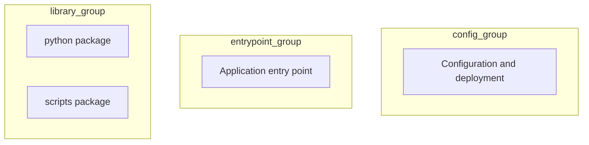

# Architecture report: astral-sh/ty

> Automated static analysis. **Observed** = directly seen in files/imports/AST; **Inferred** = interpretation from that evidence. Repository code was not executed.

## 1. Repository at a glance

| Item | Value |
| --- | --- |
| Repository | astral-sh/ty |
| Description | An extremely fast Python type checker and language server, written in Rust. |
| Language | Python |
| Stars | 20088 |
| Licence | MIT |
| Analysed commit / branch | b4bb5b2c8a620db50ad2f4c4e7055c2a4d51a551 / main |
| Framework(s) | None detected |
| Files analysed | 89 |
| Components | 4 |

## 2. Architecture in one minute

astral-sh/ty - An extremely fast Python type checker and language server, written in Rust.. This repository was analysed statically from 89 file(s) (8 Python). Detected technologies (observed from imports/manifests): GitHub Actions, Poetry, Docker. Files are grouped into 4 component(s): Configuration and deployment, Application entry point, python package, scripts package. Observed entry point(s): python/ty/__main__.py, scripts/build_ty_bolt.py, scripts/build_ty_pgo.py. Findings below distinguish observed facts from inferred interpretation.

## 3. High-level block diagram

## 4. Main components

### Configuration and deployment (`config`)

- **Kind:** config
- **Status:** Observed
- **Confidence:** 0.85
- **Responsibility:** Groups 7 file(s) under configuration and deployment (observed from repository paths and static analysis).
- **Paths:** `Dockerfile`, `_typos.toml`, `assets/badge/v0.json`, `dist-workspace.toml`, `mkdocs.yml`, `pyproject.toml`, `rust-toolchain.toml`
- **Evidence:** [Dockerfile](https://github.com/astral-sh/ty/blob/b4bb5b2c8a620db50ad2f4c4e7055c2a4d51a551/Dockerfile); [_typos.toml](https://github.com/astral-sh/ty/blob/b4bb5b2c8a620db50ad2f4c4e7055c2a4d51a551/_typos.toml); [assets/badge/v0.json](https://github.com/astral-sh/ty/blob/b4bb5b2c8a620db50ad2f4c4e7055c2a4d51a551/assets/badge/v0.json); [dist-workspace.toml](https://github.com/astral-sh/ty/blob/b4bb5b2c8a620db50ad2f4c4e7055c2a4d51a551/dist-workspace.toml); [mkdocs.yml](https://github.com/astral-sh/ty/blob/b4bb5b2c8a620db50ad2f4c4e7055c2a4d51a551/mkdocs.yml); [pyproject.toml](https://github.com/astral-sh/ty/blob/b4bb5b2c8a620db50ad2f4c4e7055c2a4d51a551/pyproject.toml); [rust-toolchain.toml](https://github.com/astral-sh/ty/blob/b4bb5b2c8a620db50ad2f4c4e7055c2a4d51a551/rust-toolchain.toml)

### Application entry point (`entrypoint`)

- **Kind:** entrypoint
- **Status:** Observed
- **Confidence:** 0.85
- **Responsibility:** Groups 6 file(s) under application entry point (observed from repository paths and static analysis). Observed top-level classes: EcosystemProject, GitProtocol, SchemastoreRepos. Observed top-level functions: _run, append_flags, cargo_command, check_program_header_address, determine_git_protocol, ecosystem_python_files.
- **Paths:** `python/ty/__main__.py`, `scripts/build_ty_bolt.py`, `scripts/build_ty_pgo.py`, `scripts/patch-dist-manifest-checksums.py`, `scripts/transform_readme.py`, `scripts/update_schemastore.py`
- **Evidence:** [python/ty/__main__.py:9](https://github.com/astral-sh/ty/blob/b4bb5b2c8a620db50ad2f4c4e7055c2a4d51a551/python/ty/__main__.py#L9); [scripts/build_ty_bolt.py:26](https://github.com/astral-sh/ty/blob/b4bb5b2c8a620db50ad2f4c4e7055c2a4d51a551/scripts/build_ty_bolt.py#L26); [scripts/build_ty_pgo.py:48](https://github.com/astral-sh/ty/blob/b4bb5b2c8a620db50ad2f4c4e7055c2a4d51a551/scripts/build_ty_pgo.py#L48); [scripts/patch-dist-manifest-checksums.py:26](https://github.com/astral-sh/ty/blob/b4bb5b2c8a620db50ad2f4c4e7055c2a4d51a551/scripts/patch-dist-manifest-checksums.py#L26); [scripts/transform_readme.py:21](https://github.com/astral-sh/ty/blob/b4bb5b2c8a620db50ad2f4c4e7055c2a4d51a551/scripts/transform_readme.py#L21); [scripts/update_schemastore.py:34](https://github.com/astral-sh/ty/blob/b4bb5b2c8a620db50ad2f4c4e7055c2a4d51a551/scripts/update_schemastore.py#L34)

### python package (`python`)

- **Kind:** library
- **Status:** Observed
- **Confidence:** 0.85
- **Responsibility:** Groups 2 file(s) under python package (observed from repository paths and static analysis). Observed top-level classes: TyNotFound. Observed top-level functions: _join, _matching_parents, _module_path, _user_scheme, find_ty_bin.
- **Paths:** `python/ty/__init__.py`, `python/ty/_find_ty.py`
- **Evidence:** [python/ty/__init__.py](https://github.com/astral-sh/ty/blob/b4bb5b2c8a620db50ad2f4c4e7055c2a4d51a551/python/ty/__init__.py); [python/ty/_find_ty.py:8](https://github.com/astral-sh/ty/blob/b4bb5b2c8a620db50ad2f4c4e7055c2a4d51a551/python/ty/_find_ty.py#L8)

### scripts package (`scripts`)

- **Kind:** library
- **Status:** Observed
- **Confidence:** 0.85
- **Responsibility:** Groups 2 file(s) under scripts package (observed from repository paths and static analysis).
- **Paths:** `scripts/autogenerate_files.sh`, `scripts/release.sh`
- **Evidence:** [scripts/autogenerate_files.sh](https://github.com/astral-sh/ty/blob/b4bb5b2c8a620db50ad2f4c4e7055c2a4d51a551/scripts/autogenerate_files.sh); [scripts/release.sh](https://github.com/astral-sh/ty/blob/b4bb5b2c8a620db50ad2f4c4e7055c2a4d51a551/scripts/release.sh)

## 5. Execution flow

**Observed** entry point(s):

- [python/ty/__main__.py:26](https://github.com/astral-sh/ty/blob/b4bb5b2c8a620db50ad2f4c4e7055c2a4d51a551/python/ty/__main__.py#L26)
- [scripts/build_ty_bolt.py:170](https://github.com/astral-sh/ty/blob/b4bb5b2c8a620db50ad2f4c4e7055c2a4d51a551/scripts/build_ty_bolt.py#L170)
- [scripts/build_ty_pgo.py:947](https://github.com/astral-sh/ty/blob/b4bb5b2c8a620db50ad2f4c4e7055c2a4d51a551/scripts/build_ty_pgo.py#L947)
- [scripts/patch-dist-manifest-checksums.py:61](https://github.com/astral-sh/ty/blob/b4bb5b2c8a620db50ad2f4c4e7055c2a4d51a551/scripts/patch-dist-manifest-checksums.py#L61)
- [scripts/transform_readme.py:69](https://github.com/astral-sh/ty/blob/b4bb5b2c8a620db50ad2f4c4e7055c2a4d51a551/scripts/transform_readme.py#L69)
- [scripts/update_schemastore.py:199](https://github.com/astral-sh/ty/blob/b4bb5b2c8a620db50ad2f4c4e7055c2a4d51a551/scripts/update_schemastore.py#L199)

Representative flow (derived from observed entry points and the import graph; steps beyond the entry point are **Inferred**):

1. Execution starts at an observed entry point listed above, if present.
2. No internal import relationships between components were observed.

## 6. Project structure

### `(root)`

- `.editorconfig` - config (317 bytes)
- `.gitattributes` - other (170 bytes)
- `.gitignore` - other (109 bytes)
- `.gitmodules` - other (73 bytes)
- `.markdownlint.yaml` - config (746 bytes)
- `.pre-commit-config.yaml` - config (4644 bytes)
- `.python-version` - other (5 bytes)
- `AGENTS.md` - docs (323 bytes)
- `BENCHMARKS.md` - docs (83874 bytes)
- `CONTRIBUTING.md` - docs (9977 bytes)
- `Dockerfile` - container (1852 bytes)
- `LICENSE` - docs (1077 bytes)
- `README.md` - docs (5610 bytes)
- `SECURITY.md` - docs (466 bytes)
- `_typos.toml` - config (221 bytes)
- `dist-workspace.toml` - config (3759 bytes)
- `mkdocs.yml` - config (5079 bytes)
- `pyproject.toml` - manifest (9574 bytes)
- `rust-toolchain.toml` - config (31 bytes)

### `.github`

- `.github/ISSUE_TEMPLATE/1_bug_report.yaml` - config (1603 bytes)
- `.github/ISSUE_TEMPLATE/2_question.yaml` - config (449 bytes)
- `.github/ISSUE_TEMPLATE/config.yml` - config (309 bytes)
- `.github/PULL_REQUEST_TEMPLATE.md` - docs (424 bytes)
- `.github/actionlint.yaml` - config (807 bytes)
- `.github/automations-dispatch.json` - config (927 bytes)
- `.github/renovate.json5` - other (1537 bytes)
- `.github/secure-token-service.json` - config (1295 bytes)
- `.github/workflows/ai-policy.yml` - ci, YAML (1753 bytes)
- `.github/workflows/build-binaries.yml` - ci, YAML (31538 bytes)
- `.github/workflows/build-docker.yml` - ci, YAML (16270 bytes)
- `.github/workflows/ci.yaml` - ci, YAML (5572 bytes)
- `.github/workflows/daily_property_tests.yml` - ci, YAML (2722 bytes)
- `.github/workflows/notify-dependents.yml` - ci, YAML (1625 bytes)
- `.github/workflows/publish-docs.yml` - ci, YAML (5129 bytes)
- `.github/workflows/publish-mirror.yml` - ci, YAML (3407 bytes)
- `.github/workflows/publish-pypi.yml` - ci, YAML (1347 bytes)
- `.github/workflows/publish-versions.yml` - ci, YAML (3559 bytes)
- `.github/workflows/release-prepare.yml` - ci, YAML (3486 bytes)
- `.github/workflows/release.yml` - ci, YAML (20552 bytes)
- `.github/workflows/sign-release-binaries.yml` - ci, YAML (17288 bytes)
- `.github/workflows/sync-ty-security.yml` - ci, YAML (4254 bytes)
- `.github/zizmor.yml` - config (156 bytes)

### `agents`

- `agents/references/repository-threat-model.md` - docs (3146 bytes)

### `assets`

- `assets/badge/v0.json` - config (335 bytes)

### `docs`

- `docs/.overrides/main.html` - docs (1498 bytes)
- `docs/.overrides/partials/integrations/analytics/fathom.html` - docs (87 bytes)
- `docs/assets/logo-letter.svg` - docs (284 bytes)
- `docs/assets/ty-benchmark-cli-light.svg` - docs (2339 bytes)
- `docs/assets/ty-benchmark-cli.svg` - docs (2443 bytes)
- `docs/coming-from-mypy-or-pyright.md` - docs (106929 bytes)
- `docs/configuration.md` - docs (2445 bytes)
- `docs/editors.md` - docs (5111 bytes)
- `docs/exclusions.md` - docs (3703 bytes)
- `docs/features/diagnostics.md` - docs (1826 bytes)
- `docs/features/language-server.md` - docs (16102 bytes)
- `docs/features/third-party/django.md` - docs (4125 bytes)
- `docs/features/third-party/index.md` - docs (271 bytes)
- `docs/features/third-party/pydantic.md` - docs (5519 bytes)
- `docs/features/third-party/pytest.md` - docs (2949 bytes)
- `docs/features/type-system.md` - docs (7035 bytes)
- `docs/index.md` - docs (2657 bytes)
- `docs/installation.md` - docs (4893 bytes)
- `docs/js/extra.js` - docs (2739 bytes)
- `docs/modules.md` - docs (3328 bytes)
- `docs/python-version.md` - docs (2339 bytes)
- `docs/reference/cli.md` - docs (14378 bytes)
- `docs/reference/configuration.md` - docs (35761 bytes)
- `docs/reference/editor-settings.md` - docs (16491 bytes)
- `docs/reference/environment.md` - docs (4469 bytes)
- `docs/reference/exit-codes.md` - docs (999 bytes)
- `docs/reference/typing-faq.md` - docs (18196 bytes)
- `docs/rules.md` - docs (2490 bytes)
- `docs/scripts.md` - docs (4259 bytes)
- `docs/stylesheets/extra.css` - docs (7077 bytes)
- `docs/suppression.md` - docs (5933 bytes)
- `docs/type-checking.md` - docs (2292 bytes)

### `python`

- `python/ty/__init__.py` - source, Python (97 bytes)
- `python/ty/__main__.py` - source, Python (520 bytes)
- `python/ty/_find_ty.py` - source, Python (3192 bytes)
- `python/ty/py.typed` - other (1 bytes)

### `scripts`

- `scripts/autogenerate_files.sh` - source, Shell (750 bytes)
- `scripts/build_ty_bolt.py` - source, Python (6132 bytes)
- `scripts/build_ty_pgo.py` - source, Python (32542 bytes)
- `scripts/build_ty_pgo.py.lock` - other (236 bytes)
- `scripts/patch-dist-manifest-checksums.py` - source, Python (2133 bytes)
- `scripts/patch-dist-manifest-checksums.py.lock` - other (236 bytes)
- `scripts/release.sh` - source, Shell (2701 bytes)
- `scripts/transform_readme.py` - source, Python (2641 bytes)
- `scripts/update_schemastore.py` - source, Python (6195 bytes)

## 7. Key dependencies and integrations

| Name | Category | Status | Confidence | Evidence |
| --- | --- | --- | --- | --- |
| GitHub Actions | ci | Observed | 0.90 | [.github/workflows/ai-policy.yml](https://github.com/astral-sh/ty/blob/b4bb5b2c8a620db50ad2f4c4e7055c2a4d51a551/.github/workflows/ai-policy.yml); [.github/workflows/build-binaries.yml](https://github.com/astral-sh/ty/blob/b4bb5b2c8a620db50ad2f4c4e7055c2a4d51a551/.github/workflows/build-binaries.yml); [.github/workflows/build-docker.yml](https://github.com/astral-sh/ty/blob/b4bb5b2c8a620db50ad2f4c4e7055c2a4d51a551/.github/workflows/build-docker.yml); [.github/workflows/ci.yaml](https://github.com/astral-sh/ty/blob/b4bb5b2c8a620db50ad2f4c4e7055c2a4d51a551/.github/workflows/ci.yaml) |
| Poetry | packaging | Observed | 0.85 | [pyproject.toml](https://github.com/astral-sh/ty/blob/b4bb5b2c8a620db50ad2f4c4e7055c2a4d51a551/pyproject.toml) |
| Docker | tooling | Observed | 0.90 | [.github/workflows/build-binaries.yml:492](https://github.com/astral-sh/ty/blob/b4bb5b2c8a620db50ad2f4c4e7055c2a4d51a551/.github/workflows/build-binaries.yml#L492); [.github/workflows/build-docker.yml:1](https://github.com/astral-sh/ty/blob/b4bb5b2c8a620db50ad2f4c4e7055c2a4d51a551/.github/workflows/build-docker.yml#L1); [.github/workflows/release.yml:133](https://github.com/astral-sh/ty/blob/b4bb5b2c8a620db50ad2f4c4e7055c2a4d51a551/.github/workflows/release.yml#L133); [Dockerfile](https://github.com/astral-sh/ty/blob/b4bb5b2c8a620db50ad2f4c4e7055c2a4d51a551/Dockerfile) |

## 8. Data and state

No database, cache, queue, or persistent-state usage was observed in the analysed files. State handling, if any, may be in-memory or in files that were not analysed.

## 9. Configuration and deployment clues

- `.editorconfig` (config)
- `.github/ISSUE_TEMPLATE/1_bug_report.yaml` (config)
- `.github/ISSUE_TEMPLATE/2_question.yaml` (config)
- `.github/ISSUE_TEMPLATE/config.yml` (config)
- `.github/actionlint.yaml` (config)
- `.github/automations-dispatch.json` (config)
- `.github/secure-token-service.json` (config)
- `.github/workflows/ai-policy.yml` (ci)
- `.github/workflows/build-binaries.yml` (ci)
- `.github/workflows/build-docker.yml` (ci)
- `.github/workflows/ci.yaml` (ci)
- `.github/workflows/daily_property_tests.yml` (ci)
- `.github/workflows/notify-dependents.yml` (ci)
- `.github/workflows/publish-docs.yml` (ci)
- `.github/workflows/publish-mirror.yml` (ci)
- `.github/workflows/publish-pypi.yml` (ci)
- `.github/workflows/publish-versions.yml` (ci)
- `.github/workflows/release-prepare.yml` (ci)
- `.github/workflows/release.yml` (ci)
- `.github/workflows/sign-release-binaries.yml` (ci)
- `.github/workflows/sync-ty-security.yml` (ci)
- `.github/zizmor.yml` (config)
- `.markdownlint.yaml` (config)
- `.pre-commit-config.yaml` (config)
- `Dockerfile` (container)
- `_typos.toml` (config)
- `assets/badge/v0.json` (config)
- `dist-workspace.toml` (config)
- `mkdocs.yml` (config)
- `pyproject.toml` (manifest)
- `rust-toolchain.toml` (config)

## 10. Design observations

- An entry/API layer is separated from other code (Inferred from paths and decorators).

These observations are interpretations (**Inferred**) of the observed structure, not guarantees about runtime design.

## 11. Limitations and unknowns

- Static analysis only: repository code was not executed, installed, or imported at runtime.
- Components and relationships are inferred from file paths, imports, and AST structure; runtime behaviour, dynamic imports, and reflection may not be visible.
- Repository text was treated as untrusted data; no instructions found in repository files were followed, and likely secret values were redacted/excluded.

## 12. Source references

- [.github/workflows/ai-policy.yml](https://github.com/astral-sh/ty/blob/b4bb5b2c8a620db50ad2f4c4e7055c2a4d51a551/.github/workflows/ai-policy.yml)
- [.github/workflows/build-binaries.yml](https://github.com/astral-sh/ty/blob/b4bb5b2c8a620db50ad2f4c4e7055c2a4d51a551/.github/workflows/build-binaries.yml)
- [.github/workflows/build-binaries.yml:492](https://github.com/astral-sh/ty/blob/b4bb5b2c8a620db50ad2f4c4e7055c2a4d51a551/.github/workflows/build-binaries.yml#L492)
- [.github/workflows/build-docker.yml](https://github.com/astral-sh/ty/blob/b4bb5b2c8a620db50ad2f4c4e7055c2a4d51a551/.github/workflows/build-docker.yml)
- [.github/workflows/build-docker.yml:1](https://github.com/astral-sh/ty/blob/b4bb5b2c8a620db50ad2f4c4e7055c2a4d51a551/.github/workflows/build-docker.yml#L1)
- [.github/workflows/ci.yaml](https://github.com/astral-sh/ty/blob/b4bb5b2c8a620db50ad2f4c4e7055c2a4d51a551/.github/workflows/ci.yaml)
- [.github/workflows/daily_property_tests.yml](https://github.com/astral-sh/ty/blob/b4bb5b2c8a620db50ad2f4c4e7055c2a4d51a551/.github/workflows/daily_property_tests.yml)
- [.github/workflows/notify-dependents.yml](https://github.com/astral-sh/ty/blob/b4bb5b2c8a620db50ad2f4c4e7055c2a4d51a551/.github/workflows/notify-dependents.yml)
- [.github/workflows/publish-docs.yml](https://github.com/astral-sh/ty/blob/b4bb5b2c8a620db50ad2f4c4e7055c2a4d51a551/.github/workflows/publish-docs.yml)
- [.github/workflows/publish-mirror.yml](https://github.com/astral-sh/ty/blob/b4bb5b2c8a620db50ad2f4c4e7055c2a4d51a551/.github/workflows/publish-mirror.yml)
- [.github/workflows/release.yml:133](https://github.com/astral-sh/ty/blob/b4bb5b2c8a620db50ad2f4c4e7055c2a4d51a551/.github/workflows/release.yml#L133)
- [Dockerfile](https://github.com/astral-sh/ty/blob/b4bb5b2c8a620db50ad2f4c4e7055c2a4d51a551/Dockerfile)
- [_typos.toml](https://github.com/astral-sh/ty/blob/b4bb5b2c8a620db50ad2f4c4e7055c2a4d51a551/_typos.toml)
- [assets/badge/v0.json](https://github.com/astral-sh/ty/blob/b4bb5b2c8a620db50ad2f4c4e7055c2a4d51a551/assets/badge/v0.json)
- [dist-workspace.toml](https://github.com/astral-sh/ty/blob/b4bb5b2c8a620db50ad2f4c4e7055c2a4d51a551/dist-workspace.toml)
- [mkdocs.yml](https://github.com/astral-sh/ty/blob/b4bb5b2c8a620db50ad2f4c4e7055c2a4d51a551/mkdocs.yml)
- [pyproject.toml](https://github.com/astral-sh/ty/blob/b4bb5b2c8a620db50ad2f4c4e7055c2a4d51a551/pyproject.toml)
- [python/ty/__init__.py](https://github.com/astral-sh/ty/blob/b4bb5b2c8a620db50ad2f4c4e7055c2a4d51a551/python/ty/__init__.py)
- [python/ty/__main__.py:9](https://github.com/astral-sh/ty/blob/b4bb5b2c8a620db50ad2f4c4e7055c2a4d51a551/python/ty/__main__.py#L9)
- [python/ty/__main__.py:26](https://github.com/astral-sh/ty/blob/b4bb5b2c8a620db50ad2f4c4e7055c2a4d51a551/python/ty/__main__.py#L26)
- [python/ty/_find_ty.py:8](https://github.com/astral-sh/ty/blob/b4bb5b2c8a620db50ad2f4c4e7055c2a4d51a551/python/ty/_find_ty.py#L8)
- [rust-toolchain.toml](https://github.com/astral-sh/ty/blob/b4bb5b2c8a620db50ad2f4c4e7055c2a4d51a551/rust-toolchain.toml)
- [scripts/autogenerate_files.sh](https://github.com/astral-sh/ty/blob/b4bb5b2c8a620db50ad2f4c4e7055c2a4d51a551/scripts/autogenerate_files.sh)
- [scripts/build_ty_bolt.py:26](https://github.com/astral-sh/ty/blob/b4bb5b2c8a620db50ad2f4c4e7055c2a4d51a551/scripts/build_ty_bolt.py#L26)
- [scripts/build_ty_bolt.py:170](https://github.com/astral-sh/ty/blob/b4bb5b2c8a620db50ad2f4c4e7055c2a4d51a551/scripts/build_ty_bolt.py#L170)
- [scripts/build_ty_pgo.py:48](https://github.com/astral-sh/ty/blob/b4bb5b2c8a620db50ad2f4c4e7055c2a4d51a551/scripts/build_ty_pgo.py#L48)
- [scripts/build_ty_pgo.py:947](https://github.com/astral-sh/ty/blob/b4bb5b2c8a620db50ad2f4c4e7055c2a4d51a551/scripts/build_ty_pgo.py#L947)
- [scripts/patch-dist-manifest-checksums.py:26](https://github.com/astral-sh/ty/blob/b4bb5b2c8a620db50ad2f4c4e7055c2a4d51a551/scripts/patch-dist-manifest-checksums.py#L26)
- [scripts/patch-dist-manifest-checksums.py:61](https://github.com/astral-sh/ty/blob/b4bb5b2c8a620db50ad2f4c4e7055c2a4d51a551/scripts/patch-dist-manifest-checksums.py#L61)
- [scripts/release.sh](https://github.com/astral-sh/ty/blob/b4bb5b2c8a620db50ad2f4c4e7055c2a4d51a551/scripts/release.sh)
- [scripts/transform_readme.py:21](https://github.com/astral-sh/ty/blob/b4bb5b2c8a620db50ad2f4c4e7055c2a4d51a551/scripts/transform_readme.py#L21)
- [scripts/transform_readme.py:69](https://github.com/astral-sh/ty/blob/b4bb5b2c8a620db50ad2f4c4e7055c2a4d51a551/scripts/transform_readme.py#L69)
- [scripts/update_schemastore.py:34](https://github.com/astral-sh/ty/blob/b4bb5b2c8a620db50ad2f4c4e7055c2a4d51a551/scripts/update_schemastore.py#L34)
- [scripts/update_schemastore.py:199](https://github.com/astral-sh/ty/blob/b4bb5b2c8a620db50ad2f4c4e7055c2a4d51a551/scripts/update_schemastore.py#L199)
