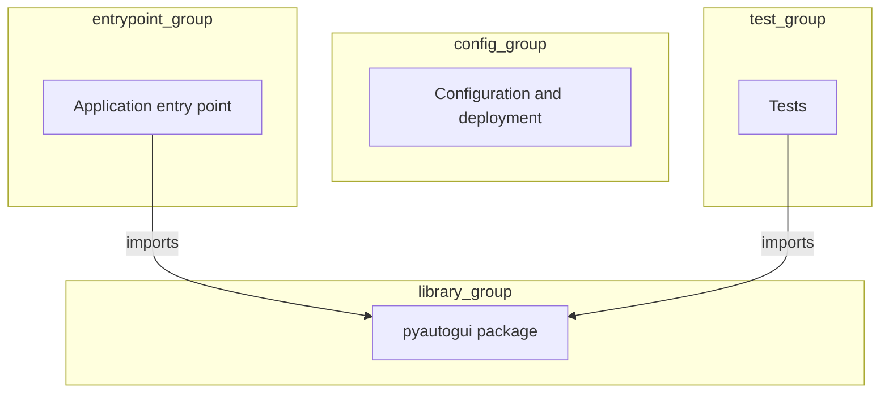

# Architecture report: asweigart/pyautogui

> Automated static analysis. **Observed** = directly seen in files/imports/AST; **Inferred** = interpretation from that evidence. Repository code was not executed.

## 1. Repository at a glance

| Item | Value |
| --- | --- |
| Repository | asweigart/pyautogui |
| Description | A cross-platform GUI automation Python module for human beings. Used to programmatically control the mouse & keyboard. |
| Language | Python |
| Stars | 12757 |
| Licence | BSD-3-Clause |
| Analysed commit / branch | b4255d0be42c377154c7d92337d7f8515fc63234 / master |
| Framework(s) | None detected |
| Files analysed | 31 |
| Components | 4 |

## 2. Architecture in one minute

asweigart/pyautogui - A cross-platform GUI automation Python module for human beings. Used to programmatically control the mouse & keyboard.. This repository was analysed statically from 31 file(s) (9 Python). Detected technologies (observed from imports/manifests): setuptools, unittest. Files are grouped into 4 component(s): Configuration and deployment, Application entry point, pyautogui package, Tests. Findings below distinguish observed facts from inferred interpretation.

## 3. High-level block diagram

## 4. Main components

### Configuration and deployment (`config`)

- **Kind:** config
- **Status:** Observed
- **Confidence:** 0.85
- **Responsibility:** Groups 4 file(s) under configuration and deployment (observed from repository paths and static analysis).
- **Paths:** `MANIFEST.in`, `Pipfile`, `setup.py`, `tox.ini`
- **Evidence:** [MANIFEST.in](https://github.com/asweigart/pyautogui/blob/b4255d0be42c377154c7d92337d7f8515fc63234/MANIFEST.in); [Pipfile](https://github.com/asweigart/pyautogui/blob/b4255d0be42c377154c7d92337d7f8515fc63234/Pipfile); [setup.py](https://github.com/asweigart/pyautogui/blob/b4255d0be42c377154c7d92337d7f8515fc63234/setup.py); [tox.ini](https://github.com/asweigart/pyautogui/blob/b4255d0be42c377154c7d92337d7f8515fc63234/tox.ini)

### Application entry point (`entrypoint`)

- **Kind:** entrypoint
- **Status:** Observed
- **Confidence:** 0.85
- **Responsibility:** Groups 1 file(s) under application entry point (observed from repository paths and static analysis).
- **Paths:** `pyautogui/__main__.py`
- **Evidence:** [pyautogui/__main__.py](https://github.com/asweigart/pyautogui/blob/b4255d0be42c377154c7d92337d7f8515fc63234/pyautogui/__main__.py)

### pyautogui package (`pyautogui`)

- **Kind:** library
- **Status:** Observed
- **Confidence:** 0.85
- **Responsibility:** Groups 5 file(s) under pyautogui package (observed from repository paths and static analysis). Observed top-level classes: FailSafeException, HARDWAREINPUT, INPUT, ImageNotFoundException, KEYBDINPUT, MOUSEINPUT. Observed top-level functions: _click, _dragTo, _genericPyAutoGUIChecks, _getCommaToken, _getNumberToken, _getParensCommandStrToken.
- **Paths:** `pyautogui/__init__.py`, `pyautogui/_pyautogui_java.py`, `pyautogui/_pyautogui_osx.py`, `pyautogui/_pyautogui_win.py`, `pyautogui/_pyautogui_x11.py`
- **Evidence:** [pyautogui/__init__.py:29](https://github.com/asweigart/pyautogui/blob/b4255d0be42c377154c7d92337d7f8515fc63234/pyautogui/__init__.py#L29); [pyautogui/_pyautogui_java.py](https://github.com/asweigart/pyautogui/blob/b4255d0be42c377154c7d92337d7f8515fc63234/pyautogui/_pyautogui_java.py); [pyautogui/_pyautogui_osx.py:219](https://github.com/asweigart/pyautogui/blob/b4255d0be42c377154c7d92337d7f8515fc63234/pyautogui/_pyautogui_osx.py#L219); [pyautogui/_pyautogui_win.py:62](https://github.com/asweigart/pyautogui/blob/b4255d0be42c377154c7d92337d7f8515fc63234/pyautogui/_pyautogui_win.py#L62); [pyautogui/_pyautogui_x11.py:26](https://github.com/asweigart/pyautogui/blob/b4255d0be42c377154c7d92337d7f8515fc63234/pyautogui/_pyautogui_x11.py#L26)

### Tests (`tests`)

- **Kind:** test
- **Status:** Observed
- **Confidence:** 0.85
- **Responsibility:** Groups 1 file(s) under tests (observed from repository paths and static analysis). Observed top-level classes: HoldThread, P, PressThread, TestDoctests, TestFailSafe, TestGeneral.
- **Paths:** `tests/test_pyautogui.py`
- **Evidence:** [tests/test_pyautogui.py:47](https://github.com/asweigart/pyautogui/blob/b4255d0be42c377154c7d92337d7f8515fc63234/tests/test_pyautogui.py#L47)

## 5. Execution flow

No entry point was observed; the startup flow below is therefore limited.

Representative flow (derived from observed entry points and the import graph; steps beyond the entry point are **Inferred**):

1. Execution starts at an observed entry point listed above, if present.
2. `entrypoint` imports `pyautogui` (Application entry point -> pyautogui package).
3. `tests` imports `pyautogui` (Tests -> pyautogui package).

## 6. Project structure

### `(root)`

- `.gitignore` - other (117 bytes)
- `AUTHORS.txt` - docs (2925 bytes)
- `CHANGES.txt` - docs (3986 bytes)
- `LICENSE.txt` - docs (1482 bytes)
- `MANIFEST.in` - manifest (213 bytes)
- `Pipfile` - manifest (181 bytes)
- `README.md` - docs (5836 bytes)
- `setup.py` - manifest, Python (2588 bytes)
- `tox.ini` - config (438 bytes)

### `docs`

- `docs/Makefile` - docs (6774 bytes)
- `docs/conf.py` - docs (4857 bytes)
- `docs/index.rst` - docs (6095 bytes)
- `docs/install.rst` - docs (1380 bytes)
- `docs/keyboard.rst` - docs (5575 bytes)
- `docs/make.bat` - docs (6465 bytes)
- `docs/mouse.rst` - docs (10507 bytes)
- `docs/msgbox.rst` - docs (1217 bytes)
- `docs/quickstart.rst` - docs (5783 bytes)
- `docs/roadmap.rst` - docs (2480 bytes)
- `docs/screenshot.rst` - docs (7800 bytes)
- `docs/simplified-chinese.ipynb` - docs (53493 bytes)
- `docs/source/modules.rst` - docs (64 bytes)
- `docs/source/pyautogui.rst` - docs (317 bytes)
- `docs/tests.rst` - docs (594 bytes)

### `pyautogui`

- `pyautogui/__init__.py` - source, Python (79299 bytes)
- `pyautogui/__main__.py` - source, Python (57 bytes)
- `pyautogui/_pyautogui_java.py` - source, Python (0 bytes)
- `pyautogui/_pyautogui_osx.py` - source, Python (15284 bytes)
- `pyautogui/_pyautogui_win.py` - source, Python (20343 bytes)
- `pyautogui/_pyautogui_x11.py` - source, Python (16398 bytes)

### `tests`

- `tests/test_pyautogui.py` - test, Python (35143 bytes)

## 7. Key dependencies and integrations

| Name | Category | Status | Confidence | Evidence |
| --- | --- | --- | --- | --- |
| setuptools | packaging | Observed | 0.90 | [setup.py:4](https://github.com/asweigart/pyautogui/blob/b4255d0be42c377154c7d92337d7f8515fc63234/setup.py#L4) |
| unittest | tooling | Observed | 0.90 | [tests/test_pyautogui.py:8](https://github.com/asweigart/pyautogui/blob/b4255d0be42c377154c7d92337d7f8515fc63234/tests/test_pyautogui.py#L8) |

## 8. Data and state

No database, cache, queue, or persistent-state usage was observed in the analysed files. State handling, if any, may be in-memory or in files that were not analysed.

## 9. Configuration and deployment clues

- `MANIFEST.in` (manifest)
- `Pipfile` (manifest)
- `setup.py` (manifest)
- `tox.ini` (config)

## 10. Design observations

- An entry/API layer is separated from other code (Inferred from paths and decorators).
- Tests are present alongside source code (Observed from test file paths).

These observations are interpretations (**Inferred**) of the observed structure, not guarantees about runtime design.

## 11. Limitations and unknowns

- Static analysis only: repository code was not executed, installed, or imported at runtime.
- Components and relationships are inferred from file paths, imports, and AST structure; runtime behaviour, dynamic imports, and reflection may not be visible.
- No clear application entry point was observed in the analysed files.
- Repository text was treated as untrusted data; no instructions found in repository files were followed, and likely secret values were redacted/excluded.

## 12. Source references

- [MANIFEST.in](https://github.com/asweigart/pyautogui/blob/b4255d0be42c377154c7d92337d7f8515fc63234/MANIFEST.in)
- [Pipfile](https://github.com/asweigart/pyautogui/blob/b4255d0be42c377154c7d92337d7f8515fc63234/Pipfile)
- [pyautogui/__init__.py:29](https://github.com/asweigart/pyautogui/blob/b4255d0be42c377154c7d92337d7f8515fc63234/pyautogui/__init__.py#L29)
- [pyautogui/__main__.py](https://github.com/asweigart/pyautogui/blob/b4255d0be42c377154c7d92337d7f8515fc63234/pyautogui/__main__.py)
- [pyautogui/_pyautogui_java.py](https://github.com/asweigart/pyautogui/blob/b4255d0be42c377154c7d92337d7f8515fc63234/pyautogui/_pyautogui_java.py)
- [pyautogui/_pyautogui_osx.py:219](https://github.com/asweigart/pyautogui/blob/b4255d0be42c377154c7d92337d7f8515fc63234/pyautogui/_pyautogui_osx.py#L219)
- [pyautogui/_pyautogui_win.py:62](https://github.com/asweigart/pyautogui/blob/b4255d0be42c377154c7d92337d7f8515fc63234/pyautogui/_pyautogui_win.py#L62)
- [pyautogui/_pyautogui_x11.py:26](https://github.com/asweigart/pyautogui/blob/b4255d0be42c377154c7d92337d7f8515fc63234/pyautogui/_pyautogui_x11.py#L26)
- [setup.py](https://github.com/asweigart/pyautogui/blob/b4255d0be42c377154c7d92337d7f8515fc63234/setup.py)
- [setup.py:4](https://github.com/asweigart/pyautogui/blob/b4255d0be42c377154c7d92337d7f8515fc63234/setup.py#L4)
- [tests/test_pyautogui.py:8](https://github.com/asweigart/pyautogui/blob/b4255d0be42c377154c7d92337d7f8515fc63234/tests/test_pyautogui.py#L8)
- [tests/test_pyautogui.py:47](https://github.com/asweigart/pyautogui/blob/b4255d0be42c377154c7d92337d7f8515fc63234/tests/test_pyautogui.py#L47)
- [tox.ini](https://github.com/asweigart/pyautogui/blob/b4255d0be42c377154c7d92337d7f8515fc63234/tox.ini)
