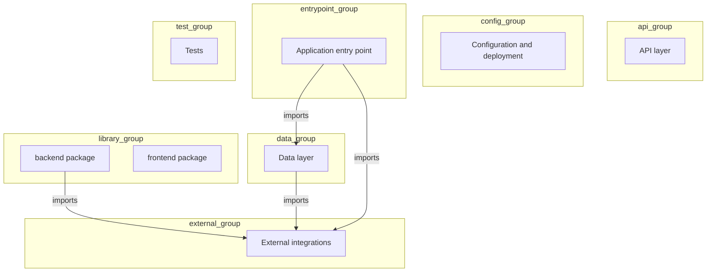

# Architecture report: avgupta456/github-trends

> Automated static analysis. **Observed** = directly seen in files/imports/AST; **Inferred** = interpretation from that evidence. Repository code was not executed.

## 1. Repository at a glance

| Item | Value |
| --- | --- |
| Repository | avgupta456/github-trends |
| Description | 🚀 Level up your GitHub profile readme with customizable cards including LOC statistics! |
| Language | Python |
| Stars | 15926 |
| Licence | MIT |
| Analysed commit / branch | 7d1ec357a1033cd6828a6a194070167ccde20092 / main |
| Framework(s) | FastAPI, React, Starlette |
| Files analysed | 238 |
| Components | 8 |

## 2. Architecture in one minute

avgupta456/github-trends - 🚀 Level up your GitHub profile readme with customizable cards including LOC statistics!. This repository was analysed statically from 238 file(s) (127 Python). Detected technologies (observed from imports/manifests): GitHub Actions, MongoDB, FastAPI, React, Starlette, axios. Files are grouped into 8 component(s): API layer, backend package, Configuration and deployment, Data layer, Application entry point, External integrations, frontend package, Tests. Observed entry point(s): backend/scripts/delete_old_data.py, backend/scripts/local.py, backend/src/main.py. Findings below distinguish observed facts from inferred interpretation.

## 3. High-level block diagram

## 4. Main components

### API layer (`api_layer`)

- **Kind:** api
- **Status:** Observed
- **Confidence:** 0.85
- **Responsibility:** Groups 16 file(s) under api layer (observed from repository paths and static analysis). Observed routes: GET /error, GET /stopwatch, GET /signup/public, GET /signup/private, GET /redirect. Observed top-level functions: authenticate_endpoint, check_valid_user, delete_account, delete_account_auth, delete_user_endpoint, get_db_public_user.
- **Paths:** `backend/src/routers/__init__.py`, `backend/src/routers/assets/__init__.py`, `backend/src/routers/assets/assets.py`, `backend/src/routers/auth/__init__.py`, `backend/src/routers/auth/standalone.py`, `backend/src/routers/auth/website.py`, `backend/src/routers/background.py`, `backend/src/routers/decorators.py`, `backend/src/routers/dev.py`, `backend/src/routers/users/__init__.py`, `backend/src/routers/users/db.py`, `backend/src/routers/users/svg.py`, `backend/src/routers/wrapped.py`, `frontend/src/api/index.js`, `frontend/src/api/user.js`, `frontend/src/api/wrapped.js`
- **Evidence:** [backend/src/routers/__init__.py](https://github.com/avgupta456/github-trends/blob/7d1ec357a1033cd6828a6a194070167ccde20092/backend/src/routers/__init__.py); [backend/src/routers/assets/__init__.py](https://github.com/avgupta456/github-trends/blob/7d1ec357a1033cd6828a6a194070167ccde20092/backend/src/routers/assets/__init__.py); [backend/src/routers/assets/assets.py:8](https://github.com/avgupta456/github-trends/blob/7d1ec357a1033cd6828a6a194070167ccde20092/backend/src/routers/assets/assets.py#L8); [backend/src/routers/auth/__init__.py](https://github.com/avgupta456/github-trends/blob/7d1ec357a1033cd6828a6a194070167ccde20092/backend/src/routers/auth/__init__.py); [backend/src/routers/auth/standalone.py:15](https://github.com/avgupta456/github-trends/blob/7d1ec357a1033cd6828a6a194070167ccde20092/backend/src/routers/auth/standalone.py#L15); [backend/src/routers/auth/website.py:21](https://github.com/avgupta456/github-trends/blob/7d1ec357a1033cd6828a6a194070167ccde20092/backend/src/routers/auth/website.py#L21); [backend/src/routers/background.py:10](https://github.com/avgupta456/github-trends/blob/7d1ec357a1033cd6828a6a194070167ccde20092/backend/src/routers/background.py#L10); [backend/src/routers/decorators.py:16](https://github.com/avgupta456/github-trends/blob/7d1ec357a1033cd6828a6a194070167ccde20092/backend/src/routers/decorators.py#L16)

### backend package (`backend`)

- **Kind:** library
- **Status:** Observed
- **Confidence:** 0.85
- **Responsibility:** Groups 36 file(s) under backend package (observed from repository paths and static analysis). Observed top-level classes: CommitLanguages, ContribsList, DateContainer, ListsContainer, StatsContainer. Observed top-level functions: _count_loc, _count_repo_loc, _get_user, alru_cache, async_fail_gracefully, async_function.
- **Paths:** `backend/scripts/__init__.py`, `backend/src/__init__.py`, `backend/src/aggregation/layer0/__init__.py`, `backend/src/aggregation/layer0/contributions.py`, `backend/src/aggregation/layer0/follows.py`, `backend/src/aggregation/layer0/languages.py`, `backend/src/aggregation/layer0/package.py`, `backend/src/aggregation/layer1/__init__.py`, `backend/src/aggregation/layer1/auth.py`, `backend/src/aggregation/layer1/user.py`, `backend/src/aggregation/layer2/__init__.py`, `backend/src/aggregation/layer2/auth.py`, `backend/src/aggregation/layer2/user.py`, `backend/src/constants.py`, `backend/src/processing/auth.py`, `backend/src/processing/user/__init__.py`, `backend/src/processing/user/commits.py`, `backend/src/processing/user/svg.py`, `backend/src/processing/wrapped/__init__.py`, `backend/src/processing/wrapped/calendar.py`, `backend/src/processing/wrapped/langs.py`, `backend/src/processing/wrapped/numeric.py`, `backend/src/processing/wrapped/package.py`, `backend/src/processing/wrapped/repos.py`, `backend/src/processing/wrapped/time.py`, `backend/src/processing/wrapped/timestamps.py`, `backend/src/render/__init__.py`, `backend/src/render/error.py`, `backend/src/render/style.py`, `backend/src/render/top_langs.py`, `backend/src/render/top_repos.py`, `backend/src/utils/__init__.py`, `backend/src/utils/alru_cache.py`, `backend/src/utils/decorators.py`, `backend/src/utils/gather.py`, `backend/src/utils/utils.py`
- **Evidence:** [backend/scripts/__init__.py](https://github.com/avgupta456/github-trends/blob/7d1ec357a1033cd6828a6a194070167ccde20092/backend/scripts/__init__.py); [backend/src/__init__.py](https://github.com/avgupta456/github-trends/blob/7d1ec357a1033cd6828a6a194070167ccde20092/backend/src/__init__.py); [backend/src/aggregation/layer0/__init__.py](https://github.com/avgupta456/github-trends/blob/7d1ec357a1033cd6828a6a194070167ccde20092/backend/src/aggregation/layer0/__init__.py); [backend/src/aggregation/layer0/contributions.py:36](https://github.com/avgupta456/github-trends/blob/7d1ec357a1033cd6828a6a194070167ccde20092/backend/src/aggregation/layer0/contributions.py#L36); [backend/src/aggregation/layer0/follows.py:10](https://github.com/avgupta456/github-trends/blob/7d1ec357a1033cd6828a6a194070167ccde20092/backend/src/aggregation/layer0/follows.py#L10); [backend/src/aggregation/layer0/languages.py:11](https://github.com/avgupta456/github-trends/blob/7d1ec357a1033cd6828a6a194070167ccde20092/backend/src/aggregation/layer0/languages.py#L11); [backend/src/aggregation/layer0/package.py:10](https://github.com/avgupta456/github-trends/blob/7d1ec357a1033cd6828a6a194070167ccde20092/backend/src/aggregation/layer0/package.py#L10); [backend/src/aggregation/layer1/__init__.py](https://github.com/avgupta456/github-trends/blob/7d1ec357a1033cd6828a6a194070167ccde20092/backend/src/aggregation/layer1/__init__.py)

### Configuration and deployment (`config`)

- **Kind:** config
- **Status:** Observed
- **Confidence:** 0.85
- **Responsibility:** Groups 13 file(s) under configuration and deployment (observed from repository paths and static analysis).
- **Paths:** `backend/.pre-commit-config.yaml`, `backend/deploy/app.yaml`, `backend/deploy/cloudbuild.yaml`, `backend/deploy/dispatch.yaml`, `backend/package.json`, `backend/pyproject.toml`, `backend/requirements.txt`, `backend/src/data/github/extensions.json`, `frontend/deploy/Dockerfile`, `frontend/package.json`, `frontend/public/manifest.json`, `frontend/src/pages/Settings/Settings.js`, `frontend/src/pages/Settings/index.js`
- **Evidence:** [backend/.pre-commit-config.yaml](https://github.com/avgupta456/github-trends/blob/7d1ec357a1033cd6828a6a194070167ccde20092/backend/.pre-commit-config.yaml); [backend/deploy/app.yaml](https://github.com/avgupta456/github-trends/blob/7d1ec357a1033cd6828a6a194070167ccde20092/backend/deploy/app.yaml); [backend/deploy/cloudbuild.yaml](https://github.com/avgupta456/github-trends/blob/7d1ec357a1033cd6828a6a194070167ccde20092/backend/deploy/cloudbuild.yaml); [backend/deploy/dispatch.yaml](https://github.com/avgupta456/github-trends/blob/7d1ec357a1033cd6828a6a194070167ccde20092/backend/deploy/dispatch.yaml); [backend/package.json](https://github.com/avgupta456/github-trends/blob/7d1ec357a1033cd6828a6a194070167ccde20092/backend/package.json); [backend/pyproject.toml](https://github.com/avgupta456/github-trends/blob/7d1ec357a1033cd6828a6a194070167ccde20092/backend/pyproject.toml); [backend/requirements.txt](https://github.com/avgupta456/github-trends/blob/7d1ec357a1033cd6828a6a194070167ccde20092/backend/requirements.txt); [backend/src/data/github/extensions.json](https://github.com/avgupta456/github-trends/blob/7d1ec357a1033cd6828a6a194070167ccde20092/backend/src/data/github/extensions.json)

### Data layer (`data_layer`)

- **Kind:** data
- **Status:** Observed
- **Confidence:** 0.85
- **Responsibility:** Groups 48 file(s) under data layer (observed from repository paths and static analysis). Observed top-level classes: CalendarData, CalendarDayDatum, CalendarLanguageDayDatum, ContribStats, ContributionDay, ContributionLists. Observed top-level functions: _get_template, delete_user, get_access_token, get_commit_files, get_commits, get_full_user.
- **Paths:** `backend/src/data/__init__.py`, `backend/src/data/github/__init__.py`, `backend/src/data/github/auth/__init__.py`, `backend/src/data/github/graphql/__init__.py`, `backend/src/data/github/graphql/commit.py`, `backend/src/data/github/graphql/models.py`, `backend/src/data/github/graphql/repo.py`, `backend/src/data/github/graphql/template.py`, `backend/src/data/github/graphql/user/__init__.py`, `backend/src/data/github/graphql/user/contribs/__init__.py`, `backend/src/data/github/graphql/user/contribs/contribs.py`, `backend/src/data/github/graphql/user/contribs/models.py`, `backend/src/data/github/graphql/user/follows/__init__.py`, `backend/src/data/github/graphql/user/follows/follows.py`, `backend/src/data/github/graphql/user/follows/models.py`, `backend/src/data/github/language_map.py`, `backend/src/data/github/rest/__init__.py`, `backend/src/data/github/rest/commit.py`, `backend/src/data/github/rest/models.py`, `backend/src/data/github/rest/repo.py`, `backend/src/data/github/rest/template.py`, `backend/src/data/github/rest/user.py`, `backend/src/data/github/utils.py`, `backend/src/data/mongo/__init__.py`, `backend/src/data/mongo/secret/__init__.py`, `backend/src/data/mongo/secret/functions.py`, `backend/src/data/mongo/secret/models.py`, `backend/src/data/mongo/user/__init__.py`, `backend/src/data/mongo/user/functions.py`, `backend/src/data/mongo/user/get.py`, `backend/src/data/mongo/user/models.py`, `backend/src/data/mongo/user_months/__init__.py`, `backend/src/data/mongo/user_months/functions.py`, `backend/src/data/mongo/user_months/get.py`, `backend/src/data/mongo/user_months/models.py`, `backend/src/models/__init__.py`, `backend/src/models/background.py`, `backend/src/models/svg.py`, `backend/src/models/user/__init__.py`, `backend/src/models/user/contribs.py`, `backend/src/models/user/follows.py`, `backend/src/models/wrapped/__init__.py`, `backend/src/models/wrapped/calendar.py`, `backend/src/models/wrapped/langs.py`, `backend/src/models/wrapped/numeric.py`, `backend/src/models/wrapped/repos.py`, `backend/src/models/wrapped/time.py`, `backend/src/models/wrapped/timestamps.py`
- **Evidence:** [backend/src/data/__init__.py](https://github.com/avgupta456/github-trends/blob/7d1ec357a1033cd6828a6a194070167ccde20092/backend/src/data/__init__.py); [backend/src/data/github/__init__.py](https://github.com/avgupta456/github-trends/blob/7d1ec357a1033cd6828a6a194070167ccde20092/backend/src/data/github/__init__.py); [backend/src/data/github/auth/__init__.py](https://github.com/avgupta456/github-trends/blob/7d1ec357a1033cd6828a6a194070167ccde20092/backend/src/data/github/auth/__init__.py); [backend/src/data/github/graphql/__init__.py](https://github.com/avgupta456/github-trends/blob/7d1ec357a1033cd6828a6a194070167ccde20092/backend/src/data/github/graphql/__init__.py); [backend/src/data/github/graphql/commit.py:14](https://github.com/avgupta456/github-trends/blob/7d1ec357a1033cd6828a6a194070167ccde20092/backend/src/data/github/graphql/commit.py#L14); [backend/src/data/github/graphql/models.py:6](https://github.com/avgupta456/github-trends/blob/7d1ec357a1033cd6828a6a194070167ccde20092/backend/src/data/github/graphql/models.py#L6); [backend/src/data/github/graphql/repo.py:7](https://github.com/avgupta456/github-trends/blob/7d1ec357a1033cd6828a6a194070167ccde20092/backend/src/data/github/graphql/repo.py#L7); [backend/src/data/github/graphql/template.py:14](https://github.com/avgupta456/github-trends/blob/7d1ec357a1033cd6828a6a194070167ccde20092/backend/src/data/github/graphql/template.py#L14)

### Application entry point (`entrypoint`)

- **Kind:** entrypoint
- **Status:** Observed
- **Confidence:** 0.85
- **Responsibility:** Groups 11 file(s) under application entry point (observed from repository paths and static analysis). Observed application object created via FastAPI, Group. Observed routes: GET /, GET /info, GET /{user_id}. Observed top-level classes: OAuthError, UserPackage, WrappedPackage. Observed top-level functions: authenticate, count_old_rows, delete_old_rows, get_bar_section, get_conn_str, get_filters.
- **Paths:** `backend/scripts/delete_old_data.py`, `backend/scripts/local.py`, `backend/src/data/github/auth/main.py`, `backend/src/data/mongo/main.py`, `backend/src/main.py`, `backend/src/models/user/main.py`, `backend/src/models/wrapped/main.py`, `backend/src/processing/wrapped/main.py`, `backend/src/render/template.py`, `backend/src/routers/auth/main.py`, `backend/src/routers/users/main.py`
- **Evidence:** [backend/scripts/delete_old_data.py:20](https://github.com/avgupta456/github-trends/blob/7d1ec357a1033cd6828a6a194070167ccde20092/backend/scripts/delete_old_data.py#L20); [backend/scripts/local.py:19](https://github.com/avgupta456/github-trends/blob/7d1ec357a1033cd6828a6a194070167ccde20092/backend/scripts/local.py#L19); [backend/src/data/github/auth/main.py:11](https://github.com/avgupta456/github-trends/blob/7d1ec357a1033cd6828a6a194070167ccde20092/backend/src/data/github/auth/main.py#L11); [backend/src/data/mongo/main.py:7](https://github.com/avgupta456/github-trends/blob/7d1ec357a1033cd6828a6a194070167ccde20092/backend/src/data/mongo/main.py#L7); [backend/src/main.py:27](https://github.com/avgupta456/github-trends/blob/7d1ec357a1033cd6828a6a194070167ccde20092/backend/src/main.py#L27); [backend/src/models/user/main.py:11](https://github.com/avgupta456/github-trends/blob/7d1ec357a1033cd6828a6a194070167ccde20092/backend/src/models/user/main.py#L11); [backend/src/models/wrapped/main.py:11](https://github.com/avgupta456/github-trends/blob/7d1ec357a1033cd6828a6a194070167ccde20092/backend/src/models/wrapped/main.py#L11); [backend/src/processing/wrapped/main.py:12](https://github.com/avgupta456/github-trends/blob/7d1ec357a1033cd6828a6a194070167ccde20092/backend/src/processing/wrapped/main.py#L12)

### External integrations (`external_integrations`)

- **Kind:** external
- **Status:** Inferred
- **Confidence:** 0.70
- **Responsibility:** Groups 0 file(s) under external integrations (observed from repository paths and static analysis).
- **Evidence:** [backend/src/aggregation/layer1/user.py:5](https://github.com/avgupta456/github-trends/blob/7d1ec357a1033cd6828a6a194070167ccde20092/backend/src/aggregation/layer1/user.py#L5); [backend/src/data/github/auth/main.py:4](https://github.com/avgupta456/github-trends/blob/7d1ec357a1033cd6828a6a194070167ccde20092/backend/src/data/github/auth/main.py#L4); [backend/src/data/github/graphql/template.py:5](https://github.com/avgupta456/github-trends/blob/7d1ec357a1033cd6828a6a194070167ccde20092/backend/src/data/github/graphql/template.py#L5); [backend/src/data/github/graphql/template.py:6](https://github.com/avgupta456/github-trends/blob/7d1ec357a1033cd6828a6a194070167ccde20092/backend/src/data/github/graphql/template.py#L6); [backend/src/data/github/rest/template.py:4](https://github.com/avgupta456/github-trends/blob/7d1ec357a1033cd6828a6a194070167ccde20092/backend/src/data/github/rest/template.py#L4); [backend/src/data/github/rest/template.py:5](https://github.com/avgupta456/github-trends/blob/7d1ec357a1033cd6828a6a194070167ccde20092/backend/src/data/github/rest/template.py#L5)

### frontend package (`frontend`)

- **Kind:** library
- **Status:** Observed
- **Confidence:** 0.85
- **Responsibility:** Groups 68 file(s) under frontend package (observed from repository paths and static analysis).
- **Paths:** `frontend/.eslintrc.js`, `frontend/.prettierrc.js`, `frontend/src/components/Card/Card.js`, `frontend/src/components/Card/SVG.js`, `frontend/src/components/Card/index.js`, `frontend/src/components/Generic/Button.js`, `frontend/src/components/Generic/Checkbox.js`, `frontend/src/components/Generic/Input.js`, `frontend/src/components/Generic/index.js`, `frontend/src/components/Home/CheckboxSection.js`, `frontend/src/components/Home/DateRangeSection.js`, `frontend/src/components/Home/Progress.js`, `frontend/src/components/Home/Section.js`, `frontend/src/components/Home/index.js`, `frontend/src/components/Preview/Preview.js`, `frontend/src/components/Preview/index.js`, `frontend/src/components/Wrapped/Organization.js`, `frontend/src/components/Wrapped/Specifics/Bar.js`, `frontend/src/components/Wrapped/Specifics/Calendar.js`, `frontend/src/components/Wrapped/Specifics/Numeric.js`, `frontend/src/components/Wrapped/Specifics/Pie.js`, `frontend/src/components/Wrapped/Specifics/Radar.js`, `frontend/src/components/Wrapped/Specifics/Swarm.js`, `frontend/src/components/Wrapped/Specifics/index.js`, `frontend/src/components/Wrapped/Templates/Bar.js`, `frontend/src/components/Wrapped/Templates/Numeric.js`, `frontend/src/components/Wrapped/Templates/Pie.js`, `frontend/src/components/Wrapped/Templates/Swarm.js`, `frontend/src/components/Wrapped/Templates/index.js`, `frontend/src/components/Wrapped/Templates/theme.js`, `frontend/src/components/Wrapped/index.js`, `frontend/src/components/index.js`, `frontend/src/constants.js`, `frontend/src/index.js`, `frontend/src/pages/App/AppTrends.js`, `frontend/src/pages/App/AppWrapped.js`, `frontend/src/pages/App/Footer.js`, `frontend/src/pages/App/Header.js`, `frontend/src/pages/App/index.js`, `frontend/src/pages/Auth/SignUp.js`, `frontend/src/pages/Auth/index.js`, `frontend/src/pages/Demo/Demo.js`, `frontend/src/pages/Demo/index.js`, `frontend/src/pages/Home/Home.js`, `frontend/src/pages/Home/index.js`, `frontend/src/pages/Home/stages/Customize.js`, `frontend/src/pages/Home/stages/Display.js`, `frontend/src/pages/Home/stages/SelectCard.js`, `frontend/src/pages/Home/stages/Theme.js`, `frontend/src/pages/Home/stages/index.js`, `frontend/src/pages/Landing/Landing.js`, `frontend/src/pages/Landing/index.js`, `frontend/src/pages/Misc/NoMatch.js`, `frontend/src/pages/Misc/Redirect.js`, `frontend/src/pages/Misc/index.js`, `frontend/src/pages/Wrapped/SelectUser.js`, `frontend/src/pages/Wrapped/Wrapped.js`, `frontend/src/pages/Wrapped/index.js`, `frontend/src/pages/Wrapped/sections/Loading.js`, `frontend/src/pages/Wrapped/sections/LoadingV2.js`, `frontend/src/pages/Wrapped/sections/index.js`, `frontend/src/redux/actions/userActions.js`, `frontend/src/redux/logger.js`, `frontend/src/redux/reducers/index.js`, `frontend/src/redux/reducers/user.js`, `frontend/src/redux/store.js`, `frontend/src/utils.js`, `frontend/tailwind.config.js`
- **Evidence:** [frontend/.eslintrc.js](https://github.com/avgupta456/github-trends/blob/7d1ec357a1033cd6828a6a194070167ccde20092/frontend/.eslintrc.js); [frontend/.prettierrc.js](https://github.com/avgupta456/github-trends/blob/7d1ec357a1033cd6828a6a194070167ccde20092/frontend/.prettierrc.js); [frontend/src/components/Card/Card.js](https://github.com/avgupta456/github-trends/blob/7d1ec357a1033cd6828a6a194070167ccde20092/frontend/src/components/Card/Card.js); [frontend/src/components/Card/SVG.js](https://github.com/avgupta456/github-trends/blob/7d1ec357a1033cd6828a6a194070167ccde20092/frontend/src/components/Card/SVG.js); [frontend/src/components/Card/index.js](https://github.com/avgupta456/github-trends/blob/7d1ec357a1033cd6828a6a194070167ccde20092/frontend/src/components/Card/index.js); [frontend/src/components/Generic/Button.js](https://github.com/avgupta456/github-trends/blob/7d1ec357a1033cd6828a6a194070167ccde20092/frontend/src/components/Generic/Button.js); [frontend/src/components/Generic/Checkbox.js](https://github.com/avgupta456/github-trends/blob/7d1ec357a1033cd6828a6a194070167ccde20092/frontend/src/components/Generic/Checkbox.js); [frontend/src/components/Generic/Input.js](https://github.com/avgupta456/github-trends/blob/7d1ec357a1033cd6828a6a194070167ccde20092/frontend/src/components/Generic/Input.js)

### Tests (`tests`)

- **Kind:** test
- **Status:** Observed
- **Confidence:** 0.85
- **Responsibility:** Groups 19 file(s) under tests (observed from repository paths and static analysis). Observed top-level classes: TestTemplate.
- **Paths:** `backend/tests/__init__.py`, `backend/tests/aggregation/__init__.py`, `backend/tests/aggregation/layer0/__init__.py`, `backend/tests/aggregation/layer0/test_contributions.py`, `backend/tests/aggregation/layer0/test_follows.py`, `backend/tests/data/__init__.py`, `backend/tests/data/github/__init__.py`, `backend/tests/data/github/auth/__init__.py`, `backend/tests/data/github/auth/test_main.py`, `backend/tests/data/github/graphql/__init__.py`, `backend/tests/data/github/graphql/test_commits.py`, `backend/tests/data/github/graphql/test_repo.py`, `backend/tests/data/github/graphql/test_user_contribs.py`, `backend/tests/data/github/graphql/test_user_follows.py`, `backend/tests/data/github/rest/__init__.py`, `backend/tests/data/github/rest/test_commit.py`, `backend/tests/data/github/rest/test_repo.py`, `backend/tests/utils/__init__.py`, `backend/tests/utils/test_alru_cache.py`
- **Evidence:** [backend/tests/__init__.py](https://github.com/avgupta456/github-trends/blob/7d1ec357a1033cd6828a6a194070167ccde20092/backend/tests/__init__.py); [backend/tests/aggregation/__init__.py](https://github.com/avgupta456/github-trends/blob/7d1ec357a1033cd6828a6a194070167ccde20092/backend/tests/aggregation/__init__.py); [backend/tests/aggregation/layer0/__init__.py](https://github.com/avgupta456/github-trends/blob/7d1ec357a1033cd6828a6a194070167ccde20092/backend/tests/aggregation/layer0/__init__.py); [backend/tests/aggregation/layer0/test_contributions.py:10](https://github.com/avgupta456/github-trends/blob/7d1ec357a1033cd6828a6a194070167ccde20092/backend/tests/aggregation/layer0/test_contributions.py#L10); [backend/tests/aggregation/layer0/test_follows.py:8](https://github.com/avgupta456/github-trends/blob/7d1ec357a1033cd6828a6a194070167ccde20092/backend/tests/aggregation/layer0/test_follows.py#L8); [backend/tests/data/__init__.py](https://github.com/avgupta456/github-trends/blob/7d1ec357a1033cd6828a6a194070167ccde20092/backend/tests/data/__init__.py); [backend/tests/data/github/__init__.py](https://github.com/avgupta456/github-trends/blob/7d1ec357a1033cd6828a6a194070167ccde20092/backend/tests/data/github/__init__.py); [backend/tests/data/github/auth/__init__.py](https://github.com/avgupta456/github-trends/blob/7d1ec357a1033cd6828a6a194070167ccde20092/backend/tests/data/github/auth/__init__.py)

## 5. Execution flow

**Observed** entry point(s):

- [backend/scripts/delete_old_data.py:62](https://github.com/avgupta456/github-trends/blob/7d1ec357a1033cd6828a6a194070167ccde20092/backend/scripts/delete_old_data.py#L62)
- [backend/scripts/local.py:102](https://github.com/avgupta456/github-trends/blob/7d1ec357a1033cd6828a6a194070167ccde20092/backend/scripts/local.py#L102)
- [backend/src/main.py:27](https://github.com/avgupta456/github-trends/blob/7d1ec357a1033cd6828a6a194070167ccde20092/backend/src/main.py#L27)
- [backend/src/render/template.py:47](https://github.com/avgupta456/github-trends/blob/7d1ec357a1033cd6828a6a194070167ccde20092/backend/src/render/template.py#L47)
- [frontend/src/api/index.js](https://github.com/avgupta456/github-trends/blob/7d1ec357a1033cd6828a6a194070167ccde20092/frontend/src/api/index.js)
- [frontend/src/components/index.js](https://github.com/avgupta456/github-trends/blob/7d1ec357a1033cd6828a6a194070167ccde20092/frontend/src/components/index.js)
- [frontend/src/index.js](https://github.com/avgupta456/github-trends/blob/7d1ec357a1033cd6828a6a194070167ccde20092/frontend/src/index.js)

**Observed** routes (from decorators):

- `GET /` -> `read_root` in `backend/src/main.py:57`
- `GET /info` -> `get_info` in `backend/src/main.py:62`
- `GET /error` -> `get_error_img` in `backend/src/routers/assets/assets.py:8`
- `GET /stopwatch` -> `get_stopwatch_img` in `backend/src/routers/assets/assets.py:13`
- `GET /signup/public` -> `redirect_public` in `backend/src/routers/auth/standalone.py:15`
- `GET /signup/private` -> `redirect_private` in `backend/src/routers/auth/standalone.py:20`
- `GET /redirect` -> `redirect_return` in `backend/src/routers/auth/standalone.py:25`
- `GET /delete/{user_id}` -> `delete_account_auth` in `backend/src/routers/auth/standalone.py:35`
- `GET /redirect/delete/{user_id}` -> `delete_account` in `backend/src/routers/auth/standalone.py:42`
- `POST /set_user_key/{code}/{user_key}` -> `set_user_key_endpoint` in `backend/src/routers/auth/website.py:21`
- `POST /login/{code}` -> `authenticate_endpoint` in `backend/src/routers/auth/website.py:32`
- `GET /delete/{user_id}` -> `delete_user_endpoint` in `backend/src/routers/auth/website.py:52`
- `GET /user/{user_id}` -> `get_user_raw` in `backend/src/routers/dev.py:19`
- `GET /wrapped/{user_id}` -> `get_wrapped_user_raw` in `backend/src/routers/dev.py:40`
- `GET /update_keys` -> `update_keys_endpoint` in `backend/src/routers/users/db.py:19`
- `GET /get/metadata/{user_id}` -> `get_db_public_user` in `backend/src/routers/users/db.py:31`
- `GET /{user_id}` -> `get_user_endpoint` in `backend/src/routers/users/main.py:25`
- `GET /{user_id}/langs` -> `get_user_lang_svg` in `backend/src/routers/users/svg.py:25`
- `GET /{user_id}/repos` -> `get_user_repo_svg` in `backend/src/routers/users/svg.py:72`
- `GET /demo` -> `get_demo_svg` in `backend/src/routers/users/svg.py:121`
- `GET /valid/{user_id}` -> `check_valid_user` in `backend/src/routers/wrapped.py:17`
- `GET /{user_id}` -> `get_wrapped_user` in `backend/src/routers/wrapped.py:23`

Representative flow (derived from observed entry points and the import graph; steps beyond the entry point are **Inferred**):

1. Execution starts at an observed entry point listed above, if present.
2. `backend` imports `external_integrations` (backend package -> External integrations).
3. `data_layer` imports `external_integrations` (Data layer -> External integrations).
4. `entrypoint` imports `data_layer` (Application entry point -> Data layer).
5. `entrypoint` imports `external_integrations` (Application entry point -> External integrations).

## 6. Project structure

### `(root)`

- `.gitattributes` - other (66 bytes)
- `.gitignore` - other (122 bytes)
- `LICENSE` - docs (1070 bytes)
- `README.md` - docs (2826 bytes)

### `.github`

- `.github/workflows/backend.yaml` - ci, YAML (1007 bytes)
- `.github/workflows/frontend.yaml` - ci, YAML (330 bytes)

### `backend`

- `backend/.coveragerc` - other (165 bytes)
- `backend/.env-template` - other (291 bytes)
- `backend/.flake8` - other (97 bytes)
- `backend/.gcloudignore` - other (747 bytes)
- `backend/.pre-commit-config.yaml` - config (276 bytes)
- `backend/README.md` - docs (552 bytes)
- `backend/deploy/app.yaml` - config (280 bytes)
- `backend/deploy/cloudbuild.yaml` - config (758 bytes)
- `backend/deploy/dispatch.yaml` - config (47 bytes)
- `backend/package.json` - manifest (624 bytes)
- `backend/pyproject.toml` - manifest (812 bytes)
- `backend/requirements.txt` - manifest (677 bytes)
- `backend/scripts/__init__.py` - source, Python (0 bytes)
- `backend/scripts/delete_old_data.py` - source, Python (1615 bytes)
- `backend/scripts/local.py` - source, Python (3027 bytes)
- `backend/src/__init__.py` - source, Python (0 bytes)
- `backend/src/aggregation/layer0/__init__.py` - source, Python (86 bytes)
- `backend/src/aggregation/layer0/contributions.py` - source, Python (16926 bytes)
- `backend/src/aggregation/layer0/follows.py` - source, Python (1241 bytes)
- `backend/src/aggregation/layer0/languages.py` - source, Python (4630 bytes)
- `backend/src/aggregation/layer0/package.py` - source, Python (758 bytes)
- `backend/src/aggregation/layer1/__init__.py` - source, Python (77 bytes)
- `backend/src/aggregation/layer1/auth.py` - source, Python (1931 bytes)
- `backend/src/aggregation/layer1/user.py` - source, Python (4031 bytes)
- `backend/src/aggregation/layer2/__init__.py` - source, Python (184 bytes)
- `backend/src/aggregation/layer2/auth.py` - source, Python (1826 bytes)
- `backend/src/aggregation/layer2/user.py` - source, Python (2568 bytes)
- `backend/src/constants.py` - source, Python (2388 bytes)
- `backend/src/data/__init__.py` - source, Python (0 bytes)
- `backend/src/data/github/__init__.py` - source, Python (0 bytes)
- `backend/src/data/github/auth/__init__.py` - source, Python (79 bytes)
- `backend/src/data/github/auth/main.py` - source, Python (1645 bytes)
- `backend/src/data/github/extensions.json` - config (62468 bytes)
- `backend/src/data/github/graphql/__init__.py` - source, Python (1178 bytes)
- `backend/src/data/github/graphql/commit.py` - source, Python (2993 bytes)
- `backend/src/data/github/graphql/models.py` - source, Python (1195 bytes)
- `backend/src/data/github/graphql/repo.py` - source, Python (1385 bytes)
- `backend/src/data/github/graphql/template.py` - source, Python (3231 bytes)
- `backend/src/data/github/graphql/user/__init__.py` - source, Python (0 bytes)
- `backend/src/data/github/graphql/user/contribs/__init__.py` - source, Python (0 bytes)
- `backend/src/data/github/graphql/user/contribs/contribs.py` - source, Python (5791 bytes)
- `backend/src/data/github/graphql/user/contribs/models.py` - source, Python (2507 bytes)
- `backend/src/data/github/graphql/user/follows/__init__.py` - source, Python (0 bytes)
- `backend/src/data/github/graphql/user/follows/follows.py` - source, Python (3332 bytes)
- `backend/src/data/github/graphql/user/follows/models.py` - source, Python (389 bytes)
- `backend/src/data/github/language_map.py` - source, Python (1130 bytes)
- `backend/src/data/github/rest/__init__.py` - source, Python (556 bytes)
- `backend/src/data/github/rest/commit.py` - source, Python (802 bytes)
- `backend/src/data/github/rest/models.py` - source, Python (223 bytes)
- `backend/src/data/github/rest/repo.py` - source, Python (5418 bytes)
- `backend/src/data/github/rest/template.py` - source, Python (3370 bytes)
- `backend/src/data/github/rest/user.py` - source, Python (926 bytes)
- `backend/src/data/github/utils.py` - source, Python (219 bytes)
- `backend/src/data/mongo/__init__.py` - source, Python (0 bytes)
- `backend/src/data/mongo/main.py` - source, Python (1095 bytes)
- `backend/src/data/mongo/secret/__init__.py` - source, Python (117 bytes)
- `backend/src/data/mongo/secret/functions.py` - source, Python (940 bytes)
- `backend/src/data/mongo/secret/models.py` - source, Python (134 bytes)
- `backend/src/data/mongo/user/__init__.py` - source, Python (377 bytes)
- `backend/src/data/mongo/user/functions.py` - source, Python (784 bytes)
- `backend/src/data/mongo/user/get.py` - source, Python (1112 bytes)
- `backend/src/data/mongo/user/models.py` - source, Python (513 bytes)
- `backend/src/data/mongo/user_months/__init__.py` - source, Python (241 bytes)
- `backend/src/data/mongo/user_months/functions.py` - source, Python (437 bytes)
- `backend/src/data/mongo/user_months/get.py` - source, Python (1662 bytes)
- `backend/src/data/mongo/user_months/models.py` - source, Python (243 bytes)
- `backend/src/main.py` - source, Python (1494 bytes)
- `backend/src/models/__init__.py` - source, Python (1214 bytes)
- `backend/src/models/background.py` - source, Python (265 bytes)
- `backend/src/models/svg.py` - source, Python (361 bytes)
- `backend/src/models/user/__init__.py` - source, Python (0 bytes)
- `backend/src/models/user/contribs.py` - source, Python (10706 bytes)
- `backend/src/models/user/follows.py` - source, Python (272 bytes)
- `backend/src/models/user/main.py` - source, Python (943 bytes)
- `backend/src/models/wrapped/__init__.py` - source, Python (0 bytes)
- `backend/src/models/wrapped/calendar.py` - source, Python (528 bytes)
- `backend/src/models/wrapped/langs.py` - source, Python (375 bytes)
- `backend/src/models/wrapped/main.py` - source, Python (998 bytes)
- `backend/src/models/wrapped/numeric.py` - source, Python (1959 bytes)
- `backend/src/models/wrapped/repos.py` - source, Python (360 bytes)
- `backend/src/models/wrapped/time.py` - source, Python (455 bytes)
- `backend/src/models/wrapped/timestamps.py` - source, Python (309 bytes)
- `backend/src/processing/auth.py` - source, Python (2266 bytes)
- `backend/src/processing/user/__init__.py` - source, Python (180 bytes)
- `backend/src/processing/user/commits.py` - source, Python (4844 bytes)
- `backend/src/processing/user/svg.py` - source, Python (1105 bytes)
- `backend/src/processing/wrapped/__init__.py` - source, Python (93 bytes)
- `backend/src/processing/wrapped/calendar.py` - source, Python (1847 bytes)
- `backend/src/processing/wrapped/langs.py` - source, Python (1466 bytes)
- `backend/src/processing/wrapped/main.py` - source, Python (1176 bytes)
- `backend/src/processing/wrapped/numeric.py` - source, Python (4771 bytes)
- `backend/src/processing/wrapped/package.py` - source, Python (1266 bytes)
- `backend/src/processing/wrapped/repos.py` - source, Python (1619 bytes)
- `backend/src/processing/wrapped/time.py` - source, Python (1833 bytes)
- `backend/src/processing/wrapped/timestamps.py` - source, Python (993 bytes)
- `backend/src/render/__init__.py` - source, Python (378 bytes)
- `backend/src/render/error.py` - source, Python (2879 bytes)
- `backend/src/render/style.py` - source, Python (3421 bytes)
- `backend/src/render/template.py` - source, Python (4034 bytes)
- `backend/src/render/top_langs.py` - source, Python (2195 bytes)
- `backend/src/render/top_repos.py` - source, Python (2189 bytes)
- `backend/src/routers/__init__.py` - source, Python (370 bytes)
- `backend/src/routers/assets/__init__.py` - source, Python (0 bytes)
- `backend/src/routers/assets/assets.py` - source, Python (461 bytes)
- `backend/src/routers/auth/__init__.py` - source, Python (0 bytes)
- `backend/src/routers/auth/main.py` - source, Python (288 bytes)
- `backend/src/routers/auth/standalone.py` - source, Python (1580 bytes)
- `backend/src/routers/auth/website.py` - source, Python (1534 bytes)
- `backend/src/routers/background.py` - source, Python (1010 bytes)
- `backend/src/routers/decorators.py` - source, Python (2343 bytes)
- `backend/src/routers/dev.py` - source, Python (1535 bytes)
- `backend/src/routers/users/__init__.py` - source, Python (0 bytes)
- `backend/src/routers/users/db.py` - source, Python (1336 bytes)
- `backend/src/routers/users/main.py` - source, Python (1265 bytes)
- `backend/src/routers/users/svg.py` - source, Python (3777 bytes)
- `backend/src/routers/wrapped.py` - source, Python (989 bytes)
- `backend/src/utils/__init__.py` - source, Python (394 bytes)
- `backend/src/utils/alru_cache.py` - source, Python (2372 bytes)
- `backend/src/utils/decorators.py` - source, Python (1580 bytes)
- `backend/src/utils/gather.py` - source, Python (1187 bytes)
- `backend/src/utils/utils.py` - source, Python (1436 bytes)
- `backend/tests/__init__.py` - test, Python (86 bytes)
- `backend/tests/aggregation/__init__.py` - test, Python (0 bytes)
- `backend/tests/aggregation/layer0/__init__.py` - test, Python (0 bytes)
- `backend/tests/aggregation/layer0/test_contributions.py` - test, Python (649 bytes)
- `backend/tests/aggregation/layer0/test_follows.py` - test, Python (401 bytes)
- `backend/tests/data/__init__.py` - test, Python (0 bytes)
- `backend/tests/data/github/__init__.py` - test, Python (0 bytes)
- `backend/tests/data/github/auth/__init__.py` - test, Python (0 bytes)
- `backend/tests/data/github/auth/test_main.py` - test, Python (470 bytes)
- `backend/tests/data/github/graphql/__init__.py` - test, Python (0 bytes)
- `backend/tests/data/github/graphql/test_commits.py` - test, Python (1225 bytes)
- `backend/tests/data/github/graphql/test_repo.py` - test, Python (1050 bytes)
- `backend/tests/data/github/graphql/test_user_contribs.py` - test, Python (955 bytes)
- `backend/tests/data/github/graphql/test_user_follows.py` - test, Python (825 bytes)
- `backend/tests/data/github/rest/__init__.py` - test, Python (0 bytes)
- `backend/tests/data/github/rest/test_commit.py` - test, Python (874 bytes)
- `backend/tests/data/github/rest/test_repo.py` - test, Python (776 bytes)
- `backend/tests/utils/__init__.py` - test, Python (0 bytes)
- `backend/tests/utils/test_alru_cache.py` - test, Python (2859 bytes)
- `backend/transfer_mongodb.bash` - other (2117 bytes)

### `docs`

- `docs/API.md` - docs (6506 bytes)
- `docs/CONTRIBUTING.md` - docs (1099 bytes)
- `docs/FAQ.md` - docs (2242 bytes)
- `docs/THEME.md` - docs (1521 bytes)

### `frontend`

- `frontend/.env-template` - other (48 bytes)
- `frontend/.eslintrc.js` - source, JavaScript (748 bytes)
- `frontend/.gitignore` - other (337 bytes)
- `frontend/.prettierrc.js` - source, JavaScript (114 bytes)
- `frontend/.yarnrc` - other (22 bytes)
- `frontend/README.md` - docs (299 bytes)
- `frontend/deploy/Dockerfile` - container (213 bytes)
- `frontend/package.json` - manifest (2300 bytes)
- `frontend/public/_redirects` - other (18 bytes)
- `frontend/public/manifest.json` - config (492 bytes)
- `frontend/public/robots.txt` - docs (67 bytes)
- `frontend/public/trends.html` - other (2921 bytes)
- `frontend/public/wrapped.html` - other (2901 bytes)
- `frontend/src/api/index.js` - source, JavaScript (215 bytes)
- `frontend/src/api/user.js` - source, JavaScript (1330 bytes)
- `frontend/src/api/wrapped.js` - source, JavaScript (647 bytes)
- `frontend/src/assets/notes.txt` - docs (145 bytes)
- `frontend/src/components/Card/Card.js` - source, JavaScript (1530 bytes)
- `frontend/src/components/Card/SVG.js` - source, JavaScript (1664 bytes)
- `frontend/src/components/Card/index.js` - source, JavaScript (105 bytes)
- `frontend/src/components/Generic/Button.js` - source, JavaScript (603 bytes)
- `frontend/src/components/Generic/Checkbox.js` - source, JavaScript (882 bytes)
- `frontend/src/components/Generic/Input.js` - source, JavaScript (1533 bytes)
- `frontend/src/components/Generic/index.js` - source, JavaScript (132 bytes)
- `frontend/src/components/Home/CheckboxSection.js` - source, JavaScript (930 bytes)
- `frontend/src/components/Home/DateRangeSection.js` - source, JavaScript (1342 bytes)
- `frontend/src/components/Home/Progress.js` - source, JavaScript (2343 bytes)
- `frontend/src/components/Home/Section.js` - source, JavaScript (1029 bytes)
- `frontend/src/components/Home/index.js` - source, JavaScript (198 bytes)
- `frontend/src/components/Preview/Preview.js` - source, JavaScript (1735 bytes)
- `frontend/src/components/Preview/index.js` - source, JavaScript (58 bytes)
- `frontend/src/components/Wrapped/Organization.js` - source, JavaScript (1322 bytes)
- `frontend/src/components/Wrapped/Specifics/Bar.js` - source, JavaScript (3749 bytes)
- `frontend/src/components/Wrapped/Specifics/Calendar.js` - source, JavaScript (3476 bytes)
- `frontend/src/components/Wrapped/Specifics/Numeric.js` - source, JavaScript (2847 bytes)
- `frontend/src/components/Wrapped/Specifics/Pie.js` - source, JavaScript (3040 bytes)
- `frontend/src/components/Wrapped/Specifics/Radar.js` - source, JavaScript (1439 bytes)
- `frontend/src/components/Wrapped/Specifics/Swarm.js` - source, JavaScript (1124 bytes)
- `frontend/src/components/Wrapped/Specifics/index.js` - source, JavaScript (155 bytes)
- `frontend/src/components/Wrapped/Templates/Bar.js` - source, JavaScript (1937 bytes)
- `frontend/src/components/Wrapped/Templates/Numeric.js` - source, JavaScript (2388 bytes)
- `frontend/src/components/Wrapped/Templates/Pie.js` - source, JavaScript (1858 bytes)
- `frontend/src/components/Wrapped/Templates/Swarm.js` - source, JavaScript (2698 bytes)
- `frontend/src/components/Wrapped/Templates/index.js` - source, JavaScript (188 bytes)
- `frontend/src/components/Wrapped/Templates/theme.js` - source, JavaScript (349 bytes)
- `frontend/src/components/Wrapped/index.js` - source, JavaScript (90 bytes)
- `frontend/src/components/index.js` - source, JavaScript (157 bytes)
- `frontend/src/constants.js` - source, JavaScript (1062 bytes)
- `frontend/src/index.css` - other (228 bytes)
- `frontend/src/index.js` - source, JavaScript (772 bytes)
- `frontend/src/pages/App/AppTrends.js` - source, JavaScript (3377 bytes)
- `frontend/src/pages/App/AppWrapped.js` - source, JavaScript (1962 bytes)
- `frontend/src/pages/App/Footer.js` - source, JavaScript (448 bytes)
- `frontend/src/pages/App/Header.js` - source, JavaScript (5902 bytes)
- `frontend/src/pages/App/index.js` - source, JavaScript (111 bytes)
- `frontend/src/pages/Auth/SignUp.js` - source, JavaScript (2008 bytes)
- `frontend/src/pages/Auth/index.js` - source, JavaScript (63 bytes)
- `frontend/src/pages/Demo/Demo.js` - source, JavaScript (4822 bytes)
- `frontend/src/pages/Demo/index.js` - source, JavaScript (61 bytes)
- `frontend/src/pages/Home/Home.js` - source, JavaScript (7011 bytes)
- `frontend/src/pages/Home/index.js` - source, JavaScript (61 bytes)
- `frontend/src/pages/Home/stages/Customize.js` - source, JavaScript (3968 bytes)
- `frontend/src/pages/Home/stages/Display.js` - source, JavaScript (2564 bytes)
- `frontend/src/pages/Home/stages/SelectCard.js` - source, JavaScript (1217 bytes)
- `frontend/src/pages/Home/stages/Theme.js` - source, JavaScript (1392 bytes)
- `frontend/src/pages/Home/stages/index.js` - source, JavaScript (229 bytes)
- `frontend/src/pages/Landing/Landing.js` - source, JavaScript (9921 bytes)
- `frontend/src/pages/Landing/index.js` - source, JavaScript (70 bytes)
- `frontend/src/pages/Misc/NoMatch.js` - source, JavaScript (975 bytes)
- `frontend/src/pages/Misc/Redirect.js` - source, JavaScript (665 bytes)
- `frontend/src/pages/Misc/index.js` - source, JavaScript (123 bytes)
- `frontend/src/pages/Settings/Settings.js` - source, JavaScript (9105 bytes)
- `frontend/src/pages/Settings/index.js` - source, JavaScript (73 bytes)
- `frontend/src/pages/Wrapped/SelectUser.js` - source, JavaScript (11669 bytes)
- `frontend/src/pages/Wrapped/Wrapped.js` - source, JavaScript (11696 bytes)
- `frontend/src/pages/Wrapped/index.js` - source, JavaScript (129 bytes)
- `frontend/src/pages/Wrapped/sections/Loading.js` - source, JavaScript (2366 bytes)
- `frontend/src/pages/Wrapped/sections/LoadingV2.js` - source, JavaScript (3149 bytes)
- `frontend/src/pages/Wrapped/sections/index.js` - source, JavaScript (66 bytes)
- `frontend/src/pages/Wrapped/sections/loading.css` - other (234 bytes)
- `frontend/src/redux/actions/userActions.js` - source, JavaScript (408 bytes)
- `frontend/src/redux/logger.js` - source, JavaScript (315 bytes)
- `frontend/src/redux/reducers/index.js` - source, JavaScript (112 bytes)
- `frontend/src/redux/reducers/user.js` - source, JavaScript (968 bytes)
- `frontend/src/redux/store.js` - source, JavaScript (577 bytes)
- `frontend/src/utils.js` - source, JavaScript (213 bytes)
- `frontend/tailwind.config.js` - source, JavaScript (446 bytes)

## 7. Key dependencies and integrations

| Name | Category | Status | Confidence | Evidence |
| --- | --- | --- | --- | --- |
| GitHub Actions | ci | Observed | 0.90 | [.github/workflows/backend.yaml](https://github.com/avgupta456/github-trends/blob/7d1ec357a1033cd6828a6a194070167ccde20092/.github/workflows/backend.yaml); [.github/workflows/frontend.yaml](https://github.com/avgupta456/github-trends/blob/7d1ec357a1033cd6828a6a194070167ccde20092/.github/workflows/frontend.yaml) |
| MongoDB | database | Observed | 0.95 | [backend/pyproject.toml:14](https://github.com/avgupta456/github-trends/blob/7d1ec357a1033cd6828a6a194070167ccde20092/backend/pyproject.toml#L14); [backend/pyproject.toml:20](https://github.com/avgupta456/github-trends/blob/7d1ec357a1033cd6828a6a194070167ccde20092/backend/pyproject.toml#L20); [backend/requirements.txt:19](https://github.com/avgupta456/github-trends/blob/7d1ec357a1033cd6828a6a194070167ccde20092/backend/requirements.txt#L19); [backend/requirements.txt:23](https://github.com/avgupta456/github-trends/blob/7d1ec357a1033cd6828a6a194070167ccde20092/backend/requirements.txt#L23) |
| FastAPI | framework | Observed | 0.95 | [backend/pyproject.toml:10](https://github.com/avgupta456/github-trends/blob/7d1ec357a1033cd6828a6a194070167ccde20092/backend/pyproject.toml#L10); [backend/requirements.txt:13](https://github.com/avgupta456/github-trends/blob/7d1ec357a1033cd6828a6a194070167ccde20092/backend/requirements.txt#L13); [backend/src/main.py:5](https://github.com/avgupta456/github-trends/blob/7d1ec357a1033cd6828a6a194070167ccde20092/backend/src/main.py#L5); [backend/src/main.py:6](https://github.com/avgupta456/github-trends/blob/7d1ec357a1033cd6828a6a194070167ccde20092/backend/src/main.py#L6) |
| React | framework | Observed | 0.90 | [frontend/package.json:20](https://github.com/avgupta456/github-trends/blob/7d1ec357a1033cd6828a6a194070167ccde20092/frontend/package.json#L20); [frontend/package.json:21](https://github.com/avgupta456/github-trends/blob/7d1ec357a1033cd6828a6a194070167ccde20092/frontend/package.json#L21) |
| Starlette | framework | Observed | 0.90 | [backend/requirements.txt:31](https://github.com/avgupta456/github-trends/blob/7d1ec357a1033cd6828a6a194070167ccde20092/backend/requirements.txt#L31); [backend/src/routers/decorators.py:8](https://github.com/avgupta456/github-trends/blob/7d1ec357a1033cd6828a6a194070167ccde20092/backend/src/routers/decorators.py#L8) |
| axios | library | Observed | 0.85 | [frontend/package.json:14](https://github.com/avgupta456/github-trends/blob/7d1ec357a1033cd6828a6a194070167ccde20092/frontend/package.json#L14) |
| Click | library | Observed | 0.85 | [backend/requirements.txt:7](https://github.com/avgupta456/github-trends/blob/7d1ec357a1033cd6828a6a194070167ccde20092/backend/requirements.txt#L7) |
| Gunicorn | library | Observed | 0.90 | [backend/pyproject.toml:19](https://github.com/avgupta456/github-trends/blob/7d1ec357a1033cd6828a6a194070167ccde20092/backend/pyproject.toml#L19); [backend/requirements.txt:15](https://github.com/avgupta456/github-trends/blob/7d1ec357a1033cd6828a6a194070167ccde20092/backend/requirements.txt#L15) |
| Pydantic | library | Observed | 0.95 | [backend/requirements.txt:21](https://github.com/avgupta456/github-trends/blob/7d1ec357a1033cd6828a6a194070167ccde20092/backend/requirements.txt#L21); [backend/src/data/github/graphql/models.py:3](https://github.com/avgupta456/github-trends/blob/7d1ec357a1033cd6828a6a194070167ccde20092/backend/src/data/github/graphql/models.py#L3); [backend/src/data/github/graphql/user/contribs/models.py:4](https://github.com/avgupta456/github-trends/blob/7d1ec357a1033cd6828a6a194070167ccde20092/backend/src/data/github/graphql/user/contribs/models.py#L4); [backend/src/data/github/graphql/user/follows/models.py:3](https://github.com/avgupta456/github-trends/blob/7d1ec357a1033cd6828a6a194070167ccde20092/backend/src/data/github/graphql/user/follows/models.py#L3) |
| React Router | library | Observed | 0.85 | [frontend/package.json:25](https://github.com/avgupta456/github-trends/blob/7d1ec357a1033cd6828a6a194070167ccde20092/frontend/package.json#L25) |
| Redux | library | Observed | 0.85 | [frontend/package.json:24](https://github.com/avgupta456/github-trends/blob/7d1ec357a1033cd6828a6a194070167ccde20092/frontend/package.json#L24) |
| requests | library | Observed | 0.95 | [backend/pyproject.toml:12](https://github.com/avgupta456/github-trends/blob/7d1ec357a1033cd6828a6a194070167ccde20092/backend/pyproject.toml#L12); [backend/requirements.txt:28](https://github.com/avgupta456/github-trends/blob/7d1ec357a1033cd6828a6a194070167ccde20092/backend/requirements.txt#L28); [backend/src/aggregation/layer1/user.py:5](https://github.com/avgupta456/github-trends/blob/7d1ec357a1033cd6828a6a194070167ccde20092/backend/src/aggregation/layer1/user.py#L5); [backend/src/data/github/auth/main.py:4](https://github.com/avgupta456/github-trends/blob/7d1ec357a1033cd6828a6a194070167ccde20092/backend/src/data/github/auth/main.py#L4) |
| Tailwind CSS | library | Observed | 0.85 | [frontend/package.json:48](https://github.com/avgupta456/github-trends/blob/7d1ec357a1033cd6828a6a194070167ccde20092/frontend/package.json#L48) |
| Uvicorn | library | Observed | 0.90 | [backend/pyproject.toml:11](https://github.com/avgupta456/github-trends/blob/7d1ec357a1033cd6828a6a194070167ccde20092/backend/pyproject.toml#L11); [backend/requirements.txt:35](https://github.com/avgupta456/github-trends/blob/7d1ec357a1033cd6828a6a194070167ccde20092/backend/requirements.txt#L35) |
| Poetry | packaging | Observed | 0.85 | [backend/pyproject.toml:1](https://github.com/avgupta456/github-trends/blob/7d1ec357a1033cd6828a6a194070167ccde20092/backend/pyproject.toml#L1) |
| Docker | tooling | Observed | 0.85 | [frontend/deploy/Dockerfile](https://github.com/avgupta456/github-trends/blob/7d1ec357a1033cd6828a6a194070167ccde20092/frontend/deploy/Dockerfile) |
| unittest | tooling | Observed | 0.95 | [backend/tests/aggregation/layer0/test_follows.py:1](https://github.com/avgupta456/github-trends/blob/7d1ec357a1033cd6828a6a194070167ccde20092/backend/tests/aggregation/layer0/test_follows.py#L1); [backend/tests/data/github/auth/test_main.py:1](https://github.com/avgupta456/github-trends/blob/7d1ec357a1033cd6828a6a194070167ccde20092/backend/tests/data/github/auth/test_main.py#L1); [backend/tests/data/github/graphql/test_commits.py:1](https://github.com/avgupta456/github-trends/blob/7d1ec357a1033cd6828a6a194070167ccde20092/backend/tests/data/github/graphql/test_commits.py#L1); [backend/tests/data/github/graphql/test_repo.py:1](https://github.com/avgupta456/github-trends/blob/7d1ec357a1033cd6828a6a194070167ccde20092/backend/tests/data/github/graphql/test_repo.py#L1) |

## 8. Data and state

- **MongoDB** (Observed, confidence 0.95) - evidence: [backend/pyproject.toml:14](https://github.com/avgupta456/github-trends/blob/7d1ec357a1033cd6828a6a194070167ccde20092/backend/pyproject.toml#L14); [backend/pyproject.toml:20](https://github.com/avgupta456/github-trends/blob/7d1ec357a1033cd6828a6a194070167ccde20092/backend/pyproject.toml#L20); [backend/requirements.txt:19](https://github.com/avgupta456/github-trends/blob/7d1ec357a1033cd6828a6a194070167ccde20092/backend/requirements.txt#L19); [backend/requirements.txt:23](https://github.com/avgupta456/github-trends/blob/7d1ec357a1033cd6828a6a194070167ccde20092/backend/requirements.txt#L23)
- Data component `data_layer` (Observed): Groups 48 file(s) under data layer (observed from repository paths and static analysis). Observed top-level classes: CalendarData, CalendarDayDatum, CalendarLanguageDayDatum, ContribStats, ContributionDay, ContributionLists. Observed top-level functions: _get_template, delete_user, get_access_token…

## 9. Configuration and deployment clues

- `.github/workflows/backend.yaml` (ci)
- `.github/workflows/frontend.yaml` (ci)
- `backend/.pre-commit-config.yaml` (config)
- `backend/deploy/app.yaml` (config)
- `backend/deploy/cloudbuild.yaml` (config)
- `backend/deploy/dispatch.yaml` (config)
- `backend/package.json` (manifest)
- `backend/pyproject.toml` (manifest)
- `backend/requirements.txt` (manifest)
- `backend/src/data/github/extensions.json` (config)
- `frontend/deploy/Dockerfile` (container)
- `frontend/package.json` (manifest)
- `frontend/public/manifest.json` (config)

## 10. Design observations

- An entry/API layer is separated from other code (Inferred from paths and decorators).
- Data-related code is grouped separately, suggesting a data-layer boundary (Inferred).
- Tests are present alongside source code (Observed from test file paths).
- External integrations appear isolated behind a boundary component (Inferred from imports/paths).

These observations are interpretations (**Inferred**) of the observed structure, not guarantees about runtime design.

## 11. Limitations and unknowns

- Static analysis only: repository code was not executed, installed, or imported at runtime.
- Components and relationships are inferred from file paths, imports, and AST structure; runtime behaviour, dynamic imports, and reflection may not be visible.
- 1 file(s) were skipped during inventory (1 x lockfile excluded).
- Repository text was treated as untrusted data; no instructions found in repository files were followed, and likely secret values were redacted/excluded.
- The GitHub repository was marked archived at selection time.

## 12. Source references

- [.github/workflows/backend.yaml](https://github.com/avgupta456/github-trends/blob/7d1ec357a1033cd6828a6a194070167ccde20092/.github/workflows/backend.yaml)
- [.github/workflows/frontend.yaml](https://github.com/avgupta456/github-trends/blob/7d1ec357a1033cd6828a6a194070167ccde20092/.github/workflows/frontend.yaml)
- [backend/.pre-commit-config.yaml](https://github.com/avgupta456/github-trends/blob/7d1ec357a1033cd6828a6a194070167ccde20092/backend/.pre-commit-config.yaml)
- [backend/deploy/app.yaml](https://github.com/avgupta456/github-trends/blob/7d1ec357a1033cd6828a6a194070167ccde20092/backend/deploy/app.yaml)
- [backend/deploy/cloudbuild.yaml](https://github.com/avgupta456/github-trends/blob/7d1ec357a1033cd6828a6a194070167ccde20092/backend/deploy/cloudbuild.yaml)
- [backend/deploy/dispatch.yaml](https://github.com/avgupta456/github-trends/blob/7d1ec357a1033cd6828a6a194070167ccde20092/backend/deploy/dispatch.yaml)
- [backend/package.json](https://github.com/avgupta456/github-trends/blob/7d1ec357a1033cd6828a6a194070167ccde20092/backend/package.json)
- [backend/pyproject.toml](https://github.com/avgupta456/github-trends/blob/7d1ec357a1033cd6828a6a194070167ccde20092/backend/pyproject.toml)
- [backend/pyproject.toml:1](https://github.com/avgupta456/github-trends/blob/7d1ec357a1033cd6828a6a194070167ccde20092/backend/pyproject.toml#L1)
- [backend/pyproject.toml:10](https://github.com/avgupta456/github-trends/blob/7d1ec357a1033cd6828a6a194070167ccde20092/backend/pyproject.toml#L10)
- [backend/pyproject.toml:11](https://github.com/avgupta456/github-trends/blob/7d1ec357a1033cd6828a6a194070167ccde20092/backend/pyproject.toml#L11)
- [backend/pyproject.toml:12](https://github.com/avgupta456/github-trends/blob/7d1ec357a1033cd6828a6a194070167ccde20092/backend/pyproject.toml#L12)
- [backend/pyproject.toml:14](https://github.com/avgupta456/github-trends/blob/7d1ec357a1033cd6828a6a194070167ccde20092/backend/pyproject.toml#L14)
- [backend/pyproject.toml:19](https://github.com/avgupta456/github-trends/blob/7d1ec357a1033cd6828a6a194070167ccde20092/backend/pyproject.toml#L19)
- [backend/pyproject.toml:20](https://github.com/avgupta456/github-trends/blob/7d1ec357a1033cd6828a6a194070167ccde20092/backend/pyproject.toml#L20)
- [backend/requirements.txt](https://github.com/avgupta456/github-trends/blob/7d1ec357a1033cd6828a6a194070167ccde20092/backend/requirements.txt)
- [backend/requirements.txt:7](https://github.com/avgupta456/github-trends/blob/7d1ec357a1033cd6828a6a194070167ccde20092/backend/requirements.txt#L7)
- [backend/requirements.txt:13](https://github.com/avgupta456/github-trends/blob/7d1ec357a1033cd6828a6a194070167ccde20092/backend/requirements.txt#L13)
- [backend/requirements.txt:15](https://github.com/avgupta456/github-trends/blob/7d1ec357a1033cd6828a6a194070167ccde20092/backend/requirements.txt#L15)
- [backend/requirements.txt:19](https://github.com/avgupta456/github-trends/blob/7d1ec357a1033cd6828a6a194070167ccde20092/backend/requirements.txt#L19)
- [backend/requirements.txt:21](https://github.com/avgupta456/github-trends/blob/7d1ec357a1033cd6828a6a194070167ccde20092/backend/requirements.txt#L21)
- [backend/requirements.txt:23](https://github.com/avgupta456/github-trends/blob/7d1ec357a1033cd6828a6a194070167ccde20092/backend/requirements.txt#L23)
- [backend/requirements.txt:28](https://github.com/avgupta456/github-trends/blob/7d1ec357a1033cd6828a6a194070167ccde20092/backend/requirements.txt#L28)
- [backend/requirements.txt:31](https://github.com/avgupta456/github-trends/blob/7d1ec357a1033cd6828a6a194070167ccde20092/backend/requirements.txt#L31)
- [backend/requirements.txt:35](https://github.com/avgupta456/github-trends/blob/7d1ec357a1033cd6828a6a194070167ccde20092/backend/requirements.txt#L35)
- [backend/scripts/__init__.py](https://github.com/avgupta456/github-trends/blob/7d1ec357a1033cd6828a6a194070167ccde20092/backend/scripts/__init__.py)
- [backend/scripts/delete_old_data.py:20](https://github.com/avgupta456/github-trends/blob/7d1ec357a1033cd6828a6a194070167ccde20092/backend/scripts/delete_old_data.py#L20)
- [backend/scripts/delete_old_data.py:62](https://github.com/avgupta456/github-trends/blob/7d1ec357a1033cd6828a6a194070167ccde20092/backend/scripts/delete_old_data.py#L62)
- [backend/scripts/local.py:19](https://github.com/avgupta456/github-trends/blob/7d1ec357a1033cd6828a6a194070167ccde20092/backend/scripts/local.py#L19)
- [backend/scripts/local.py:102](https://github.com/avgupta456/github-trends/blob/7d1ec357a1033cd6828a6a194070167ccde20092/backend/scripts/local.py#L102)
- [backend/src/__init__.py](https://github.com/avgupta456/github-trends/blob/7d1ec357a1033cd6828a6a194070167ccde20092/backend/src/__init__.py)
- [backend/src/aggregation/layer0/__init__.py](https://github.com/avgupta456/github-trends/blob/7d1ec357a1033cd6828a6a194070167ccde20092/backend/src/aggregation/layer0/__init__.py)
- [backend/src/aggregation/layer0/contributions.py:36](https://github.com/avgupta456/github-trends/blob/7d1ec357a1033cd6828a6a194070167ccde20092/backend/src/aggregation/layer0/contributions.py#L36)
- [backend/src/aggregation/layer0/follows.py:10](https://github.com/avgupta456/github-trends/blob/7d1ec357a1033cd6828a6a194070167ccde20092/backend/src/aggregation/layer0/follows.py#L10)
- [backend/src/aggregation/layer0/languages.py:11](https://github.com/avgupta456/github-trends/blob/7d1ec357a1033cd6828a6a194070167ccde20092/backend/src/aggregation/layer0/languages.py#L11)
- [backend/src/aggregation/layer0/package.py:10](https://github.com/avgupta456/github-trends/blob/7d1ec357a1033cd6828a6a194070167ccde20092/backend/src/aggregation/layer0/package.py#L10)
- [backend/src/aggregation/layer1/__init__.py](https://github.com/avgupta456/github-trends/blob/7d1ec357a1033cd6828a6a194070167ccde20092/backend/src/aggregation/layer1/__init__.py)
- [backend/src/aggregation/layer1/user.py:5](https://github.com/avgupta456/github-trends/blob/7d1ec357a1033cd6828a6a194070167ccde20092/backend/src/aggregation/layer1/user.py#L5)
- [backend/src/data/__init__.py](https://github.com/avgupta456/github-trends/blob/7d1ec357a1033cd6828a6a194070167ccde20092/backend/src/data/__init__.py)
- [backend/src/data/github/__init__.py](https://github.com/avgupta456/github-trends/blob/7d1ec357a1033cd6828a6a194070167ccde20092/backend/src/data/github/__init__.py)
- [backend/src/data/github/auth/__init__.py](https://github.com/avgupta456/github-trends/blob/7d1ec357a1033cd6828a6a194070167ccde20092/backend/src/data/github/auth/__init__.py)
- [backend/src/data/github/auth/main.py:4](https://github.com/avgupta456/github-trends/blob/7d1ec357a1033cd6828a6a194070167ccde20092/backend/src/data/github/auth/main.py#L4)
- [backend/src/data/github/auth/main.py:11](https://github.com/avgupta456/github-trends/blob/7d1ec357a1033cd6828a6a194070167ccde20092/backend/src/data/github/auth/main.py#L11)
- [backend/src/data/github/extensions.json](https://github.com/avgupta456/github-trends/blob/7d1ec357a1033cd6828a6a194070167ccde20092/backend/src/data/github/extensions.json)
- [backend/src/data/github/graphql/__init__.py](https://github.com/avgupta456/github-trends/blob/7d1ec357a1033cd6828a6a194070167ccde20092/backend/src/data/github/graphql/__init__.py)
- [backend/src/data/github/graphql/commit.py:14](https://github.com/avgupta456/github-trends/blob/7d1ec357a1033cd6828a6a194070167ccde20092/backend/src/data/github/graphql/commit.py#L14)
- [backend/src/data/github/graphql/models.py:3](https://github.com/avgupta456/github-trends/blob/7d1ec357a1033cd6828a6a194070167ccde20092/backend/src/data/github/graphql/models.py#L3)
- [backend/src/data/github/graphql/models.py:6](https://github.com/avgupta456/github-trends/blob/7d1ec357a1033cd6828a6a194070167ccde20092/backend/src/data/github/graphql/models.py#L6)
- [backend/src/data/github/graphql/repo.py:7](https://github.com/avgupta456/github-trends/blob/7d1ec357a1033cd6828a6a194070167ccde20092/backend/src/data/github/graphql/repo.py#L7)
- [backend/src/data/github/graphql/template.py:5](https://github.com/avgupta456/github-trends/blob/7d1ec357a1033cd6828a6a194070167ccde20092/backend/src/data/github/graphql/template.py#L5)
- [backend/src/data/github/graphql/template.py:6](https://github.com/avgupta456/github-trends/blob/7d1ec357a1033cd6828a6a194070167ccde20092/backend/src/data/github/graphql/template.py#L6)
- [backend/src/data/github/graphql/template.py:14](https://github.com/avgupta456/github-trends/blob/7d1ec357a1033cd6828a6a194070167ccde20092/backend/src/data/github/graphql/template.py#L14)
- [backend/src/data/github/graphql/user/contribs/models.py:4](https://github.com/avgupta456/github-trends/blob/7d1ec357a1033cd6828a6a194070167ccde20092/backend/src/data/github/graphql/user/contribs/models.py#L4)
- [backend/src/data/github/graphql/user/follows/models.py:3](https://github.com/avgupta456/github-trends/blob/7d1ec357a1033cd6828a6a194070167ccde20092/backend/src/data/github/graphql/user/follows/models.py#L3)
- [backend/src/data/github/rest/models.py:3](https://github.com/avgupta456/github-trends/blob/7d1ec357a1033cd6828a6a194070167ccde20092/backend/src/data/github/rest/models.py#L3)
- [backend/src/data/github/rest/template.py:4](https://github.com/avgupta456/github-trends/blob/7d1ec357a1033cd6828a6a194070167ccde20092/backend/src/data/github/rest/template.py#L4)
- [backend/src/data/github/rest/template.py:5](https://github.com/avgupta456/github-trends/blob/7d1ec357a1033cd6828a6a194070167ccde20092/backend/src/data/github/rest/template.py#L5)
- [backend/src/data/mongo/main.py:1](https://github.com/avgupta456/github-trends/blob/7d1ec357a1033cd6828a6a194070167ccde20092/backend/src/data/mongo/main.py#L1)
- [backend/src/data/mongo/main.py:2](https://github.com/avgupta456/github-trends/blob/7d1ec357a1033cd6828a6a194070167ccde20092/backend/src/data/mongo/main.py#L2)
- [backend/src/data/mongo/main.py:7](https://github.com/avgupta456/github-trends/blob/7d1ec357a1033cd6828a6a194070167ccde20092/backend/src/data/mongo/main.py#L7)
- [backend/src/data/mongo/secret/models.py:3](https://github.com/avgupta456/github-trends/blob/7d1ec357a1033cd6828a6a194070167ccde20092/backend/src/data/mongo/secret/models.py#L3)
- [backend/src/data/mongo/user/get.py:3](https://github.com/avgupta456/github-trends/blob/7d1ec357a1033cd6828a6a194070167ccde20092/backend/src/data/mongo/user/get.py#L3)
- [backend/src/data/mongo/user/models.py:3](https://github.com/avgupta456/github-trends/blob/7d1ec357a1033cd6828a6a194070167ccde20092/backend/src/data/mongo/user/models.py#L3)
- [backend/src/main.py:5](https://github.com/avgupta456/github-trends/blob/7d1ec357a1033cd6828a6a194070167ccde20092/backend/src/main.py#L5)
- [backend/src/main.py:6](https://github.com/avgupta456/github-trends/blob/7d1ec357a1033cd6828a6a194070167ccde20092/backend/src/main.py#L6)
- [backend/src/main.py:27](https://github.com/avgupta456/github-trends/blob/7d1ec357a1033cd6828a6a194070167ccde20092/backend/src/main.py#L27)
- [backend/src/models/user/main.py:11](https://github.com/avgupta456/github-trends/blob/7d1ec357a1033cd6828a6a194070167ccde20092/backend/src/models/user/main.py#L11)
- [backend/src/models/wrapped/main.py:11](https://github.com/avgupta456/github-trends/blob/7d1ec357a1033cd6828a6a194070167ccde20092/backend/src/models/wrapped/main.py#L11)
- [backend/src/processing/wrapped/main.py:12](https://github.com/avgupta456/github-trends/blob/7d1ec357a1033cd6828a6a194070167ccde20092/backend/src/processing/wrapped/main.py#L12)
- [backend/src/render/template.py:47](https://github.com/avgupta456/github-trends/blob/7d1ec357a1033cd6828a6a194070167ccde20092/backend/src/render/template.py#L47)
- [backend/src/routers/__init__.py](https://github.com/avgupta456/github-trends/blob/7d1ec357a1033cd6828a6a194070167ccde20092/backend/src/routers/__init__.py)
- [backend/src/routers/assets/__init__.py](https://github.com/avgupta456/github-trends/blob/7d1ec357a1033cd6828a6a194070167ccde20092/backend/src/routers/assets/__init__.py)
- [backend/src/routers/assets/assets.py:1](https://github.com/avgupta456/github-trends/blob/7d1ec357a1033cd6828a6a194070167ccde20092/backend/src/routers/assets/assets.py#L1)
- [backend/src/routers/assets/assets.py:2](https://github.com/avgupta456/github-trends/blob/7d1ec357a1033cd6828a6a194070167ccde20092/backend/src/routers/assets/assets.py#L2)
- [backend/src/routers/assets/assets.py:8](https://github.com/avgupta456/github-trends/blob/7d1ec357a1033cd6828a6a194070167ccde20092/backend/src/routers/assets/assets.py#L8)
- [backend/src/routers/auth/__init__.py](https://github.com/avgupta456/github-trends/blob/7d1ec357a1033cd6828a6a194070167ccde20092/backend/src/routers/auth/__init__.py)
- [backend/src/routers/auth/main.py:1](https://github.com/avgupta456/github-trends/blob/7d1ec357a1033cd6828a6a194070167ccde20092/backend/src/routers/auth/main.py#L1)
- [backend/src/routers/auth/standalone.py:4](https://github.com/avgupta456/github-trends/blob/7d1ec357a1033cd6828a6a194070167ccde20092/backend/src/routers/auth/standalone.py#L4)
- [backend/src/routers/auth/standalone.py:15](https://github.com/avgupta456/github-trends/blob/7d1ec357a1033cd6828a6a194070167ccde20092/backend/src/routers/auth/standalone.py#L15)
- [backend/src/routers/auth/website.py:21](https://github.com/avgupta456/github-trends/blob/7d1ec357a1033cd6828a6a194070167ccde20092/backend/src/routers/auth/website.py#L21)
- [backend/src/routers/background.py:10](https://github.com/avgupta456/github-trends/blob/7d1ec357a1033cd6828a6a194070167ccde20092/backend/src/routers/background.py#L10)
- [backend/src/routers/decorators.py:8](https://github.com/avgupta456/github-trends/blob/7d1ec357a1033cd6828a6a194070167ccde20092/backend/src/routers/decorators.py#L8)
- [backend/src/routers/decorators.py:16](https://github.com/avgupta456/github-trends/blob/7d1ec357a1033cd6828a6a194070167ccde20092/backend/src/routers/decorators.py#L16)
- [backend/tests/__init__.py](https://github.com/avgupta456/github-trends/blob/7d1ec357a1033cd6828a6a194070167ccde20092/backend/tests/__init__.py)
- [backend/tests/aggregation/__init__.py](https://github.com/avgupta456/github-trends/blob/7d1ec357a1033cd6828a6a194070167ccde20092/backend/tests/aggregation/__init__.py)
- [backend/tests/aggregation/layer0/__init__.py](https://github.com/avgupta456/github-trends/blob/7d1ec357a1033cd6828a6a194070167ccde20092/backend/tests/aggregation/layer0/__init__.py)
- [backend/tests/aggregation/layer0/test_contributions.py:10](https://github.com/avgupta456/github-trends/blob/7d1ec357a1033cd6828a6a194070167ccde20092/backend/tests/aggregation/layer0/test_contributions.py#L10)
- [backend/tests/aggregation/layer0/test_follows.py:1](https://github.com/avgupta456/github-trends/blob/7d1ec357a1033cd6828a6a194070167ccde20092/backend/tests/aggregation/layer0/test_follows.py#L1)
- [backend/tests/aggregation/layer0/test_follows.py:8](https://github.com/avgupta456/github-trends/blob/7d1ec357a1033cd6828a6a194070167ccde20092/backend/tests/aggregation/layer0/test_follows.py#L8)
- [backend/tests/data/__init__.py](https://github.com/avgupta456/github-trends/blob/7d1ec357a1033cd6828a6a194070167ccde20092/backend/tests/data/__init__.py)
- [backend/tests/data/github/__init__.py](https://github.com/avgupta456/github-trends/blob/7d1ec357a1033cd6828a6a194070167ccde20092/backend/tests/data/github/__init__.py)
- [backend/tests/data/github/auth/__init__.py](https://github.com/avgupta456/github-trends/blob/7d1ec357a1033cd6828a6a194070167ccde20092/backend/tests/data/github/auth/__init__.py)
- [backend/tests/data/github/auth/test_main.py:1](https://github.com/avgupta456/github-trends/blob/7d1ec357a1033cd6828a6a194070167ccde20092/backend/tests/data/github/auth/test_main.py#L1)
- [backend/tests/data/github/graphql/test_commits.py:1](https://github.com/avgupta456/github-trends/blob/7d1ec357a1033cd6828a6a194070167ccde20092/backend/tests/data/github/graphql/test_commits.py#L1)
- [backend/tests/data/github/graphql/test_repo.py:1](https://github.com/avgupta456/github-trends/blob/7d1ec357a1033cd6828a6a194070167ccde20092/backend/tests/data/github/graphql/test_repo.py#L1)
- [backend/tests/data/github/graphql/test_user_contribs.py:1](https://github.com/avgupta456/github-trends/blob/7d1ec357a1033cd6828a6a194070167ccde20092/backend/tests/data/github/graphql/test_user_contribs.py#L1)
- [backend/tests/data/github/graphql/test_user_follows.py:1](https://github.com/avgupta456/github-trends/blob/7d1ec357a1033cd6828a6a194070167ccde20092/backend/tests/data/github/graphql/test_user_follows.py#L1)
- [backend/tests/data/github/rest/test_commit.py:1](https://github.com/avgupta456/github-trends/blob/7d1ec357a1033cd6828a6a194070167ccde20092/backend/tests/data/github/rest/test_commit.py#L1)
- [backend/tests/data/github/rest/test_repo.py:1](https://github.com/avgupta456/github-trends/blob/7d1ec357a1033cd6828a6a194070167ccde20092/backend/tests/data/github/rest/test_repo.py#L1)
- [frontend/.eslintrc.js](https://github.com/avgupta456/github-trends/blob/7d1ec357a1033cd6828a6a194070167ccde20092/frontend/.eslintrc.js)
- [frontend/.prettierrc.js](https://github.com/avgupta456/github-trends/blob/7d1ec357a1033cd6828a6a194070167ccde20092/frontend/.prettierrc.js)
- [frontend/deploy/Dockerfile](https://github.com/avgupta456/github-trends/blob/7d1ec357a1033cd6828a6a194070167ccde20092/frontend/deploy/Dockerfile)
- [frontend/package.json:14](https://github.com/avgupta456/github-trends/blob/7d1ec357a1033cd6828a6a194070167ccde20092/frontend/package.json#L14)
- [frontend/package.json:20](https://github.com/avgupta456/github-trends/blob/7d1ec357a1033cd6828a6a194070167ccde20092/frontend/package.json#L20)
- [frontend/package.json:21](https://github.com/avgupta456/github-trends/blob/7d1ec357a1033cd6828a6a194070167ccde20092/frontend/package.json#L21)
- [frontend/package.json:24](https://github.com/avgupta456/github-trends/blob/7d1ec357a1033cd6828a6a194070167ccde20092/frontend/package.json#L24)
- [frontend/package.json:25](https://github.com/avgupta456/github-trends/blob/7d1ec357a1033cd6828a6a194070167ccde20092/frontend/package.json#L25)
- [frontend/package.json:48](https://github.com/avgupta456/github-trends/blob/7d1ec357a1033cd6828a6a194070167ccde20092/frontend/package.json#L48)
- [frontend/src/api/index.js](https://github.com/avgupta456/github-trends/blob/7d1ec357a1033cd6828a6a194070167ccde20092/frontend/src/api/index.js)
- [frontend/src/components/Card/Card.js](https://github.com/avgupta456/github-trends/blob/7d1ec357a1033cd6828a6a194070167ccde20092/frontend/src/components/Card/Card.js)
- [frontend/src/components/Card/SVG.js](https://github.com/avgupta456/github-trends/blob/7d1ec357a1033cd6828a6a194070167ccde20092/frontend/src/components/Card/SVG.js)
- [frontend/src/components/Card/index.js](https://github.com/avgupta456/github-trends/blob/7d1ec357a1033cd6828a6a194070167ccde20092/frontend/src/components/Card/index.js)
- [frontend/src/components/Generic/Button.js](https://github.com/avgupta456/github-trends/blob/7d1ec357a1033cd6828a6a194070167ccde20092/frontend/src/components/Generic/Button.js)
- [frontend/src/components/Generic/Checkbox.js](https://github.com/avgupta456/github-trends/blob/7d1ec357a1033cd6828a6a194070167ccde20092/frontend/src/components/Generic/Checkbox.js)
- [frontend/src/components/Generic/Input.js](https://github.com/avgupta456/github-trends/blob/7d1ec357a1033cd6828a6a194070167ccde20092/frontend/src/components/Generic/Input.js)
- [frontend/src/components/index.js](https://github.com/avgupta456/github-trends/blob/7d1ec357a1033cd6828a6a194070167ccde20092/frontend/src/components/index.js)
- [frontend/src/index.js](https://github.com/avgupta456/github-trends/blob/7d1ec357a1033cd6828a6a194070167ccde20092/frontend/src/index.js)
