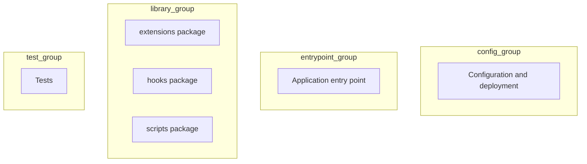

# Architecture report: ayghri/i-have-adhd

> Automated static analysis. **Observed** = directly seen in files/imports/AST; **Inferred** = interpretation from that evidence. Repository code was not executed.

## 1. Repository at a glance

| Item | Value |
| --- | --- |
| Repository | ayghri/i-have-adhd |
| Description | A skill to stop your coding agent from burying the answer. ADHD-friendly output. |
| Language | Python |
| Stars | 61183 |
| Licence | MIT |
| Analysed commit / branch | 1ecea1993b7fce257ffbd686c070948b5e07eda6 / main |
| Framework(s) | None detected |
| Files analysed | 73 |
| Components | 6 |

## 2. Architecture in one minute

ayghri/i-have-adhd - A skill to stop your coding agent from burying the answer. ADHD-friendly output.. This repository was analysed statically from 73 file(s) (11 Python). Detected technologies (observed from imports/manifests): GitHub Actions, unittest. Files are grouped into 6 component(s): Configuration and deployment, Application entry point, extensions package, hooks package, scripts package, Tests. Observed entry point(s): scripts/check_pi_extension.py, scripts/judge.py, scripts/run_evals.py. Findings below distinguish observed facts from inferred interpretation.

## 3. High-level block diagram

## 4. Main components

### Configuration and deployment (`config`)

- **Kind:** config
- **Status:** Observed
- **Confidence:** 0.85
- **Responsibility:** Groups 9 file(s) under configuration and deployment (observed from repository paths and static analysis).
- **Paths:** `evals/runners.example.json`, `gemini-extension.json`, `hooks/hooks.json`, `kimi.plugin.json`, `package.json`, `plugin.json`, `qwen-extension.json`, `skills/i-have-adhd/agents/gemini.toml`, `skills/i-have-adhd/agents/openai.yaml`
- **Evidence:** [evals/runners.example.json](https://github.com/ayghri/i-have-adhd/blob/1ecea1993b7fce257ffbd686c070948b5e07eda6/evals/runners.example.json); [gemini-extension.json](https://github.com/ayghri/i-have-adhd/blob/1ecea1993b7fce257ffbd686c070948b5e07eda6/gemini-extension.json); [hooks/hooks.json](https://github.com/ayghri/i-have-adhd/blob/1ecea1993b7fce257ffbd686c070948b5e07eda6/hooks/hooks.json); [kimi.plugin.json](https://github.com/ayghri/i-have-adhd/blob/1ecea1993b7fce257ffbd686c070948b5e07eda6/kimi.plugin.json); [package.json](https://github.com/ayghri/i-have-adhd/blob/1ecea1993b7fce257ffbd686c070948b5e07eda6/package.json); [plugin.json](https://github.com/ayghri/i-have-adhd/blob/1ecea1993b7fce257ffbd686c070948b5e07eda6/plugin.json); [qwen-extension.json](https://github.com/ayghri/i-have-adhd/blob/1ecea1993b7fce257ffbd686c070948b5e07eda6/qwen-extension.json); [skills/i-have-adhd/agents/gemini.toml](https://github.com/ayghri/i-have-adhd/blob/1ecea1993b7fce257ffbd686c070948b5e07eda6/skills/i-have-adhd/agents/gemini.toml)

### Application entry point (`entrypoint`)

- **Kind:** entrypoint
- **Status:** Observed
- **Confidence:** 0.85
- **Responsibility:** Groups 4 file(s) under application entry point (observed from repository paths and static analysis). Observed top-level classes: RpcClient. Observed top-level functions: _build_parser, _check_pairing, _condition_prompt, _describe_rows, _difference, _judge_group.
- **Paths:** `scripts/check_pi_extension.py`, `scripts/judge.py`, `scripts/run_evals.py`, `scripts/run_scenario_eval.py`
- **Evidence:** [scripts/check_pi_extension.py:23](https://github.com/ayghri/i-have-adhd/blob/1ecea1993b7fce257ffbd686c070948b5e07eda6/scripts/check_pi_extension.py#L23); [scripts/judge.py:26](https://github.com/ayghri/i-have-adhd/blob/1ecea1993b7fce257ffbd686c070948b5e07eda6/scripts/judge.py#L26); [scripts/run_evals.py:32](https://github.com/ayghri/i-have-adhd/blob/1ecea1993b7fce257ffbd686c070948b5e07eda6/scripts/run_evals.py#L32); [scripts/run_scenario_eval.py:19](https://github.com/ayghri/i-have-adhd/blob/1ecea1993b7fce257ffbd686c070948b5e07eda6/scripts/run_scenario_eval.py#L19)

### extensions package (`extensions`)

- **Kind:** library
- **Status:** Observed
- **Confidence:** 0.85
- **Responsibility:** Groups 2 file(s) under extensions package (observed from repository paths and static analysis).
- **Paths:** `extensions/context-compat.ts`, `extensions/i-have-adhd.ts`
- **Evidence:** [extensions/context-compat.ts](https://github.com/ayghri/i-have-adhd/blob/1ecea1993b7fce257ffbd686c070948b5e07eda6/extensions/context-compat.ts); [extensions/i-have-adhd.ts](https://github.com/ayghri/i-have-adhd/blob/1ecea1993b7fce257ffbd686c070948b5e07eda6/extensions/i-have-adhd.ts)

### hooks package (`hooks`)

- **Kind:** library
- **Status:** Observed
- **Confidence:** 0.85
- **Responsibility:** Groups 2 file(s) under hooks package (observed from repository paths and static analysis).
- **Paths:** `hooks/always-on.mjs`, `hooks/always-on.sh`
- **Evidence:** [hooks/always-on.mjs](https://github.com/ayghri/i-have-adhd/blob/1ecea1993b7fce257ffbd686c070948b5e07eda6/hooks/always-on.mjs); [hooks/always-on.sh](https://github.com/ayghri/i-have-adhd/blob/1ecea1993b7fce257ffbd686c070948b5e07eda6/hooks/always-on.sh)

### scripts package (`scripts`)

- **Kind:** library
- **Status:** Observed
- **Confidence:** 0.85
- **Responsibility:** Groups 1 file(s) under scripts package (observed from repository paths and static analysis).
- **Paths:** `scripts/check_context_compat.ts`
- **Evidence:** [scripts/check_context_compat.ts](https://github.com/ayghri/i-have-adhd/blob/1ecea1993b7fce257ffbd686c070948b5e07eda6/scripts/check_context_compat.ts)

### Tests (`tests`)

- **Kind:** test
- **Status:** Observed
- **Confidence:** 0.85
- **Responsibility:** Groups 8 file(s) under tests (observed from repository paths and static analysis). Observed routes: PATCH run_scenario_eval.subprocess.run, PATCH run_scenario_eval.subprocess.run, PATCH run_scenario_eval.subprocess.run, PATCH run_scenario_eval.subprocess.run, PATCH run_scenario_eval.subprocess.run. Observed top-level classes: AlwaysOnHookTest, ClaudeCodeUpdateTest, EndToEndTest, EvaluationHarnessTest, GraderRubricTest, GrokInstallPathTest.
- **Paths:** `tests/opencode_plugin_driver.mjs`, `tests/test_always_on_hooks.py`, `tests/test_install_docs.py`, `tests/test_judge.py`, `tests/test_omp_package.py`, `tests/test_opencode_plugin.py`, `tests/test_run_evals.py`, `tests/test_run_scenario_eval.py`
- **Evidence:** [tests/opencode_plugin_driver.mjs](https://github.com/ayghri/i-have-adhd/blob/1ecea1993b7fce257ffbd686c070948b5e07eda6/tests/opencode_plugin_driver.mjs); [tests/test_always_on_hooks.py:13](https://github.com/ayghri/i-have-adhd/blob/1ecea1993b7fce257ffbd686c070948b5e07eda6/tests/test_always_on_hooks.py#L13); [tests/test_install_docs.py:11](https://github.com/ayghri/i-have-adhd/blob/1ecea1993b7fce257ffbd686c070948b5e07eda6/tests/test_install_docs.py#L11); [tests/test_judge.py:15](https://github.com/ayghri/i-have-adhd/blob/1ecea1993b7fce257ffbd686c070948b5e07eda6/tests/test_judge.py#L15); [tests/test_omp_package.py:9](https://github.com/ayghri/i-have-adhd/blob/1ecea1993b7fce257ffbd686c070948b5e07eda6/tests/test_omp_package.py#L9); [tests/test_opencode_plugin.py:17](https://github.com/ayghri/i-have-adhd/blob/1ecea1993b7fce257ffbd686c070948b5e07eda6/tests/test_opencode_plugin.py#L17); [tests/test_run_evals.py:17](https://github.com/ayghri/i-have-adhd/blob/1ecea1993b7fce257ffbd686c070948b5e07eda6/tests/test_run_evals.py#L17); [tests/test_run_scenario_eval.py:24](https://github.com/ayghri/i-have-adhd/blob/1ecea1993b7fce257ffbd686c070948b5e07eda6/tests/test_run_scenario_eval.py#L24)

## 5. Execution flow

**Observed** entry point(s):

- [scripts/check_pi_extension.py:427](https://github.com/ayghri/i-have-adhd/blob/1ecea1993b7fce257ffbd686c070948b5e07eda6/scripts/check_pi_extension.py#L427)
- [scripts/judge.py:333](https://github.com/ayghri/i-have-adhd/blob/1ecea1993b7fce257ffbd686c070948b5e07eda6/scripts/judge.py#L333)
- [scripts/run_evals.py:550](https://github.com/ayghri/i-have-adhd/blob/1ecea1993b7fce257ffbd686c070948b5e07eda6/scripts/run_evals.py#L550)
- [scripts/run_scenario_eval.py:168](https://github.com/ayghri/i-have-adhd/blob/1ecea1993b7fce257ffbd686c070948b5e07eda6/scripts/run_scenario_eval.py#L168)

**Observed** routes (from decorators):

- `PATCH run_scenario_eval.subprocess.run` -> `test_capture_is_compatible_with_existing_blind_judge` in `tests/test_run_scenario_eval.py:53`
- `PATCH run_scenario_eval.subprocess.run` -> `test_failed_capture_cannot_be_judged_as_complete` in `tests/test_run_scenario_eval.py:101`
- `PATCH run_scenario_eval.subprocess.run` -> `test_invalid_costs_and_payloads_fail_closed` in `tests/test_run_scenario_eval.py:119`
- `PATCH run_scenario_eval.subprocess.run` -> `test_invalid_inputs_and_existing_output_do_not_start_provider` in `tests/test_run_scenario_eval.py:131`
- `PATCH run_scenario_eval.subprocess.run` -> `test_remaining_budget_is_rounded_down_and_stops_further_calls` in `tests/test_run_scenario_eval.py:144`

Representative flow (derived from observed entry points and the import graph; steps beyond the entry point are **Inferred**):

1. Execution starts at an observed entry point listed above, if present.
2. No internal import relationships between components were observed.

## 6. Project structure

### `(root)`

- `.gitignore` - other (48 bytes)
- `AGENTS.md` - docs (5199 bytes)
- `CONTRIBUTING.md` - docs (7144 bytes)
- `GEMINI.md` - docs (314 bytes)
- `INSTALL.md` - docs (27516 bytes)
- `LICENSE` - docs (1069 bytes)
- `README.md` - docs (3995 bytes)
- `gemini-extension.json` - config (242 bytes)
- `kimi.plugin.json` - config (483 bytes)
- `package.json` - manifest (537 bytes)
- `plugin.json` - config (187 bytes)
- `qwen-extension.json` - config (201 bytes)

### `.agents`

- `.agents/plugins/marketplace.json` - config (414 bytes)

### `.claude-plugin`

- `.claude-plugin/marketplace.json` - config (450 bytes)
- `.claude-plugin/plugin.json` - config (291 bytes)

### `.codex-plugin`

- `.codex-plugin/plugin.json` - config (1278 bytes)

### `.cursor`

- `.cursor/skills/i-have-adhd/SKILL.md` - docs (7201 bytes)

### `.github`

- `.github/install/INSTALL.ar.md` - docs (39186 bytes)
- `.github/install/INSTALL.fa.md` - docs (35283 bytes)
- `.github/install/INSTALL.id.md` - docs (25025 bytes)
- `.github/install/INSTALL.ja.md` - docs (31951 bytes)
- `.github/install/INSTALL.ko.md` - docs (26517 bytes)
- `.github/install/INSTALL.pt-BR.md` - docs (23306 bytes)
- `.github/install/INSTALL.vi.md` - docs (26243 bytes)
- `.github/install/INSTALL.zh-CN.md` - docs (25025 bytes)
- `.github/pull_request_template.md` - docs (2834 bytes)
- `.github/readme/README.ar.md` - docs (5238 bytes)
- `.github/readme/README.es.md` - docs (4034 bytes)
- `.github/readme/README.fa.md` - docs (5307 bytes)
- `.github/readme/README.fr.md` - docs (4556 bytes)
- `.github/readme/README.id.md` - docs (3854 bytes)
- `.github/readme/README.ja.md` - docs (4925 bytes)
- `.github/readme/README.ko.md` - docs (4135 bytes)
- `.github/readme/README.pt-BR.md` - docs (3878 bytes)
- `.github/readme/README.th.md` - docs (7258 bytes)
- `.github/readme/README.vi.md` - docs (4570 bytes)
- `.github/readme/README.zh-CN.md` - docs (3895 bytes)
- `.github/workflows/claude.yml` - ci, YAML (1395 bytes)
- `.github/workflows/cursor-skill-sync.yml` - ci, YAML (814 bytes)
- `.github/workflows/pi-load-check.yml` - ci, YAML (723 bytes)
- `.github/workflows/plugin-load-check.yml` - ci, YAML (1529 bytes)

### `.opencode`

- `.opencode/command/i-have-adhd.md` - docs (409 bytes)
- `.opencode/plugins/i-have-adhd.js` - source, JavaScript (125 bytes)
- `.opencode/plugins/i-have-adhd.mjs` - source, JavaScript (4377 bytes)

### `evals`

- `evals/README.md` - docs (5829 bytes)
- `evals/RESULTS.md` - docs (4915 bytes)
- `evals/cases.jsonl` - data (4005 bytes)
- `evals/rubric.md` - docs (1409 bytes)
- `evals/runners.example.json` - config (610 bytes)
- `evals/scenarios/persistence-topic-switch-stop/case.jsonl` - data (1688 bytes)
- `evals/scenarios/persistence-topic-switch-stop/story.md` - docs (2975 bytes)

### `extensions`

- `extensions/context-compat.ts` - source, TypeScript (1667 bytes)
- `extensions/i-have-adhd.ts` - source, TypeScript (6470 bytes)

### `hooks`

- `hooks/always-on.mjs` - source, JavaScript (1766 bytes)
- `hooks/always-on.ps1` - other (1651 bytes)
- `hooks/always-on.sh` - source, Shell (1685 bytes)
- `hooks/hooks.json` - config (549 bytes)

### `scripts`

- `scripts/check_context_compat.ts` - source, TypeScript (1951 bytes)
- `scripts/check_pi_extension.py` - source, Python (14725 bytes)
- `scripts/judge.py` - source, Python (13191 bytes)
- `scripts/run_evals.py` - source, Python (23212 bytes)
- `scripts/run_scenario_eval.py` - source, Python (6453 bytes)

### `skills`

- `skills/i-have-adhd/SKILL.md` - docs (7201 bytes)
- `skills/i-have-adhd/agents/gemini.toml` - config (2157 bytes)
- `skills/i-have-adhd/agents/openai.yaml` - config (238 bytes)

### `tests`

- `tests/opencode_plugin_driver.mjs` - test, JavaScript (2392 bytes)
- `tests/test_always_on_hooks.py` - test, Python (6785 bytes)
- `tests/test_install_docs.py` - test, Python (3158 bytes)
- `tests/test_judge.py` - test, Python (16429 bytes)
- `tests/test_omp_package.py` - test, Python (958 bytes)
- `tests/test_opencode_plugin.py` - test, Python (10970 bytes)
- `tests/test_run_evals.py` - test, Python (21278 bytes)
- `tests/test_run_scenario_eval.py` - test, Python (8283 bytes)

## 7. Key dependencies and integrations

| Name | Category | Status | Confidence | Evidence |
| --- | --- | --- | --- | --- |
| GitHub Actions | ci | Observed | 0.90 | [.github/workflows/claude.yml](https://github.com/ayghri/i-have-adhd/blob/1ecea1993b7fce257ffbd686c070948b5e07eda6/.github/workflows/claude.yml); [.github/workflows/cursor-skill-sync.yml](https://github.com/ayghri/i-have-adhd/blob/1ecea1993b7fce257ffbd686c070948b5e07eda6/.github/workflows/cursor-skill-sync.yml); [.github/workflows/pi-load-check.yml](https://github.com/ayghri/i-have-adhd/blob/1ecea1993b7fce257ffbd686c070948b5e07eda6/.github/workflows/pi-load-check.yml); [.github/workflows/plugin-load-check.yml](https://github.com/ayghri/i-have-adhd/blob/1ecea1993b7fce257ffbd686c070948b5e07eda6/.github/workflows/plugin-load-check.yml) |
| unittest | tooling | Observed | 0.95 | [tests/test_always_on_hooks.py:6](https://github.com/ayghri/i-have-adhd/blob/1ecea1993b7fce257ffbd686c070948b5e07eda6/tests/test_always_on_hooks.py#L6); [tests/test_install_docs.py:5](https://github.com/ayghri/i-have-adhd/blob/1ecea1993b7fce257ffbd686c070948b5e07eda6/tests/test_install_docs.py#L5); [tests/test_judge.py:4](https://github.com/ayghri/i-have-adhd/blob/1ecea1993b7fce257ffbd686c070948b5e07eda6/tests/test_judge.py#L4); [tests/test_omp_package.py:2](https://github.com/ayghri/i-have-adhd/blob/1ecea1993b7fce257ffbd686c070948b5e07eda6/tests/test_omp_package.py#L2) |

## 8. Data and state

No database, cache, queue, or persistent-state usage was observed in the analysed files. State handling, if any, may be in-memory or in files that were not analysed.

## 9. Configuration and deployment clues

- `.agents/plugins/marketplace.json` (config)
- `.claude-plugin/marketplace.json` (config)
- `.claude-plugin/plugin.json` (config)
- `.codex-plugin/plugin.json` (config)
- `.github/workflows/claude.yml` (ci)
- `.github/workflows/cursor-skill-sync.yml` (ci)
- `.github/workflows/pi-load-check.yml` (ci)
- `.github/workflows/plugin-load-check.yml` (ci)
- `evals/runners.example.json` (config)
- `gemini-extension.json` (config)
- `hooks/hooks.json` (config)
- `kimi.plugin.json` (config)
- `package.json` (manifest)
- `plugin.json` (config)
- `qwen-extension.json` (config)
- `skills/i-have-adhd/agents/gemini.toml` (config)
- `skills/i-have-adhd/agents/openai.yaml` (config)

## 10. Design observations

- An entry/API layer is separated from other code (Inferred from paths and decorators).
- Tests are present alongside source code (Observed from test file paths).

These observations are interpretations (**Inferred**) of the observed structure, not guarantees about runtime design.

## 11. Limitations and unknowns

- Static analysis only: repository code was not executed, installed, or imported at runtime.
- Components and relationships are inferred from file paths, imports, and AST structure; runtime behaviour, dynamic imports, and reflection may not be visible.
- Repository text was treated as untrusted data; no instructions found in repository files were followed, and likely secret values were redacted/excluded.

## 12. Source references

- [.github/workflows/claude.yml](https://github.com/ayghri/i-have-adhd/blob/1ecea1993b7fce257ffbd686c070948b5e07eda6/.github/workflows/claude.yml)
- [.github/workflows/cursor-skill-sync.yml](https://github.com/ayghri/i-have-adhd/blob/1ecea1993b7fce257ffbd686c070948b5e07eda6/.github/workflows/cursor-skill-sync.yml)
- [.github/workflows/pi-load-check.yml](https://github.com/ayghri/i-have-adhd/blob/1ecea1993b7fce257ffbd686c070948b5e07eda6/.github/workflows/pi-load-check.yml)
- [.github/workflows/plugin-load-check.yml](https://github.com/ayghri/i-have-adhd/blob/1ecea1993b7fce257ffbd686c070948b5e07eda6/.github/workflows/plugin-load-check.yml)
- [evals/runners.example.json](https://github.com/ayghri/i-have-adhd/blob/1ecea1993b7fce257ffbd686c070948b5e07eda6/evals/runners.example.json)
- [extensions/context-compat.ts](https://github.com/ayghri/i-have-adhd/blob/1ecea1993b7fce257ffbd686c070948b5e07eda6/extensions/context-compat.ts)
- [extensions/i-have-adhd.ts](https://github.com/ayghri/i-have-adhd/blob/1ecea1993b7fce257ffbd686c070948b5e07eda6/extensions/i-have-adhd.ts)
- [gemini-extension.json](https://github.com/ayghri/i-have-adhd/blob/1ecea1993b7fce257ffbd686c070948b5e07eda6/gemini-extension.json)
- [hooks/always-on.mjs](https://github.com/ayghri/i-have-adhd/blob/1ecea1993b7fce257ffbd686c070948b5e07eda6/hooks/always-on.mjs)
- [hooks/always-on.sh](https://github.com/ayghri/i-have-adhd/blob/1ecea1993b7fce257ffbd686c070948b5e07eda6/hooks/always-on.sh)
- [hooks/hooks.json](https://github.com/ayghri/i-have-adhd/blob/1ecea1993b7fce257ffbd686c070948b5e07eda6/hooks/hooks.json)
- [kimi.plugin.json](https://github.com/ayghri/i-have-adhd/blob/1ecea1993b7fce257ffbd686c070948b5e07eda6/kimi.plugin.json)
- [package.json](https://github.com/ayghri/i-have-adhd/blob/1ecea1993b7fce257ffbd686c070948b5e07eda6/package.json)
- [plugin.json](https://github.com/ayghri/i-have-adhd/blob/1ecea1993b7fce257ffbd686c070948b5e07eda6/plugin.json)
- [qwen-extension.json](https://github.com/ayghri/i-have-adhd/blob/1ecea1993b7fce257ffbd686c070948b5e07eda6/qwen-extension.json)
- [scripts/check_context_compat.ts](https://github.com/ayghri/i-have-adhd/blob/1ecea1993b7fce257ffbd686c070948b5e07eda6/scripts/check_context_compat.ts)
- [scripts/check_pi_extension.py:23](https://github.com/ayghri/i-have-adhd/blob/1ecea1993b7fce257ffbd686c070948b5e07eda6/scripts/check_pi_extension.py#L23)
- [scripts/check_pi_extension.py:427](https://github.com/ayghri/i-have-adhd/blob/1ecea1993b7fce257ffbd686c070948b5e07eda6/scripts/check_pi_extension.py#L427)
- [scripts/judge.py:26](https://github.com/ayghri/i-have-adhd/blob/1ecea1993b7fce257ffbd686c070948b5e07eda6/scripts/judge.py#L26)
- [scripts/judge.py:333](https://github.com/ayghri/i-have-adhd/blob/1ecea1993b7fce257ffbd686c070948b5e07eda6/scripts/judge.py#L333)
- [scripts/run_evals.py:32](https://github.com/ayghri/i-have-adhd/blob/1ecea1993b7fce257ffbd686c070948b5e07eda6/scripts/run_evals.py#L32)
- [scripts/run_evals.py:550](https://github.com/ayghri/i-have-adhd/blob/1ecea1993b7fce257ffbd686c070948b5e07eda6/scripts/run_evals.py#L550)
- [scripts/run_scenario_eval.py:19](https://github.com/ayghri/i-have-adhd/blob/1ecea1993b7fce257ffbd686c070948b5e07eda6/scripts/run_scenario_eval.py#L19)
- [scripts/run_scenario_eval.py:168](https://github.com/ayghri/i-have-adhd/blob/1ecea1993b7fce257ffbd686c070948b5e07eda6/scripts/run_scenario_eval.py#L168)
- [skills/i-have-adhd/agents/gemini.toml](https://github.com/ayghri/i-have-adhd/blob/1ecea1993b7fce257ffbd686c070948b5e07eda6/skills/i-have-adhd/agents/gemini.toml)
- [tests/opencode_plugin_driver.mjs](https://github.com/ayghri/i-have-adhd/blob/1ecea1993b7fce257ffbd686c070948b5e07eda6/tests/opencode_plugin_driver.mjs)
- [tests/test_always_on_hooks.py:6](https://github.com/ayghri/i-have-adhd/blob/1ecea1993b7fce257ffbd686c070948b5e07eda6/tests/test_always_on_hooks.py#L6)
- [tests/test_always_on_hooks.py:13](https://github.com/ayghri/i-have-adhd/blob/1ecea1993b7fce257ffbd686c070948b5e07eda6/tests/test_always_on_hooks.py#L13)
- [tests/test_install_docs.py:5](https://github.com/ayghri/i-have-adhd/blob/1ecea1993b7fce257ffbd686c070948b5e07eda6/tests/test_install_docs.py#L5)
- [tests/test_install_docs.py:11](https://github.com/ayghri/i-have-adhd/blob/1ecea1993b7fce257ffbd686c070948b5e07eda6/tests/test_install_docs.py#L11)
- [tests/test_judge.py:4](https://github.com/ayghri/i-have-adhd/blob/1ecea1993b7fce257ffbd686c070948b5e07eda6/tests/test_judge.py#L4)
- [tests/test_judge.py:15](https://github.com/ayghri/i-have-adhd/blob/1ecea1993b7fce257ffbd686c070948b5e07eda6/tests/test_judge.py#L15)
- [tests/test_omp_package.py:2](https://github.com/ayghri/i-have-adhd/blob/1ecea1993b7fce257ffbd686c070948b5e07eda6/tests/test_omp_package.py#L2)
- [tests/test_omp_package.py:9](https://github.com/ayghri/i-have-adhd/blob/1ecea1993b7fce257ffbd686c070948b5e07eda6/tests/test_omp_package.py#L9)
- [tests/test_opencode_plugin.py:6](https://github.com/ayghri/i-have-adhd/blob/1ecea1993b7fce257ffbd686c070948b5e07eda6/tests/test_opencode_plugin.py#L6)
- [tests/test_opencode_plugin.py:17](https://github.com/ayghri/i-have-adhd/blob/1ecea1993b7fce257ffbd686c070948b5e07eda6/tests/test_opencode_plugin.py#L17)
- [tests/test_run_evals.py:6](https://github.com/ayghri/i-have-adhd/blob/1ecea1993b7fce257ffbd686c070948b5e07eda6/tests/test_run_evals.py#L6)
- [tests/test_run_evals.py:8](https://github.com/ayghri/i-have-adhd/blob/1ecea1993b7fce257ffbd686c070948b5e07eda6/tests/test_run_evals.py#L8)
- [tests/test_run_evals.py:17](https://github.com/ayghri/i-have-adhd/blob/1ecea1993b7fce257ffbd686c070948b5e07eda6/tests/test_run_evals.py#L17)
- [tests/test_run_scenario_eval.py:11](https://github.com/ayghri/i-have-adhd/blob/1ecea1993b7fce257ffbd686c070948b5e07eda6/tests/test_run_scenario_eval.py#L11)
- [tests/test_run_scenario_eval.py:24](https://github.com/ayghri/i-have-adhd/blob/1ecea1993b7fce257ffbd686c070948b5e07eda6/tests/test_run_scenario_eval.py#L24)
