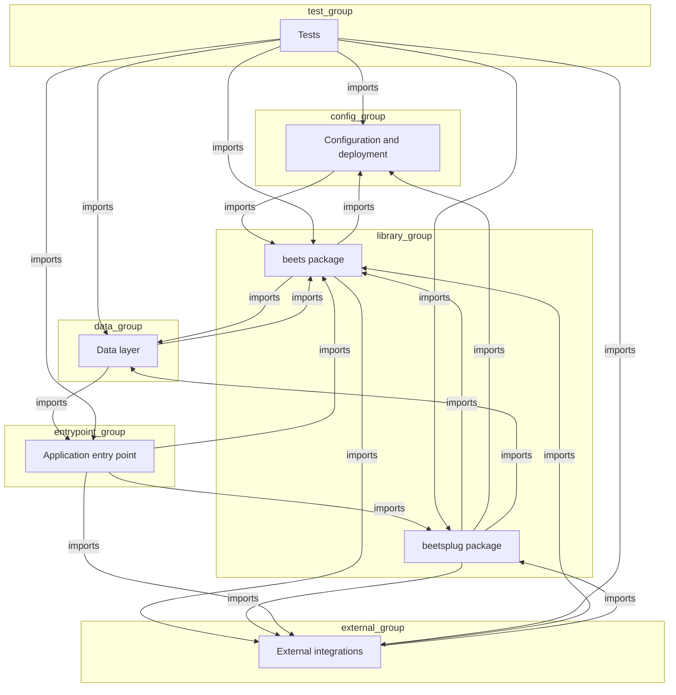

# Architecture report: beetbox/beets

> Automated static analysis. **Observed** = directly seen in files/imports/AST; **Inferred** = interpretation from that evidence. Repository code was not executed.

## 1. Repository at a glance

| Item | Value |
| --- | --- |
| Repository | beetbox/beets |
| Description | music library manager and MusicBrainz tagger |
| Language | Python |
| Stars | 15940 |
| Licence | MIT |
| Analysed commit / branch | 029ac6f37d0bc5ce478fb95e5b27547f74ac6100 / master |
| Framework(s) | Flask |
| Files analysed | 498 |
| Components | 7 |

## 2. Architecture in one minute

beetbox/beets - music library manager and MusicBrainz tagger. This repository was analysed statically from 498 file(s) (306 Python). Detected technologies (observed from imports/manifests): GitHub Actions, SQLite, Flask, Click, NumPy, requests. Files are grouped into 7 component(s): beets package, beetsplug package, Configuration and deployment, Data layer, Application entry point, External integrations, Tests. Observed entry point(s): beets/__main__.py, beets/ui/__init__.py, beets/util/functemplate.py. Findings below distinguish observed facts from inferred interpretation.

## 3. High-level block diagram

## 4. Main components

### beets package (`beets`)

- **Kind:** library
- **Status:** Observed
- **Confidence:** 0.85
- **Responsibility:** Groups 62 file(s) under beets package (observed from repository paths and static analysis). Observed top-level classes: Action, AfterConvertEventArgs, AfterWriteEventArgs, AlbumChange, AlbumEventArgs, AlbumImportedEventArgs. Observed top-level functions: _, __getattr__, _add_candidate, _allmsgs, _apply_choice, _bool_fallback.
- **Paths:** `beets/__init__.py`, `beets/autotag/__init__.py`, `beets/autotag/distance.py`, `beets/autotag/hooks.py`, `beets/autotag/match.py`, `beets/autotag/source.py`, `beets/context.py`, `beets/dbcore/__init__.py`, `beets/dbcore/pathutils.py`, `beets/dbcore/query.py`, `beets/dbcore/queryparse.py`, `beets/dbcore/sort.py`, `beets/dbcore/types.py`, `beets/events.py`, `beets/exceptions.py`, `beets/importer/__init__.py`, `beets/importer/actions.py`, `beets/importer/session.py`, `beets/importer/stages.py`, `beets/importer/state.py`, `beets/importer/tasks.py`, `beets/library/__init__.py`, `beets/library/exceptions.py`, `beets/library/fields.py`, `beets/library/library.py`, `beets/library/migrations.py`, `beets/library/queries.py`, `beets/logging.py`, `beets/mediafile.py`, `beets/metadata_plugins.py`, `beets/plugins.py`, `beets/ui/__init__.py`, `beets/ui/commands/__init__.py`, `beets/ui/commands/completion.py`, `beets/ui/commands/completion_base.sh`, `beets/ui/commands/fields.py`, `beets/ui/commands/help.py`, `beets/ui/commands/import_/__init__.py`, `beets/ui/commands/import_/display.py`, `beets/ui/commands/import_/session.py`, `beets/ui/commands/list.py`, `beets/ui/commands/modify.py`, `beets/ui/commands/move.py`, `beets/ui/commands/remove.py`, `beets/ui/commands/stats.py`, `beets/ui/commands/update.py`, `beets/ui/commands/version.py`, `beets/ui/commands/write.py`, `beets/util/__init__.py`, `beets/util/artresizer.py`, `beets/util/color.py`, `beets/util/deprecation.py`, `beets/util/diff.py`, `beets/util/extension.py`, `beets/util/hidden.py`, `beets/util/id_extractors.py`, `beets/util/layout.py`, `beets/util/lyrics.py`, `beets/util/m3u.py`, `beets/util/pathformats.py`, `beets/util/pipeline.py`, `beets/util/units.py`
- **Evidence:** [beets/__init__.py:17](https://github.com/beetbox/beets/blob/029ac6f37d0bc5ce478fb95e5b27547f74ac6100/beets/__init__.py#L17); [beets/autotag/__init__.py:26](https://github.com/beetbox/beets/blob/029ac6f37d0bc5ce478fb95e5b27547f74ac6100/beets/autotag/__init__.py#L26); [beets/autotag/distance.py:48](https://github.com/beetbox/beets/blob/029ac6f37d0bc5ce478fb95e5b27547f74ac6100/beets/autotag/distance.py#L48); [beets/autotag/hooks.py:30](https://github.com/beetbox/beets/blob/029ac6f37d0bc5ce478fb95e5b27547f74ac6100/beets/autotag/hooks.py#L30); [beets/autotag/match.py:39](https://github.com/beetbox/beets/blob/029ac6f37d0bc5ce478fb95e5b27547f74ac6100/beets/autotag/match.py#L39); [beets/autotag/source.py:13](https://github.com/beetbox/beets/blob/029ac6f37d0bc5ce478fb95e5b27547f74ac6100/beets/autotag/source.py#L13); [beets/context.py:17](https://github.com/beetbox/beets/blob/029ac6f37d0bc5ce478fb95e5b27547f74ac6100/beets/context.py#L17); [beets/dbcore/__init__.py](https://github.com/beetbox/beets/blob/029ac6f37d0bc5ce478fb95e5b27547f74ac6100/beets/dbcore/__init__.py)

### beetsplug package (`beetsplug`)

- **Kind:** library
- **Status:** Observed
- **Confidence:** 0.85
- **Responsibility:** Groups 94 file(s) under beetsplug package (observed from repository paths and static analysis). Observed top-level classes: ABSubmitCLIOpts, ABSubmitError, APIError, AcousticBrainzCLIOpts, AcousticBrainzSubmitPlugin, AcousticPlugin. Observed top-level functions: _, _album_artist_no_feat, _all_releases, _batched, _build_m3u_filename, _build_m3u_session_filename.
- **Paths:** `beetsplug/_typing.py`, `beetsplug/_utils/__init__.py`, `beetsplug/_utils/art.py`, `beetsplug/_utils/musicbrainz.py`, `beetsplug/_utils/playcount.py`, `beetsplug/_utils/requests.py`, `beetsplug/_utils/vfs.py`, `beetsplug/absubmit.py`, `beetsplug/acousticbrainz.py`, `beetsplug/advancedrewrite.py`, `beetsplug/albumtypes.py`, `beetsplug/autobpm.py`, `beetsplug/badfiles.py`, `beetsplug/bareasc.py`, `beetsplug/beatport.py`, `beetsplug/bench.py`, `beetsplug/bpm.py`, `beetsplug/bpsync.py`, `beetsplug/bucket.py`, `beetsplug/chroma.py`, `beetsplug/convert.py`, `beetsplug/deezer.py`, `beetsplug/discogs/__init__.py`, `beetsplug/discogs/states.py`, `beetsplug/discogs/types.py`, `beetsplug/duplicates.py`, `beetsplug/edit.py`, `beetsplug/embedart.py`, `beetsplug/embyupdate.py`, `beetsplug/export.py`, `beetsplug/fetchart.py`, `beetsplug/filefilter.py`, `beetsplug/fish.py`, `beetsplug/freedesktop.py`, `beetsplug/fromfilename.py`, `beetsplug/ftintitle.py`, `beetsplug/fuzzy.py`, `beetsplug/hook.py`, `beetsplug/ihate.py`, `beetsplug/importadded.py`, `beetsplug/importfeeds.py`, `beetsplug/importsource.py`, `beetsplug/info.py`, `beetsplug/inline.py`, `beetsplug/ipfs.py`, `beetsplug/keyfinder.py`, `beetsplug/kodiupdate.py`, `beetsplug/lastgenre/__init__.py`, `beetsplug/lastgenre/utils.py`, `beetsplug/lastimport.py`, `beetsplug/limit.py`, `beetsplug/listenbrainz.py`, `beetsplug/loadext.py`, `beetsplug/lyrics.py`, `beetsplug/mbcollection.py`, `beetsplug/mbpseudo.py`, `beetsplug/mbsubmit.py`, `beetsplug/mbsync.py`, `beetsplug/metasync/__init__.py`, `beetsplug/metasync/amarok.py`, `beetsplug/metasync/itunes.py`, `beetsplug/missing.py`, `beetsplug/mpdstats.py`, `beetsplug/mpdupdate.py`, `beetsplug/musicbrainz.py`, `beetsplug/parentwork.py`, `beetsplug/permissions.py`, `beetsplug/play.py`, `beetsplug/playlist.py`, `beetsplug/plexupdate.py`, `beetsplug/random.py`, `beetsplug/replace.py`, `beetsplug/replaygain.py`, `beetsplug/rewrite.py`, `beetsplug/scrub.py`, `beetsplug/smartplaylist.py`, `beetsplug/sonosupdate.py`, `beetsplug/spotify.py`, `beetsplug/subsonicplaylist.py`, `beetsplug/subsonicupdate.py`, `beetsplug/substitute.py`, `beetsplug/the.py`, `beetsplug/thumbnails.py`, `beetsplug/tidal/__init__.py`, `beetsplug/tidal/api.py`, `beetsplug/tidal/api_types.py`, `beetsplug/tidal/session.py`, `beetsplug/titlecase.py`, `beetsplug/types.py`, `beetsplug/unimported.py`, `beetsplug/web/static/backbone.js`, `beetsplug/web/static/beets.js`, `beetsplug/web/static/underscore.js`, `beetsplug/zero.py`
- **Evidence:** [beetsplug/_typing.py:10](https://github.com/beetbox/beets/blob/029ac6f37d0bc5ce478fb95e5b27547f74ac6100/beetsplug/_typing.py#L10); [beetsplug/_utils/__init__.py](https://github.com/beetbox/beets/blob/029ac6f37d0bc5ce478fb95e5b27547f74ac6100/beetsplug/_utils/__init__.py); [beetsplug/_utils/art.py:24](https://github.com/beetbox/beets/blob/029ac6f37d0bc5ce478fb95e5b27547f74ac6100/beetsplug/_utils/art.py#L24); [beetsplug/_utils/musicbrainz.py:80](https://github.com/beetbox/beets/blob/029ac6f37d0bc5ce478fb95e5b27547f74ac6100/beetsplug/_utils/musicbrainz.py#L80); [beetsplug/_utils/playcount.py:16](https://github.com/beetbox/beets/blob/029ac6f37d0bc5ce478fb95e5b27547f74ac6100/beetsplug/_utils/playcount.py#L16); [beetsplug/_utils/requests.py:21](https://github.com/beetbox/beets/blob/029ac6f37d0bc5ce478fb95e5b27547f74ac6100/beetsplug/_utils/requests.py#L21); [beetsplug/_utils/vfs.py:17](https://github.com/beetbox/beets/blob/029ac6f37d0bc5ce478fb95e5b27547f74ac6100/beetsplug/_utils/vfs.py#L17); [beetsplug/absubmit.py:27](https://github.com/beetbox/beets/blob/029ac6f37d0bc5ce478fb95e5b27547f74ac6100/beetsplug/absubmit.py#L27)

### Configuration and deployment (`config`)

- **Kind:** config
- **Status:** Observed
- **Confidence:** 0.85
- **Responsibility:** Groups 8 file(s) under configuration and deployment (observed from repository paths and static analysis). Observed top-level classes: ConfigCLIOpts, UnknownPairError. Observed top-level functions: config_edit, config_func, sanitize_choices, sanitize_pairs.
- **Paths:** `beets/config_default.yaml`, `beets/ui/commands/config.py`, `beets/util/config.py`, `beetsplug/lastgenre/aliases.yaml`, `beetsplug/lastgenre/genres-tree.yaml`, `codecov.yml`, `pyproject.toml`, `setup.cfg`
- **Evidence:** [beets/config_default.yaml](https://github.com/beetbox/beets/blob/029ac6f37d0bc5ce478fb95e5b27547f74ac6100/beets/config_default.yaml); [beets/ui/commands/config.py:16](https://github.com/beetbox/beets/blob/029ac6f37d0bc5ce478fb95e5b27547f74ac6100/beets/ui/commands/config.py#L16); [beets/util/config.py:9](https://github.com/beetbox/beets/blob/029ac6f37d0bc5ce478fb95e5b27547f74ac6100/beets/util/config.py#L9); [beetsplug/lastgenre/aliases.yaml](https://github.com/beetbox/beets/blob/029ac6f37d0bc5ce478fb95e5b27547f74ac6100/beetsplug/lastgenre/aliases.yaml); [beetsplug/lastgenre/genres-tree.yaml](https://github.com/beetbox/beets/blob/029ac6f37d0bc5ce478fb95e5b27547f74ac6100/beetsplug/lastgenre/genres-tree.yaml); [codecov.yml](https://github.com/beetbox/beets/blob/029ac6f37d0bc5ce478fb95e5b27547f74ac6100/codecov.yml); [pyproject.toml](https://github.com/beetbox/beets/blob/029ac6f37d0bc5ce478fb95e5b27547f74ac6100/pyproject.toml); [setup.cfg](https://github.com/beetbox/beets/blob/029ac6f37d0bc5ce478fb95e5b27547f74ac6100/setup.cfg)

### Data layer (`data_layer`)

- **Kind:** data
- **Status:** Observed
- **Confidence:** 0.85
- **Responsibility:** Groups 2 file(s) under data layer (observed from repository paths and static analysis). Observed top-level classes: Album, DBAccessError, DBCustomFunctionError, Database, DefaultTemplateFunctions, FormattedItemMapping. Observed top-level functions: _int_arg.
- **Paths:** `beets/dbcore/db.py`, `beets/library/models.py`
- **Evidence:** [beets/dbcore/db.py:68](https://github.com/beetbox/beets/blob/029ac6f37d0bc5ce478fb95e5b27547f74ac6100/beets/dbcore/db.py#L68); [beets/library/models.py:49](https://github.com/beetbox/beets/blob/029ac6f37d0bc5ce478fb95e5b27547f74ac6100/beets/library/models.py#L49)

### Application entry point (`entrypoint`)

- **Kind:** entrypoint
- **Status:** Observed
- **Confidence:** 0.85
- **Responsibility:** Groups 7 file(s) under application entry point (observed from repository paths and static analysis). Observed application object created via Command, Flask. Observed routes: ROUTE /server, ROUTE /tracks, ROUTE /tracks/<int:track_id>, ROUTE /tracks/<int:track_id>/audio, ROUTE /albums. Observed top-level classes: AURADocument, AURAPlugin, AlbumDocument, ArtistDocument, AuraCLIOpts, BPDCloseError. Observed top-level functions: _get_unique_table_field_values, _parse, _rep, album_art, album_query, album_unique_field_values.
- **Paths:** `beets/__main__.py`, `beets/util/functemplate.py`, `beetsplug/aura.py`, `beetsplug/bpd/__init__.py`, `beetsplug/bpd/gstplayer.py`, `beetsplug/web/__init__.py`, `extra/release.py`
- **Evidence:** [beets/__main__.py](https://github.com/beetbox/beets/blob/029ac6f37d0bc5ce478fb95e5b27547f74ac6100/beets/__main__.py); [beets/util/functemplate.py:42](https://github.com/beetbox/beets/blob/029ac6f37d0bc5ce478fb95e5b27547f74ac6100/beets/util/functemplate.py#L42); [beetsplug/aura.py:879](https://github.com/beetbox/beets/blob/029ac6f37d0bc5ce478fb95e5b27547f74ac6100/beetsplug/aura.py#L879); [beetsplug/bpd/__init__.py:1026](https://github.com/beetbox/beets/blob/029ac6f37d0bc5ce478fb95e5b27547f74ac6100/beetsplug/bpd/__init__.py#L1026); [beetsplug/bpd/gstplayer.py:37](https://github.com/beetbox/beets/blob/029ac6f37d0bc5ce478fb95e5b27547f74ac6100/beetsplug/bpd/gstplayer.py#L37); [beetsplug/web/__init__.py:292](https://github.com/beetbox/beets/blob/029ac6f37d0bc5ce478fb95e5b27547f74ac6100/beetsplug/web/__init__.py#L292); [extra/release.py:37](https://github.com/beetbox/beets/blob/029ac6f37d0bc5ce478fb95e5b27547f74ac6100/extra/release.py#L37)

### External integrations (`external_integrations`)

- **Kind:** external
- **Status:** Observed
- **Confidence:** 0.85
- **Responsibility:** Groups 1 file(s) under external integrations (observed from repository paths and static analysis). Observed top-level classes: LastFmClient.
- **Paths:** `beetsplug/lastgenre/client.py`
- **Evidence:** [beetsplug/lastgenre/client.py:36](https://github.com/beetbox/beets/blob/029ac6f37d0bc5ce478fb95e5b27547f74ac6100/beetsplug/lastgenre/client.py#L36)

### Tests (`tests`)

- **Kind:** test
- **Status:** Observed
- **Confidence:** 0.85
- **Responsibility:** Groups 164 file(s) under tests (observed from repository paths and static analysis). Observed application object created via Command. Observed routes: PATCH pathlib.Path.samefile, PATCH beetsplug.bpd.asyncio.start_server, PATCH beetsplug.chroma.acoustid.fingerprint_file, PATCH beetsplug.chroma.acoustid.fingerprint_file, PATCH beetsplug.chroma.acoustid.fingerprint_file. Observed top-level classes: AlbumArtOperationMixin, AlbumFileTest, AlbumHeaderFieldsTest, AlbumTypesPluginTest, AlbumsInDirTest, AliasFactory. Observed top-level functions: _artist, _bub_work, _consume, _exc_consume, _exc_produ…
- **Paths:** `beets/test/__init__.py`, `beets/test/_common.py`, `beets/test/fixtures.py`, `beets/test/helper.py`, `test/__init__.py`, `test/autotag/__init__.py`, `test/autotag/test_distance.py`, `test/autotag/test_hooks.py`, `test/autotag/test_match.py`, `test/conftest.py`, `test/dbcore/__init__.py`, `test/dbcore/test_datequery.py`, `test/dbcore/test_db.py`, `test/dbcore/test_query.py`, `test/dbcore/test_queryparse.py`, `test/dbcore/test_sort.py`, `test/dbcore/test_types.py`, `test/extra/__init__.py`, `test/extra/test_release.py`, `test/library/__init__.py`, `test/library/test_migrations.py`, `test/plugins/__init__.py`, `test/plugins/conftest.py`, `test/plugins/factories/__init__.py`, `test/plugins/factories/discogs.py`, `test/plugins/factories/musicbrainz.py`, `test/plugins/lyrics_pages.py`, `test/plugins/test_acousticbrainz.py`, `test/plugins/test_advancedrewrite.py`, `test/plugins/test_albumtypes.py`, `test/plugins/test_art.py`, `test/plugins/test_aura.py`, `test/plugins/test_autobpm.py`, `test/plugins/test_badfiles.py`, `test/plugins/test_bareasc.py`, `test/plugins/test_beatport.py`, `test/plugins/test_bpd.py`, `test/plugins/test_bucket.py`, `test/plugins/test_chroma.py`, `test/plugins/test_convert.py`, `test/plugins/test_deezer.py`, `test/plugins/test_discogs.py`, `test/plugins/test_duplicates.py`, `test/plugins/test_edit.py`, `test/plugins/test_embedart.py`, `test/plugins/test_embyupdate.py`, `test/plugins/test_export.py`, `test/plugins/test_fetchart.py`, `test/plugins/test_filefilter.py`, `test/plugins/test_fromfilename.py`, `test/plugins/test_ftintitle.py`, `test/plugins/test_fuzzy.py`, `test/plugins/test_hook.py`, `test/plugins/test_ihate.py`, `test/plugins/test_importadded.py`, `test/plugins/test_importadded_convert.py`, `test/plugins/test_importfeeds.py`, `test/plugins/test_importsource.py`, `test/plugins/test_info.py`, `test/plugins/test_inline.py`, `test/plugins/test_ipfs.py`, `test/plugins/test_keyfinder.py`, `test/plugins/test_lastgenre.py`, `test/plugins/test_limit.py`, `test/plugins/test_listenbrainz.py`, `test/plugins/test_lyrics.py`, `test/plugins/test_mbcollection.py`, `test/plugins/test_mbpseudo.py`, `test/plugins/test_mbsubmit.py`, `test/plugins/test_mbsync.py`, `test/plugins/test_metasync.py`, `test/plugins/test_missing.py`, `test/plugins/test_mpdstats.py`, `test/plugins/test_musicbrainz.py`, `test/plugins/test_parentwork.py`, `test/plugins/test_permissions.py`, `test/plugins/test_play.py`, `test/plugins/test_playlist.py`, `test/plugins/test_plexupdate.py`, `test/plugins/test_plugin_mediafield.py`, `test/plugins/test_random.py`, `test/plugins/test_replace.py`, `test/plugins/test_replaygain.py`, `test/plugins/test_rewrite.py`, `test/plugins/test_scrub.py`, `test/plugins/test_smartplaylist.py`, `test/plugins/test_spotify.py`, `test/plugins/test_subsonicupdate.py`, `test/plugins/test_substitute.py`, `test/plugins/test_the.py`, `test/plugins/test_thumbnails.py`, `test/plugins/test_tidal.py`, `test/plugins/test_titlecase.py`, `test/plugins/test_types_plugin.py`, `test/plugins/test_unimported.py`, `test/plugins/test_web.py`, `test/plugins/test_zero.py`, `test/plugins/utils/__init__.py`, `test/plugins/utils/test_musicbrainz.py`, `test/plugins/utils/test_playcount.py`, `test/plugins/utils/test_requests.py`, `test/plugins/utils/test_vfs.py`, `test/rsrc/acousticbrainz/data.json`, `test/rsrc/beetsplug/test.py`, `test/rsrc/convert_stub.py`, `test/rsrc/itunes_library_unix.xml`, `test/rsrc/itunes_library_windows.xml`, `test/rsrc/lyrics/examplecom/beetssong.txt`, `test/rsrc/lyrics/geniuscom/Ttngchinchillalyrics.txt`, `test/rsrc/lyrics/geniuscom/sample.txt`, `test/rsrc/lyrics/tekstowopl/piosenka24kgoldncityofangels1.txt`, `test/rsrc/lyrics/tekstowopl/piosenkabaileybiggerblackeyedsusan.txt`, `test/rsrc/lyrics/tekstowopl/piosenkabeethovenbeethovenpianosonata17tempestthe3rdmovement.txt`, `test/rsrc/mbpseudo/official_release.json`, `test/rsrc/mbpseudo/pseudo_release.json`, `test/rsrc/no_ext_not_music`, `test/rsrc/playlist.m3u`, `test/rsrc/playlist.m3u8`, `test/rsrc/playlist_non_ext.m3u`, `test/rsrc/playlist_windows.m3u8`, `test/rsrc/spotify/album_info.json`, `test/rsrc/spotify/japanese_track_request.json`, `test/rsrc/spotify/missing_request.json`, `test/rsrc/spotify/multiartist_album.json`, `test/rsrc/spotify/multiartist_track.json`, `test/rsrc/spotify/track_info.json`, `test/rsrc/spotify/track_request.json`, `test/rsrc/test_completion.sh`, `test/test_files.py`, `test/test_importer.py`, `test/test_library.py`, `test/test_logging.py`, `test/test_metadata_plugins.py`, `test/test_plugins.py`, `test/test_util.py`, `test/ui/__init__.py`, `test/ui/commands/__init__.py`, `test/ui/commands/test_completion.py`, `test/ui/commands/test_config.py`, `test/ui/commands/test_fields.py`, `test/ui/commands/test_import.py`, `test/ui/commands/test_list.py`, `test/ui/commands/test_modify.py`, `test/ui/commands/test_move.py`, `test/ui/commands/test_remove.py`, `test/ui/commands/test_update.py`, `test/ui/commands/test_write.py`, `test/ui/test_ui.py`, `test/ui/test_ui_importer.py`, `test/ui/test_ui_init.py`, `test/util/test_art_resize.py`, `test/util/test_color.py`, `test/util/test_config.py`, `test/util/test_diff.py`, `test/util/test_extension.py`, `test/util/test_functemplate.py`, `test/util/test_hidden.py`, `test/util/test_id_extractors.py`, `test/util/test_layout.py`, `test/util/test_lyrics.py`, `test/util/test_m3ufile.py`, `test/util/test_pathformats.py`, `test/util/test_pipeline.py`, `test/util/test_units.py`
- **Evidence:** [beets/test/__init__.py](https://github.com/beetbox/beets/blob/029ac6f37d0bc5ce478fb95e5b27547f74ac6100/beets/test/__init__.py); [beets/test/_common.py:40](https://github.com/beetbox/beets/blob/029ac6f37d0bc5ce478fb95e5b27547f74ac6100/beets/test/_common.py#L40); [beets/test/fixtures.py:16](https://github.com/beetbox/beets/blob/029ac6f37d0bc5ce478fb95e5b27547f74ac6100/beets/test/fixtures.py#L16); [beets/test/helper.py:56](https://github.com/beetbox/beets/blob/029ac6f37d0bc5ce478fb95e5b27547f74ac6100/beets/test/helper.py#L56); [test/__init__.py](https://github.com/beetbox/beets/blob/029ac6f37d0bc5ce478fb95e5b27547f74ac6100/test/__init__.py); [test/autotag/__init__.py](https://github.com/beetbox/beets/blob/029ac6f37d0bc5ce478fb95e5b27547f74ac6100/test/autotag/__init__.py); [test/autotag/test_distance.py:21](https://github.com/beetbox/beets/blob/029ac6f37d0bc5ce478fb95e5b27547f74ac6100/test/autotag/test_distance.py#L21); [test/autotag/test_hooks.py:65](https://github.com/beetbox/beets/blob/029ac6f37d0bc5ce478fb95e5b27547f74ac6100/test/autotag/test_hooks.py#L65)

## 5. Execution flow

**Observed** entry point(s):

- [beets/__main__.py:9](https://github.com/beetbox/beets/blob/029ac6f37d0bc5ce478fb95e5b27547f74ac6100/beets/__main__.py#L9)
- [beets/ui/__init__.py](https://github.com/beetbox/beets/blob/029ac6f37d0bc5ce478fb95e5b27547f74ac6100/beets/ui/__init__.py)
- [beets/util/functemplate.py:601](https://github.com/beetbox/beets/blob/029ac6f37d0bc5ce478fb95e5b27547f74ac6100/beets/util/functemplate.py#L601)
- [beetsplug/aura.py:879](https://github.com/beetbox/beets/blob/029ac6f37d0bc5ce478fb95e5b27547f74ac6100/beetsplug/aura.py#L879)
- [beetsplug/bpd/__init__.py:1026](https://github.com/beetbox/beets/blob/029ac6f37d0bc5ce478fb95e5b27547f74ac6100/beetsplug/bpd/__init__.py#L1026)
- [beetsplug/bpd/gstplayer.py:304](https://github.com/beetbox/beets/blob/029ac6f37d0bc5ce478fb95e5b27547f74ac6100/beetsplug/bpd/gstplayer.py#L304)
- [beetsplug/web/__init__.py:292](https://github.com/beetbox/beets/blob/029ac6f37d0bc5ce478fb95e5b27547f74ac6100/beetsplug/web/__init__.py#L292)
- [extra/release.py:263](https://github.com/beetbox/beets/blob/029ac6f37d0bc5ce478fb95e5b27547f74ac6100/extra/release.py#L263)

**Observed** routes (from decorators):

- `ROUTE /server` -> `server_info` in `beetsplug/aura.py:709`
- `ROUTE /tracks` -> `all_tracks` in `beetsplug/aura.py:718`
- `ROUTE /tracks/<int:track_id>` -> `single_track` in `beetsplug/aura.py:724`
- `ROUTE /tracks/<int:track_id>/audio` -> `audio_file` in `beetsplug/aura.py:734`
- `ROUTE /albums` -> `all_albums` in `beetsplug/aura.py:793`
- `ROUTE /albums/<int:album_id>` -> `single_album` in `beetsplug/aura.py:799`
- `ROUTE /artists` -> `all_artists` in `beetsplug/aura.py:813`
- `ROUTE /artists/<path:artist_id>` -> `single_artist` in `beetsplug/aura.py:820`
- `ROUTE /images/<string:image_id>` -> `single_image` in `beetsplug/aura.py:836`
- `ROUTE /images/<string:image_id>/file` -> `image_file` in `beetsplug/aura.py:847`
- `ROUTE /item/<idlist:ids>` -> `get_item` in `beetsplug/web/__init__.py:309`
- `ROUTE /item/` -> `all_items` in `beetsplug/web/__init__.py:316`
- `ROUTE /item/query/` -> `all_items` in `beetsplug/web/__init__.py:316`
- `ROUTE /item/<int:item_id>/file` -> `item_file` in `beetsplug/web/__init__.py:321`
- `ROUTE /item/query/<query:queries>` -> `item_query` in `beetsplug/web/__init__.py:344`
- `ROUTE /item/path/<everything:path>` -> `item_at_path` in `beetsplug/web/__init__.py:349`
- `ROUTE /item/values/<string:key>` -> `item_unique_field_values` in `beetsplug/web/__init__.py:358`
- `ROUTE /album/<idlist:ids>` -> `get_album` in `beetsplug/web/__init__.py:374`
- `ROUTE /album/` -> `all_albums` in `beetsplug/web/__init__.py:381`
- `ROUTE /album/query/` -> `all_albums` in `beetsplug/web/__init__.py:381`
- `ROUTE /album/query/<query:queries>` -> `album_query` in `beetsplug/web/__init__.py:387`
- `ROUTE /album/<int:album_id>/art` -> `album_art` in `beetsplug/web/__init__.py:392`
- `ROUTE /album/values/<string:key>` -> `album_unique_field_values` in `beetsplug/web/__init__.py:400`
- `ROUTE /artist/` -> `all_artists` in `beetsplug/web/__init__.py:415`
- `ROUTE /stats` -> `stats` in `beetsplug/web/__init__.py:426`
- `ROUTE /` -> `home` in `beetsplug/web/__init__.py:437`
- `PATCH pathlib.Path.samefile` -> `test_is_candidate_fallback_os_error` in `test/plugins/test_art.py:367`
- `PATCH beetsplug.bpd.asyncio.start_server` -> `start_server` in `test/plugins/test_bpd.py:301`
- `PATCH beetsplug.chroma.acoustid.fingerprint_file` -> `test_fingerprint_file_called_with_force_fpcalc` in `test/plugins/test_chroma.py:84`
- `PATCH beetsplug.chroma.acoustid.fingerprint_file` -> `test_no_backend_falls_back_to_library` in `test/plugins/test_chroma.py:95`
- `PATCH beetsplug.chroma.acoustid.fingerprint_file` -> `test_fingerprint_file_called_with_force_fpcalc` in `test/plugins/test_chroma.py:117`
- `PATCH beetsplug.chroma.acoustid.fingerprint_file` -> `test_no_backend_falls_back_to_library` in `test/plugins/test_chroma.py:130`
- `PATCH beets.ui.should_write` -> `test_pretend_option_skips_library_updates` in `test/plugins/test_lastgenre.py:141`
- `PATCH beetsplug.lastgenre.LastGenrePlugin._get_genre` -> `test_pretend_option_skips_library_updates` in `test/plugins/test_lastgenre.py:141`
- `PATCH beets.metadata_plugins.album_for_id` -> `test_update_library` in `test/plugins/test_mbsync.py:29`
- `PATCH beets.metadata_plugins.track_for_id` -> `test_update_library` in `test/plugins/test_mbsync.py:29`
- `PATCH beets.metadata_plugins.album_for_id` -> `test_update_library_from_scratch_set` in `test/plugins/test_mbsync.py:96`
- `PATCH beets.metadata_plugins.track_for_id` -> `test_update_library_from_scratch_set` in `test/plugins/test_mbsync.py:96`
- `PATCH beets.metadata_plugins.album_for_id` -> `test_missing_tracks` in `test/plugins/test_missing.py:213`
- `PATCH beetsplug.mpdstats.MPDClientWrapper` -> `test_run_mpdstats` in `test/plugins/test_mpdstats.py:55`
- `PATCH beetsplug.mpdstats.MPDStats.run` -> `test_cli_options_override_config` in `test/plugins/test_mpdstats.py:68`
- `PATCH pathlib.Path.chmod` -> `test_failing_permissions_on_set_art` in `test/plugins/test_permissions.py:82`
- `PATCH beetsplug.thumbnails.ArtResizer` -> `test_add_tags` in `test/plugins/test_thumbnails.py:20`
- `PATCH beetsplug.thumbnails.ThumbnailsPlugin._check_local_ok` -> `test_add_tags` in `test/plugins/test_thumbnails.py:20`
- `PATCH pathlib.Path.stat` -> `test_add_tags` in `test/plugins/test_thumbnails.py:20`
- `PATCH beetsplug.thumbnails.ArtResizer` -> `test_check_local_ok` in `test/plugins/test_thumbnails.py:37`
- `PATCH beetsplug.thumbnails.GioURI` -> `test_check_local_ok` in `test/plugins/test_thumbnails.py:37`
- `PATCH beetsplug.thumbnails.ThumbnailsPlugin._check_local_ok` -> `test_make_cover_thumbnail` in `test/plugins/test_thumbnails.py:89`
- `PATCH beetsplug.thumbnails.ArtResizer` -> `test_make_cover_thumbnail` in `test/plugins/test_thumbnails.py:89`
- `PATCH beets.util.syspath` -> `test_make_cover_thumbnail` in `test/plugins/test_thumbnails.py:89`
- `PATCH beetsplug.thumbnails.shutil` -> `test_make_cover_thumbnail` in `test/plugins/test_thumbnails.py:89`
- `PATCH beetsplug.thumbnails.ThumbnailsPlugin._check_local_ok` -> `test_make_dolphin_cover_thumbnail` in `test/plugins/test_thumbnails.py:142`
- `PATCH beetsplug.thumbnails.ThumbnailsPlugin._check_local_ok` -> `test_process_album` in `test/plugins/test_thumbnails.py:157`
- `PATCH beetsplug.thumbnails.ArtResizer` -> `test_process_album` in `test/plugins/test_thumbnails.py:157`
- `PATCH beetsplug.thumbnails.ThumbnailsPlugin._check_local_ok` -> `test_invokations` in `test/plugins/test_thumbnails.py:206`
- `PATCH beets.plugins.send` -> `test_resume_album` in `test/test_importer.py:2003`
- `PATCH beets.plugins.send` -> `test_resume_singleton` in `test/test_importer.py:2024`
- `PATCH os.execlp` -> `test_interactive_open` in `test/test_util.py:36`
- `PATCH beets.util.open_anything` -> `test_interactive_open` in `test/test_util.py:36`
- `PATCH beets.util.subprocess.Popen` -> `test_command_output` in `test/test_util.py:46`
- `PATCH beets.util.artresizer.util` -> `test_write_metadata_im` in `test/util/test_art_resize.py:114`

Representative flow (derived from observed entry points and the import graph; steps beyond the entry point are **Inferred**):

1. Execution starts at an observed entry point listed above, if present.
2. `beets` imports `config` (beets package -> Configuration and deployment).
3. `beets` imports `data_layer` (beets package -> Data layer).
4. `beets` imports `external_integrations` (beets package -> External integrations).
5. `beetsplug` imports `beets` (beetsplug package -> beets package).
6. `beetsplug` imports `config` (beetsplug package -> Configuration and deployment).
7. `beetsplug` imports `data_layer` (beetsplug package -> Data layer).
8. `beetsplug` imports `external_integrations` (beetsplug package -> External integrations).
9. `config` imports `beets` (Configuration and deployment -> beets package).

## 6. Project structure

### `(root)`

- `.git-blame-ignore-revs` - other (12267 bytes)
- `.gitignore` - other (1182 bytes)
- `.pre-commit-config.yaml` - config (455 bytes)
- `.readthedocs.yaml` - config (191 bytes)
- `AI_POLICY.md` - docs (1698 bytes)
- `CODE_OF_CONDUCT.rst` - docs (5326 bytes)
- `CONTRIBUTING.rst` - docs (16735 bytes)
- `LICENSE` - docs (1080 bytes)
- `README.rst` - docs (5316 bytes)
- `README_kr.rst` - docs (4708 bytes)
- `SECURITY.md` - docs (292 bytes)
- `codecov.yml` - config (309 bytes)
- `pyproject.toml` - manifest (9903 bytes)
- `setup.cfg` - manifest (1777 bytes)

### `.github`

- `.github/CODEOWNERS` - other (413 bytes)
- `.github/ISSUE_TEMPLATE/bug-report.md` - docs (807 bytes)
- `.github/ISSUE_TEMPLATE/config.yml` - config (348 bytes)
- `.github/ISSUE_TEMPLATE/feature-request.md` - docs (643 bytes)
- `.github/copilot-instructions.md` - docs (2679 bytes)
- `.github/labeler.yaml` - config (4821 bytes)
- `.github/problem-matchers/sphinx-build.json` - config (279 bytes)
- `.github/problem-matchers/sphinx-lint.json` - config (299 bytes)
- `.github/pull_request_template.md` - docs (1086 bytes)
- `.github/stale.yml` - config (840 bytes)
- `.github/workflows/changelog_reminder.yaml` - ci, YAML (996 bytes)
- `.github/workflows/ci.yaml` - ci, YAML (7187 bytes)
- `.github/workflows/integration_test.yaml` - ci, YAML (2022 bytes)
- `.github/workflows/label-issues.yaml` - ci, YAML (635 bytes)
- `.github/workflows/lint.yaml` - ci, YAML (5443 bytes)
- `.github/workflows/make_release.yaml` - ci, YAML (4306 bytes)

### `beets`

- `beets/__init__.py` - source, Python (1509 bytes)
- `beets/__main__.py` - source, Python (178 bytes)
- `beets/autotag/__init__.py` - source, Python (1214 bytes)
- `beets/autotag/distance.py` - source, Python (19104 bytes)
- `beets/autotag/hooks.py` - source, Python (16434 bytes)
- `beets/autotag/match.py` - source, Python (17874 bytes)
- `beets/autotag/source.py` - source, Python (1478 bytes)
- `beets/config_default.yaml` - config (4834 bytes)
- `beets/context.py` - source, Python (872 bytes)
- `beets/dbcore/__init__.py` - source, Python (641 bytes)
- `beets/dbcore/db.py` - source, Python (51851 bytes)
- `beets/dbcore/pathutils.py` - source, Python (1603 bytes)
- `beets/dbcore/query.py` - source, Python (31107 bytes)
- `beets/dbcore/queryparse.py` - source, Python (8861 bytes)
- `beets/dbcore/sort.py` - source, Python (7719 bytes)
- `beets/dbcore/types.py` - source, Python (13800 bytes)
- `beets/events.py` - source, Python (3957 bytes)
- `beets/exceptions.py` - source, Python (143 bytes)
- `beets/importer/__init__.py` - source, Python (551 bytes)
- `beets/importer/actions.py` - source, Python (1346 bytes)
- `beets/importer/session.py` - source, Python (11089 bytes)
- `beets/importer/stages.py` - source, Python (16917 bytes)
- `beets/importer/state.py` - source, Python (4302 bytes)
- `beets/importer/tasks.py` - source, Python (61181 bytes)
- `beets/library/__init__.py` - source, Python (802 bytes)
- `beets/library/exceptions.py` - source, Python (1462 bytes)
- `beets/library/fields.py` - source, Python (3585 bytes)
- `beets/library/library.py` - source, Python (8545 bytes)
- `beets/library/migrations.py` - source, Python (10692 bytes)
- `beets/library/models.py` - source, Python (58061 bytes)
- `beets/library/queries.py` - source, Python (2009 bytes)
- `beets/logging.py` - source, Python (7376 bytes)
- `beets/mediafile.py` - source, Python (373 bytes)
- `beets/metadata_plugins.py` - source, Python (16365 bytes)
- `beets/plugins.py` - source, Python (29371 bytes)
- `beets/py.typed` - other (0 bytes)
- `beets/test/__init__.py` - test, Python (267 bytes)
- `beets/test/_common.py` - test, Python (4338 bytes)
- `beets/test/fixtures.py` - test, Python (1595 bytes)
- `beets/test/helper.py` - test, Python (29479 bytes)
- `beets/ui/__init__.py` - source, Python (36762 bytes)
- `beets/ui/commands/__init__.py` - source, Python (1360 bytes)
- `beets/ui/commands/completion.py` - source, Python (3959 bytes)
- `beets/ui/commands/completion_base.sh` - source, Shell (4641 bytes)
- `beets/ui/commands/config.py` - source, Python (3121 bytes)
- `beets/ui/commands/fields.py` - source, Python (1483 bytes)
- `beets/ui/commands/help.py` - source, Python (966 bytes)
- `beets/ui/commands/import_/__init__.py` - source, Python (10369 bytes)
- `beets/ui/commands/import_/display.py` - source, Python (14444 bytes)
- `beets/ui/commands/import_/session.py` - source, Python (21283 bytes)
- `beets/ui/commands/list.py` - source, Python (1192 bytes)
- `beets/ui/commands/modify.py` - source, Python (7327 bytes)
- `beets/ui/commands/move.py` - source, Python (6717 bytes)
- `beets/ui/commands/remove.py` - source, Python (3369 bytes)
- `beets/ui/commands/stats.py` - source, Python (2116 bytes)
- `beets/ui/commands/update.py` - source, Python (8092 bytes)
- `beets/ui/commands/version.py` - source, Python (794 bytes)
- `beets/ui/commands/write.py` - source, Python (2235 bytes)
- `beets/util/__init__.py` - source, Python (42956 bytes)
- `beets/util/artresizer.py` - source, Python (27203 bytes)
- `beets/util/color.py` - source, Python (6552 bytes)
- `beets/util/config.py` - source, Python (2699 bytes)
- `beets/util/deprecation.py` - source, Python (2688 bytes)
- `beets/util/diff.py` - source, Python (3497 bytes)
- `beets/util/extension.py` - source, Python (4384 bytes)
- `beets/util/functemplate.py` - source, Python (20350 bytes)
- `beets/util/hidden.py` - source, Python (1547 bytes)
- `beets/util/id_extractors.py` - source, Python (2214 bytes)
- `beets/util/layout.py` - source, Python (13867 bytes)
- `beets/util/lyrics.py` - source, Python (6364 bytes)
- `beets/util/m3u.py` - source, Python (3193 bytes)
- `beets/util/pathformats.py` - source, Python (814 bytes)
- `beets/util/pipeline.py` - source, Python (17891 bytes)
- `beets/util/units.py` - source, Python (1711 bytes)

### `beetsplug`

- `beetsplug/_typing.py` - source, Python (3893 bytes)
- `beetsplug/_utils/__init__.py` - source, Python (49 bytes)
- `beetsplug/_utils/art.py` - source, Python (6219 bytes)
- `beetsplug/_utils/musicbrainz.py` - source, Python (20904 bytes)
- `beetsplug/_utils/playcount.py` - source, Python (3275 bytes)
- `beetsplug/_utils/requests.py` - source, Python (8091 bytes)
- `beetsplug/_utils/vfs.py` - source, Python (1921 bytes)
- `beetsplug/absubmit.py` - source, Python (7953 bytes)
- `beetsplug/acousticbrainz.py` - source, Python (12030 bytes)
- `beetsplug/advancedrewrite.py` - source, Python (6705 bytes)
- `beetsplug/albumtypes.py` - source, Python (1876 bytes)
- `beetsplug/aura.py` - source, Python (32078 bytes)
- `beetsplug/autobpm.py` - source, Python (3765 bytes)
- `beetsplug/badfiles.py` - source, Python (9696 bytes)
- `beetsplug/bareasc.py` - source, Python (2961 bytes)
- `beetsplug/beatport.py` - source, Python (18209 bytes)
- `beetsplug/bench.py` - source, Python (3798 bytes)
- `beetsplug/bpd/__init__.py` - source, Python (62902 bytes)
- `beetsplug/bpd/gstplayer.py` - source, Python (10205 bytes)
- `beetsplug/bpm.py` - source, Python (2248 bytes)
- `beetsplug/bpsync.py` - source, Python (7011 bytes)
- `beetsplug/bucket.py` - source, Python (8077 bytes)
- `beetsplug/chroma.py` - source, Python (18069 bytes)
- `beetsplug/convert.py` - source, Python (27950 bytes)
- `beetsplug/deezer.py` - source, Python (11394 bytes)
- `beetsplug/discogs/__init__.py` - source, Python (28153 bytes)
- `beetsplug/discogs/states.py` - source, Python (9000 bytes)
- `beetsplug/discogs/types.py` - source, Python (2399 bytes)
- `beetsplug/duplicates.py` - source, Python (14080 bytes)
- `beetsplug/edit.py` - source, Python (21872 bytes)
- `beetsplug/embedart.py` - source, Python (10484 bytes)
- `beetsplug/embyupdate.py` - source, Python (6389 bytes)
- `beetsplug/export.py` - source, Python (8319 bytes)
- `beetsplug/fetchart.py` - source, Python (57321 bytes)
- `beetsplug/filefilter.py` - source, Python (2461 bytes)
- `beetsplug/fish.py` - source, Python (9971 bytes)
- `beetsplug/freedesktop.py` - source, Python (995 bytes)
- `beetsplug/fromfilename.py` - source, Python (5555 bytes)
- `beetsplug/ftintitle.py` - source, Python (13105 bytes)
- `beetsplug/fuzzy.py` - source, Python (1673 bytes)
- `beetsplug/hook.py` - source, Python (2986 bytes)
- `beetsplug/ihate.py` - source, Python (2132 bytes)
- `beetsplug/importadded.py` - source, Python (6616 bytes)
- `beetsplug/importfeeds.py` - source, Python (5303 bytes)
- `beetsplug/importsource.py` - source, Python (6215 bytes)
- `beetsplug/info.py` - source, Python (7506 bytes)
- `beetsplug/inline.py` - source, Python (4299 bytes)
- `beetsplug/ipfs.py` - source, Python (11291 bytes)
- `beetsplug/keyfinder.py` - source, Python (2872 bytes)
- `beetsplug/kodiupdate.py` - source, Python (2928 bytes)
- `beetsplug/lastgenre/__init__.py` - source, Python (30577 bytes)
- `beetsplug/lastgenre/aliases.yaml` - config (1685 bytes)
- `beetsplug/lastgenre/client.py` - source, Python (4616 bytes)
- `beetsplug/lastgenre/genres-tree.yaml` - config (16385 bytes)
- `beetsplug/lastgenre/genres.txt` - docs (17596 bytes)
- `beetsplug/lastgenre/utils.py` - source, Python (2222 bytes)
- `beetsplug/lastimport.py` - source, Python (6193 bytes)
- `beetsplug/limit.py` - source, Python (3177 bytes)
- `beetsplug/listenbrainz.py` - source, Python (17164 bytes)
- `beetsplug/loadext.py` - source, Python (1010 bytes)
- `beetsplug/lyrics.py` - source, Python (46306 bytes)
- `beetsplug/mbcollection.py` - source, Python (8298 bytes)
- `beetsplug/mbpseudo.py` - source, Python (12201 bytes)
- `beetsplug/mbsubmit.py` - source, Python (3485 bytes)
- `beetsplug/mbsync.py` - source, Python (7373 bytes)
- `beetsplug/metasync/__init__.py` - source, Python (4222 bytes)
- `beetsplug/metasync/amarok.py` - source, Python (3662 bytes)
- `beetsplug/metasync/itunes.py` - source, Python (4306 bytes)
- `beetsplug/missing.py` - source, Python (8982 bytes)
- `beetsplug/mpdstats.py` - source, Python (13789 bytes)
- `beetsplug/mpdupdate.py` - source, Python (3856 bytes)
- `beetsplug/musicbrainz.py` - source, Python (29096 bytes)
- `beetsplug/parentwork.py` - source, Python (7366 bytes)
- `beetsplug/permissions.py` - source, Python (4474 bytes)
- `beetsplug/play.py` - source, Python (9883 bytes)
- `beetsplug/playlist.py` - source, Python (7037 bytes)
- `beetsplug/plexupdate.py` - source, Python (12661 bytes)
- `beetsplug/py.typed` - other (0 bytes)
- `beetsplug/random.py` - source, Python (4342 bytes)
- `beetsplug/replace.py` - source, Python (4259 bytes)
- `beetsplug/replaygain.py` - source, Python (58081 bytes)
- `beetsplug/rewrite.py` - source, Python (3012 bytes)
- `beetsplug/scrub.py` - source, Python (4984 bytes)
- `beetsplug/smartplaylist.py` - source, Python (15824 bytes)
- `beetsplug/sonosupdate.py` - source, Python (1148 bytes)
- `beetsplug/spotify.py` - source, Python (32394 bytes)
- `beetsplug/subsonicplaylist.py` - source, Python (6509 bytes)
- `beetsplug/subsonicupdate.py` - source, Python (6052 bytes)
- `beetsplug/substitute.py` - source, Python (1128 bytes)
- `beetsplug/the.py` - source, Python (2500 bytes)
- `beetsplug/thumbnails.py` - source, Python (9329 bytes)
- `beetsplug/tidal/__init__.py` - source, Python (23951 bytes)
- `beetsplug/tidal/api.py` - source, Python (6957 bytes)
- `beetsplug/tidal/api_types.py` - source, Python (4635 bytes)
- `beetsplug/tidal/session.py` - source, Python (3477 bytes)
- `beetsplug/titlecase.py` - source, Python (9370 bytes)
- `beetsplug/types.py` - source, Python (1030 bytes)
- `beetsplug/unimported.py` - source, Python (2075 bytes)
- `beetsplug/web/__init__.py` - source, Python (16083 bytes)
- `beetsplug/web/static/backbone.js` - source, JavaScript (42593 bytes)
- `beetsplug/web/static/beets.css` - other (2951 bytes)
- `beetsplug/web/static/beets.js` - source, JavaScript (9869 bytes)
- `beetsplug/web/static/underscore.js` - source, JavaScript (34498 bytes)
- `beetsplug/web/templates/index.html` - other (3833 bytes)
- `beetsplug/zero.py` - source, Python (6037 bytes)

### `docs`

- `docs/.gitignore` - docs (17 bytes)
- `docs/Makefile` - docs (4806 bytes)
- `docs/_static/beets.css` - docs (314 bytes)
- `docs/_templates/autosummary/base.rst` - docs (104 bytes)
- `docs/_templates/autosummary/class.rst` - docs (887 bytes)
- `docs/_templates/autosummary/module.rst` - docs (172 bytes)
- `docs/_templates/autosummary/namedtuple.rst` - docs (100 bytes)
- `docs/api/database.rst` - docs (491 bytes)
- `docs/api/index.rst` - docs (123 bytes)
- `docs/api/plugin_utilities.rst` - docs (255 bytes)
- `docs/api/plugins.rst` - docs (273 bytes)
- `docs/code_of_conduct.rst` - docs (57 bytes)
- `docs/conf.py` - docs (5404 bytes)
- `docs/contributing.rst` - docs (51 bytes)
- `docs/dev/cli.rst` - docs (410 bytes)
- `docs/dev/importer.rst` - docs (1008 bytes)
- `docs/dev/index.rst` - docs (602 bytes)
- `docs/dev/library.rst` - docs (10292 bytes)
- `docs/dev/paths.rst` - docs (2169 bytes)
- `docs/dev/plugins/autotagger.rst` - docs (5339 bytes)
- `docs/dev/plugins/commands.rst` - docs (2223 bytes)
- `docs/dev/plugins/events.rst` - docs (8392 bytes)
- `docs/dev/plugins/index.rst` - docs (3335 bytes)
- `docs/dev/plugins/other/config.rst` - docs (1419 bytes)
- `docs/dev/plugins/other/fields.rst` - docs (1289 bytes)
- `docs/dev/plugins/other/import.rst` - docs (3404 bytes)
- `docs/dev/plugins/other/index.rst` - docs (239 bytes)
- `docs/dev/plugins/other/logging.rst` - docs (1794 bytes)
- `docs/dev/plugins/other/mediafile.rst` - docs (1057 bytes)
- `docs/dev/plugins/other/prompts.rst` - docs (2937 bytes)
- `docs/dev/plugins/other/templates.rst` - docs (1916 bytes)
- `docs/extensions/conf.py` - docs (4676 bytes)
- `docs/faq.rst` - docs (14629 bytes)
- `docs/guides/advanced.rst` - docs (8027 bytes)
- `docs/guides/index.rst` - docs (261 bytes)
- `docs/guides/installation.rst` - docs (6416 bytes)
- `docs/guides/main.rst` - docs (12996 bytes)
- `docs/guides/tagger.rst` - docs (15539 bytes)
- `docs/index.rst` - docs (1185 bytes)
- `docs/modd.conf` - docs (81 bytes)
- `docs/plugins/absubmit.rst` - docs (2971 bytes)
- `docs/plugins/acousticbrainz.rst` - docs (2561 bytes)
- `docs/plugins/advancedrewrite.rst` - docs (3837 bytes)
- `docs/plugins/albumtypes.rst` - docs (2220 bytes)
- `docs/plugins/aura.rst` - docs (7585 bytes)
- `docs/plugins/autobpm.rst` - docs (1801 bytes)
- `docs/plugins/badfiles.rst` - docs (2624 bytes)
- `docs/plugins/bareasc.rst` - docs (2981 bytes)
- `docs/plugins/beatport.rst` - docs (1797 bytes)
- `docs/plugins/bpd.rst` - docs (5429 bytes)
- `docs/plugins/bpm.rst` - docs (1246 bytes)
- `docs/plugins/bpsync.rst` - docs (1619 bytes)
- `docs/plugins/bucket.rst` - docs (3195 bytes)
- `docs/plugins/chroma.rst` - docs (7679 bytes)
- `docs/plugins/convert.rst` - docs (13186 bytes)
- `docs/plugins/deezer.rst` - docs (1728 bytes)
- `docs/plugins/discogs.rst` - docs (8500 bytes)
- `docs/plugins/duplicates.rst` - docs (7260 bytes)
- `docs/plugins/edit.rst` - docs (2807 bytes)
- `docs/plugins/embedart.rst` - docs (5909 bytes)
- `docs/plugins/embyupdate.rst` - docs (1511 bytes)
- `docs/plugins/export.rst` - docs (3065 bytes)
- `docs/plugins/fetchart.rst` - docs (13106 bytes)
- `docs/plugins/filefilter.rst` - docs (1052 bytes)
- `docs/plugins/fish.rst` - docs (2714 bytes)
- `docs/plugins/freedesktop.rst` - docs (228 bytes)
- `docs/plugins/fromfilename.rst` - docs (520 bytes)
- `docs/plugins/ftintitle.rst` - docs (2921 bytes)
- `docs/plugins/fuzzy.rst` - docs (861 bytes)
- `docs/plugins/hook.rst` - docs (2322 bytes)
- `docs/plugins/ihate.rst` - docs (1078 bytes)
- `docs/plugins/importadded.rst` - docs (1908 bytes)
- `docs/plugins/importfeeds.rst` - docs (1916 bytes)
- `docs/plugins/importsource.rst` - docs (2816 bytes)
- `docs/plugins/index.rst` - docs (18760 bytes)
- `docs/plugins/info.rst` - docs (1817 bytes)
- `docs/plugins/inline.rst` - docs (2662 bytes)
- `docs/plugins/ipfs.rst` - docs (3173 bytes)
- `docs/plugins/keyfinder.rst` - docs (1343 bytes)
- `docs/plugins/kodiupdate.rst` - docs (1544 bytes)
- `docs/plugins/lastgenre.rst` - docs (16147 bytes)
- `docs/plugins/lastimport.rst` - docs (1951 bytes)
- `docs/plugins/limit.rst` - docs (1804 bytes)
- `docs/plugins/listenbrainz.rst` - docs (1607 bytes)
- `docs/plugins/loadext.rst` - docs (1632 bytes)
- `docs/plugins/lyrics.rst` - docs (10385 bytes)
- `docs/plugins/mbcollection.rst` - docs (1437 bytes)
- `docs/plugins/mbpseudo.rst` - docs (3635 bytes)
- `docs/plugins/mbsubmit.rst` - docs (4102 bytes)
- `docs/plugins/mbsync.rst` - docs (1851 bytes)
- `docs/plugins/metasync.rst` - docs (1882 bytes)
- `docs/plugins/missing.rst` - docs (4122 bytes)
- `docs/plugins/mpdstats.rst` - docs (3888 bytes)
- `docs/plugins/mpdupdate.rst` - docs (1315 bytes)
- `docs/plugins/musicbrainz.rst` - docs (4717 bytes)
- `docs/plugins/parentwork.rst` - docs (2724 bytes)
- `docs/plugins/permissions.rst` - docs (648 bytes)
- `docs/plugins/play.rst` - docs (5152 bytes)
- `docs/plugins/playlist.rst` - docs (2393 bytes)
- `docs/plugins/plexupdate.rst` - docs (4088 bytes)
- `docs/plugins/random.rst` - docs (3332 bytes)
- `docs/plugins/replace.rst` - docs (672 bytes)
- `docs/plugins/replaygain.rst` - docs (8549 bytes)
- `docs/plugins/rewrite.rst` - docs (2308 bytes)
- `docs/plugins/scrub.rst` - docs (1733 bytes)
- `docs/plugins/shared_metadata_source_config.rst` - docs (1828 bytes)
- `docs/plugins/smartplaylist.rst` - docs (7460 bytes)
- `docs/plugins/sonosupdate.rst` - docs (612 bytes)
- `docs/plugins/spotify.rst` - docs (5836 bytes)
- `docs/plugins/subsonicplaylist.rst` - docs (1730 bytes)
- `docs/plugins/subsonicupdate.rst` - docs (2190 bytes)
- `docs/plugins/substitute.rst` - docs (1726 bytes)
- `docs/plugins/the.rst` - docs (1651 bytes)
- `docs/plugins/thumbnails.rst` - docs (1506 bytes)
- `docs/plugins/tidal.rst` - docs (4475 bytes)
- `docs/plugins/titlecase.rst` - docs (6127 bytes)
- `docs/plugins/types.rst` - docs (878 bytes)
- `docs/plugins/unimported.rst` - docs (728 bytes)
- `docs/plugins/web.rst` - docs (8694 bytes)
- `docs/plugins/zero.rst` - docs (2558 bytes)
- `docs/reference/cli.rst` - docs (25233 bytes)
- `docs/reference/config.rst` - docs (43586 bytes)
- `docs/reference/index.rst` - docs (274 bytes)
- `docs/reference/pathformat.rst` - docs (14366 bytes)
- `docs/reference/query.rst` - docs (13505 bytes)
- `docs/team.rst` - docs (2461 bytes)

### `extra`

- `extra/_beet` - other (10148 bytes)
- `extra/ascii_logo.txt` - docs (231 bytes)
- `extra/release.py` - source, Python (8327 bytes)

### `test`

- `test/__init__.py` - test, Python (34 bytes)
- `test/autotag/__init__.py` - test, Python (0 bytes)
- `test/autotag/test_distance.py` - test, Python (12816 bytes)
- `test/autotag/test_hooks.py` - test, Python (16646 bytes)
- `test/autotag/test_match.py` - test, Python (6615 bytes)
- `test/conftest.py` - test, Python (9296 bytes)
- `test/dbcore/__init__.py` - test, Python (0 bytes)
- `test/dbcore/test_datequery.py` - test, Python (13289 bytes)
- `test/dbcore/test_db.py` - test, Python (19373 bytes)
- `test/dbcore/test_query.py` - test, Python (22572 bytes)
- `test/dbcore/test_queryparse.py` - test, Python (5542 bytes)
- `test/dbcore/test_sort.py` - test, Python (9873 bytes)
- `test/dbcore/test_types.py` - test, Python (2455 bytes)
- `test/extra/__init__.py` - test, Python (0 bytes)
- `test/extra/test_release.py` - test, Python (3593 bytes)
- `test/library/__init__.py` - test, Python (0 bytes)
- `test/library/test_migrations.py` - test, Python (13656 bytes)
- `test/plugins/__init__.py` - test, Python (0 bytes)
- `test/plugins/conftest.py` - test, Python (520 bytes)
- `test/plugins/factories/__init__.py` - test, Python (1 bytes)
- `test/plugins/factories/discogs.py` - test, Python (477 bytes)
- `test/plugins/factories/musicbrainz.py` - test, Python (8009 bytes)
- `test/plugins/lyrics_pages.py` - test, Python (31482 bytes)
- `test/plugins/test_acousticbrainz.py` - test, Python (2809 bytes)
- `test/plugins/test_advancedrewrite.py` - test, Python (3968 bytes)
- `test/plugins/test_albumtypes.py` - test, Python (3224 bytes)
- `test/plugins/test_art.py` - test, Python (42455 bytes)
- `test/plugins/test_aura.py` - test, Python (5164 bytes)
- `test/plugins/test_autobpm.py` - test, Python (1787 bytes)
- `test/plugins/test_badfiles.py` - test, Python (1802 bytes)
- `test/plugins/test_bareasc.py` - test, Python (0 bytes)
- `test/plugins/test_beatport.py` - test, Python (21667 bytes)
- `test/plugins/test_bpd.py` - test, Python (41323 bytes)
- `test/plugins/test_bucket.py` - test, Python (6391 bytes)
- `test/plugins/test_chroma.py` - test, Python (8613 bytes)
- `test/plugins/test_convert.py` - test, Python (10964 bytes)
- `test/plugins/test_deezer.py` - test, Python (6242 bytes)
- `test/plugins/test_discogs.py` - test, Python (31599 bytes)
- `test/plugins/test_duplicates.py` - test, Python (1867 bytes)
- `test/plugins/test_edit.py` - test, Python (28633 bytes)
- `test/plugins/test_embedart.py` - test, Python (15160 bytes)
- `test/plugins/test_embyupdate.py` - test, Python (9131 bytes)
- `test/plugins/test_export.py` - test, Python (2470 bytes)
- `test/plugins/test_fetchart.py` - test, Python (7039 bytes)
- `test/plugins/test_filefilter.py` - test, Python (2651 bytes)
- `test/plugins/test_fromfilename.py` - test, Python (2465 bytes)
- `test/plugins/test_ftintitle.py` - test, Python (20659 bytes)
- `test/plugins/test_fuzzy.py` - test, Python (866 bytes)
- `test/plugins/test_hook.py` - test, Python (4160 bytes)
- `test/plugins/test_ihate.py` - test, Python (1495 bytes)
- `test/plugins/test_importadded.py` - test, Python (5447 bytes)
- `test/plugins/test_importadded_convert.py` - test, Python (2372 bytes)
- `test/plugins/test_importfeeds.py` - test, Python (4688 bytes)
- `test/plugins/test_importsource.py` - test, Python (3799 bytes)
- `test/plugins/test_info.py` - test, Python (3200 bytes)
- `test/plugins/test_inline.py` - test, Python (2743 bytes)
- `test/plugins/test_ipfs.py` - test, Python (3417 bytes)
- `test/plugins/test_keyfinder.py` - test, Python (1861 bytes)
- `test/plugins/test_lastgenre.py` - test, Python (51396 bytes)
- `test/plugins/test_limit.py` - test, Python (3210 bytes)
- `test/plugins/test_listenbrainz.py` - test, Python (11566 bytes)
- `test/plugins/test_lyrics.py` - test, Python (37932 bytes)
- `test/plugins/test_mbcollection.py` - test, Python (5214 bytes)
- `test/plugins/test_mbpseudo.py` - test, Python (10640 bytes)
- `test/plugins/test_mbsubmit.py` - test, Python (3424 bytes)
- `test/plugins/test_mbsync.py` - test, Python (3549 bytes)
- `test/plugins/test_metasync.py` - test, Python (3629 bytes)
- `test/plugins/test_missing.py` - test, Python (8334 bytes)
- `test/plugins/test_mpdstats.py` - test, Python (2491 bytes)
- `test/plugins/test_musicbrainz.py` - test, Python (34952 bytes)
- `test/plugins/test_parentwork.py` - test, Python (4289 bytes)
- `test/plugins/test_permissions.py` - test, Python (2800 bytes)
- `test/plugins/test_play.py` - test, Python (7757 bytes)
- `test/plugins/test_playlist.py` - test, Python (7257 bytes)
- `test/plugins/test_plexupdate.py` - test, Python (7289 bytes)
- `test/plugins/test_plugin_mediafield.py` - test, Python (3530 bytes)
- `test/plugins/test_random.py` - test, Python (6263 bytes)
- `test/plugins/test_replace.py` - test, Python (3700 bytes)
- `test/plugins/test_replaygain.py` - test, Python (13707 bytes)
- `test/plugins/test_rewrite.py` - test, Python (2587 bytes)
- `test/plugins/test_scrub.py` - test, Python (1334 bytes)
- `test/plugins/test_smartplaylist.py` - test, Python (15182 bytes)
- `test/plugins/test_spotify.py` - test, Python (19560 bytes)
- `test/plugins/test_subsonicupdate.py` - test, Python (9210 bytes)
- `test/plugins/test_substitute.py` - test, Python (1976 bytes)
- `test/plugins/test_the.py` - test, Python (2242 bytes)
- `test/plugins/test_thumbnails.py` - test, Python (8989 bytes)
- `test/plugins/test_tidal.py` - test, Python (36974 bytes)
- `test/plugins/test_titlecase.py` - test, Python (14746 bytes)
- `test/plugins/test_types_plugin.py` - test, Python (5296 bytes)
- `test/plugins/test_unimported.py` - test, Python (2492 bytes)
- `test/plugins/test_web.py` - test, Python (28777 bytes)
- `test/plugins/test_zero.py` - test, Python (9215 bytes)
- `test/plugins/utils/__init__.py` - test, Python (0 bytes)
- `test/plugins/utils/test_musicbrainz.py` - test, Python (5099 bytes)
- `test/plugins/utils/test_playcount.py` - test, Python (6894 bytes)
- `test/plugins/utils/test_requests.py` - test, Python (1244 bytes)
- `test/plugins/utils/test_vfs.py` - test, Python (790 bytes)
- `test/rsrc/acousticbrainz/data.json` - test (129346 bytes)
- `test/rsrc/beetsplug/test.py` - test, Python (490 bytes)
- `test/rsrc/convert_stub.py` - test, Python (522 bytes)
- `test/rsrc/itunes_library_unix.xml` - test (6924 bytes)
- `test/rsrc/itunes_library_windows.xml` - test (7223 bytes)
- `test/rsrc/lyrics/examplecom/beetssong.txt` - test (28897 bytes)
- `test/rsrc/lyrics/geniuscom/Ttngchinchillalyrics.txt` - test (191142 bytes)
- `test/rsrc/lyrics/geniuscom/sample.txt` - test (10375 bytes)
- `test/rsrc/lyrics/tekstowopl/piosenka24kgoldncityofangels1.txt` - test (96547 bytes)
- `test/rsrc/lyrics/tekstowopl/piosenkabaileybiggerblackeyedsusan.txt` - test (94910 bytes)
- `test/rsrc/lyrics/tekstowopl/piosenkabeethovenbeethovenpianosonata17tempestthe3rdmovement.txt` - test (90005 bytes)
- `test/rsrc/mbpseudo/official_release.json` - test (55832 bytes)
- `test/rsrc/mbpseudo/pseudo_release.json` - test (17101 bytes)
- `test/rsrc/no_ext_not_music` - test (0 bytes)
- `test/rsrc/playlist.m3u` - test (74 bytes)
- `test/rsrc/playlist.m3u8` - test (76 bytes)
- `test/rsrc/playlist_non_ext.m3u` - test (66 bytes)
- `test/rsrc/playlist_windows.m3u8` - test (86 bytes)
- `test/rsrc/spotify/album_info.json` - test (27206 bytes)
- `test/rsrc/spotify/japanese_track_request.json` - test (4088 bytes)
- `test/rsrc/spotify/missing_request.json` - test (296 bytes)
- `test/rsrc/spotify/multiartist_album.json` - test (5978 bytes)
- `test/rsrc/spotify/multiartist_track.json` - test (5357 bytes)
- `test/rsrc/spotify/track_info.json` - test (2402 bytes)
- `test/rsrc/spotify/track_request.json` - test (4135 bytes)
- `test/rsrc/test_completion.sh` - test, Shell (2972 bytes)
- `test/test_files.py` - test, Python (15783 bytes)
- `test/test_importer.py` - test, Python (91102 bytes)
- `test/test_library.py` - test, Python (62263 bytes)
- `test/test_logging.py` - test, Python (12528 bytes)
- `test/test_metadata_plugins.py` - test, Python (6388 bytes)
- `test/test_plugins.py` - test, Python (18971 bytes)
- `test/test_util.py` - test, Python (19202 bytes)
- `test/ui/__init__.py` - test, Python (0 bytes)
- `test/ui/commands/__init__.py` - test, Python (0 bytes)
- `test/ui/commands/test_completion.py` - test, Python (1878 bytes)
- `test/ui/commands/test_config.py` - test, Python (4832 bytes)
- `test/ui/commands/test_fields.py` - test, Python (418 bytes)
- `test/ui/commands/test_import.py` - test, Python (7111 bytes)
- `test/ui/commands/test_list.py` - test, Python (3028 bytes)
- `test/ui/commands/test_modify.py` - test, Python (11918 bytes)
- `test/ui/commands/test_move.py` - test, Python (4561 bytes)
- `test/ui/commands/test_remove.py` - test, Python (3260 bytes)
- `test/ui/commands/test_update.py` - test, Python (8600 bytes)
- `test/ui/commands/test_write.py` - test, Python (1190 bytes)
- `test/ui/test_ui.py` - test, Python (17975 bytes)
- `test/ui/test_ui_importer.py` - test, Python (3967 bytes)
- `test/ui/test_ui_init.py` - test, Python (3408 bytes)
- `test/util/test_art_resize.py` - test, Python (5643 bytes)
- `test/util/test_color.py` - test, Python (845 bytes)
- `test/util/test_config.py` - test, Python (1242 bytes)
- `test/util/test_diff.py` - test, Python (3444 bytes)
- `test/util/test_extension.py` - test, Python (1386 bytes)
- `test/util/test_functemplate.py` - test, Python (9380 bytes)
- `test/util/test_hidden.py` - test, Python (1616 bytes)
- `test/util/test_id_extractors.py` - test, Python (3412 bytes)
- `test/util/test_layout.py` - test, Python (1835 bytes)
- `test/util/test_lyrics.py` - test, Python (2642 bytes)
- `test/util/test_m3ufile.py` - test, Python (4510 bytes)
- `test/util/test_pathformats.py` - test, Python (558 bytes)
- `test/util/test_pipeline.py` - test, Python (7041 bytes)
- `test/util/test_units.py` - test, Python (1086 bytes)

## 7. Key dependencies and integrations

| Name | Category | Status | Confidence | Evidence |
| --- | --- | --- | --- | --- |
| GitHub Actions | ci | Observed | 0.90 | [.github/workflows/changelog_reminder.yaml](https://github.com/beetbox/beets/blob/029ac6f37d0bc5ce478fb95e5b27547f74ac6100/.github/workflows/changelog_reminder.yaml); [.github/workflows/ci.yaml](https://github.com/beetbox/beets/blob/029ac6f37d0bc5ce478fb95e5b27547f74ac6100/.github/workflows/ci.yaml); [.github/workflows/integration_test.yaml](https://github.com/beetbox/beets/blob/029ac6f37d0bc5ce478fb95e5b27547f74ac6100/.github/workflows/integration_test.yaml); [.github/workflows/label-issues.yaml](https://github.com/beetbox/beets/blob/029ac6f37d0bc5ce478fb95e5b27547f74ac6100/.github/workflows/label-issues.yaml) |
| SQLite | database | Observed | 0.95 | [beets/dbcore/db.py:8](https://github.com/beetbox/beets/blob/029ac6f37d0bc5ce478fb95e5b27547f74ac6100/beets/dbcore/db.py#L8); [beets/dbcore/db.py:20](https://github.com/beetbox/beets/blob/029ac6f37d0bc5ce478fb95e5b27547f74ac6100/beets/dbcore/db.py#L20); [beets/dbcore/db.py:53](https://github.com/beetbox/beets/blob/029ac6f37d0bc5ce478fb95e5b27547f74ac6100/beets/dbcore/db.py#L53); [beets/ui/__init__.py:12](https://github.com/beetbox/beets/blob/029ac6f37d0bc5ce478fb95e5b27547f74ac6100/beets/ui/__init__.py#L12) |
| Flask | framework | Observed | 0.95 | [beetsplug/aura.py:11](https://github.com/beetbox/beets/blob/029ac6f37d0bc5ce478fb95e5b27547f74ac6100/beetsplug/aura.py#L11); [beetsplug/web/__init__.py:11](https://github.com/beetbox/beets/blob/029ac6f37d0bc5ce478fb95e5b27547f74ac6100/beetsplug/web/__init__.py#L11); [beetsplug/web/__init__.py:12](https://github.com/beetbox/beets/blob/029ac6f37d0bc5ce478fb95e5b27547f74ac6100/beetsplug/web/__init__.py#L12); [beetsplug/web/__init__.py:34](https://github.com/beetbox/beets/blob/029ac6f37d0bc5ce478fb95e5b27547f74ac6100/beetsplug/web/__init__.py#L34) |
| Click | library | Observed | 0.90 | [extra/release.py:18](https://github.com/beetbox/beets/blob/029ac6f37d0bc5ce478fb95e5b27547f74ac6100/extra/release.py#L18) |
| NumPy | library | Observed | 0.95 | [beets/autotag/match.py:13](https://github.com/beetbox/beets/blob/029ac6f37d0bc5ce478fb95e5b27547f74ac6100/beets/autotag/match.py#L13); [beetsplug/autobpm.py:8](https://github.com/beetbox/beets/blob/029ac6f37d0bc5ce478fb95e5b27547f74ac6100/beetsplug/autobpm.py#L8); [pyproject.toml:32](https://github.com/beetbox/beets/blob/029ac6f37d0bc5ce478fb95e5b27547f74ac6100/pyproject.toml#L32) |
| requests | library | Observed | 0.95 | [beets/metadata_plugins.py:24](https://github.com/beetbox/beets/blob/029ac6f37d0bc5ce478fb95e5b27547f74ac6100/beets/metadata_plugins.py#L24); [beetsplug/_utils/musicbrainz.py:35](https://github.com/beetbox/beets/blob/029ac6f37d0bc5ce478fb95e5b27547f74ac6100/beetsplug/_utils/musicbrainz.py#L35); [beetsplug/_utils/musicbrainz.py:40](https://github.com/beetbox/beets/blob/029ac6f37d0bc5ce478fb95e5b27547f74ac6100/beetsplug/_utils/musicbrainz.py#L40); [beetsplug/_utils/requests.py:11](https://github.com/beetbox/beets/blob/029ac6f37d0bc5ce478fb95e5b27547f74ac6100/beetsplug/_utils/requests.py#L11) |
| Poetry | packaging | Observed | 0.85 | [pyproject.toml](https://github.com/beetbox/beets/blob/029ac6f37d0bc5ce478fb95e5b27547f74ac6100/pyproject.toml) |
| pytest | tooling | Observed | 0.95 | [.github/workflows/ci.yaml:149](https://github.com/beetbox/beets/blob/029ac6f37d0bc5ce478fb95e5b27547f74ac6100/.github/workflows/ci.yaml#L149); [beets/test/_common.py:21](https://github.com/beetbox/beets/blob/029ac6f37d0bc5ce478fb95e5b27547f74ac6100/beets/test/_common.py#L21); [beets/test/helper.py:27](https://github.com/beetbox/beets/blob/029ac6f37d0bc5ce478fb95e5b27547f74ac6100/beets/test/helper.py#L27); [test/autotag/test_distance.py:3](https://github.com/beetbox/beets/blob/029ac6f37d0bc5ce478fb95e5b27547f74ac6100/test/autotag/test_distance.py#L3) |
| unittest | tooling | Observed | 0.95 | [beets/test/helper.py:17](https://github.com/beetbox/beets/blob/029ac6f37d0bc5ce478fb95e5b27547f74ac6100/beets/test/helper.py#L17); [beets/test/helper.py:25](https://github.com/beetbox/beets/blob/029ac6f37d0bc5ce478fb95e5b27547f74ac6100/beets/test/helper.py#L25); [beets/test/helper.py:44](https://github.com/beetbox/beets/blob/029ac6f37d0bc5ce478fb95e5b27547f74ac6100/beets/test/helper.py#L44); [test/dbcore/test_datequery.py:4](https://github.com/beetbox/beets/blob/029ac6f37d0bc5ce478fb95e5b27547f74ac6100/test/dbcore/test_datequery.py#L4) |

## 8. Data and state

- **SQLite** (Observed, confidence 0.95) - evidence: [beets/dbcore/db.py:8](https://github.com/beetbox/beets/blob/029ac6f37d0bc5ce478fb95e5b27547f74ac6100/beets/dbcore/db.py#L8); [beets/dbcore/db.py:20](https://github.com/beetbox/beets/blob/029ac6f37d0bc5ce478fb95e5b27547f74ac6100/beets/dbcore/db.py#L20); [beets/dbcore/db.py:53](https://github.com/beetbox/beets/blob/029ac6f37d0bc5ce478fb95e5b27547f74ac6100/beets/dbcore/db.py#L53); [beets/ui/__init__.py:12](https://github.com/beetbox/beets/blob/029ac6f37d0bc5ce478fb95e5b27547f74ac6100/beets/ui/__init__.py#L12)
- Data component `data_layer` (Observed): Groups 2 file(s) under data layer (observed from repository paths and static analysis). Observed top-level classes: Album, DBAccessError, DBCustomFunctionError, Database, DefaultTemplateFunctions, FormattedItemMapping. Observed top-level functions: _int_arg.

## 9. Configuration and deployment clues

- `.github/ISSUE_TEMPLATE/config.yml` (config)
- `.github/labeler.yaml` (config)
- `.github/problem-matchers/sphinx-build.json` (config)
- `.github/problem-matchers/sphinx-lint.json` (config)
- `.github/stale.yml` (config)
- `.github/workflows/changelog_reminder.yaml` (ci)
- `.github/workflows/ci.yaml` (ci)
- `.github/workflows/integration_test.yaml` (ci)
- `.github/workflows/label-issues.yaml` (ci)
- `.github/workflows/lint.yaml` (ci)
- `.github/workflows/make_release.yaml` (ci)
- `.pre-commit-config.yaml` (config)
- `.readthedocs.yaml` (config)
- `beets/config_default.yaml` (config)
- `beetsplug/lastgenre/aliases.yaml` (config)
- `beetsplug/lastgenre/genres-tree.yaml` (config)
- `codecov.yml` (config)
- `pyproject.toml` (manifest)
- `setup.cfg` (manifest)

Console scripts declared in packaging metadata (**Observed**):

- `beet` -> `beets.ui:main`

## 10. Design observations

- An entry/API layer is separated from other code (Inferred from paths and decorators).
- Data-related code is grouped separately, suggesting a data-layer boundary (Inferred).
- Tests are present alongside source code (Observed from test file paths).
- External integrations appear isolated behind a boundary component (Inferred from imports/paths).

These observations are interpretations (**Inferred**) of the observed structure, not guarantees about runtime design.

## 11. Limitations and unknowns

- Static analysis only: repository code was not executed, installed, or imported at runtime.
- Components and relationships are inferred from file paths, imports, and AST structure; runtime behaviour, dynamic imports, and reflection may not be visible.
- Repository text was treated as untrusted data; no instructions found in repository files were followed, and likely secret values were redacted/excluded.

## 12. Source references

- [.github/workflows/changelog_reminder.yaml](https://github.com/beetbox/beets/blob/029ac6f37d0bc5ce478fb95e5b27547f74ac6100/.github/workflows/changelog_reminder.yaml)
- [.github/workflows/ci.yaml](https://github.com/beetbox/beets/blob/029ac6f37d0bc5ce478fb95e5b27547f74ac6100/.github/workflows/ci.yaml)
- [.github/workflows/ci.yaml:149](https://github.com/beetbox/beets/blob/029ac6f37d0bc5ce478fb95e5b27547f74ac6100/.github/workflows/ci.yaml#L149)
- [.github/workflows/integration_test.yaml](https://github.com/beetbox/beets/blob/029ac6f37d0bc5ce478fb95e5b27547f74ac6100/.github/workflows/integration_test.yaml)
- [.github/workflows/label-issues.yaml](https://github.com/beetbox/beets/blob/029ac6f37d0bc5ce478fb95e5b27547f74ac6100/.github/workflows/label-issues.yaml)
- [.github/workflows/lint.yaml](https://github.com/beetbox/beets/blob/029ac6f37d0bc5ce478fb95e5b27547f74ac6100/.github/workflows/lint.yaml)
- [.github/workflows/make_release.yaml](https://github.com/beetbox/beets/blob/029ac6f37d0bc5ce478fb95e5b27547f74ac6100/.github/workflows/make_release.yaml)
- [beets/__init__.py:17](https://github.com/beetbox/beets/blob/029ac6f37d0bc5ce478fb95e5b27547f74ac6100/beets/__init__.py#L17)
- [beets/__main__.py](https://github.com/beetbox/beets/blob/029ac6f37d0bc5ce478fb95e5b27547f74ac6100/beets/__main__.py)
- [beets/__main__.py:9](https://github.com/beetbox/beets/blob/029ac6f37d0bc5ce478fb95e5b27547f74ac6100/beets/__main__.py#L9)
- [beets/autotag/__init__.py:26](https://github.com/beetbox/beets/blob/029ac6f37d0bc5ce478fb95e5b27547f74ac6100/beets/autotag/__init__.py#L26)
- [beets/autotag/distance.py:48](https://github.com/beetbox/beets/blob/029ac6f37d0bc5ce478fb95e5b27547f74ac6100/beets/autotag/distance.py#L48)
- [beets/autotag/hooks.py:30](https://github.com/beetbox/beets/blob/029ac6f37d0bc5ce478fb95e5b27547f74ac6100/beets/autotag/hooks.py#L30)
- [beets/autotag/match.py:13](https://github.com/beetbox/beets/blob/029ac6f37d0bc5ce478fb95e5b27547f74ac6100/beets/autotag/match.py#L13)
- [beets/autotag/match.py:39](https://github.com/beetbox/beets/blob/029ac6f37d0bc5ce478fb95e5b27547f74ac6100/beets/autotag/match.py#L39)
- [beets/autotag/source.py:13](https://github.com/beetbox/beets/blob/029ac6f37d0bc5ce478fb95e5b27547f74ac6100/beets/autotag/source.py#L13)
- [beets/config_default.yaml](https://github.com/beetbox/beets/blob/029ac6f37d0bc5ce478fb95e5b27547f74ac6100/beets/config_default.yaml)
- [beets/context.py:17](https://github.com/beetbox/beets/blob/029ac6f37d0bc5ce478fb95e5b27547f74ac6100/beets/context.py#L17)
- [beets/dbcore/__init__.py](https://github.com/beetbox/beets/blob/029ac6f37d0bc5ce478fb95e5b27547f74ac6100/beets/dbcore/__init__.py)
- [beets/dbcore/db.py:8](https://github.com/beetbox/beets/blob/029ac6f37d0bc5ce478fb95e5b27547f74ac6100/beets/dbcore/db.py#L8)
- [beets/dbcore/db.py:20](https://github.com/beetbox/beets/blob/029ac6f37d0bc5ce478fb95e5b27547f74ac6100/beets/dbcore/db.py#L20)
- [beets/dbcore/db.py:53](https://github.com/beetbox/beets/blob/029ac6f37d0bc5ce478fb95e5b27547f74ac6100/beets/dbcore/db.py#L53)
- [beets/dbcore/db.py:68](https://github.com/beetbox/beets/blob/029ac6f37d0bc5ce478fb95e5b27547f74ac6100/beets/dbcore/db.py#L68)
- [beets/library/models.py:49](https://github.com/beetbox/beets/blob/029ac6f37d0bc5ce478fb95e5b27547f74ac6100/beets/library/models.py#L49)
- [beets/metadata_plugins.py:24](https://github.com/beetbox/beets/blob/029ac6f37d0bc5ce478fb95e5b27547f74ac6100/beets/metadata_plugins.py#L24)
- [beets/test/__init__.py](https://github.com/beetbox/beets/blob/029ac6f37d0bc5ce478fb95e5b27547f74ac6100/beets/test/__init__.py)
- [beets/test/_common.py:21](https://github.com/beetbox/beets/blob/029ac6f37d0bc5ce478fb95e5b27547f74ac6100/beets/test/_common.py#L21)
- [beets/test/_common.py:40](https://github.com/beetbox/beets/blob/029ac6f37d0bc5ce478fb95e5b27547f74ac6100/beets/test/_common.py#L40)
- [beets/test/fixtures.py:16](https://github.com/beetbox/beets/blob/029ac6f37d0bc5ce478fb95e5b27547f74ac6100/beets/test/fixtures.py#L16)
- [beets/test/helper.py:17](https://github.com/beetbox/beets/blob/029ac6f37d0bc5ce478fb95e5b27547f74ac6100/beets/test/helper.py#L17)
- [beets/test/helper.py:25](https://github.com/beetbox/beets/blob/029ac6f37d0bc5ce478fb95e5b27547f74ac6100/beets/test/helper.py#L25)
- [beets/test/helper.py:27](https://github.com/beetbox/beets/blob/029ac6f37d0bc5ce478fb95e5b27547f74ac6100/beets/test/helper.py#L27)
- [beets/test/helper.py:44](https://github.com/beetbox/beets/blob/029ac6f37d0bc5ce478fb95e5b27547f74ac6100/beets/test/helper.py#L44)
- [beets/test/helper.py:56](https://github.com/beetbox/beets/blob/029ac6f37d0bc5ce478fb95e5b27547f74ac6100/beets/test/helper.py#L56)
- [beets/ui/__init__.py](https://github.com/beetbox/beets/blob/029ac6f37d0bc5ce478fb95e5b27547f74ac6100/beets/ui/__init__.py)
- [beets/ui/__init__.py:12](https://github.com/beetbox/beets/blob/029ac6f37d0bc5ce478fb95e5b27547f74ac6100/beets/ui/__init__.py#L12)
- [beets/ui/commands/config.py:16](https://github.com/beetbox/beets/blob/029ac6f37d0bc5ce478fb95e5b27547f74ac6100/beets/ui/commands/config.py#L16)
- [beets/ui/commands/fields.py:12](https://github.com/beetbox/beets/blob/029ac6f37d0bc5ce478fb95e5b27547f74ac6100/beets/ui/commands/fields.py#L12)
- [beets/util/config.py:9](https://github.com/beetbox/beets/blob/029ac6f37d0bc5ce478fb95e5b27547f74ac6100/beets/util/config.py#L9)
- [beets/util/functemplate.py:42](https://github.com/beetbox/beets/blob/029ac6f37d0bc5ce478fb95e5b27547f74ac6100/beets/util/functemplate.py#L42)
- [beets/util/functemplate.py:601](https://github.com/beetbox/beets/blob/029ac6f37d0bc5ce478fb95e5b27547f74ac6100/beets/util/functemplate.py#L601)
- [beetsplug/_typing.py:10](https://github.com/beetbox/beets/blob/029ac6f37d0bc5ce478fb95e5b27547f74ac6100/beetsplug/_typing.py#L10)
- [beetsplug/_utils/__init__.py](https://github.com/beetbox/beets/blob/029ac6f37d0bc5ce478fb95e5b27547f74ac6100/beetsplug/_utils/__init__.py)
- [beetsplug/_utils/art.py:24](https://github.com/beetbox/beets/blob/029ac6f37d0bc5ce478fb95e5b27547f74ac6100/beetsplug/_utils/art.py#L24)
- [beetsplug/_utils/musicbrainz.py:35](https://github.com/beetbox/beets/blob/029ac6f37d0bc5ce478fb95e5b27547f74ac6100/beetsplug/_utils/musicbrainz.py#L35)
- [beetsplug/_utils/musicbrainz.py:40](https://github.com/beetbox/beets/blob/029ac6f37d0bc5ce478fb95e5b27547f74ac6100/beetsplug/_utils/musicbrainz.py#L40)
- [beetsplug/_utils/musicbrainz.py:80](https://github.com/beetbox/beets/blob/029ac6f37d0bc5ce478fb95e5b27547f74ac6100/beetsplug/_utils/musicbrainz.py#L80)
- [beetsplug/_utils/playcount.py:16](https://github.com/beetbox/beets/blob/029ac6f37d0bc5ce478fb95e5b27547f74ac6100/beetsplug/_utils/playcount.py#L16)
- [beetsplug/_utils/requests.py:11](https://github.com/beetbox/beets/blob/029ac6f37d0bc5ce478fb95e5b27547f74ac6100/beetsplug/_utils/requests.py#L11)
- [beetsplug/_utils/requests.py:12](https://github.com/beetbox/beets/blob/029ac6f37d0bc5ce478fb95e5b27547f74ac6100/beetsplug/_utils/requests.py#L12)
- [beetsplug/_utils/requests.py:21](https://github.com/beetbox/beets/blob/029ac6f37d0bc5ce478fb95e5b27547f74ac6100/beetsplug/_utils/requests.py#L21)
- [beetsplug/_utils/vfs.py:17](https://github.com/beetbox/beets/blob/029ac6f37d0bc5ce478fb95e5b27547f74ac6100/beetsplug/_utils/vfs.py#L17)
- [beetsplug/absubmit.py:14](https://github.com/beetbox/beets/blob/029ac6f37d0bc5ce478fb95e5b27547f74ac6100/beetsplug/absubmit.py#L14)
- [beetsplug/absubmit.py:27](https://github.com/beetbox/beets/blob/029ac6f37d0bc5ce478fb95e5b27547f74ac6100/beetsplug/absubmit.py#L27)
- [beetsplug/acousticbrainz.py:8](https://github.com/beetbox/beets/blob/029ac6f37d0bc5ce478fb95e5b27547f74ac6100/beetsplug/acousticbrainz.py#L8)
- [beetsplug/aura.py:11](https://github.com/beetbox/beets/blob/029ac6f37d0bc5ce478fb95e5b27547f74ac6100/beetsplug/aura.py#L11)
- [beetsplug/aura.py:879](https://github.com/beetbox/beets/blob/029ac6f37d0bc5ce478fb95e5b27547f74ac6100/beetsplug/aura.py#L879)
- [beetsplug/autobpm.py:8](https://github.com/beetbox/beets/blob/029ac6f37d0bc5ce478fb95e5b27547f74ac6100/beetsplug/autobpm.py#L8)
- [beetsplug/bpd/__init__.py:1026](https://github.com/beetbox/beets/blob/029ac6f37d0bc5ce478fb95e5b27547f74ac6100/beetsplug/bpd/__init__.py#L1026)
- [beetsplug/bpd/gstplayer.py:37](https://github.com/beetbox/beets/blob/029ac6f37d0bc5ce478fb95e5b27547f74ac6100/beetsplug/bpd/gstplayer.py#L37)
- [beetsplug/bpd/gstplayer.py:304](https://github.com/beetbox/beets/blob/029ac6f37d0bc5ce478fb95e5b27547f74ac6100/beetsplug/bpd/gstplayer.py#L304)
- [beetsplug/deezer.py:9](https://github.com/beetbox/beets/blob/029ac6f37d0bc5ce478fb95e5b27547f74ac6100/beetsplug/deezer.py#L9)
- [beetsplug/lastgenre/aliases.yaml](https://github.com/beetbox/beets/blob/029ac6f37d0bc5ce478fb95e5b27547f74ac6100/beetsplug/lastgenre/aliases.yaml)
- [beetsplug/lastgenre/client.py:36](https://github.com/beetbox/beets/blob/029ac6f37d0bc5ce478fb95e5b27547f74ac6100/beetsplug/lastgenre/client.py#L36)
- [beetsplug/lastgenre/genres-tree.yaml](https://github.com/beetbox/beets/blob/029ac6f37d0bc5ce478fb95e5b27547f74ac6100/beetsplug/lastgenre/genres-tree.yaml)
- [beetsplug/loadext.py:5](https://github.com/beetbox/beets/blob/029ac6f37d0bc5ce478fb95e5b27547f74ac6100/beetsplug/loadext.py#L5)
- [beetsplug/web/__init__.py:11](https://github.com/beetbox/beets/blob/029ac6f37d0bc5ce478fb95e5b27547f74ac6100/beetsplug/web/__init__.py#L11)
- [beetsplug/web/__init__.py:12](https://github.com/beetbox/beets/blob/029ac6f37d0bc5ce478fb95e5b27547f74ac6100/beetsplug/web/__init__.py#L12)
- [beetsplug/web/__init__.py:34](https://github.com/beetbox/beets/blob/029ac6f37d0bc5ce478fb95e5b27547f74ac6100/beetsplug/web/__init__.py#L34)
- [beetsplug/web/__init__.py:292](https://github.com/beetbox/beets/blob/029ac6f37d0bc5ce478fb95e5b27547f74ac6100/beetsplug/web/__init__.py#L292)
- [codecov.yml](https://github.com/beetbox/beets/blob/029ac6f37d0bc5ce478fb95e5b27547f74ac6100/codecov.yml)
- [extra/release.py:18](https://github.com/beetbox/beets/blob/029ac6f37d0bc5ce478fb95e5b27547f74ac6100/extra/release.py#L18)
- [extra/release.py:37](https://github.com/beetbox/beets/blob/029ac6f37d0bc5ce478fb95e5b27547f74ac6100/extra/release.py#L37)
- [extra/release.py:263](https://github.com/beetbox/beets/blob/029ac6f37d0bc5ce478fb95e5b27547f74ac6100/extra/release.py#L263)
- [pyproject.toml](https://github.com/beetbox/beets/blob/029ac6f37d0bc5ce478fb95e5b27547f74ac6100/pyproject.toml)
- [pyproject.toml:32](https://github.com/beetbox/beets/blob/029ac6f37d0bc5ce478fb95e5b27547f74ac6100/pyproject.toml#L32)
- [pyproject.toml:57](https://github.com/beetbox/beets/blob/029ac6f37d0bc5ce478fb95e5b27547f74ac6100/pyproject.toml#L57)
- [setup.cfg](https://github.com/beetbox/beets/blob/029ac6f37d0bc5ce478fb95e5b27547f74ac6100/setup.cfg)
- [test/__init__.py](https://github.com/beetbox/beets/blob/029ac6f37d0bc5ce478fb95e5b27547f74ac6100/test/__init__.py)
- [test/autotag/__init__.py](https://github.com/beetbox/beets/blob/029ac6f37d0bc5ce478fb95e5b27547f74ac6100/test/autotag/__init__.py)
- [test/autotag/test_distance.py:3](https://github.com/beetbox/beets/blob/029ac6f37d0bc5ce478fb95e5b27547f74ac6100/test/autotag/test_distance.py#L3)
- [test/autotag/test_distance.py:21](https://github.com/beetbox/beets/blob/029ac6f37d0bc5ce478fb95e5b27547f74ac6100/test/autotag/test_distance.py#L21)
- [test/autotag/test_hooks.py:7](https://github.com/beetbox/beets/blob/029ac6f37d0bc5ce478fb95e5b27547f74ac6100/test/autotag/test_hooks.py#L7)
- [test/autotag/test_hooks.py:65](https://github.com/beetbox/beets/blob/029ac6f37d0bc5ce478fb95e5b27547f74ac6100/test/autotag/test_hooks.py#L65)
- [test/autotag/test_match.py:3](https://github.com/beetbox/beets/blob/029ac6f37d0bc5ce478fb95e5b27547f74ac6100/test/autotag/test_match.py#L3)
- [test/conftest.py:8](https://github.com/beetbox/beets/blob/029ac6f37d0bc5ce478fb95e5b27547f74ac6100/test/conftest.py#L8)
- [test/dbcore/test_datequery.py:4](https://github.com/beetbox/beets/blob/029ac6f37d0bc5ce478fb95e5b27547f74ac6100/test/dbcore/test_datequery.py#L4)
- [test/dbcore/test_datequery.py:7](https://github.com/beetbox/beets/blob/029ac6f37d0bc5ce478fb95e5b27547f74ac6100/test/dbcore/test_datequery.py#L7)
- [test/dbcore/test_db.py:5](https://github.com/beetbox/beets/blob/029ac6f37d0bc5ce478fb95e5b27547f74ac6100/test/dbcore/test_db.py#L5)
- [test/dbcore/test_queryparse.py:3](https://github.com/beetbox/beets/blob/029ac6f37d0bc5ce478fb95e5b27547f74ac6100/test/dbcore/test_queryparse.py#L3)
- [test/plugins/test_art.py:8](https://github.com/beetbox/beets/blob/029ac6f37d0bc5ce478fb95e5b27547f74ac6100/test/plugins/test_art.py#L8)
- [test/plugins/test_art.py:29](https://github.com/beetbox/beets/blob/029ac6f37d0bc5ce478fb95e5b27547f74ac6100/test/plugins/test_art.py#L29)
- [test/plugins/test_aura.py:11](https://github.com/beetbox/beets/blob/029ac6f37d0bc5ce478fb95e5b27547f74ac6100/test/plugins/test_aura.py#L11)
- [test/ui/test_ui_init.py:3](https://github.com/beetbox/beets/blob/029ac6f37d0bc5ce478fb95e5b27547f74ac6100/test/ui/test_ui_init.py#L3)
