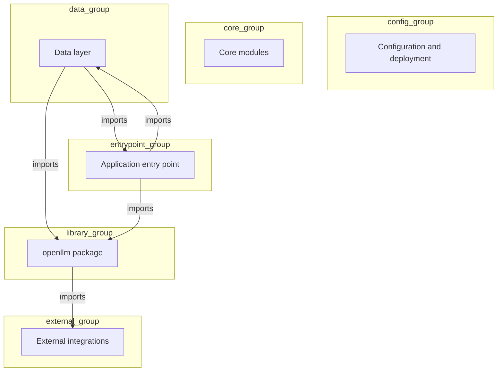

# Architecture report: bentoml/OpenLLM

> Automated static analysis. **Observed** = directly seen in files/imports/AST; **Inferred** = interpretation from that evidence. Repository code was not executed.

## 1. Repository at a glance

| Item | Value |
| --- | --- |
| Repository | bentoml/OpenLLM |
| Description | Run any open-source LLMs, such as DeepSeek and Llama, as OpenAI compatible API endpoint in the cloud. |
| Language | Python |
| Stars | 12600 |
| Licence | Apache-2.0 |
| Analysed commit / branch | 200b37fbf6f75b174e0737b937b886af460495e9 / main |
| Framework(s) | Typer |
| Files analysed | 40 |
| Components | 6 |

## 2. Architecture in one minute

bentoml/OpenLLM - Run any open-source LLMs, such as DeepSeek and Llama, as OpenAI compatible API endpoint in the cloud.. This repository was analysed statically from 40 file(s) (12 Python). Detected technologies (observed from imports/manifests): GitHub Actions, Typer, Click, httpx, Pydantic, Poetry. Files are grouped into 6 component(s): Configuration and deployment, Core modules, Data layer, Application entry point, External integrations, openllm package. Observed entry point(s): gen_readme.py, src/openllm/__main__.py, src/openllm/clean.py. Findings below distinguish observed facts from inferred interpretation.

## 3. High-level block diagram

## 4. Main components

### Configuration and deployment (`config`)

- **Kind:** config
- **Status:** Observed
- **Confidence:** 0.85
- **Responsibility:** Groups 2 file(s) under configuration and deployment (observed from repository paths and static analysis).
- **Paths:** `pyproject.toml`, `pyrightconfig.json`
- **Evidence:** [pyproject.toml](https://github.com/bentoml/OpenLLM/blob/200b37fbf6f75b174e0737b937b886af460495e9/pyproject.toml); [pyrightconfig.json](https://github.com/bentoml/OpenLLM/blob/200b37fbf6f75b174e0737b937b886af460495e9/pyrightconfig.json)

### Core modules (`core`)

- **Kind:** core
- **Status:** Observed
- **Confidence:** 0.85
- **Responsibility:** Groups 1 file(s) under core modules (observed from repository paths and static analysis).
- **Paths:** `release.sh`
- **Evidence:** [release.sh](https://github.com/bentoml/OpenLLM/blob/200b37fbf6f75b174e0737b937b886af460495e9/release.sh)

### Data layer (`data_layer`)

- **Kind:** data
- **Status:** Observed
- **Confidence:** 0.85
- **Responsibility:** Groups 1 file(s) under data layer (observed from repository paths and static analysis). Observed top-level functions: _extract_first_number, ensure_bento, get, list_bento, list_model.
- **Paths:** `src/openllm/model.py`
- **Evidence:** [src/openllm/model.py:16](https://github.com/bentoml/OpenLLM/blob/200b37fbf6f75b174e0737b937b886af460495e9/src/openllm/model.py#L16)

### Application entry point (`entrypoint`)

- **Kind:** entrypoint
- **Status:** Observed
- **Confidence:** 0.85
- **Responsibility:** Groups 3 file(s) under application entry point (observed from repository paths and static analysis). Observed top-level functions: _clone_repo, _complete_alias, _select_action, _select_bento_name, _select_bento_version, _select_target.
- **Paths:** `gen_readme.py`, `src/openllm/__main__.py`, `src/openllm/repo.py`
- **Evidence:** [gen_readme.py](https://github.com/bentoml/OpenLLM/blob/200b37fbf6f75b174e0737b937b886af460495e9/gen_readme.py); [src/openllm/__main__.py:30](https://github.com/bentoml/OpenLLM/blob/200b37fbf6f75b174e0737b937b886af460495e9/src/openllm/__main__.py#L30); [src/openllm/repo.py:25](https://github.com/bentoml/OpenLLM/blob/200b37fbf6f75b174e0737b937b886af460495e9/src/openllm/repo.py#L25)

### External integrations (`external_integrations`)

- **Kind:** external
- **Status:** Inferred
- **Confidence:** 0.70
- **Responsibility:** Groups 0 file(s) under external integrations (observed from repository paths and static analysis).
- **Evidence:** [src/openllm/local.py:4](https://github.com/bentoml/OpenLLM/blob/200b37fbf6f75b174e0737b937b886af460495e9/src/openllm/local.py#L4)

### openllm package (`openllm`)

- **Kind:** library
- **Status:** Observed
- **Confidence:** 0.85
- **Responsibility:** Groups 8 file(s) under openllm package (observed from repository paths and static analysis). Observed top-level classes: Accelerator, BentoInfo, BentoMetadata, CliEvent, Config, ContextVar. Observed top-level functions: _du, _ensure_venv, _get_deploy_cmd, _get_serve_cmd, _resolve_bento_venv_spec, _run_model.
- **Paths:** `src/openllm/__init__.py`, `src/openllm/accelerator_spec.py`, `src/openllm/analytic.py`, `src/openllm/clean.py`, `src/openllm/cloud.py`, `src/openllm/common.py`, `src/openllm/local.py`, `src/openllm/venv.py`
- **Evidence:** [src/openllm/__init__.py](https://github.com/bentoml/OpenLLM/blob/200b37fbf6f75b174e0737b937b886af460495e9/src/openllm/__init__.py); [src/openllm/accelerator_spec.py:11](https://github.com/bentoml/OpenLLM/blob/200b37fbf6f75b174e0737b937b886af460495e9/src/openllm/accelerator_spec.py#L11); [src/openllm/analytic.py:9](https://github.com/bentoml/OpenLLM/blob/200b37fbf6f75b174e0737b937b886af460495e9/src/openllm/analytic.py#L9); [src/openllm/clean.py:14](https://github.com/bentoml/OpenLLM/blob/200b37fbf6f75b174e0737b937b886af460495e9/src/openllm/clean.py#L14); [src/openllm/cloud.py:13](https://github.com/bentoml/OpenLLM/blob/200b37fbf6f75b174e0737b937b886af460495e9/src/openllm/cloud.py#L13); [src/openllm/common.py:33](https://github.com/bentoml/OpenLLM/blob/200b37fbf6f75b174e0737b937b886af460495e9/src/openllm/common.py#L33); [src/openllm/local.py:21](https://github.com/bentoml/OpenLLM/blob/200b37fbf6f75b174e0737b937b886af460495e9/src/openllm/local.py#L21); [src/openllm/venv.py:18](https://github.com/bentoml/OpenLLM/blob/200b37fbf6f75b174e0737b937b886af460495e9/src/openllm/venv.py#L18)

## 5. Execution flow

**Observed** entry point(s):

- [gen_readme.py:11](https://github.com/bentoml/OpenLLM/blob/200b37fbf6f75b174e0737b937b886af460495e9/gen_readme.py#L11)
- [src/openllm/__main__.py](https://github.com/bentoml/OpenLLM/blob/200b37fbf6f75b174e0737b937b886af460495e9/src/openllm/__main__.py)
- [src/openllm/clean.py:32](https://github.com/bentoml/OpenLLM/blob/200b37fbf6f75b174e0737b937b886af460495e9/src/openllm/clean.py#L32)
- [src/openllm/model.py:16](https://github.com/bentoml/OpenLLM/blob/200b37fbf6f75b174e0737b937b886af460495e9/src/openllm/model.py#L16)
- [src/openllm/repo.py:25](https://github.com/bentoml/OpenLLM/blob/200b37fbf6f75b174e0737b937b886af460495e9/src/openllm/repo.py#L25)

Representative flow (derived from observed entry points and the import graph; steps beyond the entry point are **Inferred**):

1. Execution starts at an observed entry point listed above, if present.
2. `data_layer` imports `entrypoint` (Data layer -> Application entry point).
3. `data_layer` imports `openllm` (Data layer -> openllm package).
4. `entrypoint` imports `data_layer` (Application entry point -> Data layer).
5. `entrypoint` imports `openllm` (Application entry point -> openllm package).
6. `openllm` imports `external_integrations` (openllm package -> External integrations).

## 6. Project structure

### `(root)`

- `.editorconfig` - config (245 bytes)
- `.envrc.template` - other (27 bytes)
- `.git-blame-ignore-revs` - other (1151 bytes)
- `.git_archival.txt` - docs (145 bytes)
- `.gitattributes` - other (91 bytes)
- `.gitignore` - other (3130 bytes)
- `.pre-commit-config.yaml` - config (1624 bytes)
- `.python-version-default` - other (5 bytes)
- `.ruff.toml` - config (612 bytes)
- `CITATION.cff` - other (2056 bytes)
- `DEVELOPMENT.md` - docs (4600 bytes)
- `LICENSE` - docs (11357 bytes)
- `README.md` - docs (9623 bytes)
- `README.md.tpl` - other (9051 bytes)
- `SECURITY.md` - docs (145 bytes)
- `gen_readme.py` - source, Python (864 bytes)
- `pyproject.toml` - manifest (3026 bytes)
- `pyrightconfig.json` - config (440 bytes)
- `release.sh` - source, Shell (2809 bytes)

### `.github`

- `.github/CODEOWNERS` - other (11 bytes)
- `.github/CODE_OF_CONDUCT.md` - docs (5214 bytes)
- `.github/ISSUE_TEMPLATE/bug_report.yml` - config (2464 bytes)
- `.github/ISSUE_TEMPLATE/config.yml` - config (300 bytes)
- `.github/ISSUE_TEMPLATE/feature_request.yml` - config (1093 bytes)
- `.github/SECURITY.md` - docs (816 bytes)
- `.github/dependabot.yml` - config (500 bytes)
- `.github/workflows/create-releases.yml` - ci, YAML (1779 bytes)
- `.github/workflows/dependabot-auto-merge.yml` - ci, YAML (883 bytes)

### `src`

- `src/openllm/__init__.py` - source, Python (0 bytes)
- `src/openllm/__main__.py` - source, Python (12799 bytes)
- `src/openllm/accelerator_spec.py` - source, Python (5573 bytes)
- `src/openllm/analytic.py` - source, Python (3539 bytes)
- `src/openllm/clean.py` - source, Python (2580 bytes)
- `src/openllm/cloud.py` - source, Python (7256 bytes)
- `src/openllm/common.py` - source, Python (12126 bytes)
- `src/openllm/local.py` - source, Python (4971 bytes)
- `src/openllm/model.py` - source, Python (5008 bytes)
- `src/openllm/py.typed` - other (0 bytes)
- `src/openllm/repo.py` - source, Python (7744 bytes)
- `src/openllm/venv.py` - source, Python (3142 bytes)

## 7. Key dependencies and integrations

| Name | Category | Status | Confidence | Evidence |
| --- | --- | --- | --- | --- |
| GitHub Actions | ci | Observed | 0.90 | [.github/workflows/create-releases.yml](https://github.com/bentoml/OpenLLM/blob/200b37fbf6f75b174e0737b937b886af460495e9/.github/workflows/create-releases.yml); [.github/workflows/dependabot-auto-merge.yml](https://github.com/bentoml/OpenLLM/blob/200b37fbf6f75b174e0737b937b886af460495e9/.github/workflows/dependabot-auto-merge.yml) |
| Typer | framework | Observed | 0.95 | [pyproject.toml:34](https://github.com/bentoml/OpenLLM/blob/200b37fbf6f75b174e0737b937b886af460495e9/pyproject.toml#L34); [src/openllm/__main__.py:4](https://github.com/bentoml/OpenLLM/blob/200b37fbf6f75b174e0737b937b886af460495e9/src/openllm/__main__.py#L4); [src/openllm/analytic.py:4](https://github.com/bentoml/OpenLLM/blob/200b37fbf6f75b174e0737b937b886af460495e9/src/openllm/analytic.py#L4); [src/openllm/cloud.py:4](https://github.com/bentoml/OpenLLM/blob/200b37fbf6f75b174e0737b937b886af460495e9/src/openllm/cloud.py#L4) |
| Click | library | Observed | 0.90 | [src/openllm/analytic.py:4](https://github.com/bentoml/OpenLLM/blob/200b37fbf6f75b174e0737b937b886af460495e9/src/openllm/analytic.py#L4) |
| httpx | library | Observed | 0.90 | [src/openllm/local.py:4](https://github.com/bentoml/OpenLLM/blob/200b37fbf6f75b174e0737b937b886af460495e9/src/openllm/local.py#L4) |
| Pydantic | library | Observed | 0.95 | [src/openllm/accelerator_spec.py:4](https://github.com/bentoml/OpenLLM/blob/200b37fbf6f75b174e0737b937b886af460495e9/src/openllm/accelerator_spec.py#L4); [src/openllm/accelerator_spec.py:6](https://github.com/bentoml/OpenLLM/blob/200b37fbf6f75b174e0737b937b886af460495e9/src/openllm/accelerator_spec.py#L6); [src/openllm/common.py:4](https://github.com/bentoml/OpenLLM/blob/200b37fbf6f75b174e0737b937b886af460495e9/src/openllm/common.py#L4) |
| Poetry | packaging | Observed | 0.85 | [pyproject.toml](https://github.com/bentoml/OpenLLM/blob/200b37fbf6f75b174e0737b937b886af460495e9/pyproject.toml) |

## 8. Data and state

- Data component `data_layer` (Observed): Groups 1 file(s) under data layer (observed from repository paths and static analysis). Observed top-level functions: _extract_first_number, ensure_bento, get, list_bento, list_model.

## 9. Configuration and deployment clues

- `.editorconfig` (config)
- `.github/ISSUE_TEMPLATE/bug_report.yml` (config)
- `.github/ISSUE_TEMPLATE/config.yml` (config)
- `.github/ISSUE_TEMPLATE/feature_request.yml` (config)
- `.github/dependabot.yml` (config)
- `.github/workflows/create-releases.yml` (ci)
- `.github/workflows/dependabot-auto-merge.yml` (ci)
- `.pre-commit-config.yaml` (config)
- `.ruff.toml` (config)
- `pyproject.toml` (manifest)
- `pyrightconfig.json` (config)

Console scripts declared in packaging metadata (**Observed**):

- `openllm` -> `openllm.__main__:app`

## 10. Design observations

- An entry/API layer is separated from other code (Inferred from paths and decorators).
- Data-related code is grouped separately, suggesting a data-layer boundary (Inferred).
- External integrations appear isolated behind a boundary component (Inferred from imports/paths).

These observations are interpretations (**Inferred**) of the observed structure, not guarantees about runtime design.

## 11. Limitations and unknowns

- Static analysis only: repository code was not executed, installed, or imported at runtime.
- Components and relationships are inferred from file paths, imports, and AST structure; runtime behaviour, dynamic imports, and reflection may not be visible.
- Repository text was treated as untrusted data; no instructions found in repository files were followed, and likely secret values were redacted/excluded.

## 12. Source references

- [.github/workflows/create-releases.yml](https://github.com/bentoml/OpenLLM/blob/200b37fbf6f75b174e0737b937b886af460495e9/.github/workflows/create-releases.yml)
- [.github/workflows/dependabot-auto-merge.yml](https://github.com/bentoml/OpenLLM/blob/200b37fbf6f75b174e0737b937b886af460495e9/.github/workflows/dependabot-auto-merge.yml)
- [gen_readme.py](https://github.com/bentoml/OpenLLM/blob/200b37fbf6f75b174e0737b937b886af460495e9/gen_readme.py)
- [gen_readme.py:11](https://github.com/bentoml/OpenLLM/blob/200b37fbf6f75b174e0737b937b886af460495e9/gen_readme.py#L11)
- [pyproject.toml](https://github.com/bentoml/OpenLLM/blob/200b37fbf6f75b174e0737b937b886af460495e9/pyproject.toml)
- [pyproject.toml:34](https://github.com/bentoml/OpenLLM/blob/200b37fbf6f75b174e0737b937b886af460495e9/pyproject.toml#L34)
- [pyrightconfig.json](https://github.com/bentoml/OpenLLM/blob/200b37fbf6f75b174e0737b937b886af460495e9/pyrightconfig.json)
- [release.sh](https://github.com/bentoml/OpenLLM/blob/200b37fbf6f75b174e0737b937b886af460495e9/release.sh)
- [src/openllm/__init__.py](https://github.com/bentoml/OpenLLM/blob/200b37fbf6f75b174e0737b937b886af460495e9/src/openllm/__init__.py)
- [src/openllm/__main__.py](https://github.com/bentoml/OpenLLM/blob/200b37fbf6f75b174e0737b937b886af460495e9/src/openllm/__main__.py)
- [src/openllm/__main__.py:4](https://github.com/bentoml/OpenLLM/blob/200b37fbf6f75b174e0737b937b886af460495e9/src/openllm/__main__.py#L4)
- [src/openllm/__main__.py:30](https://github.com/bentoml/OpenLLM/blob/200b37fbf6f75b174e0737b937b886af460495e9/src/openllm/__main__.py#L30)
- [src/openllm/accelerator_spec.py:4](https://github.com/bentoml/OpenLLM/blob/200b37fbf6f75b174e0737b937b886af460495e9/src/openllm/accelerator_spec.py#L4)
- [src/openllm/accelerator_spec.py:6](https://github.com/bentoml/OpenLLM/blob/200b37fbf6f75b174e0737b937b886af460495e9/src/openllm/accelerator_spec.py#L6)
- [src/openllm/accelerator_spec.py:11](https://github.com/bentoml/OpenLLM/blob/200b37fbf6f75b174e0737b937b886af460495e9/src/openllm/accelerator_spec.py#L11)
- [src/openllm/analytic.py:4](https://github.com/bentoml/OpenLLM/blob/200b37fbf6f75b174e0737b937b886af460495e9/src/openllm/analytic.py#L4)
- [src/openllm/analytic.py:9](https://github.com/bentoml/OpenLLM/blob/200b37fbf6f75b174e0737b937b886af460495e9/src/openllm/analytic.py#L9)
- [src/openllm/clean.py:14](https://github.com/bentoml/OpenLLM/blob/200b37fbf6f75b174e0737b937b886af460495e9/src/openllm/clean.py#L14)
- [src/openllm/clean.py:32](https://github.com/bentoml/OpenLLM/blob/200b37fbf6f75b174e0737b937b886af460495e9/src/openllm/clean.py#L32)
- [src/openllm/cloud.py:4](https://github.com/bentoml/OpenLLM/blob/200b37fbf6f75b174e0737b937b886af460495e9/src/openllm/cloud.py#L4)
- [src/openllm/cloud.py:13](https://github.com/bentoml/OpenLLM/blob/200b37fbf6f75b174e0737b937b886af460495e9/src/openllm/cloud.py#L13)
- [src/openllm/common.py:4](https://github.com/bentoml/OpenLLM/blob/200b37fbf6f75b174e0737b937b886af460495e9/src/openllm/common.py#L4)
- [src/openllm/common.py:33](https://github.com/bentoml/OpenLLM/blob/200b37fbf6f75b174e0737b937b886af460495e9/src/openllm/common.py#L33)
- [src/openllm/local.py:4](https://github.com/bentoml/OpenLLM/blob/200b37fbf6f75b174e0737b937b886af460495e9/src/openllm/local.py#L4)
- [src/openllm/local.py:21](https://github.com/bentoml/OpenLLM/blob/200b37fbf6f75b174e0737b937b886af460495e9/src/openllm/local.py#L21)
- [src/openllm/model.py:4](https://github.com/bentoml/OpenLLM/blob/200b37fbf6f75b174e0737b937b886af460495e9/src/openllm/model.py#L4)
- [src/openllm/model.py:16](https://github.com/bentoml/OpenLLM/blob/200b37fbf6f75b174e0737b937b886af460495e9/src/openllm/model.py#L16)
- [src/openllm/repo.py:4](https://github.com/bentoml/OpenLLM/blob/200b37fbf6f75b174e0737b937b886af460495e9/src/openllm/repo.py#L4)
- [src/openllm/repo.py:25](https://github.com/bentoml/OpenLLM/blob/200b37fbf6f75b174e0737b937b886af460495e9/src/openllm/repo.py#L25)
- [src/openllm/venv.py:4](https://github.com/bentoml/OpenLLM/blob/200b37fbf6f75b174e0737b937b886af460495e9/src/openllm/venv.py#L4)
- [src/openllm/venv.py:18](https://github.com/bentoml/OpenLLM/blob/200b37fbf6f75b174e0737b937b886af460495e9/src/openllm/venv.py#L18)
