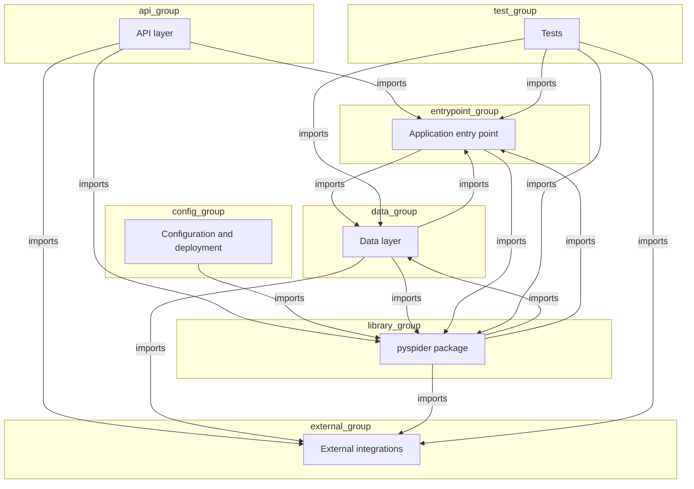

# Architecture report: binux/pyspider

> Automated static analysis. **Observed** = directly seen in files/imports/AST; **Inferred** = interpretation from that evidence. Repository code was not executed.

## 1. Repository at a glance

| Item | Value |
| --- | --- |
| Repository | binux/pyspider |
| Description | A Powerful Spider(Web Crawler) System in Python. |
| Language | Python |
| Stars | 16744 |
| Licence | Apache-2.0 |
| Analysed commit / branch | 897891cafb21ea5b4ac08e728ad2ea212879f7fa / master |
| Framework(s) | Flask |
| Files analysed | 166 |
| Components | 7 |

## 2. Architecture in one minute

binux/pyspider - A Powerful Spider(Web Crawler) System in Python.. This repository was analysed statically from 166 file(s) (108 Python). Detected technologies (observed from imports/manifests): MongoDB, MySQL, PostgreSQL, Redis, SQLite, Flask. Files are grouped into 7 component(s): API layer, Configuration and deployment, Data layer, Application entry point, External integrations, pyspider package, Tests. Observed entry point(s): pyspider/database/basedb.py, pyspider/libs/pprint.py, pyspider/run.py. Findings below distinguish observed facts from inferred interpretation.

## 3. High-level block diagram

## 4. Main components

### API layer (`api_layer`)

- **Kind:** api
- **Status:** Observed
- **Confidence:** 0.85
- **Responsibility:** Groups 4 file(s) under api layer (observed from repository paths and static analysis). Observed routes: ROUTE /debug/<project>, ROUTE /debug/<project>/run, ROUTE /debug/<project>/save, ROUTE /debug/<project>/get, ROUTE /blank.html. Observed top-level functions: active_tasks, blank_html, counter, debug, dump_result, enable_projects_import.
- **Paths:** `pyspider/webui/debug.py`, `pyspider/webui/index.py`, `pyspider/webui/result.py`, `pyspider/webui/task.py`
- **Evidence:** [pyspider/webui/debug.py:39](https://github.com/binux/pyspider/blob/897891cafb21ea5b4ac08e728ad2ea212879f7fa/pyspider/webui/debug.py#L39); [pyspider/webui/index.py:24](https://github.com/binux/pyspider/blob/897891cafb21ea5b4ac08e728ad2ea212879f7fa/pyspider/webui/index.py#L24); [pyspider/webui/result.py:17](https://github.com/binux/pyspider/blob/897891cafb21ea5b4ac08e728ad2ea212879f7fa/pyspider/webui/result.py#L17); [pyspider/webui/task.py:16](https://github.com/binux/pyspider/blob/897891cafb21ea5b4ac08e728ad2ea212879f7fa/pyspider/webui/task.py#L16)

### Configuration and deployment (`config`)

- **Kind:** config
- **Status:** Observed
- **Confidence:** 0.85
- **Responsibility:** Groups 9 file(s) under configuration and deployment (observed from repository paths and static analysis).
- **Paths:** `Dockerfile`, `MANIFEST.in`, `config_example.json`, `docker-compose.yaml`, `mkdocs.yml`, `pyspider/webui/static/package.json`, `requirements.txt`, `setup.py`, `tox.ini`
- **Evidence:** [Dockerfile](https://github.com/binux/pyspider/blob/897891cafb21ea5b4ac08e728ad2ea212879f7fa/Dockerfile); [MANIFEST.in](https://github.com/binux/pyspider/blob/897891cafb21ea5b4ac08e728ad2ea212879f7fa/MANIFEST.in); [config_example.json](https://github.com/binux/pyspider/blob/897891cafb21ea5b4ac08e728ad2ea212879f7fa/config_example.json); [docker-compose.yaml](https://github.com/binux/pyspider/blob/897891cafb21ea5b4ac08e728ad2ea212879f7fa/docker-compose.yaml); [mkdocs.yml](https://github.com/binux/pyspider/blob/897891cafb21ea5b4ac08e728ad2ea212879f7fa/mkdocs.yml); [pyspider/webui/static/package.json](https://github.com/binux/pyspider/blob/897891cafb21ea5b4ac08e728ad2ea212879f7fa/pyspider/webui/static/package.json); [requirements.txt](https://github.com/binux/pyspider/blob/897891cafb21ea5b4ac08e728ad2ea212879f7fa/requirements.txt); [setup.py](https://github.com/binux/pyspider/blob/897891cafb21ea5b4ac08e728ad2ea212879f7fa/setup.py)

### Data layer (`data_layer`)

- **Kind:** data
- **Status:** Observed
- **Confidence:** 0.85
- **Responsibility:** Groups 38 file(s) under data layer (observed from repository paths and static analysis). Observed top-level classes: MySQLMixin, ProjectDB, ResultDB, SQLiteMixin, SplitTableMixin, TaskDB. Observed top-level functions: _connect_couchdb, _connect_database, _connect_elasticsearch, _connect_mongodb, _connect_mysql, _connect_sqlalchemy.
- **Paths:** `pyspider/database/__init__.py`, `pyspider/database/base/__init__.py`, `pyspider/database/base/projectdb.py`, `pyspider/database/base/resultdb.py`, `pyspider/database/base/taskdb.py`, `pyspider/database/couchdb/__init__.py`, `pyspider/database/couchdb/couchdbbase.py`, `pyspider/database/couchdb/projectdb.py`, `pyspider/database/couchdb/resultdb.py`, `pyspider/database/couchdb/taskdb.py`, `pyspider/database/elasticsearch/__init__.py`, `pyspider/database/elasticsearch/projectdb.py`, `pyspider/database/elasticsearch/resultdb.py`, `pyspider/database/elasticsearch/taskdb.py`, `pyspider/database/local/__init__.py`, `pyspider/database/local/projectdb.py`, `pyspider/database/mongodb/__init__.py`, `pyspider/database/mongodb/mongodbbase.py`, `pyspider/database/mongodb/projectdb.py`, `pyspider/database/mongodb/resultdb.py`, `pyspider/database/mongodb/taskdb.py`, `pyspider/database/mysql/__init__.py`, `pyspider/database/mysql/mysqlbase.py`, `pyspider/database/mysql/projectdb.py`, `pyspider/database/mysql/resultdb.py`, `pyspider/database/mysql/taskdb.py`, `pyspider/database/redis/__init__.py`, `pyspider/database/redis/taskdb.py`, `pyspider/database/sqlalchemy/__init__.py`, `pyspider/database/sqlalchemy/projectdb.py`, `pyspider/database/sqlalchemy/resultdb.py`, `pyspider/database/sqlalchemy/sqlalchemybase.py`, `pyspider/database/sqlalchemy/taskdb.py`, `pyspider/database/sqlite/__init__.py`, `pyspider/database/sqlite/projectdb.py`, `pyspider/database/sqlite/resultdb.py`, `pyspider/database/sqlite/sqlitebase.py`, `pyspider/database/sqlite/taskdb.py`
- **Evidence:** [pyspider/database/__init__.py:12](https://github.com/binux/pyspider/blob/897891cafb21ea5b4ac08e728ad2ea212879f7fa/pyspider/database/__init__.py#L12); [pyspider/database/base/__init__.py](https://github.com/binux/pyspider/blob/897891cafb21ea5b4ac08e728ad2ea212879f7fa/pyspider/database/base/__init__.py); [pyspider/database/base/projectdb.py:28](https://github.com/binux/pyspider/blob/897891cafb21ea5b4ac08e728ad2ea212879f7fa/pyspider/database/base/projectdb.py#L28); [pyspider/database/base/resultdb.py:20](https://github.com/binux/pyspider/blob/897891cafb21ea5b4ac08e728ad2ea212879f7fa/pyspider/database/base/resultdb.py#L20); [pyspider/database/base/taskdb.py:59](https://github.com/binux/pyspider/blob/897891cafb21ea5b4ac08e728ad2ea212879f7fa/pyspider/database/base/taskdb.py#L59); [pyspider/database/couchdb/__init__.py](https://github.com/binux/pyspider/blob/897891cafb21ea5b4ac08e728ad2ea212879f7fa/pyspider/database/couchdb/__init__.py); [pyspider/database/couchdb/couchdbbase.py:4](https://github.com/binux/pyspider/blob/897891cafb21ea5b4ac08e728ad2ea212879f7fa/pyspider/database/couchdb/couchdbbase.py#L4); [pyspider/database/couchdb/projectdb.py:6](https://github.com/binux/pyspider/blob/897891cafb21ea5b4ac08e728ad2ea212879f7fa/pyspider/database/couchdb/projectdb.py#L6)

### Application entry point (`entrypoint`)

- **Kind:** entrypoint
- **Status:** Observed
- **Confidence:** 0.85
- **Responsibility:** Groups 7 file(s) under application entry point (observed from repository paths and static analysis). Observed top-level classes: AtomInt, BaseDB, InQueueTask, PrettyPrinter, PriorityTaskQueue, QuitableFlask. Observed top-level functions: _perfcheck, _recursion, _safe_repr, _sorted, all, bench.
- **Paths:** `pyspider/database/basedb.py`, `pyspider/libs/pprint.py`, `pyspider/run.py`, `pyspider/scheduler/task_queue.py`, `pyspider/webui/app.py`, `run.py`, `tools/migrate.py`
- **Evidence:** [pyspider/database/basedb.py:17](https://github.com/binux/pyspider/blob/897891cafb21ea5b4ac08e728ad2ea212879f7fa/pyspider/database/basedb.py#L17); [pyspider/libs/pprint.py:54](https://github.com/binux/pyspider/blob/897891cafb21ea5b4ac08e728ad2ea212879f7fa/pyspider/libs/pprint.py#L54); [pyspider/run.py:25](https://github.com/binux/pyspider/blob/897891cafb21ea5b4ac08e728ad2ea212879f7fa/pyspider/run.py#L25); [pyspider/scheduler/task_queue.py:28](https://github.com/binux/pyspider/blob/897891cafb21ea5b4ac08e728ad2ea212879f7fa/pyspider/scheduler/task_queue.py#L28); [pyspider/webui/app.py:24](https://github.com/binux/pyspider/blob/897891cafb21ea5b4ac08e728ad2ea212879f7fa/pyspider/webui/app.py#L24); [run.py](https://github.com/binux/pyspider/blob/897891cafb21ea5b4ac08e728ad2ea212879f7fa/run.py); [tools/migrate.py:20](https://github.com/binux/pyspider/blob/897891cafb21ea5b4ac08e728ad2ea212879f7fa/tools/migrate.py#L20)

### External integrations (`external_integrations`)

- **Kind:** external
- **Status:** Inferred
- **Confidence:** 0.70
- **Responsibility:** Groups 0 file(s) under external integrations (observed from repository paths and static analysis).
- **Evidence:** [pyspider/database/__init__.py:8](https://github.com/binux/pyspider/blob/897891cafb21ea5b4ac08e728ad2ea212879f7fa/pyspider/database/__init__.py#L8); [pyspider/database/__init__.py:80](https://github.com/binux/pyspider/blob/897891cafb21ea5b4ac08e728ad2ea212879f7fa/pyspider/database/__init__.py#L80); [pyspider/database/__init__.py:175](https://github.com/binux/pyspider/blob/897891cafb21ea5b4ac08e728ad2ea212879f7fa/pyspider/database/__init__.py#L175); [pyspider/database/__init__.py:178](https://github.com/binux/pyspider/blob/897891cafb21ea5b4ac08e728ad2ea212879f7fa/pyspider/database/__init__.py#L178); [pyspider/database/__init__.py:181](https://github.com/binux/pyspider/blob/897891cafb21ea5b4ac08e728ad2ea212879f7fa/pyspider/database/__init__.py#L181); [pyspider/database/basedb.py:136](https://github.com/binux/pyspider/blob/897891cafb21ea5b4ac08e728ad2ea212879f7fa/pyspider/database/basedb.py#L136)

### pyspider package (`pyspider`)

- **Kind:** library
- **Status:** Observed
- **Confidence:** 0.85
- **Responsibility:** Groups 40 file(s) under pyspider package (observed from repository paths and static analysis). Observed top-level classes: AmqpQueue, AnonymousUser, AverageWindowCounter, BaseCounter, BaseHandler, BaseHandlerMeta. Observed top-level functions: _build_url, _encode_multipart_formdata, before_request, bench_test_message_queue, bench_test_taskdb, catch_error.
- **Paths:** `pyspider/__init__.py`, `pyspider/fetcher/__init__.py`, `pyspider/fetcher/cookie_utils.py`, `pyspider/fetcher/phantomjs_fetcher.js`, `pyspider/fetcher/puppeteer_fetcher.js`, `pyspider/fetcher/tornado_fetcher.py`, `pyspider/libs/ListIO.py`, `pyspider/libs/__init__.py`, `pyspider/libs/base_handler.py`, `pyspider/libs/bench.py`, `pyspider/libs/counter.py`, `pyspider/libs/dataurl.py`, `pyspider/libs/log.py`, `pyspider/libs/multiprocessing_queue.py`, `pyspider/libs/response.py`, `pyspider/libs/result_dump.py`, `pyspider/libs/sample_handler.py`, `pyspider/libs/url.py`, `pyspider/libs/utils.py`, `pyspider/libs/wsgi_xmlrpc.py`, `pyspider/message_queue/__init__.py`, `pyspider/message_queue/kombu_queue.py`, `pyspider/message_queue/rabbitmq.py`, `pyspider/message_queue/redis_queue.py`, `pyspider/processor/__init__.py`, `pyspider/processor/processor.py`, `pyspider/processor/project_module.py`, `pyspider/result/__init__.py`, `pyspider/result/result_worker.py`, `pyspider/scheduler/__init__.py`, `pyspider/scheduler/scheduler.py`, `pyspider/scheduler/token_bucket.py`, `pyspider/webui/__init__.py`, `pyspider/webui/login.py`, `pyspider/webui/static/src/css_selector_helper.js`, `pyspider/webui/static/src/debug.js`, `pyspider/webui/static/src/index.js`, `pyspider/webui/static/src/splitter.js`, `pyspider/webui/static/webpack.config.js`, `pyspider/webui/webdav.py`
- **Evidence:** [pyspider/__init__.py](https://github.com/binux/pyspider/blob/897891cafb21ea5b4ac08e728ad2ea212879f7fa/pyspider/__init__.py); [pyspider/fetcher/__init__.py](https://github.com/binux/pyspider/blob/897891cafb21ea5b4ac08e728ad2ea212879f7fa/pyspider/fetcher/__init__.py); [pyspider/fetcher/cookie_utils.py:11](https://github.com/binux/pyspider/blob/897891cafb21ea5b4ac08e728ad2ea212879f7fa/pyspider/fetcher/cookie_utils.py#L11); [pyspider/fetcher/phantomjs_fetcher.js](https://github.com/binux/pyspider/blob/897891cafb21ea5b4ac08e728ad2ea212879f7fa/pyspider/fetcher/phantomjs_fetcher.js); [pyspider/fetcher/puppeteer_fetcher.js](https://github.com/binux/pyspider/blob/897891cafb21ea5b4ac08e728ad2ea212879f7fa/pyspider/fetcher/puppeteer_fetcher.js); [pyspider/fetcher/tornado_fetcher.py:39](https://github.com/binux/pyspider/blob/897891cafb21ea5b4ac08e728ad2ea212879f7fa/pyspider/fetcher/tornado_fetcher.py#L39); [pyspider/libs/ListIO.py:9](https://github.com/binux/pyspider/blob/897891cafb21ea5b4ac08e728ad2ea212879f7fa/pyspider/libs/ListIO.py#L9); [pyspider/libs/__init__.py](https://github.com/binux/pyspider/blob/897891cafb21ea5b4ac08e728ad2ea212879f7fa/pyspider/libs/__init__.py)

### Tests (`tests`)

- **Kind:** test
- **Status:** Observed
- **Confidence:** 0.85
- **Responsibility:** Groups 24 file(s) under tests (observed from repository paths and static analysis). Observed routes: ROUTE /bench, ROUTE /pyspider/test.html, ROUTE /pyspider/ajax.html, ROUTE /pyspider/ajax_click.html. Observed top-level classes: BuiltinQueue, Handler, IgnoreHandler, ProjectDBCase, ResultDBCase, TaskDBCase. Observed top-level functions: bench_test, test_ajax, test_ajax_click, test_page.
- **Paths:** `pyspider/webui/bench_test.py`, `tests/__init__.py`, `tests/data_fetcher_processor_handler.py`, `tests/data_handler.py`, `tests/data_sample_handler.py`, `tests/data_test_webpage.py`, `tests/test_base_handler.py`, `tests/test_bench.py`, `tests/test_counter.py`, `tests/test_database.py`, `tests/test_fetcher.py`, `tests/test_fetcher_processor.py`, `tests/test_message_queue.py`, `tests/test_processor.py`, `tests/test_response.py`, `tests/test_result_dump.py`, `tests/test_result_worker.py`, `tests/test_run.py`, `tests/test_scheduler.py`, `tests/test_task_queue.py`, `tests/test_utils.py`, `tests/test_webdav.py`, `tests/test_webui.py`, `tests/test_xmlrpc.py`
- **Evidence:** [pyspider/webui/bench_test.py:19](https://github.com/binux/pyspider/blob/897891cafb21ea5b4ac08e728ad2ea212879f7fa/pyspider/webui/bench_test.py#L19); [tests/__init__.py](https://github.com/binux/pyspider/blob/897891cafb21ea5b4ac08e728ad2ea212879f7fa/tests/__init__.py); [tests/data_fetcher_processor_handler.py:10](https://github.com/binux/pyspider/blob/897891cafb21ea5b4ac08e728ad2ea212879f7fa/tests/data_fetcher_processor_handler.py#L10); [tests/data_handler.py:12](https://github.com/binux/pyspider/blob/897891cafb21ea5b4ac08e728ad2ea212879f7fa/tests/data_handler.py#L12); [tests/data_sample_handler.py:9](https://github.com/binux/pyspider/blob/897891cafb21ea5b4ac08e728ad2ea212879f7fa/tests/data_sample_handler.py#L9); [tests/data_test_webpage.py:11](https://github.com/binux/pyspider/blob/897891cafb21ea5b4ac08e728ad2ea212879f7fa/tests/data_test_webpage.py#L11); [tests/test_base_handler.py:13](https://github.com/binux/pyspider/blob/897891cafb21ea5b4ac08e728ad2ea212879f7fa/tests/test_base_handler.py#L13); [tests/test_bench.py:19](https://github.com/binux/pyspider/blob/897891cafb21ea5b4ac08e728ad2ea212879f7fa/tests/test_bench.py#L19)

## 5. Execution flow

**Observed** entry point(s):

- [pyspider/database/basedb.py:135](https://github.com/binux/pyspider/blob/897891cafb21ea5b4ac08e728ad2ea212879f7fa/pyspider/database/basedb.py#L135)
- [pyspider/libs/pprint.py:377](https://github.com/binux/pyspider/blob/897891cafb21ea5b4ac08e728ad2ea212879f7fa/pyspider/libs/pprint.py#L377)
- [pyspider/run.py](https://github.com/binux/pyspider/blob/897891cafb21ea5b4ac08e728ad2ea212879f7fa/pyspider/run.py)
- [pyspider/scheduler/task_queue.py:289](https://github.com/binux/pyspider/blob/897891cafb21ea5b4ac08e728ad2ea212879f7fa/pyspider/scheduler/task_queue.py#L289)
- [run.py:10](https://github.com/binux/pyspider/blob/897891cafb21ea5b4ac08e728ad2ea212879f7fa/run.py#L10)
- [tools/migrate.py:43](https://github.com/binux/pyspider/blob/897891cafb21ea5b4ac08e728ad2ea212879f7fa/tools/migrate.py#L43)

**Observed** routes (from decorators):

- `ROUTE /bench` -> `bench_test` in `pyspider/webui/bench_test.py:19`
- `ROUTE /debug/<project>` -> `debug` in `pyspider/webui/debug.py:39`
- `ROUTE /debug/<project>/run` -> `run` in `pyspider/webui/debug.py:70`
- `ROUTE /debug/<project>/save` -> `save` in `pyspider/webui/debug.py:170`
- `ROUTE /debug/<project>/get` -> `get_script` in `pyspider/webui/debug.py:209`
- `ROUTE /blank.html` -> `blank_html` in `pyspider/webui/debug.py:219`
- `ROUTE /` -> `index` in `pyspider/webui/index.py:24`
- `ROUTE /queues` -> `get_queues` in `pyspider/webui/index.py:32`
- `ROUTE /update` -> `project_update` in `pyspider/webui/index.py:49`
- `ROUTE /counter` -> `counter` in `pyspider/webui/index.py:95`
- `ROUTE /run` -> `runtask` in `pyspider/webui/index.py:116`
- `ROUTE /robots.txt` -> `robots` in `pyspider/webui/index.py:153`
- `ROUTE /results` -> `result` in `pyspider/webui/result.py:17`
- `ROUTE /results/dump/<project>.<_format>` -> `dump_result` in `pyspider/webui/result.py:34`
- `ROUTE /task/<taskid>` -> `task` in `pyspider/webui/task.py:16`
- `ROUTE /task/<taskid>.json` -> `task_in_json` in `pyspider/webui/task.py:36`
- `ROUTE /tasks` -> `tasks` in `pyspider/webui/task.py:51`
- `ROUTE /active_tasks` -> `active_tasks` in `pyspider/webui/task.py:81`
- `ROUTE /pyspider/test.html` -> `test_page` in `tests/data_test_webpage.py:11`
- `ROUTE /pyspider/ajax.html` -> `test_ajax` in `tests/data_test_webpage.py:30`
- `ROUTE /pyspider/ajax_click.html` -> `test_ajax_click` in `tests/data_test_webpage.py:49`

Representative flow (derived from observed entry points and the import graph; steps beyond the entry point are **Inferred**):

1. Execution starts at an observed entry point listed above, if present.
2. `api_layer` imports `entrypoint` (API layer -> Application entry point).
3. `api_layer` imports `external_integrations` (API layer -> External integrations).
4. `api_layer` imports `pyspider` (API layer -> pyspider package).
5. `config` imports `pyspider` (Configuration and deployment -> pyspider package).
6. `data_layer` imports `entrypoint` (Data layer -> Application entry point).
7. `data_layer` imports `external_integrations` (Data layer -> External integrations).
8. `data_layer` imports `pyspider` (Data layer -> pyspider package).
9. `entrypoint` imports `data_layer` (Application entry point -> Data layer).

## 6. Project structure

### `(root)`

- `.coveragerc` - other (350 bytes)
- `.gitignore` - other (339 bytes)
- `.travis.yml` - ci, YAML (1322 bytes)
- `Dockerfile` - container (1398 bytes)
- `LICENSE` - docs (11303 bytes)
- `MANIFEST.in` - manifest (175 bytes)
- `README.md` - docs (3052 bytes)
- `config_example.json` - config (423 bytes)
- `docker-compose.yaml` - container (2514 bytes)
- `mkdocs.yml` - config (1248 bytes)
- `requirements.txt` - manifest (385 bytes)
- `run.py` - source, Python (256 bytes)
- `setup.py` - manifest, Python (2777 bytes)
- `tox.ini` - config (300 bytes)

### `.github`

- `.github/ISSUE_TEMPLATE.md` - docs (659 bytes)

### `data`

- `data/.gitignore` - other (5 bytes)

### `docs`

- `docs/About-Projects.md` - docs (2037 bytes)
- `docs/About-Tasks.md` - docs (1734 bytes)
- `docs/Architecture.md` - docs (5163 bytes)
- `docs/Command-Line.md` - docs (9268 bytes)
- `docs/Deployment-demo.pyspider.org.md` - docs (4593 bytes)
- `docs/Deployment.md` - docs (4502 bytes)
- `docs/Frequently-Asked-Questions.md` - docs (3341 bytes)
- `docs/Quickstart.md` - docs (3866 bytes)
- `docs/Running-pyspider-with-Docker.md` - docs (2013 bytes)
- `docs/Script-Environment.md` - docs (1232 bytes)
- `docs/Working-with-Results.md` - docs (2603 bytes)
- `docs/apis/@catch_status_code_error.md` - docs (542 bytes)
- `docs/apis/@every.md` - docs (729 bytes)
- `docs/apis/Response.md` - docs (1726 bytes)
- `docs/apis/index.md` - docs (198 bytes)
- `docs/apis/self.crawl.md` - docs (8234 bytes)
- `docs/apis/self.send_message.md` - docs (1258 bytes)
- `docs/conf.py` - docs (585 bytes)
- `docs/index.md` - docs (3265 bytes)
- `docs/tutorial/AJAX-and-more-HTTP.md` - docs (7345 bytes)
- `docs/tutorial/HTML-and-CSS-Selector.md` - docs (7942 bytes)
- `docs/tutorial/Render-with-PhantomJS.md` - docs (3392 bytes)
- `docs/tutorial/index.md` - docs (396 bytes)

### `pyspider`

- `pyspider/__init__.py` - source, Python (207 bytes)
- `pyspider/database/__init__.py` - source, Python (7260 bytes)
- `pyspider/database/base/__init__.py` - source, Python (0 bytes)
- `pyspider/database/base/projectdb.py` - source, Python (1879 bytes)
- `pyspider/database/base/resultdb.py` - source, Python (1280 bytes)
- `pyspider/database/base/taskdb.py` - source, Python (2951 bytes)
- `pyspider/database/basedb.py` - source, Python (5896 bytes)
- `pyspider/database/couchdb/__init__.py` - source, Python (0 bytes)
- `pyspider/database/couchdb/couchdbbase.py` - source, Python (2962 bytes)
- `pyspider/database/couchdb/projectdb.py` - source, Python (3937 bytes)
- `pyspider/database/couchdb/resultdb.py` - source, Python (3368 bytes)
- `pyspider/database/couchdb/taskdb.py` - source, Python (3771 bytes)
- `pyspider/database/elasticsearch/__init__.py` - source, Python (186 bytes)
- `pyspider/database/elasticsearch/projectdb.py` - source, Python (2821 bytes)
- `pyspider/database/elasticsearch/resultdb.py` - source, Python (3922 bytes)
- `pyspider/database/elasticsearch/taskdb.py` - source, Python (5082 bytes)
- `pyspider/database/local/__init__.py` - source, Python (186 bytes)
- `pyspider/database/local/projectdb.py` - source, Python (3013 bytes)
- `pyspider/database/mongodb/__init__.py` - source, Python (0 bytes)
- `pyspider/database/mongodb/mongodbbase.py` - source, Python (1476 bytes)
- `pyspider/database/mongodb/projectdb.py` - source, Python (2252 bytes)
- `pyspider/database/mongodb/resultdb.py` - source, Python (3073 bytes)
- `pyspider/database/mongodb/taskdb.py` - source, Python (4789 bytes)
- `pyspider/database/mysql/__init__.py` - source, Python (184 bytes)
- `pyspider/database/mysql/mysqlbase.py` - source, Python (2014 bytes)
- `pyspider/database/mysql/projectdb.py` - source, Python (2401 bytes)
- `pyspider/database/mysql/resultdb.py` - source, Python (3637 bytes)
- `pyspider/database/mysql/taskdb.py` - source, Python (4906 bytes)
- `pyspider/database/redis/__init__.py` - source, Python (187 bytes)
- `pyspider/database/redis/taskdb.py` - source, Python (5783 bytes)
- `pyspider/database/sqlalchemy/__init__.py` - source, Python (187 bytes)
- `pyspider/database/sqlalchemy/projectdb.py` - source, Python (3931 bytes)
- `pyspider/database/sqlalchemy/resultdb.py` - source, Python (5169 bytes)
- `pyspider/database/sqlalchemy/sqlalchemybase.py` - source, Python (1482 bytes)
- `pyspider/database/sqlalchemy/taskdb.py` - source, Python (6160 bytes)
- `pyspider/database/sqlite/__init__.py` - source, Python (0 bytes)
- `pyspider/database/sqlite/projectdb.py` - source, Python (1836 bytes)
- `pyspider/database/sqlite/resultdb.py` - source, Python (2899 bytes)
- `pyspider/database/sqlite/sqlitebase.py` - source, Python (1886 bytes)
- `pyspider/database/sqlite/taskdb.py` - source, Python (4019 bytes)
- `pyspider/fetcher/__init__.py` - source, Python (37 bytes)
- `pyspider/fetcher/cookie_utils.py` - source, Python (898 bytes)
- `pyspider/fetcher/phantomjs_fetcher.js` - source, JavaScript (6721 bytes)
- `pyspider/fetcher/puppeteer_fetcher.js` - source, JavaScript (6112 bytes)
- `pyspider/fetcher/splash_fetcher.lua` - other (6394 bytes)
- `pyspider/fetcher/tornado_fetcher.py` - source, Python (32232 bytes)
- `pyspider/libs/ListIO.py` - source, Python (723 bytes)
- `pyspider/libs/__init__.py` - source, Python (0 bytes)
- `pyspider/libs/base_handler.py` - source, Python (15509 bytes)
- `pyspider/libs/bench.py` - source, Python (8396 bytes)
- `pyspider/libs/counter.py` - source, Python (12784 bytes)
- `pyspider/libs/dataurl.py` - source, Python (1318 bytes)
- `pyspider/libs/log.py` - source, Python (1183 bytes)
- `pyspider/libs/multiprocessing_queue.py` - source, Python (2808 bytes)
- `pyspider/libs/pprint.py` - source, Python (12676 bytes)
- `pyspider/libs/response.py` - source, Python (7618 bytes)
- `pyspider/libs/result_dump.py` - source, Python (3952 bytes)
- `pyspider/libs/sample_handler.py` - source, Python (684 bytes)
- `pyspider/libs/url.py` - source, Python (3818 bytes)
- `pyspider/libs/utils.py` - source, Python (12492 bytes)
- `pyspider/libs/wsgi_xmlrpc.py` - source, Python (3839 bytes)
- `pyspider/logging.conf` - other (763 bytes)
- `pyspider/message_queue/__init__.py` - source, Python (2448 bytes)
- `pyspider/message_queue/kombu_queue.py` - source, Python (3274 bytes)
- `pyspider/message_queue/rabbitmq.py` - source, Python (8706 bytes)
- `pyspider/message_queue/redis_queue.py` - source, Python (3256 bytes)
- `pyspider/processor/__init__.py` - source, Python (50 bytes)
- `pyspider/processor/processor.py` - source, Python (8215 bytes)
- `pyspider/processor/project_module.py` - source, Python (9724 bytes)
- `pyspider/result/__init__.py` - source, Python (242 bytes)
- `pyspider/result/result_worker.py` - source, Python (2536 bytes)
- `pyspider/run.py` - source, Python (32634 bytes)
- `pyspider/scheduler/__init__.py` - source, Python (76 bytes)
- `pyspider/scheduler/scheduler.py` - source, Python (47379 bytes)
- `pyspider/scheduler/task_queue.py` - source, Python (9168 bytes)
- `pyspider/scheduler/token_bucket.py` - source, Python (1418 bytes)
- `pyspider/webui/__init__.py` - source, Python (238 bytes)
- `pyspider/webui/app.py` - source, Python (3625 bytes)
- `pyspider/webui/bench_test.py` - test, Python (887 bytes)
- `pyspider/webui/debug.py` - source, Python (7306 bytes)
- `pyspider/webui/index.py` - source, Python (4743 bytes)
- `pyspider/webui/login.py` - source, Python (1876 bytes)
- `pyspider/webui/result.py` - source, Python (1803 bytes)
- `pyspider/webui/static/.babelrc` - other (28 bytes)
- `pyspider/webui/static/package.json` - manifest (627 bytes)
- `pyspider/webui/static/src/css_selector_helper.js` - source, JavaScript (6661 bytes)
- `pyspider/webui/static/src/debug.js` - source, JavaScript (19767 bytes)
- `pyspider/webui/static/src/debug.less` - other (7063 bytes)
- `pyspider/webui/static/src/index.js` - source, JavaScript (6465 bytes)
- `pyspider/webui/static/src/index.less` - other (2103 bytes)
- `pyspider/webui/static/src/result.less` - other (641 bytes)
- `pyspider/webui/static/src/splitter.js` - source, JavaScript (9861 bytes)
- `pyspider/webui/static/src/task.less` - other (1023 bytes)
- `pyspider/webui/static/src/tasks.less` - other (556 bytes)
- `pyspider/webui/static/src/variable.less` - other (545 bytes)
- `pyspider/webui/static/webpack.config.js` - source, JavaScript (723 bytes)
- `pyspider/webui/task.py` - source, Python (3102 bytes)
- `pyspider/webui/templates/debug.html` - other (5821 bytes)
- `pyspider/webui/templates/index.html` - other (9491 bytes)
- `pyspider/webui/templates/result.html` - other (3589 bytes)
- `pyspider/webui/templates/task.html` - other (3781 bytes)
- `pyspider/webui/templates/tasks.html` - other (2338 bytes)
- `pyspider/webui/webdav.py` - source, Python (6954 bytes)

### `tests`

- `tests/__init__.py` - test, Python (295 bytes)
- `tests/data_fetcher_processor_handler.py` - test, Python (1412 bytes)
- `tests/data_handler.py` - test, Python (1455 bytes)
- `tests/data_sample_handler.py` - test, Python (712 bytes)
- `tests/data_test_webpage.py` - test, Python (1727 bytes)
- `tests/test_base_handler.py` - test, Python (1988 bytes)
- `tests/test_bench.py` - test, Python (1259 bytes)
- `tests/test_counter.py` - test, Python (1413 bytes)
- `tests/test_database.py` - test, Python (26769 bytes)
- `tests/test_fetcher.py` - test, Python (25027 bytes)
- `tests/test_fetcher_processor.py` - test, Python (23272 bytes)
- `tests/test_message_queue.py` - test, Python (8298 bytes)
- `tests/test_processor.py` - test, Python (20786 bytes)
- `tests/test_response.py` - test, Python (2934 bytes)
- `tests/test_result_dump.py` - test, Python (3014 bytes)
- `tests/test_result_worker.py` - test, Python (3042 bytes)
- `tests/test_run.py` - test, Python (14321 bytes)
- `tests/test_scheduler.py` - test, Python (28356 bytes)
- `tests/test_task_queue.py` - test, Python (3972 bytes)
- `tests/test_utils.py` - test, Python (2400 bytes)
- `tests/test_webdav.py` - test, Python (6724 bytes)
- `tests/test_webui.py` - test, Python (20165 bytes)
- `tests/test_xmlrpc.py` - test, Python (1991 bytes)

### `tools`

- `tools/migrate.py` - source, Python (2239 bytes)

## 7. Key dependencies and integrations

| Name | Category | Status | Confidence | Evidence |
| --- | --- | --- | --- | --- |
| MongoDB | database | Observed | 0.95 | [pyspider/database/mongodb/projectdb.py:9](https://github.com/binux/pyspider/blob/897891cafb21ea5b4ac08e728ad2ea212879f7fa/pyspider/database/mongodb/projectdb.py#L9); [pyspider/database/mongodb/resultdb.py:11](https://github.com/binux/pyspider/blob/897891cafb21ea5b4ac08e728ad2ea212879f7fa/pyspider/database/mongodb/resultdb.py#L11); [pyspider/database/mongodb/taskdb.py:11](https://github.com/binux/pyspider/blob/897891cafb21ea5b4ac08e728ad2ea212879f7fa/pyspider/database/mongodb/taskdb.py#L11); [requirements.txt:12](https://github.com/binux/pyspider/blob/897891cafb21ea5b4ac08e728ad2ea212879f7fa/requirements.txt#L12) |
| MySQL | database | Observed | 0.95 | [docker-compose.yaml:16](https://github.com/binux/pyspider/blob/897891cafb21ea5b4ac08e728ad2ea212879f7fa/docker-compose.yaml#L16); [pyspider/database/__init__.py:116](https://github.com/binux/pyspider/blob/897891cafb21ea5b4ac08e728ad2ea212879f7fa/pyspider/database/__init__.py#L116); [pyspider/database/__init__.py:119](https://github.com/binux/pyspider/blob/897891cafb21ea5b4ac08e728ad2ea212879f7fa/pyspider/database/__init__.py#L119); [pyspider/database/__init__.py:122](https://github.com/binux/pyspider/blob/897891cafb21ea5b4ac08e728ad2ea212879f7fa/pyspider/database/__init__.py#L122) |
| PostgreSQL | database | Observed | 0.90 | [requirements.txt:22](https://github.com/binux/pyspider/blob/897891cafb21ea5b4ac08e728ad2ea212879f7fa/requirements.txt#L22); [setup.py:43](https://github.com/binux/pyspider/blob/897891cafb21ea5b4ac08e728ad2ea212879f7fa/setup.py#L43) |
| Redis | database | Observed | 0.95 | [pyspider/database/__init__.py:80](https://github.com/binux/pyspider/blob/897891cafb21ea5b4ac08e728ad2ea212879f7fa/pyspider/database/__init__.py#L80); [pyspider/database/redis/taskdb.py:11](https://github.com/binux/pyspider/blob/897891cafb21ea5b4ac08e728ad2ea212879f7fa/pyspider/database/redis/taskdb.py#L11); [pyspider/message_queue/redis_queue.py:9](https://github.com/binux/pyspider/blob/897891cafb21ea5b4ac08e728ad2ea212879f7fa/pyspider/message_queue/redis_queue.py#L9); [requirements.txt:19](https://github.com/binux/pyspider/blob/897891cafb21ea5b4ac08e728ad2ea212879f7fa/requirements.txt#L19) |
| SQLite | database | Observed | 0.95 | [pyspider/database/basedb.py:136](https://github.com/binux/pyspider/blob/897891cafb21ea5b4ac08e728ad2ea212879f7fa/pyspider/database/basedb.py#L136); [pyspider/database/sqlite/sqlitebase.py:10](https://github.com/binux/pyspider/blob/897891cafb21ea5b4ac08e728ad2ea212879f7fa/pyspider/database/sqlite/sqlitebase.py#L10) |
| Flask | framework | Observed | 0.95 | [pyspider/webui/app.py:16](https://github.com/binux/pyspider/blob/897891cafb21ea5b4ac08e728ad2ea212879f7fa/pyspider/webui/app.py#L16); [pyspider/webui/bench_test.py:14](https://github.com/binux/pyspider/blob/897891cafb21ea5b4ac08e728ad2ea212879f7fa/pyspider/webui/bench_test.py#L14); [pyspider/webui/debug.py:15](https://github.com/binux/pyspider/blob/897891cafb21ea5b4ac08e728ad2ea212879f7fa/pyspider/webui/debug.py#L15); [pyspider/webui/debug.py:20](https://github.com/binux/pyspider/blob/897891cafb21ea5b4ac08e728ad2ea212879f7fa/pyspider/webui/debug.py#L20) |
| Click | library | Observed | 0.95 | [pyspider/run.py:18](https://github.com/binux/pyspider/blob/897891cafb21ea5b4ac08e728ad2ea212879f7fa/pyspider/run.py#L18); [requirements.txt:15](https://github.com/binux/pyspider/blob/897891cafb21ea5b4ac08e728ad2ea212879f7fa/requirements.txt#L15); [setup.py:30](https://github.com/binux/pyspider/blob/897891cafb21ea5b4ac08e728ad2ea212879f7fa/setup.py#L30); [tests/test_bench.py:11](https://github.com/binux/pyspider/blob/897891cafb21ea5b4ac08e728ad2ea212879f7fa/tests/test_bench.py#L11) |
| Kombu | library | Observed | 0.95 | [pyspider/message_queue/kombu_queue.py:10](https://github.com/binux/pyspider/blob/897891cafb21ea5b4ac08e728ad2ea212879f7fa/pyspider/message_queue/kombu_queue.py#L10); [pyspider/message_queue/kombu_queue.py:11](https://github.com/binux/pyspider/blob/897891cafb21ea5b4ac08e728ad2ea212879f7fa/pyspider/message_queue/kombu_queue.py#L11); [pyspider/message_queue/kombu_queue.py:12](https://github.com/binux/pyspider/blob/897891cafb21ea5b4ac08e728ad2ea212879f7fa/pyspider/message_queue/kombu_queue.py#L12); [requirements.txt:21](https://github.com/binux/pyspider/blob/897891cafb21ea5b4ac08e728ad2ea212879f7fa/requirements.txt#L21) |
| RabbitMQ (pika) | library | Observed | 0.95 | [pyspider/message_queue/rabbitmq.py:28](https://github.com/binux/pyspider/blob/897891cafb21ea5b4ac08e728ad2ea212879f7fa/pyspider/message_queue/rabbitmq.py#L28); [pyspider/message_queue/rabbitmq.py:93](https://github.com/binux/pyspider/blob/897891cafb21ea5b4ac08e728ad2ea212879f7fa/pyspider/message_queue/rabbitmq.py#L93); [pyspider/message_queue/rabbitmq.py:94](https://github.com/binux/pyspider/blob/897891cafb21ea5b4ac08e728ad2ea212879f7fa/pyspider/message_queue/rabbitmq.py#L94); [requirements.txt:11](https://github.com/binux/pyspider/blob/897891cafb21ea5b4ac08e728ad2ea212879f7fa/requirements.txt#L11) |
| requests | library | Observed | 0.95 | [pyspider/database/__init__.py:8](https://github.com/binux/pyspider/blob/897891cafb21ea5b4ac08e728ad2ea212879f7fa/pyspider/database/__init__.py#L8); [pyspider/database/couchdb/couchdbbase.py:1](https://github.com/binux/pyspider/blob/897891cafb21ea5b4ac08e728ad2ea212879f7fa/pyspider/database/couchdb/couchdbbase.py#L1); [pyspider/database/couchdb/couchdbbase.py:2](https://github.com/binux/pyspider/blob/897891cafb21ea5b4ac08e728ad2ea212879f7fa/pyspider/database/couchdb/couchdbbase.py#L2); [pyspider/database/couchdb/projectdb.py:1](https://github.com/binux/pyspider/blob/897891cafb21ea5b4ac08e728ad2ea212879f7fa/pyspider/database/couchdb/projectdb.py#L1) |
| SQLAlchemy | library | Observed | 0.95 | [pyspider/database/__init__.py:175](https://github.com/binux/pyspider/blob/897891cafb21ea5b4ac08e728ad2ea212879f7fa/pyspider/database/__init__.py#L175); [pyspider/database/__init__.py:178](https://github.com/binux/pyspider/blob/897891cafb21ea5b4ac08e728ad2ea212879f7fa/pyspider/database/__init__.py#L178); [pyspider/database/__init__.py:181](https://github.com/binux/pyspider/blob/897891cafb21ea5b4ac08e728ad2ea212879f7fa/pyspider/database/__init__.py#L181); [pyspider/database/sqlalchemy/projectdb.py:10](https://github.com/binux/pyspider/blob/897891cafb21ea5b4ac08e728ad2ea212879f7fa/pyspider/database/sqlalchemy/projectdb.py#L10) |
| setuptools | packaging | Observed | 0.90 | [setup.py:10](https://github.com/binux/pyspider/blob/897891cafb21ea5b4ac08e728ad2ea212879f7fa/setup.py#L10) |
| Docker | tooling | Observed | 0.85 | [Dockerfile](https://github.com/binux/pyspider/blob/897891cafb21ea5b4ac08e728ad2ea212879f7fa/Dockerfile) |
| Docker Compose | tooling | Observed | 0.85 | [docker-compose.yaml](https://github.com/binux/pyspider/blob/897891cafb21ea5b4ac08e728ad2ea212879f7fa/docker-compose.yaml) |
| unittest | tooling | Observed | 0.95 | [docs/conf.py:9](https://github.com/binux/pyspider/blob/897891cafb21ea5b4ac08e728ad2ea212879f7fa/docs/conf.py#L9); [tests/__init__.py:9](https://github.com/binux/pyspider/blob/897891cafb21ea5b4ac08e728ad2ea212879f7fa/tests/__init__.py#L9); [tests/test_base_handler.py:8](https://github.com/binux/pyspider/blob/897891cafb21ea5b4ac08e728ad2ea212879f7fa/tests/test_base_handler.py#L8); [tests/test_bench.py:14](https://github.com/binux/pyspider/blob/897891cafb21ea5b4ac08e728ad2ea212879f7fa/tests/test_bench.py#L14) |
| webpack | tooling | Observed | 0.85 | [pyspider/webui/static/package.json:6](https://github.com/binux/pyspider/blob/897891cafb21ea5b4ac08e728ad2ea212879f7fa/pyspider/webui/static/package.json#L6) |

## 8. Data and state

- **MongoDB** (Observed, confidence 0.95) - evidence: [pyspider/database/mongodb/projectdb.py:9](https://github.com/binux/pyspider/blob/897891cafb21ea5b4ac08e728ad2ea212879f7fa/pyspider/database/mongodb/projectdb.py#L9); [pyspider/database/mongodb/resultdb.py:11](https://github.com/binux/pyspider/blob/897891cafb21ea5b4ac08e728ad2ea212879f7fa/pyspider/database/mongodb/resultdb.py#L11); [pyspider/database/mongodb/taskdb.py:11](https://github.com/binux/pyspider/blob/897891cafb21ea5b4ac08e728ad2ea212879f7fa/pyspider/database/mongodb/taskdb.py#L11); [requirements.txt:12](https://github.com/binux/pyspider/blob/897891cafb21ea5b4ac08e728ad2ea212879f7fa/requirements.txt#L12)
- **MySQL** (Observed, confidence 0.95) - evidence: [docker-compose.yaml:16](https://github.com/binux/pyspider/blob/897891cafb21ea5b4ac08e728ad2ea212879f7fa/docker-compose.yaml#L16); [pyspider/database/__init__.py:116](https://github.com/binux/pyspider/blob/897891cafb21ea5b4ac08e728ad2ea212879f7fa/pyspider/database/__init__.py#L116); [pyspider/database/__init__.py:119](https://github.com/binux/pyspider/blob/897891cafb21ea5b4ac08e728ad2ea212879f7fa/pyspider/database/__init__.py#L119); [pyspider/database/__init__.py:122](https://github.com/binux/pyspider/blob/897891cafb21ea5b4ac08e728ad2ea212879f7fa/pyspider/database/__init__.py#L122)
- **PostgreSQL** (Observed, confidence 0.90) - evidence: [requirements.txt:22](https://github.com/binux/pyspider/blob/897891cafb21ea5b4ac08e728ad2ea212879f7fa/requirements.txt#L22); [setup.py:43](https://github.com/binux/pyspider/blob/897891cafb21ea5b4ac08e728ad2ea212879f7fa/setup.py#L43)
- **Redis** (Observed, confidence 0.95) - evidence: [pyspider/database/__init__.py:80](https://github.com/binux/pyspider/blob/897891cafb21ea5b4ac08e728ad2ea212879f7fa/pyspider/database/__init__.py#L80); [pyspider/database/redis/taskdb.py:11](https://github.com/binux/pyspider/blob/897891cafb21ea5b4ac08e728ad2ea212879f7fa/pyspider/database/redis/taskdb.py#L11); [pyspider/message_queue/redis_queue.py:9](https://github.com/binux/pyspider/blob/897891cafb21ea5b4ac08e728ad2ea212879f7fa/pyspider/message_queue/redis_queue.py#L9); [requirements.txt:19](https://github.com/binux/pyspider/blob/897891cafb21ea5b4ac08e728ad2ea212879f7fa/requirements.txt#L19)
- **SQLite** (Observed, confidence 0.95) - evidence: [pyspider/database/basedb.py:136](https://github.com/binux/pyspider/blob/897891cafb21ea5b4ac08e728ad2ea212879f7fa/pyspider/database/basedb.py#L136); [pyspider/database/sqlite/sqlitebase.py:10](https://github.com/binux/pyspider/blob/897891cafb21ea5b4ac08e728ad2ea212879f7fa/pyspider/database/sqlite/sqlitebase.py#L10)
- Data component `data_layer` (Observed): Groups 38 file(s) under data layer (observed from repository paths and static analysis). Observed top-level classes: MySQLMixin, ProjectDB, ResultDB, SQLiteMixin, SplitTableMixin, TaskDB. Observed top-level functions: _connect_couchdb, _connect_database, _connect_elasticsearch, _connect_mongodb, _c…

## 9. Configuration and deployment clues

- `.travis.yml` (ci)
- `Dockerfile` (container)
- `MANIFEST.in` (manifest)
- `config_example.json` (config)
- `docker-compose.yaml` (container)
- `mkdocs.yml` (config)
- `pyspider/webui/static/package.json` (manifest)
- `requirements.txt` (manifest)
- `setup.py` (manifest)
- `tox.ini` (config)

Console scripts declared in packaging metadata (**Observed**):

- `pyspider` -> `pyspider.run:main`

## 10. Design observations

- An entry/API layer is separated from other code (Inferred from paths and decorators).
- Data-related code is grouped separately, suggesting a data-layer boundary (Inferred).
- Tests are present alongside source code (Observed from test file paths).
- External integrations appear isolated behind a boundary component (Inferred from imports/paths).

These observations are interpretations (**Inferred**) of the observed structure, not guarantees about runtime design.

## 11. Limitations and unknowns

- Static analysis only: repository code was not executed, installed, or imported at runtime.
- Components and relationships are inferred from file paths, imports, and AST structure; runtime behaviour, dynamic imports, and reflection may not be visible.
- 5 file(s) were skipped during inventory (5 x generated/minified file excluded).
- Repository text was treated as untrusted data; no instructions found in repository files were followed, and likely secret values were redacted/excluded.
- The GitHub repository was marked archived at selection time.

## 12. Source references

- [Dockerfile](https://github.com/binux/pyspider/blob/897891cafb21ea5b4ac08e728ad2ea212879f7fa/Dockerfile)
- [MANIFEST.in](https://github.com/binux/pyspider/blob/897891cafb21ea5b4ac08e728ad2ea212879f7fa/MANIFEST.in)
- [config_example.json](https://github.com/binux/pyspider/blob/897891cafb21ea5b4ac08e728ad2ea212879f7fa/config_example.json)
- [docker-compose.yaml](https://github.com/binux/pyspider/blob/897891cafb21ea5b4ac08e728ad2ea212879f7fa/docker-compose.yaml)
- [docker-compose.yaml:16](https://github.com/binux/pyspider/blob/897891cafb21ea5b4ac08e728ad2ea212879f7fa/docker-compose.yaml#L16)
- [docs/conf.py:9](https://github.com/binux/pyspider/blob/897891cafb21ea5b4ac08e728ad2ea212879f7fa/docs/conf.py#L9)
- [mkdocs.yml](https://github.com/binux/pyspider/blob/897891cafb21ea5b4ac08e728ad2ea212879f7fa/mkdocs.yml)
- [pyspider/__init__.py](https://github.com/binux/pyspider/blob/897891cafb21ea5b4ac08e728ad2ea212879f7fa/pyspider/__init__.py)
- [pyspider/database/__init__.py:8](https://github.com/binux/pyspider/blob/897891cafb21ea5b4ac08e728ad2ea212879f7fa/pyspider/database/__init__.py#L8)
- [pyspider/database/__init__.py:12](https://github.com/binux/pyspider/blob/897891cafb21ea5b4ac08e728ad2ea212879f7fa/pyspider/database/__init__.py#L12)
- [pyspider/database/__init__.py:80](https://github.com/binux/pyspider/blob/897891cafb21ea5b4ac08e728ad2ea212879f7fa/pyspider/database/__init__.py#L80)
- [pyspider/database/__init__.py:116](https://github.com/binux/pyspider/blob/897891cafb21ea5b4ac08e728ad2ea212879f7fa/pyspider/database/__init__.py#L116)
- [pyspider/database/__init__.py:119](https://github.com/binux/pyspider/blob/897891cafb21ea5b4ac08e728ad2ea212879f7fa/pyspider/database/__init__.py#L119)
- [pyspider/database/__init__.py:122](https://github.com/binux/pyspider/blob/897891cafb21ea5b4ac08e728ad2ea212879f7fa/pyspider/database/__init__.py#L122)
- [pyspider/database/__init__.py:175](https://github.com/binux/pyspider/blob/897891cafb21ea5b4ac08e728ad2ea212879f7fa/pyspider/database/__init__.py#L175)
- [pyspider/database/__init__.py:178](https://github.com/binux/pyspider/blob/897891cafb21ea5b4ac08e728ad2ea212879f7fa/pyspider/database/__init__.py#L178)
- [pyspider/database/__init__.py:181](https://github.com/binux/pyspider/blob/897891cafb21ea5b4ac08e728ad2ea212879f7fa/pyspider/database/__init__.py#L181)
- [pyspider/database/base/__init__.py](https://github.com/binux/pyspider/blob/897891cafb21ea5b4ac08e728ad2ea212879f7fa/pyspider/database/base/__init__.py)
- [pyspider/database/base/projectdb.py:28](https://github.com/binux/pyspider/blob/897891cafb21ea5b4ac08e728ad2ea212879f7fa/pyspider/database/base/projectdb.py#L28)
- [pyspider/database/base/resultdb.py:20](https://github.com/binux/pyspider/blob/897891cafb21ea5b4ac08e728ad2ea212879f7fa/pyspider/database/base/resultdb.py#L20)
- [pyspider/database/base/taskdb.py:59](https://github.com/binux/pyspider/blob/897891cafb21ea5b4ac08e728ad2ea212879f7fa/pyspider/database/base/taskdb.py#L59)
- [pyspider/database/basedb.py:17](https://github.com/binux/pyspider/blob/897891cafb21ea5b4ac08e728ad2ea212879f7fa/pyspider/database/basedb.py#L17)
- [pyspider/database/basedb.py:135](https://github.com/binux/pyspider/blob/897891cafb21ea5b4ac08e728ad2ea212879f7fa/pyspider/database/basedb.py#L135)
- [pyspider/database/basedb.py:136](https://github.com/binux/pyspider/blob/897891cafb21ea5b4ac08e728ad2ea212879f7fa/pyspider/database/basedb.py#L136)
- [pyspider/database/couchdb/__init__.py](https://github.com/binux/pyspider/blob/897891cafb21ea5b4ac08e728ad2ea212879f7fa/pyspider/database/couchdb/__init__.py)
- [pyspider/database/couchdb/couchdbbase.py:1](https://github.com/binux/pyspider/blob/897891cafb21ea5b4ac08e728ad2ea212879f7fa/pyspider/database/couchdb/couchdbbase.py#L1)
- [pyspider/database/couchdb/couchdbbase.py:2](https://github.com/binux/pyspider/blob/897891cafb21ea5b4ac08e728ad2ea212879f7fa/pyspider/database/couchdb/couchdbbase.py#L2)
- [pyspider/database/couchdb/couchdbbase.py:4](https://github.com/binux/pyspider/blob/897891cafb21ea5b4ac08e728ad2ea212879f7fa/pyspider/database/couchdb/couchdbbase.py#L4)
- [pyspider/database/couchdb/projectdb.py:1](https://github.com/binux/pyspider/blob/897891cafb21ea5b4ac08e728ad2ea212879f7fa/pyspider/database/couchdb/projectdb.py#L1)
- [pyspider/database/couchdb/projectdb.py:2](https://github.com/binux/pyspider/blob/897891cafb21ea5b4ac08e728ad2ea212879f7fa/pyspider/database/couchdb/projectdb.py#L2)
- [pyspider/database/couchdb/projectdb.py:6](https://github.com/binux/pyspider/blob/897891cafb21ea5b4ac08e728ad2ea212879f7fa/pyspider/database/couchdb/projectdb.py#L6)
- [pyspider/database/mongodb/projectdb.py:9](https://github.com/binux/pyspider/blob/897891cafb21ea5b4ac08e728ad2ea212879f7fa/pyspider/database/mongodb/projectdb.py#L9)
- [pyspider/database/mongodb/resultdb.py:11](https://github.com/binux/pyspider/blob/897891cafb21ea5b4ac08e728ad2ea212879f7fa/pyspider/database/mongodb/resultdb.py#L11)
- [pyspider/database/mongodb/taskdb.py:11](https://github.com/binux/pyspider/blob/897891cafb21ea5b4ac08e728ad2ea212879f7fa/pyspider/database/mongodb/taskdb.py#L11)
- [pyspider/database/mysql/mysqlbase.py:9](https://github.com/binux/pyspider/blob/897891cafb21ea5b4ac08e728ad2ea212879f7fa/pyspider/database/mysql/mysqlbase.py#L9)
- [pyspider/database/mysql/projectdb.py:9](https://github.com/binux/pyspider/blob/897891cafb21ea5b4ac08e728ad2ea212879f7fa/pyspider/database/mysql/projectdb.py#L9)
- [pyspider/database/mysql/resultdb.py:12](https://github.com/binux/pyspider/blob/897891cafb21ea5b4ac08e728ad2ea212879f7fa/pyspider/database/mysql/resultdb.py#L12)
- [pyspider/database/mysql/taskdb.py:13](https://github.com/binux/pyspider/blob/897891cafb21ea5b4ac08e728ad2ea212879f7fa/pyspider/database/mysql/taskdb.py#L13)
- [pyspider/database/redis/taskdb.py:11](https://github.com/binux/pyspider/blob/897891cafb21ea5b4ac08e728ad2ea212879f7fa/pyspider/database/redis/taskdb.py#L11)
- [pyspider/database/sqlalchemy/projectdb.py:10](https://github.com/binux/pyspider/blob/897891cafb21ea5b4ac08e728ad2ea212879f7fa/pyspider/database/sqlalchemy/projectdb.py#L10)
- [pyspider/database/sqlalchemy/projectdb.py:12](https://github.com/binux/pyspider/blob/897891cafb21ea5b4ac08e728ad2ea212879f7fa/pyspider/database/sqlalchemy/projectdb.py#L12)
- [pyspider/database/sqlalchemy/projectdb.py:13](https://github.com/binux/pyspider/blob/897891cafb21ea5b4ac08e728ad2ea212879f7fa/pyspider/database/sqlalchemy/projectdb.py#L13)
- [pyspider/database/sqlalchemy/resultdb.py:12](https://github.com/binux/pyspider/blob/897891cafb21ea5b4ac08e728ad2ea212879f7fa/pyspider/database/sqlalchemy/resultdb.py#L12)
- [pyspider/database/sqlalchemy/resultdb.py:14](https://github.com/binux/pyspider/blob/897891cafb21ea5b4ac08e728ad2ea212879f7fa/pyspider/database/sqlalchemy/resultdb.py#L14)
- [pyspider/database/sqlite/sqlitebase.py:10](https://github.com/binux/pyspider/blob/897891cafb21ea5b4ac08e728ad2ea212879f7fa/pyspider/database/sqlite/sqlitebase.py#L10)
- [pyspider/fetcher/__init__.py](https://github.com/binux/pyspider/blob/897891cafb21ea5b4ac08e728ad2ea212879f7fa/pyspider/fetcher/__init__.py)
- [pyspider/fetcher/cookie_utils.py:8](https://github.com/binux/pyspider/blob/897891cafb21ea5b4ac08e728ad2ea212879f7fa/pyspider/fetcher/cookie_utils.py#L8)
- [pyspider/fetcher/cookie_utils.py:11](https://github.com/binux/pyspider/blob/897891cafb21ea5b4ac08e728ad2ea212879f7fa/pyspider/fetcher/cookie_utils.py#L11)
- [pyspider/fetcher/phantomjs_fetcher.js](https://github.com/binux/pyspider/blob/897891cafb21ea5b4ac08e728ad2ea212879f7fa/pyspider/fetcher/phantomjs_fetcher.js)
- [pyspider/fetcher/puppeteer_fetcher.js](https://github.com/binux/pyspider/blob/897891cafb21ea5b4ac08e728ad2ea212879f7fa/pyspider/fetcher/puppeteer_fetcher.js)
- [pyspider/fetcher/tornado_fetcher.py:27](https://github.com/binux/pyspider/blob/897891cafb21ea5b4ac08e728ad2ea212879f7fa/pyspider/fetcher/tornado_fetcher.py#L27)
- [pyspider/fetcher/tornado_fetcher.py:39](https://github.com/binux/pyspider/blob/897891cafb21ea5b4ac08e728ad2ea212879f7fa/pyspider/fetcher/tornado_fetcher.py#L39)
- [pyspider/libs/ListIO.py:9](https://github.com/binux/pyspider/blob/897891cafb21ea5b4ac08e728ad2ea212879f7fa/pyspider/libs/ListIO.py#L9)
- [pyspider/libs/__init__.py](https://github.com/binux/pyspider/blob/897891cafb21ea5b4ac08e728ad2ea212879f7fa/pyspider/libs/__init__.py)
- [pyspider/libs/pprint.py:54](https://github.com/binux/pyspider/blob/897891cafb21ea5b4ac08e728ad2ea212879f7fa/pyspider/libs/pprint.py#L54)
- [pyspider/libs/pprint.py:377](https://github.com/binux/pyspider/blob/897891cafb21ea5b4ac08e728ad2ea212879f7fa/pyspider/libs/pprint.py#L377)
- [pyspider/libs/response.py:17](https://github.com/binux/pyspider/blob/897891cafb21ea5b4ac08e728ad2ea212879f7fa/pyspider/libs/response.py#L17)
- [pyspider/message_queue/kombu_queue.py:10](https://github.com/binux/pyspider/blob/897891cafb21ea5b4ac08e728ad2ea212879f7fa/pyspider/message_queue/kombu_queue.py#L10)
- [pyspider/message_queue/kombu_queue.py:11](https://github.com/binux/pyspider/blob/897891cafb21ea5b4ac08e728ad2ea212879f7fa/pyspider/message_queue/kombu_queue.py#L11)
- [pyspider/message_queue/kombu_queue.py:12](https://github.com/binux/pyspider/blob/897891cafb21ea5b4ac08e728ad2ea212879f7fa/pyspider/message_queue/kombu_queue.py#L12)
- [pyspider/message_queue/rabbitmq.py:28](https://github.com/binux/pyspider/blob/897891cafb21ea5b4ac08e728ad2ea212879f7fa/pyspider/message_queue/rabbitmq.py#L28)
- [pyspider/message_queue/rabbitmq.py:93](https://github.com/binux/pyspider/blob/897891cafb21ea5b4ac08e728ad2ea212879f7fa/pyspider/message_queue/rabbitmq.py#L93)
- [pyspider/message_queue/rabbitmq.py:94](https://github.com/binux/pyspider/blob/897891cafb21ea5b4ac08e728ad2ea212879f7fa/pyspider/message_queue/rabbitmq.py#L94)
- [pyspider/message_queue/redis_queue.py:9](https://github.com/binux/pyspider/blob/897891cafb21ea5b4ac08e728ad2ea212879f7fa/pyspider/message_queue/redis_queue.py#L9)
- [pyspider/run.py](https://github.com/binux/pyspider/blob/897891cafb21ea5b4ac08e728ad2ea212879f7fa/pyspider/run.py)
- [pyspider/run.py:18](https://github.com/binux/pyspider/blob/897891cafb21ea5b4ac08e728ad2ea212879f7fa/pyspider/run.py#L18)
- [pyspider/run.py:25](https://github.com/binux/pyspider/blob/897891cafb21ea5b4ac08e728ad2ea212879f7fa/pyspider/run.py#L25)
- [pyspider/scheduler/task_queue.py:28](https://github.com/binux/pyspider/blob/897891cafb21ea5b4ac08e728ad2ea212879f7fa/pyspider/scheduler/task_queue.py#L28)
- [pyspider/scheduler/task_queue.py:289](https://github.com/binux/pyspider/blob/897891cafb21ea5b4ac08e728ad2ea212879f7fa/pyspider/scheduler/task_queue.py#L289)
- [pyspider/webui/app.py:16](https://github.com/binux/pyspider/blob/897891cafb21ea5b4ac08e728ad2ea212879f7fa/pyspider/webui/app.py#L16)
- [pyspider/webui/app.py:24](https://github.com/binux/pyspider/blob/897891cafb21ea5b4ac08e728ad2ea212879f7fa/pyspider/webui/app.py#L24)
- [pyspider/webui/bench_test.py:14](https://github.com/binux/pyspider/blob/897891cafb21ea5b4ac08e728ad2ea212879f7fa/pyspider/webui/bench_test.py#L14)
- [pyspider/webui/bench_test.py:19](https://github.com/binux/pyspider/blob/897891cafb21ea5b4ac08e728ad2ea212879f7fa/pyspider/webui/bench_test.py#L19)
- [pyspider/webui/debug.py:15](https://github.com/binux/pyspider/blob/897891cafb21ea5b4ac08e728ad2ea212879f7fa/pyspider/webui/debug.py#L15)
- [pyspider/webui/debug.py:20](https://github.com/binux/pyspider/blob/897891cafb21ea5b4ac08e728ad2ea212879f7fa/pyspider/webui/debug.py#L20)
- [pyspider/webui/debug.py:39](https://github.com/binux/pyspider/blob/897891cafb21ea5b4ac08e728ad2ea212879f7fa/pyspider/webui/debug.py#L39)
- [pyspider/webui/index.py:11](https://github.com/binux/pyspider/blob/897891cafb21ea5b4ac08e728ad2ea212879f7fa/pyspider/webui/index.py#L11)
- [pyspider/webui/index.py:16](https://github.com/binux/pyspider/blob/897891cafb21ea5b4ac08e728ad2ea212879f7fa/pyspider/webui/index.py#L16)
- [pyspider/webui/index.py:24](https://github.com/binux/pyspider/blob/897891cafb21ea5b4ac08e728ad2ea212879f7fa/pyspider/webui/index.py#L24)
- [pyspider/webui/login.py:9](https://github.com/binux/pyspider/blob/897891cafb21ea5b4ac08e728ad2ea212879f7fa/pyspider/webui/login.py#L9)
- [pyspider/webui/login.py:13](https://github.com/binux/pyspider/blob/897891cafb21ea5b4ac08e728ad2ea212879f7fa/pyspider/webui/login.py#L13)
- [pyspider/webui/result.py:17](https://github.com/binux/pyspider/blob/897891cafb21ea5b4ac08e728ad2ea212879f7fa/pyspider/webui/result.py#L17)
- [pyspider/webui/static/package.json](https://github.com/binux/pyspider/blob/897891cafb21ea5b4ac08e728ad2ea212879f7fa/pyspider/webui/static/package.json)
- [pyspider/webui/static/package.json:6](https://github.com/binux/pyspider/blob/897891cafb21ea5b4ac08e728ad2ea212879f7fa/pyspider/webui/static/package.json#L6)
- [pyspider/webui/task.py:16](https://github.com/binux/pyspider/blob/897891cafb21ea5b4ac08e728ad2ea212879f7fa/pyspider/webui/task.py#L16)
- [requirements.txt](https://github.com/binux/pyspider/blob/897891cafb21ea5b4ac08e728ad2ea212879f7fa/requirements.txt)
- [requirements.txt:11](https://github.com/binux/pyspider/blob/897891cafb21ea5b4ac08e728ad2ea212879f7fa/requirements.txt#L11)
- [requirements.txt:12](https://github.com/binux/pyspider/blob/897891cafb21ea5b4ac08e728ad2ea212879f7fa/requirements.txt#L12)
- [requirements.txt:15](https://github.com/binux/pyspider/blob/897891cafb21ea5b4ac08e728ad2ea212879f7fa/requirements.txt#L15)
- [requirements.txt:19](https://github.com/binux/pyspider/blob/897891cafb21ea5b4ac08e728ad2ea212879f7fa/requirements.txt#L19)
- [requirements.txt:21](https://github.com/binux/pyspider/blob/897891cafb21ea5b4ac08e728ad2ea212879f7fa/requirements.txt#L21)
- [requirements.txt:22](https://github.com/binux/pyspider/blob/897891cafb21ea5b4ac08e728ad2ea212879f7fa/requirements.txt#L22)
- [run.py](https://github.com/binux/pyspider/blob/897891cafb21ea5b4ac08e728ad2ea212879f7fa/run.py)
- [run.py:10](https://github.com/binux/pyspider/blob/897891cafb21ea5b4ac08e728ad2ea212879f7fa/run.py#L10)
- [setup.py](https://github.com/binux/pyspider/blob/897891cafb21ea5b4ac08e728ad2ea212879f7fa/setup.py)
- [setup.py:10](https://github.com/binux/pyspider/blob/897891cafb21ea5b4ac08e728ad2ea212879f7fa/setup.py#L10)
- [setup.py:30](https://github.com/binux/pyspider/blob/897891cafb21ea5b4ac08e728ad2ea212879f7fa/setup.py#L30)
- [setup.py:40](https://github.com/binux/pyspider/blob/897891cafb21ea5b4ac08e728ad2ea212879f7fa/setup.py#L40)
- [setup.py:41](https://github.com/binux/pyspider/blob/897891cafb21ea5b4ac08e728ad2ea212879f7fa/setup.py#L41)
- [setup.py:43](https://github.com/binux/pyspider/blob/897891cafb21ea5b4ac08e728ad2ea212879f7fa/setup.py#L43)
- [setup.py:45](https://github.com/binux/pyspider/blob/897891cafb21ea5b4ac08e728ad2ea212879f7fa/setup.py#L45)
- [setup.py:48](https://github.com/binux/pyspider/blob/897891cafb21ea5b4ac08e728ad2ea212879f7fa/setup.py#L48)
- [tests/__init__.py](https://github.com/binux/pyspider/blob/897891cafb21ea5b4ac08e728ad2ea212879f7fa/tests/__init__.py)
- [tests/__init__.py:9](https://github.com/binux/pyspider/blob/897891cafb21ea5b4ac08e728ad2ea212879f7fa/tests/__init__.py#L9)
- [tests/data_fetcher_processor_handler.py:10](https://github.com/binux/pyspider/blob/897891cafb21ea5b4ac08e728ad2ea212879f7fa/tests/data_fetcher_processor_handler.py#L10)
- [tests/data_handler.py:12](https://github.com/binux/pyspider/blob/897891cafb21ea5b4ac08e728ad2ea212879f7fa/tests/data_handler.py#L12)
- [tests/data_sample_handler.py:9](https://github.com/binux/pyspider/blob/897891cafb21ea5b4ac08e728ad2ea212879f7fa/tests/data_sample_handler.py#L9)
- [tests/data_test_webpage.py:11](https://github.com/binux/pyspider/blob/897891cafb21ea5b4ac08e728ad2ea212879f7fa/tests/data_test_webpage.py#L11)
- [tests/test_base_handler.py:8](https://github.com/binux/pyspider/blob/897891cafb21ea5b4ac08e728ad2ea212879f7fa/tests/test_base_handler.py#L8)
- [tests/test_base_handler.py:13](https://github.com/binux/pyspider/blob/897891cafb21ea5b4ac08e728ad2ea212879f7fa/tests/test_base_handler.py#L13)
- [tests/test_bench.py:11](https://github.com/binux/pyspider/blob/897891cafb21ea5b4ac08e728ad2ea212879f7fa/tests/test_bench.py#L11)
- [tests/test_bench.py:14](https://github.com/binux/pyspider/blob/897891cafb21ea5b4ac08e728ad2ea212879f7fa/tests/test_bench.py#L14)
- [tests/test_bench.py:19](https://github.com/binux/pyspider/blob/897891cafb21ea5b4ac08e728ad2ea212879f7fa/tests/test_bench.py#L19)
- [tests/test_counter.py:10](https://github.com/binux/pyspider/blob/897891cafb21ea5b4ac08e728ad2ea212879f7fa/tests/test_counter.py#L10)
- [tests/test_database.py:13](https://github.com/binux/pyspider/blob/897891cafb21ea5b4ac08e728ad2ea212879f7fa/tests/test_database.py#L13)
- [tests/test_fetcher.py:15](https://github.com/binux/pyspider/blob/897891cafb21ea5b4ac08e728ad2ea212879f7fa/tests/test_fetcher.py#L15)
- [tests/test_fetcher_processor.py:12](https://github.com/binux/pyspider/blob/897891cafb21ea5b4ac08e728ad2ea212879f7fa/tests/test_fetcher_processor.py#L12)
- [tests/test_run.py:90](https://github.com/binux/pyspider/blob/897891cafb21ea5b4ac08e728ad2ea212879f7fa/tests/test_run.py#L90)
- [tools/migrate.py:8](https://github.com/binux/pyspider/blob/897891cafb21ea5b4ac08e728ad2ea212879f7fa/tools/migrate.py#L8)
- [tools/migrate.py:20](https://github.com/binux/pyspider/blob/897891cafb21ea5b4ac08e728ad2ea212879f7fa/tools/migrate.py#L20)
- [tools/migrate.py:43](https://github.com/binux/pyspider/blob/897891cafb21ea5b4ac08e728ad2ea212879f7fa/tools/migrate.py#L43)
