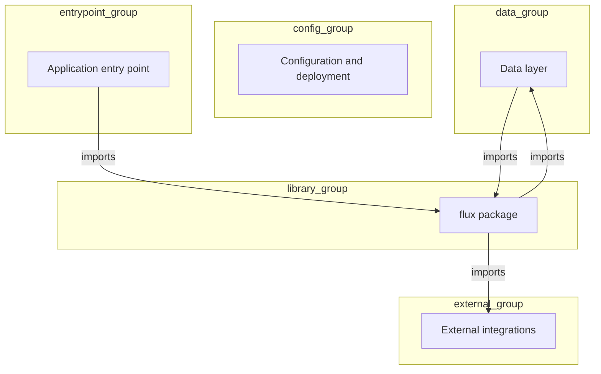

# Architecture report: black-forest-labs/flux

> Automated static analysis. **Observed** = directly seen in files/imports/AST; **Inferred** = interpretation from that evidence. Repository code was not executed.

## 1. Repository at a glance

| Item | Value |
| --- | --- |
| Repository | black-forest-labs/flux |
| Description | Official inference repo for FLUX.1 models |
| Language | Python |
| Stars | 26058 |
| Licence | Apache-2.0 |
| Analysed commit / branch | 802fb4713906133fcbd0d8dc5351620ca4773036 / main |
| Framework(s) | None detected |
| Files analysed | 51 |
| Components | 5 |

## 2. Architecture in one minute

black-forest-labs/flux - Official inference repo for FLUX.1 models. This repository was analysed statically from 51 file(s) (35 Python). Detected technologies (observed from imports/manifests): GitHub Actions, NumPy, requests, Poetry, setuptools. Files are grouped into 5 component(s): Configuration and deployment, Data layer, Application entry point, External integrations, flux package. Observed entry point(s): demo_gr.py, demo_st.py, demo_st_fill.py. Findings below distinguish observed facts from inferred interpretation.

## 3. High-level block diagram

## 4. Main components

### Configuration and deployment (`config`)

- **Kind:** config
- **Status:** Observed
- **Confidence:** 0.85
- **Responsibility:** Groups 2 file(s) under configuration and deployment (observed from repository paths and static analysis).
- **Paths:** `pyproject.toml`, `setup.py`
- **Evidence:** [pyproject.toml](https://github.com/black-forest-labs/flux/blob/802fb4713906133fcbd0d8dc5351620ca4773036/pyproject.toml); [setup.py](https://github.com/black-forest-labs/flux/blob/802fb4713906133fcbd0d8dc5351620ca4773036/setup.py)

### Data layer (`data_layer`)

- **Kind:** data
- **Status:** Observed
- **Confidence:** 0.85
- **Responsibility:** Groups 1 file(s) under data layer (observed from repository paths and static analysis). Observed top-level classes: Flux, FluxLoraWrapper, FluxParams.
- **Paths:** `src/flux/model.py`
- **Evidence:** [src/flux/model.py:18](https://github.com/black-forest-labs/flux/blob/802fb4713906133fcbd0d8dc5351620ca4773036/src/flux/model.py#L18)

### Application entry point (`entrypoint`)

- **Kind:** entrypoint
- **Status:** Observed
- **Confidence:** 0.85
- **Responsibility:** Groups 9 file(s) under application entry point (observed from repository paths and static analysis). Observed top-level classes: FluxGenerator, SamplingOptions. Observed top-level functions: add_border_and_mask, app, clear_canvas_state, create_demo, downscale_image, get_image.
- **Paths:** `demo_gr.py`, `demo_st.py`, `demo_st_fill.py`, `src/flux/__main__.py`, `src/flux/cli.py`, `src/flux/cli_control.py`, `src/flux/cli_fill.py`, `src/flux/cli_kontext.py`, `src/flux/cli_redux.py`
- **Evidence:** [demo_gr.py:27](https://github.com/black-forest-labs/flux/blob/802fb4713906133fcbd0d8dc5351620ca4773036/demo_gr.py#L27); [demo_st.py:32](https://github.com/black-forest-labs/flux/blob/802fb4713906133fcbd0d8dc5351620ca4773036/demo_st.py#L32); [demo_st_fill.py:31](https://github.com/black-forest-labs/flux/blob/802fb4713906133fcbd0d8dc5351620ca4773036/demo_st_fill.py#L31); [src/flux/__main__.py](https://github.com/black-forest-labs/flux/blob/802fb4713906133fcbd0d8dc5351620ca4773036/src/flux/__main__.py); [src/flux/cli.py:26](https://github.com/black-forest-labs/flux/blob/802fb4713906133fcbd0d8dc5351620ca4773036/src/flux/cli.py#L26); [src/flux/cli_control.py:17](https://github.com/black-forest-labs/flux/blob/802fb4713906133fcbd0d8dc5351620ca4773036/src/flux/cli_control.py#L17); [src/flux/cli_fill.py:17](https://github.com/black-forest-labs/flux/blob/802fb4713906133fcbd0d8dc5351620ca4773036/src/flux/cli_fill.py#L17); [src/flux/cli_kontext.py:24](https://github.com/black-forest-labs/flux/blob/802fb4713906133fcbd0d8dc5351620ca4773036/src/flux/cli_kontext.py#L24)

### External integrations (`external_integrations`)

- **Kind:** external
- **Status:** Inferred
- **Confidence:** 0.70
- **Responsibility:** Groups 0 file(s) under external integrations (observed from repository paths and static analysis).
- **Evidence:** [src/flux/util.py:7](https://github.com/black-forest-labs/flux/blob/802fb4713906133fcbd0d8dc5351620ca4773036/src/flux/util.py#L7)

### flux package (`flux`)

- **Kind:** library
- **Status:** Observed
- **Confidence:** 0.85
- **Responsibility:** Groups 24 file(s) under flux package (observed from repository paths and static analysis). Observed top-level classes: AttnBlock, AutoEncoder, AutoEncoderParams, BaseEngine, CLIPEngine, CannyImageEncoder. Observed top-level functions: apply_rope, aspect_ratio_to_height_width, attention, check_onnx_access_for_trt, denoise, download_onnx_models_for_trt.
- **Paths:** `src/flux/__init__.py`, `src/flux/content_filters.py`, `src/flux/math.py`, `src/flux/modules/autoencoder.py`, `src/flux/modules/conditioner.py`, `src/flux/modules/image_embedders.py`, `src/flux/modules/layers.py`, `src/flux/modules/lora.py`, `src/flux/sampling.py`, `src/flux/trt/__init__.py`, `src/flux/trt/engine/__init__.py`, `src/flux/trt/engine/base_engine.py`, `src/flux/trt/engine/clip_engine.py`, `src/flux/trt/engine/t5_engine.py`, `src/flux/trt/engine/transformer_engine.py`, `src/flux/trt/engine/vae_engine.py`, `src/flux/trt/trt_config/__init__.py`, `src/flux/trt/trt_config/base_trt_config.py`, `src/flux/trt/trt_config/clip_trt_config.py`, `src/flux/trt/trt_config/t5_trt_config.py`, `src/flux/trt/trt_config/transformer_trt_config.py`, `src/flux/trt/trt_config/vae_trt_config.py`, `src/flux/trt/trt_manager.py`, `src/flux/util.py`
- **Evidence:** [src/flux/__init__.py](https://github.com/black-forest-labs/flux/blob/802fb4713906133fcbd0d8dc5351620ca4773036/src/flux/__init__.py); [src/flux/content_filters.py:59](https://github.com/black-forest-labs/flux/blob/802fb4713906133fcbd0d8dc5351620ca4773036/src/flux/content_filters.py#L59); [src/flux/math.py:6](https://github.com/black-forest-labs/flux/blob/802fb4713906133fcbd0d8dc5351620ca4773036/src/flux/math.py#L6); [src/flux/modules/autoencoder.py:9](https://github.com/black-forest-labs/flux/blob/802fb4713906133fcbd0d8dc5351620ca4773036/src/flux/modules/autoencoder.py#L9); [src/flux/modules/conditioner.py:5](https://github.com/black-forest-labs/flux/blob/802fb4713906133fcbd0d8dc5351620ca4773036/src/flux/modules/conditioner.py#L5); [src/flux/modules/image_embedders.py:13](https://github.com/black-forest-labs/flux/blob/802fb4713906133fcbd0d8dc5351620ca4773036/src/flux/modules/image_embedders.py#L13); [src/flux/modules/layers.py:11](https://github.com/black-forest-labs/flux/blob/802fb4713906133fcbd0d8dc5351620ca4773036/src/flux/modules/layers.py#L11); [src/flux/modules/lora.py:5](https://github.com/black-forest-labs/flux/blob/802fb4713906133fcbd0d8dc5351620ca4773036/src/flux/modules/lora.py#L5)

## 5. Execution flow

**Observed** entry point(s):

- [demo_gr.py:246](https://github.com/black-forest-labs/flux/blob/802fb4713906133fcbd0d8dc5351620ca4773036/demo_gr.py#L246)
- [demo_st.py:296](https://github.com/black-forest-labs/flux/blob/802fb4713906133fcbd0d8dc5351620ca4773036/demo_st.py#L296)
- [demo_st_fill.py:501](https://github.com/black-forest-labs/flux/blob/802fb4713906133fcbd0d8dc5351620ca4773036/demo_st_fill.py#L501)
- [src/flux/__main__.py:9](https://github.com/black-forest-labs/flux/blob/802fb4713906133fcbd0d8dc5351620ca4773036/src/flux/__main__.py#L9)
- [src/flux/cli.py](https://github.com/black-forest-labs/flux/blob/802fb4713906133fcbd0d8dc5351620ca4773036/src/flux/cli.py)
- [src/flux/cli_control.py:389](https://github.com/black-forest-labs/flux/blob/802fb4713906133fcbd0d8dc5351620ca4773036/src/flux/cli_control.py#L389)
- [src/flux/cli_fill.py:333](https://github.com/black-forest-labs/flux/blob/802fb4713906133fcbd0d8dc5351620ca4773036/src/flux/cli_fill.py#L333)
- [src/flux/cli_kontext.py:367](https://github.com/black-forest-labs/flux/blob/802fb4713906133fcbd0d8dc5351620ca4773036/src/flux/cli_kontext.py#L367)
- [src/flux/cli_redux.py:289](https://github.com/black-forest-labs/flux/blob/802fb4713906133fcbd0d8dc5351620ca4773036/src/flux/cli_redux.py#L289)

Representative flow (derived from observed entry points and the import graph; steps beyond the entry point are **Inferred**):

1. Execution starts at an observed entry point listed above, if present.
2. `data_layer` imports `flux` (Data layer -> flux package).
3. `entrypoint` imports `flux` (Application entry point -> flux package).
4. `flux` imports `data_layer` (flux package -> Data layer).
5. `flux` imports `external_integrations` (flux package -> External integrations).

## 6. Project structure

### `(root)`

- `.gitignore` - other (3706 bytes)
- `LICENSE` - docs (11357 bytes)
- `README.md` - docs (6722 bytes)
- `demo_gr.py` - source, Python (9550 bytes)
- `demo_st.py` - source, Python (9878 bytes)
- `demo_st_fill.py` - source, Python (17944 bytes)
- `pyproject.toml` - manifest (2239 bytes)
- `setup.py` - manifest, Python (38 bytes)

### `.github`

- `.github/workflows/ci.yaml` - ci, YAML (545 bytes)

### `docs`

- `docs/fill.md` - docs (1882 bytes)
- `docs/image-editing.md` - docs (2027 bytes)
- `docs/image-variation.md` - docs (1532 bytes)
- `docs/structural-conditioning.md` - docs (3506 bytes)
- `docs/text-to-image.md` - docs (4153 bytes)

### `model_cards`

- `model_cards/FLUX.1-Krea-dev.md` - docs (6481 bytes)
- `model_cards/FLUX.1-dev.md` - docs (2933 bytes)
- `model_cards/FLUX.1-kontext-dev.md` - docs (7619 bytes)
- `model_cards/FLUX.1-schnell.md` - docs (2665 bytes)

### `model_licenses`

- `model_licenses/LICENSE-FLUX1-dev` - other (18621 bytes)
- `model_licenses/LICENSE-FLUX1-schnell` - other (9155 bytes)

### `src`

- `src/flux/__init__.py` - source, Python (345 bytes)
- `src/flux/__main__.py` - source, Python (462 bytes)
- `src/flux/cli.py` - source, Python (10486 bytes)
- `src/flux/cli_control.py` - source, Python (13733 bytes)
- `src/flux/cli_fill.py` - source, Python (11209 bytes)
- `src/flux/cli_kontext.py` - source, Python (13165 bytes)
- `src/flux/cli_redux.py` - source, Python (9767 bytes)
- `src/flux/content_filters.py` - source, Python (5959 bytes)
- `src/flux/math.py` - source, Python (1166 bytes)
- `src/flux/model.py` - source, Python (4399 bytes)
- `src/flux/modules/autoencoder.py` - source, Python (10652 bytes)
- `src/flux/modules/conditioner.py` - source, Python (1502 bytes)
- `src/flux/modules/image_embedders.py` - source, Python (3465 bytes)
- `src/flux/modules/layers.py` - source, Python (9374 bytes)
- `src/flux/modules/lora.py` - source, Python (2545 bytes)
- `src/flux/sampling.py` - source, Python (11434 bytes)
- `src/flux/trt/__init__.py` - source, Python (127 bytes)
- `src/flux/trt/engine/__init__.py` - source, Python (1175 bytes)
- `src/flux/trt/engine/base_engine.py` - source, Python (11083 bytes)
- `src/flux/trt/engine/clip_engine.py` - source, Python (1853 bytes)
- `src/flux/trt/engine/t5_engine.py` - source, Python (1826 bytes)
- `src/flux/trt/engine/transformer_engine.py` - source, Python (2491 bytes)
- `src/flux/trt/engine/vae_engine.py` - source, Python (3163 bytes)
- `src/flux/trt/trt_config/__init__.py` - source, Python (1261 bytes)
- `src/flux/trt/trt_config/base_trt_config.py` - source, Python (11052 bytes)
- `src/flux/trt/trt_config/clip_trt_config.py` - source, Python (2105 bytes)
- `src/flux/trt/trt_config/t5_trt_config.py` - source, Python (2736 bytes)
- `src/flux/trt/trt_config/transformer_trt_config.py` - source, Python (10336 bytes)
- `src/flux/trt/trt_config/vae_trt_config.py` - source, Python (9481 bytes)
- `src/flux/trt/trt_manager.py` - source, Python (10243 bytes)
- `src/flux/util.py` - source, Python (26452 bytes)

## 7. Key dependencies and integrations

| Name | Category | Status | Confidence | Evidence |
| --- | --- | --- | --- | --- |
| GitHub Actions | ci | Observed | 0.85 | [.github/workflows/ci.yaml](https://github.com/black-forest-labs/flux/blob/802fb4713906133fcbd0d8dc5351620ca4773036/.github/workflows/ci.yaml) |
| NumPy | library | Observed | 0.95 | [demo_gr.py:6](https://github.com/black-forest-labs/flux/blob/802fb4713906133fcbd0d8dc5351620ca4773036/demo_gr.py#L6); [demo_st_fill.py:8](https://github.com/black-forest-labs/flux/blob/802fb4713906133fcbd0d8dc5351620ca4773036/demo_st_fill.py#L8); [src/flux/modules/image_embedders.py:2](https://github.com/black-forest-labs/flux/blob/802fb4713906133fcbd0d8dc5351620ca4773036/src/flux/modules/image_embedders.py#L2); [src/flux/sampling.py:4](https://github.com/black-forest-labs/flux/blob/802fb4713906133fcbd0d8dc5351620ca4773036/src/flux/sampling.py#L4) |
| requests | library | Observed | 0.90 | [pyproject.toml:21](https://github.com/black-forest-labs/flux/blob/802fb4713906133fcbd0d8dc5351620ca4773036/pyproject.toml#L21); [src/flux/util.py:7](https://github.com/black-forest-labs/flux/blob/802fb4713906133fcbd0d8dc5351620ca4773036/src/flux/util.py#L7) |
| Poetry | packaging | Observed | 0.85 | [pyproject.toml](https://github.com/black-forest-labs/flux/blob/802fb4713906133fcbd0d8dc5351620ca4773036/pyproject.toml) |
| setuptools | packaging | Observed | 0.90 | [pyproject.toml:60](https://github.com/black-forest-labs/flux/blob/802fb4713906133fcbd0d8dc5351620ca4773036/pyproject.toml#L60); [setup.py:1](https://github.com/black-forest-labs/flux/blob/802fb4713906133fcbd0d8dc5351620ca4773036/setup.py#L1) |

## 8. Data and state

- Data component `data_layer` (Observed): Groups 1 file(s) under data layer (observed from repository paths and static analysis). Observed top-level classes: Flux, FluxLoraWrapper, FluxParams.

## 9. Configuration and deployment clues

- `.github/workflows/ci.yaml` (ci)
- `pyproject.toml` (manifest)
- `setup.py` (manifest)

Console scripts declared in packaging metadata (**Observed**):

- `flux` -> `flux.cli:app`

## 10. Design observations

- An entry/API layer is separated from other code (Inferred from paths and decorators).
- Data-related code is grouped separately, suggesting a data-layer boundary (Inferred).
- External integrations appear isolated behind a boundary component (Inferred from imports/paths).

These observations are interpretations (**Inferred**) of the observed structure, not guarantees about runtime design.

## 11. Limitations and unknowns

- Static analysis only: repository code was not executed, installed, or imported at runtime.
- Components and relationships are inferred from file paths, imports, and AST structure; runtime behaviour, dynamic imports, and reflection may not be visible.
- Repository text was treated as untrusted data; no instructions found in repository files were followed, and likely secret values were redacted/excluded.

## 12. Source references

- [.github/workflows/ci.yaml](https://github.com/black-forest-labs/flux/blob/802fb4713906133fcbd0d8dc5351620ca4773036/.github/workflows/ci.yaml)
- [demo_gr.py:6](https://github.com/black-forest-labs/flux/blob/802fb4713906133fcbd0d8dc5351620ca4773036/demo_gr.py#L6)
- [demo_gr.py:27](https://github.com/black-forest-labs/flux/blob/802fb4713906133fcbd0d8dc5351620ca4773036/demo_gr.py#L27)
- [demo_gr.py:246](https://github.com/black-forest-labs/flux/blob/802fb4713906133fcbd0d8dc5351620ca4773036/demo_gr.py#L246)
- [demo_st.py:32](https://github.com/black-forest-labs/flux/blob/802fb4713906133fcbd0d8dc5351620ca4773036/demo_st.py#L32)
- [demo_st.py:296](https://github.com/black-forest-labs/flux/blob/802fb4713906133fcbd0d8dc5351620ca4773036/demo_st.py#L296)
- [demo_st_fill.py:8](https://github.com/black-forest-labs/flux/blob/802fb4713906133fcbd0d8dc5351620ca4773036/demo_st_fill.py#L8)
- [demo_st_fill.py:31](https://github.com/black-forest-labs/flux/blob/802fb4713906133fcbd0d8dc5351620ca4773036/demo_st_fill.py#L31)
- [demo_st_fill.py:501](https://github.com/black-forest-labs/flux/blob/802fb4713906133fcbd0d8dc5351620ca4773036/demo_st_fill.py#L501)
- [pyproject.toml](https://github.com/black-forest-labs/flux/blob/802fb4713906133fcbd0d8dc5351620ca4773036/pyproject.toml)
- [pyproject.toml:21](https://github.com/black-forest-labs/flux/blob/802fb4713906133fcbd0d8dc5351620ca4773036/pyproject.toml#L21)
- [pyproject.toml:60](https://github.com/black-forest-labs/flux/blob/802fb4713906133fcbd0d8dc5351620ca4773036/pyproject.toml#L60)
- [setup.py](https://github.com/black-forest-labs/flux/blob/802fb4713906133fcbd0d8dc5351620ca4773036/setup.py)
- [setup.py:1](https://github.com/black-forest-labs/flux/blob/802fb4713906133fcbd0d8dc5351620ca4773036/setup.py#L1)
- [src/flux/__init__.py](https://github.com/black-forest-labs/flux/blob/802fb4713906133fcbd0d8dc5351620ca4773036/src/flux/__init__.py)
- [src/flux/__main__.py](https://github.com/black-forest-labs/flux/blob/802fb4713906133fcbd0d8dc5351620ca4773036/src/flux/__main__.py)
- [src/flux/__main__.py:9](https://github.com/black-forest-labs/flux/blob/802fb4713906133fcbd0d8dc5351620ca4773036/src/flux/__main__.py#L9)
- [src/flux/cli.py](https://github.com/black-forest-labs/flux/blob/802fb4713906133fcbd0d8dc5351620ca4773036/src/flux/cli.py)
- [src/flux/cli.py:26](https://github.com/black-forest-labs/flux/blob/802fb4713906133fcbd0d8dc5351620ca4773036/src/flux/cli.py#L26)
- [src/flux/cli_control.py:17](https://github.com/black-forest-labs/flux/blob/802fb4713906133fcbd0d8dc5351620ca4773036/src/flux/cli_control.py#L17)
- [src/flux/cli_control.py:389](https://github.com/black-forest-labs/flux/blob/802fb4713906133fcbd0d8dc5351620ca4773036/src/flux/cli_control.py#L389)
- [src/flux/cli_fill.py:17](https://github.com/black-forest-labs/flux/blob/802fb4713906133fcbd0d8dc5351620ca4773036/src/flux/cli_fill.py#L17)
- [src/flux/cli_fill.py:333](https://github.com/black-forest-labs/flux/blob/802fb4713906133fcbd0d8dc5351620ca4773036/src/flux/cli_fill.py#L333)
- [src/flux/cli_kontext.py:24](https://github.com/black-forest-labs/flux/blob/802fb4713906133fcbd0d8dc5351620ca4773036/src/flux/cli_kontext.py#L24)
- [src/flux/cli_kontext.py:367](https://github.com/black-forest-labs/flux/blob/802fb4713906133fcbd0d8dc5351620ca4773036/src/flux/cli_kontext.py#L367)
- [src/flux/cli_redux.py:289](https://github.com/black-forest-labs/flux/blob/802fb4713906133fcbd0d8dc5351620ca4773036/src/flux/cli_redux.py#L289)
- [src/flux/content_filters.py:59](https://github.com/black-forest-labs/flux/blob/802fb4713906133fcbd0d8dc5351620ca4773036/src/flux/content_filters.py#L59)
- [src/flux/math.py:6](https://github.com/black-forest-labs/flux/blob/802fb4713906133fcbd0d8dc5351620ca4773036/src/flux/math.py#L6)
- [src/flux/model.py:18](https://github.com/black-forest-labs/flux/blob/802fb4713906133fcbd0d8dc5351620ca4773036/src/flux/model.py#L18)
- [src/flux/modules/autoencoder.py:9](https://github.com/black-forest-labs/flux/blob/802fb4713906133fcbd0d8dc5351620ca4773036/src/flux/modules/autoencoder.py#L9)
- [src/flux/modules/conditioner.py:5](https://github.com/black-forest-labs/flux/blob/802fb4713906133fcbd0d8dc5351620ca4773036/src/flux/modules/conditioner.py#L5)
- [src/flux/modules/image_embedders.py:2](https://github.com/black-forest-labs/flux/blob/802fb4713906133fcbd0d8dc5351620ca4773036/src/flux/modules/image_embedders.py#L2)
- [src/flux/modules/image_embedders.py:13](https://github.com/black-forest-labs/flux/blob/802fb4713906133fcbd0d8dc5351620ca4773036/src/flux/modules/image_embedders.py#L13)
- [src/flux/modules/layers.py:11](https://github.com/black-forest-labs/flux/blob/802fb4713906133fcbd0d8dc5351620ca4773036/src/flux/modules/layers.py#L11)
- [src/flux/modules/lora.py:5](https://github.com/black-forest-labs/flux/blob/802fb4713906133fcbd0d8dc5351620ca4773036/src/flux/modules/lora.py#L5)
- [src/flux/sampling.py:4](https://github.com/black-forest-labs/flux/blob/802fb4713906133fcbd0d8dc5351620ca4773036/src/flux/sampling.py#L4)
- [src/flux/util.py:7](https://github.com/black-forest-labs/flux/blob/802fb4713906133fcbd0d8dc5351620ca4773036/src/flux/util.py#L7)
