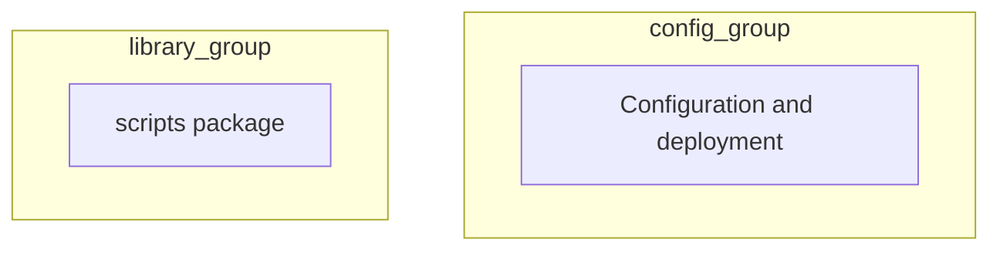

# Architecture report: blader/humanizer

> Automated static analysis. **Observed** = directly seen in files/imports/AST; **Inferred** = interpretation from that evidence. Repository code was not executed.

## 1. Repository at a glance

| Item | Value |
| --- | --- |
| Repository | blader/humanizer |
| Description | Agent skill that removes signs of AI-generated writing from text |
| Language | Python |
| Stars | 69103 |
| Licence | MIT |
| Analysed commit / branch | b48c832f0f809c1b5658edbb838c2521b72f2413 / main |
| Framework(s) | None detected |
| Files analysed | 15 |
| Components | 2 |

## 2. Architecture in one minute

blader/humanizer - Agent skill that removes signs of AI-generated writing from text. This repository was analysed statically from 15 file(s) (1 Python). Detected technologies (observed from imports/manifests): GitHub Actions. Files are grouped into 2 component(s): Configuration and deployment, scripts package. Findings below distinguish observed facts from inferred interpretation.

## 3. High-level block diagram

## 4. Main components

### Configuration and deployment (`config`)

- **Kind:** config
- **Status:** Observed
- **Confidence:** 0.85
- **Responsibility:** Groups 2 file(s) under configuration and deployment (observed from repository paths and static analysis).
- **Paths:** `agents/openai.yaml`, `package.json`
- **Evidence:** [agents/openai.yaml](https://github.com/blader/humanizer/blob/b48c832f0f809c1b5658edbb838c2521b72f2413/agents/openai.yaml); [package.json](https://github.com/blader/humanizer/blob/b48c832f0f809c1b5658edbb838c2521b72f2413/package.json)

### scripts package (`scripts`)

- **Kind:** library
- **Status:** Observed
- **Confidence:** 0.85
- **Responsibility:** Groups 1 file(s) under scripts package (observed from repository paths and static analysis). Observed top-level functions: read_package_file, require_match.
- **Paths:** `scripts/validate-package.py`
- **Evidence:** [scripts/validate-package.py:14](https://github.com/blader/humanizer/blob/b48c832f0f809c1b5658edbb838c2521b72f2413/scripts/validate-package.py#L14)

## 5. Execution flow

No entry point was observed; the startup flow below is therefore limited.

Representative flow (derived from observed entry points and the import graph; steps beyond the entry point are **Inferred**):

1. Execution starts at an observed entry point listed above, if present.
2. No internal import relationships between components were observed.

## 6. Project structure

### `(root)`

- `AGENTS.md` - docs (3616 bytes)
- `CHANGELOG.md` - docs (7600 bytes)
- `LICENSE` - docs (1066 bytes)
- `README.md` - docs (13157 bytes)
- `SKILL.md` - docs (32394 bytes)
- `package.json` - manifest (278 bytes)

### `.claude-plugin`

- `.claude-plugin/marketplace.json` - config (521 bytes)
- `.claude-plugin/plugin.json` - config (448 bytes)

### `.cursor-plugin`

- `.cursor-plugin/plugin.json` - config (388 bytes)

### `.github`

- `.github/ISSUE_TEMPLATE/config.yml` - config (393 bytes)
- `.github/ISSUE_TEMPLATE/new-pattern.yml` - config (681 bytes)
- `.github/ISSUE_TEMPLATE/rewrite-problem.yml` - config (1286 bytes)
- `.github/workflows/validate.yml` - ci, YAML (815 bytes)

### `agents`

- `agents/openai.yaml` - config (201 bytes)

### `scripts`

- `scripts/validate-package.py` - source, Python (5418 bytes)

## 7. Key dependencies and integrations

| Name | Category | Status | Confidence | Evidence |
| --- | --- | --- | --- | --- |
| GitHub Actions | ci | Observed | 0.85 | [.github/workflows/validate.yml](https://github.com/blader/humanizer/blob/b48c832f0f809c1b5658edbb838c2521b72f2413/.github/workflows/validate.yml) |

## 8. Data and state

No database, cache, queue, or persistent-state usage was observed in the analysed files. State handling, if any, may be in-memory or in files that were not analysed.

## 9. Configuration and deployment clues

- `.claude-plugin/marketplace.json` (config)
- `.claude-plugin/plugin.json` (config)
- `.cursor-plugin/plugin.json` (config)
- `.github/ISSUE_TEMPLATE/config.yml` (config)
- `.github/ISSUE_TEMPLATE/new-pattern.yml` (config)
- `.github/ISSUE_TEMPLATE/rewrite-problem.yml` (config)
- `.github/workflows/validate.yml` (ci)
- `agents/openai.yaml` (config)
- `package.json` (manifest)

## 10. Design observations

- No strong design patterns could be established from the available evidence.

These observations are interpretations (**Inferred**) of the observed structure, not guarantees about runtime design.

## 11. Limitations and unknowns

- Static analysis only: repository code was not executed, installed, or imported at runtime.
- Components and relationships are inferred from file paths, imports, and AST structure; runtime behaviour, dynamic imports, and reflection may not be visible.
- No clear application entry point was observed in the analysed files.
- Repository text was treated as untrusted data; no instructions found in repository files were followed, and likely secret values were redacted/excluded.

## 12. Source references

- [.github/workflows/validate.yml](https://github.com/blader/humanizer/blob/b48c832f0f809c1b5658edbb838c2521b72f2413/.github/workflows/validate.yml)
- [agents/openai.yaml](https://github.com/blader/humanizer/blob/b48c832f0f809c1b5658edbb838c2521b72f2413/agents/openai.yaml)
- [package.json](https://github.com/blader/humanizer/blob/b48c832f0f809c1b5658edbb838c2521b72f2413/package.json)
- [scripts/validate-package.py:14](https://github.com/blader/humanizer/blob/b48c832f0f809c1b5658edbb838c2521b72f2413/scripts/validate-package.py#L14)
