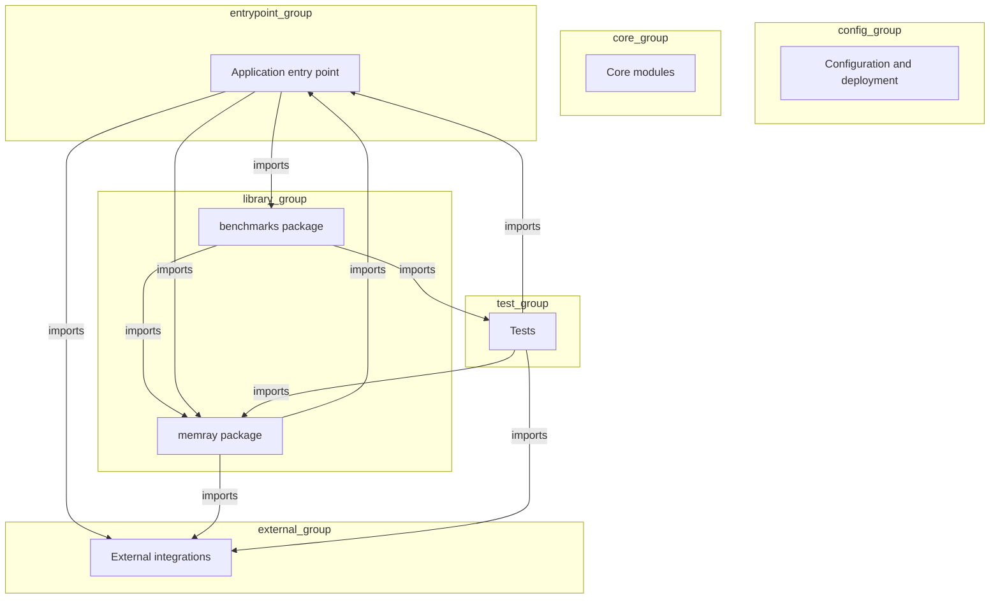

# Architecture report: bloomberg/memray

> Automated static analysis. **Observed** = directly seen in files/imports/AST; **Inferred** = interpretation from that evidence. Repository code was not executed.

## 1. Repository at a glance

| Item | Value |
| --- | --- |
| Repository | bloomberg/memray |
| Description | Memray is a memory profiler for Python |
| Language | Python |
| Stars | 15417 |
| Licence | Apache-2.0 |
| Analysed commit / branch | ec314a3288f5e00e0d45a84ce6bccf7a3140d069 / main |
| Framework(s) | None detected |
| Files analysed | 358 |
| Components | 7 |

## 2. Architecture in one minute

bloomberg/memray - Memray is a memory profiler for Python. This repository was analysed statically from 358 file(s) (151 Python). Detected technologies (observed from imports/manifests): GitHub Actions, SQLite, NumPy, Poetry, setuptools, Docker. Files are grouped into 7 component(s): benchmarks package, Configuration and deployment, Core modules, Application entry point, External integrations, memray package, Tests. Observed entry point(s): benchmarks/benchmarking/__main__.py, benchmarks/benchmarking/cases/async_tree_base.py, benchmarks/benchmarking/cases/async_tree_memray.py. Findings below distinguish observed facts from inferred interpretation.

## 3. High-level block diagram

## 4. Main components

### benchmarks package (`benchmarks`)

- **Kind:** library
- **Status:** Observed
- **Confidence:** 0.85
- **Responsibility:** Groups 5 file(s) under benchmarks package (observed from repository paths and static analysis). Observed top-level classes: AllocatorBenchmarks, FileSizeBenchmarks, HighWatermarkBenchmarks, MacroBenchmarksBase, MacroBenchmarksDefault, MacroBenchmarksPythonAll. Observed top-level functions: add_cmdline_args, bench_json_dumps, formatter, get_data, main, plot_diff.
- **Paths:** `benchmarks/__init__.py`, `benchmarks/benchmarking/cases/__init__.py`, `benchmarks/benchmarking/cases/json_dumps_base.py`, `benchmarks/benchmarking/plot.py`, `benchmarks/benchmarks.py`
- **Evidence:** [benchmarks/__init__.py](https://github.com/bloomberg/memray/blob/ec314a3288f5e00e0d45a84ce6bccf7a3140d069/benchmarks/__init__.py); [benchmarks/benchmarking/cases/__init__.py](https://github.com/bloomberg/memray/blob/ec314a3288f5e00e0d45a84ce6bccf7a3140d069/benchmarks/benchmarking/cases/__init__.py); [benchmarks/benchmarking/cases/json_dumps_base.py:28](https://github.com/bloomberg/memray/blob/ec314a3288f5e00e0d45a84ce6bccf7a3140d069/benchmarks/benchmarking/cases/json_dumps_base.py#L28); [benchmarks/benchmarking/plot.py:13](https://github.com/bloomberg/memray/blob/ec314a3288f5e00e0d45a84ce6bccf7a3140d069/benchmarks/benchmarking/plot.py#L13); [benchmarks/benchmarks.py:24](https://github.com/bloomberg/memray/blob/ec314a3288f5e00e0d45a84ce6bccf7a3140d069/benchmarks/benchmarks.py#L24)

### Configuration and deployment (`config`)

- **Kind:** config
- **Status:** Observed
- **Confidence:** 0.85
- **Responsibility:** Groups 5 file(s) under configuration and deployment (observed from repository paths and static analysis).
- **Paths:** `Dockerfile`, `asv.conf.json`, `benchmarks/requirements.txt`, `package.json`, `pyproject.toml`
- **Evidence:** [Dockerfile](https://github.com/bloomberg/memray/blob/ec314a3288f5e00e0d45a84ce6bccf7a3140d069/Dockerfile); [asv.conf.json](https://github.com/bloomberg/memray/blob/ec314a3288f5e00e0d45a84ce6bccf7a3140d069/asv.conf.json); [benchmarks/requirements.txt](https://github.com/bloomberg/memray/blob/ec314a3288f5e00e0d45a84ce6bccf7a3140d069/benchmarks/requirements.txt); [package.json](https://github.com/bloomberg/memray/blob/ec314a3288f5e00e0d45a84ce6bccf7a3140d069/package.json); [pyproject.toml](https://github.com/bloomberg/memray/blob/ec314a3288f5e00e0d45a84ce6bccf7a3140d069/pyproject.toml)

### Core modules (`core`)

- **Kind:** core
- **Status:** Observed
- **Confidence:** 0.85
- **Responsibility:** Groups 1 file(s) under core modules (observed from repository paths and static analysis).
- **Paths:** `webpack.config.js`
- **Evidence:** [webpack.config.js](https://github.com/bloomberg/memray/blob/ec314a3288f5e00e0d45a84ce6bccf7a3140d069/webpack.config.js)

### Application entry point (`entrypoint`)

- **Kind:** entrypoint
- **Status:** Observed
- **Confidence:** 0.85
- **Responsibility:** Groups 44 file(s) under application entry point (observed from repository paths and static analysis). Observed top-level classes: AsyncTree, AvgLength, Battle, BenchmarkResult, BinaryConstraint, Board. Observed top-level functions: _applyAction, _applyActionSide1, _child_process, _fannkuch, _get_free_port, _run_child_process_and_attach.
- **Paths:** `benchmarks/benchmarking/__main__.py`, `benchmarks/benchmarking/cases/async_tree_base.py`, `benchmarks/benchmarking/cases/async_tree_memray.py`, `benchmarks/benchmarking/cases/deltablue_base.py`, `benchmarks/benchmarking/cases/deltablue_memray.py`, `benchmarks/benchmarking/cases/docutils_html_base.py`, `benchmarks/benchmarking/cases/docutils_html_memray.py`, `benchmarks/benchmarking/cases/fannkuch_base.py`, `benchmarks/benchmarking/cases/fannkuch_memray.py`, `benchmarks/benchmarking/cases/go_base.py`, `benchmarks/benchmarking/cases/go_memray.py`, `benchmarks/benchmarking/cases/hexion_base.py`, `benchmarks/benchmarking/cases/hexion_memray.py`, `benchmarks/benchmarking/cases/json_dumps_memray.py`, `benchmarks/benchmarking/cases/json_loads_base.py`, `benchmarks/benchmarking/cases/json_loads_memray.py`, `benchmarks/benchmarking/cases/mdp_base.py`, `benchmarks/benchmarking/cases/mdp_memray.py`, `benchmarks/benchmarking/cases/meteor_context_base.py`, `benchmarks/benchmarking/cases/meteor_context_memray.py`, `benchmarks/benchmarking/cases/nbody_base.py`, `benchmarks/benchmarking/cases/nbody_memray.py`, `benchmarks/benchmarking/cases/nqueens_base.py`, `benchmarks/benchmarking/cases/nqueens_memray.py`, `benchmarks/benchmarking/cases/pickles_base.py`, `benchmarks/benchmarking/cases/pickles_memray.py`, `benchmarks/benchmarking/cases/pprint_format_base.py`, `benchmarks/benchmarking/cases/pprint_format_memray.py`, `benchmarks/benchmarking/cases/raytrace_base.py`, `benchmarks/benchmarking/cases/raytrace_memray.py`, `benchmarks/benchmarking/cases/regex_dna_base.py`, `benchmarks/benchmarking/cases/regex_dna_memray.py`, `benchmarks/benchmarking/cases/regex_effbot_base.py`, `benchmarks/benchmarking/cases/regex_effbot_memray.py`, `benchmarks/benchmarking/cases/regex_v8_base.py`, `benchmarks/benchmarking/cases/regex_v8_memray.py`, `benchmarks/benchmarking/cases/spectral_norm_base.py`, `benchmarks/benchmarking/cases/spectral_norm_memray.py`, `benchmarks/benchmarking/cases/sqlite_synth_base.py`, `benchmarks/benchmarking/cases/sqlite_synth_memray.py`, `benchmarks/benchmarking/cases/telco_base.py`, `benchmarks/benchmarking/cases/telco_memray.py`, `src/memray/__main__.py`, `src/memray/commands/run.py`
- **Evidence:** [benchmarks/benchmarking/__main__.py:18](https://github.com/bloomberg/memray/blob/ec314a3288f5e00e0d45a84ce6bccf7a3140d069/benchmarks/benchmarking/__main__.py#L18); [benchmarks/benchmarking/cases/async_tree_base.py:30](https://github.com/bloomberg/memray/blob/ec314a3288f5e00e0d45a84ce6bccf7a3140d069/benchmarks/benchmarking/cases/async_tree_base.py#L30); [benchmarks/benchmarking/cases/async_tree_memray.py:34](https://github.com/bloomberg/memray/blob/ec314a3288f5e00e0d45a84ce6bccf7a3140d069/benchmarks/benchmarking/cases/async_tree_memray.py#L34); [benchmarks/benchmarking/cases/deltablue_base.py:23](https://github.com/bloomberg/memray/blob/ec314a3288f5e00e0d45a84ce6bccf7a3140d069/benchmarks/benchmarking/cases/deltablue_base.py#L23); [benchmarks/benchmarking/cases/deltablue_memray.py:26](https://github.com/bloomberg/memray/blob/ec314a3288f5e00e0d45a84ce6bccf7a3140d069/benchmarks/benchmarking/cases/deltablue_memray.py#L26); [benchmarks/benchmarking/cases/docutils_html_base.py:25](https://github.com/bloomberg/memray/blob/ec314a3288f5e00e0d45a84ce6bccf7a3140d069/benchmarks/benchmarking/cases/docutils_html_base.py#L25); [benchmarks/benchmarking/cases/docutils_html_memray.py:20](https://github.com/bloomberg/memray/blob/ec314a3288f5e00e0d45a84ce6bccf7a3140d069/benchmarks/benchmarking/cases/docutils_html_memray.py#L20); [benchmarks/benchmarking/cases/fannkuch_base.py:11](https://github.com/bloomberg/memray/blob/ec314a3288f5e00e0d45a84ce6bccf7a3140d069/benchmarks/benchmarking/cases/fannkuch_base.py#L11)

### External integrations (`external_integrations`)

- **Kind:** external
- **Status:** Inferred
- **Confidence:** 0.70
- **Responsibility:** Groups 0 file(s) under external integrations (observed from repository paths and static analysis).
- **Evidence:** [benchmarks/benchmarking/cases/sqlite_synth_base.py:9](https://github.com/bloomberg/memray/blob/ec314a3288f5e00e0d45a84ce6bccf7a3140d069/benchmarks/benchmarking/cases/sqlite_synth_base.py#L9); [benchmarks/benchmarking/cases/sqlite_synth_memray.py:9](https://github.com/bloomberg/memray/blob/ec314a3288f5e00e0d45a84ce6bccf7a3140d069/benchmarks/benchmarking/cases/sqlite_synth_memray.py#L9); [docs/examples/sqlite/example.py:2](https://github.com/bloomberg/memray/blob/ec314a3288f5e00e0d45a84ce6bccf7a3140d069/docs/examples/sqlite/example.py#L2); [src/memray/commands/attach.py:11](https://github.com/bloomberg/memray/blob/ec314a3288f5e00e0d45a84ce6bccf7a3140d069/src/memray/commands/attach.py#L11); [src/memray/commands/run.py:7](https://github.com/bloomberg/memray/blob/ec314a3288f5e00e0d45a84ce6bccf7a3140d069/src/memray/commands/run.py#L7); [tests/conftest.py:1](https://github.com/bloomberg/memray/blob/ec314a3288f5e00e0d45a84ce6bccf7a3140d069/tests/conftest.py#L1)

### memray package (`memray`)

- **Kind:** library
- **Status:** Observed
- **Confidence:** 0.85
- **Responsibility:** Groups 81 file(s) under memray package (observed from repository paths and static analysis). Observed top-level classes: AllocationEntry, AllocationTable, AttachCommand, BaseReporter, Destination, DetachCommand. Observed top-level functions: _add_compression_args, _add_debugger_args, _add_high_watermark_args, _add_temporary_allocation_args, _add_tracking_args, _display_iframe.
- **Paths:** `src/memray/__init__.py`, `src/memray/_destination.py`, `src/memray/_errors.py`, `src/memray/_ipython/__init__.py`, `src/memray/_ipython/flamegraph.py`, `src/memray/_memray/alloc.h`, `src/memray/_memray/compat.cpp`, `src/memray/_memray/compat.h`, `src/memray/_memray/elf_shenanigans.cpp`, `src/memray/_memray/elf_utils.h`, `src/memray/_memray/exceptions.h`, `src/memray/_memray/frame_tree.h`, `src/memray/_memray/hooks.cpp`, `src/memray/_memray/hooks.h`, `src/memray/_memray/inject.cpp`, `src/memray/_memray/linker_shenanigans.h`, `src/memray/_memray/logging.cpp`, `src/memray/_memray/logging.h`, `src/memray/_memray/lz4_stream.h`, `src/memray/_memray/macho_shenanigans.cpp`, `src/memray/_memray/macho_utils.h`, `src/memray/_memray/native_resolver.cpp`, `src/memray/_memray/native_resolver.h`, `src/memray/_memray/python_helpers.cpp`, `src/memray/_memray/python_helpers.h`, `src/memray/_memray/record_reader.cpp`, `src/memray/_memray/record_reader.h`, `src/memray/_memray/record_writer.cpp`, `src/memray/_memray/record_writer.h`, `src/memray/_memray/records.cpp`, `src/memray/_memray/records.h`, `src/memray/_memray/sink.cpp`, `src/memray/_memray/sink.h`, `src/memray/_memray/snapshot.cpp`, `src/memray/_memray/snapshot.h`, `src/memray/_memray/socket_reader_thread.cpp`, `src/memray/_memray/socket_reader_thread.h`, `src/memray/_memray/source.cpp`, `src/memray/_memray/source.h`, `src/memray/_memray/tracking_api.cpp`, `src/memray/_memray/tracking_api.h`, `src/memray/_metadata.py`, `src/memray/_stats.py`, `src/memray/_thread_name_interceptor.py`, `src/memray/_version.py`, `src/memray/commands/__init__.py`, `src/memray/commands/_parse_args.py`, `src/memray/commands/attach.py`, `src/memray/commands/common.py`, `src/memray/commands/flamegraph.py`, `src/memray/commands/live.py`, `src/memray/commands/parse.py`, `src/memray/commands/stats.py`, `src/memray/commands/summary.py`, `src/memray/commands/table.py`, `src/memray/commands/transform.py`, `src/memray/commands/tree.py`, `src/memray/reporters/__init__.py`, `src/memray/reporters/_textual_hacks.py`, `src/memray/reporters/assets/__init__.py`, `src/memray/reporters/assets/common.js`, `src/memray/reporters/assets/common.test.js`, `src/memray/reporters/assets/flamegraph.js`, `src/memray/reporters/assets/flamegraph_common.js`, `src/memray/reporters/assets/table.js`, `src/memray/reporters/assets/temporal_flamegraph.js`, `src/memray/reporters/common.py`, `src/memray/reporters/flamegraph.py`, `src/memray/reporters/frame_tools.py`, `src/memray/reporters/module_tools.py`, `src/memray/reporters/stats.py`, `src/memray/reporters/summary.py`, `src/memray/reporters/table.py`, `src/memray/reporters/templates/__init__.py`, `src/memray/reporters/templates/assets/flamegraph.js`, `src/memray/reporters/templates/assets/flamegraph_common.js`, `src/memray/reporters/templates/assets/table.js`, `src/memray/reporters/templates/assets/temporal_flamegraph.js`, `src/memray/reporters/transform.py`, `src/memray/reporters/tree.py`, `src/memray/reporters/tui.py`
- **Evidence:** [src/memray/__init__.py](https://github.com/bloomberg/memray/blob/ec314a3288f5e00e0d45a84ce6bccf7a3140d069/src/memray/__init__.py); [src/memray/_destination.py:7](https://github.com/bloomberg/memray/blob/ec314a3288f5e00e0d45a84ce6bccf7a3140d069/src/memray/_destination.py#L7); [src/memray/_errors.py:4](https://github.com/bloomberg/memray/blob/ec314a3288f5e00e0d45a84ce6bccf7a3140d069/src/memray/_errors.py#L4); [src/memray/_ipython/__init__.py:4](https://github.com/bloomberg/memray/blob/ec314a3288f5e00e0d45a84ce6bccf7a3140d069/src/memray/_ipython/__init__.py#L4); [src/memray/_ipython/flamegraph.py:40](https://github.com/bloomberg/memray/blob/ec314a3288f5e00e0d45a84ce6bccf7a3140d069/src/memray/_ipython/flamegraph.py#L40); [src/memray/_memray/alloc.h](https://github.com/bloomberg/memray/blob/ec314a3288f5e00e0d45a84ce6bccf7a3140d069/src/memray/_memray/alloc.h); [src/memray/_memray/compat.cpp](https://github.com/bloomberg/memray/blob/ec314a3288f5e00e0d45a84ce6bccf7a3140d069/src/memray/_memray/compat.cpp); [src/memray/_memray/compat.h](https://github.com/bloomberg/memray/blob/ec314a3288f5e00e0d45a84ce6bccf7a3140d069/src/memray/_memray/compat.h)

### Tests (`tests`)

- **Kind:** test
- **Status:** Observed
- **Confidence:** 0.85
- **Responsibility:** Groups 77 file(s) under tests (observed from repository paths and static analysis). Observed routes: PATCH memray.commands.run.os.getpid, PATCH memray.commands.run.subprocess.Popen, PATCH memray.commands.live.LiveCommand, PATCH memray.commands.run.subprocess.Popen, PATCH memray.commands.live.LiveCommand. Observed top-level classes: Contribution, FakeDatetime, Location, MemoryAllocator, MockAllocationRecord, MockApp. Observed top-level functions: _generate_mock_allocations, _memray_frame_path, _snapshot_skip_reason, _wait_until_process_blocks, alloc_func1, alloc_func2.
- **Paths:** `docs/tutorials/tests/__init__.py`, `docs/tutorials/tests/test_exercise_1.py`, `docs/tutorials/tests/test_exercise_2.py`, `docs/tutorials/tests/test_exercise_3.py`, `src/memray/_test.py`, `tests/__init__.py`, `tests/conftest.py`, `tests/integration/__init__.py`, `tests/integration/misbehaving_extension/__init__.py`, `tests/integration/misbehaving_extension/misbehaving.cpp`, `tests/integration/misbehaving_extension/setup.py`, `tests/integration/multithreaded_extension/__init__.py`, `tests/integration/multithreaded_extension/main.py`, `tests/integration/multithreaded_extension/setup.py`, `tests/integration/multithreaded_extension/testext.cpp`, `tests/integration/native_extension/main.py`, `tests/integration/native_extension/native_ext.c`, `tests/integration/native_extension/setup.py`, `tests/integration/rpath_extension/ext.c`, `tests/integration/rpath_extension/setup.py`, `tests/integration/rpath_extension/sharedlibs/sharedlib.c`, `tests/integration/test_api.py`, `tests/integration/test_attach.py`, `tests/integration/test_extensions.py`, `tests/integration/test_greenlet.py`, `tests/integration/test_ipython.py`, `tests/integration/test_main.py`, `tests/integration/test_native_tracking.py`, `tests/integration/test_object_tracking.py`, `tests/integration/test_processes.py`, `tests/integration/test_pyarrow.py`, `tests/integration/test_record_writer.py`, `tests/integration/test_socket.py`, `tests/integration/test_threads.py`, `tests/integration/test_tracing.py`, `tests/integration/test_tracking.py`, `tests/test_utils.py`, `tests/unit/__init__.py`, `tests/unit/__snapshots__/test_tree_reporter/TestTUILooks.test_basic.svg`, `tests/unit/__snapshots__/test_tree_reporter/TestTUILooks.test_basic_node_selected_leaf.svg`, `tests/unit/__snapshots__/test_tree_reporter/TestTUILooks.test_basic_node_selected_not_leaf.svg`, `tests/unit/__snapshots__/test_tree_reporter/TestTUILooks.test_biggest_allocations.svg`, `tests/unit/__snapshots__/test_tree_reporter/TestTUILooks.test_hide_import_system.svg`, `tests/unit/__snapshots__/test_tree_reporter/TestTUILooks.test_select_screen.svg`, `tests/unit/__snapshots__/test_tree_reporter/TestTUILooks.test_show_uninteresting.svg`, `tests/unit/__snapshots__/test_tree_reporter/TestTUILooks.test_show_uninteresting_and_hide_import_system.svg`, `tests/unit/__snapshots__/test_tree_reporter/TestTUILooks.test_two_chains.svg`, `tests/unit/__snapshots__/test_tree_reporter/TestTUILooks.test_two_chains_after_expanding_second.svg`, `tests/unit/__snapshots__/test_tui_reporter/test_merge_threads.svg`, `tests/unit/__snapshots__/test_tui_reporter/test_tui_basic[narrow-terminal-focus-header-long-snapshots].svg`, `tests/unit/__snapshots__/test_tui_reporter/test_tui_basic[narrow-terminal-short-snapshots].svg`, `tests/unit/__snapshots__/test_tui_reporter/test_tui_basic[very-wide-terminal-short-snapshots].svg`, `tests/unit/__snapshots__/test_tui_reporter/test_tui_basic[wide-terminal-long-snapshots].svg`, `tests/unit/__snapshots__/test_tui_reporter/test_tui_gradient.svg`, `tests/unit/__snapshots__/test_tui_reporter/test_tui_pause[narrow-terminal-connected].svg`, `tests/unit/__snapshots__/test_tui_reporter/test_tui_pause[narrow-terminal-disconnected].svg`, `tests/unit/__snapshots__/test_tui_reporter/test_tui_pause[wider-terminal].svg`, `tests/unit/__snapshots__/test_tui_reporter/test_unmerge_threads.svg`, `tests/unit/conftest.py`, `tests/unit/test_allocation_lifetime_aggregator.py`, `tests/unit/test_attach.py`, `tests/unit/test_cli.py`, `tests/unit/test_flamegraph_reporter.py`, `tests/unit/test_frame_tools.py`, `tests/unit/test_high_water_mark_aggregator.py`, `tests/unit/test_highwatermark_command.py`, `tests/unit/test_module_tools.py`, `tests/unit/test_reader.py`, `tests/unit/test_stats_reporter.py`, `tests/unit/test_summary_reporter.py`, `tests/unit/test_table_reporter.py`, `tests/unit/test_templates.py`, `tests/unit/test_tracker.py`, `tests/unit/test_transform_reporter.py`, `tests/unit/test_tree_reporter.py`, `tests/unit/test_tui_reporter.py`, `tests/utils.py`
- **Evidence:** [docs/tutorials/tests/__init__.py](https://github.com/bloomberg/memray/blob/ec314a3288f5e00e0d45a84ce6bccf7a3140d069/docs/tutorials/tests/__init__.py); [docs/tutorials/tests/test_exercise_1.py:8](https://github.com/bloomberg/memray/blob/ec314a3288f5e00e0d45a84ce6bccf7a3140d069/docs/tutorials/tests/test_exercise_1.py#L8); [docs/tutorials/tests/test_exercise_2.py:7](https://github.com/bloomberg/memray/blob/ec314a3288f5e00e0d45a84ce6bccf7a3140d069/docs/tutorials/tests/test_exercise_2.py#L7); [docs/tutorials/tests/test_exercise_3.py:12](https://github.com/bloomberg/memray/blob/ec314a3288f5e00e0d45a84ce6bccf7a3140d069/docs/tutorials/tests/test_exercise_3.py#L12); [src/memray/_test.py:18](https://github.com/bloomberg/memray/blob/ec314a3288f5e00e0d45a84ce6bccf7a3140d069/src/memray/_test.py#L18); [tests/__init__.py](https://github.com/bloomberg/memray/blob/ec314a3288f5e00e0d45a84ce6bccf7a3140d069/tests/__init__.py); [tests/conftest.py:14](https://github.com/bloomberg/memray/blob/ec314a3288f5e00e0d45a84ce6bccf7a3140d069/tests/conftest.py#L14); [tests/integration/__init__.py](https://github.com/bloomberg/memray/blob/ec314a3288f5e00e0d45a84ce6bccf7a3140d069/tests/integration/__init__.py)

## 5. Execution flow

**Observed** entry point(s):

- [benchmarks/benchmarking/__main__.py:186](https://github.com/bloomberg/memray/blob/ec314a3288f5e00e0d45a84ce6bccf7a3140d069/benchmarks/benchmarking/__main__.py#L186)
- [benchmarks/benchmarking/cases/async_tree_base.py:136](https://github.com/bloomberg/memray/blob/ec314a3288f5e00e0d45a84ce6bccf7a3140d069/benchmarks/benchmarking/cases/async_tree_base.py#L136)
- [benchmarks/benchmarking/cases/async_tree_memray.py:135](https://github.com/bloomberg/memray/blob/ec314a3288f5e00e0d45a84ce6bccf7a3140d069/benchmarks/benchmarking/cases/async_tree_memray.py#L135)
- [benchmarks/benchmarking/cases/deltablue_base.py:622](https://github.com/bloomberg/memray/blob/ec314a3288f5e00e0d45a84ce6bccf7a3140d069/benchmarks/benchmarking/cases/deltablue_base.py#L622)
- [benchmarks/benchmarking/cases/deltablue_memray.py:629](https://github.com/bloomberg/memray/blob/ec314a3288f5e00e0d45a84ce6bccf7a3140d069/benchmarks/benchmarking/cases/deltablue_memray.py#L629)
- [benchmarks/benchmarking/cases/docutils_html_base.py:58](https://github.com/bloomberg/memray/blob/ec314a3288f5e00e0d45a84ce6bccf7a3140d069/benchmarks/benchmarking/cases/docutils_html_base.py#L58)
- [benchmarks/benchmarking/cases/docutils_html_memray.py:53](https://github.com/bloomberg/memray/blob/ec314a3288f5e00e0d45a84ce6bccf7a3140d069/benchmarks/benchmarking/cases/docutils_html_memray.py#L53)
- [benchmarks/benchmarking/cases/fannkuch_base.py:53](https://github.com/bloomberg/memray/blob/ec314a3288f5e00e0d45a84ce6bccf7a3140d069/benchmarks/benchmarking/cases/fannkuch_base.py#L53)
- [benchmarks/benchmarking/cases/fannkuch_memray.py:57](https://github.com/bloomberg/memray/blob/ec314a3288f5e00e0d45a84ce6bccf7a3140d069/benchmarks/benchmarking/cases/fannkuch_memray.py#L57)
- [benchmarks/benchmarking/cases/go_base.py:462](https://github.com/bloomberg/memray/blob/ec314a3288f5e00e0d45a84ce6bccf7a3140d069/benchmarks/benchmarking/cases/go_base.py#L462)
- [benchmarks/benchmarking/cases/go_memray.py:463](https://github.com/bloomberg/memray/blob/ec314a3288f5e00e0d45a84ce6bccf7a3140d069/benchmarks/benchmarking/cases/go_memray.py#L463)
- [src/memray/__main__.py](https://github.com/bloomberg/memray/blob/ec314a3288f5e00e0d45a84ce6bccf7a3140d069/src/memray/__main__.py)

**Observed** routes (from decorators):

- `PATCH memray.commands.run.os.getpid` -> `test_run_file_exists` in `tests/integration/test_main.py:573`
- `PATCH memray.commands.run.subprocess.Popen` -> `test_run_with_live` in `tests/unit/test_cli.py:184`
- `PATCH memray.commands.live.LiveCommand` -> `test_run_with_live` in `tests/unit/test_cli.py:184`
- `PATCH memray.commands.run.subprocess.Popen` -> `test_run_with_live_and_trace_python_allocators` in `tests/unit/test_cli.py:216`
- `PATCH memray.commands.live.LiveCommand` -> `test_run_with_live_and_trace_python_allocators` in `tests/unit/test_cli.py:216`

Representative flow (derived from observed entry points and the import graph; steps beyond the entry point are **Inferred**):

1. Execution starts at an observed entry point listed above, if present.
2. `benchmarks` imports `memray` (benchmarks package -> memray package).
3. `benchmarks` imports `tests` (benchmarks package -> Tests).
4. `entrypoint` imports `benchmarks` (Application entry point -> benchmarks package).
5. `entrypoint` imports `external_integrations` (Application entry point -> External integrations).
6. `entrypoint` imports `memray` (Application entry point -> memray package).
7. `memray` imports `entrypoint` (memray package -> Application entry point).
8. `memray` imports `external_integrations` (memray package -> External integrations).
9. `tests` imports `entrypoint` (Tests -> Application entry point).

## 6. Project structure

### `(root)`

- `.babelrc` - other (39 bytes)
- `.bumpversion.cfg` - config (177 bytes)
- `.clang-format` - other (2801 bytes)
- `.gitignore` - other (2527 bytes)
- `.pre-commit-config.yaml` - config (2185 bytes)
- `CMakeLists.txt` - docs (7674 bytes)
- `CONTRIBUTING.md` - docs (6713 bytes)
- `Dockerfile` - container (1067 bytes)
- `KEYS` - other (9979 bytes)
- `LICENSE` - docs (11343 bytes)
- `Makefile` - other (7595 bytes)
- `NEWS.rst` - docs (33205 bytes)
- `README.md` - docs (17767 bytes)
- `asv.conf.json` - config (6844 bytes)
- `package.json` - manifest (749 bytes)
- `pyproject.toml` - manifest (7939 bytes)
- `valgrind.supp` - other (6980 bytes)
- `webpack.config.js` - source, JavaScript (2276 bytes)

### `.devcontainer`

- `.devcontainer/devcontainer.json` - config (228 bytes)
- `.devcontainer/tutorials/devcontainer.json` - config (558 bytes)

### `.github`

- `.github/ISSUE_TEMPLATE/---bug-report.yaml` - config (2149 bytes)
- `.github/ISSUE_TEMPLATE/---feature-request.yaml` - config (1155 bytes)
- `.github/ISSUE_TEMPLATE/config.yml` - config (185 bytes)
- `.github/dependabot.yml` - config (278 bytes)
- `.github/workflows/build.yml` - ci, YAML (3987 bytes)
- `.github/workflows/build_wheels.yml` - ci, YAML (7492 bytes)
- `.github/workflows/coverage.yml` - ci, YAML (2327 bytes)
- `.github/workflows/docs.yml` - ci, YAML (1341 bytes)
- `.github/workflows/news-check.yml` - ci, YAML (690 bytes)
- `.github/workflows/sanity-check.yml` - ci, YAML (642 bytes)
- `.github/workflows/test_uv_python.yml` - ci, YAML (1477 bytes)
- `.github/workflows/zizmor.yml` - ci, YAML (634 bytes)

### `benchmarks`

- `benchmarks/__init__.py` - source, Python (0 bytes)
- `benchmarks/benchmarking/__main__.py` - source, Python (6028 bytes)
- `benchmarks/benchmarking/cases/__init__.py` - source, Python (0 bytes)
- `benchmarks/benchmarking/cases/async_tree_base.py` - source, Python (4113 bytes)
- `benchmarks/benchmarking/cases/async_tree_memray.py` - source, Python (4325 bytes)
- `benchmarks/benchmarking/cases/deltablue_base.py` - source, Python (17016 bytes)
- `benchmarks/benchmarking/cases/deltablue_memray.py` - source, Python (17353 bytes)
- `benchmarks/benchmarking/cases/docutils_data/docs/api/publisher.txt` - docs (10569 bytes)
- `benchmarks/benchmarking/cases/docutils_data/docs/api/runtime-settings.txt` - docs (6216 bytes)
- `benchmarks/benchmarking/cases/docutils_data/docs/api/transforms.txt` - docs (6334 bytes)
- `benchmarks/benchmarking/cases/docutils_data/docs/dev/distributing.txt` - docs (4530 bytes)
- `benchmarks/benchmarking/cases/docutils_data/docs/dev/enthought-plan.txt` - docs (16986 bytes)
- `benchmarks/benchmarking/cases/docutils_data/docs/dev/enthought-rfp.txt` - docs (4531 bytes)
- `benchmarks/benchmarking/cases/docutils_data/docs/dev/hacking.txt` - docs (9172 bytes)
- `benchmarks/benchmarking/cases/docutils_data/docs/dev/policies.txt` - docs (25780 bytes)
- `benchmarks/benchmarking/cases/docutils_data/docs/dev/pysource.txt` - docs (4380 bytes)
- `benchmarks/benchmarking/cases/docutils_data/docs/dev/release.txt` - docs (3497 bytes)
- `benchmarks/benchmarking/cases/docutils_data/docs/dev/repository.txt` - docs (9439 bytes)
- `benchmarks/benchmarking/cases/docutils_data/docs/dev/rst/alternatives.txt` - docs (113263 bytes)
- `benchmarks/benchmarking/cases/docutils_data/docs/dev/rst/problems.txt` - docs (35463 bytes)
- `benchmarks/benchmarking/cases/docutils_data/docs/dev/runtime-settings-processing.txt` - docs (10664 bytes)
- `benchmarks/benchmarking/cases/docutils_data/docs/dev/semantics.txt` - docs (4511 bytes)
- `benchmarks/benchmarking/cases/docutils_data/docs/dev/testing.txt` - docs (9504 bytes)
- `benchmarks/benchmarking/cases/docutils_data/docs/dev/todo.txt` - docs (98603 bytes)
- `benchmarks/benchmarking/cases/docutils_data/docs/dev/website.txt` - docs (3274 bytes)
- `benchmarks/benchmarking/cases/docutils_data/docs/index.txt` - docs (8264 bytes)
- `benchmarks/benchmarking/cases/docutils_html_base.py` - source, Python (1508 bytes)
- `benchmarks/benchmarking/cases/docutils_html_memray.py` - source, Python (1764 bytes)
- `benchmarks/benchmarking/cases/fannkuch_base.py` - source, Python (1086 bytes)
- `benchmarks/benchmarking/cases/fannkuch_memray.py` - source, Python (1229 bytes)
- `benchmarks/benchmarking/cases/go_base.py` - source, Python (14052 bytes)
- `benchmarks/benchmarking/cases/go_memray.py` - source, Python (14375 bytes)
- `benchmarks/benchmarking/cases/hexion_base.py` - source, Python (16687 bytes)
- `benchmarks/benchmarking/cases/hexion_memray.py` - source, Python (17523 bytes)
- `benchmarks/benchmarking/cases/json_dumps_base.py` - source, Python (862 bytes)
- `benchmarks/benchmarking/cases/json_dumps_memray.py` - source, Python (1616 bytes)
- `benchmarks/benchmarking/cases/json_loads_base.py` - source, Python (2858 bytes)
- `benchmarks/benchmarking/cases/json_loads_memray.py` - source, Python (3325 bytes)
- `benchmarks/benchmarking/cases/mdp_base.py` - source, Python (8515 bytes)
- `benchmarks/benchmarking/cases/mdp_memray.py` - source, Python (8748 bytes)
- `benchmarks/benchmarking/cases/meteor_context_base.py` - source, Python (7933 bytes)
- `benchmarks/benchmarking/cases/meteor_context_memray.py` - source, Python (8263 bytes)
- `benchmarks/benchmarking/cases/nbody_base.py` - source, Python (4161 bytes)
- `benchmarks/benchmarking/cases/nbody_memray.py` - source, Python (4864 bytes)
- `benchmarks/benchmarking/cases/nqueens_base.py` - source, Python (1749 bytes)
- `benchmarks/benchmarking/cases/nqueens_memray.py` - source, Python (1952 bytes)
- `benchmarks/benchmarking/cases/pickles_base.py` - source, Python (7208 bytes)
- `benchmarks/benchmarking/cases/pickles_memray.py` - source, Python (8866 bytes)
- `benchmarks/benchmarking/cases/pprint_format_base.py` - source, Python (487 bytes)
- `benchmarks/benchmarking/cases/pprint_format_memray.py` - source, Python (839 bytes)
- `benchmarks/benchmarking/cases/raytrace_base.py` - source, Python (11094 bytes)
- `benchmarks/benchmarking/cases/raytrace_memray.py` - source, Python (12074 bytes)
- `benchmarks/benchmarking/cases/regex_dna_base.py` - source, Python (5387 bytes)
- `benchmarks/benchmarking/cases/regex_dna_memray.py` - source, Python (6740 bytes)
- `benchmarks/benchmarking/cases/regex_effbot_base.py` - source, Python (4677 bytes)
- `benchmarks/benchmarking/cases/regex_effbot_memray.py` - source, Python (5387 bytes)
- `benchmarks/benchmarking/cases/regex_v8_base.py` - source, Python (126726 bytes)
- `benchmarks/benchmarking/cases/regex_v8_memray.py` - source, Python (127063 bytes)
- `benchmarks/benchmarking/cases/spectral_norm_base.py` - source, Python (1458 bytes)
- `benchmarks/benchmarking/cases/spectral_norm_memray.py` - source, Python (1817 bytes)
- `benchmarks/benchmarking/cases/sqlite_synth_base.py` - source, Python (1187 bytes)
- `benchmarks/benchmarking/cases/sqlite_synth_memray.py` - source, Python (1495 bytes)
- `benchmarks/benchmarking/cases/telco_base.py` - source, Python (2885 bytes)
- `benchmarks/benchmarking/cases/telco_memray.py` - source, Python (3446 bytes)
- `benchmarks/benchmarking/plot.py` - source, Python (2924 bytes)
- `benchmarks/benchmarks.py` - source, Python (8253 bytes)
- `benchmarks/requirements.txt` - manifest (32 bytes)

### `docs`

- `docs/Makefile` - docs (899 bytes)
- `docs/_static/css/custom.css` - docs (7297 bytes)
- `docs/_static/flamegraphs/.gitattributes` - docs (13 bytes)
- `docs/_static/js/custom.js` - docs (610 bytes)
- `docs/_templates/index.html` - docs (22101 bytes)
- `docs/api.rst` - docs (2866 bytes)
- `docs/attach.rst` - docs (6610 bytes)
- `docs/conf.py` - docs (3085 bytes)
- `docs/examples/README.rst` - docs (1532 bytes)
- `docs/examples/fibonacci/fib.py` - docs (415 bytes)
- `docs/examples/mandelbrot/mandelbrot-threaded.py` - docs (1432 bytes)
- `docs/examples/mandelbrot/mandelbrot.py` - docs (1210 bytes)
- `docs/examples/mandelbrot/requirements.txt` - manifest (6 bytes)
- `docs/examples/nbody/example.py` - docs (4048 bytes)
- `docs/examples/nbody/requirements.txt` - manifest (14 bytes)
- `docs/examples/sqlite/example.py` - docs (1465 bytes)
- `docs/flamegraph.rst` - docs (19634 bytes)
- `docs/getting_started.rst` - docs (3285 bytes)
- `docs/index.rst` - docs (640 bytes)
- `docs/jupyter_magic.rst` - docs (1321 bytes)
- `docs/licenses.rst` - docs (24462 bytes)
- `docs/live.rst` - docs (5127 bytes)
- `docs/manpage.rst` - docs (2834 bytes)
- `docs/memory.rst` - docs (8431 bytes)
- `docs/native_mode.rst` - docs (10494 bytes)
- `docs/overview.rst` - docs (1447 bytes)
- `docs/performance.rst` - docs (4273 bytes)
- `docs/python_allocators.rst` - docs (6509 bytes)
- `docs/run.rst` - docs (12917 bytes)
- `docs/stats.rst` - docs (1873 bytes)
- `docs/summary.rst` - docs (1149 bytes)
- `docs/supported_environments.rst` - docs (3286 bytes)
- `docs/table.rst` - docs (1433 bytes)
- `docs/temporary_allocations.rst` - docs (5581 bytes)
- `docs/transform.rst` - docs (4625 bytes)
- `docs/tree.rst` - docs (2377 bytes)
- `docs/tutorials/1.rst` - docs (12147 bytes)
- `docs/tutorials/2.rst` - docs (4679 bytes)
- `docs/tutorials/3.rst` - docs (8410 bytes)
- `docs/tutorials/Dockerfile` - container (611 bytes)
- `docs/tutorials/additional_features.rst` - docs (1922 bytes)
- `docs/tutorials/exercise_1/__init__.py` - docs (0 bytes)
- `docs/tutorials/exercise_1/fibonacci.py` - docs (1090 bytes)
- `docs/tutorials/exercise_2/__init__.py` - docs (0 bytes)
- `docs/tutorials/exercise_2/holding_onto_memory.py` - docs (974 bytes)
- `docs/tutorials/exercise_3/__init__.py` - docs (0 bytes)
- `docs/tutorials/exercise_3/lru_cache.py` - docs (1088 bytes)
- `docs/tutorials/index.rst` - docs (724 bytes)
- `docs/tutorials/requirements-tutorial.txt` - manifest (41 bytes)
- `docs/tutorials/solutions/exercise_1/fibonacci.py` - docs (1083 bytes)
- `docs/tutorials/solutions/exercise_2/holding_onto_memory.py` - docs (1488 bytes)
- `docs/tutorials/solutions/exercise_3/lru_cache.py` - docs (1079 bytes)
- `docs/tutorials/tests/__init__.py` - test, Python (0 bytes)
- `docs/tutorials/tests/test_exercise_1.py` - test, Python (1346 bytes)
- `docs/tutorials/tests/test_exercise_2.py` - test, Python (257 bytes)
- `docs/tutorials/tests/test_exercise_3.py` - test, Python (1703 bytes)

### `news`

- `news/.gitignore` - other (12 bytes)
- `news/1000.bugfix.rst` - docs (189 bytes)
- `news/1014.bugfix.rst` - docs (105 bytes)
- `news/1020.bugfix.rst` - docs (103 bytes)
- `news/1032.bugfix.rst` - docs (181 bytes)
- `news/1033.bugfix.rst` - docs (67 bytes)
- `news/1035.feature.rst` - docs (135 bytes)
- `news/1050.bugfix.rst` - docs (131 bytes)
- `news/943.feature.rst` - docs (97 bytes)
- `news/996.bugfix.rst` - docs (457 bytes)
- `news/faster-temporary-aggregation.feature.rst` - docs (101 bytes)

### `src`

- `src/memray/__init__.py` - source, Python (925 bytes)
- `src/memray/__init__.pyi` - other (652 bytes)
- `src/memray/__main__.py` - source, Python (94 bytes)
- `src/memray/_destination.py` - source, Python (2356 bytes)
- `src/memray/_errors.py` - source, Python (331 bytes)
- `src/memray/_ipython/__init__.py` - source, Python (206 bytes)
- `src/memray/_ipython/flamegraph.py` - source, Python (8836 bytes)
- `src/memray/_memray.pyi` - other (11133 bytes)
- `src/memray/_memray.pyx` - other (76225 bytes)
- `src/memray/_memray/CMakeLists.txt` - docs (1609 bytes)
- `src/memray/_memray/__init__.pxd` - other (0 bytes)
- `src/memray/_memray/algorithm.pxd` - other (120 bytes)
- `src/memray/_memray/alloc.h` - source, C/C++ (451 bytes)
- `src/memray/_memray/alloc.pxd` - other (985 bytes)
- `src/memray/_memray/compat.cpp` - source, C++ (8758 bytes)
- `src/memray/_memray/compat.h` - source, C/C++ (3963 bytes)
- `src/memray/_memray/elf_shenanigans.cpp` - source, C++ (8140 bytes)
- `src/memray/_memray/elf_utils.h` - source, C/C++ (9629 bytes)
- `src/memray/_memray/exceptions.h` - source, C/C++ (291 bytes)
- `src/memray/_memray/frame_tree.h` - source, C/C++ (2123 bytes)
- `src/memray/_memray/hooks.cpp` - source, C++ (15289 bytes)
- `src/memray/_memray/hooks.h` - source, C/C++ (8432 bytes)
- `src/memray/_memray/hooks.pxd` - other (215 bytes)
- `src/memray/_memray/inject.cpp` - source, C++ (7018 bytes)
- `src/memray/_memray/linker_shenanigans.h` - source, C/C++ (518 bytes)
- `src/memray/_memray/logging.cpp` - source, C++ (846 bytes)
- `src/memray/_memray/logging.h` - source, C/C++ (958 bytes)
- `src/memray/_memray/logging.pxd` - other (79 bytes)
- `src/memray/_memray/lz4_stream.h` - source, C/C++ (9616 bytes)
- `src/memray/_memray/macho_shenanigans.cpp` - source, C++ (18531 bytes)
- `src/memray/_memray/macho_utils.h` - source, C/C++ (3759 bytes)
- `src/memray/_memray/native_resolver.cpp` - source, C++ (14996 bytes)
- `src/memray/_memray/native_resolver.h` - source, C/C++ (4676 bytes)
- `src/memray/_memray/native_resolver.pxd` - other (184 bytes)
- `src/memray/_memray/pthread.pxd` - other (701 bytes)
- `src/memray/_memray/python_helpers.cpp` - source, C++ (571 bytes)
- `src/memray/_memray/python_helpers.h` - source, C/C++ (468 bytes)
- `src/memray/_memray/record_reader.cpp` - source, C++ (52245 bytes)
- `src/memray/_memray/record_reader.h` - source, C/C++ (7975 bytes)
- `src/memray/_memray/record_reader.pxd` - other (2781 bytes)
- `src/memray/_memray/record_writer.cpp` - source, C++ (29608 bytes)
- `src/memray/_memray/record_writer.h` - source, C/C++ (3984 bytes)
- `src/memray/_memray/record_writer.pxd` - other (2478 bytes)
- `src/memray/_memray/records.cpp` - source, C++ (5133 bytes)
- `src/memray/_memray/records.h` - source, C/C++ (8452 bytes)
- `src/memray/_memray/records.pxd` - other (4158 bytes)
- `src/memray/_memray/sink.cpp` - source, C++ (14726 bytes)
- `src/memray/_memray/sink.h` - source, C/C++ (3817 bytes)
- `src/memray/_memray/sink.pxd` - other (619 bytes)
- `src/memray/_memray/snapshot.cpp` - source, C++ (37504 bytes)
- `src/memray/_memray/snapshot.h` - source, C/C++ (18195 bytes)
- `src/memray/_memray/snapshot.pxd` - other (3379 bytes)
- `src/memray/_memray/socket_reader_thread.cpp` - source, C++ (2707 bytes)
- `src/memray/_memray/socket_reader_thread.h` - source, C/C++ (1088 bytes)
- `src/memray/_memray/socket_reader_thread.pxd` - other (443 bytes)
- `src/memray/_memray/source.cpp` - source, C++ (7480 bytes)
- `src/memray/_memray/source.h` - source, C/C++ (2123 bytes)
- `src/memray/_memray/source.pxd` - other (339 bytes)
- `src/memray/_memray/tracking_api.cpp` - source, C++ (49937 bytes)
- `src/memray/_memray/tracking_api.h` - source, C/C++ (14980 bytes)
- `src/memray/_memray/tracking_api.pxd` - other (1419 bytes)
- `src/memray/_memray_test_utils.pyx` - other (9015 bytes)
- `src/memray/_metadata.py` - source, Python (498 bytes)
- `src/memray/_stats.py` - source, Python (644 bytes)
- `src/memray/_stats.pyi` - other (600 bytes)
- `src/memray/_test.py` - test, Python (2365 bytes)
- `src/memray/_test_utils.pyi` - other (1833 bytes)
- `src/memray/_thread_name_interceptor.py` - source, Python (909 bytes)
- `src/memray/_version.py` - source, Python (23 bytes)
- `src/memray/commands/__init__.py` - source, Python (1379 bytes)
- `src/memray/commands/_attach.gdb` - other (1060 bytes)
- `src/memray/commands/_attach.lldb` - other (1199 bytes)
- `src/memray/commands/_parse_args.py` - source, Python (15702 bytes)
- `src/memray/commands/attach.py` - source, Python (18356 bytes)
- `src/memray/commands/common.py` - source, Python (10348 bytes)
- `src/memray/commands/flamegraph.py` - source, Python (396 bytes)
- `src/memray/commands/live.py` - source, Python (733 bytes)
- `src/memray/commands/parse.py` - source, Python (649 bytes)
- `src/memray/commands/run.py` - source, Python (8876 bytes)
- `src/memray/commands/stats.py` - source, Python (1845 bytes)
- `src/memray/commands/summary.py` - source, Python (2027 bytes)
- `src/memray/commands/table.py` - source, Python (290 bytes)
- `src/memray/commands/transform.py` - source, Python (2690 bytes)
- `src/memray/commands/tree.py` - source, Python (1840 bytes)
- `src/memray/py.typed` - other (0 bytes)
- `src/memray/reporters/__init__.py` - source, Python (429 bytes)
- `src/memray/reporters/_textual_hacks.py` - source, Python (1510 bytes)
- `src/memray/reporters/assets/README.md` - docs (251 bytes)
- `src/memray/reporters/assets/__init__.py` - source, Python (0 bytes)
- `src/memray/reporters/assets/common.js` - source, JavaScript (8562 bytes)
- `src/memray/reporters/assets/common.test.js` - source, JavaScript (11383 bytes)
- `src/memray/reporters/assets/flamegraph.js` - source, JavaScript (3470 bytes)
- `src/memray/reporters/assets/flamegraph_common.js` - source, JavaScript (10380 bytes)
- `src/memray/reporters/assets/table.js` - source, JavaScript (1430 bytes)
- `src/memray/reporters/assets/temporal_flamegraph.js` - source, JavaScript (13009 bytes)
- `src/memray/reporters/common.py` - source, Python (2686 bytes)
- `src/memray/reporters/flamegraph.py` - source, Python (14017 bytes)
- `src/memray/reporters/frame_tools.py` - source, Python (3737 bytes)
- `src/memray/reporters/module_tools.py` - source, Python (4453 bytes)
- `src/memray/reporters/stats.py` - source, Python (9265 bytes)
- `src/memray/reporters/summary.py` - source, Python (4070 bytes)
- `src/memray/reporters/table.py` - source, Python (3282 bytes)
- `src/memray/reporters/templates/__init__.py` - source, Python (1978 bytes)
- `src/memray/reporters/templates/assets/.gitattributes` - other (26 bytes)
- `src/memray/reporters/templates/assets/flamegraph.css` - other (1526 bytes)
- `src/memray/reporters/templates/assets/flamegraph.js` - source, JavaScript (97150 bytes)
- `src/memray/reporters/templates/assets/flamegraph_common.js` - source, JavaScript (90314 bytes)
- `src/memray/reporters/templates/assets/table.css` - other (39 bytes)
- `src/memray/reporters/templates/assets/table.js` - source, JavaScript (74422 bytes)
- `src/memray/reporters/templates/assets/temporal_flamegraph.js` - source, JavaScript (100147 bytes)
- `src/memray/reporters/templates/base.html` - other (17502 bytes)
- `src/memray/reporters/templates/classic_base.html` - other (1402 bytes)
- `src/memray/reporters/templates/flamegraph.html` - other (5515 bytes)
- `src/memray/reporters/templates/table.html` - other (1780 bytes)
- `src/memray/reporters/templates/temporal_flamegraph.html` - other (1581 bytes)
- `src/memray/reporters/transform.py` - source, Python (7785 bytes)
- `src/memray/reporters/tree.css` - other (392 bytes)
- `src/memray/reporters/tree.py` - source, Python (17509 bytes)
- `src/memray/reporters/tui.css` - other (1372 bytes)
- `src/memray/reporters/tui.py` - source, Python (25703 bytes)

### `tests`

- `tests/__init__.py` - test, Python (0 bytes)
- `tests/conftest.py` - test, Python (1731 bytes)
- `tests/integration/__init__.py` - test, Python (0 bytes)
- `tests/integration/misbehaving_extension/__init__.py` - test, Python (0 bytes)
- `tests/integration/misbehaving_extension/misbehaving.cpp` - test, C++ (2376 bytes)
- `tests/integration/misbehaving_extension/setup.py` - test, Python (573 bytes)
- `tests/integration/multithreaded_extension/__init__.py` - test, Python (0 bytes)
- `tests/integration/multithreaded_extension/main.py` - test, Python (139 bytes)
- `tests/integration/multithreaded_extension/setup.py` - test, Python (608 bytes)
- `tests/integration/multithreaded_extension/testext.cpp` - test, C++ (2392 bytes)
- `tests/integration/native_extension/main.py` - test, Python (139 bytes)
- `tests/integration/native_extension/native_ext.c` - test, C (2639 bytes)
- `tests/integration/native_extension/setup.py` - test, Python (613 bytes)
- `tests/integration/rpath_extension/ext.c` - test, C (1112 bytes)
- `tests/integration/rpath_extension/setup.py` - test, Python (454 bytes)
- `tests/integration/rpath_extension/sharedlibs/sharedlib.c` - test, C (108 bytes)
- `tests/integration/test_api.py` - test, Python (3204 bytes)
- `tests/integration/test_attach.py` - test, Python (7225 bytes)
- `tests/integration/test_extensions.py` - test, Python (11836 bytes)
- `tests/integration/test_greenlet.py` - test, Python (6820 bytes)
- `tests/integration/test_ipython.py` - test, Python (4905 bytes)
- `tests/integration/test_main.py` - test, Python (56625 bytes)
- `tests/integration/test_native_tracking.py` - test, Python (16277 bytes)
- `tests/integration/test_object_tracking.py` - test, Python (17714 bytes)
- `tests/integration/test_processes.py` - test, Python (5311 bytes)
- `tests/integration/test_pyarrow.py` - test, Python (1779 bytes)
- `tests/integration/test_record_writer.py` - test, Python (15168 bytes)
- `tests/integration/test_socket.py` - test, Python (12503 bytes)
- `tests/integration/test_threads.py` - test, Python (3868 bytes)
- `tests/integration/test_tracing.py` - test, Python (29931 bytes)
- `tests/integration/test_tracking.py` - test, Python (62827 bytes)
- `tests/test_utils.py` - test, Python (5352 bytes)
- `tests/unit/__init__.py` - test, Python (0 bytes)
- `tests/unit/__snapshots__/test_tree_reporter/TestTUILooks.test_basic.svg` - test (65795 bytes)
- `tests/unit/__snapshots__/test_tree_reporter/TestTUILooks.test_basic_node_selected_leaf.svg` - test (70852 bytes)
- `tests/unit/__snapshots__/test_tree_reporter/TestTUILooks.test_basic_node_selected_not_leaf.svg` - test (70936 bytes)
- `tests/unit/__snapshots__/test_tree_reporter/TestTUILooks.test_biggest_allocations.svg` - test (59833 bytes)
- `tests/unit/__snapshots__/test_tree_reporter/TestTUILooks.test_hide_import_system.svg` - test (65806 bytes)
- `tests/unit/__snapshots__/test_tree_reporter/TestTUILooks.test_select_screen.svg` - test (70782 bytes)
- `tests/unit/__snapshots__/test_tree_reporter/TestTUILooks.test_show_uninteresting.svg` - test (67216 bytes)
- `tests/unit/__snapshots__/test_tree_reporter/TestTUILooks.test_show_uninteresting_and_hide_import_system.svg` - test (68673 bytes)
- `tests/unit/__snapshots__/test_tree_reporter/TestTUILooks.test_two_chains.svg` - test (67226 bytes)
- `tests/unit/__snapshots__/test_tree_reporter/TestTUILooks.test_two_chains_after_expanding_second.svg` - test (78231 bytes)
- `tests/unit/__snapshots__/test_tui_reporter/test_merge_threads.svg` - test (33421 bytes)
- `tests/unit/__snapshots__/test_tui_reporter/test_tui_basic[narrow-terminal-focus-header-long-snapshots].svg` - test (40031 bytes)
- `tests/unit/__snapshots__/test_tui_reporter/test_tui_basic[narrow-terminal-short-snapshots].svg` - test (23942 bytes)
- `tests/unit/__snapshots__/test_tui_reporter/test_tui_basic[very-wide-terminal-short-snapshots].svg` - test (39835 bytes)
- `tests/unit/__snapshots__/test_tui_reporter/test_tui_basic[wide-terminal-long-snapshots].svg` - test (62754 bytes)
- `tests/unit/__snapshots__/test_tui_reporter/test_tui_gradient.svg` - test (116033 bytes)
- `tests/unit/__snapshots__/test_tui_reporter/test_tui_pause[narrow-terminal-connected].svg` - test (23122 bytes)
- `tests/unit/__snapshots__/test_tui_reporter/test_tui_pause[narrow-terminal-disconnected].svg` - test (23723 bytes)
- `tests/unit/__snapshots__/test_tui_reporter/test_tui_pause[wider-terminal].svg` - test (29886 bytes)
- `tests/unit/__snapshots__/test_tui_reporter/test_unmerge_threads.svg` - test (28694 bytes)
- `tests/unit/conftest.py` - test, Python (260 bytes)
- `tests/unit/test_allocation_lifetime_aggregator.py` - test, Python (15708 bytes)
- `tests/unit/test_attach.py` - test, Python (617 bytes)
- `tests/unit/test_cli.py` - test, Python (31206 bytes)
- `tests/unit/test_flamegraph_reporter.py` - test, Python (137615 bytes)
- `tests/unit/test_frame_tools.py` - test, Python (4692 bytes)
- `tests/unit/test_high_water_mark_aggregator.py` - test, Python (31207 bytes)
- `tests/unit/test_highwatermark_command.py` - test, Python (8633 bytes)
- `tests/unit/test_module_tools.py` - test, Python (5736 bytes)
- `tests/unit/test_reader.py` - test, Python (2701 bytes)
- `tests/unit/test_stats_reporter.py` - test, Python (15713 bytes)
- `tests/unit/test_summary_reporter.py` - test, Python (11813 bytes)
- `tests/unit/test_table_reporter.py` - test, Python (12884 bytes)
- `tests/unit/test_templates.py` - test, Python (1981 bytes)
- `tests/unit/test_tracker.py` - test, Python (1840 bytes)
- `tests/unit/test_transform_reporter.py` - test, Python (15963 bytes)
- `tests/unit/test_tree_reporter.py` - test, Python (70801 bytes)
- `tests/unit/test_tui_reporter.py` - test, Python (31033 bytes)
- `tests/utils.py` - test, Python (3516 bytes)

## 7. Key dependencies and integrations

| Name | Category | Status | Confidence | Evidence |
| --- | --- | --- | --- | --- |
| GitHub Actions | ci | Observed | 0.90 | [.github/workflows/build.yml](https://github.com/bloomberg/memray/blob/ec314a3288f5e00e0d45a84ce6bccf7a3140d069/.github/workflows/build.yml); [.github/workflows/build_wheels.yml](https://github.com/bloomberg/memray/blob/ec314a3288f5e00e0d45a84ce6bccf7a3140d069/.github/workflows/build_wheels.yml); [.github/workflows/coverage.yml](https://github.com/bloomberg/memray/blob/ec314a3288f5e00e0d45a84ce6bccf7a3140d069/.github/workflows/coverage.yml); [.github/workflows/docs.yml](https://github.com/bloomberg/memray/blob/ec314a3288f5e00e0d45a84ce6bccf7a3140d069/.github/workflows/docs.yml) |
| SQLite | database | Observed | 0.95 | [benchmarks/benchmarking/cases/sqlite_synth_base.py:9](https://github.com/bloomberg/memray/blob/ec314a3288f5e00e0d45a84ce6bccf7a3140d069/benchmarks/benchmarking/cases/sqlite_synth_base.py#L9); [benchmarks/benchmarking/cases/sqlite_synth_memray.py:9](https://github.com/bloomberg/memray/blob/ec314a3288f5e00e0d45a84ce6bccf7a3140d069/benchmarks/benchmarking/cases/sqlite_synth_memray.py#L9); [docs/examples/sqlite/example.py:2](https://github.com/bloomberg/memray/blob/ec314a3288f5e00e0d45a84ce6bccf7a3140d069/docs/examples/sqlite/example.py#L2) |
| NumPy | library | Observed | 0.95 | [benchmarks/benchmarking/plot.py:7](https://github.com/bloomberg/memray/blob/ec314a3288f5e00e0d45a84ce6bccf7a3140d069/benchmarks/benchmarking/plot.py#L7); [benchmarks/requirements.txt:4](https://github.com/bloomberg/memray/blob/ec314a3288f5e00e0d45a84ce6bccf7a3140d069/benchmarks/requirements.txt#L4); [docs/examples/mandelbrot/mandelbrot-threaded.py:3](https://github.com/bloomberg/memray/blob/ec314a3288f5e00e0d45a84ce6bccf7a3140d069/docs/examples/mandelbrot/mandelbrot-threaded.py#L3); [docs/examples/mandelbrot/mandelbrot.py:1](https://github.com/bloomberg/memray/blob/ec314a3288f5e00e0d45a84ce6bccf7a3140d069/docs/examples/mandelbrot/mandelbrot.py#L1) |
| Poetry | packaging | Observed | 0.85 | [pyproject.toml](https://github.com/bloomberg/memray/blob/ec314a3288f5e00e0d45a84ce6bccf7a3140d069/pyproject.toml) |
| setuptools | packaging | Observed | 0.95 | [pyproject.toml:42](https://github.com/bloomberg/memray/blob/ec314a3288f5e00e0d45a84ce6bccf7a3140d069/pyproject.toml#L42); [tests/integration/rpath_extension/setup.py:3](https://github.com/bloomberg/memray/blob/ec314a3288f5e00e0d45a84ce6bccf7a3140d069/tests/integration/rpath_extension/setup.py#L3); [tests/integration/rpath_extension/setup.py:4](https://github.com/bloomberg/memray/blob/ec314a3288f5e00e0d45a84ce6bccf7a3140d069/tests/integration/rpath_extension/setup.py#L4) |
| Docker | tooling | Observed | 0.90 | [Dockerfile](https://github.com/bloomberg/memray/blob/ec314a3288f5e00e0d45a84ce6bccf7a3140d069/Dockerfile); [docs/tutorials/Dockerfile](https://github.com/bloomberg/memray/blob/ec314a3288f5e00e0d45a84ce6bccf7a3140d069/docs/tutorials/Dockerfile) |
| Jest | tooling | Observed | 0.85 | [package.json:7](https://github.com/bloomberg/memray/blob/ec314a3288f5e00e0d45a84ce6bccf7a3140d069/package.json#L7) |
| pytest | tooling | Observed | 0.95 | [.github/workflows/build_wheels.yml:107](https://github.com/bloomberg/memray/blob/ec314a3288f5e00e0d45a84ce6bccf7a3140d069/.github/workflows/build_wheels.yml#L107); [.github/workflows/test_uv_python.yml:62](https://github.com/bloomberg/memray/blob/ec314a3288f5e00e0d45a84ce6bccf7a3140d069/.github/workflows/test_uv_python.yml#L62); [docs/tutorials/requirements-tutorial.txt:4](https://github.com/bloomberg/memray/blob/ec314a3288f5e00e0d45a84ce6bccf7a3140d069/docs/tutorials/requirements-tutorial.txt#L4); [docs/tutorials/tests/test_exercise_1.py:1](https://github.com/bloomberg/memray/blob/ec314a3288f5e00e0d45a84ce6bccf7a3140d069/docs/tutorials/tests/test_exercise_1.py#L1) |
| unittest | tooling | Observed | 0.95 | [tests/integration/test_main.py:15](https://github.com/bloomberg/memray/blob/ec314a3288f5e00e0d45a84ce6bccf7a3140d069/tests/integration/test_main.py#L15); [tests/integration/test_record_writer.py:9](https://github.com/bloomberg/memray/blob/ec314a3288f5e00e0d45a84ce6bccf7a3140d069/tests/integration/test_record_writer.py#L9); [tests/unit/test_attach.py:1](https://github.com/bloomberg/memray/blob/ec314a3288f5e00e0d45a84ce6bccf7a3140d069/tests/unit/test_attach.py#L1); [tests/unit/test_cli.py:4](https://github.com/bloomberg/memray/blob/ec314a3288f5e00e0d45a84ce6bccf7a3140d069/tests/unit/test_cli.py#L4) |
| webpack | tooling | Observed | 0.85 | [package.json:6](https://github.com/bloomberg/memray/blob/ec314a3288f5e00e0d45a84ce6bccf7a3140d069/package.json#L6) |

## 8. Data and state

- **SQLite** (Observed, confidence 0.95) - evidence: [benchmarks/benchmarking/cases/sqlite_synth_base.py:9](https://github.com/bloomberg/memray/blob/ec314a3288f5e00e0d45a84ce6bccf7a3140d069/benchmarks/benchmarking/cases/sqlite_synth_base.py#L9); [benchmarks/benchmarking/cases/sqlite_synth_memray.py:9](https://github.com/bloomberg/memray/blob/ec314a3288f5e00e0d45a84ce6bccf7a3140d069/benchmarks/benchmarking/cases/sqlite_synth_memray.py#L9); [docs/examples/sqlite/example.py:2](https://github.com/bloomberg/memray/blob/ec314a3288f5e00e0d45a84ce6bccf7a3140d069/docs/examples/sqlite/example.py#L2)

## 9. Configuration and deployment clues

- `.bumpversion.cfg` (config)
- `.devcontainer/devcontainer.json` (config)
- `.devcontainer/tutorials/devcontainer.json` (config)
- `.github/ISSUE_TEMPLATE/---bug-report.yaml` (config)
- `.github/ISSUE_TEMPLATE/---feature-request.yaml` (config)
- `.github/ISSUE_TEMPLATE/config.yml` (config)
- `.github/dependabot.yml` (config)
- `.github/workflows/build.yml` (ci)
- `.github/workflows/build_wheels.yml` (ci)
- `.github/workflows/coverage.yml` (ci)
- `.github/workflows/docs.yml` (ci)
- `.github/workflows/news-check.yml` (ci)
- `.github/workflows/sanity-check.yml` (ci)
- `.github/workflows/test_uv_python.yml` (ci)
- `.github/workflows/zizmor.yml` (ci)
- `.pre-commit-config.yaml` (config)
- `Dockerfile` (container)
- `asv.conf.json` (config)
- `benchmarks/requirements.txt` (manifest)
- `docs/examples/mandelbrot/requirements.txt` (manifest)
- `docs/examples/nbody/requirements.txt` (manifest)
- `docs/tutorials/Dockerfile` (container)
- `docs/tutorials/requirements-tutorial.txt` (manifest)
- `package.json` (manifest)
- `pyproject.toml` (manifest)

Console scripts declared in packaging metadata (**Observed**):

- `memray` -> `memray.__main__:main`

## 10. Design observations

- An entry/API layer is separated from other code (Inferred from paths and decorators).
- Tests are present alongside source code (Observed from test file paths).
- External integrations appear isolated behind a boundary component (Inferred from imports/paths).

These observations are interpretations (**Inferred**) of the observed structure, not guarantees about runtime design.

## 11. Limitations and unknowns

- Static analysis only: repository code was not executed, installed, or imported at runtime.
- Components and relationships are inferred from file paths, imports, and AST structure; runtime behaviour, dynamic imports, and reflection may not be visible.
- 71 file(s) were skipped during inventory (71 x vendored/generated directory excluded).
- Repository text was treated as untrusted data; no instructions found in repository files were followed, and likely secret values were redacted/excluded.

## 12. Source references

- [.github/workflows/build.yml](https://github.com/bloomberg/memray/blob/ec314a3288f5e00e0d45a84ce6bccf7a3140d069/.github/workflows/build.yml)
- [.github/workflows/build_wheels.yml](https://github.com/bloomberg/memray/blob/ec314a3288f5e00e0d45a84ce6bccf7a3140d069/.github/workflows/build_wheels.yml)
- [.github/workflows/build_wheels.yml:107](https://github.com/bloomberg/memray/blob/ec314a3288f5e00e0d45a84ce6bccf7a3140d069/.github/workflows/build_wheels.yml#L107)
- [.github/workflows/coverage.yml](https://github.com/bloomberg/memray/blob/ec314a3288f5e00e0d45a84ce6bccf7a3140d069/.github/workflows/coverage.yml)
- [.github/workflows/docs.yml](https://github.com/bloomberg/memray/blob/ec314a3288f5e00e0d45a84ce6bccf7a3140d069/.github/workflows/docs.yml)
- [.github/workflows/news-check.yml](https://github.com/bloomberg/memray/blob/ec314a3288f5e00e0d45a84ce6bccf7a3140d069/.github/workflows/news-check.yml)
- [.github/workflows/sanity-check.yml](https://github.com/bloomberg/memray/blob/ec314a3288f5e00e0d45a84ce6bccf7a3140d069/.github/workflows/sanity-check.yml)
- [.github/workflows/test_uv_python.yml](https://github.com/bloomberg/memray/blob/ec314a3288f5e00e0d45a84ce6bccf7a3140d069/.github/workflows/test_uv_python.yml)
- [.github/workflows/test_uv_python.yml:62](https://github.com/bloomberg/memray/blob/ec314a3288f5e00e0d45a84ce6bccf7a3140d069/.github/workflows/test_uv_python.yml#L62)
- [.github/workflows/zizmor.yml](https://github.com/bloomberg/memray/blob/ec314a3288f5e00e0d45a84ce6bccf7a3140d069/.github/workflows/zizmor.yml)
- [Dockerfile](https://github.com/bloomberg/memray/blob/ec314a3288f5e00e0d45a84ce6bccf7a3140d069/Dockerfile)
- [asv.conf.json](https://github.com/bloomberg/memray/blob/ec314a3288f5e00e0d45a84ce6bccf7a3140d069/asv.conf.json)
- [benchmarks/__init__.py](https://github.com/bloomberg/memray/blob/ec314a3288f5e00e0d45a84ce6bccf7a3140d069/benchmarks/__init__.py)
- [benchmarks/benchmarking/__main__.py:18](https://github.com/bloomberg/memray/blob/ec314a3288f5e00e0d45a84ce6bccf7a3140d069/benchmarks/benchmarking/__main__.py#L18)
- [benchmarks/benchmarking/__main__.py:186](https://github.com/bloomberg/memray/blob/ec314a3288f5e00e0d45a84ce6bccf7a3140d069/benchmarks/benchmarking/__main__.py#L186)
- [benchmarks/benchmarking/cases/__init__.py](https://github.com/bloomberg/memray/blob/ec314a3288f5e00e0d45a84ce6bccf7a3140d069/benchmarks/benchmarking/cases/__init__.py)
- [benchmarks/benchmarking/cases/async_tree_base.py:30](https://github.com/bloomberg/memray/blob/ec314a3288f5e00e0d45a84ce6bccf7a3140d069/benchmarks/benchmarking/cases/async_tree_base.py#L30)
- [benchmarks/benchmarking/cases/async_tree_base.py:136](https://github.com/bloomberg/memray/blob/ec314a3288f5e00e0d45a84ce6bccf7a3140d069/benchmarks/benchmarking/cases/async_tree_base.py#L136)
- [benchmarks/benchmarking/cases/async_tree_memray.py:34](https://github.com/bloomberg/memray/blob/ec314a3288f5e00e0d45a84ce6bccf7a3140d069/benchmarks/benchmarking/cases/async_tree_memray.py#L34)
- [benchmarks/benchmarking/cases/async_tree_memray.py:135](https://github.com/bloomberg/memray/blob/ec314a3288f5e00e0d45a84ce6bccf7a3140d069/benchmarks/benchmarking/cases/async_tree_memray.py#L135)
- [benchmarks/benchmarking/cases/deltablue_base.py:23](https://github.com/bloomberg/memray/blob/ec314a3288f5e00e0d45a84ce6bccf7a3140d069/benchmarks/benchmarking/cases/deltablue_base.py#L23)
- [benchmarks/benchmarking/cases/deltablue_base.py:622](https://github.com/bloomberg/memray/blob/ec314a3288f5e00e0d45a84ce6bccf7a3140d069/benchmarks/benchmarking/cases/deltablue_base.py#L622)
- [benchmarks/benchmarking/cases/deltablue_memray.py:26](https://github.com/bloomberg/memray/blob/ec314a3288f5e00e0d45a84ce6bccf7a3140d069/benchmarks/benchmarking/cases/deltablue_memray.py#L26)
- [benchmarks/benchmarking/cases/deltablue_memray.py:629](https://github.com/bloomberg/memray/blob/ec314a3288f5e00e0d45a84ce6bccf7a3140d069/benchmarks/benchmarking/cases/deltablue_memray.py#L629)
- [benchmarks/benchmarking/cases/docutils_html_base.py:25](https://github.com/bloomberg/memray/blob/ec314a3288f5e00e0d45a84ce6bccf7a3140d069/benchmarks/benchmarking/cases/docutils_html_base.py#L25)
- [benchmarks/benchmarking/cases/docutils_html_base.py:58](https://github.com/bloomberg/memray/blob/ec314a3288f5e00e0d45a84ce6bccf7a3140d069/benchmarks/benchmarking/cases/docutils_html_base.py#L58)
- [benchmarks/benchmarking/cases/docutils_html_memray.py:20](https://github.com/bloomberg/memray/blob/ec314a3288f5e00e0d45a84ce6bccf7a3140d069/benchmarks/benchmarking/cases/docutils_html_memray.py#L20)
- [benchmarks/benchmarking/cases/docutils_html_memray.py:53](https://github.com/bloomberg/memray/blob/ec314a3288f5e00e0d45a84ce6bccf7a3140d069/benchmarks/benchmarking/cases/docutils_html_memray.py#L53)
- [benchmarks/benchmarking/cases/fannkuch_base.py:11](https://github.com/bloomberg/memray/blob/ec314a3288f5e00e0d45a84ce6bccf7a3140d069/benchmarks/benchmarking/cases/fannkuch_base.py#L11)
- [benchmarks/benchmarking/cases/fannkuch_base.py:53](https://github.com/bloomberg/memray/blob/ec314a3288f5e00e0d45a84ce6bccf7a3140d069/benchmarks/benchmarking/cases/fannkuch_base.py#L53)
- [benchmarks/benchmarking/cases/fannkuch_memray.py:57](https://github.com/bloomberg/memray/blob/ec314a3288f5e00e0d45a84ce6bccf7a3140d069/benchmarks/benchmarking/cases/fannkuch_memray.py#L57)
- [benchmarks/benchmarking/cases/go_base.py:462](https://github.com/bloomberg/memray/blob/ec314a3288f5e00e0d45a84ce6bccf7a3140d069/benchmarks/benchmarking/cases/go_base.py#L462)
- [benchmarks/benchmarking/cases/go_memray.py:463](https://github.com/bloomberg/memray/blob/ec314a3288f5e00e0d45a84ce6bccf7a3140d069/benchmarks/benchmarking/cases/go_memray.py#L463)
- [benchmarks/benchmarking/cases/json_dumps_base.py:28](https://github.com/bloomberg/memray/blob/ec314a3288f5e00e0d45a84ce6bccf7a3140d069/benchmarks/benchmarking/cases/json_dumps_base.py#L28)
- [benchmarks/benchmarking/cases/sqlite_synth_base.py:9](https://github.com/bloomberg/memray/blob/ec314a3288f5e00e0d45a84ce6bccf7a3140d069/benchmarks/benchmarking/cases/sqlite_synth_base.py#L9)
- [benchmarks/benchmarking/cases/sqlite_synth_memray.py:9](https://github.com/bloomberg/memray/blob/ec314a3288f5e00e0d45a84ce6bccf7a3140d069/benchmarks/benchmarking/cases/sqlite_synth_memray.py#L9)
- [benchmarks/benchmarking/plot.py:7](https://github.com/bloomberg/memray/blob/ec314a3288f5e00e0d45a84ce6bccf7a3140d069/benchmarks/benchmarking/plot.py#L7)
- [benchmarks/benchmarking/plot.py:13](https://github.com/bloomberg/memray/blob/ec314a3288f5e00e0d45a84ce6bccf7a3140d069/benchmarks/benchmarking/plot.py#L13)
- [benchmarks/benchmarks.py:24](https://github.com/bloomberg/memray/blob/ec314a3288f5e00e0d45a84ce6bccf7a3140d069/benchmarks/benchmarks.py#L24)
- [benchmarks/requirements.txt](https://github.com/bloomberg/memray/blob/ec314a3288f5e00e0d45a84ce6bccf7a3140d069/benchmarks/requirements.txt)
- [benchmarks/requirements.txt:4](https://github.com/bloomberg/memray/blob/ec314a3288f5e00e0d45a84ce6bccf7a3140d069/benchmarks/requirements.txt#L4)
- [docs/examples/mandelbrot/mandelbrot-threaded.py:3](https://github.com/bloomberg/memray/blob/ec314a3288f5e00e0d45a84ce6bccf7a3140d069/docs/examples/mandelbrot/mandelbrot-threaded.py#L3)
- [docs/examples/mandelbrot/mandelbrot.py:1](https://github.com/bloomberg/memray/blob/ec314a3288f5e00e0d45a84ce6bccf7a3140d069/docs/examples/mandelbrot/mandelbrot.py#L1)
- [docs/examples/mandelbrot/requirements.txt:1](https://github.com/bloomberg/memray/blob/ec314a3288f5e00e0d45a84ce6bccf7a3140d069/docs/examples/mandelbrot/requirements.txt#L1)
- [docs/examples/nbody/example.py:9](https://github.com/bloomberg/memray/blob/ec314a3288f5e00e0d45a84ce6bccf7a3140d069/docs/examples/nbody/example.py#L9)
- [docs/examples/nbody/requirements.txt:1](https://github.com/bloomberg/memray/blob/ec314a3288f5e00e0d45a84ce6bccf7a3140d069/docs/examples/nbody/requirements.txt#L1)
- [docs/examples/sqlite/example.py:2](https://github.com/bloomberg/memray/blob/ec314a3288f5e00e0d45a84ce6bccf7a3140d069/docs/examples/sqlite/example.py#L2)
- [docs/tutorials/Dockerfile](https://github.com/bloomberg/memray/blob/ec314a3288f5e00e0d45a84ce6bccf7a3140d069/docs/tutorials/Dockerfile)
- [docs/tutorials/exercise_2/holding_onto_memory.py:1](https://github.com/bloomberg/memray/blob/ec314a3288f5e00e0d45a84ce6bccf7a3140d069/docs/tutorials/exercise_2/holding_onto_memory.py#L1)
- [docs/tutorials/requirements-tutorial.txt:4](https://github.com/bloomberg/memray/blob/ec314a3288f5e00e0d45a84ce6bccf7a3140d069/docs/tutorials/requirements-tutorial.txt#L4)
- [docs/tutorials/tests/__init__.py](https://github.com/bloomberg/memray/blob/ec314a3288f5e00e0d45a84ce6bccf7a3140d069/docs/tutorials/tests/__init__.py)
- [docs/tutorials/tests/test_exercise_1.py:1](https://github.com/bloomberg/memray/blob/ec314a3288f5e00e0d45a84ce6bccf7a3140d069/docs/tutorials/tests/test_exercise_1.py#L1)
- [docs/tutorials/tests/test_exercise_1.py:8](https://github.com/bloomberg/memray/blob/ec314a3288f5e00e0d45a84ce6bccf7a3140d069/docs/tutorials/tests/test_exercise_1.py#L8)
- [docs/tutorials/tests/test_exercise_2.py:2](https://github.com/bloomberg/memray/blob/ec314a3288f5e00e0d45a84ce6bccf7a3140d069/docs/tutorials/tests/test_exercise_2.py#L2)
- [docs/tutorials/tests/test_exercise_2.py:7](https://github.com/bloomberg/memray/blob/ec314a3288f5e00e0d45a84ce6bccf7a3140d069/docs/tutorials/tests/test_exercise_2.py#L7)
- [docs/tutorials/tests/test_exercise_3.py:3](https://github.com/bloomberg/memray/blob/ec314a3288f5e00e0d45a84ce6bccf7a3140d069/docs/tutorials/tests/test_exercise_3.py#L3)
- [docs/tutorials/tests/test_exercise_3.py:12](https://github.com/bloomberg/memray/blob/ec314a3288f5e00e0d45a84ce6bccf7a3140d069/docs/tutorials/tests/test_exercise_3.py#L12)
- [package.json](https://github.com/bloomberg/memray/blob/ec314a3288f5e00e0d45a84ce6bccf7a3140d069/package.json)
- [package.json:6](https://github.com/bloomberg/memray/blob/ec314a3288f5e00e0d45a84ce6bccf7a3140d069/package.json#L6)
- [package.json:7](https://github.com/bloomberg/memray/blob/ec314a3288f5e00e0d45a84ce6bccf7a3140d069/package.json#L7)
- [pyproject.toml](https://github.com/bloomberg/memray/blob/ec314a3288f5e00e0d45a84ce6bccf7a3140d069/pyproject.toml)
- [pyproject.toml:38](https://github.com/bloomberg/memray/blob/ec314a3288f5e00e0d45a84ce6bccf7a3140d069/pyproject.toml#L38)
- [pyproject.toml:42](https://github.com/bloomberg/memray/blob/ec314a3288f5e00e0d45a84ce6bccf7a3140d069/pyproject.toml#L42)
- [src/memray/__init__.py](https://github.com/bloomberg/memray/blob/ec314a3288f5e00e0d45a84ce6bccf7a3140d069/src/memray/__init__.py)
- [src/memray/__main__.py](https://github.com/bloomberg/memray/blob/ec314a3288f5e00e0d45a84ce6bccf7a3140d069/src/memray/__main__.py)
- [src/memray/_destination.py:7](https://github.com/bloomberg/memray/blob/ec314a3288f5e00e0d45a84ce6bccf7a3140d069/src/memray/_destination.py#L7)
- [src/memray/_errors.py:4](https://github.com/bloomberg/memray/blob/ec314a3288f5e00e0d45a84ce6bccf7a3140d069/src/memray/_errors.py#L4)
- [src/memray/_ipython/__init__.py:4](https://github.com/bloomberg/memray/blob/ec314a3288f5e00e0d45a84ce6bccf7a3140d069/src/memray/_ipython/__init__.py#L4)
- [src/memray/_ipython/flamegraph.py:40](https://github.com/bloomberg/memray/blob/ec314a3288f5e00e0d45a84ce6bccf7a3140d069/src/memray/_ipython/flamegraph.py#L40)
- [src/memray/_memray/alloc.h](https://github.com/bloomberg/memray/blob/ec314a3288f5e00e0d45a84ce6bccf7a3140d069/src/memray/_memray/alloc.h)
- [src/memray/_memray/compat.cpp](https://github.com/bloomberg/memray/blob/ec314a3288f5e00e0d45a84ce6bccf7a3140d069/src/memray/_memray/compat.cpp)
- [src/memray/_memray/compat.h](https://github.com/bloomberg/memray/blob/ec314a3288f5e00e0d45a84ce6bccf7a3140d069/src/memray/_memray/compat.h)
- [src/memray/_test.py:18](https://github.com/bloomberg/memray/blob/ec314a3288f5e00e0d45a84ce6bccf7a3140d069/src/memray/_test.py#L18)
- [src/memray/commands/attach.py:11](https://github.com/bloomberg/memray/blob/ec314a3288f5e00e0d45a84ce6bccf7a3140d069/src/memray/commands/attach.py#L11)
- [src/memray/commands/run.py:7](https://github.com/bloomberg/memray/blob/ec314a3288f5e00e0d45a84ce6bccf7a3140d069/src/memray/commands/run.py#L7)
- [tests/__init__.py](https://github.com/bloomberg/memray/blob/ec314a3288f5e00e0d45a84ce6bccf7a3140d069/tests/__init__.py)
- [tests/conftest.py:1](https://github.com/bloomberg/memray/blob/ec314a3288f5e00e0d45a84ce6bccf7a3140d069/tests/conftest.py#L1)
- [tests/conftest.py:4](https://github.com/bloomberg/memray/blob/ec314a3288f5e00e0d45a84ce6bccf7a3140d069/tests/conftest.py#L4)
- [tests/conftest.py:14](https://github.com/bloomberg/memray/blob/ec314a3288f5e00e0d45a84ce6bccf7a3140d069/tests/conftest.py#L14)
- [tests/integration/__init__.py](https://github.com/bloomberg/memray/blob/ec314a3288f5e00e0d45a84ce6bccf7a3140d069/tests/integration/__init__.py)
- [tests/integration/rpath_extension/setup.py:3](https://github.com/bloomberg/memray/blob/ec314a3288f5e00e0d45a84ce6bccf7a3140d069/tests/integration/rpath_extension/setup.py#L3)
- [tests/integration/rpath_extension/setup.py:4](https://github.com/bloomberg/memray/blob/ec314a3288f5e00e0d45a84ce6bccf7a3140d069/tests/integration/rpath_extension/setup.py#L4)
- [tests/integration/test_main.py:15](https://github.com/bloomberg/memray/blob/ec314a3288f5e00e0d45a84ce6bccf7a3140d069/tests/integration/test_main.py#L15)
- [tests/integration/test_record_writer.py:9](https://github.com/bloomberg/memray/blob/ec314a3288f5e00e0d45a84ce6bccf7a3140d069/tests/integration/test_record_writer.py#L9)
- [tests/unit/test_attach.py:1](https://github.com/bloomberg/memray/blob/ec314a3288f5e00e0d45a84ce6bccf7a3140d069/tests/unit/test_attach.py#L1)
- [tests/unit/test_cli.py:4](https://github.com/bloomberg/memray/blob/ec314a3288f5e00e0d45a84ce6bccf7a3140d069/tests/unit/test_cli.py#L4)
- [tests/unit/test_highwatermark_command.py:4](https://github.com/bloomberg/memray/blob/ec314a3288f5e00e0d45a84ce6bccf7a3140d069/tests/unit/test_highwatermark_command.py#L4)
- [tests/unit/test_highwatermark_command.py:5](https://github.com/bloomberg/memray/blob/ec314a3288f5e00e0d45a84ce6bccf7a3140d069/tests/unit/test_highwatermark_command.py#L5)
- [tests/unit/test_highwatermark_command.py:6](https://github.com/bloomberg/memray/blob/ec314a3288f5e00e0d45a84ce6bccf7a3140d069/tests/unit/test_highwatermark_command.py#L6)
- [tests/unit/test_highwatermark_command.py:7](https://github.com/bloomberg/memray/blob/ec314a3288f5e00e0d45a84ce6bccf7a3140d069/tests/unit/test_highwatermark_command.py#L7)
- [webpack.config.js](https://github.com/bloomberg/memray/blob/ec314a3288f5e00e0d45a84ce6bccf7a3140d069/webpack.config.js)
